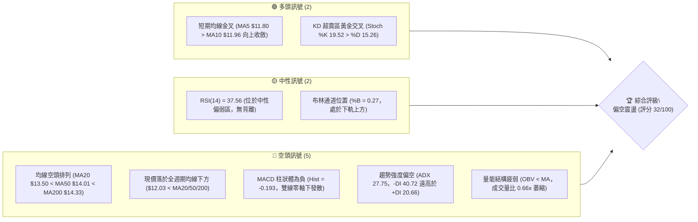
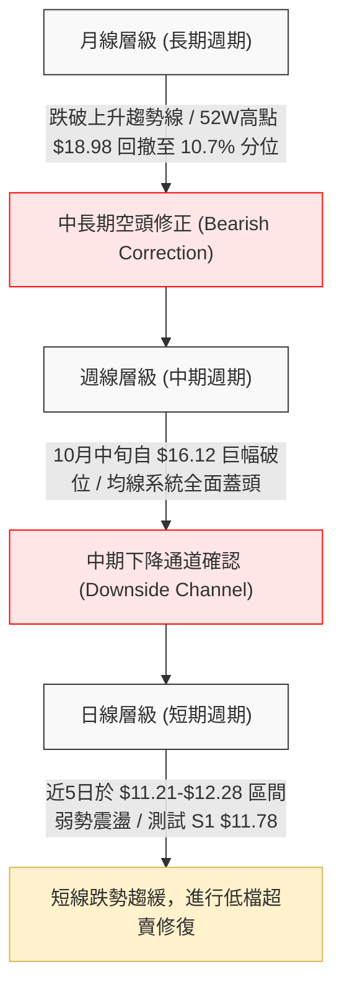
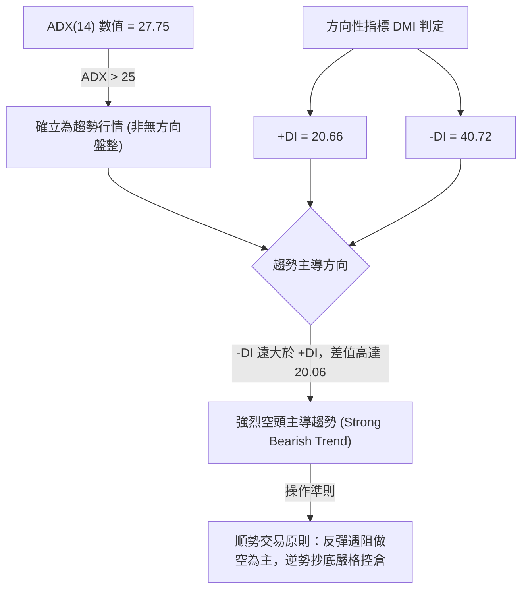
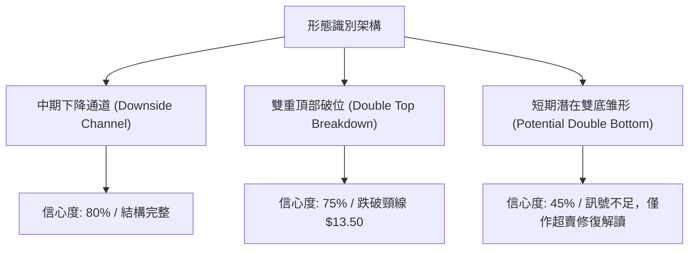
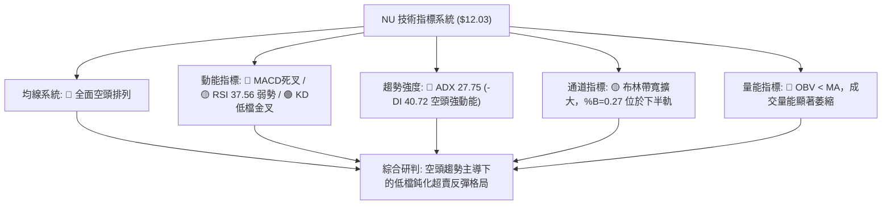
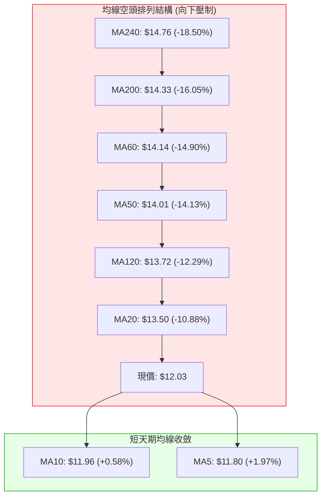
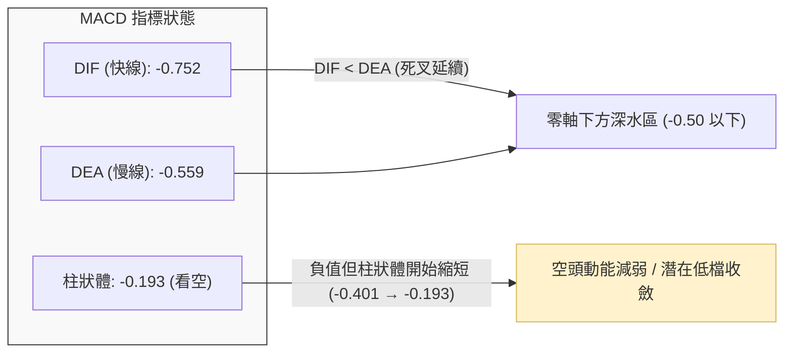
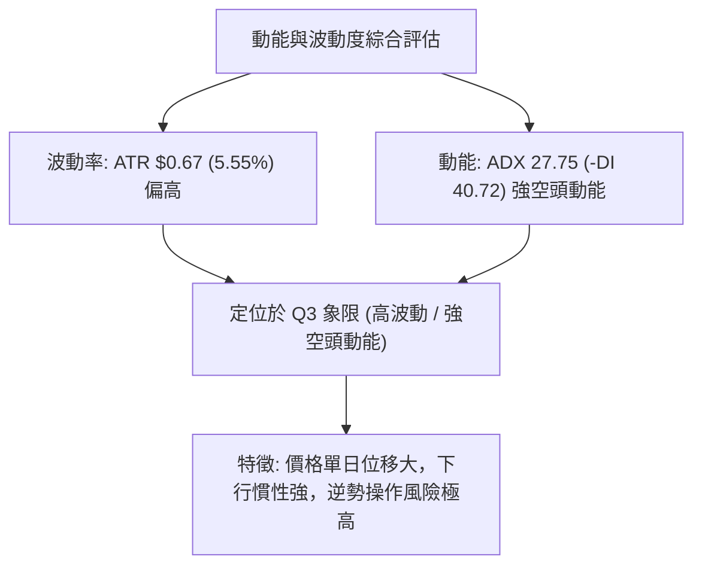
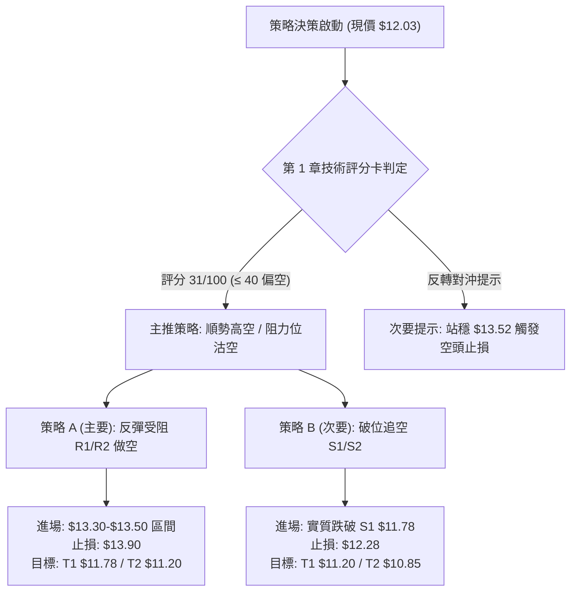
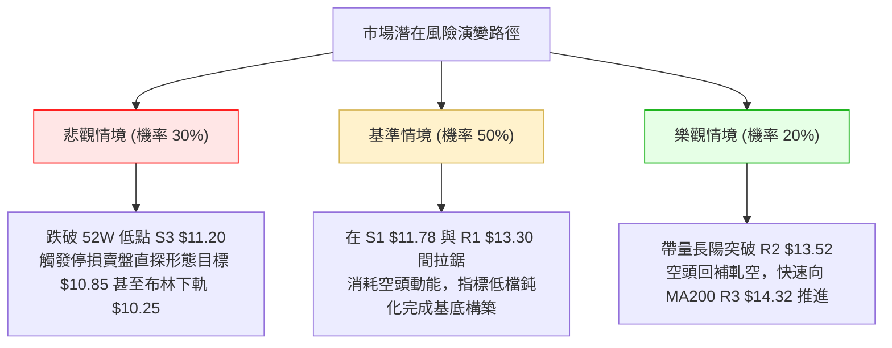

# NU 技術分析報告

> **報告日期**：2026-11-08 ｜ **語言**：繁體中文 ｜ **數據來源**：Yahoo Finance ｜ **當前價格**：$12.03

---

## 目錄

| 章節 | 內容 |
|------|------|
| [1. 技術面概覽](#1-技術面概覽) | 訊號儀表板、核心指標、評分卡 |
| [2. 趨勢分析](#2-趨勢分析) | 多時框趨勢、長中短期走勢 |
| [3. 圖表形態分析](#3-圖表形態分析) | 形態識別、K線組合、目標價 |
| [4. 支撐與阻力](#4-支撐與阻力) | 關鍵價位、斐波那契回調 |
| [5. 技術指標深度解讀](#5-技術指標深度解讀) | MA/RSI/MACD/布林/成交量 |
| [6. 動能與波動率](#6-動能與波動率) | 動能評估、ATR、Beta |
| [7. 多時框架總結](#7-多時框架總結) | 時框架評分矩陣 |
| [8. 交易策略建議](#8-交易策略建議) | 多空策略、風險報酬比 |
| [9. 風險提示與監控](#9-風險提示與監控) | 監控指標、風險場景 |

---

## 1. 技術面概覽

### 🎯 技術訊號儀表板



### 📊 核心指標速覽表

| 指標類別 | 指標名稱 | 當前數值 | 訊號 | 解讀 |
|----------|----------|----------|------|------|
| **價格** | 當前收盤價 | $12.03 | 🔴 | 位於 52 週高低區間之 10.7%，逼近近一年底部 |
| **均線** | 短期 MA20 | $13.50 | 🔴 | 價格低於 MA20 達 -10.88%，短線下行斜率陡峭 |
| **均線** | 中期 MA50 | $14.01 | 🔴 | 價格低於 MA50 達 -14.13%，中期趨勢完全受壓制 |
| **均線** | 長期 MA200 | $14.33 | 🔴 | 價格低於 MA200 達 -16.05%，長期牛熊分界線失守 |
| **均線排列** | 系統狀態 | MA20<50<200 | 🔴 | 典型完整空頭排列，各週期均線均呈向下發散蓋頭之勢 |
| **動能** | RSI(14) | 37.56 | 🟡 | 位於弱勢中性區間（30–70），未達極端超賣，無底背離 |
| **動能** | MACD (12,26,9) | -0.752 / -0.559 | 🔴 | DIF 與 DEA 雙雙在零軸下方運行，柱狀體 -0.193 持續看空 |
| **動能** | KD 指標 (14) | %K 19.52 / %D 15.26 | 🟢 | 低檔 20 以下超賣區形成向上金叉，孕育短線技術性反彈 |
| **趨勢** | ADX(14) / DMI | ADX 27.75 | 🔴 | ADX > 25 確立趨勢行情；-DI (40.72) 壓倒 +DI (20.66)，空頭主導 |
| **通道** | 布林通道 (20,2) | $10.25 - $16.75 | 🟡 | 現價處於下半區（%B = 0.27），未跌破下軌，帶寬擴大後收斂 |
| **量能** | OBV 與量比 | 量比 0.66x | 🔴 | OBV < MA 且日成交量 58.35M 低於 20 日均量 87.83M，追價意願不足 |
| **波動** | ATR(14) | $0.67 | 🟡 | ATR 佔股價 5.55%，單日震幅約 0.67 美元，波動度適中偏高 |

### 🏆 技術評分卡

```
╔══════════════════════════════════════════════════════════════╗
║                 技術評分卡 — NU (2026-11-08)                 ║
╠══════════════════════════════════════════════════════════════╣
║ 趨勢強度 (ADX=27.75, -DI主導)   ██████░░░░░░░░░░░░░░  30/100 🔴 ║
║ 動能指標 (RSI 37.56, MACD空頭)  ███████░░░░░░░░░░░░░  35/100 🔴 ║
║ 支撐穩定度 (S1 $11.78, 52W Low) ████████░░░░░░░░░░░░  40/100 🟡 ║
║ 成交量配合 (OBV弱勢, 量比0.66x) ██████░░░░░░░░░░░░░░  30/100 🔴 ║
║ 形態完整度 (下行通道, 跌破平台) ██████░░░░░░░░░░░░░░  30/100 🔴 ║
║ 均線排列 (MA20 < MA50 < MA200)  ████░░░░░░░░░░░░░░░░  20/100 🔴 ║
╠══════════════════════════════════════════════════════════════╣
║ 綜合評分 (算術平均 185 ÷ 6)     ██████░░░░░░░░░░░░░░  31/100 🔴 ║
║ 評級結論：偏空主導 / 弱勢超賣整理 (規則18四捨五入: 31/100)   ║
╚══════════════════════════════════════════════════════════════╝
```

---

## 2. 趨勢分析

### 🌐 多時框趨勢分析



### 📈 長期趨勢 — 12個月走勢圖（Unicode）

```
NU 月線收盤走勢圖（2025-11 至 2026-11）
價格軸 ($)
$18.00 ┤                     ● 17.75 (2026-01 頂部)
$17.00 ┤ ● 17.39       ● 16.74
$16.00 ┤
$15.00 ┤               ● 14.98       ● 14.55
$14.00 ┤                   ● 14.37 ● 14.48   ● 14.33
$13.00 ┤                         ● 13.13 ● 13.36
$12.00 ┤                                           ● 12.66         ● 12.03 (現價)
$11.00 ┤                                                 ● 11.61 (低點)
       └─┬─────┬─────┬─────┬─────┬─────┬─────┬─────┬─────┬─────┬─────┬─────┬───
        11月  12月  01月  02月  03月  04月  05月  06月  07月  08月  09月  10月  11月
        (25)  (25)  (26)  (26)  (26)  (26)  (26)  (26)  (26)  (26)  (26)  (26)  (26)
```

#### 走勢特徵分析表格

| 週期階段 | 時間跨度 | 價格起訖 | 漲跌幅 | 趨勢性質與結構特徵 |
|----------|----------|----------|--------|--------------------|
| **主升峰值期** | 2025-11 ～ 2026-01 | $17.39 → $17.75 | +2.07% | 構築多重頂部，創下 52 週歷史高點 $18.98，隨後動能衰竭 |
| **首輪下跌期** | 2026-01 ～ 2026-05 | $17.75 → $13.13 | -26.03% | 均線轉向，跌破多個整數關卡，自高點大幅向下修正 |
| **中期箱型整理** | 2026-05 ～ 2026-08 | $13.13 → $14.55 | +10.81% | 於 MA50 附近進行震盪築底，形成 $13.13-$14.55 箱型平台 |
| **主跌破位期** | 2026-08 ～ 2026-10 | $14.55 → $11.61 | -20.21% | 平台跌破，空頭再度發力，下探至 52 週低點附近 $11.61 |
| **築底修復期** | 2026-10 ～ 2026-11 | $11.61 → $12.03 | +3.62% | 低檔超賣拉回，於支撐區 S1 ($11.78) 上下進行弱勢整理 |

### 📊 中期趨勢（週線分析）

從近 20 週收盤走勢與週 K 線觀察，NU 自 2026 年 10 月 9 日該週衝高至 $16.12（週高點 $16.14）後，形成「假突破倒 V 反轉」，隨後三週遭遇毀滅性拋壓：
1. 2026-10-16 週：收盤下挫至 $14.56（-9.68%），失守 MA20 週線。
2. 2026-10-30 週：單週爆出 701,855,200 股的天量長黑 K，自開盤 $11.69 破位下挫，收在 $11.61，週跌幅逾 -23.4%。
3. 2026-11-06 該週：低點探至 $11.21，貼近 52 週低點 $11.20，週末收回至 $12.03，成交量萎縮至 403,806,800 股，顯示短線非理性拋壓暫歇，中期走勢由單邊暴跌轉入空頭低檔弱勢整理。

```
中期壓力與支撐結構圖（週線視角）：
$16.12 ══════════════════════════════════ [10月波段反彈頂部 / 強阻力]
          │
$14.32 ────────────────────────────────── [R3 / 斐波那契 61.8% / MA200 重合區]
          │
$13.50 ────────────────────────────────── [R2 / BB中軌 / MA20 關鍵頸線區]
          │
$12.03 ─────────────── ◄ 現價
          │
$11.78 ┄┄┄┄┄┄┄┄┄┄┄┄┄┄┄┄┄┄┄┄┄┄┄┄┄┄┄┄┄┄┄┄ [S1 / 近期低點平台]
          │
$11.20 ══════════════════════════════════ [S3 / 52W Low / 絕對防線]
```

### ⚡ 趨勢強度評估（ADX 解讀）



#### ADX 趨勢強度對照表

| 指標項 | 當前數值 | 門檻區間 | 趨勢強度判定 | 交易策略意涵 |
|--------|----------|----------|--------------|--------------|
| **ADX(14)** | **27.75** | > 25.0 | 強趨勢格局 | 市場具備明確單邊動能，擺動指標容易鈍化，禁止盲目抓反轉 |
| **+DI (多方)** | **20.66** | 基準線 20 | 多方動能低迷 | 多頭缺乏主動性攻擊量能，反彈多屬空頭回補性質 |
| **-DI (空方)** | **40.72** | > 40.0 | 空方高度控盤 | 空頭動能處於主導壓制狀態，上方拋壓極為沉重 |
| **綜合判定** | 差異 -20.06 | -DI > +DI | **空頭趨勢確認** | 多時框收斂優先級：以中長期空頭方向為主導 |

---

## 3. 圖表形態分析

### 🔍 形態識別系統



#### 形態識別信心度評估表

| 形態名稱 | 信心度 | 判斷依據（引用數據） | 完成度 | 目標價（附計算式） |
|----------|--------|----------------------|--------|--------------------|
| **雙重頂部破位** | **75%** | 2026-08 高點 $15.23 與 2026-10 高點 $16.12 形成雙頂；頸線為波段低點聚類阻力 R2 $13.52。跌破頸線確認形態成立。 | 100% (已跌破) | 形態高度 = $16.12 - $13.52 = $2.60。<br>量度跌幅目標 = 頸線 $13.52 - $2.60 = **$10.92**（接近 S3 $11.20）。 |
| **中期下降通道** | **80%** | 上軌由 $17.75 連接 $16.12，下軌由 $13.13 延伸至 $11.21，走勢於通道內向下發散運行。 | 85% | 通道下軌支撐延伸至 **$11.20**（52W Low / S3）。 |
| **潛在雙重底** | **45%** | 2026-10-30 低點 $11.48 與 2026-11-05 低點 $11.21 形成雙腳。但目前尚未突破頸線 R1 $13.30，且 ADX>25 空頭控盤。 | 30% (未成形) | **訊號不足，依規則 15 僅作指標型超賣解讀，不預設雙底目標。** |

### 🕯️ 重要K線形態分析

嚴格依據近 10 根日 K 與近 8 根週 K 之實際開、高、低、收數據解讀：

#### 近 10 根日 K 線形態解讀

| 日期 | 開 | 高 | 低 | 收 | 成交量 | K線形態 | 解讀與多空訊號 |
|------|----|----|----|----|--------|---------|----------------|
| **2026-10-26** | 11.69 | 12.78 | 11.62 | 12.59 | 339,677,800 | 帶量實體中陽線 | 🟢 暴跌後的帶量報復性反彈，收盤接近最高價。 |
| **2026-10-27** | 12.74 | 13.00 | 12.37 | 12.40 | 99,667,300 | 衝高回落小黑K | 🔴 觸及 $13.00 整數關卡遭遇獲利了結，量能急縮。 |
| **2026-10-28** | 12.36 | 12.44 | 11.96 | 11.97 | 89,320,400 | 低收下行黑K | 🔴 失守 $12.00 關卡，空方重新佔據短線優勢。 |
| **2026-10-29** | 11.98 | 12.19 | 11.85 | 12.05 | 80,210,200 | 窄幅震盪小紅十字 | 🟡 多空在 $12.00 附近拉鋸，交投清淡。 |
| **2026-10-30** | 11.75 | 11.85 | 11.48 | 11.61 | 92,979,500 | 破低下行中黑K | 🔴 跌破前低 $11.62，最低見 $11.48，空方續攻。 |
| **2026-11-02** | 11.79 | 12.03 | 11.59 | 11.62 | 68,994,700 | 弱勢小陰線 | 🔴 嘗試反彈受制於 $12.03，量能萎縮至 68.99M。 |
| **2026-11-03** | 11.62 | 11.70 | 11.45 | 11.61 | 89,030,600 | 平底十字星 (Doji) | 🟡 探低 $11.45 後收平，多空力量暫時平衡。 |
| **2026-11-04** | 11.95 | 12.16 | 11.84 | 11.99 | 87,546,000 | 跳空小陽線 | 🟢 開盤跳空推升，收復 $11.90 支撐，多方微弱反撲。 |
| **2026-11-05** | 12.02 | 12.02 | 11.21 | 11.74 | 99,882,900 | 長下影錘頭線 (Hammer) | 🟢 早盤重挫至 $11.21（逼近 52W 低點 $11.20）後爆發強勁買盤拉抬，下影線長達 $0.53，顯示 $11.20 支撐強固。 |
| **2026-11-06** | 11.81 | 12.28 | 11.79 | 12.03 | 58,352,600 | 溫和小陽線 | 🟢 延續前日長下影反彈，收於 $12.03，但成交量僅 58.35M，呈現無量反彈。 |

#### 近 8 根週 K 線形態解讀

| 週末日期 | 開 | 高 | 低 | 收 | 週成交量 | 週K形態 | 解讀與多空訊號 |
|----------|----|----|----|----|----------|---------|----------------|
| **2026-09-18** | 14.35 | 14.55 | 13.58 | 13.65 | 368,136,800 | 破位中長黑K | 🔴 跌破 MA200，週 MACD 柱狀轉負。 |
| **2026-09-25** | 13.84 | 14.25 | 13.36 | 13.59 | 290,425,500 | 窄幅縮量陰線 | 🟡 於 $13.50 附近進行弱勢停頓。 |
| **2026-10-02** | 12.53 | 13.50 | 12.13 | 13.43 | 532,732,100 | 下影長陽線 | 🟢 下探 $12.13 獲買盤強烈承接，收復大部分失土。 |
| **2026-10-09** | 14.98 | 16.14 | 14.84 | 16.12 | 517,684,300 | 帶量突破大陽K | 🟢 衝高至 $16.14，形成短期多頭主升攻擊假象。 |
| **2026-10-16** | 16.10 | 16.19 | 14.40 | 14.56 | 328,775,500 | 長黑吞噬線 | 🔴 開高走低倒 V 反轉，完全吞沒前週漲幅，構成頂部。 |
| **2026-10-23** | 14.72 | 15.41 | 14.36 | 15.16 | 322,110,100 | 上影小陽線 | 🟡 弱勢反抽受阻於 $15.41，多方無力挽回頹勢。 |
| **2026-10-30** | 11.69 | 13.00 | 11.48 | 11.61 | 701,855,200 | 巨量崩跌長黑K | 🔴 單週 7 億股恐慌拋盤，跌幅超 23%，破壞全部技術結構。 |
| **2026-11-06** | 11.79 | 12.28 | 11.21 | 12.03 | 403,806,800 | 帶長下影下探回升K | 🟢 探至 52W 低點 $11.21 後獲利盤回補，收盤站回 $12.00。 |

### 📉 ASCII 走勢形態示意圖

```
雙重頂部破位與下探支撐示意圖：
$16.14 ─────────── 頂部 1 (10-09)
                      ╲           頂部 2 (10-16 $16.19)
                       ╲         ╱ ╲
                        ╲       ╱   ╲
$14.32 (R3) ─────────────╲─────╱─────╲───────────────────
                          ╲   ╱       ╲
$13.52 (R2 頸線) ══════════╲═╱═════════╲═════════════════ [頸線破位]
                            V           ╲
                                         ╲
$12.03 (現價) ────────────────────────────●──────────────
                                         ╱ ╲
$11.78 (S1) ┄┄┄┄┄┄┄┄┄┄┄┄┄┄┄┄┄┄┄┄┄┄┄┄┄┄╱┄┄┄┄╲┄┄┄┄┄┄┄┄┄
                                       ╱       ╲
$11.21 ───────────────────────────────●         ●──────── [雙針探底 $11.20 S3]
                                     (11-05)   (52W Low)
```

### 🎯 形態目標價計算

根據雙重頂部幾何破位推算：
1. **頸線位置**：阻力位 R2 = **$13.52**
2. **形態頭部頂點**：2026-10-16 波段最高點 = **$16.19**（收盤聚類為 $16.12）
3. **形態高度**：$16.19 - $13.52 = **$2.67**
4. **理論量度下行目標價**：
   $$\text{目標價} = \text{頸線} - \text{形態高度} = \$13.52 - \$2.67 = \mathbf{\$10.85}$$
   *註：該理論值略低於 52 週最低點 S3 ($11.20)。在實務運行中，$11.20 為極強心理防線，若 $11.20 跌破，空頭延伸目標將直指 $10.85–$10.92。*

---

## 4. 支撐與阻力

### 🗺️ 關鍵價位分布圖（Unicode）

```
NU 價位結構分布圖（OHLCV 精確計算）
═════════════════════════════════════════════════════════════════
$14.32 ║████████████████████████████████████║ 強阻力 R3 (MA200 / 61.8%)
$13.52 ║████████████████████████            ║ 關鍵阻力 R2 (MA20 / 頸線)
$13.30 ║████████████████                    ║ 短線阻力 R1 (波段高點聚類)
$12.86 ║------------------------------------║ 斐波那契 78.6% 回調位
$12.03 ╠════════════════════════════════════╣ ◄ 當前收盤價 ($12.03)
$11.78 ║▓▓▓▓▓▓▓▓▓▓▓▓▓▓▓▓                    ║ 近期支撐 S1 (-2.08%)
$11.51 ║▓▓▓▓▓▓▓▓▓▓▓▓▓▓▓▓▓▓▓▓                ║ 關鍵支撐 S2 (-4.32%)
$11.20 ║████████████████████████████████████║ 核心防線 S3 (52W Low / 100%)
═════════════════════════════════════════════════════════════════
```

### 🚧 阻力位分析表

所有價位均嚴格引用 OHLCV 聚類計算數值：

| 阻力級別 | 價位 | 形成原因（數據依據） | 突破難度 | 技術重要性 |
|----------|------|----------------------|----------|------------|
| **R1** | **$13.30** | 近一年波段高點聚類；與 10-30 週長黑 K 反彈高點及日 K 平台重疊（距現價 +10.56%）。 | 中等 🟡 | 短線空方防禦第一道關卡，站上此處方能緩解下行重壓。 |
| **R2** | **$13.52** | 雙頂頸線位；與 MA20 ($13.50) 及布林帶中軌高度重合（距現價 +12.34%）。 | 極高 🔴 | 中期多空強弱分水嶺，未有效收復前中期趨勢絕對看空。 |
| **R3** | **$14.32** | MA200 ($14.33) 牛熊線；波段高點聚類及斐波那契 61.8% ($14.17) 共振帶（距現價 +18.99%）。 | 極難 🔴 | 長期趨勢阻力，堆積了 7-9 月份數十億股的成交套牢盤。 |

### 🛡️ 支撐位分析表

所有價位均嚴格引用 OHLCV 聚類計算數值：

| 支撐級別 | 價位 | 形成原因（數據依據） | 守住機率 | 技術重要性 |
|----------|------|----------------------|----------|------------|
| **S1** | **$11.78** | 近一年波段低點聚類；11-06 日 K 開盤價 $11.81 及日線密集成交底限（距現價 -2.08%）。 | 55% 🟡 | 短線多頭維繫超賣反彈行情的最低門檻。 |
| **S2** | **$11.51** | 波段低點聚類；10-30 日低點 $11.48 及 11-03 低點 $11.45 形成的雙底水平線（距現價 -4.32%）。 | 65% 🟢 | 空頭二次探底的關鍵防護區，破位將觸發停損賣壓。 |
| **S3** | **$11.20** | 52 週最低價 ($11.20)；11-05 盤中最低探至 $11.21 後強烈收回，斐波那契 100% 回調（距現價 -6.90%）。 | 75% 🟢 | 全年最核心底部，長線多頭最後堡壘，具極高買盤支撐力。 |

### 📐 斐波那契回調位分析

依據 52 週完整波動區間（高點 **$18.98** → 低點 **$11.20**，總波幅 $7.78）計算之斐波那契回調水準：

| 回調比例 | 對應價位 | 與當前價 ($12.03) 關係 | 技術層面解讀 |
|----------|----------|------------------------|--------------|
| **0.0% (52W High)** | **$18.98** | +57.77% | 歷史牛市最高頂點，長期多頭終極目標。 |
| **23.6%** | **$17.14** | +42.48% | 上升行情高檔強勢回調位，現已遠在天際。 |
| **38.2%** | **$16.01** | +33.08% | 10-09 波段高點 $16.12 測試位，強烈密集成交套牢區。 |
| **50.0%** | **$15.09** | +25.44% | 心理均衡多空平衡軸心，10-23 週反彈受阻高點 ($15.16)。 |
| **61.8%** | **$14.17** | +17.79% | 黃金分割關鍵阻力，緊貼 R3 ($14.32) 與 MA200 ($14.33)。 |
| **78.6%** | **$12.86** | +6.90% | 深幅回調極限防守位，現已實質跌破轉化為上方第一道反抽壓力。 |
| **100.0% (52W Low)**| **$11.20** | -6.90% | 52 週極限低點，下行空間終點，當前防守的核心基石。 |

**位置判定**：當前收盤價 **$12.03** 落於 **78.6% 回調位 ($12.86)** 與 **100.0% 底部 ($11.20)** 之間。這代表 NU 已經回吐了過去一年全部漲幅的 89.3%，技術結構處於「深度空頭回撤的末端尋底期」。若能守穩 $11.20-$11.78 區間，向上反抽 78.6% 水平 ($12.86) 為技術修復之首要目標。

---

## 5. 技術指標深度解讀

### 🎛️ 指標訊號總覽



### 📈 移動平均線排列分析



#### 均線系統數據詳解

1. **長期排列（空頭壓制）**：MA20 ($13.50) < MA50 ($14.01) < MA200 ($14.33)，呈現教科書式的完整空頭排列。MA20、MA60、MA120、MA240 全部處於負斜率下行通道中，且價格與中長期均線的乖離率高達 -10% 至 -18%，表明中長線空方勢力根深蒂固。
2. **短期修復（微弱金叉）**：短期均線出現低檔收斂跡象，MA5 ($11.80) 向上穿越日 K 底部，現價 $12.03 站上 MA5 與 MA10 ($11.96)。這是近三週以來首次站上短天期均線，預示短線跌勢減緩，有機會展開向 MA20 ($13.50) 的超跌均線回歸修復。

### 📉 RSI(14) 分析

* RSI(14) 當前數值：**37.56**（Wilder 計算法）
* 進度條：`███████░░░░░░░░░░░░░` 37.56% (弱勢區間 30–70)

```
RSI(14) 區間位置示意：
[0] ────────── [30 極度超賣] ──────●───── [50 強弱分水嶺] ────────── [70 超買] ────────── [100]
                                 37.56
```

#### 背離與動能分析
- **背離檢驗結論**：根據近期 20 根 K 棒之首尾價格與 RSI 檢驗，**無明顯背離**。
- **解讀**：價格由 10-23 的高點 $15.16 下跌至 11-06 的 $12.03，同期週 RSI 由 55.0 下滑至 37.6，日 RSI 由中性下行至 37.56。指標與價格同步回落，並未出現「價格創新低而 RSI 抬高」的典型底背離特徵，說明此波下跌為實質性獲利拋盤所致。RSI 雖然接近 30 超賣門檻，但未進入極端恐慌區，短線多頭反彈力道仍受局限。

### 📊 MACD(12/26/9) 訊號解讀



- **柱狀體變化**：週線 MACD 柱狀體在 10-30 週觸及極值 -0.401，隨後在 11-06 週收斂至 -0.193。柱狀體負值大幅收斂，顯示急跌拋售的「最大動能釋放點」已經過去。
- **訊號結論**：快慢線仍在零軸下方深度運行，表明大級別趨勢依然牢牢由空頭掌控；但負柱狀體的萎縮意味著空方動能邊際衰減，支持現價在 S1 ($11.78) 附近形成抵抗型平台。

### 📦 布林通道分析

```
NU 布林通道 (20, 2) 結構圖
$16.75 ════════════════════════════════════════════════ 布林上軌
          │
$13.50 ──────────────────────────────────────────────── 布林中軌 (MA20)
          │
$12.03 ──────────────────────── ◄ 現價 (%B = 0.27)
          │
$10.25 ════════════════════════════════════════════════ 布林下軌
```

- **軌道參數與現狀**：上軌 **$16.75**，中軌 (MA20) **$13.50**，下軌 **$10.25**，當前帶寬 (Bandwidth) 為 $6.50 (54.0%)。
- **%B 指標解讀**：目前 `%B = 0.27`。當前股價自接近下軌的超跌狀態回升至 0.27 分位，並未觸及或跌破下軌 ($10.25)，顯示下行軌道雖然擴張，但價格未出現極端失控的「貼軌暴跌」，處於布林帶下半部的弱勢震盪反彈階段，上方阻力首先指向中軌 $13.50。

### 💹 成交量分析（量價配合度）

1. **量能萎縮**：最新單日成交量為 **58,352,600 股**，相較於 20 日均量 **87,827,380 股**，量比僅為 **0.66x**；相較於 50 日均量 **84,084,004 股** 同樣顯著萎縮。
2. **OBV 走勢疲弱**：指標顯示「OBV < MA」，量能曲線持續運行於均量線下方。在 10-30 暴跌時單日放量超 3.39 億股、單週放量 7.01 億股，而在隨後的反彈中成交量迅速降至 58M 級別，呈現標準的「跌有量、漲無量」的空頭量價特徵。
3. **結論**：現階段缺乏機構主動性大買盤介入，屬於籌碼沉澱後的散戶惜售或空頭平倉引發的縮量修復，反彈高度將受到嚴格限制。

---

## 6. 動能與波動率

### ⚡ 動能評估四象限

| 象限 | 動能維度 | 波動維度 | 象限特徵 | 當前狀態判定 |
|------|----------|----------|----------|--------------|
| **第一象限 (Q1)** | 強動能 (Bullish) | 低波動 (Low Vol) | 穩定單邊上行，最佳做多機會 | — |
| **第二象限 (Q2)** | 弱動能 (Bearish) | 低波動 (Low Vol) | 陰跌整理，流動性減弱 | — |
| **第三象限 (Q3)** | 強動能 (Trend) | 高波動 (High Vol) | 劇烈單邊行情，高風險高收益 | **✓ NU 當前位置 (Q3 空方象限)** |
| **第四象限 (Q4)** | 弱動能 (Neutral) | 高波動 (High Vol) | 無序寬幅洗盤，避免盲目進場 | — |



### 📊 ATR 波動率分析

- **ATR(14) 數值**：**$0.67**（佔現價 $12.03 之 **5.55%**，Wilder 計算）。
- **日內波動特徵**：近 10 日平均單日高低點波幅達 0.67 美元，說明 NU 具備高度日內彈性。
- **交易止損距離建議**：
  - **超短線交易（1.0 × ATR）**：風控緩衝應設為 **$0.67**。
  - **波段操作（1.5 × ATR）**：風控緩衝應設為 $0.67 \times 1.5 = \mathbf{\$1.01}$。以現價 $12.03 為例，若做空，止損不可低於 $13.04；若做多，止損需預留至 $11.02。
  - **趨勢追蹤（2.0 × ATR）**：風控緩衝為 $0.67 \times 2 = \mathbf{\$1.34}$。

### 📐 Beta 與市場相關性

- **Beta 數值**：**0.968**。
- **大盤聯動性**：Beta 接近於 1.0（0.968），意味著 NU 與美股大盤（S&P 500 / 銀行板塊）具備近乎同步的系統性風險敏感度。近期 NU 跌幅顯著擴大（單月跌幅逾 14%），主要由自身財報預期、南美新興市場信貸違約率擔憂及機構淨流出（機構持股 82.8%，近期 ETF 出現淨賣出）等個股特定因子所引發的 Alpha 負溢價驅動。

---

## 7. 多時框架總結

### 📋 時框架評分表

| 時框架 | 趨勢方向 | 動能狀態 | 均線排列 | 形態特徵 | 綜合評分 | 交易建議 |
|--------|----------|----------|----------|----------|----------|----------|
| **長期 (月線)** | 偏空 🔴 | 弱勢下行 | 跌破 MA200 | 52W 高點回撤 89% | 30/100 | 長期投資者暫停定投，等待長底成形 |
| **中期 (週線)** | 強烈看空 🔴 | MACD 負柱狀擴大 | 空頭排列蓋頭 | 雙頂頸線破位 | 25/100 | 中線反彈逢高布空，嚴禁重倉抄底 |
| **短期 (日線)** | 弱勢超賣反彈 🟡 | KD 金叉 / RSI 37 | 短天期金叉收斂 | $11.20 雙針探底錘頭 | 40/100 | 短線超跌反抽，僅限輕倉快進快出 |

### 🔲 綜合訊號矩陣

```
時框維度       趨勢指標    動能指標    量價配合    形態結構    共振研判
══════════════════════════════════════════════════════════════════════════
長期 (月線)      🔴 空頭      🔴 衰竭      🔴 失衡      🔴 跌破平台   中長期處於修正週期
中期 (週線)      🔴 空頭      🔴 強空      🔴 爆量下殺  🔴 雙頂成形   主導權完全在空方
短期 (日線)      🟡 震盪      🟢 超賣金叉  🔴 縮量反彈  🟡 區間抵抗   醞釀超跌反抽抵抗
══════════════════════════════════════════════════════════════════════════
收斂共振評級：🔴 空頭主導下的短線反抽（方向依規收斂為：偏空）
```

### ⚖️ 多時框收斂結論

**嚴格依據規則 14 之優先級收斂**：
1. **行情性質判定**：ADX(14) 當前數值為 **27.75**，大於 25.0 門檻值，技術結構嚴格定義為**「趨勢行情」**，而非無方向的盤整震盪。
2. **時框主導原則**：在 ADX > 25 的趨勢行情中，必須以中長期（週線、MA50 $14.01、MA200 $14.33）的方向為唯一主導，日線層級的指標（KD 超賣金叉、MA5 穿過 MA10）**僅能視為尋找順勢交易進場點或逆勢反彈出場點的時機工具**，絕不可作為逆轉大級別趨勢的依據。
3. **唯一方向性結論**：**【偏空（反彈高空為主）】**。
   日線層級在 $11.21 形成的長下影線雖有短線支撐，但上方遭遇下沉的 MA20 ($13.50) 與 R1 ($13.30) 強阻力壓制。在週線與月線均處於空頭破位排列的前提下，市場任何反彈均應優先視為空頭抵抗或解套拋壓窗口。

---

## 8. 交易策略建議

### 🗺️ 策略決策流程圖



### 🧭 策略路由（依評分卡分流）

> **當前主策略方向 = 空頭主導 / 逢高沽空（依第 1 章技術評分卡綜合評分 31/100）**
> *依嚴格要求規則 18，評分 ≤ 40 嚴禁兩頭下注，報告主推空頭策略；多頭操作僅作為超跌反抽的極輕倉短線參考，並於反向風險章節列出對沖觸發點。*

### 🎯 價格情境階梯（Price Scenarios）

所有價位均嚴格引用第 4 章及數據源數值：

| 觸發條件 | 下一目標 | 後續延伸 | 情境技術含義 |
|----------|----------|----------|--------------|
| **強勢向上突破 R1 ($13.30)** | R2 ($13.52) | R3 ($14.32) | 短線超跌強勢修復，挑戰雙頂頸線與布林中軌。 |
| **站穩現價區間 ($11.78–$12.28)** | R1 ($13.30) | S1 ($11.78) | 短期底部弱勢拉鋸，進行籌碼換手與指標修復。 |
| **跌破近期支撐 S1 ($11.78)** | S2 ($11.51) | S3 ($11.20) | 空方重啟下攻，考驗 10 月末低點密集成交區。 |
| **實質失守核心防線 S3 ($11.20)**| 形態量度 $10.85 | 布林下軌 $10.25 | 創 52 週新低，雙頂幾何量度跌幅展開，恐慌盤湧出。 |

### 📊 情境機率分佈

| 情境劇本 | 預估機率 | 主要技術指標與結構依據 |
|----------|----------|------------------------|
| **弱勢反彈受阻回落 (主情境)** | **60%** | ADX 27.75 確立空頭趨勢；OBV 量能極度疲弱；上方 MA20 ($13.50) 下行壓制沉重。 |
| **低檔區間窄幅震盪 (次情境)** | **25%** | KD 在超賣區形成金叉；近 5 日日 K 出現長下影線錘頭；短天期 MA5/MA10 提供短線支撐。 |
| **強勢反轉直接突破 (極端情境)** | **15%** | 需日成交量暴增至 1.5 億股以上並長陽收復 R2 ($13.52)；目前無任何籌碼與量能跡象支持。 |

### 🟢 主策略詳情（空頭主導策略）

依照「規則 17」之定義嚴格計算風險報酬比：
- 做空風險報酬比公式：$\text{RRR} = (\text{進場價} - \text{目標價}) \div (\text{止損價} - \text{進場價})$，以「1 : X.XX（以 T1 計）」呈現。進場價若為區間，以區間中點計算並註明。

| 策略要素 | 策略 A：阻力位逢高沽空（主推薦） | 策略 B：跌破支撐順勢追空（突破型） |
|----------|----------------------------------|------------------------------------|
| **策略類型** | 順應中長線趨勢，反抽阻力沽空 | 跌破短線平台，順勢下看 52W 低點 |
| **進場條件** | 股價反彈至 R1 與 R2 區間滯漲，出現長上影線黑 K | 跌破支撐位 S1 ($11.78)，15 分鐘收盤無法收回 |
| **進場價格** | **$13.41**（區間 $13.30–$13.52 中點） | **$11.78**（S1 破位點） |
| **目標價 T1** | **$11.78**（支撐位 S1） | **$11.20**（核心防線 S3 / 52W Low） |
| **目標價 T2** | **$11.20**（支撐位 S3 / 52W Low） | **$10.85**（由雙頂形態高度推算） |
| **止損價格** | **$13.90**（突破阻力區間上方 1.0 ATR） | **$12.03**（現價 / 11-06 收盤反壓線） |
| **風險報酬比 (T1)** | **1 : 3.33（以 T1 計）**<br>*算式: (13.41-11.78)÷(13.90-13.41)=1.63÷0.49* | **1 : 2.32（以 T1 計）**<br>*算式: (11.78-11.20)÷(12.03-11.78)=0.58÷0.25* |
| **風險報酬比 (T2)** | **1 : 4.51（以 T2 計）**<br>*算式: (13.41-11.20)÷(13.90-13.41)=2.21÷0.49* | **1 : 3.72（以 T2 計）**<br>*算式: (11.78-10.85)÷(12.03-11.78)=0.93÷0.25* |
| **歷史勝率估計** | **65%** | **55%** |
| **建議配置倉位** | **15% - 20%**（總投資組合佔比） | **10%**（動量型倉位） |

### 🔴 反向風險觸發點（對沖提示）

若市場出現非預期多頭極端反轉，以下為推翻空頭主策略的嚴格風控節點：
1. **多頭平倉與止損警報**：若日線收盤價**強勢站上 R2 ($13.52)**，且成交量放大至 1.2 億股以上，宣告雙重頂頸線破位形態失效，空頭部位必須全數無條件止損出局。
2. **多空翻轉信號**：若價格持續向上突破斐波那契 61.8% 與 MA200 重合區 **R3 ($14.32)**，技術面將徹底修復長期牛熊線，屆時整體架構將由偏空轉為多頭回歸，方可建立主動型多頭部位。

### ⭐ 整體訊號強度評星

```
╔══════════════════════════════════════════════════════════════╗
║                     技術面訊號強度評星                       ║
╠══════════════════════════════════════════════════════════════╣
║ 做多訊號強度：★★☆☆☆  (2.0/5星 — 僅屬低檔超賣修復，勝率偏低)  ║
║ 做空訊號強度：★★★★☆  (4.0/5星 — 中長期均線壓制，ADX趨勢明確) ║
║ 整體技術可信度：★★★★☆ (4.0/5星 — 價量形態完整，阻力支撐清晰) ║
╚══════════════════════════════════════════════════════════════╝
```

---

## 9. 風險提示與監控

### ✅ 關鍵監控指標 Checklist

```
╔══════════════════════════════════════════════════════════════════╗
║                  NU 技術監控清單 (Daily Checklist)              ║
╠══════════════════════════════════════════════════════════════════╣
║ [ ] 價格是否跌破 S1 ($11.78)？ — 確認空頭延伸行情啟動            ║
║ [ ] 價格是否探至 S3 ($11.20)？ — 觀察有無主力長下影線護盤        ║
║ [ ] RSI(14) 是否跌破 30？ — 評估是否進入非理性恐慌拋售區間       ║
║ [ ] MACD 負柱狀體是否翻正？ — 監控日線級別動能反轉訊號           ║
║ [ ] 成交量是否放大至 85M (20日均量) 之上？ — 判斷有無機構真實介入 ║
║ [ ] 價格能否有效收復 MA20 ($13.50)？ — 衡量空頭趨勢是否告終      ║
╚══════════════════════════════════════════════════════════════════╝
```

### ⚠️ 風險場景分析



### 🛡️ 風險管理重要提醒

1. **基本面與財報發布窗口風險**：新聞顯示「Nu Holdings Earnings Expected to Grow... Ahead of Q3 Release」。財報公布日前後隱含波動率將激增，隔夜跳空風險極大。技術面交易者應在財報出爐前削減至少 50% 的短線部位，嚴防因業績指引造成的跳空破位。
2. **機構流動性抽離風險**：NU 之機構持股高達 82.8%，新聞顯示「ETFs Are Net Sellers of Nu Holdings on Nov. 3」。在機構持續贖回的階段，被動型賣盤將壓制技術指標的正常反彈幅度，不可過度信賴短線擺動指標的超買超賣讀數。
3. **部位規模與單筆損失控制**：鑑於當前 ATR 高達 5.55%，單日震盪幅度劇烈，單筆交易之最大曝險金額務必嚴格限制於總資金的 1.0%–1.5% 之內。若採用策略 A（做空），每股承擔風險為 $0.49 ($13.90 - $13.41)，10 萬美元總資金帳戶單次操作規模不宜超過 2,000–3,000 股。

---

## 📋 報告總結

```
NU 技術分析報告總結
══════════════════════════════════════════════════════════════════
報告日期：2026-11-08
當前價格：$12.03
分析評級：🔴 偏空主導 / 弱勢超賣整理 (綜合評分 31/100)

關鍵結論：
├─ 長期趨勢：🔴 空頭修正，自 52W 高點 $18.98 回吐逾 89%，失守 MA200。
├─ 中期趨勢：🔴 雙頂破位，週線 MA20/50 全面蓋頭，ADX 27.75 空方控盤。
├─ 短期趨勢：🟡 跌勢趨緩，於 $11.21 形成長下影錘頭線，短線縮量修復。
├─ 關鍵支撐：S1: $11.78 ｜ S2: $11.51 ｜ S3: $11.20 (52W Low 防線)
├─ 關鍵阻力：R1: $13.30 ｜ R2: $13.52 (MA20/頸線) ｜ R3: $14.32 (MA200)
└─ 分析師共識：買入 (Buy, 23位分析師)，目標價均值 $18.56 (最低 $12.00)

最優策略組合：
1. 🥇 最佳機會：策略 A — 反彈至 R1/R2 區間 ($13.30–$13.52) 遭遇阻力時逢高沽空，
               嚴格止損於 $13.90，首要目標 S1 $11.78，次要目標 S3 $11.20。
               (風險報酬比 1 : 3.33，以 T1 計)
2. 🥈 次選機會：策略 B — 跌破近一年低點支撐 S1 ($11.78) 順勢破位追空，
               止損於 $12.03，目標直指 52W 低點 S3 $11.20。
               (風險報酬比 1 : 2.32，以 T1 計)
3. 🥉 保守選擇：空手觀望，靜待股價於 S3 ($11.20) 附近築成具備明確底背離之雙底結構，
               或強勢站穩 R2 ($13.52) 確立趨勢反轉後，再行順勢佈局。
══════════════════════════════════════════════════════════════════
```

---

> ⚠️ **免責聲明**：本報告為技術分析研究，所有數據、圖表及估算均嚴格基於所提供之歷史價格與量化指標計算。本報告**僅供研究與學術參考**，**不構成任何買賣要約或投資建議**。金融市場瞬息萬變，投資有風險，操作前請務必獨立評估並嚴格落實風控紀律。

---

*報告生成時間：2026-11-08 ｜ 數據來源：Yahoo Finance ｜ 分析框架：多時框技術分析體系*