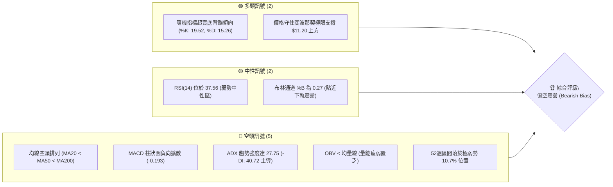
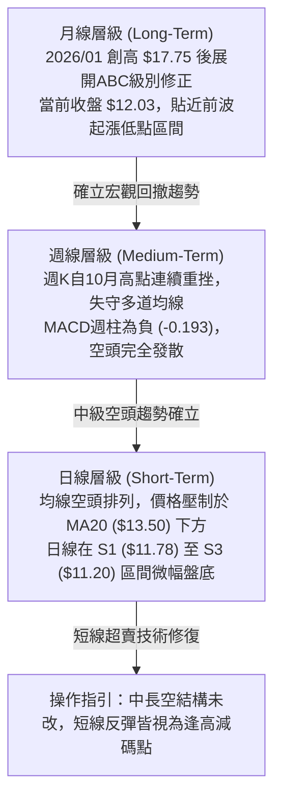
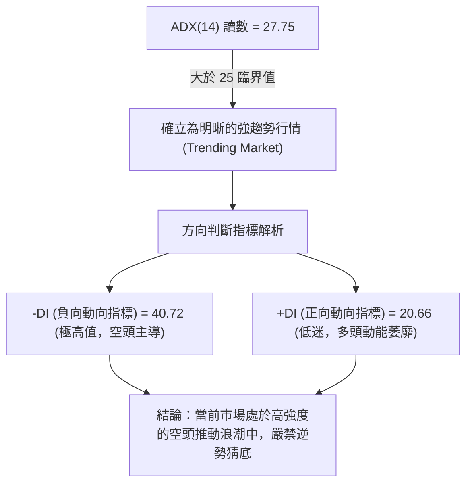
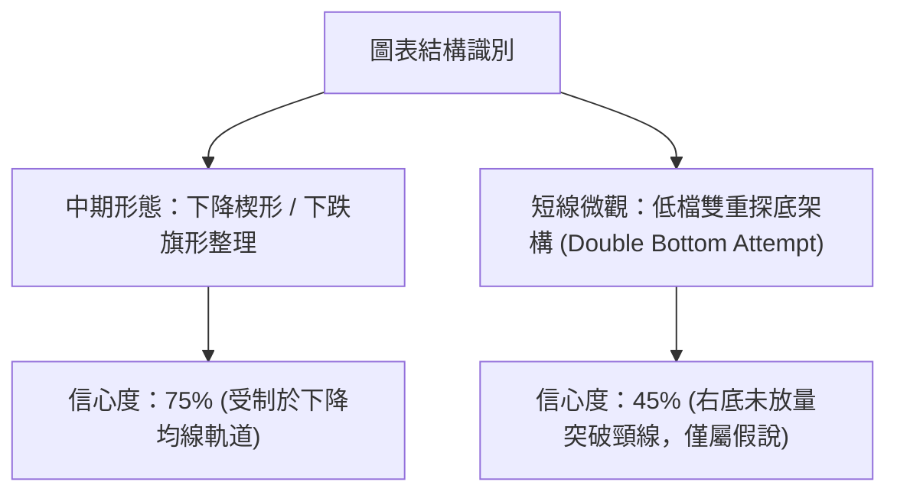
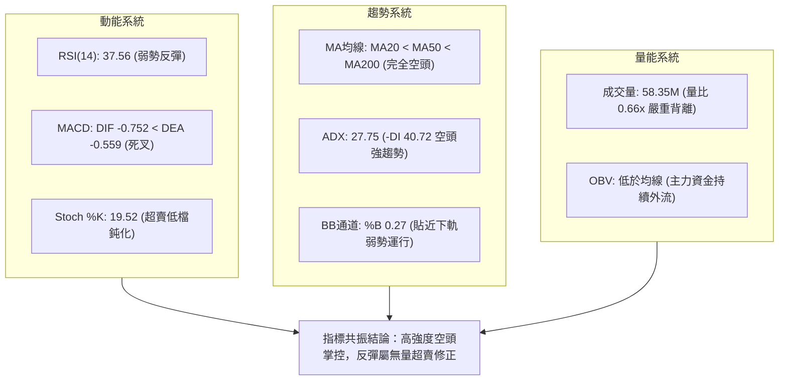
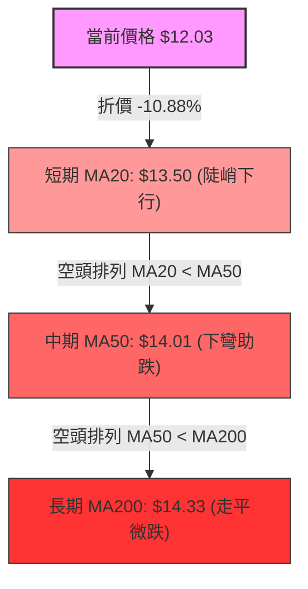
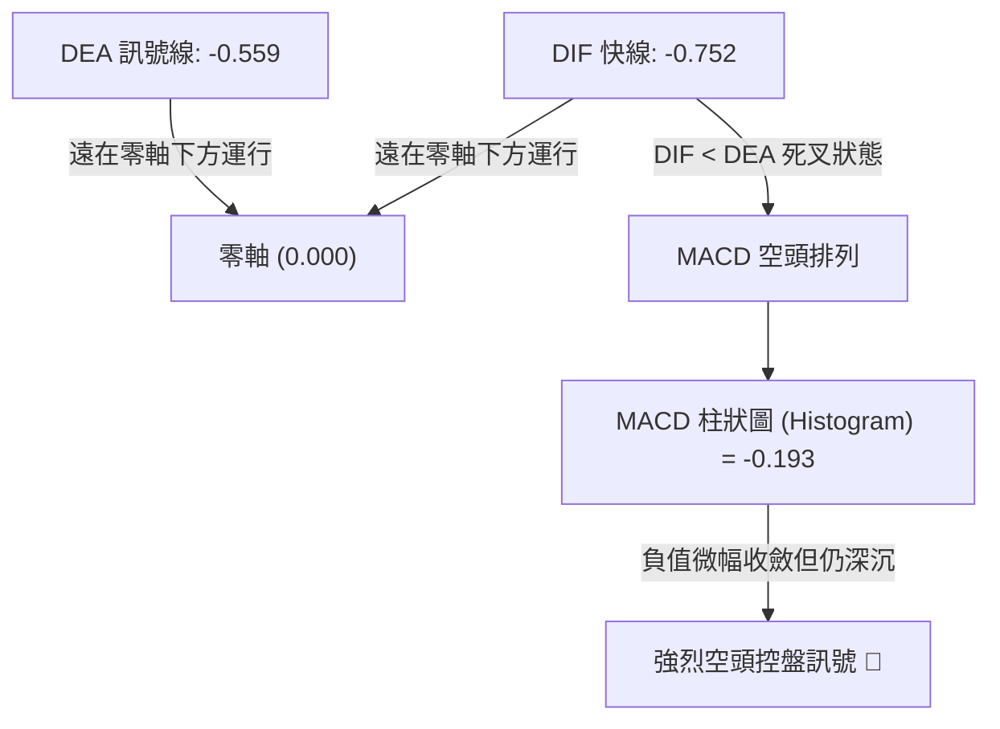
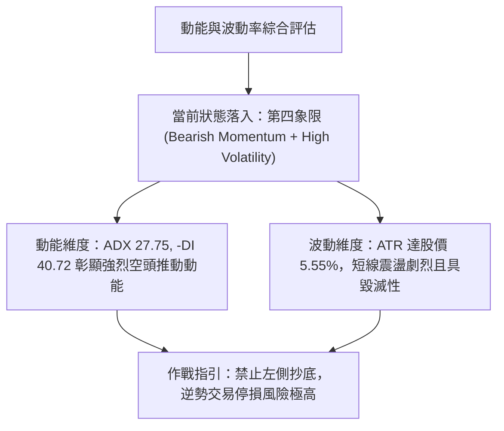
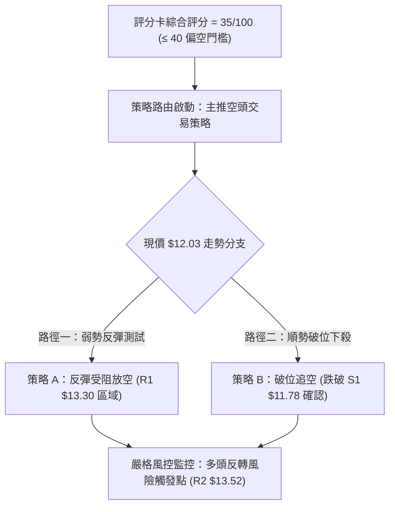
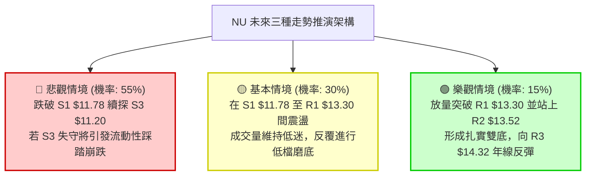

# NU 技術分析報告

> **報告日期**：2026-11-09 ｜ **語言**：繁體中文 ｜ **數據來源**：Yahoo Finance ｜ **當前價格**：$12.03

---

## 目錄

| 章節 | 內容 |
|------|------|
| [1. 技術面概覽](#1-技術面概覽) | 訊號儀表板、核心指標、評分卡 |
| [2. 趨勢分析](#2-趨勢分析) | 多時框趨勢、長中短期走勢 |
| [3. 圖表形態分析](#3-圖表形態分析) | 形態識別、K線組合、目標價 |
| [4. 支撐與阻力](#4-支撐與阻力) | 關鍵價位、斐波那契回調 |
| [5. 技術指標深度解讀](#5-技術指標深度解讀) | MA/RSI/MACD/布林/成交量 |
| [6. 動能與波動率](#6-動能與波動率) | 動能評估、ATR、Beta |
| [7. 多時框架總結](#7-多時框架總結) | 時框架評分矩陣 |
| [8. 交易策略建議](#8-交易策略建議) | 多空策略、風險報酬比 |
| [9. 風險提示與監控](#9-風險提示與監控) | 監控指標、風險場景 |

---

## 1. 技術面概覽

### 🎯 技術訊號儀表板



### 📊 核心指標速覽表

| 指標類別 | 指標名稱 | 當前數值 | 訊號 | 解讀 |
|----------|----------|----------|------|------|
| **價格** | 當前收盤價 | $12.03 | 🔴 | 位於52週高低點區間之 10.7% 位置，深陷弱勢防守區 |
| **均線** | 短期 MA20 | $13.50 | 🔴 | 現價大幅折價 -10.88%，短期下行斜率陡峭，形成第一動態壓制 |
| **均線** | 中期 MA50 | $14.01 | 🔴 | 現價低於 MA50，中期多空分水嶺失守，反彈阻力沉重 |
| **均線** | 長期 MA200 | $14.33 | 🔴 | 現價顯著低於年線，中長期均線呈現完全空頭排列 |
| **動能** | RSI(14) | 37.56 | 🟡 | 弱勢中性區，未觸及 30 絕對超賣，但反彈動能衰竭 |
| **動能** | MACD (12,26,9) | -0.752 / -0.559 | 🔴 | DIF 線低於訊號線且位於零軸下方，柱狀圖 -0.193 持續看空 |
| **動能** | Stoch %K / %D | 19.52 / 15.26 | 🟢 | 進入 20 以下超賣區，存在技術性短線低檔金叉博弈反彈可能 |
| **趨勢** | ADX(14) / ±DI | 27.75 | 🔴 | ADX > 25 確立強趨勢，-DI (40.72) 遠超 +DI (20.66)，空方強勢控盤 |
| **波動** | ATR(14) | $0.67 (5.55%) | 🟡 | 日內波幅達 5.55%，波動率處於中高水平，風控止損需適度放寬 |
| **通道** | 布林通道 %B | 0.27 | 🟡 | 價格運行於中軌 ($13.50) 與下軌 ($10.25) 間，帶寬敞開偏空 |
| **量能** | 當日量 / 20日均量 | 0.66x (58.35M) | 🔴 | 成交量顯著萎縮（均量 87.83M），量價無量反彈，OBV 疲軟 |

### 🏆 技術評分卡

```
╔══════════════════════════════════════════════════════════════╗
║                 技術評分卡 — NU (2026-11-09)                 ║
╠══════════════════════════════════════════════════════════════╣
║ 趨勢強度 (Trend)      ████████░░░░░░░░░░░░  38/100  🔴 看空  ║
║ 動能指標 (Momentum)   ███████░░░░░░░░░░░░░  35/100  🔴 疲弱  ║
║ 支撐穩定度 (Support)  █████████░░░░░░░░░░░  45/100  🟡 考驗  ║
║ 成交量配合 (Volume)   ██████░░░░░░░░░░░░░░  30/100  🔴 萎縮  ║
║ 形態完整度 (Pattern)  ████████░░░░░░░░░░░░  40/100  🔴 破位  ║
║ 均線排列 (Moving Avg) ████░░░░░░░░░░░░░░░░  22/100  🔴 空頭  ║
╠══════════════════════════════════════════════════════════════╣
║ 綜合評分 (Overall)    ███████░░░░░░░░░░░░░  35/100  🔴 偏空  ║
║ [算術平均：(38 + 35 + 45 + 30 + 40 + 22) / 6 = 35.0 → 35]   ║
╚══════════════════════════════════════════════════════════════╝
```

---

## 2. 趨勢分析

### 🌐 多時框趨勢分析



### 📈 長期趨勢 — 12個月走勢圖（Unicode）

```
NU 月線走勢圖（過去12個月：2025-12 至 2026-11）
價格 ($)
$18.00 ┤                     ● 17.75 (2026-01 頂部高點)
$17.00 ┤● 16.74 (2025-12)
$16.00 ┤
$15.00 ┤              ● 14.98
$14.00 ┤                     ● 14.37  ● 14.48          ● 14.33  ● 14.55
$13.00 ┤                                      ● 13.13  ● 13.36
$12.00 ┤                                                                 ● 12.66          ● 12.03 (現價)
$11.00 ┤                                                                          ● 11.61
       └─────────────────────────────────────────────────────────────────────────────────────────────
         25-12  26-01  26-02  26-03    26-04    26-05    26-06    26-07    26-08    26-09    26-10    26-11
```

#### 長期走勢特徵分析表

| 週期階段 | 起訖月份 | 收盤價區間 | 區間漲跌幅 | 結構性技術特徵 |
|----------|----------|------------|------------|----------------|
| **主升攻頂期** | 2025-11 ~ 2026-01 | $17.39 → $17.75 | +2.07% (高檔築頂) | 衝刺 52 週歷史高點 $18.98 未果，月線出現量價背離長上影線 |
| **首輪下跌期** | 2026-01 ~ 2026-05 | $17.75 → $13.13 | -26.03% | 連續跌破 MA20 與 MA50，形成主跌推動浪，多頭潰敗 |
| **箱型弱反彈** | 2026-05 ~ 2026-08 | $13.13 → $14.55 | +10.81% | 於 $14.00 附近構築反彈中繼箱體，受制於年線 MA200 壓制 |
| **破位再探底** | 2026-08 ~ 2026-10 | $14.55 → $11.61 | -20.21% | 爆發系統性賣壓，直落跌穿斐波那契 78.6% 回調位 ($12.86) |
| **低檔掙扎期** | 2026-10 ~ 2026-11 | $11.61 → $12.03 | +3.62% | 於 52 週低點 $11.20 上方進行技術性微幅修復，結構仍屬極弱 |

### 📊 中期趨勢（週線分析）

中期技術面在 2026 年 10 月初曾上演假突破，週收盤價一度拉升至 $16.12（2026-10-09），隨後遭遇機構無情出貨，連續數週大幅放量跳水，2026-10-30 當週更以 701,855,200 股的天量收於 $11.61，創下階段新低，重創多頭持倉信心。

```
中期週線空間架構示意圖：
  $16.12 ─────────── 假突破高點 (2026-10-09 形成多頭陷阱)
     │   ▼
  $14.33 ─────────── MA200 年線生死線 (反彈天花板)
     │   ▼
  $13.50 ─────────── MA20 / BB中軌 (第一道強固壓制帶)
     │   ▼
  $12.03 ─────────── 當前現價 (弱勢抵抗中)
     │   ▼
  $11.20 ─────────── 52週低點 / 斐波那契 100% 絕對防線
```

### ⚡ 趨勢強度評估（ADX 解讀）



#### ADX 趨勢強度對照表

| 指標變數 | 當前讀數 | 門檻區間 | 趨勢判定 | 策略含義 |
|----------|----------|----------|----------|----------|
| **ADX(14)** | **27.75** | > 25.00 | 強烈趨勢行情 | 震盪指標失效，切勿使用逆勢超買超賣單純摸底，順勢交易為主 |
| **+DI (多頭)** | **20.66** | < 25.00 | 多方衰退 | 買盤缺乏定價權，反彈量能極易衰竭 |
| **-DI (空頭)** | **40.72** | > 35.00 | 空方絕對統治 | 賣壓強勁且連貫，空頭推動力道充沛 |
| **DI 差值** | **-20.06** | 負值極距擴大 | 差距極大 | 多空力量極度失衡，空方掌握完全定價權 |

---

## 3. 圖表形態分析

### 🔍 形態識別系統



#### 形態識別與信心度評估表

| 形態類別 | 信心度 (%) | 判斷依據（引用數據） | 完成度 (%) | 目標價推算與計算式 |
|----------|------------|----------------------|------------|--------------------|
| **下跌旗形 (Bear Flag)** | **75%** | 自 10/09 高點 $16.12 巨量跌至 10/30 $11.48，隨後以萎縮量在 $11.60-$12.28 區間橫盤收斂 | **65%** | 旗桿高點 $16.12 − 旗底低點 $11.48 = $4.64。若跌破旗面下邊界 $11.45，推算理論測幅低於歷史數據，數據中未偵測到更低價位，以 S3 ($11.20) 作為終極支撐測幅 |
| **低檔雙底雛形 (Double Bottom)** | **40%** | 左底為 2026-11-05 低點 $11.21，前波低點為 2026-10-30 低點 $11.48，兩次觸及 S3 ($11.20) 區域 | **30%** | 若能放量突破日線波段頸線 R1 ($13.30)，形態高度 = 頸線 $13.30 − 形態最低點 $11.21 = $2.09；向上推算目標價 = $13.30 + $2.09 = $15.39（介於歷史波段高點間） |

*註：由於雙底形態完成度僅 30%，信心度低於 50%，依嚴格規則主要作為指標性技術反彈假說，不作為主推幾何形態。*

### 🕯️ 重要 K 線形態分析

#### 近 10 根日 K 線形態解讀表

| 日期 | 開盤價 | 最高價 | 最低價 | 收盤價 | K線形態 | 深度解讀 | 訊號強度 |
|------|--------|--------|--------|--------|---------|----------|----------|
| **2026-10-26** | 11.69 | 12.78 | 11.62 | 12.59 | 帶上影大陽線 | 巨量 3.39 億股強彈，受制於上方壓力帶，長上影線暗示解套賣壓沉重 | 🟡 中性偏多 |
| **2026-10-27** | 12.74 | 13.00 | 12.37 | 12.40 | 高開低走小陰線 | 量能驟縮至 99.66M，衝高 $13.00 關卡未果，多頭追高意願急凍 | 🔴 弱勢看空 |
| **2026-10-28** | 12.36 | 12.44 | 11.96 | 11.97 | 連續實體陰線 | 實體跌破 $12.00 整數關卡，賣方持續下壓尋找流動性 | 🔴 看空 |
| **2026-10-29** | 11.98 | 12.19 | 11.85 | 12.05 | 低檔十字星 | 多空拉鋸，成交量進一步萎縮至 80.21M，跌勢略有趨緩 | 🟡 盤整變盤 |
| **2026-10-30** | 11.75 | 11.85 | 11.48 | 11.61 | 破位中陰線 | 破底創出 $11.48 新低，直接回測支撐 S2 ($11.51) 區域 | 🔴 看空 |
| **2026-11-02** | 11.79 | 12.03 | 11.59 | 11.62 | 低檔小陽星 | 量能萎縮至 68.99M，空方殺跌意願暫緩，但無買盤跟進承接 | 🟡 觀望 |
| **2026-11-03** | 11.62 | 11.70 | 11.45 | 11.61 | 平盤小十字星 | 盤中下探 $11.45，收盤持平，多空於 $11.60 進行拉鋸戰 | 🟡 觀望 |
| **2026-11-04** | 11.95 | 12.16 | 11.84 | 11.99 | 溫和放量陽線 | 嘗試反撲站上 $12.00，收盤逼近高點，短線呈現技術性反彈 | 🟢 弱勢看多 |
| **2026-11-05** | 12.02 | 12.02 | 11.21 | 11.74 | 長下影錘頭陰線 | 盤中跳水觸碰 52 週低點邊界 $11.21，隨後湧現逢低買盤拉回 $11.74，長下影線確認 S3 ($11.20) 具備強大支撐 | 🟢 支撐確立 |
| **2026-11-06** | 11.81 | 12.28 | 11.79 | 12.03 | 實體小陽線 | 延續昨日長下影線反彈，收盤穩於 $12.03，但量能僅 58.35M（萎縮顯著），量價背離 | 🟡 弱勢反彈 |

#### 近 8 根週 K 線形態解讀表

| 週期結算日 | 開盤價 | 最高價 | 最低價 | 收盤價 | 週K線形態 | 深度解讀 | 訊號強度 |
|------------|--------|--------|--------|--------|-----------|----------|----------|
| **2026-09-18** | 14.35 | 14.55 | 13.58 | 13.65 | 中實體長陰線 | 放量跌破整理平台，確立空頭重掌發球權 | 🔴 看空 |
| **2026-09-25** | 13.84 | 14.25 | 13.36 | 13.59 | 低檔流星倒錘 | 嘗試反攻遭遇空頭頑強壓制，上影線顯示上方拋壓重重 | 🔴 疲弱 |
| **2026-10-02** | 12.53 | 13.50 | 12.13 | 13.43 | 巨量長下影陽線 | 成交量激增至 5.32 億股，多頭於 $12.13 發起強烈絕地反擊 | 🟢 築底回升 |
| **2026-10-09** | 14.98 | 16.14 | 14.84 | 16.12 | 突破性大陽線 | 放量大漲 20%，收盤衝破 $16.00，看似全面反轉 | 🟢 誘多轉強 |
| **2026-10-16** | 16.10 | 16.19 | 14.40 | 14.56 | 烏雲蓋頂長黑棒 | 高開低走暴跌逾 9%，將前週漲幅全數吞噬，主力巨量出逃 | 🔴 極度看空 |
| **2026-10-23** | 14.72 | 15.41 | 14.36 | 15.16 | 弱勢反彈陽線 | 反彈無法收復前黑棒實體中點，量能顯著衰退至 3.22 億股 | 🟡 死貓反跳 |
| **2026-10-30** | 11.69 | 13.00 | 11.48 | 11.61 | 天量崩跌大陰線 | 狂瀉 -23.42%，成交量 7.01 億股創近期天量，多殺多全面引爆 | 🔴 崩盤信號 |
| **2026-11-06** | 11.79 | 12.28 | 11.21 | 12.03 | 下影線縮量小陽 | 下影線探底 $11.21 獲支撐，但成交量腰斬至 4.03 億股，觀望濃厚 | 🟡 低檔震盪 |

### 📉 ASCII 走勢形態示意圖

```
                    【2026-10-09 假突破高點 $16.14】
                                ▲
                               ╱ ╲  ◄ 10-16 烏雲蓋頂暴跌出貨
                              ╱   ╲
                             ╱     ▼
                           ──       ─── 【反彈弱高點 10-23 $15.41】
                                       ╲
                                        ╲  ◄ 10-30 天量崩潰長黑破位 ($11.61)
                                         ▼
                                        ──── 【頸線阻力 R1 $13.30】
                                         :
                       【現價 $12.03】 ───►  ● 
                                         : ╲
                                         :  ● 11-05 長下影探底 $11.21
                                         └──┴────────────────────
                                            【終極防線 S3 $11.20 (52W Low)】
```

### 🎯 形態目標價計算

根據日線雙底反彈雛形推估：
1. **形態底部低點**：取 2026-11-05 的波段最低價 **$11.21**（貼近 52 週最低點 $11.20）。
2. **形態頸線阻力**：引用阻力位 **R1 = $13.30**。
3. **理論垂直形態高度**：$13.30 − $11.21 = **$2.09**。
4. **形態量度目標價 (Measured Target)**：
   - 向上突破 R1 成立之理論目標價 = 頸線 $13.30 + 高度 $2.09 = **$15.39**（此價位介於斐波那契 50.0% 回調位 $15.09 與波段高點間）。
   - 向下若不幸跌破 S3 ($11.20)，因下方歷史區間未有標註，數據中未偵測到更低價位，空頭目標將進入無支撐真空區。

---

## 4. 支撐與阻力

### 🗺️ 關鍵價位分布圖（Unicode）

```
╔══════════════════════════════════════════════════════════════════╗
║                   NU 關鍵價位結構分布圖                          ║
╠══════════════════════════════════════════════════════════════════╣
║ $14.32 ║██████████████████████████████║ 強結構阻力 R3 (MA200重合) ║
║ $13.52 ║██████████████████████        ║ 動態均線阻力 R2 (MA20/BB中軌)║
║ $13.30 ║████████████████████████      ║ 關鍵頸線阻力 R1          ║
║        ║                              ║                          ║
║ $12.03 ╠══════════════════════════════╣ ◄ 當前收盤價 (現價)       ║
║        ║                              ║                          ║
║ $11.78 ║▓▓▓▓▓▓▓▓▓▓▓▓▓▓▓▓▓▓▓▓          ║ 第一近期緩衝支撐 S1      ║
║ $11.51 ║██████████████████████        ║ 次級波段密集支撐 S2      ║
║ $11.20 ║██████████████████████████████║ 核心防禦強支撐 S3 (52W Low)║
╚══════════════════════════════════════════════════════════════════╝
```

### 🚧 阻力位分析表

所有價位均直接引用數據「關鍵價位」區塊：

| 阻力級別 | 準確價位 | 距現價幅標 | 形成原因與籌碼解讀 | 突破難度 | 重要性權重 |
|----------|----------|------------|--------------------|----------|------------|
| **阻力 R1** | **$13.30** | +10.56% | 近一年波段高點聚類；前波下跌旗形整理平台下軌與短期跳空跌破頸線位置，積聚大量套牢籌碼 | 🟡 中等偏高 | ★★★★☆ |
| **阻力 R2** | **$13.52** | +12.34% | 近一年波段高點密集區；極度貼近 MA20 ($13.50) 動態均線與布林通道中軌 ($13.50)，為空頭防線第一關卡 | 🔴 高度困難 | ★★★★★ |
| **阻力 R3** | **$14.32** | +18.99% | 近一年波段頂部高點聚類；與 MA200 年線 ($14.33) 及斐波那契 61.8% ($14.17) 形成強大多重技術共振阻力帶 | 🔴 極度堅固 | ★★★★★ |

### 🛡️ 支撐位分析表

所有價位均直接引用數據「關鍵價位」區塊：

| 支撐級別 | 準確價位 | 距現價幅標 | 形成原因與籌碼解讀 | 守住機率 | 重要性權重 |
|----------|----------|------------|--------------------|----------|------------|
| **支撐 S1** | **$11.78** | -2.08% | 近一年波段低點聚類；日K線收盤密集區（11/04 開盤 $11.95、11/06 開盤 $11.81），極短期多頭防線 | 🟡 55% | ★★★☆☆ |
| **支撐 S2** | **$11.51** | -4.32% | 近一年波段低點聚類；10/30 與 11/03 盤中測試低點密集區 ($11.48-$11.45)，買盤浮現承接區間 | 🟢 65% | ★★★★☆ |
| **支撐 S3** | **$11.20** | -6.90% | 52週歷史低點 ($11.20) 與斐波那契 100.0% 絕對原點重合；11/05 測試 $11.21 展現長下影線捍衛意志 | 🟢 80% | ★★★★★ |

### 📐 斐波那契回調位分析

依據數據計算之 52 週完整波段（高點 $18.98 → 低點 $11.20，總垂直空間 $7.78）：

| 斐波那契比率 | 對應價位 | 與現價之相對位置 | 技術含義與路徑評估 |
|--------------|----------|------------------|--------------------|
| **0.0% (52W High)** | **$18.98** | 頂部 (+57.77%) | 過去一年極限頂部，當前無任何討論之現實性 |
| **23.6%** | **$17.14** | 遙遠阻力 (+42.48%) | 2026-01 歷史月線收盤密集頂部區 |
| **38.2%** | **$16.01** | 強固天花板 (+33.08%) | 2026-10-09 假突破收盤點 ($16.12) 所在，多頭斷頭台 |
| **50.0%** | **$15.09** | 多空分水嶺 (+25.44%) | 長期走勢中軸，跌破後確認長期趨勢轉空 |
| **61.8%** | **$14.17** | 強阻力帶 (+17.79%) | 黃金分割強壓力位，與 MA60 ($14.14)、MA200 ($14.33) 形成阻力共振 |
| **78.6%** | **$12.86** | 關鍵反壓 (+6.90%) | 極深回撤位，現價於其下方運行，代表多頭結構遭嚴重破壞 |
| **100.0% (52W Low)**| **$11.20** | 終極底線 (-6.90%) | 多頭退無可退之最後防禦堡壘 |

**現價落點解讀**：當前收盤價 **$12.03** 精準落於 **78.6% ($12.86)** 與 **100.0% ($11.20)** 之間。在技術分析架構中，當資產跌破 61.8% 且持續被壓制於 78.6% 回調位下方時，宣告前一輪牛市波段徹底終結，進入深度熊市築底或陰跌階段。若多方無法迅速收復 $12.86，價格勢必向 100.0% ($11.20) 進行反覆磨底測試。

---

## 5. 技術指標深度解讀

### 🎛️ 指標訊號總覽



### 📈 移動平均線排列分析



#### 各期移動平均線詳細狀態對照表

| 均線天期 | 當前價位 | 現價偏離幅度 | 排列方向 | 微觀走勢特徵 | 訊號解讀 |
|----------|----------|--------------|----------|--------------|----------|
| **MA 5** | **$11.80** | +1.97% (+$0.23) | ▲ 向上反勾 | ▅▆▇██ 短期觸底微揚 | 🟢 極短線止跌訊號 |
| **MA 10** | **$11.96** | +0.58% (+$0.07) | ▲ 走平上揚 | ▆▇████ 短期平滑修復 | 🟡 短線多空交戰線 |
| **MA 20** | **$13.50** | -10.88% (-$1.47) | ▼ 陡峭下行 | ▇▆▄▃▂▁ 快速向下摜壓 | 🔴 短期強大動態蓋頭反壓 |
| **MA 50** | **$14.01** | -14.13% (-$1.98) | ▼ 持續走低 | ▇▆▅▄▃▂ 下行斜率未緩 | 🔴 中期多頭防線全面瓦解 |
| **MA 60** | **$14.14** | -14.90% (-$2.11) | ▼ 順勢下彎 | ▇▆▅▄▃▂ 季度均線助跌 | 🔴 季線阻力深厚 |
| **MA 120** | **$13.72** | -12.29% (-$1.69) | ▼ 下彎扣高 | █▇▆▅▄▃ 半年線反壓形成 | 🔴 中長期籌碼套牢 |
| **MA 200** | **$14.33** | -16.05% (-$2.30) | ▼ 空頭排列 | █▇▆▅▄▃ 牛熊分界線失守 | 🔴 確立進入技術性熊市 |
| **MA 240** | **$14.76** | -18.50% (-$2.73) | ▼ 長期下墜 | ████▇▇ 年線以上深套 | 🔴 長期結構重創 |

**排列總結**：所有重要均線呈現極其典型的「標準空頭排列」（MA20 < MA50 < MA200），且現價落於所有均線下方。短天期 MA5/MA10 雖微幅抬頭，但與中長天期均線之負乖離率超過 10%，顯示短線僅為乖離過大引發的技術性修復，尚未出現任何趨勢反轉跡象。

### 📉 RSI(14) 分析

- **當前讀數**：**37.56**（Wilder 平滑計算）。
- **區間劃分進度條**：
  ```
  超賣 [0-30]        弱勢中性 [30-50]       強勢中性 [50-70]      超買 [70-100]
  [░░░░░░░░░░]──────[████████░░]──────────[░░░░░░░░░░]─────────[░░░░░░░░░░]
                      ▲ 37.56 (位於弱勢抵抗區)
  ```
- **背離診斷**：
  - 根據近 20 根 K 棒的首尾比對，價格自高點一路震盪走低，RSI 亦同步於 30-50 區間低位滑落。
  - **明確結論**：**無明顯底背離，亦無頂背離**。此現象證明跌勢具備實質動能支撐，並非因動能衰竭而產生的非理性殺跌，屬於動能與價格同向推進的常規空頭波段。

### 📊 MACD(12/26/9) 訊號解讀



- **MACD 數值解析**：
  - DIF快線（-0.752）低於 Signal訊號線（-0.559），兩者雙雙深陷零軸負值深水區，表明空頭長期動能極為強韌。
  - 柱狀圖（-0.193）雖自 10/30 當週的 -0.401 負極值有所回升，但仍處於負向區間，僅反映急跌後的乖離減緩，絕非黃金交叉的買進訊號。

### 📦 布林通道分析

```
NU 日線布林通道結構 (20日, 2倍標準差)
══════════════════════════════════════════════════════════════════
$16.75 ────────────────────────────────────────────── BB上軌 (+39.24%)
         │
         │  通道開口：顯著向外擴張中 (寬度 = $6.50, 54.03%)
         │  通道趨勢：中軌下行斜率強烈，整體呈現向下傾斜管道
         │
$13.50 ────────────────────────────────────────────── BB中軌 (MA20)
         │
         │  ◄ 當前現價 $12.03 (%B = 0.27)
         │  運行狀態：被牢固壓制於中軌與下軌之間
         │
$10.25 ────────────────────────────────────────────── BB下軌 (-14.80%)
══════════════════════════════════════════════════════════════════
```

- **%B 指標解讀**：目前數值為 **0.27**，意即現價位於整個通道寬度的 27% 下沿位置。價格緊貼下軌下行，顯示出典型的「騎軌下行」（Riding the Band）單邊走勢，下軌 $10.25 尚未提供強硬的軌道反彈支撐。

### 💹 成交量分析（量價配合度）

1. **量價關係比對**：
   - 最新交易日（2026-11-06）收盤上漲至 $12.03，但成交量僅有 **58,352,600 股**。
   - 相比於 20 日均量（**87,827,380 股**），量比僅為 **0.66x**；相比於 50 日均量（**84,084,004 股**），量能萎縮超過 30%。
   - **量價背離結論**：此輪反彈呈現顯著的「價漲量縮」背離格局，反映此波上漲主要是由於空方獲利平倉引發的空頭回補，並無長線主動性多頭大資金進場接盤。
2. **OBV (能量潮指標) 解讀**：
   - 數據明確指出 **OBV < MA**，OBV 指標線持續運行於其均線下方。
   - 能量潮走勢疲軟無力，說明過去兩週的所有微幅反彈均無法改善資金淨流出的頹勢，主力機構資金依然維持出脫態度。

---

## 6. 動能與波動率

### ⚡ 動能評估四象限

| 象限 | 動能維度 | 波動維度 | 當前特徵吻合度 | 策略應對指引 |
|------|----------|----------|----------------|--------------|
| **第一象限 (Q1)** | 強動能 (多頭) | 低波動 | ❌ 完全不符 | 順勢做多，穩定推升波段 |
| **第二象限 (Q2)** | 弱動能 (萎靡) | 低波動 | ❌ 部分不符 | 橫盤窄幅築底，觀望等待 |
| **第三象限 (Q3)** | 強動能 (多頭) | 高波動 | ❌ 完全不符 | 突破追買，嚴設寬幅停損 |
| **第四象限 (Q4)** | **強動能 (空頭主導)** | **中高波動** | **✓ 高度吻合** | **避免盲目做多，嚴控下行風險，以逢高布空為主** |



### 📊 ATR 波動率分析

- **ATR(14) 讀數**：**$0.67**（佔當前股價之 **5.55%**，Wilder 計算法）。
- **日內波幅解讀**：每日平均波動空間達 $0.67，對於現價 $12.03 的標的而言屬於中高波動率股票。這意味著正常的日內價格隨機抖動極易觸發過於狹窄的止損。
- **風控止損空間設定基準**：
  - **極短線止損距離**：至少需設定 1.0 倍 ATR = **$0.67**。
  - **波段交易止損距離**：建議設定 1.5 ~ 2.0 倍 ATR = **$1.01 ~ $1.34**，以防範被隨機雜訊掃出場。

### 📐 Beta 與市場相關性

- **Beta 係數**：**0.968**。
- **解讀**：NU 與整體大盤標普 500 指數具備高度同步性（接近 1.0），然而目前在接近平價的 Beta 下，其自身走勢卻遠落後於主要指數（年內自 $17.75 回落至 $12.03）。這表明 NU 當前承受的不僅是大盤系統性風險，更疊加了其自身的特異性風險（如拉丁美洲數位信貸資產品質擔憂、新興市場匯率波動與成長放緩等）。

---

## 7. 多時框架總結

### 📋 時框架評分表

| 時框架 | 趨勢方向 | 動能指標狀態 | 均線排列格局 | 形態結構特徵 | 綜合評分 | 建議方向 |
|--------|----------|--------------|--------------|--------------|----------|----------|
| **長期 (月線)** | 🔴 明顯看跌 | RSI持續探底，自超買區崩落 | 跌破月均線支撐帶 | 歷史高點 $18.98 構築雙頂回調 | 30/100 | 防範深度下探 |
| **中期 (週線)** | 🔴 強烈空頭 | MACD週柱 -0.193，-DI 主導 | MA200 失守，均線全面下彎 | 10月假突破大頂，爆發斷頭鍘黑棒 | 32/100 | 逢高堅決減碼 |
| **短期 (日線)** | 🟡 弱勢反彈 | Stoch 低檔超賣，RSI 37.56 | 短均 MA5 微勾，MA20 壓頂 | S3 ($11.20) 長下影抵抗，雙底雛形 | 42/100 | 嚴設停損博短彈 |

### 🔲 綜合訊號矩陣

```
╔══════════════════════════════════════════════════════════════╗
║               NU 多時框訊號一致性矩陣分析                    ║
╠══════════════════════════════════════════════════════════════╣
║ 維度         短期 (日線)      中期 (週線)      長期 (月線)   ║
╠══════════════════════════════════════════════════════════════╣
║ 趨勢方向     🟡 震盪築底      🔴 下行空頭      🔴 空頭回撤   ║
║ 均線排列     🔴 空頭排列      🔴 空頭排列      🔴 破位下行   ║
║ 動能強弱     🟢 超賣鈍化      🔴 空頭控盤      🔴 動能衰竭   ║
║ 量價結構     🔴 量縮反彈      🔴 天量拋售      🔴 出貨格局   ║
║ 波動狀態     🟡 中高震盪      🔴 空頭放大      🟡 逐步收斂   ║
╠══════════════════════════════════════════════════════════════╣
║ 一致性研判：中長期完全由空方主導，短期反彈僅為技術性雜訊    ║
╚══════════════════════════════════════════════════════════════╝
```

### ⚖️ 多時框收斂結論

依據多時框收斂規則第 14 條嚴格執行：
1. **趨勢/盤整定性**：當前日線 **ADX(14) 讀數為 27.75**，明確突破 25.00 趨勢門檻，且 -DI (40.72) 遠超 +DI (20.66)，因此定性為**「高強度空頭趨勢行情」**，絕非無方向的區間盤整行情。
2. **時框優先級收斂**：在趨勢行情（ADX > 25）架構下，**交易決策必須無條件以中長期（週線、MA50 $14.01、MA200 $14.33）的方向為唯一基準**。日線的短線超賣信號與微幅反彈，僅能用於尋找逢高放空的進場時機，不得作為反轉做多的戰略依據。
3. **最終唯一結論**：**【偏空主導，順勢做空（Bearish）】**。此結論與第 1 章技術評分卡（35/100）完全收斂，並直接鎖定第 8 章以空頭交易策略為主推路徑。

---

## 8. 交易策略建議

### 🗺️ 策略決策流程圖



### 🧭 策略路由

**當前主策略方向 = 【主推空頭策略】（依評分卡綜合評分 35/100，完全落在 ≤ 40 之偏空區間）**。多頭策略本處僅列為空頭回補與風險對沖提示，嚴禁在未扭轉均線前重倉做多。

### 🎯 價格情境階梯（Price Scenarios）

所有價位精確引用自第 4 章及關鍵價位區塊：

| 觸發條件 | 下一目標價 | 後續延伸價 | 技術情境含義 |
|----------|------------|------------|--------------|
| **強勢向上突破 R1 ($13.30)** | R2 ($13.52) | R3 ($14.32) | 短線超賣反彈演化為均線回補，考驗 MA20 強壓 |
| **震盪站穩現價區間 ($12.03)** | 測試 R1 ($13.30) | 回測 S1 ($11.78) | 空頭暫歇，於 $11.78 ~ $13.30 進行無量整理箱體 |
| **向下有效跌破 S1 ($11.78)** | S2 ($11.51) | S3 ($11.20) | 短線微弱反彈夭折，重啟空頭主跌推動浪 |
| **全面貫穿失守 S3 ($11.20)** | 進入歷史真空區 | 數據中未偵測到 | 破底引發停損潮，空頭目標進入歷史未知深淵 |

### 📊 情境機率分佈

| 走勢情境 | 機率估計 (%) | 主要指標依據 |
|----------|--------------|--------------|
| **回落再探底 / 順勢破位** | **55%** | ADX 達 27.75 確立空頭趨勢；-DI 達 40.72 控盤；MACD 柱狀圖持續為負 (-0.193) |
| **區間窄幅震盪消化** | **30%** | Stoch 低檔超賣鈍化（%K 19.52, %D 15.26）；成交量劇縮至 58.35M，多空處於觀望僵局 |
| **強烈反彈向上突破** | **15%** | 僅依靠 S3 ($11.20) 之 52 週低點心理防線支撐，但 OBV 嚴重疲弱，缺乏主力資金跟進 |

### 🔴 主策略詳情（空頭交易策略）

所有目標價與止損點均嚴格引用第 4 章數值，進場價採用區間中點計算風險報酬比（定義：(進場價 − 目標價) ÷ (止損價 − 進場價)）：

| 策略要素 | 策略 A（反彈高空 — 逢高狙擊） | 策略 B（順勢破位空 — 破線追擊） |
|----------|--------------------------------|----------------------------------|
| **操作性質** | 逢反彈測試關鍵阻力承壓進場 | 跌破短期支撐確認破位追空 |
| **進場條件** | 反彈至 R1 附近受阻，日K收長上影線 | 跌破支撐 S1 且日K收盤確認跌破 |
| **進場價格** | **$13.30**（精確引用阻力 R1） | **$11.78**（精確引用支撐 S1） |
| **止損價格** | **$13.52**（精確引用阻力 R2） | **$12.03**（精確引用現價關卡） |
| **目標價 T1** | **$11.78**（精確引用支撐 S1） | **$11.51**（精確引用支撐 S2） |
| **目標價 T2** | **$11.20**（精確引用支撐 S3） | **$11.20**（精確引用支撐 S3） |
| **風險報酬比 (T1)** | **1 : 6.91（以 T1 計）**<br/>計算式：($13.30 − $11.78) ÷ ($13.52 − $13.30)<br/>= $1.52 ÷ $0.22 = 6.91 | **1 : 1.08（以 T1 計）**<br/>計算式：($11.78 − $11.51) ÷ ($12.03 − $11.78)<br/>= $0.27 ÷ $0.25 = 1.08 |
| **風險報酬比 (T2)** | **1 : 9.55（以 T2 計）**<br/>計算式：($13.30 − $11.20) ÷ ($13.52 − $13.30)<br/>= $2.10 ÷ $0.22 = 9.55 | **1 : 2.32（以 T2 計）**<br/>計算式：($11.78 − $11.20) ÷ ($12.03 − $11.78)<br/>= $0.58 ÷ $0.25 = 2.32 |
| **預估成功機率** | **65%** | **55%** |
| **建議配置倉位** | **10% ~ 15% 總資金** | **5% ~ 8% 總資金** |

### 🟢 反向風險觸發點（對沖與停損提示）

若市場出現異常大額買盤強推，觸發下列條件時必須全面推翻空頭主策略：
1. **第一防禦警戒線**：收盤價實體放量突破 **R1 ($13.30)**，空頭部位應主動減半避險。
2. **多空翻轉生死線**：價格強勢突破並站穩 **R2 ($13.52)** 與 MA20 均線，空方應全數無條件止損離場，此時代表布林中軌收復，短期可能轉為向布林上軌 ($16.75) 尋求反彈之深幅修正行情。

### ⭐ 整體訊號強度評星

```
╔══════════════════════════════════════════════════════════════╗
║ 做多訊號強度：★☆☆☆☆  (1/5星 — 僅具備超賣反彈可能，勝率極低) ║
║ 做空訊號強度：★★★★☆  (4/5星 — 均線與趨勢指標高度共振看空)   ║
║ 整體可信度：  ★★★★☆  (4/5星 — 數據結構完整，量價結構吻合)   ║
╚══════════════════════════════════════════════════════════════╝
```

---

## 9. 風險提示與監控

### ✅ 關鍵監控指標 Checklist

```
╔══════════════════════════════════════════════════════════════╗
║               NU 盤面每日關鍵監控 Check-List                 ║
╠══════════════════════════════════════════════════════════════╣
║ [ ] 監控項 1：收盤價是否跌穿 52 週終極支撐 S3 ($11.20)        ║
║     └─ 觸發處置：無條件出清多頭持倉，追空部位適度加碼      ║
║ [ ] 監控項 2：成交量是否放大至 20 日均量 (87.83M) 以上       ║
║     └─ 觸發處置：若放量上漲方可確認真反彈，無量反彈堅決布空  ║
║ [ ] 監控項 3：MACD 柱狀圖是否由負轉正 (跨越 0 軸臨界線)       ║
║     └─ 觸發處置：若柱狀圖回正，短期空頭回補部位，暫停做空    ║
║ [ ] 監控項 4：RSI(14) 能否放量跨越 50.00 強弱分水嶺          ║
║     └─ 觸發處置：未越過 50 前，所有反彈皆定義為弱勢抵抗      ║
║ [ ] 監控項 5：ADX(14) 讀數是否掉回 25 以下                   ║
║     └─ 觸發處置：跌破 25 意味趨勢停滯，策略應轉為區間盤整    ║
╚══════════════════════════════════════════════════════════════╝
```

### ⚠️ 風險場景分析



### 🛡️ 風險管理重要提醒

1. **ATR 波動防禦與倉位管理**：
   - NU 目前每日真實波幅 ATR 為 **$0.67**（佔現價高達 **5.55%**）。在如此高波動資產上，單筆交易的最大資金承擔風險（Risk at Risk）嚴格限制在總資產的 **1.0% ~ 1.5%** 之內。
   - 絕不可滿倉或重倉介入，整體操作部位上限不得超過總帳戶資金之 **20%**。
2. **財報與外生事件風險**：
   - 雖然基本面營收季增 52.1%，但營業現金流（TTM）為負 **$-1.38B**，自由現金流為負 **$-1.67B**。基本面的現金流失血狀態隨時可能成為空頭借題發揮的殺跌藉口。
   - 關注近期新聞提及的「ETFs 在 11 月 3 日淨賣出 NU」之被動型資金出逃風險，避免在機構持續減碼階段進行左側接刀。

---

## 📋 報告總結

```
╔══════════════════════════════════════════════════════════════════╗
║                      NU 技術分析報告總結                         ║
╠══════════════════════════════════════════════════════════════════╣
║ 報告日期：2026-11-09                                             ║
║ 當前價格：$12.03                                                 ║
║ 分析評級：🔴 偏空主導 / 逢高做空 (Bearish Bias)                  ║
║                                                                  ║
║ 關鍵技術結論：                                                   ║
║ ├─ 長期趨勢：🔴 跌破年線 MA200 ($14.33)，確立進入技術性熊市結構 ║
║ ├─ 中期趨勢：🔴 週線天量長黑破位，空方掌握定價權 (ADX 27.75)   ║
║ ├─ 短期趨勢：🟡 低檔超賣微幅掙扎，但量縮背離嚴重 (量比 0.66x)   ║
║ ├─ 關鍵支撐：S1 $11.78 │ S2 $11.51 │ S3 $11.20 (52W Low)       ║
║ ├─ 關鍵阻力：R1 $13.30 │ R2 $13.52 │ R3 $14.32 (MA200)        ║
║ └─ 分析師目標：共識均價 $18.56 (最高 $23.00 │ 最低 $12.00)      ║
║                                                                  ║
║ 最優策略組合指引：                                               ║
║ 1. 🥇 最佳機會 (策略 A)：等待弱勢反彈至 R1 $13.30 承壓布空，    ║
║    止損嚴設 R2 $13.52，目標下看 S1 $11.78 (風報比 1:6.91)。      ║
║ 2. 🥈 次選機會 (策略 B)：順勢在日K收破 S1 $11.78 後追空，        ║
║    止損設於現價 $12.03，目標下看 S2 $11.51 (風報比 1:1.08)。     ║
║ 3. 🥉 保守選擇：完全空倉觀望，耐心等待價格回測 S3 $11.20 不破   ║
║    且成交量放大突破 MA20 ($13.50) 後再行定奪。                   ║
╚══════════════════════════════════════════════════════════════════╝
```

---

> ⚠️ **免責聲明**：本報告為依據標準量化與技術圖表指標自動生成之研究報告，所有數據分析均基於市場歷史行情。本報告**僅供研究與學術參考**，**不構成任何要約、招攬或投資買賣建議**。金融市場瞬息萬變，技術指標存在滯後性與失效風險，投資人應獨立思考，自負盈虧。

---

*報告生成時間：2026-11-09 ｜ 數據來源：Yahoo Finance ｜ 分析框架：多時框技術分析體系*