# NU 技術分析報告

> **報告日期**：2026-11-10 ｜ **語言**：繁體中文 ｜ **數據來源**：Yahoo Finance ｜ **當前價格**：$12.36

---

## 目錄

| 章節 | 內容 |
|------|------|
| [1. 技術面概覽](#1-技術面概覽) | 訊號儀表板、核心指標、評分卡 |
| [2. 趨勢分析](#2-趨勢分析) | 多時框趨勢、長中短期走勢 |
| [3. 圖表形態分析](#3-圖表形態分析) | 形態識別、K線組合、目標價 |
| [4. 支撐與阻力](#4-支撐與阻力) | 關鍵價位、斐波那契回調 |
| [5. 技術指標深度解讀](#5-技術指標深度解讀) | MA/RSI/MACD/布林/成交量 |
| [6. 動能與波動率](#6-動能與波動率) | 動能評估、ATR、Beta |
| [7. 多時框架總結](#7-多時框架總結) | 時框架評分矩陣 |
| [8. 交易策略建議](#8-交易策略建議) | 多空策略、風險報酬比 |
| [9. 風險提示與監控](#9-風險提示與監控) | 監控指標、風險場景 |

---

## 1. 技術面概覽

### 🎯 技術訊號儀表板

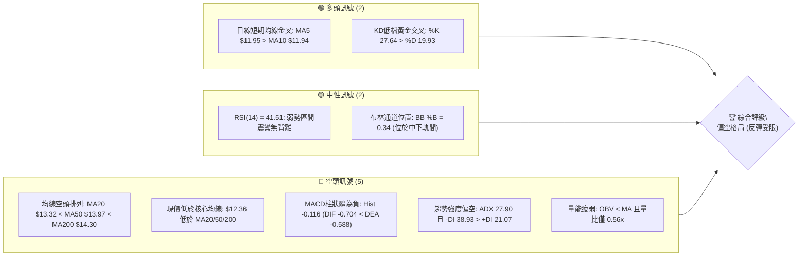

### 📊 核心指標速覽表

| 指標類別 | 指標名稱 | 當前數值 | 訊號 | 解讀 |
|----------|----------|----------|------|------|
| **價格** | 當前收盤價 | $12.36 | 🔴 | 位於52週區間14.9%處，深陷波段低位階 |
| **均線** | MA20 (月線) | $13.32 | 🔴 | 現價低於MA20達-7.18%，短期動能受制壓抑 |
| **均線** | MA50 (季線) | $13.97 | 🔴 | 現價低於MA50，中期下降趨勢未獲修復 |
| **均線** | MA200 (年線) | $14.30 | 🔴 | 現價遠低於年線，中長期進入空頭架構 |
| **動能** | RSI(14) | 41.51 | 🟡 | 位於30–50弱勢盤整區間，尚未進入超賣 |
| **動能** | MACD (12,26,9) | -0.704 / -0.588 | 🔴 | MACD線位於訊號線下方，柱狀體為-0.116看空 |
| **趨勢** | ADX(14) / ±DI | 27.90 / -DI:38.93 | 🔴 | ADX>25為強趨勢，-DI大幅壓制+DI，空頭強勢主導 |
| **波動** | ATR(14) | $0.65 | 🟡 | 佔股價5.25%，每日波動中等偏高，震盪劇烈 |
| **量能** | 成交量 / 20日均量 | 49.12M / 87.01M | 🔴 | 量比0.56x，OBV低於均線，買盤追價意願低迷 |

### 🏆 技術評分卡

```
╔══════════════════════════════════════════════════════════════╗
║                 技術評分卡 — NU (2026-11-10)                 ║
╠══════════════════════════════════════════════════════════════╣
║ 趨勢強度 (ADX=27.90, -DI主導)    ██████░░░░░░░░░░░░░░  30/100 🔴 ║
║ 動能指標 (RSI=41.51, MACD看空)   ████████░░░░░░░░░░░░  40/100 🔴 ║
║ 支撐穩定度 (前低$11.20防守)       ██████████░░░░░░░░░░  50/100 🟡 ║
║ 成交量配合 (量比0.56x, OBV疲弱)  ██████░░░░░░░░░░░░░░  30/100 🔴 ║
║ 形態完整度 (自$18.98頂部回落)     ████████░░░░░░░░░░░░  40/100 🔴 ║
║ 均線排列 (MA20<MA50<MA200空頭)   ████░░░░░░░░░░░░░░░░  20/100 🔴 ║
╠══════════════════════════════════════════════════════════════╣
║ 綜合評分 (六項算術平均：35.0)     ███████░░░░░░░░░░░░░  35/100 🔴 ║
║ 評級結論：技術面明確偏空 (空頭主導之弱勢反彈格局)            ║
╚══════════════════════════════════════════════════════════════╝
```

---

## 2. 趨勢分析

### 🌐 多時框趨勢分析

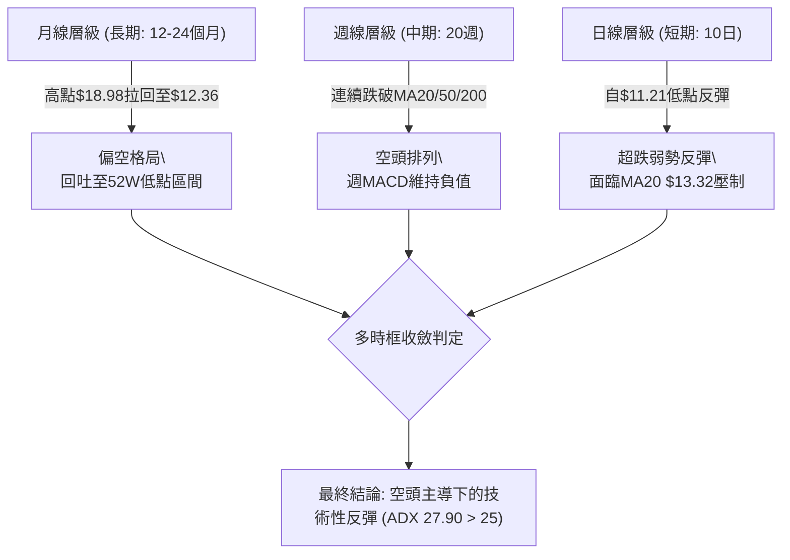

### 📈 長期趨勢 — 12個月走勢圖（Unicode）

```
NU 月線走勢圖（2025-11 至 2026-11）
價格軸 ($)
$18.00 ┤              ● (2026-01: $17.75)
$17.00 ┤● (2025-11: $17.39)
$16.00 ┤    ●
$15.00 ┤          ●
$14.00 ┤              ●   ●   ●       ●   ●
$13.00 ┤                              ●       ●
$12.00 ┤                                          ● ←現價 ($12.36)
$11.00 ┤                                      ● (2026-10: $11.61)
       └────────────────────────────────────────────────────────
         11  12  01  02  03  04  05  06  07  08  09  10  11 (月份)
         25  25  26  26  26  26  26  26  26  26  26  26  26 (年份)
```

#### 長期走勢特徵分析表

| 階段區間 | 時間跨度 | 起訖價位 | 漲跌幅 | 走勢特徵與技術含義 |
|----------|----------|----------|--------|--------------------|
| 歷史高檔築頂 | 2025-11 ~ 2026-01 | $17.39 → $17.75 (高點$18.98) | +2.07% | 高檔滯漲，成交量無法放大，構築雙重頂部架構 |
| 中期滑落重挫 | 2026-02 ~ 2026-05 | $17.75 → $13.13 | -26.03% | 連續跌破各中期均線，空方全面掌控節奏 |
| 弱勢橫盤掙扎 | 2026-06 ~ 2026-08 | $13.36 → $14.55 | +8.91% | 於斐波那契61.8% ($14.17) 附近反覆拉鋸，但無法越過季線 |
| 加速探底破位 | 2026-09 ~ 2026-10 | $14.55 → $11.61 | -20.21% | 10月出現崩跌長黑K（單週跌幅逾23%），觸及52W低點$11.20 |
| 當前低檔弱彈 | 2026-11 至今 | $11.61 → $12.36 | +6.46% | 自52W低檔超跌弱勢反彈，目前仍處於年線與季線下方 |

### 📊 中期趨勢（週線分析）

從近20週數據觀察，NU在2026年10月09日週曾一度反彈至收盤$16.12，但隨後三週內接連遭到空頭反撲：
- 2026-10-16：開盤$16.10，收盤重挫至$14.56（高點$16.19未過前高）。
- 2026-10-30：爆量重挫，單週成交量高達701,855,200股，開盤$11.69，盤中摜破至$11.48，收在$11.61，週RSI暴跌至30.7，週MACD柱狀體擴大至-0.401。
- 2026-11-06 至 2026-11-09：跌勢於前波低點$11.21附近暫時獲得支撐，最新一週收盤回升至$12.36，但週成交量急縮至49,118,900股，反映多頭反彈缺乏追價動能。

```
中期週線空間位階結構：
$16.19 ── 10月中旬反彈波段頂部（強壓阻力區）
  │
$14.32 ── 阻力 R3 / MA200 聚類壓制
$13.30 ── 阻力 R1 / MA20 (週線頸線跌破轉阻力)
  │
$12.36 ── 現價收盤（低位盤整反彈中）
  │
$11.78 ── 支撐 S2 (波段密集成交低點)
$11.20 ── 52W最低價 / 形態絕對底線
```

### ⚡ 趨勢強度評估（ADX 解讀）

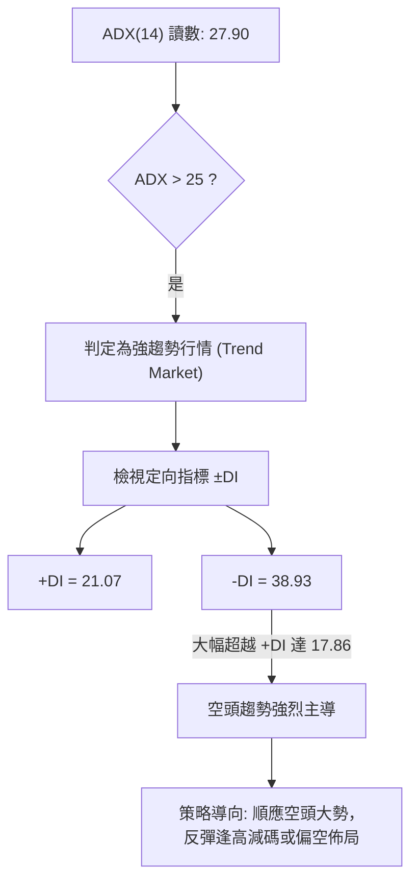

#### ADX 趨勢強度對照表

| 指標名稱 | 當前讀數 | 臨界門檻 | 趨勢狀態判定 | 交易決策指引 |
|----------|----------|----------|--------------|--------------|
| **ADX(14)** | **27.90** | > 25.00 | **強趨勢確立** | 市場脫離無方向震盪，具備明晰的單向運行力量 |
| **+DI(14)** | **21.07** | — | 多方力量偏弱 | 買方動能不足以發動持續性多頭攻擊 |
| **-DI(14)** | **38.93** | — | 空方力量主導 | 賣壓強勁，-DI 與 +DI 差值高達 17.86，空頭處於主攻狀態 |
| **綜合解讀** | — | — | **強烈空頭趨勢** | 拒絕盲目抄底，所有短期向上反彈均視為空頭波段中的修正 |

---

## 3. 圖表形態分析

### 🔍 形態識別系統

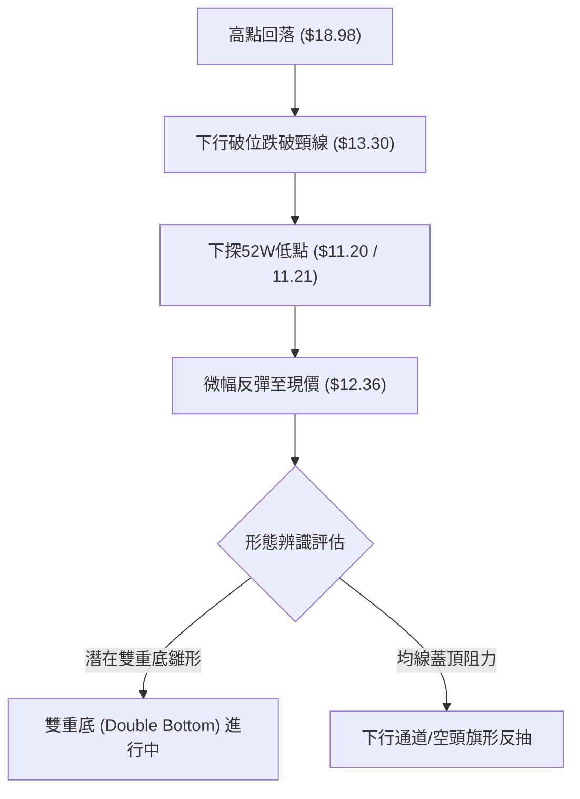

#### 圖表形態信心度評估表

| 形態名稱 | 信心度 | 判斷依據（引用數據） | 完成度 | 目標價（附計算式） |
|----------|--------|----------------------|--------|--------------------|
| **潛在雙重底 (Double Bottom)** | 55% | 2026-10-30與11-03低點$11.48/$11.45，與2026-11-05低點$11.21形成雙底回測52W低點$11.20 | 45% (尚未突破頸線) | 頸線阻力R1 $13.30 + 形態高度($13.30 - $11.20 = $2.10) = $15.40；但目前未突破頸線，僅屬底部構築嘗試 |
| **空頭下行排列反抽** | 75% | 均線系統呈標準空頭排列 (MA20 $13.32 < MA50 $13.97 < MA200 $14.30)，現價向MA20拉回測試 | 80% (反抽進行中) | 下行目標回測支撐S2 $11.78，若跌破則指向52W低點$11.20 |
| **大型頭肩頂頸線破位** | 70% | 歷史高點$18.98為頭部，兩肩分別於$16.12與$17.39，頸線於斐波那契61.8% $14.17破位 | 90% (已完成破位向下滿足) | 由頸線$14.17跌破，量度跌幅下看S3 $11.51與52W低點$11.20（已大致滿足） |

### 🕯️ 重要K線形態分析

嚴格依據數據中「近10根日K」與「近8根週K」之實際開高低收數據進行客觀解讀：

#### 近10根日K棒形態深度解讀

| 日期 | 開盤價 | 最高價 | 最低價 | 收盤價 | 成交量 | K線形態名稱 | 技術解讀與訊號 |
|------|--------|--------|--------|--------|--------|-------------|----------------|
| 2026-10-27 | $12.74 | $13.00 | $12.37 | $12.40 | 99.67M | 中黑實體K棒 | 高開低走，盤中衝高$13.00遭賣壓摜回，空頭發力 🔴 |
| 2026-10-28 | $12.36 | $12.44 | $11.96 | $11.97 | 89.32M | 連續下跌黑K | 跌破$12.00關卡，下影線極短，收盤接近全日最低 🔴 |
| 2026-10-29 | $11.98 | $12.19 | $11.85 | $12.05 | 80.21M | 低檔小紅紡錘線 | 於$11.85處初見支撐，多空陷入短暫僵持 🟡 |
| 2026-10-30 | $11.75 | $11.85 | $11.48 | $11.61 | 92.98M | 跳空低開長黑 | 創波段新低$11.48，帶量下殺，恐慌賣壓湧現 🔴 |
| 2026-11-02 | $11.79 | $12.03 | $11.59 | $11.62 | 68.99M | 帶上影倒狀錘頭 | 反彈至$12.03無力，量能縮小至68.99M，多頭動能不足 🟡 |
| 2026-11-03 | $11.62 | $11.70 | $11.45 | $11.61 | 89.03M | 探底十字星/平底 | 低點$11.45與前低互為呼應，收盤價與開盤持平，殺跌減緩 🟡 |
| 2026-11-04 | $11.95 | $12.16 | $11.84 | $11.99 | 87.55M | 跳空反彈小陽K | 向上跳空開出並收在$11.99，短期均線有止跌跡象 🟢 |
| 2026-11-05 | $12.02 | $12.02 | $11.21 | $11.74 | 99.88M | 長下影長針探底 | 盤中摜壓至$11.21逼近52W低點$11.20，但尾盤爆量拉回收$11.74，下影線達$0.53，主力低接明顯 🟢 |
| 2026-11-06 | $11.81 | $12.28 | $11.79 | $12.03 | 58.38M | 溫和實體紅K | 站回$12.00大關，確認11-05長下影線有效支撐 🟢 |
| 2026-11-09 | $12.14 | $12.40 | $12.00 | $12.36 | 49.12M | 連續溫和紅K | 延續反彈態勢收於全日高檔$12.36，但成交量降至49.12M（量能背離） 🟡 |

#### 近8根週K棒形態深度解讀

| 週交易日 | 開盤價 | 最高價 | 最低價 | 收盤價 | 成交量 | K線形態名稱 | 技術解讀與訊號 |
|----------|--------|--------|--------|--------|--------|-------------|----------------|
| 2026-09-25 | $13.84 | $14.25 | $13.36 | $13.59 | 290.43M | 下跌小黑K | 弱勢整理，反彈受制於$14.25 🔴 |
| 2026-10-02 | $12.53 | $13.50 | $12.13 | $13.43 | 532.73M | 大量下影長紅 | 爆出532.73M巨量，下影線自$12.13強力拉升 🟢 |
| 2026-10-09 | $14.98 | $16.14 | $14.84 | $16.12 | 517.68M | 突破長紅大陽線 | 跳空強攻突破波段高點，為近兩個月最強多頭波段 🟢 |
| 2026-10-16 | $16.10 | $16.19 | $14.40 | $14.56 | 328.78M | 高檔烏雲罩頂長黑 | 創$16.19高點後直線跳水，形成高檔吞噬看跌反轉 🔴 |
| 2026-10-23 | $14.72 | $15.41 | $14.36 | $15.16 | 322.11M | 弱勢反彈吊頸線 | 反彈不過前高$16.19，多頭氣竭 🟡 |
| 2026-10-30 | $11.69 | $13.00 | $11.48 | $11.61 | 701.86M | 崩跌巨量大黑K | 701.86M天量破位下殺，重挫-23.4%，空方徹底失控 🔴 |
| 2026-11-06 | $11.79 | $12.28 | $11.21 | $12.03 | 403.84M | 帶下影止跌陽K | 探底$11.21獲得買盤承接，週線止跌回升 🟢 |
| 2026-11-09 | $12.14 | $12.40 | $12.00 | $12.36 | 49.12M | 弱勢延續紅K | 交易日不完整（單日數據），短線反彈但週量嚴重匱乏 🟡 |

### 📉 ASCII 走勢形態示意圖

```
                    NU 日K線破底反彈形態示意圖
 價格 ($)
 $13.00 ┤        ┌─┐ (10-27 高點 $13.00)
        │        │ │
 $12.50 ┤        │ └─┐
        │        │   │                               ┌─┐ (11-09 收盤 $12.36)
 $12.00 ┤        │   └───┬─┐                     ┌─┐│ │
        │                │ │                     │ ││ │
 $11.50 ┤                └─┬─┐         ┌─┐       │ │└─┘
        │                  │ │ ┌─┐     │ │ ┌─┐   │ │
 $11.00 ┤                  │ │ │ │ ┌─┐ │ │ │ │ ┌─┘ │
        │                  └─┘ └─┘ │ │ └─┘ │ │ │   │
 $10.50 ┤                          │ │     │ │ │   │
        │                          └─┘     │ │ └───┘
 $10.00 ┤                                  │ │
        │                                  └─┘ (11-05 長下影探底 $11.21)
        └────────────────────────────────────────────────────────
          10-27  10-28  10-30 11-02 11-03 11-04 11-05 11-06 11-09
```

### 🎯 形態目標價計算

1. **潛在雙重底反彈目標推算（依規則13嚴格計算）**：
   - 第一低點（2026-10-30）：$11.48
   - 第二低點（2026-11-05）：$11.21（絕對低點 $11.20）
   - 中間反彈頸線阻力（R1）：$13.30
   - 形態高度：$13.30 − $11.20 = $2.10
   - **形態向上測量目標價** = 頸線 $13.30 + 形態高度 $2.10 = **$15.40**（註：此為若能放量突破頸線R1之等幅測距目標）
2. **短期弱勢反彈滿足目標**：
   - 根據近一年波段高點聚類，目前短線反彈直接面臨阻力位 **R1: $13.30** 與 **R2: $13.52**，與當前 MA20 ($13.32) 形成重合共振。

---

## 4. 支撐與阻力

### 🗺️ 關鍵價位分布圖（Unicode）

```
╔══════════════════════════════════════════════════════════════════╗
║                    NU 關鍵價位空間結構分布圖                     ║
╠══════════════════════════════════════════════════════════════════╣
║ $14.32 ║████████████████████████████████║ 強阻力 R3 (年線MA200重疊)║
║ $14.17 ║▓▓▓▓▓▓▓▓▓▓▓▓▓▓▓▓▓▓▓▓▓▓▓▓▓▓▓▓▓▓  ║ 斐波那契 61.8% 回調位    ║
║ $13.52 ║████████████████████████        ║ 阻力 R2 (波段高點聚類)   ║
║ $13.30 ║████████████████████████████████║ 核心阻力 R1 (MA20/月線)  ║
║ $12.86 ║▓▓▓▓▓▓▓▓▓▓▓▓▓▓▓▓▓▓▓▓            ║ 斐波那契 78.6% 回調位    ║
╠════════╬════════════════════════════════╬══════════════════════════╣
║ $12.36 ╠════════════════════════════════╣ ◄◄ 當前收盤價 ($12.36)   ║
╠════════╬════════════════════════════════╬══════════════════════════╣
║ $12.18 ║▓▓▓▓▓▓▓▓▓▓▓▓▓▓▓▓▓▓▓▓            ║ 近期支撐 S1 (波段低點)   ║
║ $11.78 ║████████████████████████        ║ 強支撐 S2 (密集換手區)   ║
║ $11.51 ║████████████████████████████    ║ 關鍵防線 S3 (破底警戒區) ║
║ $11.20 ║████████████████████████████████║ 52週極限低點 (100%回調)  ║
╚══════════════════════════════════════════════════════════════════╝
```

### 🚧 阻力位分析表

所有價位均來自「關鍵價位（由 OHLCV 計算）」區塊，嚴禁捏造：

| 阻力級別 | 價位 | 距離現價 | 形成原因與技術共振 | 突破難度 | 重要性 |
|----------|------|----------|--------------------|----------|--------|
| **R1** | **$13.30** | +7.61% | 近一年波段高點聚類，與布林中軌 MA20 ($13.32) 形成共振強壓 | 極高 | ★★★★★ |
| **R2** | **$13.52** | +9.34% | 近一年波段高點聚類，前波週線換手平台下緣 | 高 | ★★★★☆ |
| **R3** | **$14.32** | +15.82% | 近一年密集波段高點，且與 MA200 ($14.30) 及斐波那契61.8% ($14.17) 重合 | 極高 | ★★★★★ |

### 🛡️ 支撐位分析表

所有價位均來自「關鍵價位（由 OHLCV 計算）」區塊，嚴禁捏造：

| 支撐級別 | 價位 | 距離現價 | 形成原因與技術共振 | 守住機率 | 重要性 |
|----------|------|----------|--------------------|----------|--------|
| **S1** | **$12.18** | -1.45% | 近一年波段低點聚類，近3日K線回測不破之短線防線 | 60% | ★★★☆☆ |
| **S2** | **$11.78** | -4.69% | 近一年波段低點聚類，11月06日實體K棒起漲支撐點 | 70% | ★★★★☆ |
| **S3** | **$11.51** | -6.88% | 近一年波段低點聚類，10月30日長黑K收盤支撐區 | 75% | ★★★★☆ |

### 📐 斐波那契回調位分析

依據 52 週波段區間（$11.20 → $18.98）計算之標準斐波那契回調位如下：

| 回調比率 | 價位 | 當前價位關係 | 技術意涵解讀 |
|----------|------|--------------|--------------|
| **0.0%** (52W High) | **$18.98** | 高於現價 +53.56% | 2026年歷史多頭頂部極限值 |
| **23.6%** | **$17.14** | 高於現價 +38.67% | 強勢多頭防守線，跌破後轉為超級長壓 |
| **38.2%** | **$16.01** | 高於現價 +29.53% | 10月09日週K反彈高點 ($16.12) 之受壓區 |
| **50.0%** | **$15.09** | 高於現價 +22.09% | 多空中長線強弱分水嶺 |
| **61.8%** | **$14.17** | 高於現價 +14.64% | 黃金分割重要防線，跌破後確認進入深度修正 |
| **78.6%** | **$12.86** | 高於現價 +4.05% | **現價 ($12.36) 位於 78.6% 至 100.0% 之間** |
| **100.0%** (52W Low) | **$11.20** | 低於現價 -9.39% | 52週波段最低點，空頭波段的終極多頭防禦基石 |

**斐波那契結構深度解讀**：
當前收盤價 $12.36 明顯落於 **78.6% ($12.86)** 與 **100.0% ($11.20)** 之間的「深陷回撤區間」。這意味著多頭不僅回吐了過去一整年牛市行情的全部超額漲幅，甚至瀕臨全數回吐的危險邊緣。78.6% 回調位 $12.86 已經由支撐徹底反轉為向上反彈的第一道嚴密障礙。

---

## 5. 技術指標深度解讀

### 🎛️ 指標訊號總覽

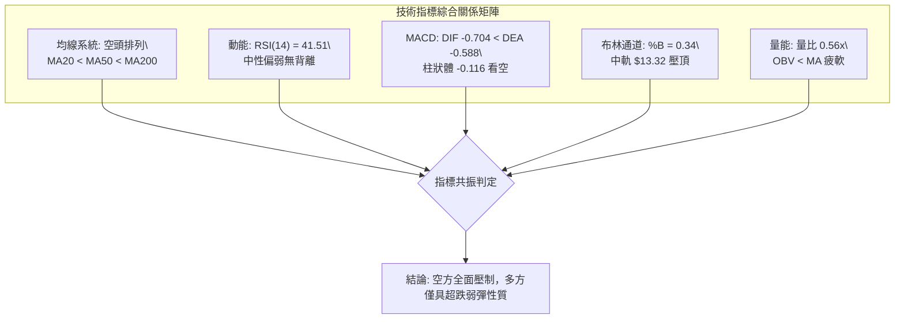

### 📈 移動平均線排列分析

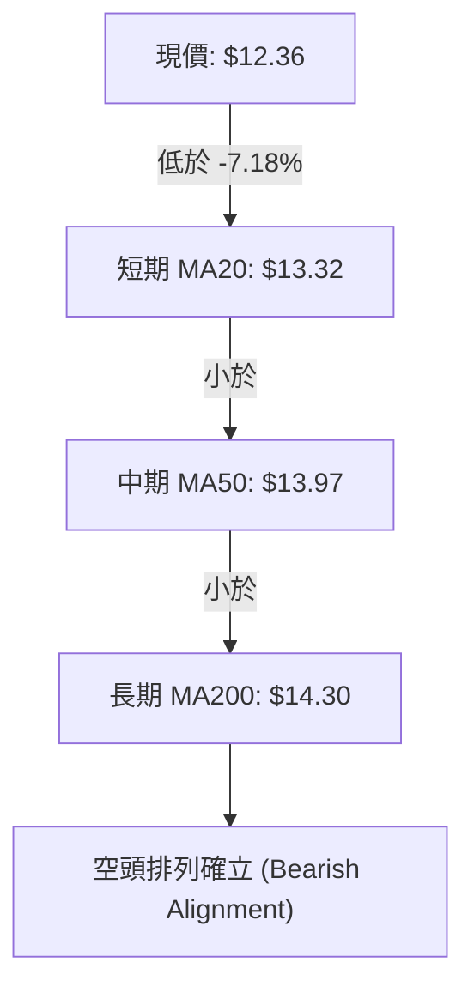

#### 移動平均線系統數據矩陣

| 均線名稱 | 數值 | 現價與均線距離 | 走勢特徵 (Trend) | 訊號評級 |
|----------|------|----------------|------------------|----------|
| **MA 5** | $11.95 | +$0.41 (+3.47%) | 向上勾頭反彈 ▃▃▄▅▆▇ | 🟢 短線反彈 |
| **MA 10** | $11.94 | +$0.42 (+3.53%) | 走平微升 ▄▄▅▆▇ | 🟢 5日金叉10日 |
| **MA 20** | $13.32 | -$0.96 (-7.18%) | 下行反壓 █▇▆▅▄▃▂ | 🔴 月線強阻 |
| **MA 50** | $13.97 | -$1.61 (-11.53%) | 陡峭向下 █▇▆▅▄▃ | 🔴 季線重壓 |
| **MA 60** | $14.09 | -$1.73 (-12.26%) | 持續向下 █▇▆▅▄▃ | 🔴 中期偏空 |
| **MA 120**| $13.72 | -$1.36 (-9.89%) | 緩步下彎 █▇▆▅▄ | 🔴 半年線死叉 |
| **MA 200**| $14.30 | -$1.94 (-13.57%) | 長期均線下彎 | 🔴 長期走熊 |
| **MA 240**| $14.75 | -$2.39 (-16.18%) | 年線深套區 █▇▆▅▄▃ | 🔴 結構性套牢 |

**均線綜合解讀**：
雖然超短期均線出現微弱的金叉現象（MA5 $11.95 向上穿過 MA10 $11.94），但核心波段均線呈現標準的「死亡空頭排列」：**MA20 ($13.32) < MA50 ($13.97) < MA200 ($14.30)**。現價與20日均線的負乖離率達 -7.18%，在空頭行情中，向 MA20 的靠攏往往屬於「死貓跳」或「回抽測壓」，除非能伴隨巨大成交量連續收復 MA20 與 MA50，否則均線系統對價格構成沉重下壓。

### 📉 RSI(14) 分析

- **RSI(14) 當前數值**：**41.51**
- **強度進度條**：
  ```
  弱勢超賣區 [0-30]      弱勢空方區 [30-50]      強勢多方區 [50-70]      超買警示區 [70-100]
  ░░░░░░░░░░░░░░░░░░░░  ████████████░░░░░░░░  ░░░░░░░░░░░░░░░░░░░░  ░░░░░░░░░░░░░░░░░░░░
  當前水位：41.51 (處於弱勢空方主導區間)
  ```
- **區間評估**：RSI 位於 41.51，脫離了 10 月 30 日低點的超賣邊界（當時週 RSI 跌至 30.7），但仍受制於 50 多空分水嶺。這表明多頭的反彈僅僅是技術性指標修復，並未形成多頭主動進攻的動能。
- **背離判斷**：
  - **日線背離判定**：比對近 20 根 K 棒首尾之價格與 RSI 方向，**無明顯背離（No Divergence）**。價格創新低之際，RSI 亦同步探底，隨後同步回升，顯示跌勢與技術指標完全相符，未見大型「底背離」誘多或轉折結構。

### 📊 MACD(12/26/9) 訊號解讀

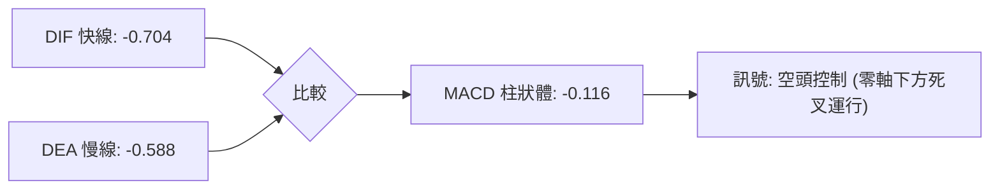

- **MACD 快線 (DIF)**：-0.704
- **MACD 訊號線 (DEA)**：-0.588
- **MACD 柱狀體 (Histogram)**：-0.116 🔴 看空
- **深度剖析**：
  DIF 與 DEA 均位於零軸深處（負值），呈現「雙線零下死叉」格局，反映市場仍處於大型中線空頭波段中。儘管負柱狀體（-0.116）較 10 月底的高峰有所收斂，但快線未曾上穿慢線，尚未產生真正的多頭黃金交叉。任何在零軸深處的微幅鈍化，均隨時可能因空頭二次打壓而再度擴大。

### 📦 布林通道分析

```
NU 日線布林通道 (20, 2) 結構圖
══════════════════════════════════════════════════════════════
$16.38 ───────────────────────────── 布林上軌 (BB Upper)
       │
       │
$13.32 ───────────────────────────── 布林中軌 (MA20 / BB Middle)
       │
$12.36 ─────────────── 現價 ($12.36, BB %B = 0.34)
       │
$10.25 ───────────────────────────── 布林下軌 (BB Lower)
══════════════════════════════════════════════════════════════
```

- **通道參數**：上軌 $16.38 ｜ 中軌 $13.32 ｜ 下軌 $10.25 ｜ 通道寬度 = $6.13
- **當前位置 (%B)**：**0.34**（0 代表下軌，$10.25；0.5 代表中軌，$13.32；1 代表上軌，$16.38）。
- **結構解讀**：%B 讀數為 0.34，表明價格運行於布林下半部通道（弱勢區）。現價反彈的中期極限壓制點即為下行的中軌 **$13.32**（與阻力位 R1 $13.30 完全重疊）。在通道開口向下張開的背景下，股價若無法強勢突破中軌，將面臨沿著下半通道再度滑落尋找下軌支撐的風險。

### 💹 成交量分析（量價配合度）

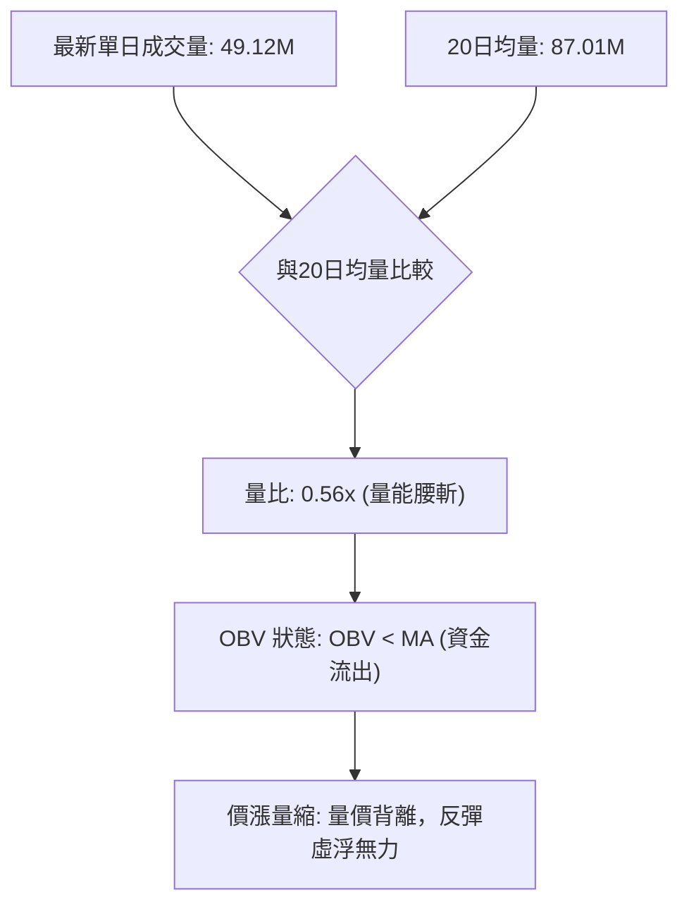

- **最新成交量**：49,118,900 股
- **20日平均成交量**：87,011,990 股（量比僅 **0.56x**）
- **50日平均成交量**：83,484,360 股
- **量價關係深入分析**：
  在 11 月 06 日至 11 月 09 日的價格上揚過程中，成交量由 10 月底巨幅下殺時的 7 億股（週量）及 9,900 萬股（日量），急速萎縮至僅 4,911 萬股。**價格反彈但量能大幅衰竭**，呈現典型的「量價負背離」。此外，OBV 趨勢持續低於其移動平均線，顯示大資金主力機構並未在此刻積極進場掃貨，目前的拉升更偏向市場浮額賣壓暫時耗竭後的被動上浮。

---

## 6. 動能與波動率

### ⚡ 動能評估四象限

| 象限標籤 | 動能狀態 | 波動率狀態 | 當前狀態吻合度 | 技術評估與操作意涵 |
|----------|----------|------------|----------------|--------------------|
| **第一象限 (Q1)** | 強動能 (Bullish) | 低波動 (Low Vol) | — | 穩定多頭主升段，最佳持股與加碼環境 |
| **第二象限 (Q2)** | 弱動能 (Bearish) | 低波動 (Low Vol) | — | 底部打底或無趣盤整，適合區間網格操作 |
| **第三象限 (Q3)** | 強動能 (Bullish) | 高波動 (High Vol) | — | 狂熱噴出爆量段，高風險高收益，須緊盯停利 |
| **第四象限 (Q4)** | **弱動能 (Bearish)** | **高波動 (High Vol)** | **✓ (當前處境)** | **空方宣洩主導，高波動下跌洗盤，嚴禁重倉盲目抄底** |

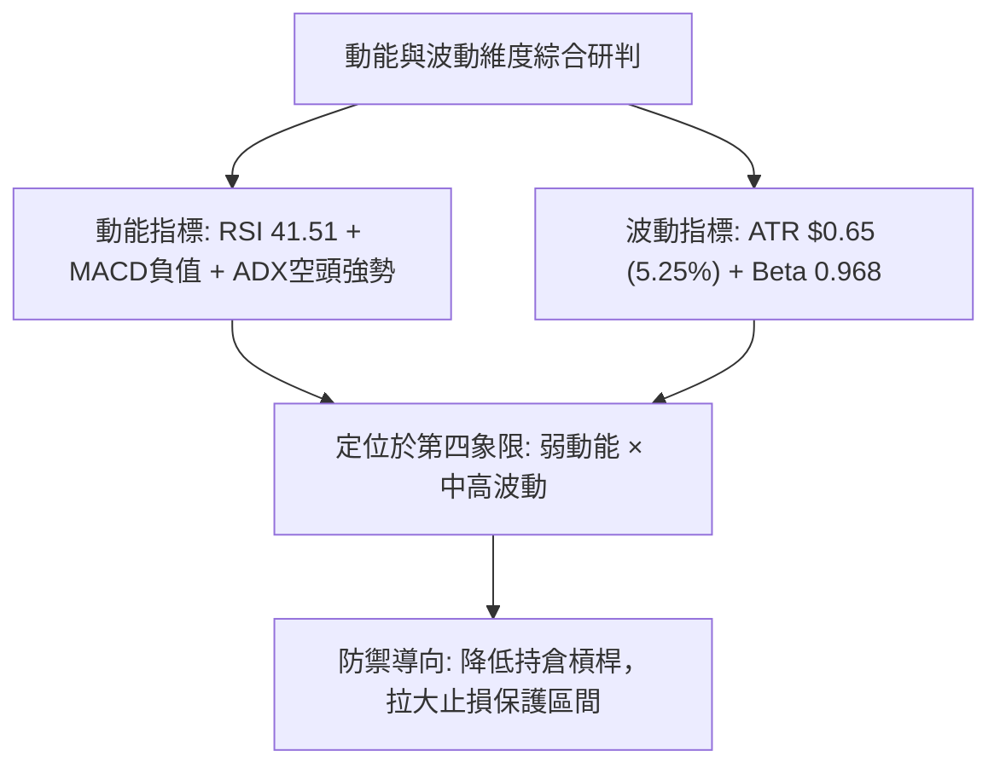

### 📊 ATR 波動率分析

- **ATR(14) 數值**：**$0.65**（採 Wilder 演算法計算）。
- **ATR 佔比**：佔當前股價 $12.36 之 **5.25%**。
- **波動特性分析**：
  每日平均波動高達 $0.65，反映 NU 屬於高彈性標的。若設定止損，絕不能設定過於緊密（如小於 $0.30），否則極易在正常的盤中雜訊中遭到無謂洗盤出場。
- **動態止損距離設定建議**：
  - **保守型（波段持倉）**：建議給予 2.0 × ATR = **$1.30** 之防守空間。
  - **積極型（短線交易）**：建議給予 1.0 ~ 1.5 × ATR = **$0.65 ~ $0.98** 之止損空間。

### 📐 Beta 與市場相關性

- **Beta 係數**：**0.968**
- **市場連動解讀**：
  Beta 接近 1.0（0.968），表示 NU 與美股大盤（S&P 500 / 納斯達克）之波動幅度高度同頻。在系統性市場回檔或宏觀金融板塊承壓之際，NU 將承受同等甚至略微放大的聯動賣壓。機構持股比例高達 **82.8%**，且空頭未平倉比例（Short % Float）為 **3.7%**（空頭回補天數 1.65 天），說明當前股價滑落主要來自於機構投資者的去槓桿調節與拋售，而非單純的散戶恐慌。

---

## 7. 多時框架總結

### 📋 時框架評分表

| 時框架 | 趨勢方向 | 動能狀態 | 均線排列 | 形態特徵 | 綜合評分 | 戰術建議 |
|--------|----------|----------|----------|----------|----------|----------|
| **長期 (月線)** | 偏空 🔴 | 疲弱 (回吐前波漲幅) | 均線下彎跌破長期均線 | 歷史高點 $18.98 雙頂頸線破位 | **30/100** | 戰略性減碼，不宜中長線重倉 |
| **中期 (週線)** | 空頭 🔴 | 轉空 (週MACD為負) | 空頭排列 (跌破週線MA20) | 10月底爆量巨黑K破位 | **30/100** | 逢反彈至週線阻力積極減壓 |
| **短期 (日線)** | 弱彈 🟡 | 中性微弱 (KD金叉/量縮) | MA5/10微幅金叉，但受制MA20 | 觸底 $11.21 後的技術性縮量反抽 | **45/100** | 僅供超短線高拋低吸，嚴格止損 |

### 🔲 綜合訊號矩陣

```
╔══════════════════════════════════════════════════════════════════╗
║                   NU 多時框架訊號收斂矩陣                       ║
╠══════════════════════════════════════════════════════════════════╣
║ 維度項目       日線層級 (短期)     週線層級 (中期)     月線層級 (長期) ║
╠══════════════════════════════════════════════════════════════════╣
║ 趨勢方向       弱勢反彈 🟡         強烈空頭 🔴         高檔破位 🔴     ║
║ 動能強弱       KD金叉/超跌 🟢      MACD負值發散 🔴     回調未到底 🔴   ║
║ 均線系統       MA5>MA10短多 🟢     MA20<MA50空頭 🔴    遠低於年線 🔴   ║
║ 量能配合       縮量反彈背離 🔴     爆量破位下殺 🔴     量能持續萎縮 🔴 ║
║ 關鍵關卡       受制 R1 $13.30      失守 $14.17 (61.8%) 逼近低點 $11.20 ║
╚══════════════════════════════════════════════════════════════════╝
```

### ⚖️ 多時框收斂結論

> **依「多時框收斂規則（規則14）」判定**：
> 當前指標中 **ADX(14) 讀數為 27.90（明確大於 25 臨界值）**，且 **-DI (38.93) 遠高於 +DI (21.07)**，系統正式判定當前市場處於**「強烈趨勢行情（空頭主導）」**而非無方向的盤整行情。
>
> 依優先級規則：**在 ADX > 25 之趨勢行情中，必須以中長期（週線 / MA50 / MA200）方向為主導，日線層級僅可用於尋找逢高放空或超跌止損之進場時機**。
>
> **最終唯一方向性結論**：**明確偏空（主策略採反彈受阻放空，或逢高出脫減碼）**。此結論完全收斂第 1 章（綜合評分 35/100 偏空）與第 2、5 章之空頭均線壓制結論，拒絕兩頭模稜兩可。

---

## 8. 交易策略建議

### 🗺️ 策略決策流程圖

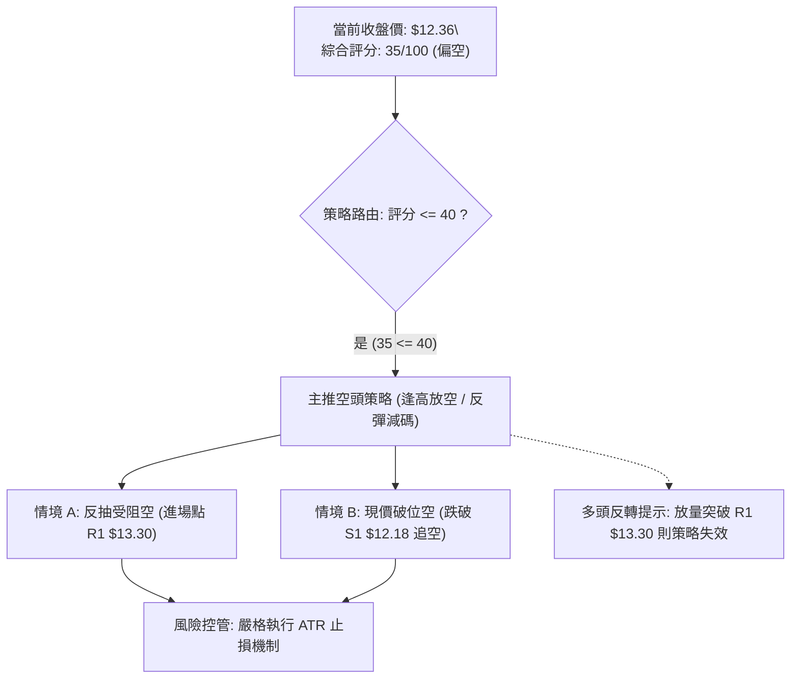

### 🧭 策略路由（依評分卡分流）

**當前主策略方向 = 主推空頭策略（依技術評分卡綜合評分 35/100 ≤ 40 偏空分流，嚴格執行順勢偏空操作）**。

### 🎯 價格情境階梯（Price Scenarios）

價位完全嚴格引用「第4章／關鍵價位區塊」計算之波段聚類數值：

| 觸發條件 | 下一目標 | 後續延伸 | 技術面情境含義與對策 |
|----------|----------|----------|----------------------|
| **向上突破 R1 $13.30** | R2 $13.52 | R3 $14.32 | 短線強勢修復，突破月線壓制，空頭空單必須全數止損離場 |
| **受阻於 R1 $13.30 承壓** | 現價 $12.36 | S1 $12.18 | 反彈力竭，受制於布林中軌與均線反壓，為最佳放空切入點 |
| **跌破 S1 $12.18 關卡** | S2 $11.78 | S3 $11.51 | 反彈結束，空頭重啟下行推動浪，將進一步探底 |
| **跌破 S3 $11.51 支撐** | 52W低點 $11.20 | 下行破位 | 空方極度宣洩，若失守 $11.20 將開啟未知的技術性破底跌勢 |

### 📊 情境機率分佈

| 運行情境 | 發生機率 | 主要技術依據與數據指標支持 |
|----------|----------|----------------------------|
| **情境一：弱勢反抽受阻於 R1 後回落** | **55%** | 均線空頭排列（MA20 $13.32 反壓）、ADX 27.90 強勢偏空、成交量嚴重萎縮（量比 0.56x 背離） |
| **情境二：直接失守 S1 再度探底** | **30%** | MACD 柱狀體仍為負 (-0.116)、-DI 高達 38.93 牢牢掌權，市場缺乏追價意願 |
| **情境三：放量反轉強攻突破 R2/R3** | **15%** | KD 低檔金叉，但缺乏資金配合，在未收復季線前僅屬極低機率之黑天鵝軋空 |

### 🔴 主策略詳情（方向：空頭波段操作）

所有數值均由數據中關鍵價位計算，並依照規則 17 計算精確風險報酬比：

| 策略要素 | 策略 A：反彈受阻放空（勝率較高） | 策略 B：跌破支撐追空（順勢突破） |
|----------|---------------------------------|---------------------------------|
| **策略邏輯** | 向上測試阻力 R1 與 MA20 力竭時進場 | 跌破短線支撐 S1 確認反彈結束進場 |
| **進場價格** | **$13.30**（精準切入阻力位 R1） | **$12.18**（跌破支撐位 S1 確認） |
| **止損價格** | **$13.80**（突破阻力後之上方緩衝） | **$12.50**（站回突破點之上方） |
| **目標價 T1** | **$12.18**（近期支撐 S1） | **$11.51**（波段支撐 S3） |
| **目標價 T2** | **$11.20**（52週極限低點） | **$11.20**（52週極限低點） |
| **風險報酬比 (以 T1 計)** | **1 : 2.24**<br>計算式：($13.30 − $12.18) ÷ ($13.80 − $13.30) = $1.12 ÷ $0.50 | **1 : 2.09**<br>計算式：($12.18 − $11.51) ÷ ($12.50 − $12.18) = $0.67 ÷ $0.32 |
| **風險報酬比 (以 T2 計)** | **1 : 4.20**<br>計算式：($13.30 − $11.20) ÷ ($13.80 − $13.30) = $2.10 ÷ $0.50 | **1 : 3.06**<br>計算式：($12.18 − $11.20) ÷ ($12.50 − $12.18) = $0.98 ÷ $0.32 |
| **成功機率估計** | **60%** | **55%** |
| **建議配置倉位** | **總資金之 15%** | **總資金之 10%** |

### 🟢 反向風險觸發點（對沖與止損提示）

若市場出現以下訊號，說明原有空頭邏輯被市場推翻，空單必須立即無條件止損，甚至考慮反手短多：
1. **價位警訊**：日K線收盤價**強勢帶量站穩 R1 $13.30 之上**，且隔日確認不破。
2. **量能警訊**：單日成交量突破 20 日均量（> 8,700 萬股），呈現標準量增價揚實體長紅。
3. **指標警訊**：日線 MACD 柱狀體翻正，且 DIF 向上穿越 DEA 形成零下金叉。

### ⭐ 整體訊號強度評星

```
╔══════════════════════════════════════════════════════════════╗
║                    整體技術訊號評星                          ║
╠══════════════════════════════════════════════════════════════╣
║ 做多訊號強度：  ★★☆☆☆  (2/5星 - 僅屬超跌反抽，無持續買盤)    ║
║ 做空訊號強度：  ★★★★☆  (4/5星 - 均線與趨勢指標強烈偏空)      ║
║ 整體可信度：    ★★★★☆  (4/5星 - 多時框數據一致確認向下)      ║
╚══════════════════════════════════════════════════════════════╝
```

---

## 9. 風險提示與監控

### ✅ 關鍵監控指標 Checklist

```
╔══════════════════════════════════════════════════════════════╗
║               NU 日常交易監控 Checklist (每日必檢)            ║
╠══════════════════════════════════════════════════════════════╣
║ [ ] 監控項 1：收盤價是否挑戰 MA20 / R1 ($13.30)？未過仍屬空頭 ║
║ [ ] 監控項 2：成交量是否放大至 8,700 萬股以上？若量縮則反彈為假║
║ [ ] 監控項 3：支撐 S1 ($12.18) 是否失守？破位將加速探底     ║
║ [ ] 監控項 4：ADX(14) 是否持續維持在 25 以上？維持則空頭延續 ║
║ [ ] 監控項 5：-DI 是否依然大幅高於 +DI？空方是否持續控盤      ║
║ [ ] 監控項 6：MACD Histogram 是否由負翻正？關注背離轉折訊號 ║
║ [ ] 監控項 7：52週低點 ($11.20) 之終極防線是否面臨考驗？      ║
╚══════════════════════════════════════════════════════════════╝
```

### ⚠️ 風險場景分析

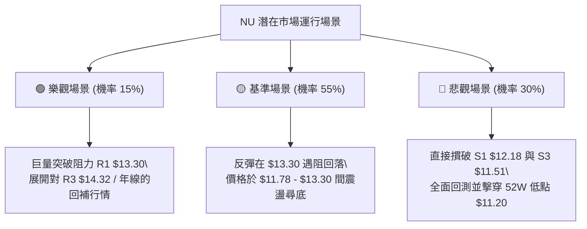

### 🛡️ 風險管理重要提醒

1. **嚴禁逆勢重倉加碼攤平**：
   NU 當前處於標準的空頭排列架構，且 ADX 強達 27.90。在下行趨勢確立的背景下，「越跌越買」或「逢低攤平」是交易中最致命的行為，極易導致帳戶權益出現毀滅性回撤。
2. **波動率保護原則**：
   當前 ATR 達 $0.65（佔股價 5.25%），單日價格震盪劇烈。無論採取何種策略，必須確保單筆交易的風險暴露金額（Account Risk）嚴格控制在總資金的 **1.0% ~ 1.5%** 以內。
3. **財報與宏觀事件風險**：
   根據最新市場資訊，市場正密切關注 Q3 財報釋出與宏觀金融環境波動（如 MercadoLibre 財報引發的區域性拉回）。在重大財報與經濟數據公布前夕，應主動降倉以規避隔夜跳空風險。

---

## 📋 報告總結

```
╔══════════════════════════════════════════════════════════════════╗
║                     NU 技術分析報告總結                          ║
╠══════════════════════════════════════════════════════════════════╣
║ 報告日期：2026-11-10                                             ║
║ 當前價格：$12.36 USD                                             ║
║ 分析評級：🔴 偏空格局 (技術評分: 35/100，空頭波段反彈受阻)       ║
╠══════════════════════════════════════════════════════════════════╣
║ 關鍵結論：                                                       ║
║ ├─ 長期趨勢：🔴 空頭主導 (歷史高點 $18.98 回落，深陷年線下方)    ║
║ ├─ 中期趨勢：🔴 空頭排列 (週線爆量長黑，MA20 < MA50 < MA200)    ║
║ ├─ 短期趨勢：🟡 弱勢反彈 (受制於量能不足 0.56x，反抽面臨月線反壓)║
║ ├─ 關鍵支撐：S1 $12.18 ｜ S2 $11.78 ｜ 極限低點 $11.20           ║
║ ├─ 關鍵阻力：R1 $13.30 (MA20) ｜ R2 $13.52 ｜ R3 $14.32 (MA200) ║
║ └─ 分析師目標：共識買入評級 (目標均價 $18.56，區間 $12.00-$23.00) ║
╠══════════════════════════════════════════════════════════════════╣
║ 最優策略組合：                                                   ║
║ 1. 🥇 最佳機會：等待反彈至 R1 ($13.30) 受阻時順勢放空 (風報比1:2.24)║
║ 2. 🥈 次選機會：跌破短線支撐 S1 ($12.18) 時順勢追空，看 S3 ($11.51)║
║ 3. 🥉 保守選擇：空手觀望，靜待股價回測 $11.20 出現量價底背離再議 ║
╚══════════════════════════════════════════════════════════════════╝
```

---

> ⚠️ **免責聲明**：本報告為資深量化與技術分析框架自動生成之專業研報，報告內所有數據、圖表及推算結論均嚴格基於所提供之歷史價格與交易量資訊。本報告**僅供學術研究與交易架構參考**，**不構成任何要約、招攬或實質投資建議**。金融市場瞬息萬變，交易決策應獨立審慎，入市需自負盈虧風險。

---

*報告生成時間：2026-11-10 ｜ 數據來源：Yahoo Finance ｜ 分析框架：多時框技術分析體系*