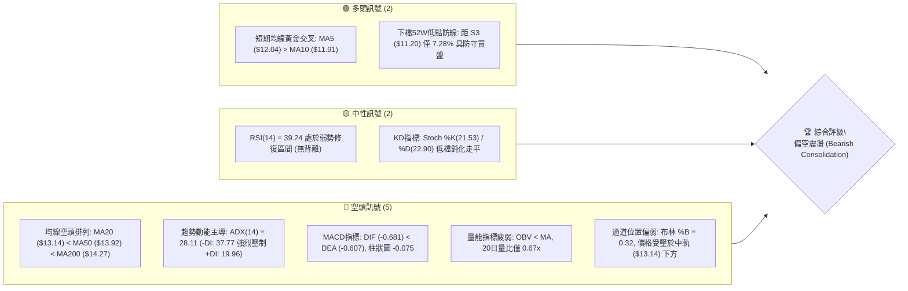
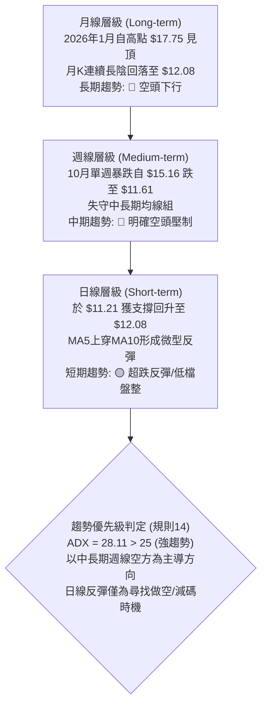
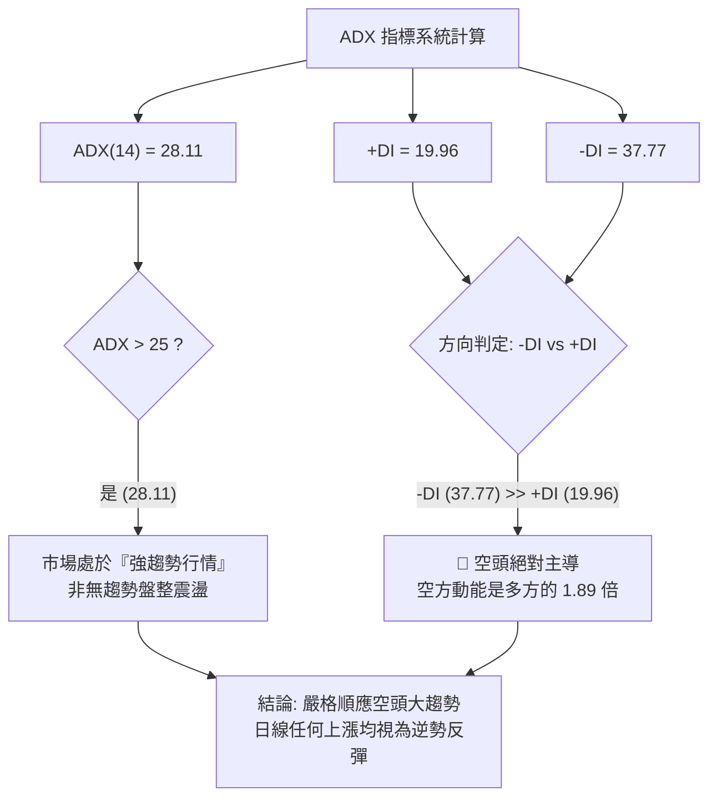
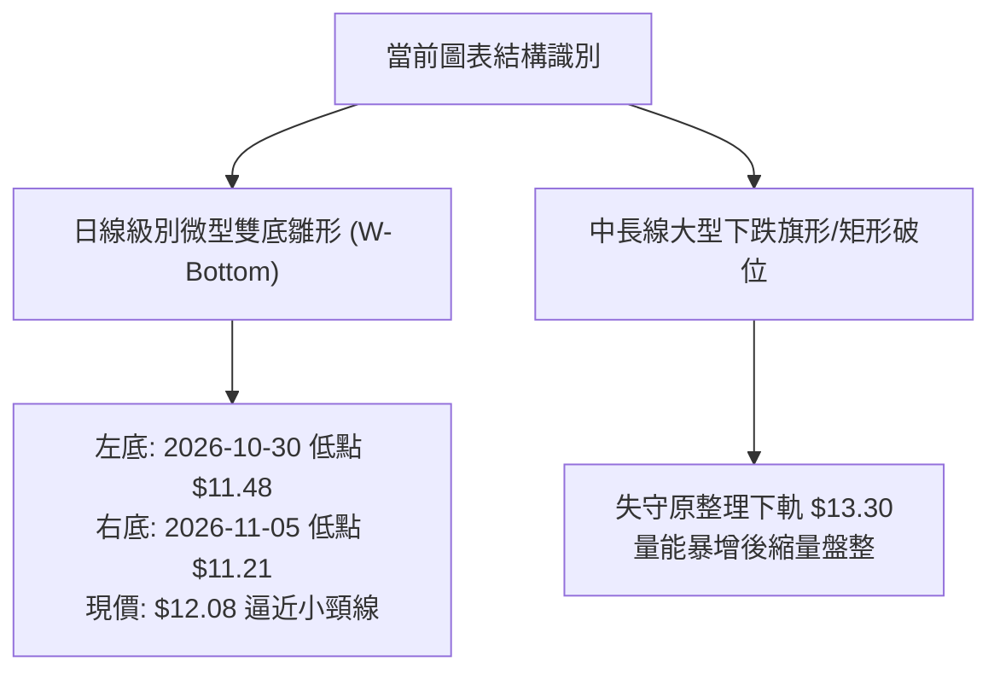
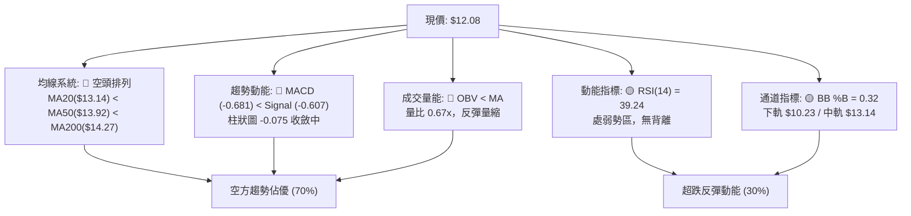
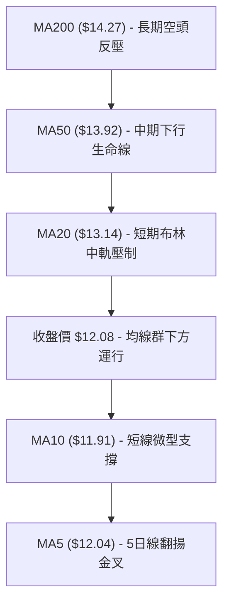
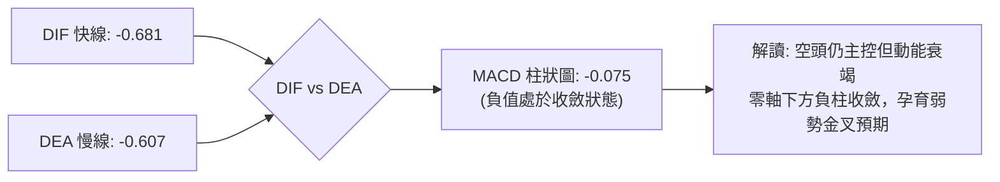
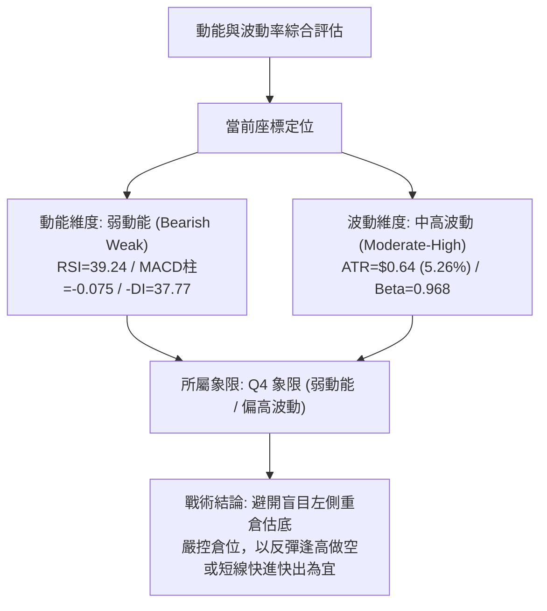
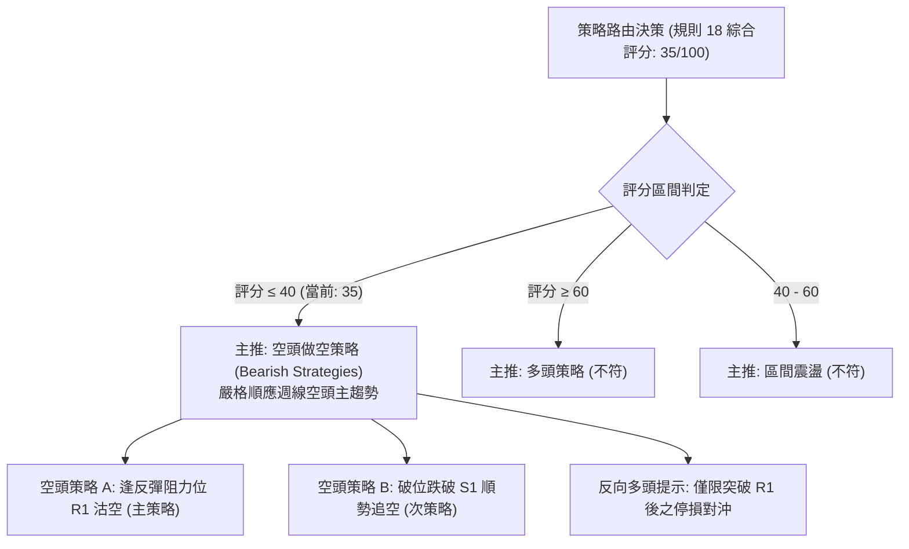
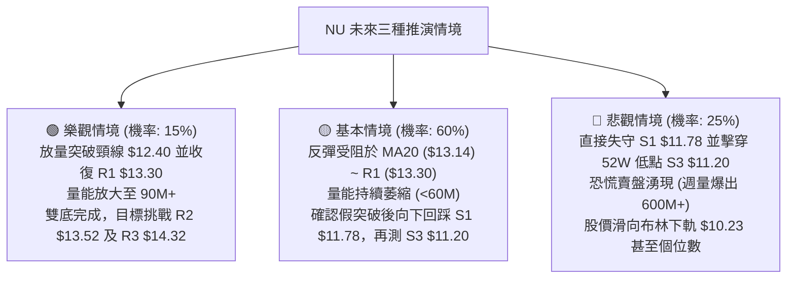

# NU 技術分析報告

> **報告日期**：2026-11-11 ｜ **語言**：繁體中文 ｜ **數據來源**：Yahoo Finance ｜ **當前價格**：$12.08

---

## 目錄

| 章節 | 內容 |
|------|------|
| [1. 技術面概覽](#1-技術面概覽) | 訊號儀表板、核心指標、評分卡 |
| [2. 趨勢分析](#2-趨勢分析) | 多時框趨勢、長中短期走勢 |
| [3. 圖表形態分析](#3-圖表形態分析) | 形態識別、K線組合、目標價 |
| [4. 支撐與阻力](#4-支撐與阻力) | 關鍵價位、斐波那契回調 |
| [5. 技術指標深度解讀](#5-技術指標深度解讀) | MA/RSI/MACD/布林/成交量 |
| [6. 動能與波動率](#6-動能與波動率) | 動能評估、ATR、Beta |
| [7. 多時框架總結](#7-多時框架總結) | 時框架評分矩陣 |
| [8. 交易策略建議](#8-交易策略建議) | 多空策略、風險報酬比 |
| [9. 風險提示與監控](#9-風險提示與監控) | 監控指標、風險場景 |

---

## 1. 技術面概覽

### 🎯 技術訊號儀表板



### 📊 核心指標速覽表

| 指標類別 | 指標名稱 | 當前數值 | 訊號 | 解讀 |
|----------|----------|----------|:----:|------|
| **價格** | 當前價格 | $12.08 | 🔴 | 位於52週區間 11.3% 位置，整體處於近一年絕對低位區 |
| **均線** | MA20 | $13.14 | 🔴 | 價格在MA20下方 -8.07%，短期反彈第一重主要蓋頭反壓 |
| **均線** | MA50 | $13.92 | 🔴 | 價格在MA50下方 -13.22%，中期生命線下彎形成沉重阻力 |
| **均線** | MA200 | $14.27 | 🔴 | 價格在MA200下方 -15.35%，長期多空分水嶺失守，長線轉空 |
| **動能** | RSI(14) | 39.24 | 🟡 | 位於 30-70 中性偏弱區，未跌破超賣閾值但缺乏強勁買盤推升 |
| **動能** | MACD | -0.681 | 🔴 | DIF < DEA (-0.607)，柱狀圖為 -0.075，空方動能佔優但負柱收斂 |
| **波動** | ATR(14) | $0.64 | 🟡 | 佔現價 5.26%，屬中度波動區間，每日價格波幅約 64 美分 |
| **趨勢** | ADX(14) | 28.11 | 🔴 | ADX > 25 表明趨勢明確，-DI (37.77) 遠高於 +DI (19.96) 主導跌勢 |
| **量能** | OBV | OBV < MA | 🔴 | 能量潮低於其均線，最新成交量 57.93M 低於 20MA (86.91M)，量縮反彈 |

### 🏆 技術評分卡

```
╔══════════════════════════════════════════════════════════════════╗
║                   技術評分卡 — NU (2026-11-11)                   ║
╠══════════════════════════════════════════════════════════════════╣
║ 趨勢強度 (Trend)     ██████░░░░░░░░░░░░░░  30/100  🔴 空頭趨勢主導 ║
║ 動能指標 (Momentum)  ████████░░░░░░░░░░░░  40/100  🟡 弱勢震盪反彈 ║
║ 支撐穩定度 (Support) ██████████░░░░░░░░░░  50/100  🟡 考驗S1/S2支撐║
║ 成交量配合 (Volume)  ██████░░░░░░░░░░░░░░  30/100  🔴 量縮背離弱勢 ║
║ 形態完整度 (Pattern) ████████░░░░░░░░░░░░  40/100  🟡 築底結構未成 ║
║ 均線排列 (Moving Avg)████░░░░░░░░░░░░░░░░  20/100  🔴 典型空頭排列 ║
╠══════════════════════════════════════════════════════════════════╣
║ 綜合評分             ███████░░░░░░░░░░░░░  35/100  🔴 偏空弱勢格局 ║
║ 算術平均: (30 + 40 + 50 + 30 + 40 + 20) / 6 = 35.0/100 (規則18)  ║
╚══════════════════════════════════════════════════════════════════╝
```

---

## 2. 趨勢分析

### 🌐 多時框趨勢分析



### 📈 長期趨勢 — 12個月走勢圖（Unicode）

```
NU 月線走勢圖（2025-12 至 2026-11）
價格軸 ($)
$18.00 ┤              ● (2026-01: $17.75)
$17.00 ┤        ●     │
$16.00 ┤        │     │
$15.00 ┤        │     │  ● (02: $14.98)
$14.00 ┤        │     │  │  ● (03: $14.37)  ● (04: $14.48)        ● (07: $14.33)  ● (08: $14.55)
$13.00 ┤        │     │  │  │               │              ● (06: $13.36)  │
$12.00 ┤        │     │  │  │               │  ● (05: $13.13)              │               ● (09: $12.66)
$11.00 ┤        │     │  │  │               │                              │               │  ● (10: $11.61) 
$10.00 ┤        │     │  │  │               │                              │               │  │  ● (11: $12.08 現價)
       └────────┴─────┴──┴──┴───────────────┴──────────────────────────────┴───────────────┴──┴──┴────────────
       月份    12    01 02 03              04 05                          06              07 08 09 10 11 (2026)
```

#### 走勢特徵分析表格

| 階段區間 | 起始與結束收盤價 | 區間漲跌幅 | 主要走勢特徵 | 量價結構解讀 |
|:---------|:-----------------|:-----------|:-------------|:-------------|
| **見頂衝頂期** (2025-11 ~ 2026-01) | $17.39 → $17.75 | +2.07% | 於 $17.75 構築大週期多頭頂部，衝擊 52W 高點 $18.98 未果 | 漲勢放緩，高檔出現長滯漲影線 |
| **首波下殺期** (2026-01 ~ 2026-05) | $17.75 → $13.13 | -26.03% | 連續跌破各短期均線，呈現階梯式下行回撤 | 空頭主導行情，反彈乏力 |
| **中繼平台整理** (2026-06 ~ 2026-08) | $13.36 → $14.55 | +8.91% | 在 $13.30 - $14.55 區間構築對稱旗形整理平台 | 成交量萎縮，市場多空博弈劇烈 |
| **崩跌破位期** (2026-09 ~ 2026-10) | $14.55 → $11.61 | -20.21% | 平台破位，特別在10月下旬單週爆量放量大陰線直摜 $11.61 | 機構拋售明顯，週量能急劇放大至 701.8M |
| **低檔修復期** (2026-10 ~ 2026-11) | $11.61 → $12.08 | +4.05% | 逼近 52W 低點 $11.20 迎來技術性反彈，目前收在 $12.08 | 量能萎縮，屬於跌深後的縮量修復走勢 |

### 📊 中期趨勢（週線分析）

```
NU 週線阻力與支撐結構示意圖
$16.12 ── 週線前波次高點 (2026-10-09) ════════════════════════════════ (極強阻力)
       │
$14.32 ── 密集波段高點阻力位 R3 / 斐波那契 61.8% ($14.17) ───────── (強阻力區)
       │
$13.30 ── 近一年波段高點阻力位 R1 / MA20 ($13.14) ──────────────── (多空頸線分水嶺)
       │
$12.08 ── 當前價格位置 (◄ 弱勢低檔整理)
       │
$11.78 ── 波段低點聚類支撐 S1 ──────────────────────────────────── (短期防線)
       │
$11.20 ── 52週歷史低點支撐 S3 / 斐波那契 100.0% ══════════════════ (生命防線)
```

週線指標顯示，MACD 柱狀圖在 2026-10-30 創下 -0.401 的近期極端負值後，連續兩週收斂至 -0.193 及當前的 -0.075；週線 RSI 自 30.7 回升至 39.2。這表明中期超賣壓力正在釋放，但價格仍受制於下行的週線均線組下方，屬於標準的「空頭趨勢中的修正反彈」。

### ⚡ 趨勢強度評估（ADX 解讀）



#### ADX 趨勢強度對照解讀

| 指標名稱 | 當前讀數 | 門檻區間 | 當前狀態判定 | 交易指引 |
|:---------|:---------|:---------|:-------------|:---------|
| **ADX(14)** | **28.11** | 25 - 50 | 🟢 強趨勢區間 (Strong Trend) | 順勢指標有效，嚴禁逆勢盲目估底 |
| **-DI(14)** | **37.77** | > 30 | 🔴 空方力量極端強勢 | 空頭持有籌碼主導定價權 |
| **+DI(14)** | **19.96** | < 20 | 🔴 多方力量處於壓制疲軟狀態 | 多方缺乏推升行情的進攻能力 |
| **DI 差值** | **-17.81** | < 0 | 🔴 空頭方向差距顯著 | 趨勢延續性強，反轉需等待 DI 金叉 |

---

## 3. 圖表形態分析

### 🔍 形態識別系統



#### 形態識別與信心度評估表（依規則 15）

| 形態名稱 | 信心度 | 判斷依據（引用數據） | 完成度 | 目標價（附計算式，依規則 13/15） |
|:---------|:------:|:---------------------|:------:|:---------------------------------|
| **日線微型雙底 (Double Bottom)** | **55%** | 兩次低點分別為 10-30 之 $11.48 與 11-05 之 $11.21（接近 S3 $11.20）；頸線為 11-09 高點 $12.40。 | 60% | 頸線 $12.40 + 形態高度 ($12.40 − $11.21 = $1.19) = **$13.59**。若突破，理論目標指向阻力 R2 ($13.52) 附近。 |
| **中級空頭下跌旗形 (Bear Flag)** | **75%** | 10-23 週收盤 $15.16 垂直暴跌至 10-30 收盤 $11.61（旗桿跌幅 $3.55），隨後兩週在 $11.21 - $12.40 內縮量旗面整理。 | 80% | 由旗面下緣 $11.21 扣除旗桿高度 ($15.16 − $11.61 = $3.55) = **$7.66**（僅為遠期推算，數據中關鍵支撐先看 S3 $11.20）。 |
| **均線死叉壓制形態** | **85%** | MA20 ($13.14) 下穿 MA50 ($13.92) 與 MA200 ($14.27)，典型空頭排列。 | 100% | 阻力明確壓制於 R1 ($13.30) 與 MA20 ($13.14)。 |

### 🕯️ 重要K線形態分析

嚴格依據近 10 根日 K 與近 8 根週 K 之開、高、低、收數據進行解讀（規則 19）：

#### 近10根日K形態精解

| 日期（日K） | 開 | 高 | 低 | 收 | K線形態 | 深度技術解讀 | 訊號 |
|:------------|:---:|:---:|:---:|:---:|:--------|:-------------|:----:|
| **2026-10-28** | 12.36 | 12.44 | 11.96 | 11.97 | 中陰線 | 開高走低，實體跌破 $12.00 整數關口，收在全天最低點附近 | 🔴 |
| **2026-10-29** | 11.98 | 12.19 | 11.85 | 12.05 | 小陽十字 | 多空在 $12.00 展開爭奪，上下影線均衡，成交量縮至 80.2M | 🟡 |
| **2026-10-30** | 11.75 | 11.85 | 11.48 | 11.61 | 低開光頭陰 | 跳空低開直摜波段低點 $11.48，空方力量肆虐，收跌於 $11.61 | 🔴 |
| **2026-11-02** | 11.79 | 12.03 | 11.59 | 11.62 | 倒錘子線 | 盤中衝高至 $12.03 遭空頭迎頭痛擊，長上影線顯示上方拋壓重 | 🔴 |
| **2026-11-03** | 11.62 | 11.70 | 11.45 | 11.61 | 窄幅平底星 | 最低價觸及 $11.45，收盤持平於 $11.61，連續三天在低檔築平台 | 🟡 |
| **2026-11-04** | 11.95 | 12.16 | 11.84 | 11.99 | 實體中陽 | 跳空走高，一舉吞噬前兩日實體，短線呈現轉折初階訊號 | 🟢 |
| **2026-11-05** | 12.02 | 12.02 | 11.21 | 11.74 | 長下影錘頭 | 開盤即最高($12.02)，下殺至52W低點附近 $11.21 後爆量拉回，下影線長達 $0.53，顯示強勁逢低承接買盤 | 🟢 |
| **2026-11-06** | 11.81 | 12.28 | 11.79 | 12.03 | 穩健中陽 | 延續前日長下影多頭動能，重新收復 $12.00 關卡 | 🟢 |
| **2026-11-09** | 12.14 | 12.40 | 12.00 | 12.36 | 強勢長陽 | 盤中創近兩週高點 $12.40，多頭攻擊頸線，但量能僅 49.2M 出現量價背離 | 🟡 |
| **2026-11-10** | 12.37 | 12.39 | 11.92 | 12.08 | 倒吊陰線 | 高開於 $12.37，上衝受阻於 $12.39，隨後回跌至 $12.08，上影線顯示反彈在 $12.40 遭遇阻力 | 🔴 |

#### 近8根週K形態精解

| 日期（週K） | 開 | 高 | 低 | 收 | K線形態 | 深度技術解讀 | 訊號 |
|:------------|:---:|:---:|:---:|:---:|:--------|:-------------|:----:|
| **2026-09-25** | 13.84 | 14.25 | 13.36 | 13.59 | 帶長上影小陰 | 反彈無力，衝高至 $14.25 後回落，均線呈蓋頭態勢 | 🔴 |
| **2026-10-02** | 12.53 | 13.50 | 12.13 | 13.43 | 探底長陽 | 探底 $12.13 後強力拉升，下影線長達 $0.40，週量放大至 532.7M | 🟢 |
| **2026-10-09** | 14.98 | 16.14 | 14.84 | 16.12 | 突破長陽 | 單週大漲衝擊 $16.14，為波段最高點，週MACD柱大幅走強 | 🟢 |
| **2026-10-16** | 16.10 | 16.19 | 14.40 | 14.56 | 烏雲罩頂長陰 | 開盤 $16.10 衝高 $16.19 後垂直潰敗，重挫至 $14.56，吞噬前週實體 | 🔴 |
| **2026-10-23** | 14.72 | 15.41 | 14.36 | 15.16 | 吊頸小陽 | 弱勢反彈，高點未過前週高，成交量降至 322.1M | 🟡 |
| **2026-10-30** | 11.69 | 13.00 | 11.48 | 11.61 | 斷頭斷裂巨陰 | 爆出 701.8M 歷史級天量，自 $13.00 狂瀉至 $11.61，確立中期跌勢確立 | 🔴 |
| **2026-11-06** | 11.79 | 12.28 | 11.21 | 12.03 | 低檔十字帶長下影 | 探測 52W 新低 $11.21 後反彈收在 $12.03，量能減半至 403.8M | 🟡 |
| **2026-11-10** | 12.14 | 12.40 | 11.92 | 12.08 | 短實體小陰星 | 週初在 $12.08 窄幅徘徊，量能急凍，等待方向選擇 | 🟡 |

### 📉 ASCII 走勢形態示意圖

```
日線低檔微型雙底形態與阻力壓制示意圖
價格 ($)
$13.30 ┼───────────────────────────────────────────── 關鍵阻力 R1 / 頸線突破點
       │
$12.40 ┼──────────────● 頸線 (11-09 高點) ──────────── 雙底小頸線阻力
       │             ╱ ╲
$12.08 ┼────────────┼───● 當前收盤價 ($12.08)
       │           ╱     ╲
$11.78 ┼──────────┼───────┼────────────────────────── 近期支撐 S1
       │         ╱         ╲
$11.48 ┼───────● 左底 (10-30) ╲
       │                       ╲
$11.21 ┼────────────────────────● 右底 (11-05，回踩 S3 $11.20)
       └───────┴───────────────┴──────────────────── 時間軸 (日K)
```

### 🎯 形態目標價計算

1. **雙底形態量度目標（小級別）**：
   - 雙底底部低點取 2026-11-05 最低價：$11.21
   - 雙底頸線取 2026-11-09 最高價：$12.40
   - 形態垂直高度 $H = \$12.40 - \$11.21 = \$1.19$
   - 突破量度目標價 $T_1 = \text{頸線} + H = \$12.40 + \$1.19 = \mathbf{\$13.59}$
   - 對應數據中阻力：該目標價高度吻合關鍵阻力位 **R2 ($13.52)**。

2. **跌破整理平台回測目標（大級別）**：
   - 跌破原下軌支撐位 **R1 ($13.30)**
   - 只要無法帶量收復 $13.30，所有反彈均為回測阻力之誘多走勢。

---

## 4. 支撐與阻力

### 🗺️ 關鍵價位分布圖（Unicode）

```
NU 價位結構分布圖（嚴格依據 OHLCV 波段高低點與斐波那契計算）
═══════════════════════════════════════════════════════════════════
$14.32 ║████████████████████████║ 強阻力 R3 (近一年波段高點聚類)
$14.17 ║▓▓▓▓▓▓▓▓▓▓▓▓▓▓▓▓▓▓▓▓▓▓  ║ 斐波那契 61.8% 重合反壓
       ║                        ║
$13.52 ║████████████████████    ║ 阻力 R2 (波段反彈高點聚類)
$13.30 ║████████████████████████║ 關鍵阻力 R1 (前波低點轉阻力/頸線)
$13.14 ║────────────────────────║ 布林中軌 (MA20) 動態阻力
       ║                        ║
$12.08 ╠════════════════════════╣ ◄ 當前市價 ($12.08)
       ║                        ║
$11.78 ║▓▓▓▓▓▓▓▓▓▓▓▓▓▓▓▓        ║ 近期支撐 S1 (波段低點支撐聚類)
$11.51 ║████████████████        ║ 支撐 S2 (日線實體密集支撐)
$11.20 ║████████████████████████║ 強支撐 S3 (52W歷史最低點 / 斐波100.0%)
═══════════════════════════════════════════════════════════════════
```

### 🚧 阻力位分析表

所有價位均直接引用數據「關鍵價位」區塊：

| 阻力級別 | 價位 | 形成原因（波段高點聚類） | 突破難度 | 重要性 |
|:---------|:----:|:-------------------------|:--------:|:------:|
| **R1 (第一阻力)** | **$13.30** | 近一年波段高點聚類；接近布林中軌 MA20 ($13.14) 與 78.6% 斐波回調位 ($12.86) 上方，原下跌前平台下緣。 | 🔴 高 | ★★★★★ (多空分水嶺) |
| **R2 (第二阻力)** | **$13.52** | 2026年9月下旬多次反覆衝高未果之成交密集套牢區，雙底形態量度目標 ($13.59) 附近。 | 🔴 極高 | ★★★★☆ (反彈強阻力) |
| **R3 (第三阻力)** | **$14.32** | 近一年波段高點聚類；高度重合 52W 區間斐波那契 61.8% ($14.17) 與 MA200 ($14.27)，為牛熊生命線。 | 🔴 堅不可摧 | ★★★★★ (趨勢反轉點) |

### 🛡️ 支撐位分析表

所有價位均直接引用數據「關鍵價位」區塊：

| 支撐級別 | 價位 | 形成原因（波段低點聚類） | 守住機率 | 重要性 |
|:---------|:----:|:-------------------------|:--------:|:------:|
| **S1 (第一支撐)** | **$11.78** | 近一年波段低點聚類；日K 2026-11-06 最低價 $11.79 獲得印證，跌破則短線反彈終結。 | 🟡 55% | ★★★☆☆ (短線防守線) |
| **S2 (第二支撐)** | **$11.51** | 近一年波段低點聚類；接近 10-30 低點 $11.48 及 11-03 低點 $11.45 之實體密集防守區。 | 🟡 65% | ★★★★☆ (次級安全墊) |
| **S3 (第三支撐)** | **$11.20** | **52W 最低點 ($11.20)**；斐波那契 100.0% 回調位，2026-11-05 探底 $11.21 即告強烈反彈。 | 🟢 80% | ★★★★★ (年度生命線) |

### 📐 斐波那契回調位分析

依據 52 週最高點 **$18.98** 至最低點 **$11.20** 計算之回調架構（垂直落差 $7.78）：

| 斐波那契比率 | 對應價位 | 與現價 ($12.08) 關係 | 技術層面意義解讀 |
|:-------------|:--------:|:--------------------:|:-----------------|
| **0.0% (52W High)** | **$18.98** | +57.12% | 過去一年多頭極限高點，目前屬於遠期極端目標 |
| **23.6%** | **$17.14** | +41.89% | 前期高檔盤整箱體下軌 |
| **38.2%** | **$16.01** | +32.53% | 2026-10-09 波段高點 ($16.12) 重合區，大週期分水嶺 |
| **50.0%** | **$15.09** | +24.92% | 多空平衡中樞，失守後空方全權主導 |
| **61.8%** | **$14.17** | +17.30% | **黃金分割關鍵壓制**；與阻力 R3 ($14.32) 及 MA200 ($14.27) 共振 |
| **78.6%** | **$12.86** | +6.46% | 深度回調阻力位；多頭反彈欲挑戰 R1 ($13.30) 必須首先跨越的關卡 |
| **100.0% (52W Low)**| **$11.20** | -7.28% | **全週期基準底線**；目前價格落於 78.6% ($12.86) 與 100.0% ($11.20) 之間 |

**現價區間深度解讀**：
當前收盤價 **$12.08** 正處於斐波那契 **78.6% ($12.86)** 與 **100.0% ($11.20)** 之間的「超跌衰竭區」。這表明大週期回撤已達極端深度，空方進一步向下摜壓的邊際動能開始受到 52W 底部的頑強抵抗。然而，在未能有效向上收復 78.6% ($12.86) 並回補至 R1 ($13.30) 前，任何反彈均僅屬技術性修正，不得視為趨勢反轉。

---

## 5. 技術指標深度解讀

### 🎛️ 指標訊號總覽



### 📈 移動平均線排列分析



#### 均線架構全景解析表

| 均線名稱 | 數值 | 距現價幅差 | 走勢斜率 | 技術意涵與排列診斷 |
|:---------|:----:|:----------:|:--------:|:-------------------|
| **MA 5** | $12.04 | +0.33% | ▲ 翻揚 | 短期微型支撐，價格站上 5MA 展開連續數日修復 |
| **MA 10** | $11.91 | +1.46% | ▲ 翻揚 | 短期底部確認，MA5 於低檔金叉 MA10，短多微弱抵抗 |
| **MA 20** | $13.14 | -8.07% | ▼ 陡峭向下 | 近期主要波段反壓，布林通道中軌，反彈首要考驗 |
| **MA 50** | $13.92 | -13.22% | ▼ 向下 | 中期多空分水嶺，與 MA60 ($14.04) 形成雙重下行阻力網 |
| **MA 60** | $14.04 | -13.98% | ▼ 向下 | 季線下行，中線空頭壓制 |
| **MA 120**| $13.71 | -11.89% | ▼ 向下 | 半年線下彎走平後加速下行 |
| **MA 200**| $14.27 | -15.35% | ▼ 向下 | 年線生命線失守，牛熊轉換為熊市架構 |
| **MA 240**| $14.73 | -17.97% | ▼ 向下 | 長期均線完全順序下行，構成標準「空頭完美排列」 |

### 📉 RSI(14) 分析

- **當前讀數**：**39.24**（Wilder 計算）
- **指標進度條**：`████████░░░░░░░░░░░░` 39.24%（中性偏弱區）
- **區間評估**：
  - 30 以下為極端超賣，70 以上為極端超買。當前數值 39.24 剛自 10-30 的週線低點 30.7 脫離超賣區，進入弱勢修復區間。
  - 多方動能依然疲弱，數值未能有效升破 50 多空中軸，顯示反彈力道僅屬抵抗性質，未轉化為攻勢。
- **背離判斷**：
  - **日線背離狀況**：依數據核定，日線 20 根 K 棒首尾價格與 RSI 呈現同向變動，**無明顯背離**。
  - **低檔微背離檢驗**：11-05 創波段低點 $11.21 時，日K收盤並未顯著下破 10-30 之收盤價 $11.61，RSI 亦維持在 37-39 區間未破前低，存在極微弱的低檔鈍化止跌跡象，但尚未構成標準的經典底背離形態。

### 📊 MACD(12/26/9) 訊號解讀



- **快線 (MACD)**：-0.681，遠在零軸下方運行，表明大格局完全處於空方防區。
- **慢線 (Signal)**：-0.607，同步向負值深水區下行。
- **柱狀圖 (Histogram)**：**-0.075**（🔴 仍為看空狀態）。
- **動能演變深度解讀**：
  回顧近 20 週數據，週線 MACD 柱在 2026-10-30 暴跌時擴大至 **-0.401** 的恐慌峰值，隨後於 11-06 收窄至 **-0.193**，至 11-10 更進一步收斂至 **-0.075**。此數據強烈佐證：雖然雙線均在零軸之下（大趨勢為空），但**空頭賣壓動能已顯現大幅度衰竭（柱狀圖收斂了 81.3%）**，短期價格具備向上貼近均線或進行均值回歸的動能。

### 📦 布林通道分析

```
NU 日線布林通道結構示意圖
價格 ($)
$16.05 ┼──────────────────────────────── 上軌 (Upper Band)
       │
       │
$13.14 ┼──────────────────────────────── 中軌 (Middle Band / MA20) - 空頭反彈極限壓制點
       │                                  ▲
       │                                  │ 反彈空間 +$1.06 (+8.77%)
$12.08 ┼───────● 現價 (收盤價 $12.08) ─────┴── %B = 0.32 (偏向弱勢下半區)
       │       │
       │       │ 下檔緩衝 -$1.85 (-15.31%)
       │       ▼
$10.23 ┼──────────────────────────────── 下軌 (Lower Band) - 極端超賣支撐
       └───────────────────────────────────────
```

- **上軌**：$16.05
- **中軌 (MA20)**：$13.14
- **下軌**：$10.23
- **帶寬與位置 (%B)**：
  - 當前 **%B = 0.32**（0 代表下軌，0.5 代表中軌，1 代表上軌）。
  - 現價位於中軌與下軌之間的弱勢下半區，距離中軌 $13.14 仍有約 8.8% 的修復空間。
  - 通道整體開口向下傾斜，中軌呈下壓趨勢，若無法突破中軌，價格將持續沿通道下半部震盪下行。

### 💹 成交量分析（量價配合度）

- **成交量數據對比**：
  - 最新成交量：**57,929,000** 股
  - 20 日移動平均量 (20MA Volume)：**86,906,230** 股
  - 50 日移動平均量 (50MA Volume)：**82,739,162** 股
  - **量比 (Volume Ratio)**：**0.67x**（明顯縮量）
- **能量潮 (OBV) 走向**：
  - 系統指標明確顯示：**OBV < MA**，能量潮均線空頭排列，量能結構持續疲弱。
- **量價背離診斷**：
  日K自 11-05 探底 $11.21 後連續三日收陽反彈（11-06 收 $12.03，11-09 收 $12.36），但成交量自 99.88M 遞減至 58.38M，11-09 甚至萎縮至 49.20M，創近十日最低量。**典型的「價漲量縮」量價頂背離形態**。這表明市場機構買盤並未進場推升，目前的價格回升純粹是空頭平倉及市場惜售所引發的技術性抽腳，缺乏成交量背書的反彈極易在遭遇關鍵阻力 R1 ($13.30) 前夭折。

---

## 6. 動能與波動率

### ⚡ 動能評估四象限



#### 動能-波動四象限對照表

| 象限 | 動能維度 | 波動維度 | 當前狀態吻合 | 實戰策略指引 |
|:----:|:--------:|:--------:|:------------:|:-------------|
| **Q1** | 強動能 (多頭) | 低波動 | — | 最佳波段順勢抱牢時機 |
| **Q2** | 弱動能 (中性) | 低波動 | — | 狹幅盤整觀望，等待突破方向 |
| **Q3** | 強動能 (多頭) | 高波動 | — | 突破行情，高風險高收益進攻 |
| **Q4** | **弱動能 (空頭)** | **中高波動** | **✓ (吻合當前)** | **高風險弱勢區，避免盲目抄底，優先順向放空或觀望** |

### 📊 ATR 波動率分析

- **當前指標數值**：**ATR(14) = $0.64**（佔當前股價 $12.08 之比率為 **5.26%**，採 Wilder 平滑算法）。
- **市場意義**：
  - 過去 14 個交易日 NU 的平均日波動範圍達 64 美分，這意味著持倉在單日承受超過 ±5% 的價格波動是正常市場噪音。
- **動態止損與風險間距建議**：
  - **短線交易止損距離**：取 $1.0 \times \text{ATR} = \mathbf{\$0.64}$。
  - **波段交易止損距離**：取 $1.5 \times \text{ATR} = \mathbf{\$0.96}$。
  - **寬鬆趨勢防守距離**：取 $2.0 \times \text{ATR} = \mathbf{\$1.28}$。
  - 當前現價 $12.08 距離關鍵支撐 S1 ($11.78) 僅 $0.30 (小於 0.5 ATR)，距離 S3 ($11.20) 為 $0.88 (約 1.37 ATR)，說明下檔防守邊界清晰，非常適合設定精確且風報比對稱的風控止損。

### 📐 Beta 與市場相關性

- **Beta 係數**：**0.968**
- **市場特徵分析**：
  - Beta 接近 1.0 (0.968)，顯示該股與標普500大盤具備近乎同步的系統性風險敏感度。
  - 但其本身近期跌幅顯著超越大盤，顯示除了市場共性外，公司受特定區域金融風險（如巴西新興市場貨幣、拉丁美洲金融監管環境或財報預期）之特異性風險壓制明顯。
  - **融券數據驗證**：空頭借券比率（Short % Float）為 3.7%，回補天數（Short Ratio）僅為 1.65 天，顯示當前尚未構成軋空（Short Squeeze）的極端條件，空方籌碼依然牢固。

---

## 7. 多時框架總結

### 📋 時框架評分表

| 時框架 | 趨勢方向 | 動能狀態 | 均線排列 | 圖表形態 | 綜合評分 | 操作建議 |
|:-------|:--------:|:--------:|:--------:|:--------:|:--------:|:---------|
| **長期 (月線)** | 🔴 下行空頭 | 弱勢下挫 | 轉入空頭壓制 | 見頂高檔破位 | **30/100** | 逢高減碼長線持倉 |
| **中期 (週線)** | 🔴 明確空頭 | 負柱大幅收斂 | 空頭完美排列 | 下跌旗形整理 | **35/100** | 逢反彈關鍵阻力做空 |
| **短期 (日線)** | 🟡 弱勢反彈 | 低檔修復(RSI 39) | MA5/10金叉，上壓MA20 | 微型雙底爭奪頸線 | **45/100** | 輕倉短打博弈反彈 |

### 🔲 綜合訊號矩陣

```
╔══════════════════════════════════════════════════════════════════╗
║               NU 多時框架綜合訊號交叉矩陣                         ║
╠══════════════════╦════════════╦════════════╦═════════════════════╣
║ 訊號維度         ║ 短期 (日線) ║ 中期 (週線) ║ 長期 (月線)         ║
╠══════════════════╬════════════╬════════════╬═════════════════════╣
║ 趨勢方向         ║ 🟡 震盪整理║ 🔴 強力空頭║ 🔴 下跌波段         ║
║ 均線系統         ║ 🟡 低檔金叉║ 🔴 空頭排列║ 🔴 跌破中期均線     ║
║ 動能指標 (MACD)  ║ 🟡 負柱收窄║ 🟡 超賣回升║ 🔴 零軸下方運行     ║
║ 相對強弱 (RSI)   ║ 🟡 39.24   ║ 🔴 39.20   ║ 🔴 40以下弱勢區     ║
║ 成交量能配合     ║ 🔴 嚴重縮量║ 🔴 巨陰放量║ 🔴 下殺量大於反彈量 ║
║ 關鍵形態位置     ║ 🟡 微型雙底║ 🔴 旗形中繼║ 🔴 大型M頭頸線破位  ║
╚══════════════════╩════════════╩════════════╩═════════════════════╝
```

### ⚖️ 多時框收斂結論（依規則 14 嚴格執行）

- **市場狀態判定**：
  - 當前 **ADX(14) = 28.11 > 25**，依規則 14 明確歸類為**「趨勢行情」**而非「無方向盤整行情」。
  - -DI (37.77) 佔據壓倒性優勢，趨勢方向為**「強烈空頭趨勢」**。
- **時框優先級收斂（規則 14）**：
  - 在強趨勢行情中，必須以中長期（週線 / MA50 / MA200）方向為主導。
  - 日線層級出現的 MA5/10 金叉、RSI 脫離超賣、微型雙底雛形等，僅能定義為**「空頭大趨勢背景下的次級超跌反彈」**，其核心用途僅為提供空頭較佳的進場防守價位，或多頭套牢盤的減碼時機，絕不可將日線反彈誤判為大週期底部反轉。
- **唯一方向性結論**：
  - **偏空格局（Bearish Dominance）**，逢阻力沽空為最高期望值策略。

---

## 8. 交易策略建議

### 🗺️ 策略決策流程圖



### 🧭 策略路由（依評分卡分流，不得兩頭下注）

- **當前主策略方向 = 【空頭策略（沽空 / 逢高減碼）】（依技術評分卡綜合評分：35/100，規則 18 判定屬偏空區間）**

### 🎯 價格情境階梯（Price Scenarios）

所有價位均嚴格引用第 4 章及數據「關鍵價位」區塊數值：

| 觸發條件 | 下一目標 | 後續延伸 | 情境含義與技術應對 |
|:---------|:--------:|:--------:|:-------------------|
| **向上突破 R1 $13.30** | R2 $13.52 | R3 $14.32 | **短線轉強**：空頭警報拉響，雙底形態確立，空單全數停損離場，短多可進場博弈回抽 MA200。 |
| **站穩現價區間 ($11.78 - $12.40)** | R1 $13.30 | S1 $11.78 | **區間震盪**：多空在 52W 低點上方拉鋸，以縮量築底為主，維持觀望或高拋低吸。 |
| **向下跌破 S1 $11.78** | S2 $11.51 | S3 $11.20 | **中期轉弱**：反彈終結，下測 S2，一旦跌破 S3 52W 低點將開啟無底深淵之恐慌破位。 |

### 📊 情境機率分佈

| 情境劇本 | 發生機率 | 主要技術指標依據（引用指標狀態） |
|:---------|:--------:|:---------------------------------|
| **情境一：回落 / 再探低點 (主情境)** | **60%** | ADX=28.11 顯示空頭強趨勢未變，-DI=37.77 主導行情；均線呈空頭排列；成交量比僅 0.67x 出現價漲量縮頂背離；OBV < MA 顯示資金持續外流。 |
| **情境二：區間震盪築底 (次情境)** | **25%** | MACD 柱狀圖收斂至 -0.075 表明空方動能減弱；布林 %B=0.32 提供下檔防守緩衝；日K在 $11.21 出現長下影買盤承接。 |
| **情境三：強勢反轉上行 (低機率)** | **15%** | 必須同時達成「突破 R1 $13.30」與「日成交量放大至 20MA (86.9M) 之 1.5 倍」雙重苛刻條件，目前缺乏基本面與資金面配合。 |

### 🟢 主策略詳情（空頭主導策略）

精確風險報酬比計算依據規則 17 嚴格推導：$\text{做空風報比} = (\text{進場價} - \text{目標價 T1}) \div (\text{止損價} - \text{進場價})$。

| 策略要素 | 空頭策略 A (反彈遇阻放空 - 最佳期望值) | 空頭策略 B (支撐破位順勢空 - 趨勢追擊) |
|:---------|:---------------------------------------|:---------------------------------------|
| **進場條件** | 價格反彈至關鍵阻力 R1 附近受阻滯漲，日K留上影線 | 價格有效放量跌破近期第一支撐位 S1 ($11.78) |
| **進場價格** | **$13.14** (布林中軌 MA20 阻力點) | **$11.70** (跌破 S1 $11.78 後確認價) |
| **目標價 T1** | **$11.78** (近期支撐 S1) | **$11.20** (強支撐 S3 / 52W 最低點) |
| **目標價 T2** | **$11.20** (強支撐 S3 / 52W 最低點) | **$10.23** (布林通道下軌極端值) |
| **止損價格** | **$13.52** (關鍵阻力 R2 突破止損) | **$12.08** (現價 / 重新站回支撐轉阻力點) |
| **風險報酬比** | **1 : 3.58（以 T1 計）**<br/>計算式: (13.14 − 11.78) ÷ (13.52 − 13.14) = 1.36 ÷ 0.38 = 3.58<br/>*另列: 1 : 5.11（以 T2 計，(13.14−11.20)÷0.38）* | **1 : 1.32（以 T1 計）**<br/>計算式: (11.70 − 11.20) ÷ (12.08 − 11.70) = 0.50 ÷ 0.38 = 1.32<br/>*另列: 1 : 3.87（以 T2 計，(11.70−10.23)÷0.38）* |
| **成功機率** | **65%** | **60%** |
| **建議倉位** | **15%** 總資產 | **10%** 總資產 |

### 🔴 反向風險觸發點（對沖提示）

若市場出現以下情況，主空頭策略立即失效，空單必須無條件停損離場並轉為觀望：
1. **價位突破**：日K收盤價強勢收復 **R1 ($13.30)**，並突破布林中軌。
2. **量能爆發**：伴隨單日成交量突破 1.2 億股（超越 50MA 均量 50% 以上）。
3. **指標翻多**：日線 MACD 出現零軸下方的低檔金叉（DIF 向上突破 DEA），且 ADX 之 +DI 向上金叉 -DI。

### ⭐ 整體訊號強度評星

```
╔══════════════════════════════════════════════════════════════════╗
║                     整體訊號強度評星                             ║
╠══════════════════════════════════════════════════════════════════╣
║ 做多訊號強度：★★☆☆☆  (2.0/5星 - 僅存超跌預期，量價結構嚴重背離)   ║
║ 做空訊號強度：★★★★☆  (4.0/5星 - 均線空排，ADX強勢，順大勢而為)   ║
║ 整體可信度：  ★★★★☆  (4.0/5星 - 歷史關鍵高低點聚類明確，數據紮實) ║
╚══════════════════════════════════════════════════════════════════╝
```

---

## 9. 風險提示與監控

### ✅ 關鍵監控指標 Checklist

```
╔══════════════════════════════════════════════════════════════════╗
║                 交易員每日關鍵監控 Checklist                     ║
╠══════════════════════════════════════════════════════════════════╣
║ [ ] 監控點 1: 現價與 S1 ($11.78) 的動態關係，是否收盤破位？     ║
║ [ ] 監控點 2: 反彈測試 MA20 ($13.14) 與 R1 ($13.30) 時的量能大小？║
║ [ ] 監控點 3: ADX(14) 是否持續維持在 25 以上？-DI 是否壓制 +DI？ ║
║ [ ] 監控點 4: 日成交量是否持續低於 20MA (86.9M)，維持量縮反彈？  ║
║ [ ] 監控點 5: MACD 柱狀圖是否延續收斂趨勢，是否形成死叉再擴大？ ║
║ [ ] 監控點 6: 52W 低點 S3 ($11.20) 是否出現長黑實體跌破？       ║
╚══════════════════════════════════════════════════════════════════╝
```

### ⚠️ 風險場景分析



### 🛡️ 風險管理重要提醒

1. **嚴禁左側無止損抄底**：
   NU 雖然距離 52W 低點 $11.20 極近，看似具有「下檔空間有限」的誘惑，但均線空頭排列（MA200 遠在 $14.27 壓制）以及 ADX > 25 的強烈空頭趨勢表明，在沒有量能結構的根本扭轉前，逢低抄底极易遭遇「陰跌不休」或破位踩踏。
2. **倉位與波幅管理**：
   NU 的日 ATR 高達 $0.64 (佔股價 5.26%)，意味著持倉日內雜訊劇烈。單筆交易風險敞口不應超過總賬戶資金的 **1.5% - 2.0%**。以空頭策略 A（止損幅度 $0.38）為例，最大持倉比例不應超過整體投資組合的 **15%**。
3. **破位止損紀律**：
   任何多頭博弈反彈之倉位，若跌破近期波段低點 S1 ($11.78) 必須無條件執行第一道止損；跌破 52W 低點 S3 ($11.20) 必須全部清倉，嚴防加速破位風險。

---

## 📋 報告總結

```
╔══════════════════════════════════════════════════════════════════╗
║                    NU 技術分析報告總結                           ║
╠══════════════════════════════════════════════════════════════════╣
║ 報告日期：2026-11-11                                            ║
║ 當前價格：$12.08 USD                                             ║
║ 分析評級：🔴 偏空震盪 / 逢高沽空 (Bearish / Sell on Rallies)    ║
║ 技術評分：35 / 100 (六項指標算術平均，規則 18)                   ║
╠══════════════════════════════════════════════════════════════════╣
║ 關鍵結論：                                                       ║
║ ├─ 長期趨勢：🔴 空頭主導 (自 $17.75 見頂下行，MA200 下彎壓制)   ║
║ ├─ 中期趨勢：🔴 週線下跌旗形整理，ADX(14)=28.11 顯示空方趨勢強勁 ║
║ ├─ 短期趨勢：🟡 超跌反彈，受阻於 $12.40 頸線，量價呈頂背離跡象 ║
║ ├─ 關鍵支撐：S1: $11.78  │  S2: $11.51  │  S3: $11.20 (52W底)   ║
║ ├─ 關鍵阻力：R1: $13.30  │  R2: $13.52  │  R3: $14.32 (強阻)   ║
║ └─ 華爾街目標價：Mean $18.56 / Low $12.00 / High $23.00        ║
╠══════════════════════════════════════════════════════════════════╣
║ 最優策略組合：                                                   ║
║ 1. 🥇 最佳機會：空頭策略 A (反彈至 MA20 $13.14 遇阻放空，        ║
║                  止損設 $13.52，目標 T1 $11.78，風報比 1:3.58)  ║
║ 2. 🥈 次選機會：空頭策略 B (跌破支撐 S1 $11.78 順勢追空，        ║
║                  止損設 $12.08，目標 T1 $11.20，風報比 1:1.32)  ║
║ 3. 🥉 保守選擇：空手觀望，靜待價格於 $11.20 構築完整多重底與    ║
║                  日線量能突破 86.9M 後再行介入。                 ║
╚══════════════════════════════════════════════════════════════════╝
```

---

> ⚠️ **免責聲明**：本報告為 AI 自動生成之技術分析，所有數據及估算均基於提供的歷史價格與市場指標資訊。本報告**僅供研究與學術參考**，**不構成任何要約、招攬或投資建議**。金融市場投資具有極高風險，投資人應獨立思考並自行承擔交易盈虧。

---

*報告生成時間：2026-11-11 ｜ 數據來源：Yahoo Finance ｜ 分析框架：資深多時框量化技術分析*