# NU 技術分析報告

> **報告日期**：2026-11-12 ｜ **語言**：繁體中文 ｜ **數據來源**：Yahoo Finance ｜ **當前價格**：$12.32

---

## 目錄

| 章節 | 內容 |
|------|------|
| [1. 技術面概覽](#1-技術面概覽) | 訊號儀表板、核心指標、評分卡 |
| [2. 趨勢分析](#2-趨勢分析) | 多時框趨勢、長中短期走勢、ADX 解讀 |
| [3. 圖表形態分析](#3-圖表形態分析) | 形態識別、K線組合、目標價推算 |
| [4. 支撐與阻力](#4-支撐與阻力) | 關鍵價位、斐波那契回調結構 |
| [5. 技術指標深度解讀](#5-技術指標深度解讀) | MA/RSI/MACD/布林/成交量量價配合 |
| [6. 動能與波動率](#6-動能與波動率) | 動能四象限、ATR 波動率、Beta |
| [7. 多時框架總結](#7-多時框架總結) | 時框架評分矩陣與多時框收斂 |
| [8. 交易策略建議](#8-交易策略建議) | 策略路由、主策略詳情、風險報酬比 |
| [9. 風險提示與監控](#9-風險提示與監控) | 監控指標、風險場景與總結 |

---

## 1. 技術面概覽

### 🎯 技術訊號儀表板

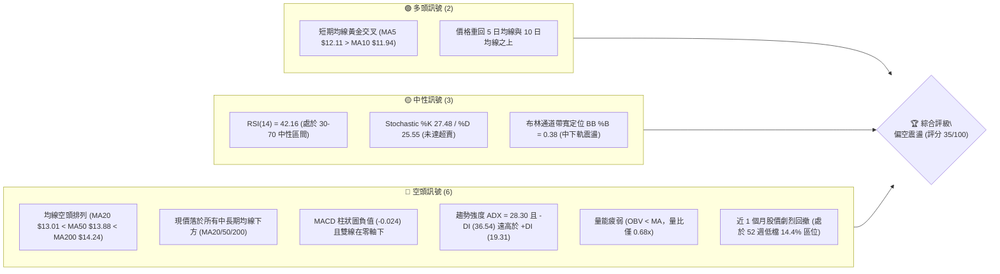

### 📊 核心指標速覽表

| 指標類別 | 指標名稱 | 當前數值 | 訊號 | 解讀 |
|----------|----------|----------|------|------|
| **價格** | 當前收盤價 | $12.32 | 🔴 | 位於 52 週區間 14.4% 處，跌破多數中期均線支撐 |
| **均線** | 短期 MA5 / MA10 | $12.11 / $11.94 | 🟢 | 現價站上 MA5 與 MA10，短線出現超跌低檔反彈企圖 |
| **均線** | 中期 MA20 | $13.01 | 🔴 | 現價低於 MA20 達 -5.30%，中期趨勢仍處下行壓力中 |
| **均線** | 中期 MA50 | $13.88 | 🔴 | 現價低於 MA50，中期下降趨勢線構成厚重上方壓力 |
| **均線** | 長期 MA200 | $14.24 | 🔴 | 現價低於牛熊分界線 MA200，空頭排列確立 |
| **動能** | RSI(14) | 42.16 | 🟡 | 位於中性偏弱區，未達 30 以下極端超賣，無背離訊號 |
| **動能** | MACD (12,26,9) | 柱狀圖 -0.024 | 🔴 | MACD (-0.636) 位於 Signal (-0.613) 下方，空頭主導 |
| **趨勢** | ADX (14) | 28.30 | 🔴 | ADX > 25 確立趨勢行情；-DI (36.54) 顯著高於 +DI (19.31) |
| **通道** | 布林通道 %B | 0.38 | 🟡 | 下軌 $10.20、中軌 $13.01，價格自下軌反彈但仍在中軌下 |
| **量能** | 20日量比 / OBV | 0.68x / 弱勢 | 🔴 | 成交量 58.0M 低於 20 日均量 85.7M，反彈缺乏資金增量 |
| **波動** | ATR(14) | $0.61 | 🟡 | 波動率佔股價 4.95%，顯示每日具備約 5% 的波幅風險 |

### 🏆 技術評分卡

```
技術評分卡 — NU (2026-11-12)
════════════════════════════════════════════════════
趨勢強度 (ADX/DI)      ██████░░░░░░░░░░░░░░  30/100  🔴 空頭強趨勢
動能指標 (RSI/MACD)    ████████░░░░░░░░░░░░  40/100  🟡 中性偏弱無背離
支撐穩定度 (S1/S2/S3)  ████████░░░░░░░░░░░░  40/100  🟡 S1暫穩但未脫險
成交量配合 (Volume/OBV)██████░░░░░░░░░░░░░░  30/100  🔴 量能萎縮且OBV弱
形態完整度 (K線/幾何)  ████████░░░░░░░░░░░░  40/100  🟡 超跌後弱勢盤整
均線排列 (MA20/50/200) ██████░░░░░░░░░░░░░░  30/100  🔴 典型空頭發散
════════════════════════════════════════════════════
綜合評分              ███████░░░░░░░░░░░░░  35/100  🔴 偏空弱勢
════════════════════════════════════════════════════
計算說明：綜合評分 = (30 + 40 + 40 + 30 + 40 + 30) ÷ 6 = 35.0（依規則 18 取整數）
```

---

## 2. 趨勢分析

### 🌐 多時框趨勢分析

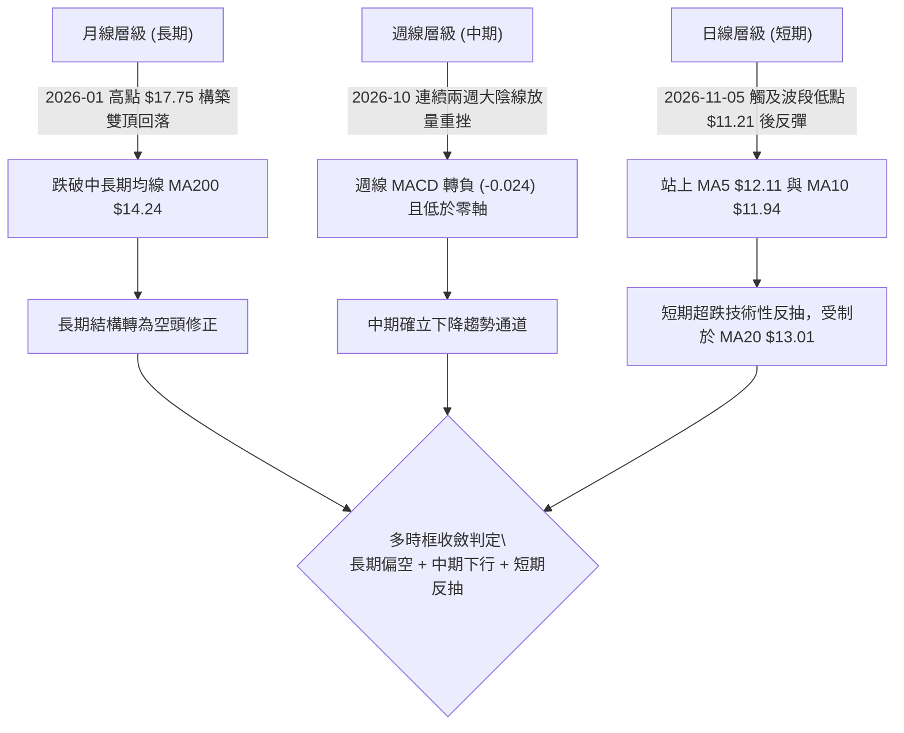

### 📈 長期趨勢 — 12個月走勢圖（Unicode）

```
NU 月線走勢圖（過去12個月：2025-12 至 2026-11）
價格軸 ($)
$18.00 ┤              ●(2026-01: $17.75 歷史波段次高)
$17.00 ┤        ●(2025-12: $16.74)
$16.00 ┤
$15.00 ┤                    ●(2026-02: $14.98)
$14.00 ┤                          ●(04:$14.48)        ●(08:$14.55)
$13.00 ┤                                ●(06:$13.36)        ●(09:$12.66)
$12.00 ┤                                                          ●(11:$12.32 ← 現價)
$11.00 ┤                                                                ●(10:$11.61 波段低點)
       └────────────────────────────────────────────────────────────────────────────
        25-12  26-01  26-02  26-03  26-04  26-05  26-06  26-07  26-08  26-09  26-10  26-11
```

#### 走勢特徵分析表格

| 階段區間 | 起止月份 | 價格變化 ($) | 漲跌幅 (%) | 核心特徵與量價結構 |
|----------|----------|--------------|------------|--------------------|
| 頂部構築 | 2025-11 至 2026-01 | $17.39 → $17.75 | +2.07% | 高檔滯漲，觸及 52 週最高價 $18.98 後動能竭盡，量縮見頂 |
| 第一波下殺 | 2026-01 至 2026-05 | $17.75 → $13.13 | -26.03% | 跌破 MA20 與 MA50，均線開始拐頭向下，多頭停損賣壓湧現 |
| 中期箱型反彈 | 2026-05 至 2026-08 | $13.13 → $14.55 | +10.81% | 於 $13.30-$14.50 進行弱勢區間整理，受制於 MA200 壓制 |
| 主跌加速破位 | 2026-08 至 2026-10 | $14.55 → $11.61 | -20.21% | 跌破前低支撐，10月單月下挫，逼近 52 週最低價 $11.20 |
| 短線超跌修復 | 2026-10 至 2026-11 | $11.61 → $12.32 | +6.12% | 触及 $11.21 後獲得支撐，出現縮量技術性反彈，目前受制於 R1 |

### 📊 中期趨勢（週線分析）

從近 8 週的週 K 線觀察，NU 在 2026-10-09 當週曾拉出一根高點 $16.14、收盤 $16.12 的假突破長陽線，隨後三週內出現報復性下殺：
- **2026-10-30 當週**：爆出 701,855,200 股的天量大陰線，單週重挫至收盤 $11.61，一舉貫穿所有均線支撐。
- **2026-11-06 當週**：週低點下探至 $11.21（逼近 52 週低點 $11.20）後收於 $12.03，量能萎縮至 403,836,100 股。
- **當前週（截至 11-11）**：收盤 $12.32，週成交量降至 165,197,700 股，顯示拋壓雖暫緩，但追價買盤極為謹慎。

```
週線支撐壓力結構示意圖：
[阻力 R3] $14.32 ══════════════════════════════════ (MA200 / 斐波 61.8%)
                    ▲
[阻力 R2] $13.52 ───┼────────────────────────────── (波段成交密集區)
                    │
[阻力 R1] $13.30 ───┴────────────────────────────── (MA20 附近首要壓制)
─────────────────────────────────────────────────────────────────
[現價位]  $12.32 ◄─── (弱勢反抽中)
─────────────────────────────────────────────────────────────────
[支撐 S1] $12.18 ───┬────────────────────────────── (近一年波段密集低點)
                    │
[支撐 S2] $11.78 ───┼────────────────────────────── (日線平台下軌)
                    ▼
[支撐 S3] $11.51 ══════════════════════════════════ (破位前最後防線 / 下方為 $11.20)
```

### ⚡ 趨勢強度評估（ADX 解讀）

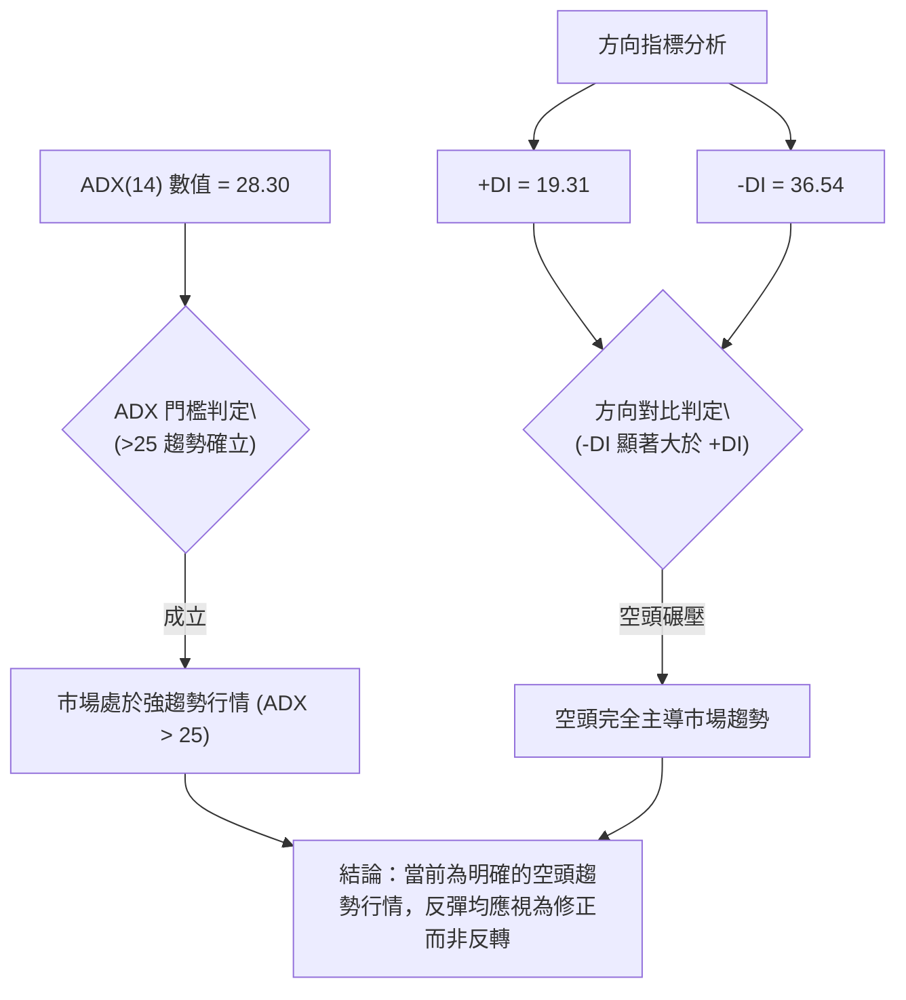

#### ADX 趨勢強度對照表

| 指標變數 | 當前讀數 | 門檻區間 | 技術含義 | 對交易之指引 |
|----------|----------|----------|----------|--------------|
| **ADX(14)** | **28.30** | > 25.0 (強趨勢) | 市場脫離無方向盤整，進入動能驅動的趨勢市 | 遵循趨勢優先原則，順勢操作，嚴禁逆勢猜底 |
| **-DI** | **36.54** | > 30.0 (強空頭) | 空方拋售動能強勁，空頭賣壓主導價格波動 | 任何反彈未見 -DI 跌破 25 前，空頭結構不變 |
| **+DI** | **19.31** | < 20.0 (弱多頭) | 多方力量疲弱，缺乏主力機構進場推升意願 | 買盤力量無法形成持久的突破行情 |
| **DI 差值** | **-17.23** | 負值擴大 | 空方動能領先幅度達 17.23 點 | 依照規則 14，以中長期空頭方向為主導時框 |

---

## 3. 圖表形態分析

### 🔍 形態識別系統

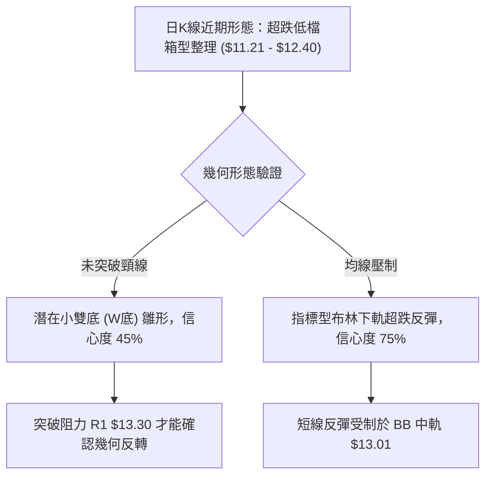

#### 形態識別信心度評估表（依規則 15）

| 形態名稱 | 信心度 (%) | 判斷依據（引用數據） | 完成度 (%) | 目標價（附計算式） | 狀態評估 |
|----------|------------|----------------------|------------|--------------------|----------|
| **潛在小雙底 (W底)** | 45% | 低點一 2026-10-30 ($11.48)、低點二 2026-11-05 ($11.21)；兩次低點均在支撐位 S3 ($11.51) 與 52W 低點 ($11.20) 區間獲撐 | 60% | 頸線為近期反彈高點 $12.40，形態高度 = $12.40 - $11.21 = $1.19；推算目標價 = $12.40 + $1.19 = **$13.59** | 信心度不足 50%，頸線未放量突破，僅能視為低檔盤整 |
| **布林通道超跌反彈** | 75% | 價格於 2026-11-05 跌破並觸及下軌區域後回升，BB %B 自極低值回升至 0.38 | 80% | 以回歸布林中軌 MA20 為目標：目標價 = **$13.01** | 指標型形態，有效性較高，目前正在向中軌進行技術修復 |

### 🕯️ 重要K線形態分析（依規則 19）

嚴格依據數據中「近10根日K」與「近8根週K」的實際開高低收進行分析：

#### 近10根日K形態解析

| 日期（日K） | 開盤 ($) | 最高 ($) | 最低 ($) | 收盤 ($) | K線形態名稱 | 解讀與技術意涵 | 訊號 |
|-------------|----------|----------|----------|----------|-------------|----------------|------|
| 2026-10-29 | 11.98 | 12.19 | 11.85 | 12.05 | 小陽線 | 下跌中繼小幅盤整，成交量 80.2M 萎縮 | 🟡 |
| 2026-10-30 | 11.75 | 11.85 | 11.48 | 11.61 | 中陰線破位 | 開盤向下跳空，跌破 S2 ($11.78)，放量 92.9M | 🔴 |
| 2026-11-02 | 11.79 | 12.03 | 11.59 | 11.62 | 倒錘頭小陰線 | 盤中衝高回落，多頭反攻無力，成交量 68.9M 縮減 | 🔴 |
| 2026-11-03 | 11.62 | 11.70 | 11.45 | 11.61 | 十字星陰線 | 於 $11.45-$11.70 極窄幅震盪，多空暫時均衡 | 🟡 |
| 2026-11-04 | 11.95 | 12.16 | 11.84 | 11.99 | 光腳中陽線 | 跳空開高走高收復 $11.90，短線多頭嘗試突圍 | 🟢 |
| 2026-11-05 | 12.02 | 12.02 | 11.21 | 11.74 | 長下影中陰線 | 盤中重挫至 $11.21 創近期新低，隨後引發空頭回補收長下影，爆量 99.8M | 🟡 |
| 2026-11-06 | 11.81 | 12.28 | 11.79 | 12.03 | 實體陽線 | 吞噬前一日實體部分，確認 $11.21 低點支撐有效 | 🟢 |
| 2026-11-09 | 12.14 | 12.40 | 12.00 | 12.36 | 穩步上行陽線 | 創近期反彈高點 $12.40，收盤突破支撐轉阻力線 | 🟢 |
| 2026-11-10 | 12.37 | 12.39 | 11.92 | 12.08 | 帶下影陰線 | 衝高未破 $12.40 後回落，回踩 $12.00 整數關卡獲撐 | 🟡 |
| 2026-11-11 | 12.19 | 12.35 | 12.07 | 12.32 | 小陽線 | 守住 $12.07 低點，收盤於 $12.32 站回短期均線上方 | 🟢 |

#### 近8根週K形態解析

| 日期（週K最後交易日） | 開盤 ($) | 最高 ($) | 最低 ($) | 收盤 ($) | 週K形態名稱 | 解讀與技術意涵 | 訊號 |
|-----------------------|----------|----------|----------|----------|-------------|----------------|------|
| 2026-09-25 | 13.84 | 14.25 | 13.36 | 13.59 | 帶長上影陰線 | 上攻 MA200 受阻回落，中期上行乏力 | 🔴 |
| 2026-10-02 | 12.53 | 13.50 | 12.13 | 13.43 | 長下影大陽錘 | 探底 $12.13 後強力反彈，5.32億巨量換手 | 🟢 |
| 2026-10-09 | 14.98 | 16.14 | 14.84 | 16.12 | 突破長陽線 | 巨量 5.17億拉升，創波段反彈高點 $16.14 | 🟢 |
| 2026-10-16 | 16.10 | 16.19 | 14.40 | 14.56 | 烏雲蓋頂巨陰 | 衝高 $16.19 後崩跌，完全回吐前週漲幅 | 🔴 |
| 2026-10-23 | 14.72 | 15.41 | 14.36 | 15.16 | 中陽線反抽 | 弱勢反抽，未能越過前週陰線高點 | 🟡 |
| 2026-10-30 | 11.69 | 13.00 | 11.48 | 11.61 | 爆量長陰破位 | 爆出 7.01億歷史級天量破位大跌，確立主跌段 | 🔴 |
| 2026-11-06 | 11.79 | 12.28 | 11.21 | 12.03 | 探底回升長下影陽星 | 最低觸及 $11.21，下檔買盤承接，週跌勢放緩 | 🟡 |
| 2026-11-11 | 12.14 | 12.40 | 11.92 | 12.32 | 縮量小陽線 (週中) | 量能 1.65億萎縮，呈現超跌後的低檔休整 | 🟡 |

### 📉 ASCII 走勢形態示意圖

```
NU 近10日 K 線結構與低檔震盪形態示意圖：
價格 ($)
$12.50 ┤
$12.40 ┤             ┬                 (2026-11-09 高點 $12.40 - 頸線壓制)
$12.30 ┤           ┌─┴─┐   ┬     ┌─┴─┐ (現價 $12.32)
$12.20 ┤   ┬       │   │ ┌─┴─┐   │   │
$12.10 ┤ ┌─┴─┐     │   │ │   │   │   │
$12.00 ┤ │   │ ┬   │   │ └───┘   └───┘ (重回 $12.00 關卡)
$11.90 ┤ │   │ │   │   │   │       │
$11.80 ┤ └───┘ │   └───┘   ┴       ┴
$11.70 ┤   │   │     │
$11.60 ┤   │ ┌─┴─┐   │
$11.50 ┤   ┴ │   │   │
$11.40 ┤     └───┘   │
$11.30 ┤       │     │
$11.20 ┤       ┴     ┴                 (2026-11-05 低點 $11.21 - 雙底左腳/右腳支撐)
       └────────────────────────────────────────────────────────
        10-29 10-30 11-02 11-03 11-04 11-05 11-06 11-09 11-10 11-11
```

### 🎯 形態目標價計算

1. **潛在雙底目標推算（依規則 15，信心度 45%）**：
   - 第一低點：2026-10-30 之低點 $11.48
   - 第二低點：2026-11-05 之低點 $11.21
   - 形態底部基準低點 = $11.21
   - 形態頸線位置 = 2026-11-09 之波段反彈高點 $12.40
   - 形態高度 $H$ = 頸線高點 ($12.40) − 形態低點 ($11.21) = **$1.19**
   - 理論突破目標價 = 頸線 ($12.40) + $H ($1.19) = **$13.59**
   - *註：該理論目標價與阻力位 R2 ($13.52) 吻合度極高，但因突破未確立，此僅作為多頭反轉的極限參考。*

2. **布林均值回歸目標（信心度 75%）**：
   - 下軌觸發價位：$11.21
   - 中軌回歸目標 = MA20 數值 = **$13.01**

---

## 4. 支撐與阻力

### 🗺️ 關鍵價位分布圖（Unicode）

```
NU 價位結構分布圖（嚴格依據 OHLCV 計算聚類值）
══════════════════════════════════════════════════════════════════
$14.32 ║████████████████████████████████║ 強阻力 R3 (MA200 / 斐波 61.8%)
$13.52 ║████████████████████            ║ 中期阻力 R2 (波段反彈推算目標區)
$13.30 ║████████████████████████        ║ 關鍵阻力 R1 (MA20 下移壓力區)
       ║                                ║
$12.32 ╠════════════════════════════════╣ ◄── 現價 ($12.32)
       ║                                ║
$12.18 ║▓▓▓▓▓▓▓▓▓▓▓▓▓▓▓▓▓▓▓▓▓▓▓▓        ║ 近期支撐 S1 (-1.13% 波段支撐)
$11.78 ║████████████████████████        ║ 強支撐 S2 (-4.38% 日線平台支撐)
$11.51 ║████████████████████████████████║ 核心支撐 S3 (-6.57% 52週低點前哨站)
══════════════════════════════════════════════════════════════════
```

### 🚧 阻力位分析表

所有數值均嚴格引用數據中「關鍵價位」區塊之波段高點聚類數值：

| 阻力級別 | 價位 ($) | 距現價差距 (%) | 形成原因與技術共振 | 突破難度 | 重要性 |
|----------|----------|----------------|--------------------|----------|--------|
| **R1** | **$13.30** | +7.95% | 近一年波段高點聚類，且與即將下壓的 MA20 ($13.01) 形成共振壓力帶 | 🟡 中等 | ★★★★☆ |
| **R2** | **$13.52** | +9.70% | 近一年波段次高密集區，且為短期雙底形態量度目標 ($13.59) 之防禦線 | 🔴 高 | ★★★☆☆ |
| **R3** | **$14.32** | +16.19% | 長期牛熊分水嶺，MA200 ($14.24) 及斐波那契 61.8% ($14.17) 強壓聚落 | 🔴 極高 | ★★★★★ |

### 🛡️ 支撐位分析表

所有數值均嚴格引用數據中「關鍵價位」區塊之波段低點聚類數值：

| 支撐級別 | 價位 ($) | 距現價差距 (%) | 形成原因與技術共振 | 守住機率 | 重要性 |
|----------|----------|----------------|--------------------|----------|--------|
| **S1** | **$12.18** | -1.13% | 近一年波段低點聚類，近 3 個交易日收盤防守的核心下檔樞紐 | 🟡 55% | ★★★★☆ |
| **S2** | **$11.78** | -4.38% | 2026-10-30 與 2026-11-06 之開盤與震盪密集換手區間 | 🟡 50% | ★★★★☆ |
| **S3** | **$11.51** | -6.57% | 波段深跌的核心防線，一旦跌破將直接考驗 52 週最低價 $11.20 | 🟢 65% | ★★★★★ |

### 📐 斐波那契回調位分析

依據 52 週極端區間（最高價 $18.98 → 最低價 $11.20，總垂直振幅 $7.78）回調位分析：

| 斐波那契回調層級 | 計算價位 ($) | 與現價 ($12.32) 相對關係 | 技術面心理意涵與阻力/支撐作用 |
|------------------|--------------|---------------------------|--------------------------------|
| **0.0% (52W High)** | $18.98 | 現價在其下方 -35.09% | 歷史級頂部阻力，多頭終極目標 |
| **23.6%** | $17.14 | 現價在其下方 -28.12% | 2025 年末高檔整理平台下緣 |
| **38.2%** | $16.01 | 現價在其下方 -23.05% | 2026-10-09 當週高點 ($16.14) 假突破受阻位 |
| **50.0%** | $15.09 | 現價在其下方 -18.36% | 多空平衡中軸，2026-10-23 週反彈極限 ($15.16) |
| **61.8%** | $14.17 | 現價在其下方 -13.06% | **黃金分割重壓位**，與 MA200 ($14.24) 及 R3 ($14.32) 高度共振 |
| **78.6%** | $12.86 | 現價在其下方 -4.20% | **下行深幅回調臨界線**，現價正承壓於此線下方 |
| **100.0% (52W Low)**| $11.20 | 現價在其上方 +10.00% | 52 週最低點，多頭最後的防守底線 |

#### 現價落點意義解讀
當前現價 **$12.32** 落在 **78.6% ($12.86)** 與 **100.0% ($11.20)** 之間。在技術分析架構中，股價回調跌破 61.8% ($14.17) 並下探至 78.6% 甚至 100% 區間，標誌著前一輪自 $11.20 至 $18.98 的大級別上升趨勢結構已被徹底破壞。當前走勢非單純強勢拉回，而是深幅弱勢探底行情，78.6% 回調位 ($12.86) 目前已由支撐轉為短線強阻力。

---

## 5. 技術指標深度解讀

### 🎛️ 指標訊號總覽

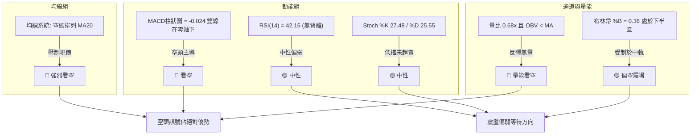

### 📈 移動平均線排列分析

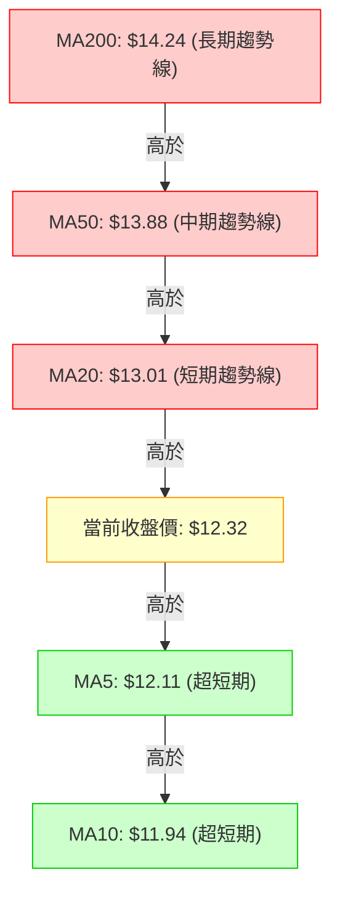

#### 移動平均線各週期詳細數據

| 均線名稱 | 當前價格 ($) | 距現價偏離 ($) | 偏離幅度 (%) | 當前走勢特徵 | 均線層次訊號 |
|----------|--------------|----------------|--------------|--------------|--------------|
| **MA5** | $12.11 | +0.21 | +1.77% | 短線快速勾頭向上 | 🟢 超短線金叉 |
| **MA10** | $11.94 | +0.38 | +3.17% | 走平並初露微升跡象 | 🟢 超短線支撐 |
| **MA20** | $13.01 | -0.69 | -5.30% | 持續陡峭下行 | 🔴 短期主要反彈壓力 |
| **MA50** | $13.88 | N/A（數據未提供偏離）| N/A（數據未提供）| 下彎速率加快 | 🔴 中期空頭發散 |
| **MA60** | $14.01 | -1.69 | -12.06% | 穩定向下延伸 | 🔴 季線反壓顯著 |
| **MA120** | $13.70 | -1.38 | -10.09% | 拐頭向下延伸 | 🔴 半年線失守 |
| **MA200** | $14.24 | N/A（數據未提供偏離）| N/A（數據未提供）| 長期均線轉弱下傾 | 🔴 長期牛熊轉換為空 |
| **MA240** | $14.71 | -2.39 | -16.23% | 長期年線走低 | 🔴 結構性套牢沉重 |

**排列總結**：中長期格局呈現完全標準的空頭排列（MA20 < MA50 < MA60 < MA120 < MA200 < MA240），唯有超短線 MA5 上穿 MA10 形成技術性弱金叉，此為典型主跌段後的低檔喘息現象。

### 📉 RSI(14) 分析

#### RSI 數值進度條
```
RSI(14) 數值: 42.16 (Wilder)
0 ──────────── 30 ─────────────────────── 70 ──────────── 100
[超賣區]       [        中性震盪區間        ]       [超買區]
█████████████████░░░░░░░░░░░░░░░░░░░░░░░░ 42.16%
```

- **區間評估**：當前 RSI(14) 為 42.16，坐落於 30 至 70 的中性區間偏下緣。此數值顯示市場雖經歷重挫，但多空動能已在 40 附近暫時冷卻，並未出現極度超賣（<30）所引發的報復性技術買盤。
- **背離分析**：依據近 20 根 K 棒比對，價格在 2026-11-05 跌破 2026-10-30 低點創出 $11.21 新低，而 RSI 數值同步在低位打底，未見顯著底背離訊號（數據明確認定：**無明顯背離**）。缺乏指標背離支持，意味著當前的價格回升僅為跌深反彈，並非趨勢性反轉結構。

### 📊 MACD(12/26/9) 訊號解讀

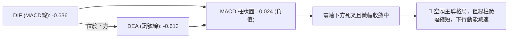

- **MACD 線**：-0.636
- **Signal 線**：-0.613
- **MACD 柱狀圖 (Histogram)**：-0.024
- **解讀**：雙線深陷於零軸下方（<-0.600），顯示中線空頭動能仍佔絕對優勢。雖然柱狀圖為 -0.024，呈現微幅收斂跡象，但由於 DIF 仍未上穿 DEA 形成黃金交叉，在零軸之下的任何弱勢收斂，若未能伴隨大成交量拉升，極易演變為「零下拒絕金叉」或弱勢二次死叉，後續下行風險不可忽視。

### 📦 布林通道分析

```
布林通道 (Bollinger Bands, 20, 2) 結構示意圖：
價格 ($)
$15.82 ┤ ────────────────────────────────── 上軌 (Upper Band)
       │
$14.50 ┤
       │
$13.01 ┤ ┄┄┄┄┄┄┄┄┄┄┄┄┄┄┄┄┄┄┄┄┄┄┄┄┄┄┄┄┄┄┄┄ 中軌 (MA20)
       │
$12.32 ┤ ══════════════════════════════════ [現價收盤位 %B = 0.38]
       │
$10.20 ┤ ────────────────────────────────── 下軌 (Lower Band)
```

- **上軌**：$15.82
- **中軌 (MA20)**：$13.01
- **下軌**：$10.20
- **通道位置 (%B)**：0.38
- **解讀**：%B 為 0.38，代表價格位於中軌（0.50）與下軌（0.00）之間偏下區間。通道帶寬 ($15.82 - $10.20 = $5.62) 呈現顯著擴張狀態，反映近月的高波動下跌。目前價格由下軌回抽，中軌 $13.01 為多頭短線不可逾越之第一重反壓。

### 💹 成交量分析（量價配合度）

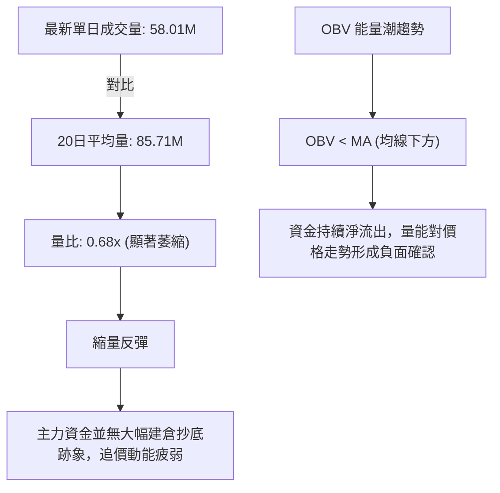

- **量價背離現象**：近 3 個交易日股價自 $11.74 回升至 $12.32，然而單日成交量分別為 58.38M、49.20M、57.98M、58.01M，均顯著低於 20 日均量 (85.71M) 與 50 日均量 (82.55M)。這種「價升量縮」的背離現象，確認了當前反彈屬於散戶與空頭回補推動的無量反抽，極易在觸及壓力區後引來新的拋壓。
- **OBV 趨勢**：OBV 指標持續位於其自身均線下方，證明過去兩個月放量下跌過程中有大量資金流出，目前尚未見到資金重新淨流入的積極跡象。

---

## 6. 動能與波動率

### ⚡ 動能評估四象限

| 象限 | 動能強度 | 波動率水準 | 當前對應狀態 | 操作與評估指引 |
|------|----------|------------|--------------|----------------|
| **Q1 (爆發區)** | 強 (+DI > -DI) | 高 (ATR% > 5%) | ─ | 趨勢主升浪，積極做多持股 |
| **Q2 (盤整區)** | 弱 (+DI ≈ -DI) | 低 (ATR% < 3%) | ─ | 區間沉寂期，低吸高拋觀望 |
| **Q3 (風險區)** | 強 (-DI > +DI) | 高 (ATR% ≈ 5%) | **✓ NU 當前落點** | **強空頭趨勢伴隨顯著波動，嚴防反彈破位，反彈高空為宜** |
| **Q4 (陰跌區)** | 弱 (ADX < 20) | 低 (ATR 萎縮) | ─ | 無量陰跌，流動性枯竭，避免進場 |

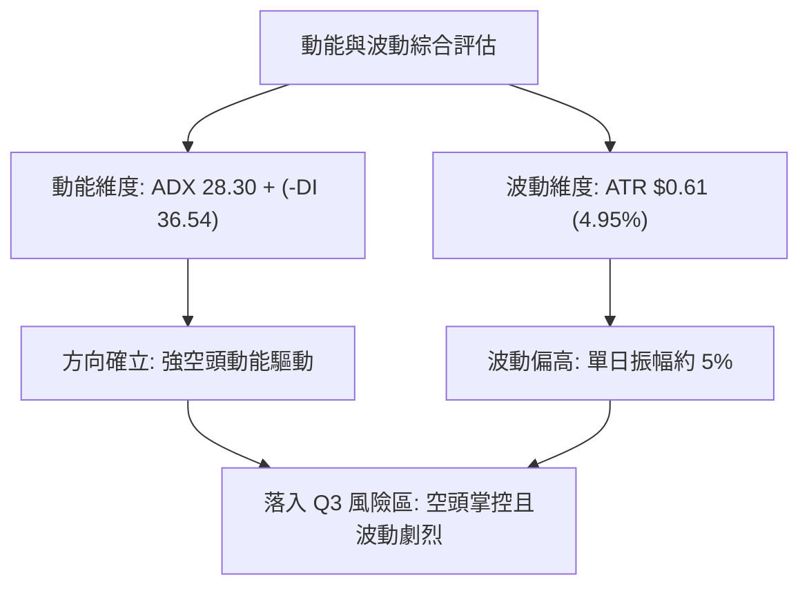

### 📊 ATR 波動率分析

- **ATR(14) 數值**：$0.61 USD（採 Wilder 計算方式）
- **ATR 佔比**：佔當前股價 $12.32 的 **4.95%**
- **波動特性分析**：單日平均潛在波動區間達 $0.61，顯示該股投機屬性與情緒波動偏高。近 10 日 K 線多次出現日內高低點振幅超過 $0.80 的走勢（如 2026-11-05 單日高低差距達 $0.81）。
- **風控止損距離建議**：
  - **極短線動態止損**：以 1.0 倍 ATR 計，設置為 $0.61，提供充足空間避免日內雜訊掃損。
  - **波段交易止損**：以 1.5 倍至 2.0 倍 ATR 計，設置為 $0.92 至 $1.22，可覆蓋常態性震盪假突破。

### 📐 Beta 與市場相關性

- **Beta 係數**：**0.968**
- **市場敏感度解讀**：Beta 極度接近 1.0（0.968），意味著 NU 的系統性市場風險與美股大盤（標普 500 指數）具有高度同步性。然而近期個股跌幅遠超大盤，反映其主要驅動力來自於個股特質因素（如拉丁美洲金融信貸循環、Fintech 板塊獲利回吐與資金輪動），而非單純由大盤波動主導。在當前弱勢架構下，一旦大盤出現任何風吹草動，該股容易被放大拋售。

---

## 7. 多時框架總結

### 📋 時框架評分表

| 時框架 | 趨勢方向 | 動能狀態 | 均線排列特徵 | 圖表形態識別 | 綜合評分 | 建議操作策略 |
|--------|----------|----------|--------------|--------------|----------|--------------|
| **長期 (月線)** | 🔴 下行修正 | 弱勢 (高檔大幅回調) | 跌破 20月均線 | 2026-01 雙頂頸線下破 | 30/100 | 長期投資者暫停定投加碼 |
| **中期 (週線)** | 🔴 空頭主導 | 弱勢 (MACD負值/放量下殺)| MA20/50/200 下彎 | 跌破大區間整理箱底 | 30/100 | 中線反彈逢高減磅或做空 |
| **短期 (日線)** | 🟡 弱勢反抽 | 中性 (RSI 42/縮量反抽) | MA5/10 金叉但受阻MA20 | 低檔窄幅整理震盪 | 45/100 | 僅供超短線交易者快進快出 |

### 🔲 綜合訊號矩陣

```
時框架訊號矩陣交叉驗證：
┌─────────────┬───────────┬───────────┬───────────┬───────────┐
│ 分析維度    │ 短期 (日) │ 中期 (週) │ 長期 (月) │ 多時框共振│
├─────────────┼───────────┼───────────┼───────────┼───────────┤
│ 均線系統    │ 🟡 弱多反抽│ 🔴 空頭排列│ 🔴 空頭壓制│ 🔴 空頭主導│
│ 動能指標    │ 🟡 中性低位│ 🔴 空方控盤│ 🔴 動能流失│ 🔴 偏空震盪│
│ 趨勢強度    │ 🟡 減速整理│ 🔴 強空下行│ 🔴 趨勢下傾│ 🔴 空頭主導│
│ 量能配合    │ 🔴 縮量反抽│ 🔴 巨量破位│ 🔴 資金退潮│ 🔴 負向背離│
└─────────────┴───────────┴───────────┴───────────┴───────────┘
```

### ⚖️ 多時框收斂結論

嚴格依據「規則 14」進行多時框收斂判斷：
1. **趨勢市判定**：當前 ADX(14) 數值為 **28.30**，明確大於 25 臨界值，且 -DI (36.54) 遠大於 +DI (19.31)。技術架構被嚴格界定為**「趨勢行情」**而非無方向盤整行情。
2. **時框主導權收斂**：在趨勢行情下，必須以中長期（週線、MA50 $13.88、MA200 $14.24）方向為主導，日線短期訊號（MA5/10 金叉）僅能用作尋找高拋點或防守性進場時機。
3. **唯一方向性結論**：**【偏空主導】**。日線級別的縮量反彈未能逆轉週線與月線的空頭發散結構。因此，交易策略嚴禁盲目追多，任何反彈均應視為空頭趨勢中的均值修復阻力測試。

---

## 8. 交易策略建議

### 🗺️ 策略決策流程圖

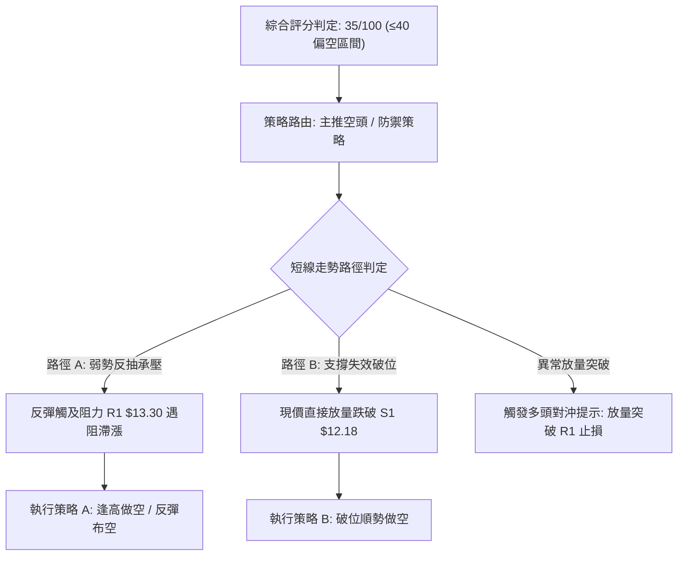

### 🧭 策略路由（依評分卡分流）

> **當前主策略方向 = 主推空頭策略（依綜合評分 35/100，處於 ≤40 偏空區間）**

依據規則，在綜合評分 35 分的偏合格空頭背景下，交易主軸應順應 ADX 趨勢強度所揭示的空方力量，以**「反彈遇阻做空」**為第一優先策略，**「關鍵破位順勢做空」**為第二備選策略。多頭方向僅列為反轉風險觸發點與空單嚴格止損點。

### 🎯 價格情境階梯（Price Scenarios）

價位嚴格引用第 4 章及數據中經 OHLCV 計算之實際聚類數值：

| 觸發條件 | 下一目標 | 後續延伸 | 情境含義與技術演變 |
|----------|----------|----------|--------------------|
| **突破 R1 $13.30** | R2 $13.52 | R3 $14.32 | 短線超跌反彈轉強，測試 MA200 牛熊分界線 |
| **受制於 R1 $13.30 之下** | S1 $12.18 | S2 $11.78 | 弱勢區間震盪，反彈動能衰竭，空頭重新蓄力 |
| **跌破 S1 $12.18** | S2 $11.78 | S3 $11.51 | 確立短線反抽結束，重啟下行主跌浪 |
| **跌破 S3 $11.51** | 52W低點 $11.20 | 深度尋底 | 破位加速，空頭全面宣洩 |

### 📊 情境機率分佈

| 情境劃分 | 預估機率 (%) | 主要技術依據與指標支撐 |
|----------|--------------|------------------------|
| **情境一：反抽遇阻回落 (再探底)** | **60%** | 均線系統全面空頭排列；量比僅 0.68x 顯示買盤無力支撐持久突破；ADX -DI 高達 36.54 |
| **情境二：區間低檔弱勢震盪** | **30%** | 布林下軌獲撐，RSI 在 42.16 暫獲喘息，下檔 S1 ($12.18) 具備短線換手支撐 |
| **情境三：持續反彈突破 R1** | **10%** | 缺乏利多與大成交量配合，OBV 疲軟，受制於 MA20 下移壓力，突破機率極低 |

### 🟢 主策略詳情（空頭主導策略）

嚴格依據規則 17 計算風險報酬比：做空時風險報酬比 = (進場價 − 目標價 T1) ÷ (止損價 − 進場價)。

| 策略要素 | 策略 A：阻力位反彈布空（首選） | 策略 B：跌破 S1 順勢追空（次選） |
|----------|--------------------------------|-----------------------------------|
| **交易方向** | 做空 (Short) | 做空 (Short) |
| **進場條件** | 股價反彈至 R1 附近出現滯漲長上影線 | 股價放量跌破支撐位 S1 |
| **進場價格** | **$13.30** (以 R1 價格為基準) | **$12.18** (以 S1 價格為基準) |
| **目標價 T1** | **$11.78** (支撐位 S2) | **$11.51** (支撐位 S3) |
| **目標價 T2** | **$11.51** (支撐位 S3) | **$11.20** (52週最低價) |
| **止損價格** | **$13.88** (中期均線 MA50 處) | **$12.40** (近期日K反彈高點頸線) |
| **風險報酬比** | **1 : 2.62（以 T1 計）**<br>*(13.30 − 11.78) ÷ (13.88 − 13.30) = 1.52 ÷ 0.58*<br>另：1 : 3.09（以 T2 計） | **1 : 3.05（以 T1 計）**<br>*(12.18 − 11.51) ÷ (12.40 − 12.18) = 0.67 ÷ 0.22*<br>另：1 : 4.45（以 T2 計） |
| **歷史勝率估計** | 65% | 60% |
| **建議倉位** | 10% - 15% 總資金 | 5% - 10% 總資金 |

### 🔴 反向風險觸發點（對沖與風控提示）

若市場出現非理性軋空或突發消息推動股價，以下價位與訊號將**徹底推翻**上述偏空推演，空單必須果斷離場對沖：
1. **多頭警報訊號**：單日成交量暴增至 1.2 億股以上（量比 > 1.5x），且收盤價強勢突破並站穩 **$13.30 (R1)** 之上。
2. **趨勢反轉確認**：MACD 出現零下二次金叉，且 RSI(14) 突破 55 中強分界線，日線收盤價站上 **MA50 ($13.88)**。
3. **對沖操作建議**：空單於 $13.88 全數平倉止損，並可反手以短線多單博弈至 R3 ($14.32)。

### ⭐ 整體訊號強度評星

```
做多訊號強度：★☆☆☆☆  (1/5星 - 僅存超跌超短線反彈動能)
做空訊號強度：★★★★☆  (4/5星 - 趨勢、均線、量能高度共振共向)
整體可信度：  ★★★★☆  (4/5星 - 多時框數據一致性極高)
```

---

## 9. 風險提示與監控

### ✅ 關鍵監控指標 Checklist

```
╔══════════════════════════════════════════════════════════════════╗
║              NU 每日交易風控監控清單 (Checklist)                 ║
╠══════════════════════════════════════════════════════════════════╣
║ [ ] 監控項 1：收盤價是否跌破支撐位 S1 ($12.18)                   ║
║     └─ 意義：跌破意味著反彈終結，開啟下探 S2 ($11.78) 浪潮       ║
║                                                                  ║
║ [ ] 監控項 2：成交量是否放大至 8,500 萬股 (20日均量) 之上       ║
║     └─ 意義：若縮量反彈則空頭無憂；若放量上攻則須警惕假摔反轉   ║
║                                                                  ║
║ [ ] 監控項 3：MACD 柱狀圖是否由負轉正 (突破 0 軸)               ║
║     └─ 意義：目前為 -0.024，若翻正代表短期空頭動能徹底鈍化       ║
║                                                                  ║
║ [ ] 監控項 4：ADX(14) 數值變化及 -DI 是否跌破 30                ║
║     └─ 意義：若 -DI 回落且 ADX 下穿 25，市場將自趨勢市轉為震盪市 ║
║                                                                  ║
║ [ ] 監控項 5：阻力位 R1 ($13.30) 之價格行為 (Price Action)      ║
║     └─ 意義：重要空頭防禦點，觀察是否有長上影線或放量滯漲現象   ║
╚══════════════════════════════════════════════════════════════════╝
```

### ⚠️ 風險場景分析

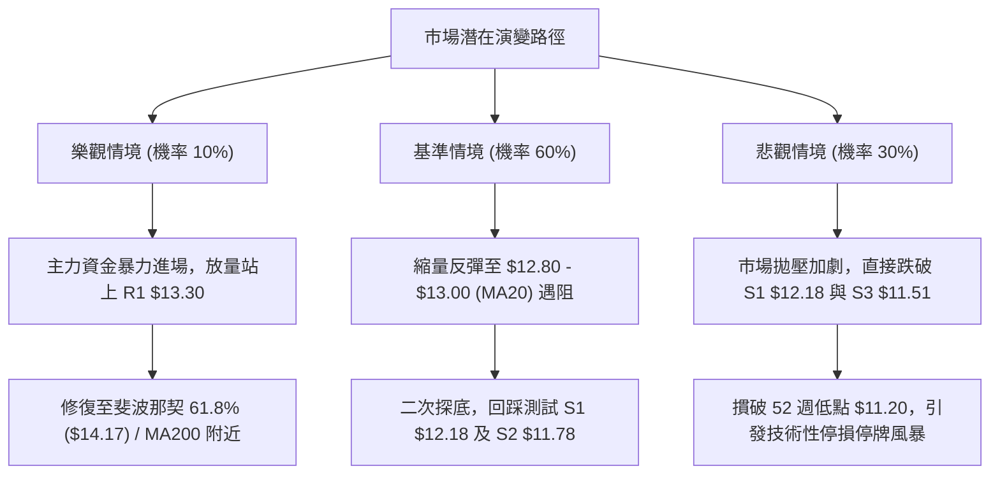

### 🛡️ 風險管理重要提醒

1. **嚴禁主觀猜底**：雖然 NU 過去一年營收與淨利保持大幅增長，但技術面走勢完全由拋售籌碼主導。在均線空頭排列（MA20 < MA50 < MA200）且 ADX 高達 28.30（-DI = 36.54）的強勢空頭趨勢中，左側抄底極易遭遇「接飛刀」風險。
2. **波動率倉位折算**：當前 ATR 高達 $0.61，佔股價近 5.0%，意味著個股單日波動極大。在建立任何部位時，單筆交易虧損額度必須嚴格控制在總投資資本的 1.0% - 1.5% 以內，倉位不宜超過總資金的 15%。
3. **財報與外圍情緒風險**：新聞顯示南美同業（如 MercadoLibre）財報利潤承壓導致板塊重挫，NU 即將迎來財報窗口，隱含波動率攀升，技術指標可能在財報公佈日產生跳空鈍化，投資人應避免在財報發佈前夕重倉押注。

---

## 📋 報告總結

```
NU 技術分析報告總結
════════════════════════════════════════════════════════
報告日期：2026-11-12
當前價格：$12.32
分析評級：🔴 偏空弱勢（技術評分：35 / 100）

關鍵結論：
├─ 長期趨勢：🔴 跌破 MA200 ($14.24)，雙頂頸線下破，進入空頭週期
├─ 中期趨勢：🔴 週線爆量下殺破位，空頭排列發散，MACD 處於零下
├─ 短期趨勢：🟡 超跌後縮量反彈，受制於 MA20 ($13.01) 與 R1 ($13.30)
├─ 關鍵支撐：S1 $12.18 ｜ S2 $11.78 ｜ S3 $11.51 ｜ 52W低點 $11.20
├─ 關鍵阻力：R1 $13.30 ｜ R2 $13.52 ｜ 斐波61.8% $14.17 ｜ R3 $14.32
└─ 分析師目標：低標 $12.00 ｜ 均標 $18.21 ｜ 高標 $23.00

最優策略組合：
1. 🥇 最佳機會：阻力位反彈布空 (策略 A)，於 $13.30 遇阻佈局，看至 $11.78
2. 🥈 次選機會：破位順勢跟進 (策略 B)，放量跌破 S1 $12.18 追空，看至 $11.51
3. 🥉 保守選擇：場外空倉觀望，耐心等待價格重回 MA50 ($13.88) 或放量打底完成
════════════════════════════════════════════════════════
```

---

> ⚠️ **免責聲明**：本報告為 AI 自動生成之技術分析研究報告，所有數據、圖表及價位推算均嚴格基於所提供的歷史交易資訊。本報告**僅供學術研究與交易思路參考**，**絕對不構成任何實質性投資邀約或買賣建議**。金融市場具有高度不確定性與虧損風險，投資人應獨立評估自身財務承受能力並自負盈虧。

---

*報告生成時間：2026-11-12 ｜ 數據來源：Yahoo Finance ｜ 分析框架：資深多時框技術分析模型*