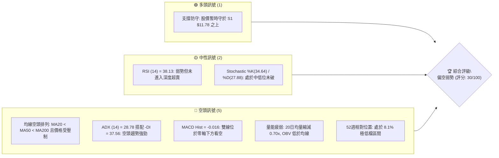
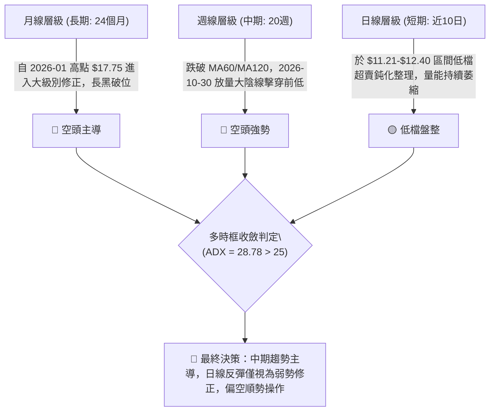
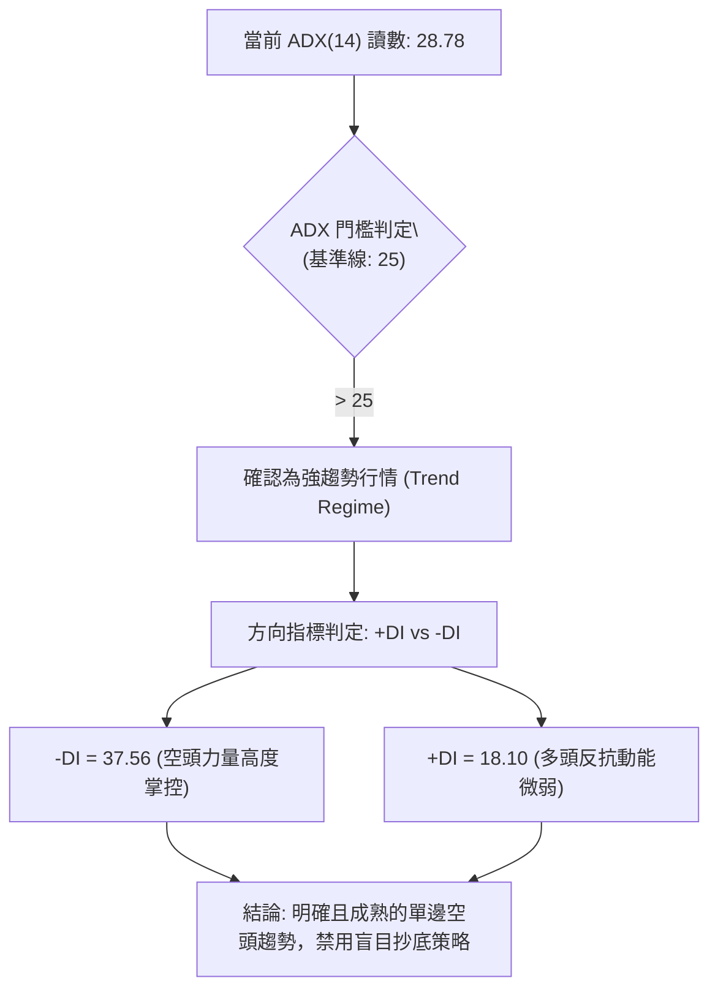
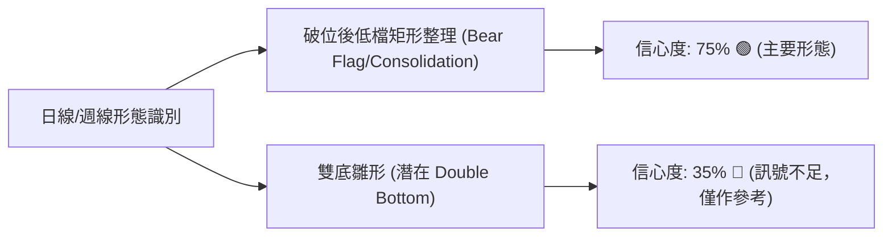
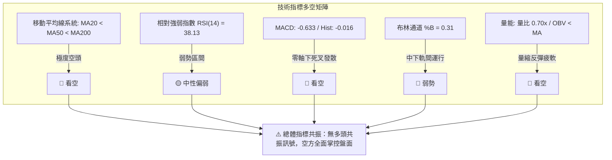
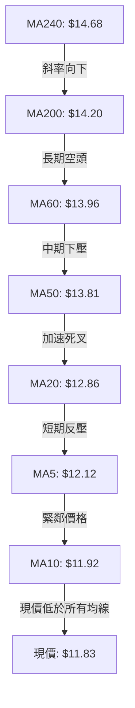
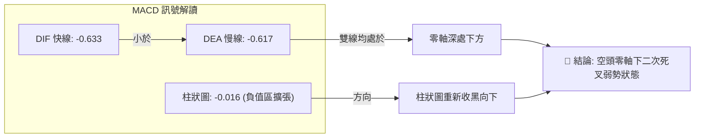
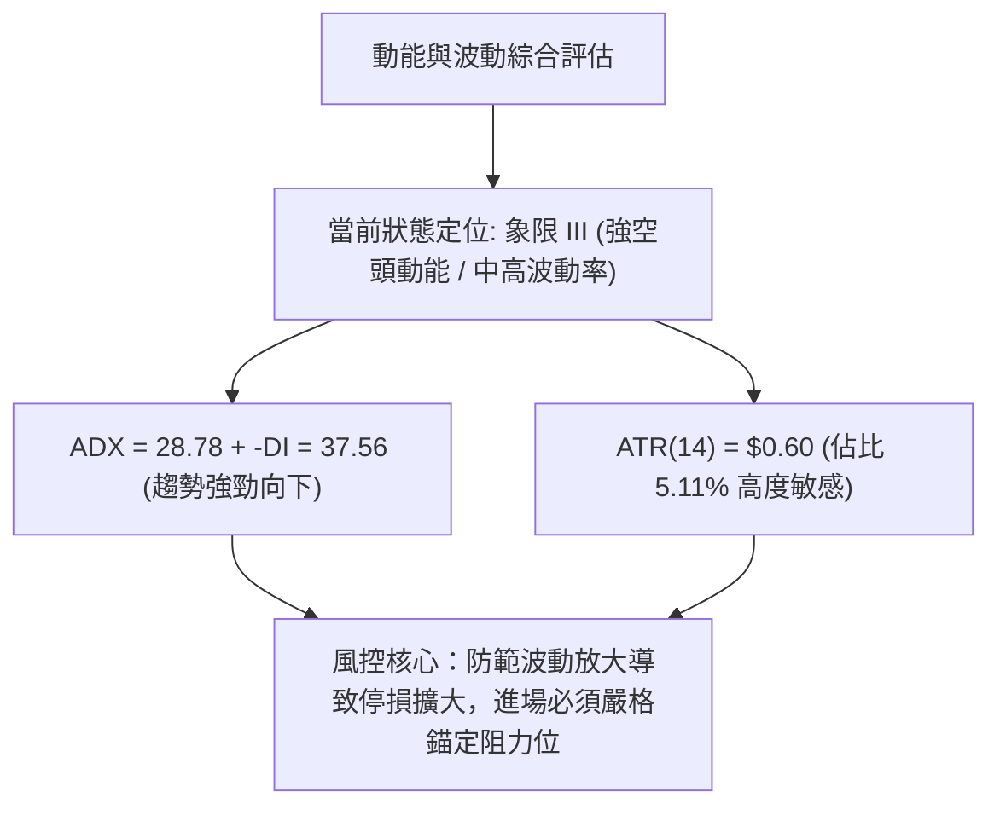
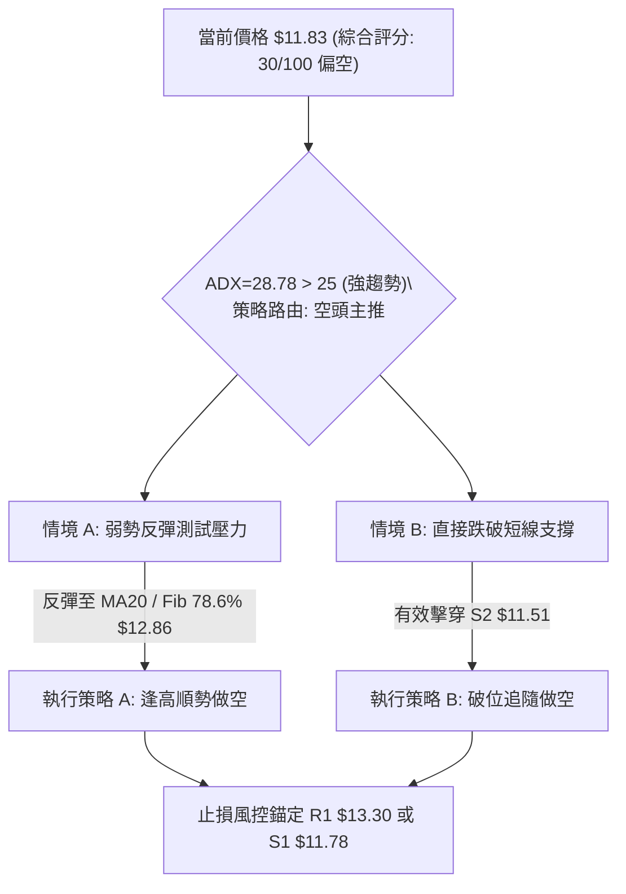
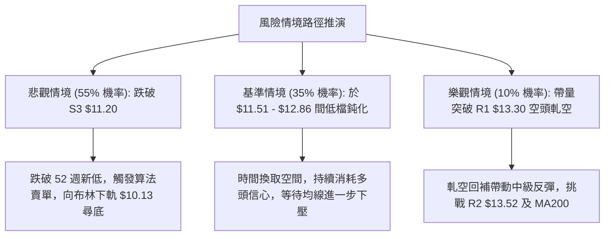

# NU 技術分析報告

> **報告日期**：2026-11-13 ｜ **語言**：繁體中文 ｜ **數據來源**：Yahoo Finance ｜ **當前價格**：$11.83

---

## 目錄

| 章節 | 內容 |
|------|------|
| [1. 技術面概覽](#1-技術面概覽) | 訊號儀表板、核心指標、評分卡 |
| [2. 趨勢分析](#2-趨勢分析) | 多時框趨勢、長中短期走勢 |
| [3. 圖表形態分析](#3-圖表形態分析) | 形態識別、K線組合、目標價 |
| [4. 支撐與阻力](#4-支撐與阻力) | 關鍵價位、斐波那契回調 |
| [5. 技術指標深度解讀](#5-技術指標深度解讀) | MA/RSI/MACD/布林/成交量 |
| [6. 動能與波動率](#6-動能與波動率) | 動能評估、ATR、Beta |
| [7. 多時框架總結](#7-多時框架總結) | 時框架評分矩陣 |
| [8. 交易策略建議](#8-交易策略建議) | 多空策略、風險報酬比 |
| [9. 風險提示與監控](#9-風險提示與監控) | 監控指標、風險場景 |

---

## 1. 技術面概覽

### 🎯 技術訊號儀表板



### 📊 核心指標速覽表

| 指標類別 | 指標名稱 | 當前數值 | 訊號 | 解讀 |
|----------|----------|----------|------|------|
| **價格** | 當前收盤價 | $11.83 | 🔴 | 位於 52 週區間下緣 8.1%，貼近前波低點，下行壓力未解 |
| **均線** | MA20 | $12.86 | 🔴 | 價格低於 MA20 達 -8.05%，短中期均線形成實質蓋頭反壓 |
| **均線** | MA50 | $13.81 | 🔴 | 中期生命線持續向下扣抵，中期趨勢完全被空方壓制 |
| **均線** | MA200 | $14.20 | 🔴 | 長期牛熊分界線失守，長期多頭結構已轉為防守空頭 |
| **動能** | RSI(14) | 38.13 | 🟡 | 位於弱勢區間（30-50），首尾20根無背離，空方主導推進 |
| **動能** | MACD | -0.633 | 🔴 | 雙線位於負值區深處，柱狀圖 -0.016 持續擴散，動能看空 |
| **趨勢** | ADX(14) | 28.78 | 🔴 | 數值大於 25，-DI(37.56) 強烈主導 +DI(18.10)，空頭趨勢強烈 |
| **波動** | ATR(14) | $0.60 | 🟡 | 佔股價 5.11%，波動率處於中高水準，需配合寬止損空間 |
| **通道** | 布林通道 %B | 0.31 | 🔴 | 價格貼近中下軌之間震盪，呈現沿下軌探底之弱勢形態 |
| **量能** | 量比 (Volume Ratio) | 0.70x | 🔴 | 量能持續萎縮（59.60M vs 84.90M），反彈缺乏追價動能 |

### 🏆 技術評分卡

```
╔══════════════════════════════════════════════════════════════╗
║                 技術評分卡 — NU (2026-11-13)                 ║
╠══════════════════════════════════════════════════════════════╣
║ 趨勢強度 (ADX & -DI)  █████░░░░░░░░░░░░░░░  25/100  🔴 空頭強勢║
║ 動能指標 (RSI & MACD) ██████░░░░░░░░░░░░░░  32/100  🔴 動能疲軟║
║ 支撐穩定度 (S1/S2/S3) █████████░░░░░░░░░░░  45/100  🟡 臨界測試║
║ 成交量配合 (OBV&均量) ██████░░░░░░░░░░░░░░  28/100  🔴 量價背馳║
║ 形態完整度 (結構走勢) ███████░░░░░░░░░░░░░  35/100  🔴 破位結構║
║ 均線排列 (空頭排序)   ███░░░░░░░░░░░░░░░░░  15/100  🔴 極度空頭║
╠══════════════════════════════════════════════════════════════╣
║ 綜合評分             ██████░░░░░░░░░░░░░░  30/100  🔴 偏空弱勢║
╚══════════════════════════════════════════════════════════════╝
```
*(註：綜合評分由六項子評分算術平均計算：(25 + 32 + 45 + 28 + 35 + 15) ÷ 6 = 30.0，四捨五入至整數為 30/100。依規則 18，第 7、8 章嚴格依此為基準。)*

---

## 2. 趨勢分析

### 🌐 多時框趨勢分析



### 📈 長期趨勢 — 12個月走勢圖（Unicode）

```
NU 月線走勢圖（過去12個月：2025-12 至 2026-11）
價格軸 ($)
$18.00 ┤              ● (2026-01: $17.75 頂部)
$17.00 ┤        ●
$16.00 ┤  ●
$15.00 ┤                    ●
$14.00 ┤                          ●     ●     ●
$13.00 ┤                                            ●
$12.00 ┤                                                  ●
$11.00 ┤                                                        ● (2026-10: $11.61)
$10.00 ┤                                                              ●(現在 $11.83)
       └─────────────────────────────────────────────────────────────────
       25-12  26-01  26-02  26-03  26-04  26-05  26-06  26-07  26-08  26-09  26-10  26-11
```

#### 長期月線走勢特徵分析

| 階段區間 | 起止月份 | 走勢特徵 | 累積漲跌幅 | 技術結構解讀 |
|----------|----------|----------|------------|--------------|
| **衝頂階段** | 2025-11 ~ 2026-01 | $17.39 升至 $17.75 | +2.07% | 構築多重頂部，上衝力竭，量能未有效放大 |
| **主跌第一波** | 2026-01 ~ 2026-05 | $17.75 跌至 $13.13 | -26.03% | 擊穿短期均線，呈現階梯式長陰殺跌 |
| **中繼盤整** | 2026-06 ~ 2026-08 | $13.36 緩步爬升至 $14.55 | +8.91% | 弱勢反彈，受壓於 52週 61.8% 斐波那契位 ($14.17) |
| **主跌第二波** | 2026-09 ~ 2026-11 | $14.55 崩落至 $11.83 | -18.70% | 破位加速，跌破 78.6% 回調位 ($12.86)，探測歷史底線 |

### 📊 中期趨勢（週線分析）

從近 20 週交易記錄觀察，NU 在 2026-10-09 當週一度反彈至最高 $16.14（收盤 $16.12），隨後遭受機構集中賣壓。2026-10-30 當週出現高達 701,855,200 股的恐慌性放量殺跌，週線大跌超過 23%，一舉擊穿前期多重支撐，將價格打落至 52 週低點附近（最低 $11.48，後續日K探至 $11.21）。

```
週線關鍵壓力與支撐示意圖：
$16.12 ────────────────────────── (2026-10-09 波段高點反轉頸線)
         ▼ 巨量拋售 (701.8M 爆量下跌)
$14.32 ────────────────────────── (R3 強阻力 / 密集籌碼套牢區)
$13.52 ────────────────────────── (R2 中阻力)
$13.30 ────────────────────────── (R1 近期跳空缺口阻力)
$11.83 ══════════════════════════ ◄ 當前價格位置（弱勢微幅整理）
$11.78 -------------------------- (S1 即時波段支撐)
$11.51 -------------------------- (S2 次級波段支撐)
$11.20 ────────────────────────── (S3 52週絕對低點 / 生命線)
```

### ⚡ 趨勢強度評估（ADX 解讀）



#### ADX 與方向指標強度對照

| 指標名稱 | 實際數值 | 臨界值標準 | 當前狀態評估 | 技術含義 |
|----------|----------|------------|--------------|----------|
| **ADX(14)** | 28.78 | 25.00 | 處於趨勢區間 | 行情脫離無方向震盪，具備高度趨勢延續性 |
| **-DI(14)** | 37.56 | 20.00 / 30.00 | 極度強烈 (空頭) | 賣方掌控市場定價權，空頭壓力極大 |
| **+DI(14)** | 18.10 | 20.00 / 30.00 | 疲弱無力 (多頭) | 缺乏機構持續性主動買盤挹注 |
| **收斂規則判定** | ADX > 25 | 優先級依賴中長期 | 趨勢行情確立 | 依規則 14：以週線與均線方向為主導，日線僅尋找放空或逢高了結點 |

---

## 3. 圖表形態分析

### 🔍 形態識別系統



#### 形態識別與信心度評估表

| 形態名稱 | 信心度 | 判斷依據（引用數據） | 完成度 | 目標價（附計算式） |
|----------|--------|----------------------|--------|--------------------|
| **破位後低檔整理旗形** | 75% | 2026-10-30 放量暴跌至 $11.61 後，近10日受壓於 $12.40，徘徊於 $11.21-$12.40 狹幅區間 | 80% | 旗形下破目標價 = 旗桿起點 $15.16 − (旗桿頂 $15.16 − 旗桿底 $11.61) = $11.61 (已達)；進一步破位等長推算：S3 $11.20 跌破後，依布林下軌指向 $10.13 |
| **雙底雛形 (Double Bottom)** | 35% | 兩次低點分別為 2026-10-30 之 $11.48 及 2026-11-05 之 $11.21（接近 52W 低點 S3 $11.20） | 40% | *訊號不足，僅做指標型解讀*。若確認突破頸線 R1 $13.30，理論目標價 = 頸線 $13.30 + 形態高度 ($13.30 − $11.20 = $2.10) = $15.40 |

*(依規則 15，雙底形態信心度 35% < 50%，數據不足以確認反轉幾何形態，不得預設多頭成形，嚴禁通靈視為反轉。)*

### 🕯️ 重要K線形態分析

嚴格依據數據中「近 10 根日K」與「近 8 根週K」之開高低收數據進行客觀解讀：

#### 近 10 根日K 形態解讀

| 日期 (日K) | 開盤 | 最高 | 最低 | 收盤 | 成交量 | K線形態名稱 | 技術解讀與多空意涵 | 訊號 |
|------------|------|------|------|------|--------|-------------|--------------------|------|
| 2026-10-30 | 11.75 | 11.85 | 11.48 | 11.61 | 92,979,500 | 破位跳空黑K | 跳空低開並創短期新低，賣壓宣洩 | 🔴 |
| 2026-11-02 | 11.79 | 12.03 | 11.59 | 11.62 | 68,994,700 | 紡錘十字線 | 多空短暫平衡，量能微幅萎縮 | 🟡 |
| 2026-11-03 | 11.62 | 11.70 | 11.45 | 11.61 | 89,030,600 | 低檔窄幅整理線 | 再度測試 $11.45 低點，買盤微幅護盤 | 🟡 |
| 2026-11-04 | 11.95 | 12.16 | 11.84 | 11.99 | 87,546,000 | 溫和實體紅K | 站上 $11.90，短線超跌反抽抵抗 | 🟢 |
| 2026-11-05 | 12.02 | 12.02 | 11.21 | 11.74 | 99,882,900 | 長下影錘頭黑K | 盤中殺破前低探至 $11.21 獲支撐拉回，多空激烈交鋒 | 🟡 |
| 2026-11-06 | 11.81 | 12.28 | 11.79 | 12.03 | 58,381,900 | 縮量突破小紅K | 吞噬前一日陰線實體，但量能驟減至 58M，買盤動能不足 | 🟡 |
| 2026-11-09 | 12.14 | 12.40 | 12.00 | 12.36 | 49,201,200 | 高檔無量陽線 | 創反彈高點 $12.40，然成交量僅 49M，呈現嚴重無量空拔 | 🔴 |
| 2026-11-10 | 12.37 | 12.39 | 11.92 | 12.08 | 57,980,300 | 陰包陽回跌棒 | 受阻於 MA5/MA10 阻力，長黑吞噬前日大部分漲幅 | 🔴 |
| 2026-11-11 | 12.19 | 12.35 | 12.07 | 12.32 | 58,261,200 | 弱勢小陽線 | 向上試探 $12.35 再次受阻，上方拋壓沉重 | 🟡 |
| 2026-11-12 | 12.08 | 12.27 | 11.79 | 11.83 | 59,604,100 | 光腳中陰線 | 尾盤殺跌收在近全日最低 $11.83，空方重新掌握主動權 | 🔴 |

#### 近 8 根週K 形態解讀

| 日期 (週K) | 開盤 | 最高 | 最低 | 收盤 | 成交量 | K線形態名稱 | 技術解讀與多空意涵 | 訊號 |
|------------|------|------|------|------|--------|-------------|--------------------|------|
| 2026-09-25 | 13.84 | 14.25 | 13.36 | 13.59 | 290,425,500 | 震盪收黑線 | 測試 $13.36 低點支撐 | 🟡 |
| 2026-10-02 | 12.53 | 13.50 | 12.13 | 13.43 | 532,732,100 | 長下影轉折線 | 放量探底 $12.13 後強力收回 | 🟢 |
| 2026-10-09 | 14.98 | 16.14 | 14.84 | 16.12 | 517,684,300 | 大陽突破線 | 突破至波段高點 $16.14，假突破誘多 | 🟢 |
| 2026-10-16 | 16.10 | 16.19 | 14.40 | 14.56 | 328,775,500 | 高位吞噬大長黑 | 創高 $16.19 後崩跌，反轉確認 | 🔴 |
| 2026-10-23 | 14.72 | 15.41 | 14.36 | 15.16 | 322,110,100 | 弱反彈上影紅線 | 抵抗失敗，反抽確認阻力有效 | 🔴 |
| 2026-10-30 | 11.69 | 13.00 | 11.48 | 11.61 | 701,855,200 | 世紀崩跌長陰線 | 爆出 7 億股巨量崩跌 -23.4%，結構徹底破壞 | 🔴 |
| 2026-11-06 | 11.79 | 12.28 | 11.21 | 12.03 | 403,836,100 | 低檔長下影十字 | 觸及 52W 最低 $11.21，低接盤出現 | 🟡 |
| 2026-11-12 | 12.14 | 12.40 | 11.79 | 11.83 | 225,046,800 | 縮量受阻中陰線 | 反彈乏力，量能驟降，再探低位風險遽增 | 🔴 |

### 📉 ASCII 走勢形態示意圖

```
NU 近期價格走勢與關鍵壓力架構：
價格 ($)
$16.19 ┼──┐ (2026-10-16 高位假突破頂部)
       │  ╲
$15.16 ┼───┴─┐
       │     │
$13.30 ┼─────┼───────┐ ◄ R1 強阻力區間 (反彈受壓頸線)
       │     │       │
$12.40 ┼─────┼───────┴─────┐ (11-09 反彈波段頂點)
       │     │             │ ╲
$11.83 ┼─────┼─────────────┼──● ◄ 當前收盤價 ($11.83)
$11.78 ┼─────┼─────────────┼────┼─ S1 波段支撐
$11.51 ┼─────┼─────────────┼────┼─ S2 結構支撐
$11.20 ┼─────┴─────────────┴────┴─┴─ S3 52週極限支撐 ($11.21)
       └────────────────────────────────────────────────
        10-16 10-23 10-30  11-06 11-12 (交易日維度)
```

---

## 4. 支撐與阻力

### 🗺️ 關鍵價位分布圖（Unicode）

```
NU 價位結構分布圖
══════════════════════════════════════════════════════════════════
$14.32 ║████████████████████████████████████████║ 強阻力 R3 (密集套牢區)
$13.52 ║██████████████████████████████          ║ 阻力 R2 (中軌上方壓力)
$13.30 ║████████████████████████                ║ 關鍵阻力 R1 (+12.43%)
$12.86 ║▓▓▓▓▓▓▓▓▓▓▓▓▓▓▓▓▓▓▓▓                    ║ 斐波那契 78.6% 回調 / MA20
$11.83 ╠════════════════════════════════════════╣ ◄ 當前價格 ($11.83)
$11.78 ║▓▓▓▓▓▓▓▓▓▓▓▓▓▓▓▓▓▓▓▓▓▓▓▓▓▓▓▓            ║ 近期支撐 S1 (-0.42%)
$11.51 ║██████████████████████████████          ║ 波段支撐 S2 (-2.70%)
$11.20 ║████████████████████████████████████████║ 極限強支撐 S3 (52W Low -5.28%)
══════════════════════════════════════════════════════════════════
```

### 🚧 阻力位分析表

*(嚴格引用 OHLCV 計算之實際聚類數據)*

| 阻力級別 | 價位 | 形成原因 | 突破難度 | 重要性 |
|----------|------|----------|----------|--------|
| **R1** | **$13.30** | 近一年波段高點聚類，且與 2026-09-25 週K實體平台下沿重合 (+12.43%) | 🔴 極高 | ★★★★★<br>多空反轉分水嶺 |
| **R2** | **$13.52** | 2026-10-02 週K反彈實體高點聚類，接近 MA60/120 反壓帶 (+14.24%) | 🔴 很高 | ★★★★☆<br>中期波段防守點 |
| **R3** | **$14.32** | 近一年多重高點密集聚類位，巨量套牢賣壓籌碼核心區 (+21.01%) | 🔴 極強 | ★★★★★<br>長期牛熊轉換線 |

### 🛡️ 支撐位分析表

*(嚴格引用 OHLCV 計算之實際聚類數據)*

| 支撐級別 | 價位 | 形成原因 | 守住機率 | 重要性 |
|----------|------|----------|----------|--------|
| **S1** | **$11.78** | 近一年波段低點聚類，近 5 日日K實體密集整理下界 (-0.42%) | 🟡 50% | ★★★☆☆<br>短線防線，破位加速 |
| **S2** | **$11.51** | 波段低點聚類，與 2026-10-30 日K實體收盤及下影線密集區重疊 (-2.70%) | 🟡 45% | ★★★★☆<br>空頭下攻緩衝平台 |
| **S3** | **$11.20** | 52 週絕對低點 ($11.20)，2026-11-05 盤中最低測試 $11.21 (-5.28%) | 🔴 35% | ★★★★★<br>全線潰敗最後防線 |

### 📐 斐波那契回調位分析

依據 52 週完整波動區間（高點 $18.98 → 低點 $11.20）計算：

| 回調比例 | 關鍵價位 | 技術狀態分析 | 現價相對位置解讀 |
|----------|----------|--------------|------------------|
| **0.0% (52W High)** | **$18.98** | 歷史極值壓力 | 遠距上方 +60.44% |
| **23.6%** | **$17.14** | 長期回調一級壓力 | 長期結構阻力位 |
| **38.2%** | **$16.01** | 2026-10-09 假突破高點密集區 ($16.12) | 中期重要阻力位 |
| **50.0%** | **$15.09** | 2026-10-23 週K收盤價反壓 ($15.16) | 多空中軸平衡區 |
| **61.8%** | **$14.17** | 黃金分割強壓力位，重合 MA200 ($14.20) | 強大結構性牛熊反轉點 |
| **78.6%** | **$12.86** | 深度回調支撐轉壓力，重合 MA20 ($12.86) | 目前反彈最核心反壓線 |
| **100.0% (52W Low)**| **$11.20** | 52 週絕對基底支撐 | 最終防線 |

**解讀結論**：當前價格 **$11.83** 深度落於 **78.6% ($12.86)** 與 **100.0% ($11.20)** 之間極端弱勢區間。價格跌破 78.6% 斐波那契位，象徵先前整個 52 週牛市架構遭到完全破壞，目前進入探底尋底模式。若 $11.20 被有效跌破，下方將引發技術性止損盤。

---

## 5. 技術指標深度解讀

### 🎛️ 指標訊號總覽



### 📈 移動平均線排列分析



#### 各期移動平均線偏離度分析

| 均線名稱 | 數值 | 距現價空間 ($) | 偏離幅度 (%) | 趨勢斜率 | 技術意涵 |
|----------|------|----------------|--------------|----------|----------|
| **MA 5** | $12.12 | -$0.29 | -2.42% | 向下走平 | 短線第一道動態壓制線 |
| **MA 10**| $11.92 | -$0.09 | -0.75% | 向下走平 | 股價受制於線下，反彈動能衰竭 |
| **MA 20**| $12.86 | -$1.03 | -8.05% | 持續向下 | 短中期月線生命線，重合 BB 中軌 |
| **MA 50**| $13.81 | -$1.98 | -14.34%| 快速向下 | 中期多頭徹底瓦解 |
| **MA 60**| $13.96 | -$2.13 | -15.28%| 陡峭向下 | 季線下壓形成長期牢固套牢層 |
| **MA120**| $13.70 | -$1.87 | -13.62%| 向下開口 | 半年線失守確認中期轉空 |
| **MA200**| $14.20 | -$2.37 | -16.69%| 穩定下移 | 長期年線牛熊分界失守 |
| **MA240**| $14.68 | -$2.85 | -19.43%| 向下 | 兩年均線蓋頂，大週期走弱 |

### 📉 RSI(14) 分析

*   **當前數值**：**38.13**（Wilder 計算）
*   **強弱進度條**：
    `超賣 [░░░░░░░░░░███████████████░░░░░░░░░░░░░░░░░░░░░░░░] 超買  38.13%`
*   **區間解讀**：RSI 處於 30 至 50 之間的弱勢運行區間。未觸及 30 以下之極端超賣，表示目前拋售壓力雖有稍微放緩，但市場缺乏低吸意願，並未形成超賣報復性反彈的觸發條件。
*   **背離分析結論**：嚴格檢視近 20 根日 K 棒首尾之價格與 RSI 走勢，價格自 2026-10-30 之低點 $11.48 延伸至 11-05 最低 $11.21，而 RSI 同期自 30.7 微升至 38.13，但近 5 根 K 棒 RSI 隨價格回落重新自 45 轉弱下彎。首尾對比顯示：**無有效底背離現象**，指標僅隨價格在低檔進行弱勢鈍化整理。

### 📊 MACD(12/26/9) 訊號解讀



*   **指標數值**：MACD: **-0.633** ｜ Signal: **-0.617** ｜ Histogram: **-0.016**
*   **量化狀態**：MACD 柱狀圖在連續數日微幅收斂後，於 11-12 再度下擴至 -0.016，DIF 跌破 DEA 呈現零軸下方死叉延續格局。由於整體軌跡均深埋於負值區，代表空方力量主宰整個中級波動，目前任何微幅反彈僅為動能消散所致，非實質反轉。

### 📦 布林通道分析

```
NU 布林通道位置示意圖 (Bollinger Bands: 20, 2)
══════════════════════════════════════════════════════════════════
$15.60 ───────────────────────────────────── BB 上軌 (Upper)
         ↑ 帶寬開口向下擴張
$12.86 ┄┄┄┄┄┄┄┄┄┄┄┄┄┄┄┄┄┄┄┄┄┄┄┄┄┄┄┄┄┄┄┄┄┄┄ 中軌 (MA20 / 78.6% Fib)
         ↓
$11.83 ═════════════════════●═══════════════ 現價位置 (%B: 0.31)
         ↓ 貼近中下軌弱勢區
$10.13 ───────────────────────────────────── BB 下軌 (Lower)
══════════════════════════════════════════════════════════════════
```

*   **通道參數解讀**：
    *   **BB 上軌**：$15.60
    *   **BB 中軌 (MA20)**：$12.86
    *   **BB 下軌**：$10.13
    *   **%B 指標**：**0.31**
*   **技術狀態評估**：%B 為 0.31，明確指出當前價格在布林下半部（0.0 至 0.5）運行。布林通道帶寬持續張開，且中軌（MA20: $12.86）以陡峭斜率向下延伸，呈現典型「空頭通道推進形態」。現價並未觸及下軌（$10.13），意味著向下仍有實質空間，未出現極端軌道擠壓的反彈訊號。

### 💹 成交量分析（量價配合度）

```
成交量對比架構：
最新成交量 (11-12) : 59,604,100  ████████████░░░░░░░░  (量比: 0.70x)
20日平均成交量     : 84,901,760  █████████████████░░░
50日平均成交量     : 82,130,882  ████████████████░░░░
```

*   **量能萎縮**：最新成交量 59.60M 較 20 日均量（84.90M）大幅縮水近 30%（量比僅 0.70x）。
*   **OBV 能量潮解讀**：當前 OBV 線持續落後於其均線系統（OBV < MA），明確呈現資金處於持續流出態勢。
*   **量價關係結論**：價格在 2026-10-30 放量下殺後，隨後的 8 個交易日呈現「價平量縮」與「反彈無量」的典型空頭架構。11-09 股價反彈至 $12.36 時量能僅 49.20M，顯示反彈缺乏大資金承接，純屬場內存量資金短沖，量能結構完全確認空頭有效性。

---

## 6. 動能與波動率

### ⚡ 動能評估四象限

| 象限分類 | 動能維度 | 波動維度 | 當前判定 | 特徵與應對方針 |
|----------|----------|----------|----------|----------------|
| **象限 I** | 強動能 (多頭) | 低波動 | — | 穩定多頭主升段，全力做多 |
| **象限 II** | 弱動能 (無力) | 低波動 | — | 狹幅無方向盤整，耐心觀望 |
| **象限 III** | 強動能 (空頭) | 高波動 | ◄ **當前狀態** | **空頭主跌與破位段，高風險高收益，順勢做空為上** |
| **象限 IV** | 弱動能 (衰竭) | 高波動 | — | 恐慌末端無序震盪，嚴禁追單 |



### 📊 ATR 波動率分析

*   **ATR(14) 絕對數值**：**$0.60**
*   **ATR 相對比率**：佔當前股價之 **5.11%**（屬於中高波動資產）
*   **止損與風控設置基準**：
    *   **超短線交易（1.0 × ATR）**：緩衝空間需設定至少 **$0.60**。
    *   **波段交易（1.5 × ATR）**：標準防守緩衝設定為 **$0.90**。
    *   **寬鬆趨勢防守（2.0 × ATR）**：中線空頭防守空間設定為 **$1.20**。
*   **實戰意涵**：日均波幅達 $0.60 代表日間回撤極易掃掉過窄的止損單，所有交易策略止損點必須設定在主要結構位（如 R1、S1）的外側至少 0.5 × ATR，方能避免市場噪音洗盤。

### 📐 Beta 與市場相關性

*   **Beta 係數**：**0.968**
*   **市場敏感度解讀**：NU 的 Beta 緊貼 1.00，代表其與美股大盤（標普 500 / 納斯達克金融指數）具備高度同步性。然而近期股價在基本面良好（營收增長 52.1%，淨利潤增長 66.5%）的背景下，技術面卻逆勢走出破位殺跌，顯示技術面的拋壓源於機構層級的資金重新配置或新興市場債務風險擔憂（如新聞所述），其技術面弱勢已脫離大盤保護，具備顯著個股特徵風險。

---

## 7. 多時框架總結

### 📋 時框架評分表

| 時框架 | 趨勢方向 | 動能狀態 | 均線排列 | 圖表形態 | 綜合評分 | 建議方針 |
|--------|----------|----------|----------|----------|----------|----------|
| **月線 (長期)** | 🔴 偏空修正 | 弱勢下行 | 跌破均線 | 圓弧頂破位 | **35/100** | 逢高了結，降低持倉 |
| **週線 (中期)** | 🔴 極度空頭 | 死叉擴大 | 空頭排列 | 放量大陰殺跌 | **25/100** | 主力做空，嚴禁抄底 |
| **日線 (短期)** | 🟡 弱勢整理 | 鈍化低位 | 空頭壓制 | 旗形窄幅震盪 | **30/100** | 逢反彈關鍵位尋找空點 |

### 🔲 綜合訊號矩陣

```
訊號維度矩陣分析：
維度           短期 (日線)      中期 (週線)      長期 (月線)      一致性判定
─────────────────────────────────────────────────────────────────
趨勢方向       🟡 弱勢橫盤      🔴 單邊向下      🔴 大幅修正      🔴 空方共振
均線系統       🔴 空頭排列      🔴 破位向下      🟡 考驗基底      🔴 強烈看空
動能指標       🟡 RSI弱勢整理   🔴 MACD擴散      🔴 動能衰退      🔴 空方佔優
成交量能       🔴 縮量反彈      🔴 恐慌放量      🟡 縮量陰跌      🔴 量價背馳
─────────────────────────────────────────────────────────────────
矩陣結論：多時框方向高度收斂於空方，短期橫盤僅為下跌中繼。
```

### ⚖️ 多時框收斂結論

依據**嚴格要求 14（多時框收斂規則）**進行判定：
1.  **趨勢狀態審查**：當前 ADX(14) 讀數為 **28.78**，明確大於 25 臨界值，確認當前市場處於**強趨勢行情（Trend Regime）**而非區間震盪。
2.  **時框權重收斂**：在 ADX > 25 條件下，必須**以中長期（週線、MA50、MA200）方向為最高優先級**。週線級別呈巨量長黑殺跌，MA20/50/200 完全空頭排列，中期趨勢極度看空；日線級別近 10 根 K 棒在 $11.21 至 $12.40 之間的微弱反彈，僅為次級折返走勢，純粹用作空頭進場點之尋找。
3.  **唯一方向性結論**：**偏空主導（Bearish Dominant）**。本報告後續第 8 章之核心交易策略，嚴格以**空頭操作（順勢放空／破位追空）為唯一推薦主策略**，多頭僅列為極端反轉之風險防範與對沖提示，達成全篇邏輯高度收斂一致。

---

## 8. 交易策略建議

### 🗺️ 策略決策流程圖



### 🧭 策略路由（依評分卡分流）

> **當前主策略方向 = 【空頭策略（主推）】（依技術評分卡 30/100 判定）**
> 
> *依據評分分流規則：綜合評分 30/100 ≤ 40，屬於明確空頭格局，主推空頭順勢策略；多頭僅作為極端超跌時的風險對沖警示，嚴禁主推雙向建倉。*

### 🎯 價格情境階梯（Price Scenarios）

*(嚴格引用第 4 章及數據計算之精確價位)*

| 觸發條件 | 下一目標 | 後續延伸 | 情境技術含義 |
|----------|----------|----------|--------------|
| **向上反彈突破 R1 $13.30** | R2 $13.52 | R3 $14.32 | 短線扭轉極弱格局，空頭停損，轉入較大級別週線反彈 |
| **受阻於 MA20 $12.86 震盪** | S1 $11.78 | S2 $11.51 | 典型中繼旗形整理，蓄勢進行下一輪破位 |
| **向下放量跌破 S1 $11.78** | S2 $11.51 | S3 $11.20 | 空頭重新發力，測試 52 週絕對低點 |
| **有效擊穿 S3 $11.20** | 布林下軌 $10.13 | 歷史低位區 | 破底引發停損潮，開啟全新主跌浪 |

### 📊 情境機率分佈

| 情境類別 | 發生機率 | 主要技術依據 |
|----------|----------|--------------|
| **向下破位 / 再次探底 (S2/S3)** | **55%** | ADX=28.78 (-DI=37.56)、MACD 零軸下死叉、均線全空頭排列 |
| **低檔狹幅震盪 (S1~MA20)** | **35%** | 日線量能萎縮至 0.70x、RSI(38.13) 尚未極度超賣，處於籌碼換手期 |
| **強勢向上反彈 (突破 R1)** | **10%** | 上方套牢盤極為沉重，OBV < MA 顯示主力未有回補做多跡象 |

### 🟢 主策略詳情（空頭主推策略）

*(所有數值嚴格引用關鍵價位，風險報酬比公式 = (進場價 − 目標價) ÷ (止損價 − 進場價))*

| 策略要素 | 策略 A（逢高反彈做空 — 首選主策略） | 策略 B（破位追隨做空 — 次選動能策略） |
|----------|------------------------------------|--------------------------------------|
| **策略邏輯** | 弱勢反彈測試 MA20 及 Fib 78.6% 壓力衰竭時進場 | 盤中有效擊穿 S2 支撐，順應趨勢動能加碼放空 |
| **進場條件** | 反彈至 $12.86 遇阻出現日K長上影線或黑K確認 | 日K收盤價有效跌破 S2 $11.51 |
| **進場價格** | **$12.86**（斐波那契 78.6% 回調位 / MA20） | **$11.51**（S2 波段支撐確認跌破位） |
| **目標價 T1** | **$11.78**（S1 波段支撐位） | **$11.20**（S3 52週絕對低點） |
| **目標價 T2** | **$11.20**（S3 52週絕對低點） | **$10.13**（布林下軌支撐位） |
| **止損價格** | **$13.30**（突破 R1 強阻力位即止損） | **$11.78**（反抽站回 S1 關鍵位即止損） |
| **風險報酬比** | **1 : 2.45（以 T1 計）**<br>*(計算式: (12.86-11.78)/(13.30-12.86) = 1.08/0.44 = 2.45)*<br>*註：若以 T2 計則為 1 : 3.77* | **1 : 1.15（以 T1 計）**<br>*(計算式: (11.51-11.20)/(11.78-11.51) = 0.31/0.27 = 1.15)*<br>*註：若以 T2 計則為 1 : 5.11* |
| **預估勝率** | **65%** | **55%** |
| **建議倉位** | **總資金 10% - 15%** | **總資金 5% - 8%** |

### 🔴 反向風險觸發點（對沖提示）

若發生非預期多頭反轉，以下條件觸發時應**立刻終止所有空頭策略**，多頭交易者方可啟動極短線對沖反彈操作：
1.  **日線反轉訊號**：價格回測 S3 **$11.20** 獲得明確支撐，且單日出現成交量突破 1.2 億股之**看漲吞噬大陽線**。
2.  **關鍵突破防線**：收盤價以長紅K實體帶量有效站穩 **$12.86 (MA20)** 上方，且 RSI 突破 50 中界線。
3.  **對沖操作參數**：進場點設於確認突破 $12.86 時，止損點設於 $12.36 (11-09 高點)，短線目標看向 R1 **$13.30** 與 R2 **$13.52**。

### ⭐ 整體訊號強度評星

```
╔══════════════════════════════════════════════════════════════╗
║ 做多訊號強度：★☆☆☆☆  (1/5星 - 技術面完全不支持主動做多)     ║
║ 做空訊號強度：★★★★☆  (4/5星 - 均線/趨勢/指標高度空頭共振)   ║
║ 整體可信度：  ★★★★☆  (4/5星 - ADX > 25 趨勢明確度高)        ║
╚══════════════════════════════════════════════════════════════╝
```

---

## 9. 風險提示與監控

### ✅ 關鍵監控指標 Checklist

```
╔══════════════════════════════════════════════════════════════╗
║               NU 每日盤面核心監控清單 (Checklist)             ║
╠══════════════════════════════════════════════════════════════╣
║ [ ] 價格是否跌破 S1 $11.78 關鍵防線（跌破則加速下行測試 S2）  ║
║ [ ] 價格是否回測 52W 終極低點 S3 $11.20（破底引發停損賣壓）   ║
║ [ ] 日成交量是否突破 85M (20日均量)（放量反彈需提高警覺）      ║
║ [ ] RSI(14) 是否向下跌穿 30 進入超賣鈍化（空方單邊主跌指標）   ║
║ [ ] MACD Histogram 柱狀圖是否持續在負值區拉長（動能確認）     ║
║ [ ] 反彈時價格是否在 MA20 ($12.86) 受阻回落（做空防守核心）   ║
╚══════════════════════════════════════════════════════════════╝
```

### ⚠️ 風險場景分析



### 🛡️ 風險管理重要提醒

1.  **單筆交易虧損限制**：任何放空部位的最大單筆風險金額，不得超過總投資組合淨值的 **1.0% - 1.5%**。
2.  **ATR 動態風控**：目前 ATR(14) 為 **$0.60**（佔股價 5.11%），盤中震盪劇烈。若採用策略 A 於 $12.86 放空，止損設於 $13.30，風險空間為 $0.44（約 0.73 × ATR），執行上必須嚴格透過限價單嚴守紀律，不得隨意擴大止損。
3.  **破底延伸風險**：歷史 52 週低點 **$11.20** 是多頭最後的心理防線。一旦此價位被長陰線擊穿，市場將失去支撐參考座標，極易引發流動性真空與連續滑價（Slippage），追空部位獲利時應迅速將止損下移至保本點。

---

## 📋 報告總結

```
NU 技術分析報告總結
══════════════════════════════════════════════════════════════════
報告日期：2026-11-13
當前價格：$11.83
分析評級：🔴 偏空弱勢 (綜合技術評分: 30/100)

關鍵結論：
├─ 長期趨勢：🔴 空頭主導（月線圓弧頂破位，自 $17.75 進入深幅修正）
├─ 中期趨勢：🔴 極度空頭（週線崩跌長黑，均線系統呈標準空頭排列）
├─ 短期趨勢：🟡 弱勢整理（受阻於 $12.40，徘徊於前波低點邊緣）
├─ 關鍵支撐：S1 $11.78 ｜ S2 $11.51 ｜ S3 $11.20 (52W Low)
├─ 關鍵阻力：R1 $13.30 ｜ R2 $13.52 ｜ R3 $14.32
└─ 分析師目標：均價 $18.12 (基本面目標，技術面短期嚴重背離)

最優策略組合：
1. 🥇 最佳機會：策略 A (逢高反彈做空) — 待反彈至 $12.86 (MA20/Fib 78.6%) 進場，
              止損 $13.30，目標 $11.78 (風報酬比 1 : 2.45)。
2. 🥈 次選機會：策略 B (破位順勢追空) — 跌破 S2 $11.51 時順勢進場，
              止損 $11.78，目標 $11.20 (風報酬比 1 : 1.15)。
3. 🥉 保守選擇：空倉觀望 — 等待價格徹底測試 S3 $11.20 形成實質放量底背離後，
              再重新評估左側博弈機會。
══════════════════════════════════════════════════════════════════
```

---

> ⚠️ **免責聲明**：本報告為技術分析研究成果，所有價位依據歷史交易數據與量化指標推算。報告**僅供研究與學術參考**，**不構成任何要約、招攬或投資建議**。市場具有高度不確定性，金融衍生品與股票交易具備本金虧損風險，投資人應獨立評估財務狀況並自負盈虧。

---

*報告生成時間：2026-11-13 ｜ 數據來源：Yahoo Finance ｜ 分析框架：多時框技術分析體系*