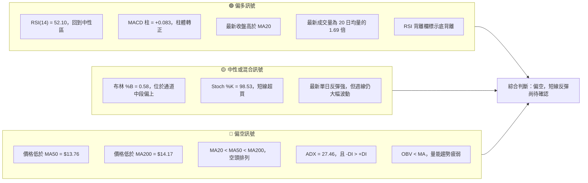
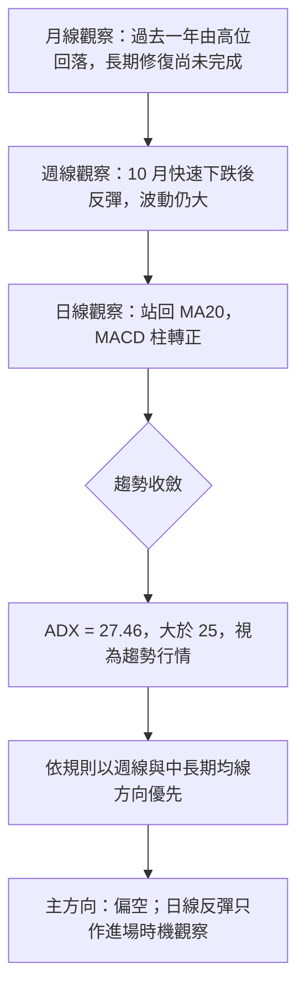
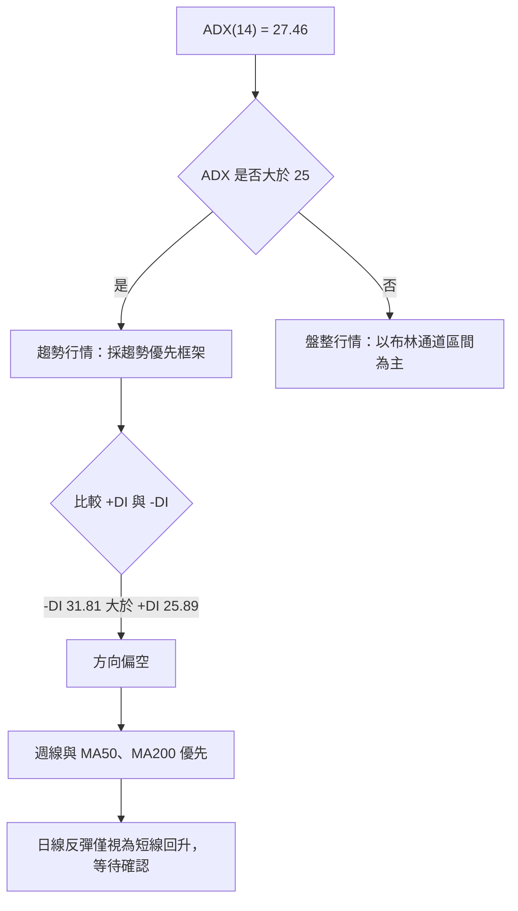
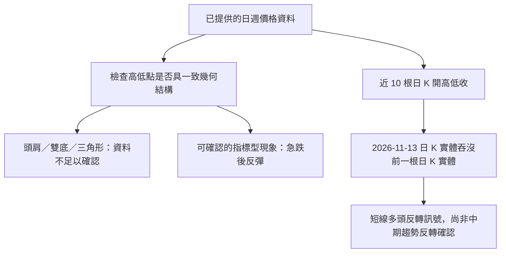
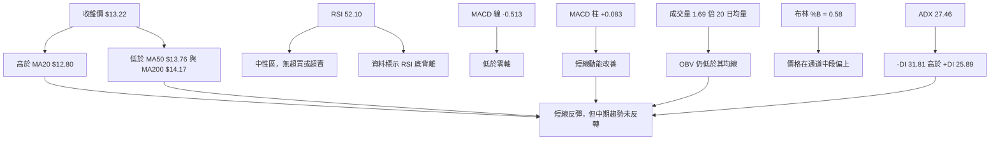
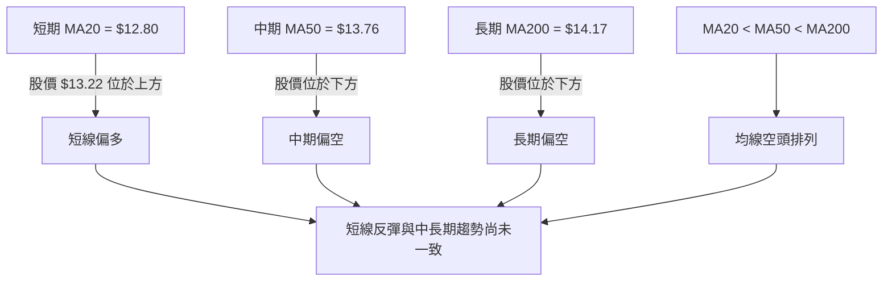
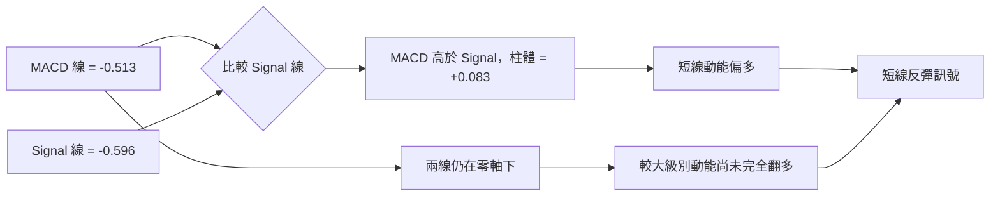
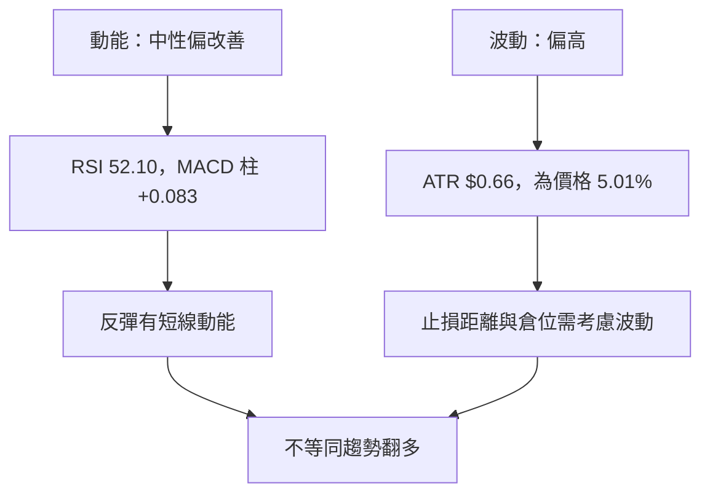
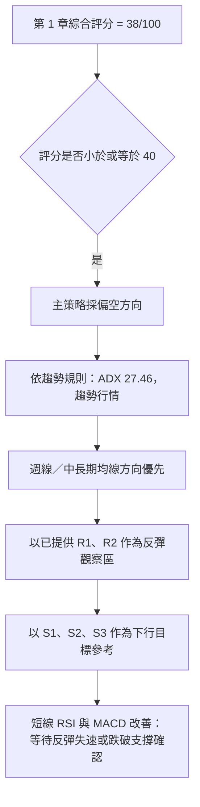
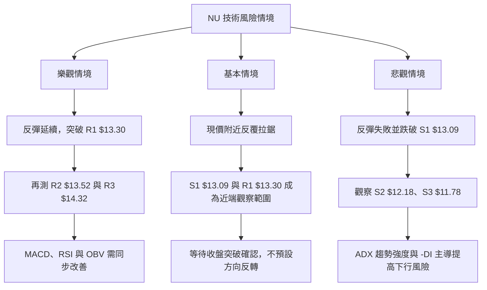

# NU 技術分析報告

> **報告日期**：2026-11-14 ｜ **語言**：繁體中文 ｜ **數據來源**：使用者提供之 Yahoo Finance 技術數據  
> **當前價格**：**$13.22**（2026-11-13 收盤價）

---

## 目錄

| 章節 | 內容 |
|------|------|
| 1. 技術面概覽 | 訊號儀表板、核心指標、評分卡 |
| 2. 趨勢分析 | 多時框趨勢、長中短期走勢 |
| 3. 圖表形態分析 | 形態識別、K 線組合、目標價 |
| 4. 支撐與阻力 | 關鍵價位、斐波那契回調 |
| 5. 技術指標深度解讀 | MA、RSI、MACD、布林通道、成交量 |
| 6. 動能與波動率 | 動能評估、ATR、Beta |
| 7. 多時框架總結 | 時框架評分矩陣 |
| 8. 交易策略建議 | 主策略、情境分析、風險報酬比 |
| 9. 風險提示與監控 | 監控指標、風險場景 |

---

## 1. 技術面概覽

### 🎯 技術訊號儀表板

目前訊號呈現「短線反彈、較大級別趨勢仍偏弱」的混合結構。RSI 回到中性區、MACD 柱翻正，並有單日高成交量配合；但股價仍低於 MA50、MA200，均線維持空頭排列，ADX 高於 25 且 `-DI > +DI`，趨勢方向仍由空方主導。



### 📊 核心指標速覽表

| 指標類別 | 指標名稱 | 當前數值 | 訊號 | 解讀 |
|----------|----------|----------:|------|------|
| 價格 | 收盤價 | **$13.22** | 🟡 | 為資料提供之最新收盤價，非盤中即時報價 |
| 區間 | 52 週高／低 | $18.98／$11.20 | 🔴 | 現價位於所提供 52 週區間的 26.0% 位置 |
| 均線 | MA20 | $12.80 | 🟢 | 收盤價高於 MA20，短線反彈站回短均線 |
| 均線 | MA50 | $13.76 | 🔴 | 收盤價低於 MA50，中期趨勢未扭轉 |
| 均線 | MA200 | $14.17 | 🔴 | 收盤價低於 MA200，長期均線仍構成壓力 |
| 動能 | RSI(14) | 52.10 | 🟡 | 中性；已離開超賣區，但未進入強勢區 |
| 動能 | MACD | -0.513 | 🔴 | MACD 線仍為負值，反彈尚未完成零軸收復 |
| 動能 | MACD 柱 | +0.083 | 🟢 | 柱體轉正，短線動能改善 |
| 趨勢 | ADX(14) | 27.46 | 🔴 | 高於 25，屬趨勢行情；`-DI` 主導方向 |
| 波動 | ATR(14) | $0.66 | 🟡 | 約為價格的 5.01%，日常波動幅度偏大 |
| 量能 | 量比 | 1.69 倍 | 🟢／🟡 | 最新成交量放大，但 OBV 趨勢仍疲弱 |
| 量能 | OBV | OBV < MA | 🔴 | 累積量能尚未確認價格反彈 |

### 🏆 技術評分卡

評分採 0–100 分，各項依當前技術狀態評估；綜合分數依規定以六項子評分算術平均計算：

\[
(35+48+42+35+35+33)\div6=38
\]

| 評分項目 | 分數 | 評分理由 |
|----------|-----:|----------|
| 趨勢強度 | 35/100 | ADX 顯示趨勢有強度，但 `-DI > +DI`，方向偏空 |
| 動能指標 | 48/100 | RSI 中性、MACD 柱轉正；MACD 線仍在零軸下 |
| 支撐穩定度 | 42/100 | 現價高於 S1，但近期低點曾快速下探，支撐仍需確認 |
| 成交量配合 | 35/100 | 最新量放大，但 OBV 低於其均線，量價確認不完整 |
| 形態完整度 | 35/100 | 可辨識短線反彈與吞噬型日 K，但不足以確認主要反轉結構 |
| 均線排列 | 33/100 | MA20 < MA50 < MA200，股價仍低於 MA50、MA200 |

```text
╔════════════════════════════════════════════════════════════╗
║              技術評分卡 — NU（2026-11-14）                ║
╠════════════════════════════════════════════════════════════╣
║ 趨勢強度      ▓▓▓▓▓▓▓░░░░░░░░░░░░░░  35/100  🔴          ║
║ 動能指標      ▓▓▓▓▓▓▓▓▓▓░░░░░░░░░░  48/100  🟡          ║
║ 支撐穩定度    ▓▓▓▓▓▓▓▓░░░░░░░░░░░░  42/100  🟡          ║
║ 成交量配合    ▓▓▓▓▓▓▓░░░░░░░░░░░░░  35/100  🔴          ║
║ 形態完整度    ▓▓▓▓▓▓▓░░░░░░░░░░░░░  35/100  🔴          ║
║ 均線排列      ▓▓▓▓▓▓▓░░░░░░░░░░░░░  33/100  🔴          ║
╠════════════════════════════════════════════════════════════╣
║ 綜合評分      ▓▓▓▓▓▓▓▓░░░░░░░░░░░░  38/100  🔴 偏空      ║
║ 計算：六項分數算術平均，四捨五入至整數                  ║
╚════════════════════════════════════════════════════════════╝
```

---

## 2. 趨勢分析

### 🌐 多時框趨勢分析



| 時框 | 可用資料與現況 | 趨勢判讀 | 訊號 |
|------|----------------|----------|------|
| 長期／月線 | 近 12 個月月收盤由 2026-01 的 $17.75 降至 2026-10 的 $11.61，11 月回升至 $13.22 | 長期仍屬高位回落後的修復，未能收復 MA200 | 🔴 |
| 中期／週線 | 2026-10-09 收 $16.12，至 2026-10-30 收 $11.61；其後回升至 $13.22 | 急跌後反彈，仍在低位波動區，不能單憑一週反彈確認反轉 | 🔴／🟡 |
| 短期／日線 | 收盤高於 MA20，RSI 52.10，MACD 柱轉正；但低於 MA50 與 MA200 | 反彈動能改善，趨勢反轉條件不足 | 🟡 |

### 📈 長期趨勢 — 12 個月走勢圖

下圖依提供的月度收盤價繪製，縱軸為近似視覺位置；每月數值及標記均以原始月收盤資料為準。圖中高低點指的是**月收盤高低點**，不等同於月內最高／最低價。

```text
NU 月線收盤走勢（2025-12 至 2026-11；每格約代表相對價格區間）

$18 ┤     ● 17.75
$17 ┤    ╱ ╲
$16 ┤ ● 16.74   ╲
$15 ┤              ● 14.98
$14 ┤                 ● 14.37─● 14.48             ● 14.33─● 14.55
$13 ┤                         ╲ ● 13.13─● 13.36              ╲
$12 ┤                                                      ● 12.66
$11 ┤                                                          ● 11.61
    ┤                                                              ╲ ● 13.22
    └───────────────────────────────────────────────────────────────
     12月   1月   2月   3月   4月   5月   6月   7月   8月   9月  10月  11月
     16.74 17.75 14.98 14.37 14.48 13.13 13.36 14.33 14.55 12.66 11.61 13.22
                   ▲月收盤高點                                      ▼低點
```

#### 近 12 個月月收盤數據與階段變化

| 月份 | 月收盤 | 相對前月變化 | 階段特徵 |
|------|-------:|-------------:|----------|
| 2025-12 | $16.74 | — | 延續高位整理 |
| 2026-01 | $17.75 | +6.04% | 近 12 個月月收盤高點 |
| 2026-02 | $14.98 | -15.66% | 明顯回撤 |
| 2026-03 | $14.37 | -4.07% | 續弱 |
| 2026-04 | $14.48 | +0.77% | 低位橫向修復 |
| 2026-05 | $13.13 | -9.32% | 再度走弱 |
| 2026-06 | $13.36 | +1.75% | 小幅回升 |
| 2026-07 | $14.33 | +7.26% | 反彈延續 |
| 2026-08 | $14.55 | +1.53% | 高於 7 月收盤 |
| 2026-09 | $12.66 | -13.00% | 回落幅度擴大 |
| 2026-10 | $11.61 | -8.29% | 月收盤低點 |
| 2026-11 | $13.22 | +13.87% | 依最新收盤，屬月內反彈，尚未收月 |

由 2026-01 月收盤 $17.75 至 2026-10 月收盤 $11.61，累計變化約 **-34.6%**。2026-11 的 $13.22 較 10 月收盤上升，但 11 月資料尚未結束，不宜視為完整月線確認。

### 📊 中期趨勢（週線分析）

近 20 週週收盤顯示，7 月至 8 月曾升至 $15.23，9 月中下旬轉弱；10 月初雖一度收至 $16.12，但 10 月底回落至 $11.61。最新兩週收盤分別為 $12.03、$13.22，顯示反彈加速，但仍需觀察是否能向上突破已提供的阻力區。

```text
週線近期結構示意（只按提供的週收盤數據呈現）

$16.12 ┤                         ● 10/09
       │                        ╱ ╲
$15.16 ┤                       ╱    ● 10/23
$14.56 ┤                              ╲
$13.59 ┤ ● 09/25 ─ ● 10/02             ╲
$13.22 ┤                                      ╲          ● 11/13
$12.03 ┤                                                 ● 11/06
$11.61 ┤                                            ● 10/30
       └─────────────────────────────────────────────────────
        09/25   10/02   10/09   10/16   10/23   10/30   11/06   11/13
```

- 10 月 9 日週收盤 $16.12 至 10 月 30 日週收盤 $11.61，跌幅約 **28.0%**。
- 10 月 30 日至 11 月 13 日，收盤由 $11.61 回升至 $13.22，升幅約 **13.9%**。
- 11 月 13 日週成交量為 378,183,800，低於 10 月 30 日週的 701,855,200；因此反彈雖具價格幅度，但週量尚未超越前一段急跌的高成交量。
- 週線 RSI 由 2026-10-30 的 30.7 回升至 2026-11-13 的 52.1，與反彈方向一致；但週線 MACD 柱雖回升至 +0.083，仍不足以單獨證明中期趨勢反轉。

### ⚡ 趨勢強度評估（ADX 解讀）

| 指標 | 數值 | 解讀 |
|------|-----:|------|
| ADX(14) | 27.46 | 高於 25，趨勢強度達到常用趨勢行情門檻 |
| +DI | 25.89 | 多方方向指標 |
| -DI | 31.81 | 高於 +DI，空方方向仍占優勢 |
| DI 差距 | -DI 高 5.92 點 | 空方主導，但差距並非極端擴大 |



**收斂判讀：** ADX 高於 25，因此依既定規則不把市場當成單純盤整。趨勢方向參照週線回撤及中長期均線：偏空；日線反彈是短線改善，不足以推翻較大級別趨勢。

---

## 3. 圖表形態分析

### 🔍 形態識別系統

現有資料足以辨認價格急跌後反彈、短線均線下方反抽，以及單根日 K 的多頭吞噬型態；但不足以可靠辨認具完整幾何結構的頭肩底、雙底、三角形或旗形。因此不以未確認的形態推算目標價。



| 形態／現象 | 信心度 | 判斷依據 | 完成度 | 目標價 |
|------------|-------:|----------|-------:|--------|
| 日線多頭吞噬 | 75% | 11/12 開 $12.08、收 $11.83；11/13 開 $12.36、收 $13.22，11/13 實體涵蓋前一日實體範圍 | 已完成單根組合；後續確認不足 | 不以單根 K 形態推算目標價 |
| 急跌後反彈 | 75% | 週收盤由 10/30 的 $11.61 回升至 11/13 的 $13.22 | 反彈已發生；反轉尚未確認 | 以已提供 R1–R3 作為阻力觀察，不另推形態目標 |
| 雙底 | <50% | 資料未提供可驗證的兩個等高低點與頸線結構 | 未確認 | **數據中未偵測到** |
| 頭肩底／頭肩頂 | <50% | 沒有足夠且明確的波峰波谷幾何排列 | 未確認 | **數據中未偵測到** |
| 三角形／旗形 | <50% | 未提供可確認的收斂趨勢線或旗桿—旗面結構 | 未確認 | **數據中未偵測到** |

### 🕯️ 重要 K 線形態分析

以下 K 線判讀僅引用近 10 根日 K、近 8 根週 K 的開、高、低、收資料。量能另列為背景，不以區塊外日期推斷 K 線形態。

| 日期（日 K／週 K） | 開 | 高 | 低 | 收 | K 線形態 | 解讀 | 訊號 |
|------|---:|---:|---:|---:|----------|------|------|
| 2026-11-05（日 K） | $12.02 | $12.02 | $11.21 | $11.74 | 長下影線 | 低位曾下探至 $11.21，收盤回到低點之上；顯示低位承接，但不是單獨反轉確認 | 🟡 |
| 2026-11-12（日 K） | $12.08 | $12.27 | $11.79 | $11.83 | 偏空實體 | 收盤低於開盤，提供次日吞噬型態的前一根陰線實體 | 🔴 |
| 2026-11-13（日 K） | $12.36 | $13.25 | $12.10 | $13.22 | 多頭吞噬型實體 | 收盤遠高於開盤，且實體涵蓋前一日實體；上影線短、下影線存在，短線買盤明顯 | 🟢 |
| 2026-10-30（週 K） | $11.69 | $13.00 | $11.48 | $11.61 | 長上影線／偏空週 K | 高點至收盤回落明顯，週收低於開盤，反映該週反彈未能守住 | 🔴 |
| 2026-11-06（週 K） | $11.79 | $12.28 | $11.21 | $12.03 | 多頭週 K | 收盤高於開盤，低位下影顯示低點有承接 | 🟢／🟡 |
| 2026-11-13（週 K） | $12.14 | $13.25 | $11.79 | $13.22 | 長實體多頭週 K | 收盤接近週高，週內反彈強；但尚未站上 MA50、MA200 | 🟢／🟡 |

### 📉 ASCII 走勢形態示意圖

```text
近月週收盤結構示意（僅表示收盤序列，不補造未提供的轉折點）

$16.12 ┤                     ●
       │                   ╱   ╲
$15.16 ┤                  ╱      ●
$14.56 ┤                ╱          ╲
$13.59 ┤ ●────●                       ╲
$13.22 ┤                                  ╲             ●
$12.03 ┤                                                ●
$11.61 ┤                                           ●
       └──────────────────────────────────────────────────
        09/25 10/02 10/09 10/16 10/23 10/30 11/06 11/13
                    急跌段                反彈段
```

圖形所呈現的是「先急跌、後快速回升」，而不是已確認的底部形態。若要確認反轉，需看到後續收盤持續向上、突破所提供阻力，並由成交量／OBV 配合。

### 🎯 形態目標價計算

- **目前不使用頭肩、雙底、旗形或三角形目標價公式。**原因是資料不足以確立形態邊界、頸線或形態高度。
- 11 月 13 日的多頭吞噬型日 K 具有短線反轉訊號，但不是可直接量度的價位形態，故不計算形態高度目標。
- 後續價格參考採用第 4 章提供的 R1、R2、R3 與 S1、S2、S3；不另創造精確價位。

---

## 4. 支撐與阻力

### 🗺️ 關鍵價位分布圖

下圖僅使用資料包中的波段高低點聚類價位。現價位於 R1 與 S1 之間，距 R1 為 0.61%，距 S1 為 1.02%。

```text
NU 價位結構分布圖（美元；價位依資料包原值）

$14.32  ║████████████████████████║ R3 阻力
$13.52  ║████████████████████    ║ R2 阻力
$13.30  ║████████████████████████║ R1 阻力
$13.22  ╠════════════════════════╣ ◄ 最新收盤價
$13.09  ║▓▓▓▓▓▓▓▓▓▓▓▓▓▓          ║ S1 支撐
$12.18  ║████████████████████    ║ S2 支撐
$11.78  ║████████████████████████║ S3 支撐
         └──────────────────────────
```

### 🚧 阻力位分析表

| 阻力級別 | 價位 | 相對現價 | 形成原因 | 突破難度 | 重要性 |
|----------|-----:|---------:|----------|----------|--------|
| R1 | $13.30 | +0.61% | 近一年波段高點聚類 | 中 | 短線第一個確認門檻 |
| R2 | $13.52 | +2.23% | 近一年波段高點聚類 | 中 | 若突破 R1，觀察反彈是否延伸 |
| R3 | $14.32 | +8.28% | 近一年波段高點聚類 | 中高 | 更高級別反彈阻力參考 |

以上阻力價位只引用已提供的 R1、R2、R3。MA50、MA200、斐波那契水平等亦可作指標觀察，但不替代這組波段高點聚類價位。

### 🛡️ 支撐位分析表

| 支撐級別 | 價位 | 相對現價 | 形成原因 | 守住機率判斷 | 重要性 |
|----------|-----:|---------:|----------|--------------|--------|
| S1 | $13.09 | -1.02% | 近一年波段低點聚類 | 中低；價位接近現價，需觀察收盤是否守穩 | 第一層短線支撐 |
| S2 | $12.18 | -7.86% | 近一年波段低點聚類 | 中；較接近反彈前的交易區域 | 次級支撐 |
| S3 | $11.78 | -10.89% | 近一年波段低點聚類 | 中；若觸及代表反彈明顯失敗 | 較深一級支撐 |

「守住機率」是依目前趨勢、位置及量價訊號作定性判斷，不是統計勝率。ADX 顯示趨勢行情、`-DI` 主導，故不應把任何支撐視為必然有效。

### 📐 斐波那契回調位分析

| 回調比例 | 價位 | 現價相對位置 |
|----------|-----:|--------------|
| 23.6% | $17.14 | 現價低於此位 |
| 38.2% | $16.01 | 現價低於此位 |
| 50.0% | $15.09 | 現價低於此位 |
| 61.8% | $14.17 | 現價低於此位 |
| 78.6% | $12.86 | 現價高於此位 |

現價 **$13.22 位於 61.8% 回調位 $14.17 與 78.6% 回調位 $12.86 之間**。按資料包提供的 52 週區間，股價已回吐較大部分區間漲幅；現價高於 78.6% 回調位，但距 61.8% 回調位仍有一段距離。這代表目前位置具備反彈空間，但不等於已完成趨勢反轉。

```text
52 週區間回調位示意（由資料包直接引用）

$18.98 ┤ 0.0%   52 週高點
$17.14 ┤ 23.6%
$16.01 ┤ 38.2%
$15.09 ┤ 50.0%
$14.17 ┤ 61.8%
$13.22 ┤ ◄ 現價
$12.86 ┤ 78.6%
$11.20 ┤ 100.0% 52 週低點
        └────────────────────────
```

---

## 5. 技術指標深度解讀

### 🎛️ 指標訊號總覽



### 📈 移動平均線排列分析

| 均線 | 數值 | 相對股價 | 均線自身變化 | 訊號 |
|------|-----:|----------|--------------|------|
| MA5 | $12.36 | 股價高於 MA5 | 上升 +6.94% | 短線反彈 |
| MA10 | $12.08 | 股價高於 MA10 | 上升 +9.44% | 短線改善 |
| MA20 | $12.80 | 股價高於 MA20 | 上升 +3.30% | 短線支撐參考 |
| MA50 | $13.76 | 股價低於 MA50 | 下降 -5.21%（MA60 欄） | 中期壓力 |
| MA120 | $13.70 | 股價低於 MA120 | 下降 -3.49% | 中期均線仍偏弱 |
| MA200 | $14.17 | 股價低於 MA200 | MA240 為 $14.67 且下降 | 長期壓力參考 |

> 資料列出的移動平均走勢使用 MA5、MA10、MA20、MA60、MA120、MA240；快照則另列 MA50、MA200。此處不將 MA60 或 MA240 數值冒充 MA50 或 MA200 的斜率資料。



**解讀：** MA5、MA10、MA20 數值均低於現價，與最新反彈相符；但 MA20 仍低於 MA50、MA200，且現價未收復後兩者。這是「短線反彈、長中期均線偏空」的典型不一致結構。若沒有站回更高級別均線，短線多頭訊號不宜被解讀為完整趨勢翻多。

### 📉 RSI(14) 分析

RSI(14) 為 **52.10**，位於 30–70 的中性區。

```text
RSI(14) 強度刻度

0       20       30                50                70       80      100
|--------|--------|-----------------|-----------------|--------|--------|
         超賣區   └────────中性區────────┘               超買區
                                      ▲
                                  RSI 52.10
                                  █████░░░░░ 52%
```

- **超買／超賣：** RSI 52.10 並未進入超買區或超賣區；因此目前不是單純以 RSI 極端值判斷逆轉的情況。
- **短線方向：** RSI 從週線資料的 2026-10-30 的 30.7 上升至 2026-11-13 的 52.1，反映動能修復。
- **背離判斷：** 技術快照明確標示 RSI 背離為「底背離」，並註明比較近 20 根 K 棒首尾價格與 RSI 方向。據此判斷：**RSI 底背離訊號存在**，但資料沒有提供完整的各根 RSI 與價格轉折序列，無法獨立驗證背離的每一個局部低點，故信心度屬中等。
- **頂背離：** 資料未標示 RSI 頂背離，亦未提供足以自行驗證頂背離的完整逐根 RSI 序列，故不宣稱存在頂背離。

### 📊 MACD(12/26/9) 訊號解讀

| MACD 項目 | 數值 | 解讀 |
|-----------|-----:|------|
| MACD 線 | -0.513 | 仍在零軸下方，較大級別動能尚未完全轉多 |
| Signal 線 | -0.596 | 低於零軸 |
| MACD Histogram | +0.083 | 高於零，代表兩線差距轉向有利於短線反彈 |



- **MACD 柱與 RSI 的確認：** MACD 柱轉正、RSI 回到 52.10，兩者均支持短線反彈。
- **與均線及 ADX 的矛盾：** MACD 線仍為負，現價低於 MA50／MA200，且 `-DI` 高於 `+DI`。因此動能訊號較像跌勢中的回升，而非已確認的趨勢翻轉。
- **MACD 背離：** 未提供 MACD 逐根高低點序列或背離欄位，結論為 **N/A（數據未提供）**；不推測 MACD 頂背離或底背離。

### 📦 布林通道分析

| 項目 | 價位／數值 | 與現價關係 |
|------|-----------:|------------|
| 上軌 | $15.42 | 高於現價 |
| 中軌（MA20） | $12.80 | 現價高於中軌 |
| 下軌 | $10.18 | 低於現價 |
| %B | 0.58 | 位於通道中段偏上 |

```text
布林通道示意（不是按比例精確繪製）

$15.42 ║ 上軌 ─────────────────────────────
       ║
$13.22 ║                         ● 現價
       ║                        ↑
$12.80 ║ 中軌（MA20） ──────────┼────────────
       ║
$10.18 ║ 下軌 ─────────────────────────────
       ╚════════════════════════════════════
```

現價位於布林中軌之上，%B 為 0.58，表示價格略偏通道上半部，但尚未接近上軌。這與短線反彈相符。布林通道帶寬未提供，故不能量化通道收縮或擴張速度；盤整行情的上下軌交易邏輯亦不應凌駕於目前 ADX > 25 的趨勢行情判定之上。

### 💹 成交量分析（量價配合度）

| 成交量項目 | 數值 | 解讀 |
|------------|------:|------|
| 最新成交量 | 152,561,300 | 明顯高於 20 日均量 |
| 20 日均量 | 90,299,260 | 量比 1.69 倍 |
| 50 日均量 | 83,557,216 | 最新量亦高於 50 日均量 |
| OBV 趨勢 | OBV < MA | 資料判定量能趨勢疲弱 |

最新日成交量約為 20 日均量的 **1.69 倍**，且收盤顯著上升，構成單日量價同向的正面訊號。然而，OBV 仍低於其移動平均線，表示累積量能尚未確認反彈的持續性。週線方面，11 月 13 日週成交量 378,183,800 低於 10 月 30 日週的 701,855,200；比較這兩週時，反彈的週量尚未超越急跌週的交易量。

**綜合判斷：** 短線成交量有支持，但量能趨勢仍偏疲弱；量價訊號評為混合，不宜只因單日放量就判定中期反轉。

---

## 6. 動能與波動率

### ⚡ 動能評估四象限

目前 RSI 中性、MACD 柱轉正，動能較 10 月底改善；ATR 為價格的 5.01%，屬相對明顯的日常波動。Beta 未提供，因此不能把個股市場敏感度納入量化象限。

| 象限 | 動能 | 波動 | 當前狀態 | 評估 |
|------|------|------|----------|------|
| Q1 | 強 | 低 | — | 若出現，通常具趨勢延續且回撤較小的特徵 |
| Q2 | 弱 | 低 | — | 低波動整理，但方向性有限 |
| Q3 | 強 | 高 | **部分接近** | 反彈動能改善，但 ATR 偏高，且趨勢仍由空方主導 |
| Q4 | 弱 | 高 | — | 若 RSI 再度走弱、OBV 下行且 ATR 維持高位，風險上升 |



### 📊 ATR 波動率分析

ATR(14) 為 **$0.66**，約為現價 $13.22 的 **5.01%**。這表示近期典型波動幅度不小，過窄的停損可能因日常波動而被觸發；但 ATR 只描述歷史波動，並不代表未來一定維持相同範圍。

- 以 ATR 作為**風險尺度參考**，可比較交易停損與 ATR 的距離；實際止損價仍依第 4 章允許的已提供關鍵價位設定。
- 不將 `13.22 − 1 × ATR` 或其他 ATR 倍數結果當成新支撐或精確止損價，以遵守價位資料紀律。
- 建議控制每筆交易的帳戶風險，而不是用固定股數忽略 ATR 變化。
- 當日 ATR 百分比約 5%，代表若持倉過大，即使方向正確，價格正常波動也可能造成較大的帳戶淨值變化。

### 📐 Beta 與市場相關性

| 項目 | 數值 | 判斷 |
|------|------|------|
| Beta | **N/A（數據未提供）** | 不作數值估算 |
| 與大盤相關係數 | **N/A（數據未提供）** | 無法從本資料直接計算 |
| 市場敏感度 | 未知 | 個股波動不可簡單等同大盤波動 |

由於 Beta 與相關係數未提供，不能據此判斷 NU 對大盤漲跌的歷史敏感度。風險控制應依本身 ATR、關鍵價位與個股訊號執行，而不是假設其波動必然與大盤同步。

---

## 7. 多時框架總結

### 📋 時框架評分表

評分是技術條件的相對整理，與第 1 章綜合分數 **38/100** 一致；未提供週線、月線均線值的欄位以 N/A 標示，不自行推算。

| 時框架 | 趨勢方向 | 動能 | 均線排列 | 形態 | 綜合評分 | 建議 |
|--------|----------|------|----------|------|---------:|------|
| 長期／月線 | 偏空 | 近月反彈 | 月線 MA 資料 N/A；日線 MA200 偏空 | 高位回落後修復，未確認反轉 | 35/100 | 不以單月反彈判斷長期翻多 |
| 中期／週線 | 偏空後反彈 | RSI、MACD 柱改善 | 週線均線 N/A | 急跌後反彈，結構仍需確認 | 38/100 | 優先觀察支撐與阻力收盤突破 |
| 短期／日線 | 反彈 | RSI 中性、MACD 柱正 | 價格高於 MA20，低於 MA50／MA200 | 11/13 多頭吞噬型日 K | 48/100 | 反彈訊號可以觀察，但不宜視為趨勢反轉 |
| **整體** | **偏空** | **短線改善** | **空頭排列** | **反轉形態尚未確認** | **38/100** | **偏空；反彈時重視風險控制** |

### 🔲 綜合訊號矩陣

| 技術維度 | 短期 | 中期 | 長期 | 一致性 |
|----------|------|------|------|--------|
| 價格方向 | 🟢 反彈 | 🔴 急跌後修復 | 🔴 高位回落 | 不一致 |
| 均線 | 🟢 高於 MA20 | 🔴 低於 MA50 | 🔴 低於 MA200 | 偏空主導 |
| 動能 | 🟡 RSI 中性、MACD 柱轉正 | 🟡 動能由低位回升 | 🔴 MACD 線仍在零軸下 | 短多長空 |
| 趨勢強度 | ADX 27.46 | 趨勢強度達門檻 | 方向由 `-DI` 主導 | 趨勢偏空 |
| 成交量 | 最新單日量放大 | OBV < MA | 確認不足 | 混合偏弱 |

### ⚖️ 多時框收斂結論

1. **行情分類：** ADX(14) = 27.46，大於 25，按規則屬趨勢行情，而非以布林通道上下軌為主的單純盤整行情。
2. **主導時框：** 依趨勢行情收斂規則，優先採用週線與中長期方向；資料顯示週線在 10 月大幅回落，股價仍低於 MA50、MA200，且 `-DI > +DI`。
3. **短線修正：** 日線 RSI、MACD 柱及最新成交量均有改善，代表反彈並非毫無支持；但它們不足以推翻中期偏空訊號。
4. **唯一方向性結論：** **偏空**。短線反彈可影響入場時機，但在關鍵阻力未被確認突破之前，不把日線反彈當成多時框趨勢反轉。

---

## 8. 交易策略建議

### 🗺️ 策略決策流程圖



**當前主策略方向 = 偏空（依評分 38/100）。**

策略方向雖偏空，但不代表應在任何價位直接追空。最新單日反彈強、MACD 柱轉正，較合理的技術執行方式是等待價格進入已提供阻力區後觀察反彈是否失速，或等待支撐失守確認；如果行情直接持續上漲，應避免在沒有訊號的情況下追空。

### 🎯 價格情境階梯（Price Scenarios）

| 觸發條件 | 下一目標 | 後續延伸 | 情境含義 |
|----------|----------|----------|----------|
| 突破 R1 **$13.30** 並續強 | R2 **$13.52** | R3 **$14.32** | 反彈延伸；若連續收復阻力，偏空判斷需重新評估 |
| 維持在 S1 **$13.09** 與 R1 **$13.30** 之間 | — | — | 短線窄幅整理；不宜因單一盤中波動改變較大級別方向 |
| 跌破 S1 **$13.09** | S2 **$12.18** | S3 **$11.78** | 反彈失守，偏空趨勢獲得更多價格確認 |

> 上表只引用資料包提供的關鍵價位。布林通道、均線與斐波那契水平可作為輔助觀察，但不另行創造目標價。

### 📊 情境機率分佈

以下機率是依目前技術狀態作情境權重估計，不是歷史回測勝率；三項總和為 100%。

| 情境 | 機率 | 主要依據 |
|------|-----:|----------|
| 繼續上行／反彈 | 25% | RSI 52.10、MACD 柱 +0.083、最新成交量為 20 日均量 1.69 倍、11/13 日 K 強勢收高 |
| 區間震盪 | 25% | 布林 %B 0.58，價格位於中軌偏上；但 ADX > 25，故盤整情境權重不宜過高 |
| 回落／再探底 | 50% | ADX 27.46、`-DI > +DI`、價格低於 MA50／MA200、均線空頭排列、OBV < MA |

### 🔴 主策略詳情：偏空

以下兩種方式是同一偏空策略的不同觸發情境，並非同時對相同部位重複加碼。所有入場、止損、目標價均使用資料包已提供的價格。

| 策略要素 | 策略 A：反彈至 R1 後失速 | 策略 B：回測 R2 後轉弱 |
|----------|-------------------------|-------------------------|
| 進場條件 | 價格測試 R1 後無法延續，且出現轉弱確認 | 反彈至 R2 附近後無法站穩，並重新走弱 |
| 進場價格 | **$13.30** | **$13.52** |
| 目標價 T1 | **$13.09（S1）** | **$12.18（S2）** |
| 目標價 T2 | **$12.18（S2）** | **$11.78（S3）** |
| 止損價格 | **$13.52（R2）** | **$14.32（R3）** |
| 風險報酬比 | **1 : 0.95（以 T1 計）**；1 : 5.09（以 T2 計） | **1 : 1.68（以 T1 計）**；1 : 2.18（以 T2 計） |
| 成功機率評估 | 50%（主觀情境估計，非回測） | 45%（主觀情境估計，非回測） |
| 建議倉位 | 資金配置上限 2%–3%；單筆帳戶風險宜限制於 0.25%–0.50% | 資金配置上限 1%–2%；採較小倉位等待阻力確認 |

**風險報酬比驗算：**

- 策略 A 做空，進場 $13.30、止損 $13.52、T1 $13.09：  
  \[
  (13.30-13.09)\div(13.52-13.30)=0.21\div0.22=0.95
  \]
- 策略 A 至 T2：  
  \[
  (13.30-12.18)\div0.22=1.12\div0.22=5.09
  \]
- 策略 B 做空，進場 $13.52、止損 $14.32、T1 $12.18：  
  \[
  (13.52-12.18)\div(14.32-13.52)=1.34\div0.80=1.68
  \]
- 策略 B 至 T2：  
  \[
  (13.52-11.78)\div0.80=1.74\div0.80=2.18
  \]

策略 A 的 T1 風險報酬比低於 1，若只以 T1 為獲利目標，交易效率不高；只有在確認趨勢延續並具備計畫性管理時，才有理由考慮延伸至 T2。策略 B 的入場位置更高、目標空間較大，但仍須等待反彈失速，不能將「價格到達」單獨當成做空訊號。

### 🔴 反向風險觸發點（對沖提示）

以下因素可能推翻偏空策略或降低其可信度：

- 收盤有效突破 **R1 $13.30**，並進一步站上 **R2 $13.52**。
- 若突破 **R3 $14.32**，代表短線反彈已擴大，原本的偏空執行邏輯需重新檢視。
- RSI 持續位於 50 上方、MACD 線不再維持零軸下方，並伴隨 OBV 改善，會提高多頭反轉可信度。
- 若價格跌破 **S1 $13.09** 且成交量再度擴大，則反彈失敗的判讀獲得加強；仍須留意支撐位可能反覆測試。

### ⭐ 整體訊號強度評星

```text
做多訊號強度：★★☆☆☆  (2/5 星)
做空訊號強度：★★★☆☆  (3/5 星)
整體可信度：  ★★★☆☆  (3/5 星)

說明：中長期偏空結構較明確；但日線反彈與短線動能改善，
      使得立即追空的勝算與風險報酬未必理想。
```

---

## 9. 風險提示與監控

### ✅ 關鍵監控指標 Checklist

```text
╔════════════════════════════════════════════════════════════╗
║                 NU 技術面監控清單                          ║
╠════════════════════════════════════════════════════════════╣
║ □ 收盤是否突破 R1 $13.30？                                ║
║ □ 突破 R1 後，是否進一步站上 R2 $13.52？                  ║
║ □ R3 $14.32 是否被收復？若是，重估偏空策略。             ║
║ □ S1 $13.09 是否失守？                                    ║
║ □ 若失守 S1，觀察 S2 $12.18、S3 $11.78。                  ║
║ □ RSI(14) 是否持續高於 50，或再次轉弱？                   ║
║ □ MACD 柱是否維持正值？MACD 線是否仍在零軸下？           ║
║ □ OBV 是否由低於其均線轉為高於其均線？                   ║
║ □ 成交量放大是否伴隨價格延續，而非單日脈衝？              ║
║ □ ADX 是否維持大於 25，且 -DI 是否仍高於 +DI？            ║
║ □ 價格能否收復 MA50 $13.76、MA200 $14.17？                ║
╚════════════════════════════════════════════════════════════╝
```

### ⚠️ 風險場景分析



#### 樂觀情境

若收盤突破 R1 $13.30、R2 $13.52，並有成交量與 OBV 配合，短線反彈可能延伸至 R3 $14.32。若 RSI、MACD 同步改善，則偏空判讀的可信度會下降。不過，在收復 MA50 $13.76 與 MA200 $14.17 之前，應區分「反彈延伸」與「完整趨勢翻多」。

#### 基本情境

股價在 $13.09 至 $13.30 附近反覆震盪，RSI 仍處中性區，MACD 柱正值未能持續擴大，OBV 亦未有效確認。由於 ADX 高於 25，不能只因短線整理就判定進入長時間盤整；需以收盤突破／跌破關鍵價位作方向確認。

#### 悲觀情境

若股價收盤跌破 S1 $13.09，且成交量放大、`-DI` 持續高於 `+DI`，則反彈失敗訊號增強，後續觀察 S2 $12.18 及 S3 $11.78。若價格跌至支撐附近而 RSI 或 OBV 未改善，應避免因「已接近支撐」而無條件假設反彈。

### 🛡️ 風險管理重要提醒

1. **設定單筆風險上限：** 以帳戶可承受損失決定部位，不以預測目標價決定倉位。可將每筆交易的帳戶風險控制在 0.25%–0.50% 作為保守參考。
2. **依止損距離計算股數：**  
   `持倉股數 = 可承受金額風險 ÷（每股進場價與止損價差）`。止損距離較大時，必須降低股數。
3. **避免在短線急漲後直接追價做空：** 最新日成交量為 20 日均量的 1.69 倍，且日 K 強勢收高；空方策略應等待阻力失守或反彈失速等確認條件。
4. **提防缺口及隔夜風險：** 技術止損不保證成交在指定價，若出現跳空，實際損失可能超過按止損價計算的理論風險。
5. **以收盤確認作為重要判斷：** 盤中短暫穿越關鍵價位不一定代表有效突破；趨勢型市場中，收盤位置及後續延續性更重要。
6. **不要混用不同時框的訊號：** 日線反彈可用來選擇空方進場時機，但不能在未收復中長期關鍵均線前，自動推翻週線與 ADX 指向的偏空背景。
7. **評分不等於勝率：** 綜合評分 38/100 是技術條件評分，不是預測價格下跌的統計機率；交易情境機率亦屬依現有指標所作的主觀估計。

---

## 📋 報告總結

```text
╔════════════════════════════════════════════════════════════╗
║                 NU 技術分析報告總結                       ║
╠════════════════════════════════════════════════════════════╣
║ 報告日期：2026-11-14                                      ║
║ 當前價格：$13.22（2026-11-13 收盤）                      ║
║ 分析評級：🔴 偏空；短線反彈，但中長期趨勢尚未反轉        ║
║ 綜合評分：38/100（六項子評分算術平均）                   ║
╠════════════════════════════════════════════════════════════╣
║ 長期趨勢：🔴 近一年高位回落，最新月內反彈尚未確認        ║
║ 中期趨勢：🔴 10 月急跌後回升，週線結構仍需修復            ║
║ 短期趨勢：🟡 RSI、MACD 柱改善，價格站回 MA20              ║
║ 關鍵支撐：$13.09（S1）；其下為 $12.18（S2）               ║
║ 關鍵阻力：$13.30（R1）；其上為 $13.52（R2）               ║
║ 上方延伸阻力：$14.32（R3）                                ║
║ 分析師平均目標：$17.95（外部分析師共識，非技術目標價）     ║
╠════════════════════════════════════════════════════════════╣
║ 最優策略組合：                                             ║
║ 1. 🥇 等待反彈至 R1 或 R2 後觀察是否失速，再評估偏空執行  ║
║ 2. 🥈 若跌破 S1 $13.09，觀察 S2 $12.18、S3 $11.78         ║
║ 3. 🥉 若突破 R2 $13.52，避免追空並重新評估短線結構        ║
╚════════════════════════════════════════════════════════════╝
```

> ⚠️ **免責聲明**：本報告為依據所提供技術資料產生之分析，僅供研究與學術參考，不構成投資建議、買賣邀約或保證。技術型態、情境機率與評分不代表未來報酬或勝率。市場價格可能快速變化，止損亦可能因跳空而無法按指定價成交。投資有風險，入市需謹慎。

---

*報告生成時間：2026-11-14 ｜ 數據來源：使用者提供之 Yahoo Finance 數據 ｜ 分析框架：多時框技術分析*