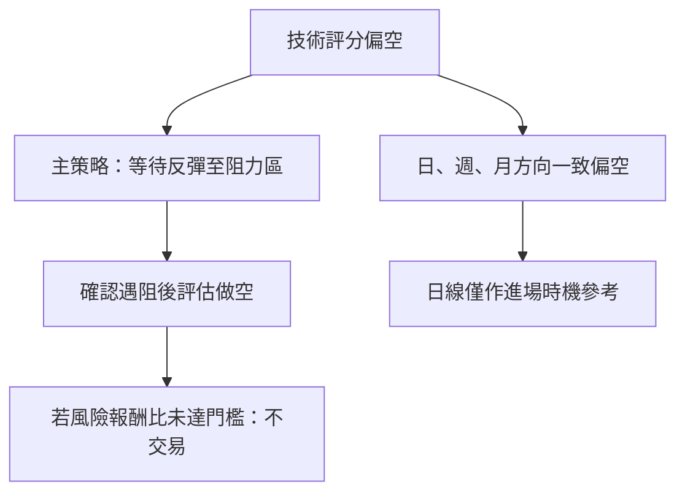

# NU 技術分析報告

> **報告日期**：2026-11-17 ｜ **語言**：繁體中文 ｜ **數據來源**：Yahoo Finance ｜ **當前價格**：$12.68（2026-11-16 收盤）

---

## 目錄

| 章節 | 內容 |
|------|------|
| [1. 技術面概覽](#1-技術面概覽) | 核心指標速覽、評分卡 |
| [2. 趨勢分析](#2-趨勢分析) | 長中短期走勢、ADX |
| [3. 圖表形態分析](#3-圖表形態分析) | 形態、K 線、缺口 |
| [4. 支撐與阻力](#4-支撐與阻力) | 關鍵價位、斐波那契 |
| [5. 技術指標深度解讀](#5-技術指標深度解讀) | MA／RSI／MACD／布林／成交量／進階指標 |
| [6. 動能與波動率](#6-動能與波動率) | ATR、Beta、相對強度 |
| [7. 多時框架總結](#7-多時框架總結) | 時框架訊號矩陣 |
| [8. 交易策略建議](#8-交易策略建議) | 歷史基準、策略、風險報酬比 |
| [9. 風險提示與監控](#9-風險提示與監控) | 監控指標、風險場景 |

---

## 1. 技術面概覽

目前技術面偏空：股價低於主要趨勢均線，且日、週、月方向一致偏空。日線 MACD 柱轉正及 A/D 線上升是反向訊號，顯示短線賣壓有緩和或吸籌跡象，但尚未扭轉中長期弱勢。最大反向風險是支撐區附近出現反彈並突破上方阻力，令順勢做空的風險報酬比惡化。

### 📊 核心指標速覽表

| 指標類別 | 指標名稱 | 當前數值 | 訊號 | 解讀 |
|----------|----------|----------|------|------|
| **價格** | 當前價格 | $12.68 | 🔴 | 位於主要趨勢均線下方，接近支撐區 |
| **均線** | MA20／MA50／MA200 | 見第 5 章 | 🔴 | 價格低於三條均線，排列偏空 |
| **動能** | RSI(14)（日線） | 見第 5 章 | 🟡 | 中性，未顯示超買或超賣 |
| **動能** | MACD 柱（日線） | 見第 5 章 | 🟢 | 柱值轉正，但 MACD 線仍在零軸下方 |
| **趨勢** | ADX(14) | 見第 2 章 | 🔴 | 趨勢強度達趨勢行情門檻，空頭方向主導 |
| **波動** | ATR(14) | 見第 6 章 | 🟡 | 日波動幅度偏高，需留意止損距離 |
| **多時框** | 一致性 | 見第 7 章 | 🔴 | 日、週、月方向一致偏空 |

### 🏆 技術評分卡

| 維度 | 評分（0–100） | 訊號 | 主要依據（引用數值所在章節） |
|------|---------------|------|------------------------------|
| 趨勢強度 | 25 | 🔴 | ADX 顯示趨勢行情，方向由空頭主導；見第 2 章 |
| 動能指標 | 55 | 🟡 | RSI 中性、MACD 柱轉正，但多時框方向仍偏空；見第 5、7 章 |
| 支撐穩定度 | 45 | 🟡 | 下方存在多級波段支撐，但尚未形成有效反轉確認；見第 4 章 |
| 成交量配合 | 35 | 🔴 | OBV 低於其均線，量能對價格反彈的確認不足；見第 5 章 |
| 形態完整度 | 30 | 🔴 | 未有足夠幾何證據確認反轉形態；見第 3 章 |
| 均線排列 | 20 | 🔴 | 均線呈空頭排列，價格位於主要均線下方；見第 5 章 |
| **綜合評分** | **35** | **偏空** | 六項算術平均：210 ÷ 6 = 35 |

---

## 2. 趨勢分析

### 📈 長期趨勢（近 12 個月）

近十二個月走勢先於年初附近見階段高位，之後回落，期間出現反彈但未能維持；近期仍處於自高位回撤後的低位區間。階段漲跌幅按表列起訖收盤計算，反映的是價格報酬而非含息總報酬。

| 階段 | 期間 | 起訖月收盤 | 漲跌幅 | 特徵 |
|------|------|------------|--------|------|
| 年底整理至階段高位 | 2025-12 至 2026-01 | $16.74 → $17.75 | +6.0% | 月收盤上行，延續此前升勢 |
| 高位回落 | 2026-01 至 2026-05 | $17.75 → $13.13 | -26.0% | 回撤明顯，趨勢轉弱 |
| 低位反彈整理 | 2026-05 至 2026-08 | $13.13 → $14.55 | +10.8% | 反彈後未能重返年初高位 |
| 再度走弱 | 2026-08 至 2026-11 | $14.55 → $12.68 | -12.9% | 近期月收盤偏弱，仍待趨勢反轉確認 |

### 📊 中期趨勢（週線）

週線方向偏空：最新週線收盤位於週趨勢均線下方，週 RSI 低於中性分界，週 MACD 柱為負值。近週線資料亦顯示，十月中旬曾反彈至較高收盤，隨後快速回落；之後雖有反彈，週線仍未收復趨勢均線。週線動能的短暫回升不足以單獨確認趨勢反轉。

| 週線觀察 | 數值／狀態 | 解讀 |
|----------|------------|------|
| 多時框週線方向 | 偏空 | 收盤低於週趨勢均線，RSI 低於 50 |
| 週趨勢均線 | MA20 $13.99；收盤在其下方 | 中期趨勢尚未轉強 |
| 週 RSI(14) | 44.99 | 動能偏弱，未進入超賣區 |
| 週 MACD 柱 | -0.175 | 週線動能仍偏空 |
| 週收盤變化 | 2026-10-09：$16.12；2026-10-30：$11.61；2026-11-13：$13.22；2026-11-16：$12.68 | 急跌後反彈，但最新收盤低於前一週收盤 |

### ⚡ 趨勢強度（ADX）

ADX 高於趨勢行情門檻，且負向 DI 高於正向 DI，代表目前較符合**空頭趨勢行情**，而非單純盤整。依多時框收斂規則，應以週線及中長期均線方向決定主方向，日線只作進場時機參考；短線 MACD 柱轉正不能凌駕中長期偏空結構。

| 指標 | 數值 | 解讀 |
|------|------:|------|
| ADX(14) | 26.23 | 高於 25，判定為趨勢行情 |
| +DI | 24.26 | 多方方向力量較弱 |
| −DI | 29.80 | 高於 +DI，空頭方向主導 |
| 規則 14 優先級 | 趨勢行情 | 以週線／MA50／MA200方向為主，日線用於安排進場 |

---

## 3. 圖表形態分析

### 🔍 形態識別

現有資料不足以確認高可信度的頭肩、雙底、旗形或其他幾何形態。技術判讀以均線空頭排列、價格位於主要均線下方，以及週線急跌後反彈但尚未收復趨勢均線為主；以下不將短期反彈直接定義為反轉形態。

| 形態 | 信心度 | 判斷依據 | 完成度 | 目標價 |
|------|--------|----------|--------|--------|
| 幾何反轉形態 | 低 | 目前價位與給定週線資料不足以確認清晰頸線、對稱低點或形態高度 | 訊號不足，僅做指標型解讀 | N/A（數據未提供；未確認形態，不推算形態目標） |
| 均線空頭排列 | 高 | MA20、MA50、MA200呈空頭排列，價格低於三者 | 已形成，但不代表價格必然持續下跌 | 不適用 |
| 週線急跌後反彈 | 中 | 急跌後週收盤反彈，惟最新週收盤仍低於前一週 | 反彈仍未確認為趨勢反轉 | 不適用 |

### 🕯️ 重要 K 線形態與缺口

以下 K 線判斷僅使用近十根日 K、近八根週 K 的開高低收。日 K 與週 K 的部分日期重疊，分開列示以保留各自時框資訊。

| 日期（日 K／週 K） | 開 | 高 | 低 | 收 | K 線形態 | 解讀 | 訊號 |
|------|----:|----:|----:|----:|----------|------|------|
| 2026-11-05（日 K） | $12.02 | $12.02 | $11.21 | $11.74 | 長下影線、收低於開盤 | 低位有承接，但當日仍收跌；單根 K 棒不足以確認反轉 | 🟡 |
| 2026-11-13（日 K） | $12.36 | $13.25 | $12.10 | $13.22 | 長實體陽線、收近高位 | 買盤推升明顯；仍需後續價格與成交量確認延續性 | 🟢 |
| 2026-11-16（日 K） | $12.96 | $13.19 | $12.64 | $12.68 | 陰線、上影線 | 反彈後遇賣壓，短線追價動能有所降溫 | 🔴 |
| 2026-10-30（週 K） | $11.69 | $13.00 | $11.48 | $11.61 | 向下跳空背景下的弱勢週 K | 週線收盤低於開盤，該週須連同未回補缺口解讀，不視為一般單週波動 | 🔴 |
| 2026-11-13（週 K） | $12.14 | $13.25 | $11.79 | $13.22 | 長實體陽線、收近高位 | 週線反彈有力，但下一週收盤回落，尚未確認反轉 | 🟡 |

#### 跳空缺口清單

| 日期 | 方向 | 缺口區間 | 是否回補 | 技術含義 |
|------|------|----------|----------|----------|
| 2026-11-04 | 向上跳空 | $11.70–$11.84 | 已回補 | 缺口已回補，作為未來支撐依據的效力有限 |
| 2026-10-26 | 向下跳空 | $12.78–$14.57 | 未回補 | 上方供給／阻力區；若反彈進入該區，需觀察能否有效收復 |
| 2026-10-05 | 向上跳空 | $13.50–$14.84 | 已回補 | 缺口已回補，不構成未回補缺口支撐 |
| 2026-09-28 | 向下跳空 | $12.66–$13.44 | 已回補 | 缺口已回補，僅作歷史價格行為參考 |

---

## 4. 支撐與阻力

### 🚧 阻力位分析表

以下阻力價位取自近一年波段高點聚類。最近價格低於各級阻力；在中長期趨勢偏空的條件下，反彈至阻力區時，應檢查成交量與收盤能否確認突破，而不宜只憑盤中穿越判定有效突破。

| 阻力級別 | 價位 | 形成原因 | 突破難度 | 重要性 |
|----------|------:|----------|----------|--------|
| R1 | $13.30 | 近一年波段高點聚類 | 中 | 第一層反彈阻力；亦是空頭策略觀察進場位 |
| R2 | $13.52 | 近一年波段高點聚類 | 中 | 位於 R1 上方；突破後可能削弱近端空頭結構 |
| R3 | $14.32 | 近一年波段高點聚類 | 高 | 更高階波段阻力，突破需較強買盤確認 |

### 🛡️ 支撐位分析表

以下支撐價位取自近一年波段低點聚類。支撐能否守住仍需觀察收盤及量能；由於目前中長期趨勢偏空，不將支撐價位視為必然反轉點。

| 支撐級別 | 價位 | 形成原因 | 守住可能性 | 重要性 |
|----------|------:|----------|------------|--------|
| S1 | $12.18 | 近一年波段低點聚類 | 中 | 第一層近端支撐，跌破後可能測試下一級支撐 |
| S2 | $11.78 | 近一年波段低點聚類 | 中 | 次級支撐，需配合價格是否快速收復判斷 |
| S3 | $11.51 | 近一年波段低點聚類 | 低 | 更低層支撐；若下跌趨勢延續，守住的把握較弱 |

波段支撐及阻力均已提供多級價位，本節不以樞軸點補充波段價位。

### 📐 斐波那契回調位分析

斐波那契區間為 52 週高低點；現價位於 78.6% 回調位與 100.0% 回調位之間，代表價格已回吐該區間的大部分漲幅，且靠近 52 週低位一側。此位置與偏空的均線及多時框方向一致，但不能單獨視為超跌反轉訊號。

| 回調比例 | 價位 | 技術解讀 |
|----------|------:|----------|
| 23.6% | $17.14 | 深度回撤前的較高參考位 |
| 38.2% | $16.01 | 中段回撤參考位 |
| 50.0% | $15.09 | 區間中點參考位 |
| 61.8% | $14.17 | 深度回撤參考位 |
| 78.6% | $12.86 | 現價低於此回調位，反彈時可留意其阻力作用 |
| 100.0%（52 週低點） | $11.20 | 區間低點參考位 |

---

## 5. 技術指標深度解讀

### 📈 均線、RSI、MACD、布林通道

| 指標 | 數值 | 訊號 | 解讀 |
|------|------|------|------|
| MA20／MA50／MA200 與排列 | MA20 $12.71；MA50 $13.70；MA200 $14.15；MA20 < MA50 < MA200 | 🔴 | 價格低於三條均線，且均線呈空頭排列，反映中短期趨勢仍弱 |
| RSI(14)（日線）與背離 | RSI 47.60；近二十根 K 棒首尾比較未見明顯背離 | 🟡 | 位於中性區間。**RSI 背離結論：無明顯頂背離或底背離** |
| MACD 線／Signal／柱（日線） | MACD -0.455；Signal -0.568；柱 +0.113 | 🟡 | 柱值為正，顯示短線動能改善；MACD 線仍在零軸下方，尚不能確認中期轉多 |
| 布林上軌／中軌／下軌／%B（日線） | $15.20／$12.71／$10.21／0.49 | 🟡 | %B 接近通道中部，日線價格位置並非明顯貼近上軌或下軌，未見明確布林突破訊號 |

**指標整合：**均線排列與 RSI 中性偏弱、MACD 線仍低於零軸，整體支持中期偏空；MACD 柱轉正則與空頭均線結構存在短線矛盾。布林 %B 位於通道中部，未確認向上突破或極端超賣。綜合而言，短線賣壓可能緩和，但目前沒有足夠訊號推翻中長期偏空判斷。

### 💹 成交量（量價配合度）

| 指標 | 數值／狀態 | 解讀 |
|------|------------|------|
| 最新成交量 | 89,606,300 股 | 接近二十日均量、略低於該均量 |
| 二十日均量 | 92,710,635 股 | 量比低於 1，最新交易日成交量未高於短期均量 |
| 五十日均量 | 84,379,120 股 | 最新成交量高於五十日均量，但單日不足以確認趨勢性量能 |
| OBV | OBV < MA | 量能趨勢疲弱，尚未確認價格反彈 |
| A/D 線（近二十根） | 高於其二十日均值；A/D 上升、價格下跌 | 出現價跌而 A/D 上升的吸籌跡象，與 OBV 偏弱讀數不一致 |

**量價結論：**成交量訊號並不完全一致。OBV 仍低於均線，沒有明確確認反彈；A/D 線上升則提供吸籌的反向線索。因此，量能對短線反彈僅屬部分確認，尚不足以支持趨勢已反轉。

### 🧭 進階指標

| 指標 | 數值 | 收盤相對位置 | 解讀 |
|------|------|--------------|------|
| 一目均衡表（日線） | 轉換線 $12.23；基準線 $13.70；最新 K 棒雲層先行帶 A $14.14、B $14.18；前方雲層 A $12.97、B $13.70 | 收盤位於最新雲層下方；轉換線低於基準線 | 偏空；與主要均線結構一致。前方雲層 A 位於 B 下方，也偏空 |
| 成交量分布 | POC $13.96；價值區 $13.14–$17.68，涵蓋 71% 成交量 | 收盤位於價值區下方 | 價格低於主要成交密集區，反彈可能遇到上方供給；與均線及趨勢結論一致 |
| 錨定 VWAP（自 52 週高點） | $14.05 | 收盤在其下方 | 上方套牢／成本壓力較大，偏空 |
| 錨定 VWAP（自 52 週低點） | $13.73 | 收盤在其下方 | 自低點起的成交量加權成本仍高於收盤，未確認價格轉強 |
| A/D 線（近二十根） | 高於其二十日均值；A/D 上升、價格下跌 | 不適用 | 顯示可能有吸籌，與 OBV 偏弱及均線偏空構成分歧，須等待價格確認 |

---

## 6. 動能與波動率

### 📊 ATR 波動率分析

ATR 顯示單日價格波動占現價比例偏高。以下 ATR 倍數僅作風險距離參考，不取代第 8 章依既定價位設置的實際止損；若採用固定支撐／阻力位，仍應確認該距離與個人倉位風險相容。

| 指標 | 數值 | 解讀 |
|------|------:|------|
| ATR(14) | $0.66 | 日線平均真實波幅參考 |
| ATR／價格 | 5.18% | 單日波動占現價比例偏高 |
| 1.5 倍 ATR 距離 | $0.99 | 可作為較寬鬆止損距離的波動參考 |
| 2 倍 ATR 距離 | $1.32 | 適用於容忍較大短期波動的風險距離參考 |

### 📐 Beta 與相對強度

相對強度表顯示，NU 對 VTI 的短期相對表現偏弱；較長觀察期曾有超額表現，但比值低於其均線，近期相對動能未支持追多。這與本報告的偏空主策略相符，但六個月區間的正超額報酬提醒，不能假設中期相對弱勢會線性延續。

| 期間 | NU 價格報酬 | VTI 價格報酬 | 超額報酬 |
|------|------------:|-------------:|---------:|
| 一個月 | -10.3% | -1.9% | -8.3% |
| 三個月 | -10.3% | -2.9% | -7.4% |
| 六個月 | +8.4% | +2.3% | +6.1% |
| 比值趨勢 | 相對走弱 | 比值低於其 50 日均值 | 支持偏空主策略的近期方向判斷 |

| 指標 | 數值 | 解讀 |
|------|------:|------|
| Beta | 0.968 | 歷史敏感度接近大盤，但 Beta 不代表個股短期波動一定低於市場 |
| 短期相對強度 | 相對走弱 | 近月與近季落後 VTI，與偏空主策略同向 |
| 中期相對強度 | 六個月超額為正 | 與短期相對走弱相抵，提示反彈或均值回歸風險 |

---

## 7. 多時框架總結

### 📋 時框架訊號矩陣

方向、趨勢均線、RSI 與 MACD 柱依各時框指標列示；「形態」欄僅概括各時框價格結構，不把日線指標移作週線或月線讀數。

| 時框架 | 趨勢方向 | RSI(14) | MACD 柱 | 收盤 vs 趨勢均線 | 形態 | 建議 |
|--------|----------|---------:|--------:|------------------|------|------|
| 日線 | 偏空 | 47.60 | +0.113 | 收盤 $12.68，低於 MA50 $13.70 | 短線反彈後回落；未形成已確認反轉形態 | 以反彈至阻力區作為觀察，不追空低位 |
| 週線 | 偏空 | 44.99 | -0.175 | 收盤 $12.68，低於 MA20 $13.99 | 急跌後反彈，尚未收復週趨勢均線 | 以週線趨勢為主，等待反彈失敗或破位確認 |
| 月線 | 偏空 | 33.24 | N/A（數據未提供） | 收盤 $12.68，低於 MA10 $13.61 | 月線仍處較弱區域，月 MACD 柱未提供 | 不以月 RSI 偏低單獨判定底部 |

**多時框一致性：3/3 偏空。**

### ⚖️ 多時框收斂結論

目前屬於趨勢行情，依規則以中長期方向為主。日線與週線、月線並未出現方向衝突：三者均偏空；日線 MACD 柱轉正只構成短線反向訊號，不改變主趨勢判定。**唯一方向性結論：偏空。**這與第 8 章主策略一致。

---

## 8. 交易策略建議

**當前主策略方向 = 偏空（依綜合評分 35/100）。**策略採反彈至阻力後尋找做空條件，不在支撐附近追空；若價格未達到風險報酬比門檻，則不執行交易。

### 🧭 策略路由

### 📊 歷史基準機率

今日狀態定義為 RSI(14) 位於 30–50 且收盤低於 MA200。樣本期間涵蓋 2021-12-09 至 2026-11-16，共 1,239 個交易日；下表為價格報酬、不含股息。

| 持有期 | 相同狀態樣本（段數） | 上漲比例 | 中位數報酬 | 25%–75% 分位 | 全部交易日上漲比例／中位數 |
|--------|----------------------:|----------:|------------:|--------------:|----------------------------:|
| 五日 | 246（39 段） | 55% | +0.8% | -2.7% 至 +5.1% | 55%／+0.7% |
| 二十日 | 235（38 段） | 60% | +4.4% | -5.2% 至 +13.9% | 59%／+2.3% |
| 六十日 | 217（34 段） | 64% | +10.1% | -8.2% 至 +22.0% | 66%／+8.9% |

**解讀：**短期上漲比例與全部交易日相同；中期上漲比例略高，但長持有期低於全部交易日。中位數報酬在部分持有期較高，然而各持有期樣本互相重疊，真正較接近獨立事件的段數較少。這些是歷史頻率，不是預測，也沒有強力支持順勢做空；因此方向主要依據多時框趨勢，歷史基準則提醒需防範反彈。

### 🎯 價格情境階梯（Price Scenarios）

| 觸發條件 | 下一目標 | 後續延伸 | 可能性 | 依據 |
|----------|----------|----------|--------|------|
| 突破並站穩 R1 | R2 | R3 | 低 | 多時框仍偏空；需價格與成交量共同確認，才視為空頭結構轉弱 |
| 在支撐與近端阻力間維持整理 | — | — | 中 | 日線布林 %B 位於通道中部，但 ADX 判定為趨勢行情，不能將盤整假設置於中長期趨勢之上 |
| 跌破 S1 並持續收於其下 | S2 | S3 | 中 | 空頭趨勢、週線 MACD 柱為負；但支撐附近仍有吸籌跡象，需避免未確認前追空 |

### 🟢 主策略詳情

策略 A 為唯一達到最低風險報酬比的可執行候選；策略 B 列示為不交易情境，避免在支撐附近以不足的風險報酬比追空。所有策略仍需按實際成交價格重新核算風險報酬比。

| 策略要素 | 策略 A：反彈至 R1 後偏空 | 策略 B：支撐附近追空 |
|----------|--------------------------|----------------------|
| 進場條件 | 價格反彈至 R1，出現轉弱訊號且未有效站穩 R2 | 價格在 S1 附近直接做空 |
| 進場價格 | $13.30 | 此價位不交易（風險報酬比 1 : 0.36 不足）；須等反彈至 $13.30 才達到可執行設定 |
| 目標價 T1 | $12.18（S1） | $11.78（S2） |
| 目標價 T2 | $11.78（S2） | $11.51（S3） |
| 止損價格 | $13.52（R2） | $13.30（R1） |
| 風險報酬比 | **1 : 5.09（以 T1 計）**；計算：(13.30 − 12.18) ÷ (13.52 − 13.30) | **1 : 0.36（以 T1 計，不達標）**；計算：(12.18 − 11.78) ÷ (13.30 − 12.18) |
| 以 T2 計風險報酬比 | 1 : 6.91 | 1 : 0.60 |
| 把握度 | 中；多時框與均線結構偏空，但 A/D 上升、歷史基準並未顯示明確下跌優勢 | 不適用；未達最低風險報酬比，不列為可執行策略 |
| 建議倉位 | 依止損距離計算倉位；單筆帳戶風險上限建議不高於資金的 0.5% | 不建議建立部位 |

**策略執行條件：**策略 A 僅在反彈到指定阻力且出現轉弱確認後執行；若價格直接下跌至支撐，不追空。若進場成交價偏離表列進場價，應使用實際成交價重新計算風險報酬比，未達門檻即取消交易。

### 🔴 反向風險觸發點（對沖提示）

| 風險觸發 | 對主策略的影響 | 風控提示 |
|----------|----------------|----------|
| 有效站穩 R1，並進一步突破 R2 | 反彈可能由短線修復轉為結構性轉強 | 停止追空，重新評估趨勢；勿以原止損失效後加碼 |
| 收復一目均衡表基準線並進入雲層 | 空頭訊號減弱 | 等待週線確認，不以單日突破直接判定趨勢反轉 |
| A/D 上升同時 OBV 轉強 | 吸籌訊號獲成交量確認 | 降低空頭部位或等待下一個反彈高點再評估 |

---

## 9. 風險提示與監控

### ✅ 關鍵監控指標

| 監控項目 | 觀察條件／價位 | 觸發後動作 |
|----------|----------------|------------|
| R1、R2 阻力 | 見第 4 章 | 觀察反彈是否遇阻；有效突破時停止依原假設追空 |
| S1、S2、S3 支撐 | 見第 4 章 | 支撐失守時確認收盤及量能，避免單靠盤中跌破追空 |
| 未回補跳空 | 2026-10-26 向下缺口 $12.78–$14.57 | 反彈進入缺口區間時留意上方供給；缺口上緣及下緣的作用須由收盤確認 |
| OBV 與 A/D 線 | OBV 是否回到均線上方；A/D 上升是否延續 | 兩者若轉為一致偏多，削弱空頭策略的量價依據 |
| 下次財報日 | N/A（數據未提供） | 距最新收盤日的日曆天數：N/A（數據未提供）；財報日期未提供，無法核對是否落在持有期間 |
| 財報跳空風險 | 日期未提供 | 若持倉期間遇財報，可能出現跳空；止損不保證按預定價格成交 |

### ⚠️ 風險場景

| 情境 | 觸發條件 | 參考價位 | 可能性 | 應對 |
|------|----------|----------|--------|------|
| 樂觀（對空頭不利） | 價格突破近端阻力並收復上方趨勢區 | R1、R2；見第 4 章 | 低 | 停止加空，檢視週線是否由偏空轉為中性或偏多 |
| 基本 | 價格在支撐與阻力之間波動，未有效突破任一側 | S1 與 R1；見第 4 章 | 中 | 等待阻力反轉訊號或支撐破位確認，不在區間中段追單 |
| 悲觀（對空頭有利） | 收盤有效跌破首級支撐並延續弱勢 | S1、S2、S3；見第 4 章 | 中 | 已持倉者按計畫移動止盈；未持倉者仍須確認風險報酬比 |

### 🛡️ 風險管理提醒

- 只在策略條件成立且風險報酬比達最低門檻時進場；若實際成交價改變，重新計算後再決定。
- 倉位以止損距離反推，避免先決定股數再放寬止損；單筆風險宜維持在可承受範圍。
- 不在支撐位附近因短線情緒追空；若支撐失守，等待收盤確認與反彈失敗訊號。
- 不因單一日線 MACD 或 A/D 訊號反轉就忽略週線、月線方向；若多時框轉向，應重新評估主策略。
- 財報日未提供，無法確認策略持倉期間是否涵蓋財報；持倉前應另行核實，並考慮跳空可能使止損無法按指定價成交。

---

## 📋 報告總結

| 項目 | 結論 |
|------|------|
| 報告日期 | 2026-11-17 |
| 當前價格 | 標題列所示（2026-11-16 收盤） |
| 綜合評分／方向 | 35/100，偏空 |
| 長期／中期／短期趨勢 | 🔴 長期偏弱；🔴 週線偏空；🟡 日線偏空但短線動能有修復 |
| 關鍵支撐／關鍵阻力 | S1／S2／S3 與 R1／R2／R3，精確價位見第 4 章 |
| 🥇 最佳機會 | 策略 A：反彈至 R1 後，符合條件才考慮偏空；未到位則觀望 |
| 最大風險 | 支撐附近的吸籌跡象及短線動能改善，可能引發反彈並使追空交易承受不利風險 |

> ⚠️ **免責聲明**：本報告為 AI 自動生成之技術分析，所有分析均基於歷史價格與技術指標資料。本報告僅供研究與學術參考，不構成投資建議。投資有風險，入市需謹慎。

---

## 資料與來源

| 項目 | 內容 |
|------|------|
| 價格 | 12.68 USD，2026-11-16 收盤（Yahoo Finance 日線） |
| K 棒 | 500 根日線，2024-11-18 至 2026-11-16（Yahoo Finance）；較長期間的價位與基準機率取自價格資料庫 |
| 關鍵價位回溯期間 | 阻力 近一年、支撐 近一年 |
| 有回應的資料來源 | Yahoo Finance、Finviz、StockAnalysis、Roic.ai |
| 由程式計算 | 所有指標、R1–S3 與斐波那契價位、多時框方向、相對強度、缺口、歷史基準機率、綜合評分 |
| 撰寫模型 | openai / gpt-6-luna |

> 本區塊由產生報告的程式依實際取得的資料填寫，非模型撰寫。「由程式計算」的數字不是模型的估計；其餘判斷（評分、情境、策略）是模型的分析。
