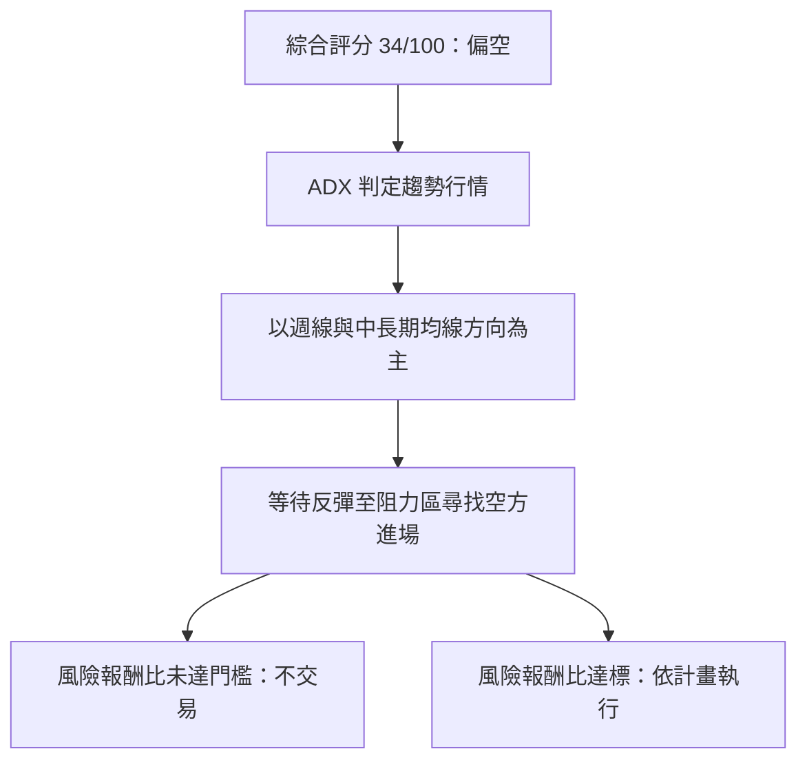

# NU 技術分析報告

> **報告日期**：2026-11-20 ｜ **語言**：繁體中文 ｜ **數據來源**：Yahoo Finance ｜ **當前價格**：**$11.82**（收盤日期：2026-11-19）

---

## 目錄

| 章節 | 內容 |
|------|------|
| [1. 技術面概覽](#1-技術面概覽) | 核心指標速覽、評分卡 |
| [2. 趨勢分析](#2-趨勢分析) | 長中短期走勢、ADX |
| [3. 圖表形態分析](#3-圖表形態分析) | 形態、K線、缺口 |
| [4. 支撐與阻力](#4-支撐與阻力) | 關鍵價位、斐波那契 |
| [5. 技術指標深度解讀](#5-技術指標深度解讀) | MA／RSI／MACD／布林／成交量／進階指標 |
| [6. 動能與波動率](#6-動能與波動率) | ATR、Beta、相對強度 |
| [7. 多時框架總結](#7-多時框架總結) | 時框架評分矩陣 |
| [8. 交易策略建議](#8-交易策略建議) | 歷史基準、策略、風險報酬比 |
| [9. 風險提示與監控](#9-風險提示與監控) | 監控指標、風險場景 |

---

## 1. 技術面概覽

NU 目前偏空：日線、週線與月線方向一致偏空，且收盤位於主要均線下方；均線空頭排列與週線動能轉弱是最重要的兩項確認。短線反向風險在於日線 MACD 柱已轉正、A/D 線呈現價跌而 A/D 上升的吸籌跡象，若價格重新站回阻力區，空頭延續判斷可能失效。ADX 略高於趨勢門檻，故策略以中長期偏空方向為主，日線訊號只作進場時機參考。

### 📊 核心指標速覽表

| 指標類別 | 指標名稱 | 當前數值 | 訊號 | 解讀 |
|----------|----------|----------|------|------|
| **價格** | 當前價格 | **$11.82** | 🔴 | 位於52週區間低位一側，價格壓力仍大。 |
| **均線** | MA20／MA50／MA200 | 見第5章 | 🔴 | 收盤低於三條均線，排列偏空。 |
| **動能** | RSI(14)（日線） | 見第5章 | 🟡 | 中性區間，尚未呈現超賣反轉確認。 |
| **動能** | MACD柱（日線） | 見第5章 | 🟡 | 柱體轉正，但中期趨勢仍偏弱。 |
| **趨勢** | ADX(14) | 見第2章 | 🔴 | 略高於趨勢門檻，且空頭方向指標占優。 |
| **波動** | ATR(14) | 見第6章 | 🟡 | 單日波動幅度相對價格偏高，須控制倉位。 |
| **多時框** | 一致性 | 見第7章 | 🔴 | 日、週、月線方向一致偏空。 |

### 🏆 技術評分卡

此為全報告唯一評分卡。綜合評分依六項子評分的算術平均計算，四捨五入至整數。

| 維度 | 評分（0–100） | 訊號 | 主要依據 |
|------|---------------|------|----------|
| 趨勢強度 | 25 | 🔴 | ADX 已進入趨勢區，方向指標偏空；見第2章。 |
| 動能指標 | 45 | 🟡 | 日線 RSI 中性、MACD 柱短線轉正，但週月動能偏空；見第5、7章。 |
| 支撐穩定度 | 55 | 🟡 | 近期低點聚集提供近端參考，但收盤靠近低位區且仍有下破風險；見第4章。 |
| 成交量配合 | 30 | 🔴 | OBV 低於均線、最新量低於均量；A/D 吸籌跡象構成反向訊號；見第5章。 |
| 形態完整度 | 35 | 🔴 | 未確認具幾何目標的完整反轉形態，主要仍是偏空趨勢訊號；見第3章。 |
| 均線排列 | 15 | 🔴 | 短、中、長期均線呈空頭排列，價格位於其下；見第5章。 |
| **綜合評分** | **34** | **偏空** | 六項平均為34.17，四捨五入至34。 |

---

## 2. 趨勢分析

### 📈 長期趨勢（近12個月）

整體呈現先升後跌，年初高位後轉為中長期回落；近月價格仍處低位區域。以下階段表以月末收盤整理，最後一個完整月收盤列至十月；十一月為未完結月份，不納入完整月段落計算。

| 期間 | 起訖月收盤 | 漲跌幅 | 特徵 |
|------|------------|--------|------|
| 2025年12月至2026年1月 | $16.74 → $17.75 | +6.03% | 延續上行並形成階段高位。 |
| 2026年1月至2026年2月 | $17.75 → $14.98 | -15.61% | 高位回落，趨勢轉弱。 |
| 2026年2月至2026年6月 | $14.98 → $13.36 | -10.82% | 回落延續，期間未形成持續性月線反轉。 |
| 2026年6月至2026年8月 | $13.36 → $14.55 | +8.91% | 出現反彈，但未扭轉其後的走弱格局。 |
| 2026年8月至2026年10月 | $14.55 → $11.61 | -20.21% | 再度下跌，長期方向仍偏空。 |

月線資料顯示趨勢均線下方、方向偏空；月 RSI 位於偏弱區域，月 MACD 柱為 **N/A（數據未提供）**。因此月線訊號支持中長期謹慎，而不是確認底部反轉。

### 📊 中期趨勢（週線）

週線收盤低於其趨勢均線，週線方向為偏空；週 RSI 低於中性分界，週 MACD 柱為負值。近週收盤走勢亦顯示，十月下旬急跌後雖有反彈，最新週收盤再次回落，反彈尚未改變週線偏空結構。

| 週線觀察項目 | 數值／訊號 | 解讀 |
|--------------|------------|------|
| 週線趨勢均線 | MA20：$13.95；收盤在其下方 | 價格尚未收復週線趨勢均線。 |
| 週 RSI(14) | 42.16 | 動能偏弱，未達偏多條件。 |
| 週 MACD 柱 | -0.229 | 週線動能偏空，與週線方向一致。 |
| 近週收盤變化 | $13.22 → $11.82 | 最新週線回落，反彈後續航不足。 |

### ⚡ 趨勢強度（ADX）

ADX 略高於趨勢判定門檻，因此依多時框收斂規則，採用週線與中長期均線方向作為主導；日線主要用於尋找較有利的進場時點，而非推翻中期方向。

| 指標 | 數值 | 解讀 |
|------|------:|------|
| ADX(14) | 25.21 | 高於25，判定為趨勢行情，但僅略高於門檻。 |
| +DI | 19.91 | 多方方向力量較弱。 |
| −DI | 33.06 | 空方方向力量占優，與中長期偏空方向一致。 |
| 規則14採用方式 | 趨勢行情優先級 | 以週線／MA50、MA200方向為主，日線用於進場時機。 |

---

## 3. 圖表形態分析

### 🔍 形態識別

目前可確認的是趨勢與指標型訊號；現有價格序列不足以可靠識別完整頭肩、雙底或旗形等幾何形態。未經確認的幾何形態不提供形態高度目標，避免把短期波動過度解讀為反轉型態。

| 形態 | 信心度 | 判斷依據 | 完成度 | 目標價 |
|------|--------|----------|--------|--------|
| 完整反轉／延續幾何形態 | 低 | 僅有月、週、日收盤序列及有限 K 棒資料，未能確認必要的形態邊界與頸線。 | 訊號不足，僅做指標型解讀。 | N/A（數據未提供） |
| 均線空頭排列 | 高 | 日線短、中、長期均線呈空頭排列，價格位於其下。 | 已成立；仍須觀察價格能否重新站回均線區。 | 不適用，非幾何形態。 |
| 日線 MACD 柱轉正 | 中 | 日線柱體轉正，但 MACD 線與 Signal 仍為負值。 | 短線動能修復，未確認趨勢反轉。 | 不適用，非幾何形態。 |

### 🕯️ 重要K線形態與缺口

以下 K 線判讀只使用所列日線、週線開高低收。單根 K 棒形態只描述當根價格行為，不單獨視為趨勢反轉確認。

| 日期（日K／週K） | 開 | 高 | 低 | 收 | K線形態 | 解讀 | 訊號 |
|------|----:|----:|----:|----:|---------|------|------|
| 2026-11-13（日K） | 12.36 | 13.25 | 12.10 | 13.22 | 長實體陽線，收盤接近高位 | 單日買盤明顯，但其後價格回落，尚未形成持續突破。 | 🟡 |
| 2026-11-19（日K） | 12.20 | 12.40 | 11.80 | 11.82 | 長實體陰線，收盤接近日內低位 | 賣方主導當日走勢，與週線偏空方向一致。 | 🔴 |
| 2026-11-19（週K） | 12.96 | 13.19 | 11.80 | 11.82 | 收盤接近週內低位 | 週內反彈未能維持，週線收盤偏弱。 | 🔴 |

| 日期 | 方向 | 缺口區間 | 是否回補 |
|------|------|----------|----------|
| 2026-11-04 | 向上跳空 | $11.70–$11.84 | 已回補 |
| 2026-10-26 | 向下跳空 | $12.78–$14.57 | 未回補 |
| 2026-10-05 | 向上跳空 | $13.50–$14.84 | 已回補 |
| 2026-09-28 | 向下跳空 | $12.66–$13.44 | 已回補 |

未回補的向下缺口構成上方供給與阻力參考；其他已回補缺口不應視為仍未填補的價格區間。

---

## 4. 支撐與阻力

### 🚧 阻力位分析表

以下價位來自近一年波段高點聚類，資料區塊未標示需放寬至近兩年或近五年，故按近一年引用。

| 阻力級別 | 價位 | 形成原因 | 突破難度 | 重要性 |
|----------|------:|----------|----------|--------|
| R1 | $13.30 | 近一年波段高點聚類 | 中 | 首個價格阻力；若收復，短線賣壓可能緩和。 |
| R2 | $13.52 | 近一年波段高點聚類，亦與日線MA50重合 | 高 | 波段阻力與均線壓力重疊，技術意義較強。 |
| R3 | $14.32 | 近一年波段高點聚類 | 高 | 較高層級阻力；突破需要趨勢與量能共同改善。 |

另有未回補向下缺口 $12.78–$14.57，屬市場脈絡中的缺口區間；此區間可能形成供給壓力，但不取代上述波段阻力級別。

### 🛡️ 支撐位分析表

以下價位來自近一年波段低點聚類。

| 支撐級別 | 價位 | 形成原因 | 守住可能性 | 重要性 |
|----------|------:|----------|------------|--------|
| S1 | $11.78 | 近一年波段低點聚類 | 中 | 近端支撐；近期價格靠近此區，須留意收盤是否有效失守。 |
| S2 | $11.51 | 近一年波段低點聚類 | 中 | 下一層波段支撐，若近端支撐失守，價格可能測試此處。 |
| S3 | $11.20 | 近一年波段低點聚類，亦為52週低點 | 中 | 重要低位參考；失守將使中期下行風險上升。 |

波段支撐與阻力均已有多個層級，故不另以樞軸點補充第4章價位。

### 📐 斐波那契回調位分析

斐波那契回調數值取自已計算的52週區間；現價位於78.6%回調位與52週低點之間，顯示價格已回吐大部分區間升幅，接近低位支撐帶。該位置本身不等同底部訊號，仍須配合收盤止跌、量價改善與中期方向變化確認。

| 回調層級 | 價位 | 解讀 |
|----------|------:|------|
| 23.6% | $17.14 | 高位回調阻力參考。 |
| 38.2% | $16.01 | 中高位回調參考。 |
| 50.0% | $15.09 | 區間中位回調參考。 |
| 61.8% | $14.17 | 深度回調阻力參考。 |
| 78.6% | $12.86 | 接近現價上方的回調阻力參考。 |
| 52週低點 | $11.20 | 現價下方的區間低點參考。 |

---

## 5. 技術指標深度解讀

### 📈 均線、RSI、MACD、布林通道

| 指標 | 數值 | 訊號 | 解讀 |
|------|------|------|------|
| MA20／MA50／MA200 與排列 | MA20 $12.27；MA50 $13.52；MA200 $14.06；MA20<MA50<MA200 | 🔴 | 收盤低於三條均線，短中長期均線皆向下，屬完整空頭排列。 |
| RSI(14)（日線）與背離 | RSI 41.09；近20根K棒首尾比較未見明顯背離 | 🟡 | 位於中性區而非超賣區；沒有資料支持明確 RSI 頂背離或底背離。 |
| MACD 線／Signal／柱 | -0.445／-0.504／+0.059 | 🟡 | 柱體轉正代表短線動能改善，但兩條線仍為負，尚未確認中期翻多。 |
| 布林上軌／中軌／下軌／%B | $13.86／$12.27／$10.69／0.36 | 🟡 | %B 位於中軌下方而高於下軌，價格偏弱但未觸及布林下軌。 |

四者訊號並非完全一致：均線排列明確偏空，RSI 仍在弱勢中性區，布林位置亦偏中軌下方；相對地，MACD 柱短線轉正，表示下跌動能有收斂跡象。整體解讀為**中期偏空、短線有修復但未反轉**，而非以單一日線動能訊號推翻週月趨勢。

### 💹 成交量（量價配合度）

| 指標 | 數值／狀態 | 解讀 |
|------|------------|------|
| 最新成交量 | 55,584,600股 | 低於20日與50日均量，最新交易日未見明顯放量確認。 |
| 20日均量／量比 | 90,307,040股／0.62倍 | 量比低於1，短線成交參與度不足。 |
| 50日均量 | 82,891,934股 | 最新成交量低於中期平均。 |
| OBV | OBV低於其移動平均 | 量能未確認價格反彈，整體偏疲弱。 |
| A/D 線 | 近20根不高於其20日均值；A/D上升而價格下跌 | 顯示有吸籌跡象，與OBV偏弱結論相抵。 |

綜合判斷，**成交量尚未確認價格止跌或反彈**：OBV與量比偏弱，A/D 線則提供局部的吸籌反向訊號。若價格反彈但量能仍低，突破阻力的可信度有限；若低位出現放量且 A/D 延續改善，空頭動能可能減弱。

### 🧭 進階指標

| 指標 | 數值 | 收盤相對位置 | 解讀 |
|------|------|--------------|------|
| 一目均衡表（轉換線／基準線／雲層） | 轉換線 $12.52；基準線 $13.31；先行帶A $14.37；先行帶B $14.18。前方雲層：先行帶A $12.91、先行帶B $13.70，A在B下方。 | 雲層下方；轉換線低於基準線 | 偏空。與均線排列、RSI及週線MACD方向相互確認；日線MACD柱轉正屬局部矛盾。 |
| 成交量分布（POC／價值區） | POC $13.96；價值區 $12.82–$17.68（含77%成交量） | 收盤位於價值區下方 | 價格落在主要成交密集區下方，該區可能形成上方供給壓力，與均線及趨勢偏空相符。 |
| 錨定 VWAP（自52週高點／低點） | 自52週高點起 $14.03；自52週低點起 $13.71 | 收盤低於兩者 | 兩個錨定成本參考均在價格上方，偏空確認；與短線MACD柱轉正有所矛盾。 |
| A/D 線 | 近20根不高於20日均值；A/D上升、價格下跌 | — | 屬吸籌跡象，與OBV疲弱不一致；須等待價格及成交量進一步確認。 |
| 經典樞軸 | 樞軸PR2 $17.80；樞軸PR1 $14.71；樞軸P $13.09；樞軸PS1 $10.00；樞軸PS2 $8.38 | — | 樞軸為公式值，不等同波段支撐或阻力；本報告波段層級足夠，不用其替代R/S價位。 |

---

## 6. 動能與波動率

### 📊 ATR 波動率分析

ATR 顯示單日常態波動相對股價偏高，倉位不宜只依固定股數決定。止損應放在策略失效位置；ATR 可用來檢視止損是否過近，不能用 ATR 推算並另造未列明的支撐、阻力價位。

| 指標 | 數值 | 解讀 |
|------|------:|------|
| ATR(14) | $0.64 | 每日波動參考值。 |
| ATR佔價格比例 | 5.42% | 屬偏高日波動，短線進出可能承受較大價格噪音。 |
| 1.5倍ATR距離 | $0.96 | 可作止損距離寬度檢視，不代表新增技術價位。 |
| 2倍ATR距離 | $1.28 | 以此檢視策略止損是否與波動不相稱；實際止損仍依第8章列示價位。 |

### 📐 Beta 與相對強度

相對強度資料截至2026-11-18，報酬不含股息。NU各觀察期間均落後整體市場，且相對比值低於其50日均值，支持偏空主策略；此結論與 Beta 所描述的市場敏感度不同，Beta 不表示個股一定跑贏或跑輸市場。

| 期間 | NU價格報酬 | VTI價格報酬 | 超額報酬 |
|------|-----------:|------------:|---------:|
| 1個月 | -19.9% | -4.7% | -15.3% |
| 3個月 | -15.0% | -4.5% | -10.4% |
| 6個月 | -5.6% | -1.3% | -4.3% |
| 比值趨勢 | 相對走弱 | — | 比值低於其50日均值 |

| 指標 | 數值 | 解讀 |
|------|------:|------|
| Beta | 0.968 | 歷史市場敏感度接近整體市場水準；不能據此推定未來波動方向。 |

---

## 7. 多時框架總結

### 📋 時框架評分表

下表方向、RSI、MACD柱與趨勢均線依多時框指標區塊逐項引用，不以日線指標替代週線或月線指標。

| 時框架 | 趨勢方向 | RSI(14) | MACD柱 | 收盤 vs 趨勢均線 | 形態 | 建議 |
|--------|----------|---------|--------|------------------|------|------|
| 日線 | 偏空 | 41.09 | +0.059 | MA50 $13.52；收盤在下方 | 均線空頭排列，短線MACD柱轉正 | 偏空方向下等待反彈進場，避免追空近端支撐。 |
| 週線 | 偏空 | 42.16 | -0.229 | MA20 $13.95；收盤在下方 | 週線動能偏空，反彈未扭轉方向 | 以週線偏空作為策略主導。 |
| 月線 | 偏空 | 29.96 | N/A（數據未提供） | MA10 $13.53；收盤在下方 | 月線仍在趨勢均線下方 | 長線方向偏弱；月MACD柱不作推論。 |

**多時框一致性：3/3 偏空。**

### ⚖️ 多時框收斂結論

ADX 判定目前屬趨勢行情，依規則以週線與中長期均線方向為主，日線只用於尋找進場時機。日線 MACD 柱轉正及 A/D 吸籌跡象是反向風險，但尚未扭轉週線、月線與均線結構。**唯一方向性結論：偏空。**此結論與第8章主策略一致。

---

## 8. 交易策略建議

### 🧭 策略路由（依評分卡分流）

**當前主策略方向 = 偏空（依評分 34/100）。**以下策略採等待反彈至已列阻力區後偏空布局，不建議在近端支撐上方盲目追空。若未到達預設進場價，則不執行。

### 📊 歷史基準機率

今日狀態為 RSI(14) 位於30–50且收盤低於MA200；歷史資料涵蓋2021-12-09至2026-11-19，共1,242個交易日。下表為歷史頻率，不是預測；相同狀態交易日會連續出現且持有期重疊，段數較交易日數更接近獨立事件數。

| 持有期 | 相同狀態樣本（段數） | 上漲比例 | 中位數報酬 | 25%–75%分位 | 全部交易日上漲比例／中位數 |
|--------|----------------------|----------|------------|-------------|-----------------------------|
| 5日 | 249（39段） | 55% | +0.8% | -2.7%至+5.1% | 55%／+0.7% |
| 20日 | 235（38段） | 60% | +4.4% | -5.2%至+13.9% | 59%／+2.2% |
| 60日 | 217（34段） | 64% | +10.1% | -8.2%至+22.0% | 66%／+8.8% |

短期上漲比例與全部交易日接近；中期歷史比例略高，但60日比例低於全部交易日。各持有期的分位區間均涵蓋負報酬，且獨立段數有限，故不能視為方向預測。整體而言，歷史基準對空頭策略沒有強烈確認，與偏空技術結構相抵；策略方向仍以多時框趨勢為主，並嚴格控制進場與止損。

### 🎯 價格情境階梯（Price Scenarios）

所有價位引用第4章已列示的阻力與支撐級別。可能性為定性判斷，不代表歷史機率。

| 觸發條件 | 下一目標 | 後續延伸 | 可能性 | 依據 |
|----------|----------|----------|--------|------|
| 向上突破R1並站穩 | R2 | R3 | 中 | 需克服均線與上方缺口供給；目前成交量未確認。 |
| 在近端支撐上方整理 | — | — | 中 | 若支撐守住且日線動能延續改善，可能先進入反彈整理；尚不足以確認趨勢反轉。 |
| 跌破S1 | S2 | S3 | 中 | 多時框偏空、空方方向指標占優；但須觀察是否有放量確認。 |

### 🟢 主策略詳情

以下進場、止損與目標價均使用第4章列示的波段價位。進場採單一價位計算風險報酬比；不在指定價位成交時，不應以盤中追價替代。

| 策略要素 | 策略A：反彈至首層阻力偏空 | 策略B：反彈至較高阻力偏空 |
|----------|---------------------------|---------------------------|
| 進場條件 | 價格反彈至R1，且未能站穩；日線收盤仍受中期趨勢壓制 | 價格反彈至R2並出現受阻訊號；未有效突破R3 |
| 進場價格 | $13.30 | $13.52 |
| 目標價T1 | $11.51（S2） | $11.78（S1） |
| 目標價T2 | $11.20（S3） | $11.51（S2） |
| 止損價格 | $13.52（R2） | $14.32（R3） |
| 風險報酬比 | 1 : 8.14（以T1計） | 1 : 2.18（以T1計） |
| 把握度 | 中：多時框偏空及阻力提供方向支持，但日線MACD柱轉正構成反向風險。 | 中：較高阻力可作失效參考，但能否到價取決於反彈幅度。 |
| 建議倉位 | 資金的0.5%–1.0%，依個人最大可承受損失調整 | 資金的0.5%–1.0%，依個人最大可承受損失調整 |

風險報酬比依指定公式計算：策略A以T1計為（13.30−11.51）÷（13.30−13.52的絕對風險方向）需按做空方向計算，即獲利距離1.79、風險距離0.22，結果為 **1 : 8.14**；策略B獲利距離1.74、風險距離0.80，結果為 **1 : 2.18**。兩者以T1計均達到最低門檻。若到價前價格已跌近目標區，應取消追空計畫，避免風險報酬比因成交位置改變而失效。

### 🔴 反向風險觸發點（對沖提示）

| 反向觸發 | 對主策略的意義 | 風控動作 |
|----------|----------------|----------|
| 日線收復R1並持續站穩 | 反彈可能由短線修復轉為更廣泛的回升 | 避免在支撐附近追空，等待是否進一步測試R2。 |
| 有效突破R2及其上方供給區 | 原偏空進場前提轉弱 | 依策略止損規則執行，不以攤平方式擴大風險。 |
| 價跌而A/D持續改善，且放量收復均線 | 吸籌跡象得到價格確認，空頭延續可信度下降 | 重新評估空單持有理由與倉位，不預設趨勢必然延續。 |

---

## 9. 風險提示與監控

### ✅ 關鍵監控指標

| 監控項目 | 觸發條件／數值 | 觸發後動作 |
|----------|----------------|------------|
| 近端支撐 | S1：$11.78 | 觀察收盤是否失守；未確認跌破前避免在支撐旁追空。 |
| 下一層支撐 | S2：$11.51；再下方參考S3：$11.20 | 若逐級下破，按既定目標分批處理；若快速反彈則檢查空單風險。 |
| 反彈阻力 | R1：$13.30；R2：$13.52 | 觀察反彈受阻或有效站穩，依第8章條件決定是否進場或取消策略。 |
| 成交量與OBV | 量比、OBV是否改善 | 若價格突破阻力且量能同步改善，降低空頭判斷信心。 |
| 多時框方向 | 日線、週線、月線是否仍一致偏空 | 若週線或月線條件改變，重新檢視策略路由；不只依日線短線訊號轉向。 |
| 下次財報日 | N/A（數據未提供） | 財報日期及距最新收盤日的日曆天數均為N/A（數據未提供）；需另行查證後再規劃事件風險。 |

下次財報日未提供，無法判斷財報是否落在預定持有期間內。若交易前確認財報將於持有期內公布，須考慮財報可能造成跳空，且止損單不保證按設定價格成交。

### ⚠️ 風險場景

| 情境 | 觸發條件 | 參考價位 | 可能性 | 應對 |
|------|----------|----------|--------|------|
| 樂觀反彈 | 價格收復阻力並有成交量確認，日線短線改善擴大 | R1、R2 | 中 | 不追空；檢查偏空策略是否失效，等待週線訊號確認。 |
| 基本情境 | 價格仍受中期均線與阻力壓制，低位支撐間反覆 | S1至R1區間 | 中 | 僅在第8章預設的阻力進場條件成立時交易，否則觀望。 |
| 悲觀續跌 | 收盤有效跌破近端支撐，且空方成交量增加 | S2、S3 | 中 | 依既定目標處理，不在下跌延伸後追空；重新核對風險報酬比。 |

### 🛡️ 風險管理提醒

- 每筆交易先設定最大可承受損失，再由止損距離反推股數；勿先決定股數後才遷就止損。
- 僅在策略條件與風險報酬比均達標時執行；未到預設進場區時以觀望取代追價。
- 止損以策略失效價位執行，不因盤中波動臨時擴大；跳空時實際成交價可能劣於止損設定。
- ATR 顯示日常波動不低，倉位應反映波動風險；若市場波動擴大，優先降低部位。
- 若價格、成交量或週線方向與主策略相反，先減少風險並重做判斷，不以攤平代替風控。

---

## 📋 報告總結

| 項目 | 結論 |
|------|------|
| 報告日期 | 2026-11-20 |
| 當前價格 | $11.82（收盤日期：2026-11-19） |
| 綜合評分／方向 | 34/100，偏空 |
| 長期／中期／短期趨勢 | 🔴 長期偏空；🔴 中期偏空；🟡 短線動能略有修復但未反轉。 |
| 關鍵支撐／關鍵阻力 | 支撐見第4章S1–S3；阻力見第4章R1–R3。 |
| 🥇 最佳機會 | 等待反彈至第8章策略A或B預設價位，且進場條件成立後偏空；未到價則觀望。 |
| 最大風險 | 日線動能修復及A/D吸籌跡象可能促成反彈；未回補缺口與週線偏空並存，價格跳空亦可能使止損成交偏離。 |

> ⚠️ **免責聲明**：本報告為 AI 自動生成之技術分析，所有數據及估算均基於歷史價格資訊。本報告**僅供研究與學術參考**，**不構成任何投資建議**。投資有風險，入市需謹慎。

---

## 資料與來源

| 項目 | 內容 |
|------|------|
| 價格 | 11.82 USD，2026-11-19 收盤（Yahoo Finance 日線） |
| K 棒 | 501 根日線，2024-11-20 至 2026-11-19（Yahoo Finance）；較長期間的價位與基準機率取自價格資料庫 |
| 關鍵價位回溯期間 | 阻力 近一年、支撐 近一年 |
| 有回應的資料來源 | Yahoo Finance、Finviz、StockAnalysis、Roic.ai |
| 由程式計算 | 所有指標、R1–S3 與斐波那契價位、多時框方向、相對強度、缺口、歷史基準機率、綜合評分 |
| 撰寫模型 | openai / gpt-6-luna |

> 本區塊由產生報告的程式依實際取得的資料填寫，非模型撰寫。「由程式計算」的數字不是模型的估計；其餘判斷（評分、情境、策略）是模型的分析。
