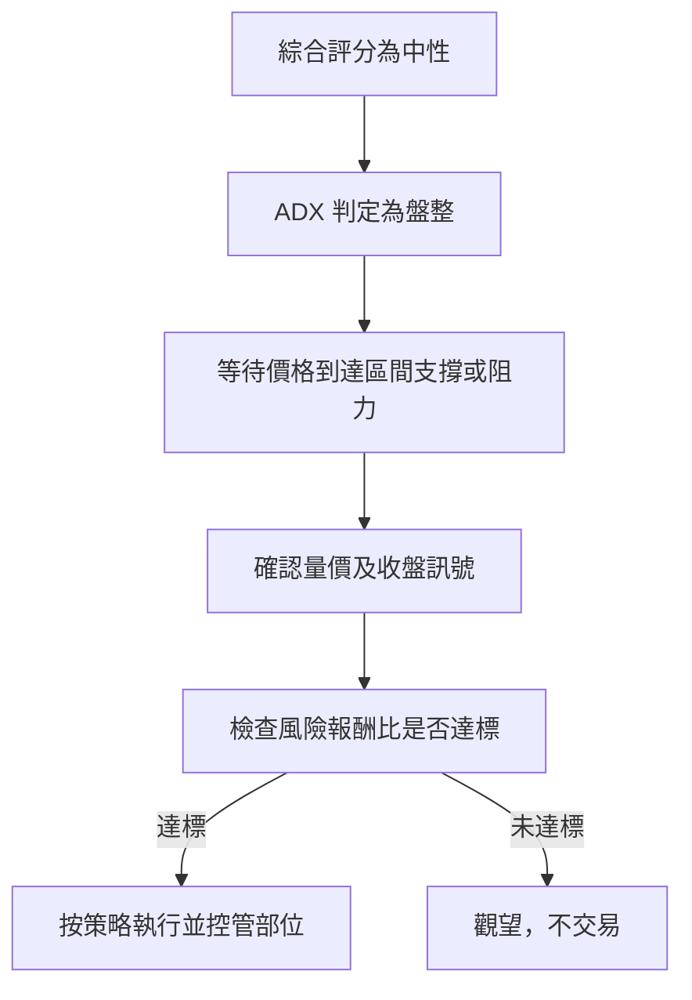

# NU 技術分析報告

> **報告日期**：2026-11-28 ｜ **語言**：繁體中文 ｜ **數據來源**：Yahoo Finance ｜ **當前價格**：$12.91（收盤日：2026-11-27）

---

## 目錄

| 章節 | 內容 |
|------|------|
| [1. 技術面概覽](#1-技術面概覽) | 核心指標速覽、評分卡 |
| [2. 趨勢分析](#2-趨勢分析) | 長中短期走勢、ADX |
| [3. 圖表形態分析](#3-圖表形態分析) | 形態、K線、缺口 |
| [4. 支撐與阻力](#4-支撐與阻力) | 關鍵價位、斐波那契 |
| [5. 技術指標深度解讀](#5-技術指標深度解讀) | MA／RSI／MACD／布林／成交量／進階指標 |
| [6. 動能與波動率](#6-動能與波動率) | ATR、Beta、相對強度 |
| [7. 多時框架總結](#7-多時框架總結) | 時框架評分矩陣 |
| [8. 交易策略建議](#8-交易策略建議) | 歷史基準、策略、風險報酬比 |
| [9. 風險提示與監控](#9-風險提示與監控) | 監控指標、風險場景 |

---

## 1. 技術面概覽

NU 的短線動能自低檔回升，但中長期均線與週、月線方向仍偏空，整體訊號尚未轉為趨勢性看多。最重要的正面依據是日線 MACD 柱翻正、OBV 高於其均線；主要反向風險則是空頭均線排列、週月線偏空，以及 A/D 線未確認近期價格反彈。ADX 顯示目前較接近盤整，因此策略以區間交易為框架，避免在阻力前追價。

### 📊 核心指標速覽表

| 指標類別 | 指標名稱 | 當前數值 | 訊號 | 解讀 |
|----------|----------|----------|------|------|
| **價格** | 當前價格 | **$12.91** | 🟡 | 位於近一年價格區間偏低位置，反彈仍需突破上方阻力確認。 |
| **均線** | MA20／MA50／MA200 | 見第 5 章 | 🔴 | 價格高於短期均線，但仍低於中長期均線；均線排列偏空。 |
| **動能** | RSI(14)（日線） | 見第 5 章 | 🟡 | 中性區，未顯示明確超買或超賣。 |
| **動能** | MACD 柱（日線） | 見第 5 章 | 🟢 | 柱體轉正，短線動能改善，仍須觀察能否延續。 |
| **趨勢** | ADX(14) | 見第 2 章 | 🟡 | 趨勢強度不足，盤整框架優先。 |
| **波動** | ATR(14) | 見第 6 章 | 🟡 | 日常價格波幅偏高，交易需預留足夠止損距離。 |
| **多時框** | 一致性 | 見第 7 章 | 🔴 | 多時框偏空；日線中性，與週、月線未完全同步。 |

### 🏆 技術評分卡

以下分數為技術面判斷，不代表報酬機率。綜合評分依六項子評分的算術平均計算。

| 維度 | 評分（0–100） | 訊號 | 主要依據（引用數值所在章節） |
|------|---------------|------|------------------------------|
| 趨勢強度 | 42 | 🟡 | ADX 顯示趨勢強度不足，詳見第 2 章。 |
| 動能指標 | 56 | 🟡 | 日線動能有改善，但週、月線仍偏空，詳見第 5、7 章。 |
| 支撐穩定度 | 55 | 🟡 | 有波段支撐與未回補缺口參考，但 A/D 尚未確認反彈，詳見第 3、4、5 章。 |
| 成交量配合 | 45 | 🟡 | OBV 支持上漲，但 A/D 與價格背離，量價訊號互相矛盾，詳見第 5 章。 |
| 形態完整度 | 42 | 🟡 | 缺乏足以確認反轉或延續的幾何形態，詳見第 3 章。 |
| 均線排列 | 30 | 🔴 | 均線呈空頭排列，價格仍在中長期均線下方，詳見第 5 章。 |
| **綜合評分** | **45** | **中性** | 六項平均：45；符合中性區間。 |

---

## 2. 趨勢分析

### 📈 長期趨勢（近 12 個月）

長期走勢呈現先升後跌、近期反彈的結構。從年初高位回落後，股價曾在夏季短暫反彈，之後再度走弱；最近一段有回升，但尚未收復中長期均線。下表以月線收盤整理階段，報酬為區間首尾收盤變化計算；當月月線尚未結束，最後一段僅代表截至最新交易日的月內表現。

| 期間 | 起訖月收盤 | 漲跌幅 | 特徵 |
|------|------------|--------|------|
| 2025-12 至 2026-01 | $16.74 → $17.75 | +6.0% | 年初延續上行，形成觀察期間高位。 |
| 2026-01 至 2026-05 | $17.75 → $13.13 | -26.0% | 高位回落，月收盤重心下移。 |
| 2026-05 至 2026-08 | $13.13 → $14.55 | +10.8% | 出現階段性反彈，但尚不足以扭轉中長期下降結構。 |
| 2026-08 至 2026-10 | $14.55 → $11.61 | -20.2% | 再度走弱，月 RSI 進入偏低區域。 |
| 2026-10 至 2026-11 | $11.61 → $12.91 | +11.2% | 月內回升；截至最新交易日仍低於月趨勢均線。 |

### 📊 中期趨勢（週線）

週線方向偏空。近週收盤雖從十月底低點反彈，週 RSI 亦由低位回升，但週 MACD 柱仍為負值，且多時框指標中週線收盤低於週趨勢均線。反彈尚未形成足以確認中期趨勢反轉的條件。

| 觀察項目 | 週線讀值 | 解讀 |
|----------|----------|------|
| 近期週收盤序列 | 參見「近20週收盤走勢」 | 十月中旬急跌後反覆震盪，近期反彈但未收復週趨勢均線。 |
| 週 RSI(14) | 47.1 | 低於中性分界，動能仍略偏弱。 |
| 週 MACD 柱 | -0.210 | 仍在零軸下方，週線動能尚未轉多。 |
| 多時框週線方向 | 偏空 | 收盤低於週趨勢均線，符合偏空判定。 |

### ⚡ 趨勢強度（ADX）

ADX 低於趨勢行情門檻，代表目前比較符合盤整或弱趨勢，而非強趨勢行情。+DI 高於 −DI，反映短線多方略占上風，但差距有限；因此不能只因近期反彈，就判定中期趨勢已反轉。依多時框收斂規則，本報告以日線布林通道上下軌作為盤整交易框架，並以週、月線偏空方向限制追多意願。

| 指標 | 數值 | 判讀 |
|------|------|------|
| ADX(14) | 24.16 | 弱趨勢／盤整；低於 25，採盤整行情優先規則。 |
| +DI | 28.99 | 略高於 −DI，短線多頭主導。 |
| −DI | 25.76 | 空方壓力仍在，DI 差距不足以單獨確認趨勢反轉。 |
| 行情分類 | 盤整偏弱 | 日線用於區間進出；週、月線用於方向風險控管。 |

---

## 3. 圖表形態分析

### 🔍 形態識別

現有資料較適合做指標型與區間型判讀，沒有足夠幾何結構可高信心確認頭肩、雙底或旗形。近期確有急跌後反彈及跳空，但僅憑有限 K 棒，不能把它直接定義為已完成的反轉形態。

| 形態 | 信心度 | 判斷依據 | 完成度 | 目標價 |
|------|--------|----------|--------|--------|
| 區間震盪／弱勢反彈 | 中 | ADX 落在盤整區；週線反彈未能扭轉週、月線偏空方向。 | 區間結構仍在發展，須觀察阻力突破或支撐失守。 | N/A（數據中未偵測到可供計算的幾何形態目標）。 |
| 雙底 | 低 | 近端低點雖有多次測試，但現有資料不足以確認兩個有效低點及頸線突破。 | 未確認。 | N/A（數據中未偵測到）。 |
| 頭肩、旗形或其他複合形態 | 低 | 可用 K 棒與收盤序列不足以確認幾何結構。 | 訊號不足，僅做指標型解讀。 | N/A（數據中未偵測到）。 |
| 指標型反彈訊號 | 中 | 日線 MACD 柱轉正、OBV 高於其均線；但 A/D 下降且週月線偏空。 | 有短線改善，尚未完成中期反轉確認。 | 不適用；不將指標型訊號偽裝成形態目標。 |

### 🕯️ 重要 K 線形態

以下只依近端日 K、週 K 的開高低收判斷。缺口所在交易日另於缺口表列示，避免將跳空 K 棒簡化成一般長紅或長黑。

| 日期（日 K／週 K） | 開 | 高 | 低 | 收 | K 線形態 | 解讀 | 訊號 |
|------|----:|----:|----:|----:|---------|------|------|
| 2026-11-20（日 K） | $11.70 | $11.91 | $11.23 | $11.27 | 長黑實體，收近低點 | 賣壓主導，單日未見明顯下影線反轉訊號。 | 🔴 |
| 2026-11-25（日 K） | $11.64 | $12.53 | $11.57 | $12.36 | 長紅實體，影線短 | 買方推升明顯，但下一交易日有向上跳空，須結合缺口觀察。 | 🟢 |
| 2026-11-27（日 K） | $13.42 | $13.52 | $12.86 | $12.91 | 跳空後黑 K，收低於開盤 | 缺口未回補，但當日上方出現賣壓，不能單以跳空視為確認突破。 | 🟡 |
| 2026-10-30（週 K） | $11.69 | $13.00 | $11.48 | $11.61 | 小黑實體、上影線較長 | 反映低檔反彈遭遇賣壓；仍處於急跌後的弱勢區間。 | 🔴 |
| 2026-11-20（週 K） | $12.96 | $13.19 | $11.23 | $11.27 | 長黑實體，收近低點 | 週線下行壓力明顯，與週線偏空方向一致。 | 🔴 |
| 2026-11-27（週 K） | $12.00 | $13.52 | $11.57 | $12.91 | 長紅實體、上影線可見 | 週線反彈顯著，但仍需後續收盤確認，不能單根 K 棒定義反轉。 | 🟡 |

### 🕳️ 跳空缺口

以下缺口只列市場脈絡的近期缺口統計；缺口以其原始區間作為技術參考，不將已回補缺口當作現存支撐或阻力。

| 日期 | 方向 | 缺口區間 | 幅度 | 是否回補 | 技術解讀 |
|------|------|----------|------|----------|----------|
| 2026-11-27 | 向上跳空 | $12.53–$12.86 | 2.7% | 未回補 | 未回補缺口可作短線參考；但當日收低於開盤，突破確認仍不足。 |
| 2026-11-04 | 向上跳空 | $11.70–$11.84 | 1.2% | 已回補 | 已回補，不應再視為未填補的缺口支撐。 |
| 2026-10-26 | 向下跳空 | $12.78–$14.57 | 11.8% | 未回補 | 大幅未回補下跌缺口，形成上方供給區，反彈可能面臨賣壓。 |
| 2026-10-05 | 向上跳空 | $13.50–$14.84 | 10.0% | 已回補 | 已回補，對目前價格的即時支撐意義有限。 |
| 2026-09-28 | 向下跳空 | $12.66–$13.44 | 5.7% | 已回補 | 已回補，僅保留為歷史價格行為參考。 |

---

## 4. 支撐與阻力

### 🚧 阻力位分析表

R 位取自近一年波段高點聚類。近期價格仍在多條中長期均線下方，故各阻力的突破難度整體偏高；上方未回補跳空區亦可能增加供給。

| 阻力級別 | 價位 | 形成原因 | 突破難度 | 重要性 |
|----------|------:|----------|----------|--------|
| R1 | $13.28 | 近一年波段高點聚類；亦接近近期短線反彈需要確認的區域。 | 中 | 首要短線阻力；有效突破才改善區間上緣結構。 |
| R2 | $13.52 | 近一年波段高點聚類；與近期 K 線高點區域相呼應。 | 中至高 | 突破後有助反彈延伸，但仍須看收盤與量能確認。 |
| R3 | $14.32 | 近一年波段高點聚類；進入更明顯的中期供給範圍。 | 高 | 中期阻力；若未突破，反彈仍可能只是下降趨勢中的修復。 |

### 🛡️ 支撐位分析表

S 位取自近一年波段低點聚類。守住支撐與否仍須配合收盤位置、成交量及 A/D 變化判讀；表中「守住可能性」為質化評估，不代表統計機率。

| 支撐級別 | 價位 | 形成原因 | 守住可能性 | 重要性 |
|----------|------:|----------|------------|--------|
| S1 | $12.18 | 近一年波段低點聚類；短線回測的第一層區域。 | 中 | 盤整區間下緣參考；失守將削弱短線反彈結構。 |
| S2 | $11.78 | 近一年波段低點聚類；低於第一層支撐。 | 中至低 | 失守後需防範進一步測試更低支撐。 |
| S3 | $11.51 | 近一年波段低點聚類；接近近期低檔價格區。 | 低至中 | 若到此仍無買盤回應，弱勢結構可能加深。 |

### 樞軸點補充

波段支撐與阻力均有足夠層級，不需以樞軸點取代波段價位。為完整呈現公式參考，以下列出月樞軸點；僅作輔助觀察，不重新標示為 R 位或 S 位。

| 名稱 | 價位 | 用途 |
|------|------:|------|
| 樞軸 PR2 | $17.80 | 較遠端公式阻力參考。 |
| 樞軸 PR1 | $14.71 | 中期公式阻力參考。 |
| 樞軸 P | $13.09 | 月樞軸中值；價格於其上下的變化可作短線強弱參考。 |
| 樞軸 PS1 | $10.00 | 較遠端公式支撐參考。 |
| 樞軸 PS2 | $8.38 | 更遠端公式支撐參考。 |

### 📐 斐波那契回調位分析

斐波那契區間以近一年高低點計算；當前收盤位置落在 **78.6% 與 61.8% 回調位之間**，較靠近深回撤一側。這反映價格仍處於高位回落後的低位區域，但回調位本身並非買進確認訊號；若反彈，仍需先觀察波段阻力與未回補缺口能否被有效收復。

| 回調層級 | 價位 | 技術解讀 |
|----------|------:|----------|
| 23.6% | $17.14 | 較淺回撤位；屬較遠端反彈參考。 |
| 38.2% | $16.01 | 中淺回撤位；亦接近歷史月收盤區域。 |
| 50.0% | $15.09 | 區間中位回撤參考。 |
| 61.8% | $14.17 | 深回撤區上緣；須與中期阻力一起觀察。 |
| 78.6% | $12.86 | 深回撤區下緣；目前價格位於其附近區間。 |

---

## 5. 技術指標深度解讀

### 📈 均線、RSI、MACD、布林通道

| 指標 | 數值 | 訊號 | 解讀 |
|------|------|------|------|
| MA20／MA50／MA200 與排列 | MA20 $12.08；MA50 $13.31；MA200 $13.93；MA20 < MA50 < MA200 | 🔴 | 收盤高於 MA20、低於 MA50 與 MA200；空頭排列尚未解除。短期均線改善並不足以確認中長期轉多。 |
| RSI(14)（日線）與背離 | RSI 53.11；近 20 根 K 棒首尾比較：無明顯背離 | 🟡 | RSI 位於中性區，未超買或超賣；目前沒有明確 RSI 頂背離或底背離。 |
| MACD 線／Signal／柱 | MACD -0.315；Signal -0.444；Hist +0.129 | 🟢 | MACD 線仍低於零軸，但高於 Signal，柱體為正，表示短線動能改善；與中長期均線偏空形成分歧。 |
| 布林上軌／中軌／下軌／%B | 上軌 $13.03；中軌 $12.08；下軌 $11.12；%B 0.94 | 🟡 | 價格位於通道上半部且接近上軌，顯示短線反彈接近區間上側；在 ADX 偏弱時，接近上軌不等於趨勢突破。 |

四項指標的整合訊號為「短線改善、中長線未翻多」：RSI 中性且沒有明顯背離，MACD 柱轉正，對短線反彈構成支持；但空頭均線排列、週月線偏空及價格接近布林上軌，限制追高空間。整體屬日線修復與中期偏弱並存，而非已確認的趨勢反轉。

### 💹 成交量（量價配合度）

| 量能指標 | 數值／訊號 | 解讀 |
|----------|-------------|------|
| 最新成交量 | 68,473,700 股 | 接近但略低於二十日均量。 |
| 二十日均量 | 69,963,060 股 | 最新量能沒有明顯放大，突破確認力道有限。 |
| 五十日均量 | 81,413,404 股 | 最新量低於較長期均量，反彈尚未呈現強勢放量特徵。 |
| 量比 | 0.98 倍 | 大致接近二十日均量，屬中性量能。 |
| OBV | OBV 高於其均線 | OBV 顯示量能支持近期上漲，對日線反彈偏正面。 |
| A/D 線 | 近 20 根不高於其 20 日均值；A/D 下降、價格上漲 | 呈現價漲而 A/D 下降的派發跡象，與 OBV 的偏多訊號矛盾。 |
| 量價結論 | 🟡 | 量能沒有一致確認價格反彈；OBV 支持、A/D 抵銷，需等待後續成交量與收盤共同確認。 |

### 🧭 進階指標

以下數值由日線計算。進階指標與均線、RSI、MACD 的整體對照為：一目均衡表與錨定 VWAP 偏空，和中長期均線一致；成交量分布顯示價格仍在價值區內，屬中性；短線 RSI、MACD 改善並未扭轉進階指標所呈現的中期壓力。

| 指標 | 數值 | 收盤相對位置 | 解讀 |
|------|------|--------------|------|
| 一目均衡表（轉換線／基準線／雲層） | 轉換線 $12.38；基準線 $13.23；當前雲層先行帶 A $14.72／B $14.18；前方 26 根雲層先行帶 A $12.80／B $13.70 | 收盤位於雲層下方；轉換線在基準線下方；前方雲層 A 在 B 下方 | 偏空排列，與中長期均線方向互相確認；短線 MACD 柱為正則與之矛盾。 |
| 成交量分布（POC／價值區） | POC $13.96；價值區 $12.17–$15.74，含 71% 成交量 | 收盤位於價值區內 | 價格仍在主要成交密集範圍，無法單憑此指標判定突破；POC 位於現價上方，可能形成價格吸引與供給參考。 |
| 錨定 VWAP（自 52 週高點／低點） | 自 2026-01-29 高點起 $13.99；自 2026-06-03 低點起 $13.66 | 收盤均在兩條錨定 VWAP 下方 | 兩條 VWAP 均在價格上方，顯示相關期間持倉平均成本高於現價，偏空並與中長期均線方向一致。 |
| A/D 線 | 近 20 根：不高於其 20 日均值；A/D 下降、價格上漲 | — | 量價累積未確認價格反彈，構成派發警訊；與 OBV 訊號相抵。 |

---

## 6. 動能與波動率

### 📊 ATR 波動率分析

| 指標 | 數值 | 解讀 |
|------|------|------|
| ATR(14) | $0.68 | Wilder 方法估算的日均真實波幅參考。 |
| ATR 佔價格比例 | 5.30% | 相對日常波動偏高，進場與止損距離不可過窄。 |
| 1.5 倍 ATR 距離 | $1.02 | 可作波動風險尺度參考，不等同於建議止損價。 |
| 2 倍 ATR 距離 | $1.36 | 對應更寬的波動緩衝；須以部位縮小配合，避免放大單筆風險。 |

ATR 換算值僅用來描述波動距離，不用來創造新的支撐、阻力或目標價。實際策略的止損點仍採第 4 章已列出的關鍵價位。

### 📐 Beta 與相對強度

相對強度比較採市場脈絡所列至 2026-11-25 的價格報酬，不含股息。短期相對強度有改善，但較長期間表現落後基準，且比值趨勢相對走弱；整體對追多主策略並非充分支持。

| 期間 | NU 本股報酬 | VTI 基準報酬 | 超額報酬 | 判讀 |
|------|-------------:|-------------:|---------:|------|
| 1 個月 | -0.3% | -6.5% | +6.2% | 短期相對抗跌，對短線反彈略有支持。 |
| 3 個月 | -16.9% | -7.2% | -9.7% | 明顯落後市場，對中期偏多策略相抵。 |
| 6 個月 | -5.3% | -5.0% | -0.3% | 大致與市場同步，未顯示明顯相對強勢。 |
| 比值趨勢 | — | — | — | 相對走弱，比值低於其 50 日均值；整體不支持追高。 |
| Beta | 0.968 | — | — | 歷史敏感度接近市場基準；Beta 不是方向指標，也不能取代個股波動管理。 |

---

## 7. 多時框架總結

### 📋 時框架評分表

下表按多時框指標的日線、週線及月線數值與方向列示。多時框的收盤均為各時框截至最新交易日的讀值；週線、月線末根 K 棒仍在進行中。

| 時框架 | 趨勢方向 | RSI(14) | MACD 柱 | 收盤 vs 趨勢均線 | 形態 | 建議 |
|--------|----------|---------|---------|------------------|------|------|
| 日線 | 中性 | 53.11 | +0.129 | 收盤 $12.91；MA50 $13.31，下方 | 日線短線動能改善，但尚未收復趨勢均線。 | 以區間操作為主，避免追價。 |
| 週線 | 偏空 | 47.12 | -0.210 | 收盤 $12.91；MA20 $13.88，下方 | 週線仍受下降趨勢與負 MACD 柱壓制。 | 反彈須等待週線轉強確認。 |
| 月線 | 偏空 | 34.06 | N/A（數據未提供） | 收盤 $12.91；MA10 $13.64，下方 | 月線仍偏弱；月 MACD 柱資料不足。 | 不宜僅依日線反彈推論長期反轉。 |

**多時框一致性：2/3 偏空。**

### ⚖️ 多時框收斂結論

目前 ADX 低於趨勢行情門檻，故以盤整行情規則處理，日線布林通道作為區間操作參考；但週線、月線方向均偏空，且價格低於各自趨勢均線，限制偏多部位的積極程度。日線 MACD 改善只作為進場時機參考，不能推翻中長期訊號。

**唯一方向性結論：中性觀望。** 等待價格到達可接受的區間價位並出現確認訊號，不在現價區域追多；若支撐失守，應以中長期偏空訊號提高風險控管優先級。

---

## 8. 交易策略建議

### 🧭 策略路由

**當前主策略方向 = 中性觀望（依評分 45/100）。** 綜合評分落於中性區間，且 ADX 顯示盤整；採取等待區間邊緣的條件式策略，而不是在現價追價。以下多頭交易僅在支撐區觸發並符合風險報酬門檻時執行，並非無條件看多。

### 📊 歷史基準機率

今日狀態定義為 RSI(14) 落在 50–70 且收盤低於 MA200。樣本涵蓋 2021-12-09 至 2026-11-27，共 1,247 個交易日；同一狀態的連續交易日會重疊，段數較接近獨立事件數。以下為價格歷史頻率，不是預測，也不應直接解讀為策略成功機率。

| 持有期 | 相同狀態樣本（段數） | 上漲比例 | 中位數報酬 | 25%–75% 分位 | 全部交易日上漲比例／中位數 |
|--------|----------------------|----------|------------|--------------|----------------------------|
| 5 日 | 105（27 段） | 64% | +2.7% | -2.4% 至 +5.6% | 54%／+0.6% |
| 20 日 | 104（26 段） | 51% | +0.4% | -8.2% 至 +8.2% | 59%／+2.1% |
| 60 日 | 104（26 段） | 52% | +1.4% | -9.4% 至 +10.4% | 66%／+8.8% |

短持有期的相同狀態上漲比例高於全部交易日，但中長持有期低於全部交易日；中位數亦顯示較長持有期沒有明確優勢。雖然各持有期交易日樣本逾百，但獨立段數僅 26 至 27 段，且存在持有期重疊，因此樣本量有限。歷史頻率對短線反彈略有支持，對中期偏多則相抵，故不改變中性觀望的主策略。

### 🎯 價格情境階梯（Price Scenarios）

下表的情境可能性為質化判斷，不是百分比機率。所有價位均取自第 4 章已列出的波段價位；突破須以收盤確認，單日盤中觸及不視為有效突破。

| 觸發條件 | 下一目標 | 後續延伸 | 可能性 | 依據 |
|----------|----------|----------|--------|------|
| 突破 R1 並能維持其上 | R2 | R3 | 中 | 日線動能改善，但週、月線仍偏空；需量能配合才可提高突破可信度。 |
| 在現價區域守穩並回測成功 | R1 | R2 | 中 | OBV 支持反彈，但 A/D 派發訊號與空頭均線排列仍是反向風險。 |
| 跌破 S1 且收盤未能收復 | S2 | S3 | 中 | 支撐失守會削弱區間反彈結構；週月線偏空增加下行風險。 |

### 🟢 主策略詳情

主策略是等待支撐位附近的條件式區間多單；觸發前維持觀望。風險報酬比以同列進場、止損及第一目標價計算；結果符合最低門檻。

| 策略要素 | 策略 A：支撐區條件式多單 |
|----------|--------------------------|
| 參考收盤價 | $12.91 |
| 進場條件 | 價格回測 S1，並出現支撐有效、收盤轉強的確認；若直接跌破，不接刀。 |
| 進場價格 | $12.18 |
| 目標價 T1 | $13.28 |
| 目標價 T2 | $13.52 |
| 止損價格 | $11.78 |
| 風險報酬比 | 1 : 2.75（以 T1 計）；1 : 3.35（以 T2 計）。計算：($13.28−$12.18) ÷ ($12.18−$11.78) = 2.75。 |
| 把握度 | 中；價格回到支撐區時具區間交易邏輯，但中長期趨勢與 A/D 訊號偏空，須等待確認。 |
| 建議倉位 | 單筆名目部位不超過總資金 5%；以止損距離反推持股數，將單筆帳戶風險控制在預先設定額度內。 |
| 財報風險 | 下次財報日為 N/A（數據未提供），無法判斷策略持有期是否跨越財報事件；實際公布日若落在持有期間內，應考慮跳空風險，止損不保證成交。 |

### 🔴 反向風險觸發點（對沖提示）

| 風險觸發 | 對主策略的影響 | 風控提示 |
|----------|----------------|----------|
| 跌破 S1，且收盤無法收復 | 支撐區多單邏輯轉弱。 | 不新增多單；檢查是否按計畫止損，並觀察下一支撐層級。 |
| 跌破 S2 | 短線支撐失效，週月線偏空可能主導。 | 不以低位加碼攤平；重新評估風險暴露。 |
| 在 R1 或 R2 遭遇賣壓且量價轉弱 | 反彈延伸可能受阻。 | 依交易計畫分段處理，不把未實現獲利視為趨勢反轉確認。 |
| A/D 持續下降、OBV 轉弱 | 原本的量價支持可能消失。 | 暫停新增部位，等待成交量與價格重新同步。 |

---

## 9. 風險提示與監控

### ✅ 關鍵監控指標

| 監控項目 | 觸發條件／數值 | 觸發後動作 |
|----------|----------------|------------|
| 近端波段阻力 | R1 $13.28 | 收盤有效突破並有量能確認，才考慮反彈延伸；若受阻，避免追高。 |
| 下一層阻力 | R2 $13.52 | 觀察突破是否延續；若量能不足，按區間交易管理。 |
| 第一層支撐 | S1 $12.18 | 觀察回測後收盤與量能；失守時不再視為有效支撐。 |
| 下一層支撐 | S2 $11.78 | 若失守，降低多頭曝險並檢查策略止損。 |
| 未回補向上缺口 | $12.53–$12.86 | 作短線缺口參考；若回補，評估反彈結構是否轉弱。 |
| 未回補向下缺口 | $12.78–$14.57 | 上方供給區參考；進入該區時留意賣壓與量價反應。 |
| 日線動能 | RSI、MACD 柱與 OBV 方向 | 觀察動能是否延續；若價格上升但 A/D 繼續走弱，降低突破判斷信心。 |
| 多時框方向 | 週、月線趨勢均線與方向 | 週、月線未改善前，不把日線反彈視為中長期反轉。 |
| 下次財報日 | N/A（數據未提供） | 距最新收盤日的日曆天數：N/A（數據未提供）。取得確切日期後，重新檢查是否落入持有期間。 |

### ⚠️ 風險場景

| 情境 | 觸發條件 | 價位參考 | 可能性 | 應對 |
|------|----------|----------|--------|------|
| 樂觀 | 日線收盤突破首層阻力，量能改善，A/D 不再走弱 | R1，其後觀察 R2、R3 | 中 | 依計畫分段管理；若只有盤中突破、收盤未確認，不追價。 |
| 基本 | 價格維持區間內震盪，短線動能改善但週月線偏空 | S1 至 R1 的區間結構 | 中 | 僅在區間邊緣、風險報酬比達標時考慮交易；中段等待。 |
| 悲觀 | 收盤跌破首層支撐，且週線動能未改善 | S2、S3 | 中 | 停止新增多單，優先保護本金；不以擴大止損代替風險控制。 |

### 🛡️ 風險管理提醒

- 僅在條件式進場訊號出現後執行；不要因為價格接近支撐就預設支撐必然有效。
- 以預先設定的帳戶風險反推部位大小；高 ATR 環境下，避免沿用低波動時的持股數。
- 嚴守策略止損，不因短線反彈而任意下移止損；若跳空越過止損，成交價可能劣於預設價。
- 若價格走勢與 A/D、OBV 方向持續矛盾，降低突破訊號可信度，避免加碼。
- 財報日期資料未提供；如後續確認財報落在持有期間，須重新評估隔夜跳空與流動性風險。

---

## 📋 報告總結

| 項目 | 結論 |
|------|------|
| 報告日期 | 2026-11-28 |
| 當前價格 | $12.91（收盤日期：2026-11-27） |
| 綜合評分／方向 | 45/100，中性 |
| 長期／中期／短期趨勢 | 🔴 長期偏弱；🔴 週線偏空；🟡 日線反彈但未確認趨勢反轉。 |
| 關鍵支撐／關鍵阻力 | 支撐 S1、S2；阻力 R1、R2，精確價位見第 4 章。 |
| 🥇 最佳機會 | 觀望，等待價格到達可交易價位；支撐區條件式策略須先確認，才執行。 |
| 最大風險 | 週月線偏空與 A/D 派發訊號可能壓過短線反彈，且未回補向下缺口構成上方供給。 |

> ⚠️ **免責聲明**：本報告為 AI 自動生成之技術分析，所有數據及估算均基於歷史價格資訊。本報告僅供研究與學術參考，不構成任何投資建議。投資有風險，入市需謹慎。

---

## 資料與來源

| 項目 | 內容 |
|------|------|
| 價格 | 12.91 USD，2026-11-27 收盤（Yahoo Finance 日線） |
| K 棒 | 500 根日線，2024-11-29 至 2026-11-27（Yahoo Finance）；較長期間的價位與基準機率取自價格資料庫 |
| 關鍵價位回溯期間 | 阻力 近一年、支撐 近一年 |
| 有回應的資料來源 | Yahoo Finance、Finviz、StockAnalysis、Roic.ai |
| 由程式計算 | 所有指標、R1–S3 與斐波那契價位、多時框方向、相對強度、缺口、歷史基準機率、綜合評分 |
| 撰寫模型 | openai / gpt-6-luna |

> 本區塊由產生報告的程式依實際取得的資料填寫，非模型撰寫。「由程式計算」的數字不是模型的估計；其餘判斷（評分、情境、策略）是模型的分析。
