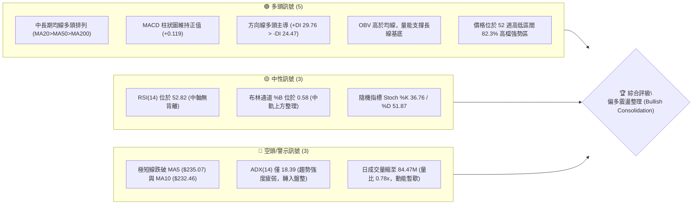
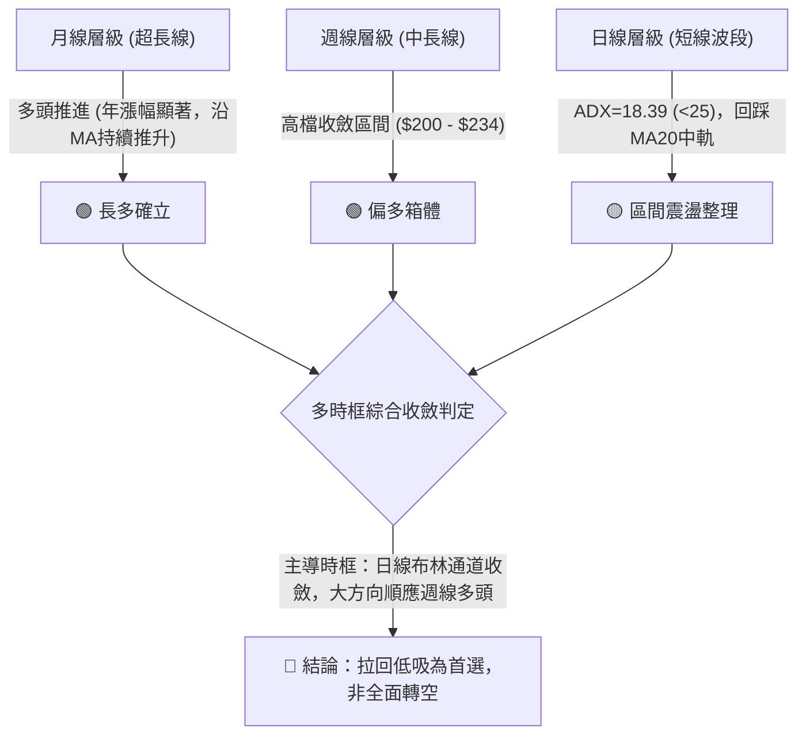
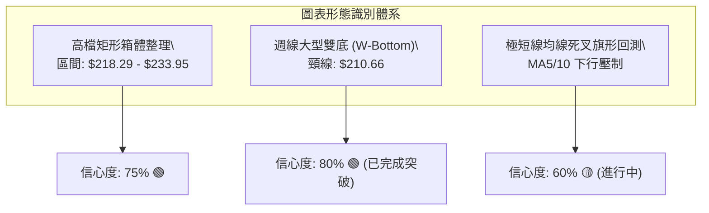
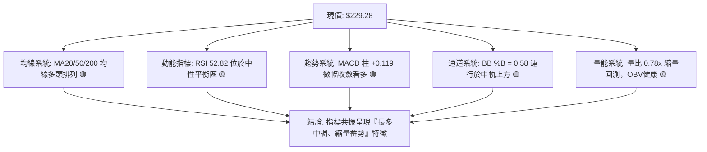
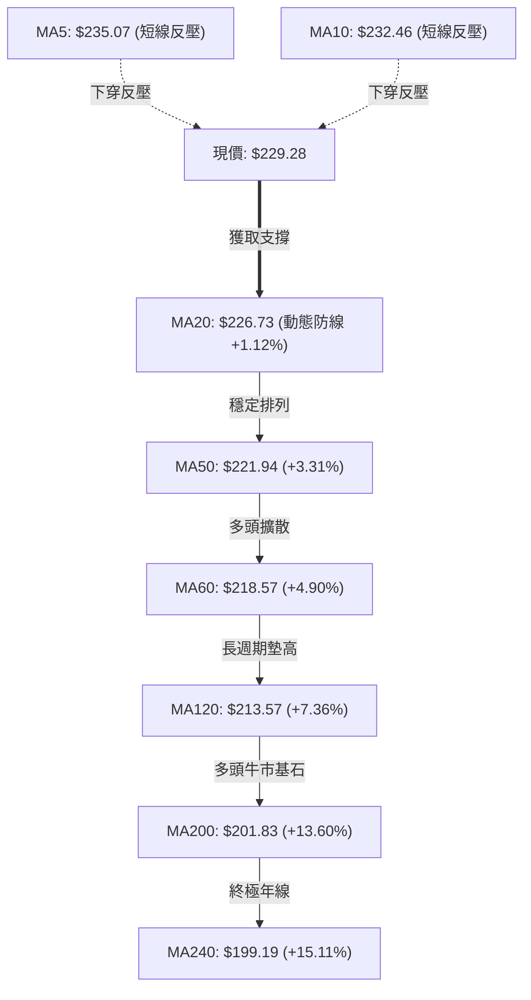
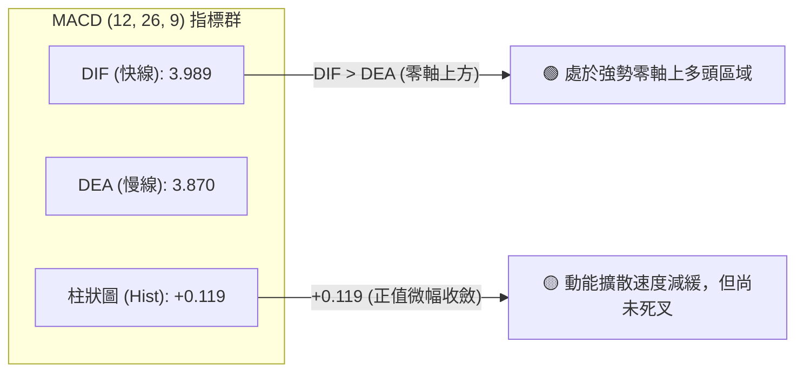
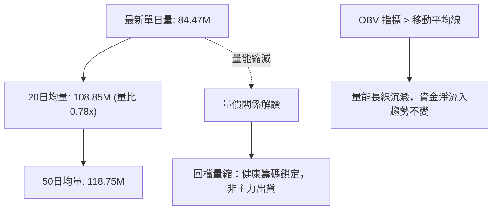
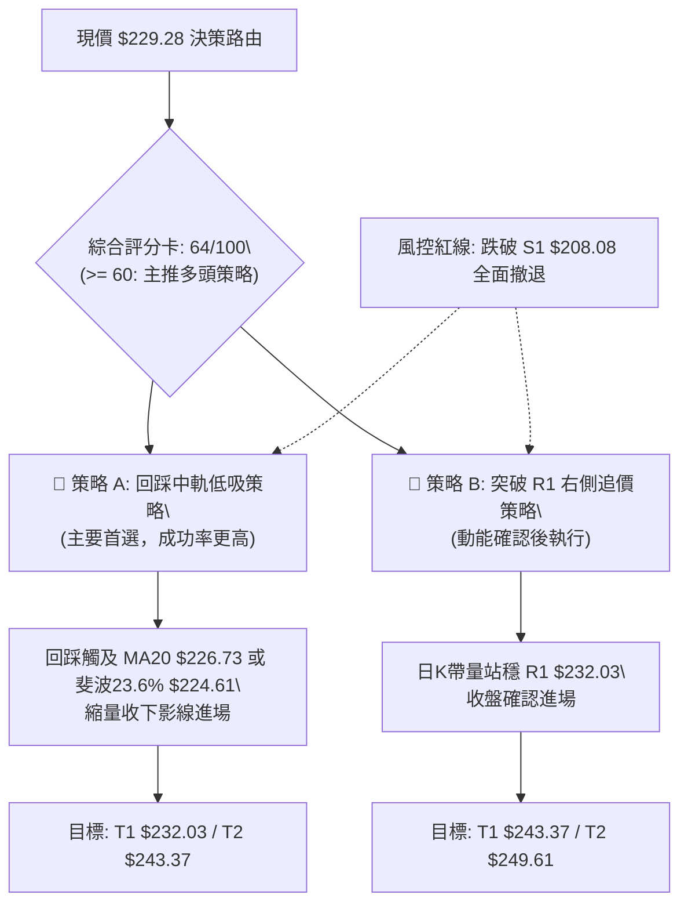
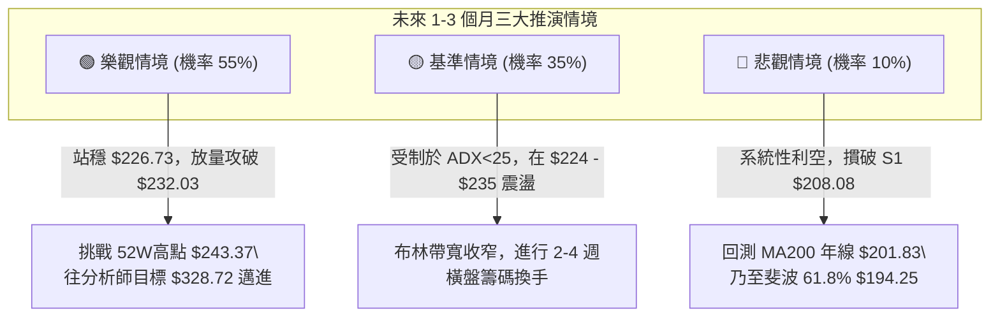

# NVDA 技術分析報告

> **報告日期**：2026-10-12 ｜ **語言**：繁體中文 ｜ **數據來源**：Yahoo Finance ｜ **當前價格**：$229.28

---

## 目錄

| 章節 | 內容 |
|------|------|
| [1. 技術面概覽](#1-技術面概覽) | 訊號儀表板、核心指標、評分卡 |
| [2. 趨勢分析](#2-趨勢分析) | 多時框趨勢、長中短期走勢、ADX解讀 |
| [3. 圖表形態分析](#3-圖表形態分析) | 形態識別、K線組合、目標價計算 |
| [4. 支撐與阻力](#4-支撐與阻力) | 關鍵價位、斐波那契回調結構 |
| [5. 技術指標深度解讀](#5-技術指標深度解讀) | 均線、RSI、MACD、布林通道、成交量 |
| [6. 動能與波動率](#6-動能與波動率) | 四象限評估、ATR波動性、Beta敏感度 |
| [7. 多時框架總結](#7-多時框架總結) | 時框評分、訊號矩陣、多時框收斂 |
| [8. 交易策略建議](#8-交易策略建議) | 策略路由、情境階梯、主策略明細 |
| [9. 風險提示與監控](#9-風險提示與監控) | 監控Checklist、三表情境、風控原則 |

---

## 1. 技術面概覽

### 🎯 技術訊號儀表板



### 📊 核心指標速覽表

| 指標類別 | 指標名稱 | 當前數值 | 訊號 | 專業解讀 |
|----------|----------|----------|------|----------|
| **價格** | 當前收盤價 | $229.28 | 🟢 多頭 | 處於 52 週區間高檔 82.3% 處，整體多頭架構未變 |
| **短期均線** | MA5 / MA10 | $235.07 / $232.46 | 🔴 偏弱 | 現價低於短期均線，短線出現回檔降溫壓力 |
| **中期均線** | MA20 (布林中軌) | $226.73 | 🟢 看多 | 價格高於 MA20 (+1.12%)，提供第一道動態支撐 |
| **長期均線** | MA50 / MA200 | $221.94 / $201.83 | 🟢 看多 | 典型多頭排列，長多防守線穩固 |
| **動能** | RSI(14) | 52.82 | 🟡 中性 | 位於 50 多空分界線上方，動能均衡無極端背離 |
| **趨勢強度** | ADX(14) | 18.39 | 🟡 盤整 | 數值小於 25，顯示當前缺乏單邊爆發趨勢，進入箱體 |
| **趨勢方向** | +DI / -DI | 29.76 / 24.47 | 🟢 看多 | 多頭買盤力道仍高於空頭賣盤 (+DI 領先 5.29) |
| **指數平滑** | MACD (12,26,9) | 3.989 / 3.870 | 🟢 看多 | DIF 高於 DEA，柱狀圖 +0.119，維持偏多發散 |
| **通道位置** | Bollinger %B | 0.58 | 🟢 中性偏多 | 處於中軌 ($226.73) 與上軌 ($242.83) 之間偏中段 |
| **波動度** | ATR(14) | $5.20 (2.27%) | 🟡 中度 | 日內波動常態化，未出現失控拋補現象 |
| **成交量** | 20日量比 | 0.78x | 🟡 縮量 | 量能降溫，呈現典型的「上漲放量、回檔量縮」特徵 |

### 🏆 技術評分卡

```
╔══════════════════════════════════════════════════════════════╗
║              技術評分卡 — NVDA (2026-10-12)                   ║
╠══════════════════════════════════════════════════════════════╣
║ 均線排列系統  ████████████████░░░░  80/100  🟢 完美多頭排列  ║
║ 長期趨勢架構  ██████████████░░░░░░  70/100  🟢 穩居年線之上  ║
║ 支撐結構強度  ██████████████░░░░░░  70/100  🟢 下方均線稠密  ║
║ 動能擺動指標  ████████████░░░░░░░░  60/100  🟡 中性偏多震盪  ║
║ 成交量能配合  ██████████░░░░░░░░░░  50/100  🟡 縮量拉回整理  ║
║ 趨勢爆發強度  ████████░░░░░░░░░░░░  40/100  🔴 ADX低於25盤整 ║
╠══════════════════════════════════════════════════════════════╣
║ 綜合評分      █████████████░░░░░░░  64/100  🟢 偏多震盪蓄勢  ║
╚══════════════════════════════════════════════════════════════╝
```

---

## 2. 趨勢分析

### 🌐 多時框趨勢分析

依據多時框收斂體系，NVDA 目前處於「長期牛市、中期高檔蓄勢、短線拉回尋找支撐」的結構中：



### 📈 長期趨勢 — 12個月走勢圖（Unicode）

以下為 2025 年 11 月至 2026 年 10 月之月線收盤價歷史軌跡，記錄自波段修正後持續墊高底部之牛市路徑：

```
NVDA 月線走勢圖（過去12個月：2025-11 至 2026-10）
價格軸 ($)
$240 ┤                                                 ● $229.28 (現價)
$230 ┤                                           ● $228.38
$220 ┤                                     ● $220.53
$210 ┤                         ● $210.66
$200 ┤                   ● $199.11   ● $199.87 ● $200.53
$190 ┤             ● $190.68
$180 ┤       ● $186.06
$170 ┤ ● $176.58   ● $176.78 ● $174.00 (波段起漲雙底)
$160 ┤
     └─────────────────────────────────────────────────────────────
       11    12    01    02    03    04    05    06    07    08    09    10  (月份)
     [2025] ───┼─ [2026] ───────────────────────────────────────────►
```

#### 走勢特徵分析表格

| 階段區間 | 起訖月份 | 收盤價變化 | 漲跌幅 | 走勢結構與特徵解讀 |
|----------|----------|------------|--------|--------------------|
| **築底加固期** | 2025-11 → 2026-03 | $176.58 → $174.00 | -1.46% | 於 $174.00 - $190.68 區間進行大型箱體震盪，夯實中期支撐底部 |
| **多頭點火期** | 2026-03 → 2026-05 | $174.00 → $210.66 | +21.07% | 帶量突破 $200 整數心理關口，月線連兩紅，確立主升段啟動 |
| **中繼沉澱期** | 2026-05 → 2026-07 | $210.66 → $200.53 | -4.81% | 於 $200 附近進行籌碼換手回測，回踩確認突破有效性，未破支撐 |
| **二度推升期** | 2026-07 → 2026-10 | $200.53 → $229.28 | +14.34% | 形成更高的高點與低點 (Higher Highs & Higher Lows)，創收盤新高 |

### 📊 中期趨勢（週線分析）

中期週線數據展現出強烈的上升通道特徵。檢視近 10 週的價量走勢：
- 2026-08-09 週線以大陽線收在 $223.71（MACD 柱 +2.494，RSI 升至 65.6），開啟新一輪攻勢。
- 2026-10-04 觸及週線收盤高點 $233.95，週 RSI 達到 83.0（進入極端超買區）。
- 2026-10-11 本週回吐至 $229.28，週 RSI 迅速冷卻至 52.8，MACD 柱由 +0.822 收斂至 +0.119。
- 這表明當前的拉回是週線級別超買之後的「良性降溫」，而非趨勢反轉。

### ⚡ 趨勢強度評估（ADX 解讀）

```mermaid
graph TD
    A["ADX(14) 數值: 18.39"] --> B{"ADX 強度閾值檢驗"}
    B -->|"< 25| C["趨勢強度偏弱 / 無單邊趨勢"]
    B -->|">= 25"| D["強勢單邊趨勢"]
    C --> E["市場屬性: 區間震盪 (Consolidation)"]
    E --> F["交易策略重心: 布林通道上下軌、支撐位低吸"]
    
    G["方向線指標"] --> H["+DI = 29.76"]
    G --> I["-DI = 24.47"]
    H & I --> J{"+DI 領先 -DI (+5.29)"}
    J --> K["多頭陣營仍保有邊際定價權"]
```

#### ADX 強度對照表

| 指標變數 | 當前讀數 | 標準門檻 | 狀態判斷 | 對應操作指引 |
|----------|----------|----------|----------|--------------|
| **ADX(14)** | **18.39** | < 25.0 | 弱趨勢 / 震盪行情 | 避免追高殺跌；採用均值回歸與支撐位佈局策略 |
| **+DI(14)** | **29.76** | > -DI | 多方佔優 | 多頭推動力仍在，回檔幅度預期有限 |
| **-DI(14)** | **24.47** | < +DI | 空方受壓 | 空方尚無能力組織連續性下殺動能 |

---

## 3. 圖表形態分析

### 🔍 形態識別系統

在多時框圖表識別中，嚴格依據價格幾何結構與歷史 OHLCV 進行驗證：



#### 形態識別與目標價測算表

| 形態名稱 | 信心度 | 判斷依據（引用數據） | 完成度 | 目標價（附嚴謹計算式） |
|----------|--------|----------------------|--------|------------------------|
| **高檔收斂箱體** | 75% | 近 6 週價格反覆於 $218.29 (2026-09-13 低點) 與 $233.95 (2026-10-04 高點) 區間震盪 | 70% | 向上突破目標價 = 箱頂 $233.95 + 箱體高度 ($233.95 - $218.29 = $15.66) = **$249.61**（若突破有效） |
| **週線雙底 (W底)** | 80% | 底部一：2026-03 ($174.00)；底部二：2026-06 ($192.31)；頸線：2026-05 高點 $210.66 | 100% (已突破) | 雙底最小目標價 = 頸線 $210.66 + 形態高度 ($210.66 - $174.00 = $36.66) = **$247.32**（與 52W 高點 $243.37 形成阻力共振） |
| **短期上升旗形** | 55% | 旗桿自 $200.53 快速拉升至 $233.95，目前連續兩週量縮拉回，旗面傾斜向下 | 40% (尚未突破) | 旗形突破目標 = 突破點預估 $232.03 + 旗桿高度 ($233.95 - $200.53 = $33.42) = **$265.45**（訊號尚待確認） |

### 🕯️ 重要K線形態分析

| 週期/日期 | 收盤價 | K線形態特徵 | 結構性解讀 | 技術訊號 |
|-----------|--------|-------------|------------|----------|
| **2026-08-09 週線** | $223.71 | 長紅實體長陽線 | 放量跳空脫離 $200-$210 震盪底，多頭主升確立 | 🟢 強烈看多 |
| **2026-09-13 週線** | $218.29 | 縮量下影線十字星 | 週線量能僅 400.7M，回踩 MA60 ($218.57) 有守 | 🟢 支撐確認 |
| **2026-10-04 週線** | $233.95 | 高檔長上影倒錘頭 | 觸及 52W 高點聚類區，週 RSI 衝高至 83.0 引發獲利了結 | 🔴 短線超買 |
| **2026-10-11 週線** | $229.28 | 縮量小陰實體孕線 | 成交量 513.8M 顯著收縮，屬於高檔收斂「內困」型態 | 🟡 整理觀望 |

### 📉 ASCII 走勢形態示意圖

```
NVDA 近期日線/週線形態：高檔箱體震盪旗形整理示意
價格 ($)
$235 ┤                      ▲ 10/04 高點 $233.95
$233 ┤                    ╱   ╲ ◄ 短期受壓於 MA5/10 ($232.46 - $235.07)
$231 ┤        ▲ $230.10  ╱     ╲
$229 ┤───────╱──────────┼───────● $229.28 (當前位置：逼近箱體中軸)
$227 ┤      ╱           │      ▲ MA20 / BB中軌 ($226.73)
$225 ┤     ╱   ● $225.07│      
$223 ┤▲   ╱            │      
$221 ┤ │ ╱              │      
$219 ┤ └● $218.29       ▼ 09/27 $218-$222 平台支撐
     └────────────────────────────────────────────► 時間進程
```

---

## 4. 支撐與阻力

### 🗺️ 關鍵價位分布圖（Unicode）

```
NVDA 價位結構分布圖（OHLCV 精確計算）
═══════════════════════════════════════════════════════════════
$243.37 ║████████████████████████████████║ 52週歷史高點 / 斐波 0.0%
$242.83 ║████████████████████████████    ║ 布林通道上軌 (通道極限)
$232.03 ║████████████████████████        ║ 關鍵短線阻力 R1 (波段高點聚類)
════════╠════════════════════════════════╣ ◄ 當前市價 $229.28
$226.73 ║▓▓▓▓▓▓▓▓▓▓▓▓▓▓▓▓▓▓▓▓▓▓▓▓        ║ 第一動態防守：MA20 / 布林中軌
$224.61 ║▓▓▓▓▓▓▓▓▓▓▓▓▓▓▓▓▓▓▓▓            ║ 關鍵回調支撐：斐波那契 23.6%
$213.01 ║████████████████                ║ 強支撐區間：斐波那契 38.2%
$210.64 ║████████████████████            ║ 布林通道下軌
$208.08 ║████████████████████████        ║ 強支撐 S1 (近一年波段低點聚類)
$198.43 ║████████████████████████████    ║ 核心波段支撐 S2 (波段密集低點)
$194.30 ║████████████████████████████████║ 終極結構支撐 S3 / 斐波 61.8% ($194.25)
═══════════════════════════════════════════════════════════════
```

### 🚧 阻力位分析表

| 阻力級別 | 精確價位 | 形成技術依據 | 突破難度 | 技術重要性 |
|----------|----------|--------------|----------|------------|
| **阻力 R1** | **$232.03** | 近一年波段高點密集聚類區、MA10 ($232.46) 反壓 | 🟡 中度 | **極高**。短線多空分水嶺，站穩方能化解日線下行壓力 |
| **布林上軌** | **$242.83** | 20日布林帶頂部包絡線 (+2σ 標準差位置) | 🔴 較高 | **高**。波段統計學超買邊界，非放量爆發難以持續穿透 |
| **歷史高點** | **$243.37** | 52 週最高價、斐波那契 0.0% 絕對頂部 | 🔴 極高 | **極高**。籌碼解套與前波套牢賣壓之核心歷史天花板 |

### 🛡️ 支撐位分析表

| 支撐級別 | 精確價位 | 形成技術依據 | 守住機率 | 技術重要性 |
|----------|----------|--------------|----------|------------|
| **動態支撐** | **$226.73** | 20日移動平均線 (MA20) 與布林通道中軌共振 | 75% | **極高**。月內多頭防線，失守則短線回檔加深 |
| **黃金回調** | **$224.61** | 52 週高低點之 23.6% 斐波那契回調位 | 70% | **高**。強勢市場的第一道回踩承接位 |
| **支撐 S1** | **$208.08** | 近一年波段低點聚類、貼近布林下軌 ($210.64) | 85% | **極高**。中期多頭結構底線，跌破象徵中期走弱 |
| **支撐 S2** | **$198.43** | 近一年密集波段換手低點、接近 MA200 ($201.83) | 90% | **核心級**。機構長期成本線，具強大價值支撐 |
| **支撐 S3** | **$194.30** | 近一年極端波段低點聚類、斐波那契 61.8% ($194.25) | 95% | **終極底線**。長期牛熊轉換關鍵樞紐 |

### 📐 斐波那契回調位分析

依據 52 週歷史區間極值點：波段低點 **$163.90**（100.0%）至波段高點 **$243.37**（0.0%）嚴格計算：

| 斐波那契層級 | 精確計算價位 | 與現價 ($229.28) 相對位置 | 技術解讀與籌碼意涵 |
|--------------|--------------|---------------------------|--------------------|
| **0.0% (52W High)** | $243.37 | +6.15% (上方阻力) | 上升浪潮終極目標與波段頂部 |
| **23.6%** | **$224.61** | **-2.04% (下方首要防線)** | **現價 ($229.28) 穩居 23.6% 之上**，屬於極強勢回檔範疇 |
| **38.2%** | $213.01 | -7.10% (次級防線) | 多頭健康調整極限，未跌破前多頭總體趨勢無損 |
| **50.0%** | $203.63 | -11.19% (中軸防線) | 心理多空中樞，接近 MA200 ($201.83) |
| **61.8% (黃金分割)** | $194.25 | -15.28% (共振 S3 $194.30) | 多頭最後防守底線，回撤超過此位代表反轉為空頭 |
| **78.6%** | $180.90 | -21.10% (深幅回調) | 極端非理性恐慌殺盤區 |
| **100.0% (52W Low)** | $163.90 | -28.52% (起漲原點) | 52 週歷史底部基石 |

> **位置判斷總結**：現價 $229.28 處於 **0.0% ($243.37)** 與 **23.6% ($224.61)** 之間的高檔偏多區間。距離 23.6% 支撐僅 2.04%，下行緩衝空間有限但支撐強度高，具備絕佳的進場盈虧比。

---

## 5. 技術指標深度解讀

### 🎛️ 指標訊號總覽



### 📈 移動平均線排列分析



- **均線排列判定**：中長期標準多頭排列（MA20 > MA50 > MA60 > MA120 > MA200 > MA240），多頭趨勢無懈可擊。
- **短線扣抵警示**：MA5 ($235.07) 與 MA10 ($232.46) 呈下彎壓制（分別偏離現價 -2.46% 與 -1.37%），顯示過去 5 至 10 個交易日內追高資金處於微幅被套狀態，需時間以震盪消化浮額。

### 📉 RSI(14) 分析

- **當前數值**：**52.82**（處於 30–70 之健康常態區間）
```
RSI(14) 強度規：
[0 ────────── 30 ───────● 50 ────── 70 ────────── 100]
超賣區        中性偏弱    52.82    超買區
進度條：██████████░░░░░░░░░░  52.82%
```
- **背離判斷**：
  - 價格於 10/04 創出 $233.95 高點時，週 RSI 衝至 83.0，隨後價格拉回至 $229.28，日線 RSI 順暢降至 52.82。
  - **結論**：指標與價格同步回調，**無頂背離亦無底背離**現象。屬於多頭趨勢中健康的指標冷卻修復（Reset）。

### 📊 MACD(12/26/9) 訊號解讀


- **定量解析**：快線 DIF (3.989) 仍壓制在慢線 DEA (3.870) 之上，維持黃金交叉狀態。柱狀圖讀數為 +0.119，雖然相較於 8 月份高檔有所縮窄，但未翻綠，表明空方尚未取得短線主控權。

### 📦 布林通道分析

```
NVDA 日線布林通道 (20, 2) 結構示意圖
價格 ($)
$242.83 ├─────────────────────────────────────── 上軌 (強阻力邊界)
        │
$235.00 ├───────┐
        │       │
$229.28 ├───────┼─────────────● 現價 (位於中上軌之間，%B = 0.58)
        │       │
$226.73 ├───────┴─────────────────────────────── 中軌 (MA20 核心支撐)
        │
$210.64 ├─────────────────────────────────────── 下軌 (極端支撐防線)
```
- **通道指標數值**：
  - 上軌：**$242.83** ｜ 中軌：**$226.73** ｜ 下軌：**$210.64** ｜ 帶寬：**$32.19 (14.2%)**
  - **%B 指標**：**0.58**（中軌為 0.50，現價位於中軌略上方）。
- **結構研判**：通道帶寬平穩擴張後進入平行收口期，現價穩居中軌上方，屬於強勢震盪特徵，回測中軌 $226.73 不破即為技術性買點。

### 💹 成交量分析（量價配合度）


- **量比讀數**：0.78x。日線成交量由突破時的 100M+ 縮減至 84.47M，顯示賣盤力道枯竭，市場追跌意願低。
- **OBV 趨勢**：系統明確指示「OBV > MA → 量能支撐上漲」，資金未顯著離場，形成典型的牛市整理量價架構。

---

## 6. 動能與波動率

### ⚡ 動能評估四象限


| 象限 | 動能維度 | 波動維度 | 當前狀態標註 | 戰術應對邏輯 |
|------|----------|----------|--------------|--------------|
| **Q1** | 強 (ADX>25) | 低 (ATR%<2%) | — | 加碼順勢追突破 |
| **Q2** | **弱 (ADX=18.39)** | **低至中 (ATR%=2.27%)** | **✓ 當前狀態 (NVDA)** | **區間內逢低買進、高拋低吸，嚴格控制部位** |
| **Q3** | 強 (ADX>25) | 高 (ATR%>4%) | — | 擴大止盈區間，享受主升浪 |
| **Q4** | 弱 (ADX<25) | 高 (ATR%>4%) | — | 停損離場，嚴禁接飛刀 |

### 📊 ATR 波動率分析

- **ATR(14) 絕對值**：**$5.20**
- **ATR 相對價格比**：**2.27%**（以 $229.28 計算）
- **風控參數與止損距離設定**：
  - **保守型（1.0x ATR）**：$5.20 緩衝距離。短線進場允許波動區間。
  - **標準波段型（1.5x ATR）**：$7.80 緩衝距離。由進場點下浮 $7.80 可過濾日常隨機雜訊。
  - **寬鬆趨勢型（2.0x ATR）**：$10.40 緩衝距離。適合波段抱波段投資者。

### 📐 Beta 與市場相關性

- **Beta 係數**：**2.216**
- **市場特徵解讀**：
  - NVDA 的波動彈性為標普 500 指數的 **2.216 倍**，具備極強的高 Beta 進攻屬性。
  - 當大盤（SPY/QQQ）出現 1% 的回檔時，NVDA 平均下修幅度約 2.22%；反之大盤反彈時，其爆發力亦具備 2 倍以上的超額報酬潛力。

---

## 7. 多時框架總結

### 📋 時框架評分表

| 時框架 | 趨勢方向 | 動能狀態 | 均線排列 | 圖表形態 | 綜合評分 | 操作建議 |
|--------|----------|----------|----------|----------|----------|----------|
| **月線層級** | 🟢 強烈看多 | 🟢 高檔維持 | 🟢 多頭排列 | 突破歷史大箱體 | **85/100** | 核心多頭部位續抱 |
| **週線層級** | 🟢 偏多上行 | 🟡 超買冷卻 | 🟢 多頭排列 | 高檔大旗形/W底 | **75/100** | 回踩重要支撐加碼 |
| **日線層級** | 🟡 震盪整理 | 🟡 中性平穩 | 🟢 中長多/短線壓 | 高檔箱體整理 | **60/100** | 中軌承接，箱頂減碼 |
| **4小時/短線**| 🔴 短線拉回 | 🔴 短期死叉 | 🔴 MA5/10下彎 | 內困收斂小陰線 | **45/100** | 等待短線止跌確認訊號 |

### 🔲 綜合訊號矩陣

```
時框與指標訊號共振度評估矩陣：
╔════════════╦══════════╦══════════╦══════════╦══════════╗
║ 指標 / 時框║ 月線(長期)║ 週線(中期)║ 日線(短期)║ 訊號收斂 ║
╠════════════╬══════════╬══════════╬══════════╬══════════╣
║ 趨勢方向   ║  🟢 多頭  ║  🟢 多頭  ║  🟡 盤整  ║ 🟢 偏多  ║
║ 均線結構   ║  🟢 多頭  ║  🟢 多頭  ║  🟢 多頭  ║ 🟢 看多  ║
║ RSI 狀態   ║  🟢 強勢  ║  🟡 中性  ║  🟡 中性  ║ 🟡 平衡  ║
║ MACD 動能  ║  🟢 多方  ║  🟢 多方  ║  🟢 零軸上║ 🟢 看多  ║
║ 量價關係   ║  🟢 沉澱  ║  🟡 換手  ║  🟡 縮量  ║ 🟢 蓄勢  ║
╚════════════╩══════════╩══════════╩══════════╩══════════╝
一致性評級：良好 (75% 指標處於偏多與共振區間)
```

### ⚖️ 多時框收斂結論

> **依嚴格收斂規則（規則 14）判定**：
> 1. **行情屬性**：當前日線 ADX(14) = **18.39 (< 25)**，嚴格定性為**「盤整行情（Consolidation Regime）」**。
> 2. **主導時框優先級**：在此行情下，不可盲目追逐短線突破。交易的核心邊界應當以**日線布林通道上下軌（$210.64 – $242.83）及 MA20 中軌（$226.73）**為主要依託。
> 3. **唯一方向性結論**：**🟢 偏多震盪蓄勢（Bullish Consolidation）**。中長期牛市趨勢（MA20>MA50>MA200）提供天然下檔防護，短線回檔是趨勢回調而非反轉。日線僅用作回測進場點的捕捉工具。

---

## 8. 交易策略建議

### 🗺️ 策略決策流程圖



### 🧭 策略路由（依評分卡分流）

**當前主策略方向 = 🟢 偏多操作（依綜合評分 64/100，大於 60 門檻，主推多頭策略，嚴禁重倉放空）。**

### 🎯 價格情境階梯（Price Scenarios）

所有關鍵價位均嚴格引用第 4 章計算之波段聚類點位與斐波那契位：

| 觸發條件 | 下一目標 | 後續延伸 | 情境技術含義 |
|----------|----------|----------|--------------|
| **向上放量突破 R1 ($232.03)** | 布林上軌 $242.83 | 52W高點 $243.37 | 短線整理結束，重返主升浪擴散期 |
| **突破 52W 高點 ($243.37)** | 箱體測算目標 $249.61 | 分析師均價 $328.72 | 創歷史新高，上方無解套賣壓，空間打開 |
| **維持於 $224.61 – $232.03** | 布林中軌 $226.73 | — | 區間沉澱，高拋低吸，蓄積動能 |
| **跌破動態支撐 ($226.73)** | 支撐 S1 $208.08 | 布林下軌 $210.64 | 短線修正加深，考驗中期籌碼底線 |
| **有效跌破 S1 ($208.08)** | 支撐 S2 $198.43 | 支撐 S3 $194.30 | 中期結構破位，多頭防線全面退守年線 |

### 📊 情境機率分佈

| 價格情境 | 發生機率 | 主要依據（指標狀態） |
|----------|----------|----------------------|
| **情境一：回踩有守，震盪推升創高** | **55%** | 中長天期均線標準多頭排列，MACD 柱狀圖維持正值 (+0.119)，OBV 指標持續高於均線，基本面動能強勁 |
| **情境二：布林通道內寬幅箱體震盪** | **35%** | ADX 僅 18.39 (<25)，市場缺乏單邊趨勢動能，量比萎縮至 0.78x，籌碼在高檔需要換手沉澱 |
| **情境三：跌破 MA20 展開深度下修** | **10%** | 短線受制於 MA5/10，若大盤系統性風險引發 Beta (2.216) 放大殺盤，跌破 23.6% ($224.61) 支撐 |

### 🟢 主策略詳情

嚴格按照技術位階與風控比推導兩套具體執行方案：

| 策略要素 | 策略 A：中軌回踩低吸（左側/穩健） | 策略 B：突破 R1 右側跟進（動能/激進） |
|----------|----------------------------------|--------------------------------------|
| **進場條件** | 股價回踩 MA20 附近出現量縮止跌訊號 | 日線收盤實體放量突破關鍵阻力 R1 |
| **進場價格** | **$226.73** (MA20 / 布林中軌價位) | **$232.03** (突破 R1 確認點位) |
| **止損價格** | **$221.94** (跌破 MA50 嚴格止損) | **$226.73** (跌回 MA20 中軌下方止損) |
| **第一目標 (T1)** | **$232.03** (阻力 R1，預期報酬 +2.34%) | **$243.37** (52W歷史高點，報酬 +4.89%) |
| **第二目標 (T2)** | **$243.37** (52W歷史高點，報酬 +7.34%) | **$249.61** (形態高度推算，報酬 +7.58%) |
| **單筆風險/股** | $4.79 (進場 $226.73 - 止損 $221.94) | $5.30 (進場 $232.03 - 止損 $226.73) |
| **潛在報酬/股** | $16.64 (至 T2: $243.37 - $226.73) | $17.58 (至 T2: $249.61 - $232.03) |
| **風險報酬比** | **1 : 3.47** (極優) | **1 : 3.32** (極優) |
| **估計成功率** | 65% | 60% |
| **建議配置倉位** | **15% - 20%** 總投資組合權重 | **10% - 15%** 總投資組合權重 |

### 🔴 反向風險觸發點（對沖與撤退提示）

- **警訊觸發一**：日K收盤價連續 2 個交易日跌破斐波那契 23.6% **$224.61**，多頭倉位應立即減半避險。
- **終極止損觸發**：若不幸帶量摜破波段支撐 S1 **$208.08**（同時跌破布林下軌 $210.64），宣告日線級別多頭結構遭到破壞，主策略完全失效，所有多頭部位應當**無條件停損離場或反手對沖**。

### ⭐ 整體訊號強度評星

```
做多訊號強度：★★★★☆  (4.0/5星 — 長多基底扎實，短線回踩逢低佈局)
做空訊號強度：★☆☆☆☆  (1.0/5星 — 逆強勢均線操作，盈虧比極差)
整體可信度：  ★★★★☆  (4.2/5星 — 多時框指標一致性高，數據收斂明確)
```

---

## 9. 風險提示與監控

### ✅ 關鍵監控指標 Checklist

```
╔══════════════════════════════════════════════════════════════╗
║               NVDA 每日盤後技術監控清單 (Checklist)           ║
╠══════════════════════════════════════════════════════════════╣
║ [ ] 價格是否守穩布林中軌 MA20 ($226.73) 之上？               ║
║ [ ] RSI(14) 是否跌破 50 多空中軸（目前 52.82）？             ║
║ [ ] MACD 柱狀圖是否翻綠（跌破 0 軸，目前 +0.119）？          ║
║ [ ] 成交量是否放量突破 20 日均量 (108.85M)？                  ║
║ [ ] ADX(14) 是否由 18.39 升溫突破 25，預告單邊趨勢降臨？     ║
║ [ ] 價格是否成功收復短均反壓 MA10 ($232.46) 與 MA5 ($235.07)？║
║ [ ] 費城半導體指數 (SOX) 是否出現同步破位風險？              ║
╚══════════════════════════════════════════════════════════════╝
```

### ⚠️ 風險場景分析



### 🛡️ 風險管理重要提醒

1. **高 Beta 波動控制**：
   NVDA 的 Beta 高達 **2.216**，ATR 達到 **$5.20**。在震盪行情中，任何追高行為均容易遭遇 2–3 天內 $10 以上（約 4%–5%）的劇烈回撤。嚴格禁止在 MA5 ($235.07) 之上過度追價。
2. **倉位管理法則**：
   在 ADX < 25 的盤整環境中，單一標的總暴露倉位不宜超過個人投資組合之 **20%**。建議採取「分批建倉（Scaling-in）」策略：首批 1/3 佈局於 $226.73 附近，確認止跌加碼 1/3，突破 $232.03 確認後再行補齊。
3. **無條件停損紀律**：
   若觸發策略 A 之止損點 **$221.94**（跌破 MA50），必須果斷砍倉，切勿因基本面優異而心存僥倖抱單，避免資金遭受時間成本與潛在深幅回調的侵蝕。

---

## 📋 報告總結

```
╔══════════════════════════════════════════════════════════════════╗
║                    NVDA 技術分析報告總結                         ║
╠══════════════════════════════════════════════════════════════════╣
║ 報告日期：2026-10-12                                             ║
║ 當前價格：$229.28                                                ║
║ 分析評級：🟢 偏多震盪蓄勢 (Bullish Consolidation / 評分 64/100) ║
╠══════════════════════════════════════════════════════════════════╣
║ 關鍵技術結論：                                                   ║
║ ├─ 長期趨勢：🟢 強烈看多 (MA20>50>200 多頭排列，位居年線之上)   ║
║ ├─ 中期趨勢：🟢 偏多箱體 (週線完成雙底，高檔橫盤蓄勢)           ║
║ ├─ 短期趨勢：🟡 盤整回調 (ADX 18.39<25，回踩 MA20 中軌，量縮)    ║
║ ├─ 關鍵首要支撐：$226.73 (MA20) / $224.61 (斐波 23.6%)          ║
║ ├─ 關鍵波段支撐：$208.08 (S1) / $198.43 (S2)                     ║
║ ├─ 關鍵阻力目標：$232.03 (R1) / $243.37 (52W 高點)              ║
║ └─ 華爾街共識目標價：$328.72 (59 位分析師強烈買進共識)          ║
╠══════════════════════════════════════════════════════════════════╣
║ 最優策略組合：                                                   ║
║ 1. 🥇 最佳首選：策略 A（回踩 MA20 $226.73 低吸，止損 $221.94，   ║
║                 目標 $243.37，風報比 1:3.47）                   ║
║ 2. 🥈 次選突破：策略 B（帶量突破 R1 $232.03 追價，目標 $249.61， ║
║                 止損 $226.73，風報比 1:3.32）                   ║
║ 3. 🥉 保守選擇：場外觀望，等待日線 ADX 向上突破 25 或縮量測試   ║
║                 斐波那契 23.6% ($224.61) 出現右側陽線再行介入    ║
╚══════════════════════════════════════════════════════════════════╝
```

---

> ⚠️ **免責聲明**：本報告為技術分析專用量化研究成果，所有價位、回調比率及策略推算均依據嚴謹之技術指標公式與歷史交易數據生成。本報告**僅供研究與學術參考**，**不構成任何要約、推薦或投資建議**。金融市場存在高度波動與本金損失風險，投資人應依個人財務狀況與風險承受度審慎決策，自負投資盈虧。

---

*報告生成時間：2026-10-12 ｜ 數據來源：Yahoo Finance ｜ 分析框架：多時框架量化技術分析*