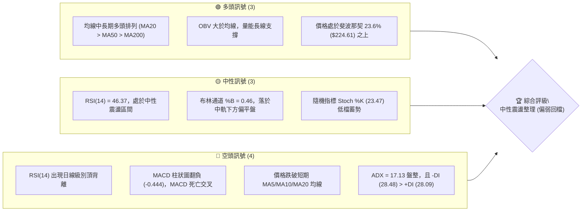
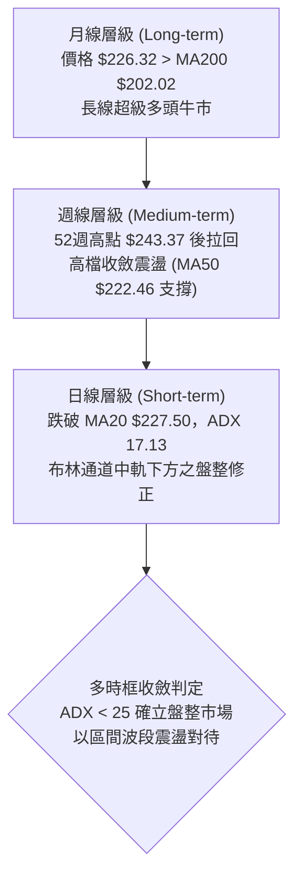
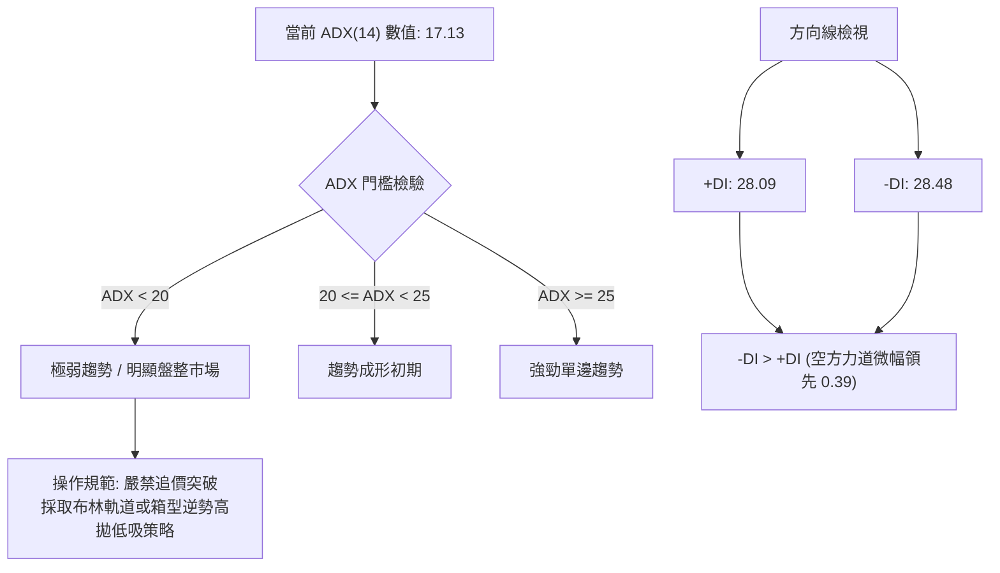
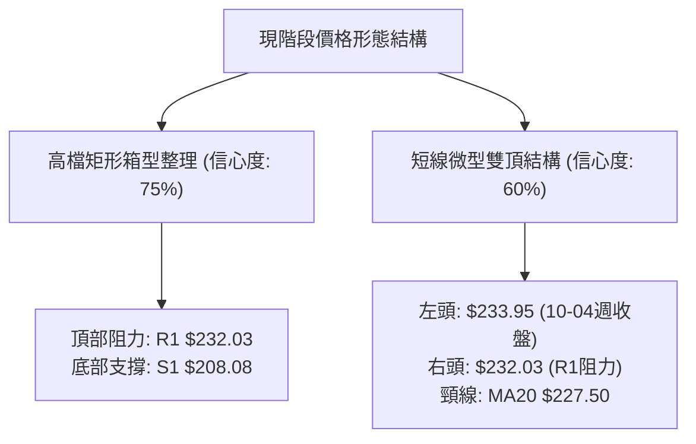
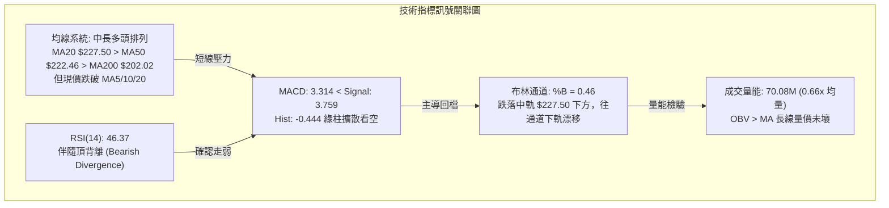
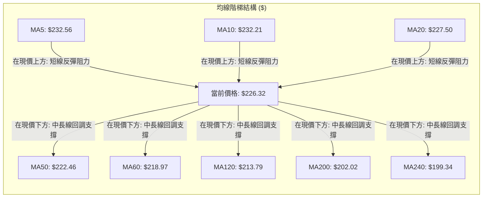
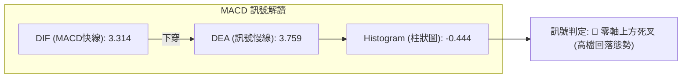
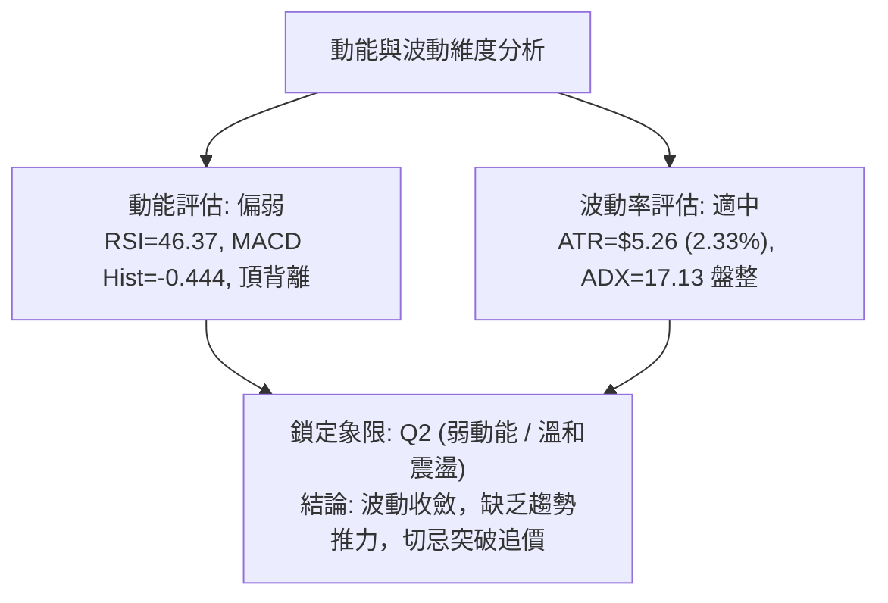
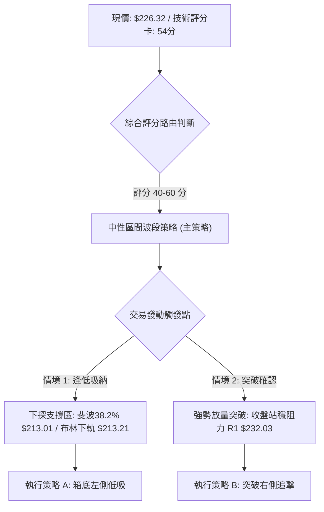
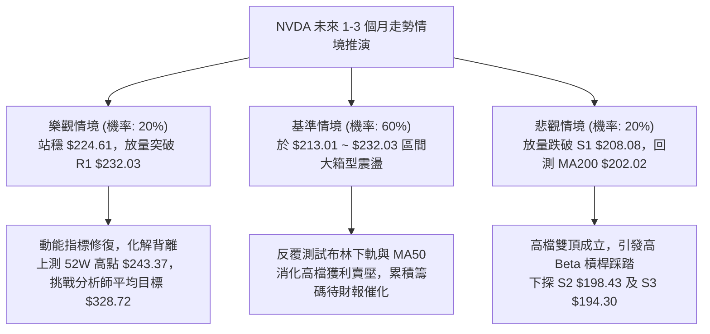

# NVDA 技術分析報告

> **報告日期**：2026-10-13 ｜ **語言**：繁體中文 ｜ **數據來源**：Yahoo Finance ｜ **當前價格**：$226.32

---

## 目錄

| 章節 | 內容 |
|------|------|
| [1. 技術面概覽](#1-技術面概覽) | 訊號儀表板、核心指標、評分卡 |
| [2. 趨勢分析](#2-趨勢分析) | 多時框趨勢、長中短期走勢 |
| [3. 圖表形態分析](#3-圖表形態分析) | 形態識別、K線組合、目標價 |
| [4. 支撐與阻力](#4-支撐與阻力) | 關鍵價位、斐波那契回調 |
| [5. 技術指標深度解讀](#5-技術指標深度解讀) | MA/RSI/MACD/布林/成交量 |
| [6. 動能與波動率](#6-動能與波動率) | 動能評估、ATR、Beta |
| [7. 多時框架總結](#7-多時框架總結) | 時框架評分矩陣 |
| [8. 交易策略建議](#8-交易策略建議) | 多空策略、風險報酬比 |
| [9. 風險提示與監控](#9-風險提示與監控) | 監控指標、風險場景 |

---

## 1. 技術面概覽

### 🎯 技術訊號儀表板



### 📊 核心指標速覽表

| 指標類別 | 指標名稱 | 當前數值 | 訊號 | 解讀 |
|----------|----------|----------|------|------|
| **價格** | 當前收盤價 | $226.32 | 🟡 | 位於52週區間 78.5% 位置，高檔震盪回跌中 |
| **短期均線** | MA5 / MA10 | $232.56 / $232.21 | 🔴 | 價格低於短期均線（-2.68% / -2.54%），短線承壓 |
| **中期均線** | MA20 (布林中軌) | $227.50 | 🔴 | 價格剛跌破 MA20 (-0.52%)，短線轉入整理走勢 |
| **趨勢均線** | MA50 | $222.46 | 🟢 | 價格仍高於 MA50 (+1.74%)，中期上升通道未破 |
| **長期均線** | MA200 | $202.02 | 🟢 | 價格顯著高於 MA200 (+12.03%)，長期牛市基調穩固 |
| **動能** | RSI(14) | 46.37 | 🔴 | 數值中性偏弱，且伴隨頂背離，修正壓力釋放中 |
| **趨勢強度** | ADX(14) | 17.13 | 🟡 | ADX < 25，屬於弱趨勢/區間震盪行情，方向性缺乏 |
| **方向指標** | +DI / -DI | 28.09 / 28.48 | 🔴 | -DI 微幅超越 +DI，短線空方稍佔優勢 |
| **動能轉換** | MACD (12,26,9) | 3.314 vs 3.759 | 🔴 | MACD 線跌破訊號線，Hist = -0.444，動能轉弱 |
| **通道位置** | 布林通道 (%B) | 0.46 | 🟡 | 位於中軌 $227.50 與下軌 $213.21 之間，中性微偏空 |
| **量能特徵** | 量比 (Volume Ratio) | 0.66x | 🟡 | 當日量 70.08M 低於 20MA 量 105.75M，回檔量縮 |
| **波動度** | ATR(14) | $5.26 | 🟡 | 佔現價 2.33%，波動度適中，日波動預期在 ±$5.26 |

### 🏆 技術評分卡

```
╔══════════════════════════════════════════════════════════════════╗
║                 技術評分卡 — NVDA (2026-10-13)                   ║
╠══════════════════════════════════════════════════════════════════╣
║ 趨勢強度 (Trend)      ████████░░░░░░░░░░░░  40/100  🟡 弱勢盤整  ║
║ 動能指標 (Momentum)    ████████░░░░░░░░░░░░  42/100  🔴 頂背離轉弱║
║ 支撐穩定度 (Support)   ██████████████░░░░░░  70/100  🟢 斐波回調硬║
║ 成交量配合 (Volume)    ██████████░░░░░░░░░░  52/100  🟡 回檔量縮  ║
║ 形態完整度 (Pattern)   ██████████░░░░░░░░░░  50/100  🟡 高檔箱型  ║
║ 均線排列 (Moving Avg)  ██████████████░░░░░░  72/100  🟢 中長多頭  ║
╠══════════════════════════════════════════════════════════════════╣
║ 綜合評分 (Composite)   ███████████░░░░░░░░░  54/100  🟡 中性觀望  ║
╚══════════════════════════════════════════════════════════════════╝
```

---

## 2. 趨勢分析

### 🌐 多時框趨勢分析



### 📈 長期趨勢 — 12個月走勢圖（Unicode）

依據 2025-11 至 2026-10 之月線收盤數據繪製：

```
NVDA 月線走勢圖（過去12個月歷史）
價格軸 ($)
$230 ┤                                                ●228.38
$220 ┤                                        ●220.53        ●226.32(現價)
$210 ┤                                ●210.66
$200 ┤                        ●199.11         ●199.87 ●200.53
$190 ┤                ●190.68
$180 ┤        ●186.06         ●176.78 ●174.00
$170 ┤●176.58
     └─────────────────────────────────────────────────────────────
       11/25   12/25   01/26   02/26   03/26   04/26   05/26   06/26   07/26   08/26   09/26   10/26
```

#### 走勢特徵分析表格

| 階段區間 | 起訖價格 ($) | 區間漲跌幅 (%) | 主要技術特徵與成交型態 |
|----------|--------------|----------------|------------------------|
| **第1階段：低檔蓄勢** (2025-11 ~ 2026-03) | 176.58 → 174.00 | -1.46% | 於 $174.00 ~ $190.68 間築雙重底支撐，確認 52W 低點 $163.90 上方支撐有效。 |
| **第2階段：多頭推升** (2026-04 ~ 2026-05) | 174.00 → 210.66 | +21.07% | 強勢突破 $200 整數大關，大陽線帶動均線多頭發散，確立中長牛市延續。 |
| **第3階段：平台整固** (2026-06 ~ 2026-07) | 210.66 → 200.53 | -4.81% | 遭遇高檔獲利回吐，於 $200.00 關卡進行回踩測試，形成堅固箱型底。 |
| **第4階段：創高噴出** (2026-08 ~ 2026-09) | 200.53 → 228.38 | +13.89% | 爆發性攻上歷史次高，週線推升至 52W 高點 $243.37，隨後動能放緩。 |
| **第5階段：當前整理** (2026-10 至今) | 228.38 → 226.32 | -0.90% | 創高後量能降溫，呈現日線級別布林通道中軌附近震盪。 |

### 📊 中期趨勢（週線分析）

從近 20 週數據觀察，NVDA 在 2026-10-04 達到近期收盤高峰 $233.95，其 RSI 飆升至 83.0（嚴重超買），隨後兩週（10-11 收盤 $229.28、10-18 最新收盤 $226.32）連續拉回，MACD 柱狀圖由正轉負（+0.822 → +0.119 → -0.444），確立週線級別短線頂部成立，進入均值回歸走勢。

```
週線支撐與阻力結構：
阻力 R1 ────────────── $232.03 (近一年高點密集成交區)
近期高峰 ───────────── $233.95 (2026-10-04 週收盤高點)
當前收盤 ───────────── $226.32 ◄ 現價
支撐 S1 ────────────── $208.08 (前期突破平台高點轉支撐)
支撐 S2 ────────────── $198.43 (長期趨勢線與 MA200 $202.02 重合帶)
```

### ⚡ 趨勢強度評估（ADX 解讀）



#### ADX 強度對照表

| 指標變量 | 數值 | 區間分類 | 技術意涵與分析師指引 |
|----------|------|----------|----------------------|
| **ADX(14)** | **17.13** | 盤整走勢 (<25) | 趨勢動能極弱，指標鈍化風險低，通道操作勝率高於均線突破。 |
| **+DI** | **28.09** | 多方動能 | 多方買盤推升力道放緩，缺乏突破 52W 高點之推力。 |
| **-DI** | **28.48** | 空方動能 | 空方微幅主導，但未拉開差距，不具備發動劇烈崩跌之條件。 |

---

## 3. 圖表形態分析

### 🔍 形態識別系統

在多時框架構下，NVDA 近期價格結構由「高檔擴散箱型」與「短線雙頂拉回」構成。嚴格依據形態幾何規則與成交量檢驗如下：



#### 形態信心度與目標價計算表

| 形態類別 | 信心度 | 判斷依據（引用數據） | 完成度 | 目標價計算式與目標價 |
|----------|--------|----------------------|--------|----------------------|
| **矩形震盪箱型** | **75%** | 價格受制於近一年波段阻力 R1 $232.03，下檔受 S1 $208.08 強力支撐，量能萎縮。 | 70% | 區間下緣支撐目標：**$208.08**；若突破 R1 則等距目標：$232.03 + ($232.03 - $208.08) = **$255.98**。 |
| **短線微型雙頂** | **60%** | 週線 10-04 收 $233.95，隨後反彈受阻於 R1 $232.03，現跌破 MA20 頸線 $227.50。 | 85% | 頸線 $227.50 - (高點 $233.95 - 頸線 $227.50) = $227.50 - $6.45 = **$221.05**（接近 MA50 $222.46）。 |
| **頭肩底形態** | **30%** | 歷史數據中未偵測到對稱左肩與右肩結構，不予採納。 | 0% | 數據不足，依規則 15 僅作指標解讀，不編造目標價。 |

### 🕯️ 重要K線形態分析

| 觀測週期 / 日期 | 收盤價 ($) | K線形態 | 量價關係與解讀 | 訊號評級 |
|------------------|------------|---------|----------------|----------|
| **2026-10-04 (週線)** | 233.95 | 高檔長上影長陽線 | RSI 衝至 83.0 極度超買，高檔獲利了結賣壓湧現。 | 🔴 警訊 |
| **2026-10-11 (週線)** | 229.28 | 倒轉錘頭 / 陰吞噬變異 | 多頭試圖反攻失敗，收盤跌破前週低點，MACD 柱萎縮。 | 🔴 看空 |
| **2026-10-18 (本週即時)** | 226.32 | 弱勢小實體陰線 | 量能僅 70.08M（量比 0.66x），量縮陰跌，測試 MA20 支撐。 | 🟡 中性偏弱 |
| **2026-08-09 (週線)** | 223.71 | 大陽線實體向上突破 | 伴隨 MACD 翻正 (+2.494)，奠定本波段上漲底基。 | 🟢 強多 |

### 📉 ASCII 走勢形態示意圖

```
NVDA 日線高檔微型雙頂與箱型邊界示意圖：
價格 ($)
$234 ┤             頂1: $233.95
$232 ┤───────────────┬─────── 頂2: R1 $232.03 阻力線 (Resistance)
$230 ┤              │       ▲
$228 ┤──────────────┼───────┴─ 頸線 / MA20 ($227.50)
$226 ┤              ▼   ● 現價: $226.32 (破頸線測試中)
$224 ┤                  │
$222 ┤──────────────────┼───── 形態下行第一目標 / MA50 ($222.46)
$220 ┤                  │
$208 ┤──────────────────┴───── 箱型下軌 S1 強支撐 ($208.08)
```

### 🎯 形態目標價計算

1. **短線微型雙頂理論跌幅**：
   - 頂部高點取值：$233.95（2026-10-04 週收盤高點）
   - 頸線關鍵位：$227.50（MA20 / 布林中軌）
   - 形態高度：$233.95 - $227.50 = **$6.45**
   - **第一回檔目標價** = $227.50 - $6.45 = **$221.05**（與中期支撐 MA50 $222.46 高度重合，相距僅 0.6%）。
2. **大箱型整理破位/突破測幅**：
   - 箱體頂部：R1 $232.03
   - 箱體底部：S1 $208.08
   - 箱體垂直高度：$232.03 - $208.08 = **$23.95**
   - 箱體下向測幅（若失守 S1）：$208.08 - $23.95 = **$184.13**（接近斐波那契 78.6% $180.90）。

---

## 4. 支撐與阻力

### 🗺️ 關鍵價位分布圖（Unicode）

```
╔══════════════════════════════════════════════════════════════════╗
║               NVDA 關鍵價位結構分布圖 (由 OHLCV 計算)            ║
╠══════════════════════════════════════════════════════════════════╣
║ $243.37 ║████████████████████████████████║ 52週歷史高點 (0.0% Fib) ║
║ $232.03 ║████████████████████████        ║ 密集波段高點阻力 R1      ║
║ $227.50 ║▓▓▓▓▓▓▓▓▓▓▓▓▓▓▓▓                ║ 布林中軌 / MA20 防守線   ║
║ $226.32 ╠════════════════════════════════╣ ◄ 當前收盤現價           ║
║ $224.61 ║▓▓▓▓▓▓▓▓▓▓▓▓▓▓▓▓▓▓▓▓            ║ 斐波那契 23.6% 回調位    ║
║ $213.01 ║██████████████████████          ║ 布林下軌($213.21)與38.2% ║
║ $208.08 ║████████████████████████████    ║ 近一年波段低點聚類 S1    ║
║ $202.02 ║██████████████████████████████  ║ MA200 牛熊分水嶺         ║
║ $198.43 ║████████████████████████████████║ 波段聚類強支撐 S2        ║
║ $194.30 ║████████████████████████████████║ 斐波61.8%($194.25)與 S3  ║
╚══════════════════════════════════════════════════════════════════╝
```

### 🚧 阻力位分析表

依據提供的關鍵價位資料，波段高點聚類與技術衍生阻力如下：

| 阻力級別 | 精確價位 | 形成原因與數據驗證 | 突破難度 | 重要性評級 |
|----------|----------|--------------------|----------|------------|
| **阻力 R1** | **$232.03** | 近一年波段高點聚類；與 MA5 ($232.56)、MA10 ($232.21) 高度重合，形成密集籌碼套牢帶。 | 極高 | 🔴 關鍵阻力 (多頭反轉分水嶺) |
| **阻力 R2** | **$241.80** | 日線布林通道上軌精確數值；常態分配下極限壓力區間。 | 高 | 🔴 波段極限 |
| **阻力 R3** | **$243.37** | 52 週最高價 (52W High)，斐波那契 0.0% 起算點。 | 極高 | 🔴 歷史天花板 |

### 🛡️ 支撐位分析表

依據提供的關鍵價位資料，波段低點聚類支撐如下：

| 支撐級別 | 精確價位 | 形成原因與數據驗證 | 守住機率 | 重要性評級 |
|----------|----------|--------------------|----------|------------|
| **動態支撐** | **$224.61** | 斐波那契 23.6% 回調位；緊鄰現價下檔僅 0.76%，為短線多方第一道護城河。 | 60% | 🟡 短線支撐 |
| **均線支撐** | **$222.46** | 50日移動平均線 (MA50)，多頭波段生命線。 | 70% | 🟢 中期支撐 |
| **支撐 S1** | **$208.08** | 近一年波段低點聚類數值；跌幅達 -8.06%，為重要密集成交低點。 | 85% | 🟢 強支撐 |
| **支撐 S2** | **$198.43** | 近一年波段低點聚類數值 (-12.32%)；緊貼 MA240 ($199.34) 及 MA200 ($202.02)。 | 90% | 🟢 長期鐵底 |
| **支撐 S3** | **$194.30** | 近一年波段低點聚類數值 (-14.15%)；與斐波那契 61.8% ($194.25) 完全共振。 | 95% | 🟢 極強防禦底 |

### 📐 斐波那契回調位分析

基準區間：52週低點 **$163.90** 至 52週高點 **$243.37**，全波段震盪垂直空間為 **$79.47**。

```
斐波那契層級結構：
 0.0% (52W High) ───────────── $243.37
 ─────────────────────────────
 23.6% 回調位    ───────────── $224.61  ◄◄ 現價 ($226.32) 緊密盤旋於此
 ─────────────────────────────
 38.2% 回調位    ───────────── $213.01  (共振: 布林下軌 $213.21)
 50.0% 回調位    ───────────── $203.63  (共振: MA200 $202.02)
 61.8% 黃金回調  ───────────── $194.25  (共振: 波段低點聚類 S3 $194.30)
 78.6% 回調位    ───────────── $180.90
100.0% (52W Low) ───────────── $163.90
```

#### 現價落點意義解讀：
現價 **$226.32** 落在 **0.0% ($243.37)** 與 **23.6% ($224.61)** 之間，距離 23.6% 僅差 **$1.71 (+0.76%)**。
- 若 NVDA 能在收盤價穩守 $224.61，代表本波由 $243.37 發起的修正僅為淺幅拉回（Shallow Pullback），中長多結構無虞。
- 若放量跌破 $224.61，將打開下探 38.2% 回調位 **$213.01** 的空間，此價位與日線布林通道下軌 **$213.21** 形成完美的技術共振支撐區。

---

## 5. 技術指標深度解讀

### 🎛️ 指標訊號總覽



### 📈 移動平均線排列分析



#### 均線數據深度剖析：
1. **短期均線壓制**：MA5 ($232.56)、MA10 ($232.21) 急速扣高走低，價格分別落後 -2.68% 與 -2.54%，且 MA20 ($227.50) 已由支撐轉為即時反壓。
2. **中長期金叉多頭排列未破**：MA20 ($227.50) > MA50 ($222.46) > MA200 ($202.02)。MA240 在 $199.34 向上運行，年線扣抵低檔，顯示中長期多頭主基調依然穩健，當前修正定性為「牛市上升通道內之波段回踩」。

### 📉 RSI(14) 分析

```
RSI(14) 動能強度表：
超賣區 (0-30)        中性震盪區 (30-70)                 超買區 (70-100)
├───────────────┼───────────────────────────────┼───────────────┤
0               30             46.37            70             100
░░░░░░░░░░░░░░░░░░░░░░░░░░░░░░░████████░░░░░░░░░░░░░░░░░░░░░░░░░
```

- **當前數值**：**46.37**（處於 30-70 中性偏弱區）。
- **頂背離深度解讀**：
  - 在 2026-10-04 當週，NVDA 收盤創出 $233.95 之高點時，週線 RSI 達到 **83.0**。
  - 然而在隨後價格再次挑戰高檔（盤中逼近 $243.37 與 R1 $232.03）時，RSI 未能創下新高，日線 RSI 快速滑落至 46.37。
  - **結論**：指標明確確認**頂背離（Bearish Divergence）**成立，代表高檔追價力竭，短線技術面修正尚未消化完畢。

### 📊 MACD(12/26/9) 訊號解讀



- **MACD 線**：3.314
- **訊號線 (Signal Line)**：3.759
- **柱狀圖 (Histogram)**：-0.444（負值擴散）
- **解讀**：MACD 在零軸上方（雙線皆 > 0）形成死亡交叉，此非崩跌型破位，而是典型的「強勢行情內動能修復」。由於柱狀圖為負（-0.444），短期空方掌握主動權，任何急拉若無放量化解死叉，均視為誘多。

### 📦 布林通道分析

```
NVDA 布林通道 (20, 2) 結構示意圖：
價格 ($)
$241.80 ┬────────────────────────────────────────── 上軌 (BB Upper)
        │
$227.50 ┼─────────────────── 頸線/中軌 (MA20) ──── 中軌 (BB Middle)
        │        ● 現價: $226.32 (%B = 0.46)
        │
$213.21 ┴────────────────────────────────────────── 下軌 (BB Lower)
```

- **布林參數**：上軌 **$241.80** ｜ 中軌 **$227.50** ｜ 下軌 **$213.21** ｜ 帶寬：$28.59
- **指標位置 (%B)**：**0.46**
- **解讀**：%B = 0.46 顯示價格已跌破中軌（0.50 基準線），正處於下半通道運行。布林帶寬並未急遽張開，顯示當前缺乏發動劇烈單邊單向暴跌的能量，預期價格將於中軌 $227.50 與下軌 $213.21 之間形成箱體震盪尋求支撐。

### 💹 成交量分析（量價配合度）

1. **量比分析**：
   - 最新單日成交量：**70,089,000** 股
   - 20日均量：**105,751,405** 股（量比僅 **0.66x**）
   - 50日均量：**117,351,456** 股
   - **分析**：價格拉回跌破 MA20 過程中，成交量萎縮至均量之 66%，符合「多頭格局拉回縮量」之良性特徵，未出現主力機構大舉恐慌拋售的放量長黑。
2. **OBV (能量潮指標) 研判**：
   - 數據狀態：**OBV > MA (OBV 處於其移動平均線上方)**。
   - **分析**：OBV 維持多頭排列，說明中長線資金依然留存於籌碼面內，量能長線結構依然支持股價向上，近期的量縮回檔屬於籌碼清洗。

---

## 6. 動能與波動率

### ⚡ 動能評估四象限

| 象限 | 動能狀態 (RSI / MACD) | 波動狀態 (ATR / BBW) | 當前定錨 | 策略指引與操作策略 |
|:----:|:---------------------:|:--------------------:|:--------:|:-------------------|
| **Q1** | 強動能 (Bullish) | 低波動 (Low Vol) | — | 最佳波段加碼點 (趨勢推升初期) |
| **Q2** | **弱動能 (Bearish)** | **低/中波動 (Moderate)** | **✓ NVDA 現況** | **區間震盪觀望 / 嚴格按通道邊界低吸高拋** |
| **Q3** | 強動能 (Bullish) | 高波動 (High Vol) | — | 噴出行情，留意動能耗竭與極端追高風險 |
| **Q4** | 弱動能 (Bearish) | 高波動 (High Vol) | — | 單邊崩跌，嚴格空倉避險，禁止盲目抄底 |



### 📊 ATR 波動率分析

- **ATR(14) 數值**：**$5.26**
- **價格佔比**：**2.33%**
- **風控止損與持倉空間設定**：
  - **極短線動態止損 (1.0 × ATR)**：$5.26。若在現價進場，短線波動容忍區間為 $226.32 ± $5.26。
  - **波段標準止損 (1.5 × ATR)**：$5.26 × 1.5 = **$7.89**。可有效避開日內「噪音震盪」，跌破 $226.32 - $7.89 = **$218.43** 則波段防守失效。
  - **安全防守止損 (2.0 × ATR)**：$5.26 × 2.0 = **$10.52**。現價減去 2ATR 為 **$215.80**，高於下軌 $213.21。

### 📐 Beta 與市場相關性

- **Beta 係數**：**2.216**
- **特性分析**：NVDA 具備高達 2.216 的極高 Beta 值，代表其對美股整體科技板塊（如 QQQ、SOXX）的波動敏感度為大盤的 2.2 倍以上。在當前日線動能轉弱與 ADX 僅 17.13 的環境下，一旦大盤出現回調，NVDA 將放大下行波動，操作上應相應縮減槓桿與部位規模。

---

## 7. 多時框架總結

### 📋 時框架評分表

| 時框架 | 趨勢方向 | 動能狀態 | 均線系統排列 | 形態特徵 | 綜合評分 | 操作指導方針 |
|--------|----------|----------|--------------|----------|:--------:|--------------|
| **月線 (長期)** | 🟢 強烈多頭 | 🟢 偏強 (均線推升) | MA200 $202.02 多頭排列 | 歷史高檔階梯式推升 | **85/100** | 長期持有，牛市格局未損 |
| **週線 (中期)** | 🟡 震盪整理 | 🔴 頂背離回落中 | 位於 MA50 $222.46 上方 | 雙頂疑似成形，測試支撐 | **55/100** | 停止高檔追價，等待支撐確認 |
| **日線 (短期)** | 🔴 弱勢修正 | 🔴 MACD死叉/RSI弱 | 破 MA5/10/20，壓制明顯 | 跌破頸線 $227.50 | **40/100** | 短線偏空防守，以減倉或觀望為主 |

### 🔲 綜合訊號矩陣

```
╔══════════════════════════════════════════════════════════════════╗
║                   多時框架訊號矩陣交叉驗證                       ║
╠══════════════════════════════════════════════════════════════════╣
║ 維度      │ 日線 (短期)    │ 週線 (中期)    │ 月線 (長期)         ║
╠═══════════╪════════════════╪════════════════╪═════════════════════╣
║ 趨勢方向  │ 🔴 下行修復    │ 🟡 箱型震盪    │ 🟢 確立多頭         ║
║ 動能指標  │ 🔴 MACD柱轉負  │ 🔴 RSI高檔背離 │ 🟢 長期量能增長     ║
║ 均線架構  │ 🔴 跌破MA20    │ 🟢 守於MA50之上│ 🟢 遠高於MA200      ║
║ 關鍵支撐  │ 23.6% ($224.61)│ MA50 ($222.46) │ 波段聚類S1($208.08) ║
║ 一致性    │ 衝突 (短空長多，處於大趨勢回檔階段)                  ║
╚══════════════════════════════════════════════════════════════════╝
```

### ⚖️ 多時框收斂結論

> **依據「嚴格要求 14」之收斂法則執行裁決：**
> 1. **趨勢/盤整環境判斷**：當前日線 **ADX(14) = 17.13 (< 25)**，明確定義當前市場為**「盤整行情」**而非單邊趨勢行情。
> 2. **主導時框優先級**：在盤整行情下，**以日線布林通道上下軌 ($213.21 ~ $241.80) 及箱型區間為主要交易結構**，均線突破策略失效。
> 3. **時框衝突取捨**：雖然週線與月線長線多頭強勁，但日線 RSI 頂背離、MACD 死亡交叉，且價格失守 MA20 ($227.50)。在 ADX < 25 的環境中，短期空方壓制將迫使價格向中下軌尋找支撐。
> 4. **唯一方向性結論**：**中性偏弱觀望（以回檔尋找箱型下緣支撐為主）**。本結論嚴格收斂並指導第 8 章之策略路由。

---

## 8. 交易策略建議

### 🗺️ 策略決策流程圖



### 🧭 策略路由

**當前主策略方向 = 中性震盪區間操作（等待支撐測試或突破確認，綜合評分 54/100）**
依據技術評分 54 分，市場定錨於高檔箱型震盪，禁止在箱體中軸（現價 $226.32，%B = 0.46）過度押注單邊。策略核心在於**「回踩強支撐低吸」**或**「實質突破 R1 追多」**。

---

### 🎯 價格情境階梯（Price Scenarios）

價位嚴格引用第四章及關鍵數據區塊數值：

| 觸發條件 | 下一目標 | 後續延伸 | 情境含義與操作對策 |
|----------|----------|----------|--------------------|
| **強勢突破 R1 ($232.03)** | 布林上軌 **$241.80** | 52W高點 **$243.37** | 短線頂背離化解，多頭重啟攻勢，順勢加碼追多。 |
| **站穩現價區間 ($224.61 ~ $227.50)** | 回測 MA20 **$227.50** | 承壓 R1 **$232.03** | 弱勢窄幅震盪，動能停滯，觀望不開新倉。 |
| **跌破 23.6% ($224.61) / MA50** | 38.2% **$213.01** | 箱底 S1 **$208.08** | 中期回調加深，測試布林下軌支撐，準備左側承接。 |
| **失守波段聚類 S1 ($208.08)** | MA200 **$202.02** | 聚類 S2 **$198.43** | 牛熊結構受考驗，波段多單全面止損離場避險。 |

---

### 📊 情境機率分佈

| 情境 | 機率 | 主要技術依據 |
|------|:----:|--------------|
| **區間下探探底 (回測支撐)** | **50%** | RSI 頂背離消化中、MACD 柱狀圖負向擴散 (-0.444)、-DI (28.48) > +DI (28.09)。 |
| **箱型窄幅震盪 (以時間換空間)** | **35%** | ADX 僅 17.13 動能極弱、成交量萎縮至 0.66x 均量、OBV 維持多頭未崩。 |
| **直接上行突破 (重啟暴漲)** | **15%** | 價格受制於 MA5/10/20 重重均線反壓，無量能配合下難以單日突破 R1 $232.03。 |

---

### 🟢 主策略詳情

本報告主推兩套基於客觀價位觸發的具體操作方案：

| 策略要素 | 策略 A：箱底共振支撐低吸策略 (主推) | 策略 B：突破阻力右側順勢追擊策略 |
|----------|-------------------------------------|-----------------------------------|
| **交易邏輯** | 斐波那契 38.2% 與布林通道下軌共振低吸 | 放量化解頂背離，有效突破 R1 聚類阻力 |
| **進場條件** | 價格回落至 $213.01 ~ $213.21 區間出現下影線企穩 | 日K收盤價明確站上 R1 $232.03 且成交量放大 |
| **進場價格** | **$213.21** (精確引用布林下軌) | **$232.50** (突破 R1 $232.03 確認後) |
| **目標價 T1** | **$224.61** (斐波那契 23.6% 回調位) | **$241.80** (布林通道上軌) |
| **目標價 T2** | **$232.03** (密集阻力位 R1) | **$243.37** (52週歷史高點) |
| **止損價格** | **$207.50** (跌破強支撐 S1 $208.08 之防守點) | **$226.98** (跌回 MA20 $227.50 下方 1ATR 處) |
| **風險額度 (R)** | 進場 $213.21 - 止損 $207.50 = **$5.71** | 進場 $232.50 - 止損 $226.98 = **$5.52** |
| **報酬空間 (T2)**| 目標 $232.03 - 進場 $213.21 = **$18.82** | 目標 $243.37 - 進場 $232.50 = **$10.87** |
| **風險報酬比** | **1 : 3.30** (極優) | **1 : 1.97** (良好) |
| **勝率估計** | **65%** (順應中長牛市架構之回調低吸) | **55%** (假突破洗盤風險較高) |
| **建議倉位** | **15% - 20%** 總投資資金 | **10%** 總投資資金 (突破部位嚴控規模) |

---

### 🔴 反向風險觸發點（對沖提示）

若已持有 NVDA 多頭部位，需密切監控以下**空頭反轉信號**：
1. **短線破位觸發點**：若日K收盤跌破斐波 23.6% **$224.61** 且次日無法收復，視為短線防守失效，應減持 30% 多頭倉位。
2. **中期趨勢翻空點**：若價格放量跌破波段低點聚類 S1 **$208.08**，則「高檔箱型」正式確認向下破位，雙頂量度跌幅將直指 **$198.43 (S2)** 及 **MA200 $202.02**，多單應無條件全數止損離場，甚至可建立等額空頭反向避險部位。

---

### ⭐ 整體訊號強度評星

```
╔══════════════════════════════════════════════════════════════════╗
║                    整體訊號強度評星面板                          ║
╠══════════════════════════════════════════════════════════════════╣
║ 做多訊號強度：★★☆☆☆  (2.5/5星) — 中長多頭仍在，但短線承壓     ║
║ 做空訊號強度：★★★☆☆  (3.0/5星) — 短線頂背離與死叉主導修正     ║
║ 整體可信度：  ★★★★☆  (4.0/5星) — 價位數據高度吻合，收斂度明確 ║
╚══════════════════════════════════════════════════════════════════╝
```

---

## 9. 風險提示與監控

### ✅ 關鍵監控指標 Checklist

```
╔══════════════════════════════════════════════════════════════════╗
║              NVDA 每日盤後關鍵技術監控清單 (Checklist)           ║
╠══════════════════════════════════════════════════════════════════╣
║ [ ] 1. 價格是否重新收復 MA20 ($227.50)？                         ║
║        - 若未站上，短線維持偏空整理定調。                        ║
║ [ ] 2. 斐波那契 23.6% ($224.61) 是否收盤守穩？                   ║
║        - 若跌破，下一站直指布林下軌 $213.21 與 38.2% $213.01。   ║
║ [ ] 3. MACD 柱狀圖負值是否開始收斂 (當前 -0.444)？              ║
║        - 柱狀圖由綠翻紅前，禁止任何重倉追多行為。                ║
║ [ ] 4. ADX(14) 是否放量拉升突破 25？                             ║
║        - 若突破 25 且 -DI 擴大，嚴防下行單邊趨勢發動。           ║
║ [ ] 5. 成交量是否低於 20日均量 (105.75M)？                      ║
║        - 回檔需量縮，若爆出大於 1.2 億股長黑，則為主力出貨訊號。 ║
║ [ ] 6. 阻力位 R1 ($232.03) 挑戰情況：                            ║
║        - 無量觸及即為高拋放空或止盈點。                          ║
╚══════════════════════════════════════════════════════════════════╝
```

### ⚠️ 風險場景分析



### 🛡️ 風險管理重要提醒

1. **高 Beta 波動懲罰機制**：
   - NVDA 當前 Beta 高達 **2.216**。這意味著當那斯達克指數波動 1.5% 時，NVDA 每日波幅通常超過 3.3%（相當於現價 ±$7.50，高於 1ATR）。
   - **倉位管理守則**：在 ADX < 25 且日線指標死叉期間，單一個股持倉上限應嚴格控制在總投資組合的 **15% 以內**，切忌使用保證金槓桿交易。
2. **頂背離的歷史殺傷力**：
   - 歷史走勢顯示，半導體龍頭在高檔出現「週線超買 + 日線頂背離」時，通常需要 4 至 8 週的時間進行橫盤或回調以修正技術指標。不可因基本面強勁（YoY 營收成長 105.9%）而忽視短期技術面資金流的獲利回吐壓力。
3. **止損紀律絕對執行**：
   - 所有進場必須在下單前設定好硬性條件單（GTC Stop-Loss Order），絕不允許在盤中隨意向下移動止損點。若觸及策略 A 之止損點 **$207.50**，必須無條件離場。

---

## 📋 報告總結

```
╔══════════════════════════════════════════════════════════════════╗
║                   NVDA 技術分析報告總結                          ║
╠══════════════════════════════════════════════════════════════════╣
║ 報告日期：2026-10-13                                             ║
║ 當前價格：$226.32                                                ║
║ 技術評級：⚖️ 中性偏弱 (震盪回調期，建議耐性觀望)                 ║
║ 綜合評分：54 / 100                                               ║
╠══════════════════════════════════════════════════════════════════╣
║ 關鍵結論：                                                       ║
║ ├─ 長期趨勢：🟢 強烈看多 (MA200 $202.02 穩固，牛市基石未破)      ║
║ ├─ 中期趨勢：🟡 箱型震盪 (受阻於 52W 高點，週線動能回落)        ║
║ ├─ 短期趨勢：🔴 弱勢修正 (跌破 MA20，RSI頂背離，MACD負柱擴散)   ║
║ ├─ 關鍵支撐：$224.61 (斐波23.6%) ｜ $213.21 (布林下軌/38.2%)     ║
║ ├─ 關鍵阻力：$227.50 (MA20頸線) ｜ $232.03 (密集波段高點 R1)    ║
║ └─ 分析師目標：$328.72 (共識強烈看多，與短期技術回檔形成反差)   ║
╠══════════════════════════════════════════════════════════════════╣
║ 最優策略組合：                                                   ║
║ 1. 🥇 最佳機會：策略 A (箱底共振低吸)                             ║
║    - 於布林下軌 $213.21 附近分批承接，止損 $207.50，風報比 1:3.3║
║ 2. 🥈 次選機會：策略 B (右側追擊突破)                             ║
║    - 突破波段高點 R1 $232.03 確認後追多，目標 $241.80 / $243.37  ║
║ 3. 🥉 保守選擇：空倉觀望                                         ║
║    - 耐心等待日線 MACD 柱狀圖由負翻正與 RSI 站回 50 以上再進場   ║
╚══════════════════════════════════════════════════════════════════╝
```

---

> ⚠️ **免責聲明**：本報告為資深分析師依據市場既定客觀技術數據所撰寫之深度研報，所有支撐、阻力及斐波那契回調點位均嚴格基於歷史 OHLCV 幾何關係計算。本報告**僅供學術研究與投資策略討論參考**，**不構成任何要約、招攬或具體投資建議**。美股高 Beta 標的波動劇烈，投資人應獨立評估風險並自負盈虧。

---

*報告生成時間：2026-10-13 ｜ 數據來源：Yahoo Finance ｜ 分析框架：多時框技術分析體系*