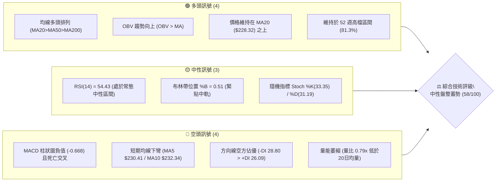
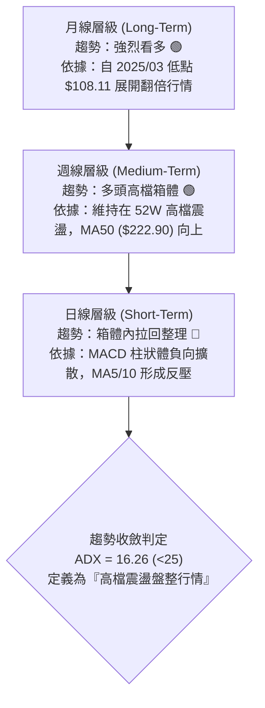
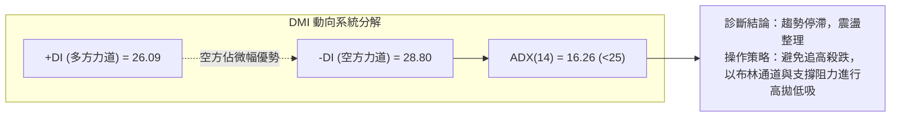
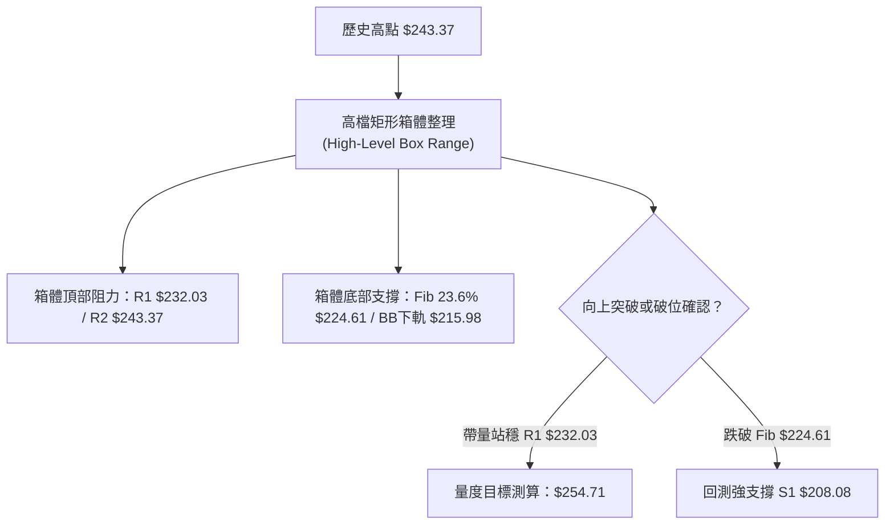
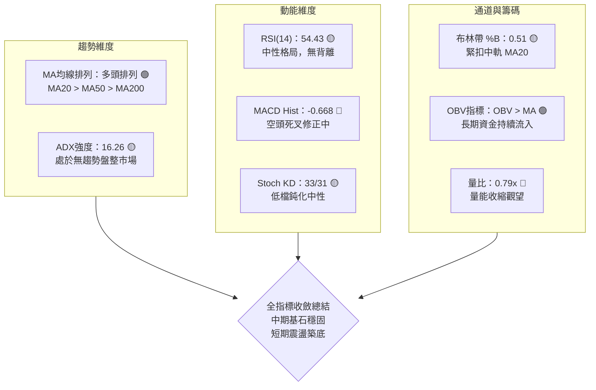
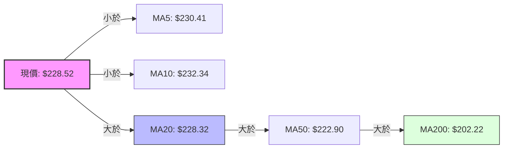
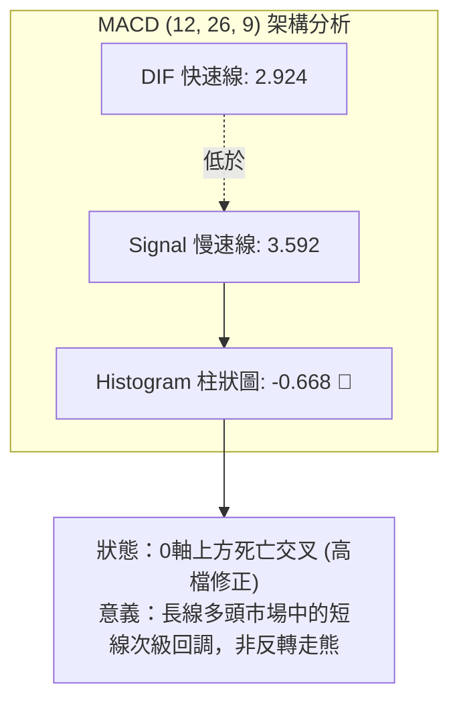
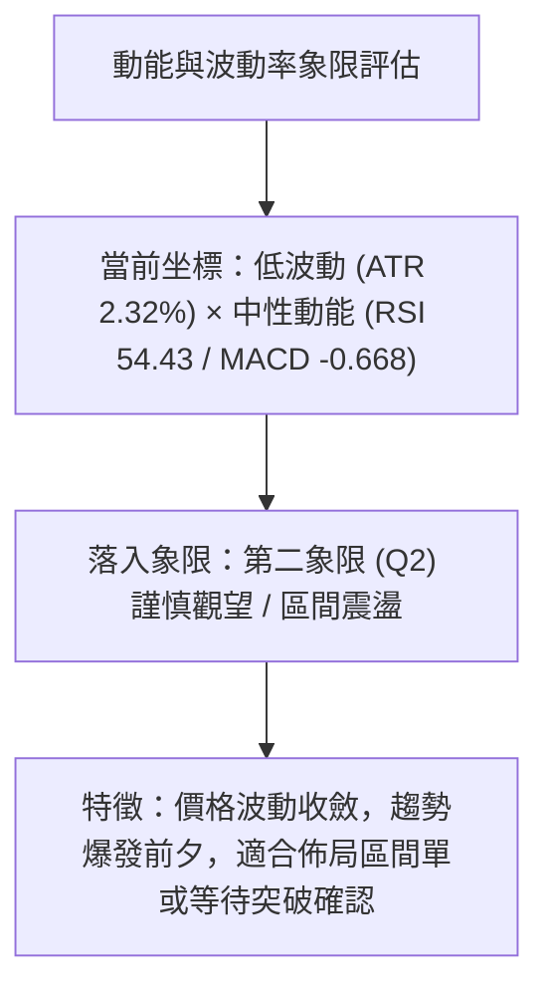
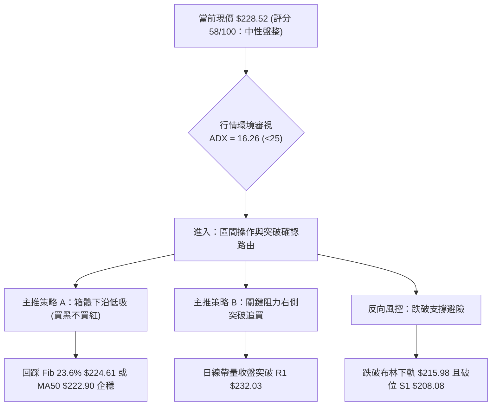
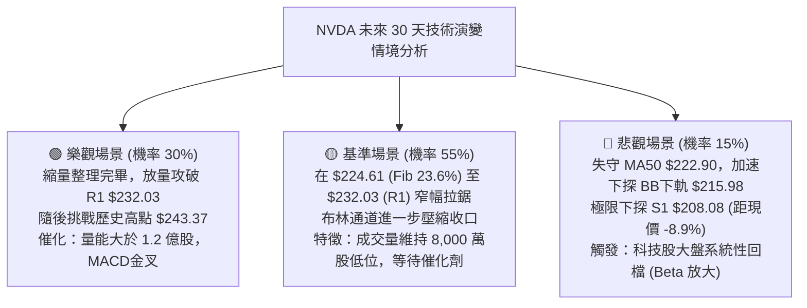

# NVDA 技術分析報告

> **報告日期**：2026-10-14 ｜ **語言**：繁體中文 ｜ **數據來源**：Yahoo Finance ｜ **當前價格**：$228.52

---

## 目錄

| 章節 | 內容 |
|------|------|
| [1. 技術面概覽](#1-技術面概覽) | 訊號儀表板、核心指標、評分卡 |
| [2. 趨勢分析](#2-趨勢分析) | 多時框趨勢、長中短期走勢、ADX 解讀 |
| [3. 圖表形態分析](#3-圖表形態分析) | 形態識別、K線組合、目標價推算 |
| [4. 支撐與阻力](#4-支撐與阻力) | 關鍵價位、斐波那契回調位精確解析 |
| [5. 技術指標深度解讀](#5-技術指標深度解讀) | MA/RSI/MACD/布林通道/成交量與OBV |
| [6. 動能與波動率](#6-動能與波動率) | 動能四象限、ATR波動分析、Beta風險 |
| [7. 多時框架總結](#7-多時框架總結) | 時框架評分矩陣與多時框收斂結論 |
| [8. 交易策略建議](#8-交易策略建議) | 策略路由、區間操作/突破進場規劃、情境機率 |
| [9. 風險提示與監控](#9-風險提示與監控) | 風險清單、壓力測試、監控指標 Checklist |

---

## 1. 技術面概覽

### 🎯 技術訊號儀表板



### 📊 核心指標速覽表

| 指標類別 | 指標名稱 | 當前數值 | 訊號 | 解讀 |
|----------|----------|----------|:----:|------|
| **價格** | 當前收盤價 | $228.52 | 🟢 | 站穩中長期均線上方，處於 52 週區間之 81.3% 高位 |
| **均線** | MA20 (月線) | $228.32 | 🟢 | 現價微幅高於 MA20（+0.09%），發揮即時動態支撐作用 |
| **均線** | MA50 (季線) | $222.90 | 🟢 | 現價高於 MA50（+2.52%），中期上升趨勢結構完整 |
| **均線** | MA200 (年線)| $202.22 | 🟢 | 現價遠高於 MA200（+13.01%），長期牛市基石極為穩固 |
| **短期均線**| MA5 / MA10 | $230.41 / $232.34 | 🔴 | 短期均線自高檔下彎，構成上方短線反彈壓制 |
| **動能** | RSI(14) | 54.43 | 🟡 | 位於 50 軸線上方的常態震盪區，未出現超買或超賣 |
| **動能** | MACD (12,26,9) | 2.924 / 3.592 | 🔴 | DIF 線低於 Signal 線，柱狀圖為 -0.668，短線拉回整理 |
| **動能** | Stoch %K / %D | 33.35 / 31.19 | 🟡 | 位於超賣區邊緣震盪，指標逐步鈍化打底 |
| **趨勢強度**| ADX(14) | 16.26 | 🟡 | ADX < 25 表明趨勢動力減弱，市場進入無趨勢區間盤整 |
| **通道** | Bollinger %B | 0.51 | 🟡 | 價格恰位於布林帶中軌（$228.32），等待方向性突破 |
| **量能** | 20日成交量比 | 0.79x (83.85M) | 🟡 | 成交量低於 20 日均量 (105.57M)，市場觀望氛圍濃厚 |
| **量能** | OBV 指標 | OBV > MA | 🟢 | 能量潮指標高於其均線，代表中長線籌碼未見鬆動 |
| **波動** | ATR(14) | $5.31 (2.32%) | 🟢 | 波動率收斂至常態區間，未出現極端恐慌拋售行情 |

### 🏆 技術評分卡

```
╔══════════════════════════════════════════════════════════════╗
║               技術評分卡 — NVDA (2026-10-14)                 ║
╠══════════════════════════════════════════════════════════════╣
║ 趨勢強度 (ADX=16.26)   ████████░░░░░░░░░░░░  42/100 🟡 弱盤整 ║
║ 動能指標 (RSI/MACD)    █████████░░░░░░░░░░░  46/100 🟡 偏弱勢 ║
║ 支撐穩定度 (Fib/MA)    ███████████████░░░░░  76/100 🟢 極穩固 ║
║ 成交量配合 (OBV/Vol)   ███████████░░░░░░░░░  56/100 🟡 縮量中 ║
║ 形態完整度 (區間箱體)  ████████████░░░░░░░░  62/100 🟢 構建中 ║
║ 均線排列 (多頭排列)    ████████████████░░░░  82/100 🟢 強多頭 ║
╠══════════════════════════════════════════════════════════════╣
║ 綜合技術評分           ███████████░░░░░░░░░  58/100 🟡 區間盤整║
╚══════════════════════════════════════════════════════════════╝
```

---

## 2. 趨勢分析

### 🌐 多時框趨勢分析

依據多時框收斂原則，長期多頭結構與短期震盪整理出現時框分歧。技術面需層層拆解：



### 📈 長期趨勢 — 12個月走勢圖（Unicode）

以下為 NVDA 過去 12 個月（2025-11 至 2026-10）真實收盤價之 ASCII 走勢圖：

```
NVDA 月線收盤走勢圖（過去12個月：2025-11 至 2026-10）
價格軸 ($)
$240 ┤                                                 ● 52W高點 $243.37
$230 ┤                                           ●━━━●←現價 $228.52
$220 ┤                                       ●   (09月 $228.38 / 10月 $228.52)
$210 ┤                             ●         │   (08月 $220.53)
$200 ┤                     ●       │ ●━━━●   │   (05月 $210.66)
$190 ┤             ●       │       │ │   │   │   (04月 $199.11 / 06-07月 ~200)
$180 ┤     ●       │       │       │ │   │   │   (01月 $190.68)
$170 ┤ ●   │   ●   │       │       │ │   │   │   (12月 $186.06)
$160 ┤ │   │   │   │   ●   │       │ │   │   │   (11月 $176.58 / 02月 $176.78)
     └─┬───┬───┬───┬───┬───┬───────┬─┬───┬───┬───┬───
      11  12  01  02  03  04      0506  07  08  09  10 (月份)
      '25 '25 '26 '26 '26 '26     '26'26 '26 '26 '26 '26
```

#### 走勢特徵分析表格

| 階段區間 | 月份跨度 | 價格區間 ($) | 漲跌幅 (%) | 走勢特徵與結構分析 |
|:---|:---:|:---:|:---:|:---|
| **首波洗盤** | 2025-11 ~ 2026-03 | $176.58 → $174.00 | -1.46% | 構築 $174.00~$176.78 之中期堅實三重底部支撐帶 |
| **主升攻擊** | 2026-03 ~ 2026-05 | $174.00 → $210.66 | +21.07% | 帶量長紅突破兩百元心理關卡，創波段波高點 |
| **箱體蓄勢** | 2026-06 ~ 2026-07 | $199.87 → $200.53 | +0.33% | 於 $200.00 整數大關進行平台換手，均線持續跟進修復 |
| **次段爆發** | 2026-07 ~ 2026-09 | $200.53 → $228.38 | +13.89% | 順利推升突破前期壓力，觸及 52 週歷史天花板 $243.37 |
| **高檔收斂** | 2026-09 ~ 2026-10 | $228.38 → $228.52 | +0.06% | 衝高後面臨獲利了結賣壓，進入高檔橫向窄幅整理期 |

### 📊 中期趨勢（週線分析）

從近 20 週數據觀察，NVDA 在 2026-10-04 創下週線收盤高點 $233.95，其後兩週分別收在 $229.28 與 $228.52。MACD 柱狀體由正轉負（+0.822 → +0.119 → -0.668），RSI 亦自超買區 83.0 回落至 54.4。這表明中期價格在上攻測試 52 週高點 $243.37 後，動能出現自然衰竭，回測布林帶中軌（$228.32）尋求支撐。

```
中期支撐與壓力拓撲示意圖（週線視角）
 [壓力 R2] $243.37 ═════════════════════════════════════ (52週歷史高點/天花板)
          ▲
          │ 獲利了結賣壓區間
          ▼
 [阻力 R1] $232.03 ------------------------------------- (近一年波段高點聚類)
          ▲
          │ 【當前震盪區間】：$224.61 (Fib 23.6%) ~ $232.03
  [現價]  $228.52 ◄─── 恰位於 MA20 ($228.32) 動態平衡點
          ▼
 [支撐 S1] $208.08 ------------------------------------- (波段低點聚類/強防線)
          ▲
          │ 中期多空分水嶺
          ▼
 [支撐 S2] $198.43 ═════════════════════════════════════ (MA200 / $200 堡壘)
```

### ⚡ 趨勢強度評估（ADX 解讀）

當前 ADX(14) 讀數為 **16.26**，遠低於趨勢判斷臨界值 25.0。此數據提供了關鍵交易指引：**市場正處於典型的盤整/無方向期**。



#### ADX 強度對照表

| ADX 數值區間 | 趨勢狀態定義 | 當前 NVDA 位置 | 交易戰略指引 |
|:---:|:---:|:---:|:---|
| **0 – 20** | **極弱勢 / 盤整震盪** | **16.26 (現況)** | **禁止趨勢突破單，採用布林通道上下軌之區間逆勢高拋低吸** |
| 20 – 25 | 趨勢醞釀中 / 方向未明 | — | 縮小部位規模，等待量能放大確認突破信號 |
| 25 – 50 | 強趨勢確立 (單邊行情) | — | 順勢交易，採用均線追蹤止損，讓利潤奔馳 |
| 50 – 75 | 極強單邊趨勢 | — | 注意過度延伸風險，逢高分批減碼獲利了結 |
| 75 – 100 | 極度過熱 / 即將反轉 | — | 指標嚴重鈍化，準備反手或全面離場觀望 |

---

## 3. 圖表形態分析

### 🔍 形態識別系統

在日線與週線時框下，價格經過前波自 $174.00 上漲至 $243.37 的大幅拉升後，當前走勢呈現高檔收斂特徵。



#### 形態信心度與驗證表格

| 識別形態名稱 | 信心度 (%) | 判斷依據（嚴格引用數據） | 完成度 (%) | 量度目標價與計算式 |
|:---|:---:|:---|:---:|:---|
| **高檔矩形整理箱體**<br/>(Box Consolidation) | **75%** | 上方受制於 R1 $232.03 與 52W高點 $243.37，下方受 Fib 23.6% ($224.61) 支撐，ADX 16.26 確認無趨勢 | **70%** | 箱體高度 = $243.37 - $224.61 = $18.76<br/>向上突破目標 = $232.03 + $18.76 = **$250.79**<br/>向下跌破目標 = $224.61 - $18.76 = **$205.85** |
| **短期雙重頂雛形**<br/>(Potential Double Top) | **45%**<br/>(信心度不足) | 2026-10-04 高點 $233.95 與前期高檔聚類形成雙峰，但頸線並未跌破 | **35%** | *註：信心度低於50%，頸線 $224.61 尚未失守，依規則僅列為風險監控，不作為主要交易依據* |
| **均線多頭收斂收斂三角**<br/>(Symmetrical Pennant) | **60%** | MA5 ($230.41) 與 MA10 ($232.34) 向下壓制，但 MA50 ($222.90) 向上托底，振幅急遽縮小 | **65%** | 形態頂點落在 $228.50 附近，突破後量度幅度約等同 ATR×3 = $15.93，目標指向 **$244.45** |

### 🕯️ 重要K線形態分析

| 週期/月份 | 收盤價 ($) | 核心 K 線形態 | 盤面技術解讀 | 訊號性質 |
|:---|:---:|:---|:---|:---:|
| **2026-08 (月線)** | $220.53 | **帶量大陽線** | 實體穿透所有中期均線，確立 $200.00 平台突破有效性 | 🟢 強烈看多 |
| **2026-09 (月線)** | $228.38 | **長上影中陽線** | 盤中衝擊 $243.37 遇獲利盤打壓，留有長上影線，顯現高檔解套與獲利盤壓力 | 🟡 中性滯漲 |
| **2026-10 (月至今)**| $228.52 | **高檔十字星 (Doji)**| 振幅僅 $0.14，多空雙方在 MA20 ($228.32) 達到極致平衡，變盤窗口臨近 | 🟡 變盤預警 |
| **2026-10-04 (週線)**| $233.95 | **射擊之星 (Shooting Star)**| 週 RSI 衝至 83.0 極度超買後回落，引發短線多頭獲利了結平倉 | 🔴 短線預警 |
| **2026-10-18 (週線)**| $228.52 | **縮量下影錘頭** | 成交量急縮至 1.54 億股，回測 MA20 獲得承接買盤支撐 | 🟢 支撐測試 |

### 📉 ASCII 走勢形態示意圖

```
NVDA 近期日線/週線形態細節（箱體整理與均線交匯）
   $243.37 ┬───────────────────────────────● (52W High / 假突破阻力區)
           │                             ╱   ╲
   $232.03 ┼────────────────────────────●─────● (阻力 R1 / 箱體上沿)
           │                          ╱  ▲    ╲
           │                         ╱   │     ▼
   $228.52 ┼────────────────────────┼────┼──────●◄─── 當前現價 (正處於 MA20 樞軸點)
           │                        │ MA20 $228.32
   $224.61 ┼────────────────────────● (Fib 23.6% 回調位 / 箱體下沿頸線)
           │                      ╱
   $215.98 ┼─────────────────────● (布林通道下軌動態支撐)
           │                   ╱
   $208.08 ┴──────────────────● (波段支撐 S1 / 多頭終極護城河)
           └─────────────────────────────────────────────
```

### 🎯 形態目標價計算

若當前高檔箱體整理能有效向上突破：
1. **頸線確認位**：有效實體收盤突破 **R1 $232.03**（連續兩日收盤於上方且日量能突破 1.05 億股）。
2. **形態高度 ($H$)**：$232.03 - $224.61 (Fib 23.6%) = **$7.42**。
3. **第一目標價 ($T_1$)**：突破點 $232.03 + $7.42 = **$239.45**（逼近布林上軌 $240.66）。
4. **第二目標價 ($T_2$)**：若進一步突破 52 週高點 $243.37，則依箱體大波段高度 ($243.37 - $215.98 = $27.39) 等幅外推：
   $$\text{目標價 } T_2 = 243.37 + (243.37 - 224.61) = 243.37 + 18.76 = \mathbf{\$262.13}$$
   *(註：嚴格依形態推算，未突破前禁止提前佈局過度樂觀倉位)*。

---

## 4. 支撐與阻力

### 🗺️ 關鍵價位分布圖（Unicode）

```
NVDA 價位結構分布圖（OHLCV 精確計算）
═════════════════════════════════════════════════════════════════════
$243.37 ║████████████████████████████████║ 強阻力 R2 (52W歷史高點 / Fib 0.0%)
$240.66 ║▓▓▓▓▓▓▓▓▓▓▓▓▓▓▓▓▓▓▓▓▓▓▓▓        ║ 布林通道上軌壓力
$232.03 ║████████████████████            ║ 關鍵阻力 R1 (波段高點聚類 / 箱體上沿)
────────╫────────────────────────────────╫──────────────────────────────────
$228.52 ╠════════════════════════════════╣ ◄ 當前市價 (MA20: $228.32 / BB中軌)
────────╫────────────────────────────────╫──────────────────────────────────
$224.61 ║▓▓▓▓▓▓▓▓▓▓▓▓▓▓▓▓▓▓▓▓            ║ 斐波那契 23.6% 回調黃金支撐位
$222.90 ║▓▓▓▓▓▓▓▓▓▓▓▓                    ║ MA50 季線生命線
$215.98 ║▓▓▓▓▓▓▓▓▓▓▓▓▓▓▓▓                ║ 布林通道下軌極限支撐
$213.01 ║▓▓▓▓▓▓▓▓▓▓▓▓                    ║ 斐波那契 38.2% 回調位
$208.08 ║████████████████████████        ║ 波段強支撐 S1 (近一年波段低點聚類)
$202.22 ║████████████████████████████    ║ MA200 牛熊分水嶺 / Fib 50% ($203.63)
$198.43 ║████████████████████████████████║ 極強支撐 S2
$194.30 ║████████████████████████████████║ 終極防線 S3 / Fib 61.8% ($194.25)
═════════════════════════════════════════════════════════════════════
```

### 🚧 阻力位分析表

所有數值均嚴格依據 OHLCV 波段高點與通道公式導出：

| 阻力級別 | 精確價位 | 距現價差距 | 形成原因與籌碼邏輯 | 突破難度 | 重要性 |
|:---:|:---:|:---:|:---|:---:|:---:|
| **R1** | **$232.03** | **+1.53%** | 近一年波段高點密集聚類區；也是短期均線 MA10 ($232.34) 重疊反壓帶。 | 🟡 中等 | ★★★★☆ |
| **通道上軌**| **$240.66** | **+5.31%** | 日線布林通道上軌動態阻力，當前量能不足以支撐突破上軌。 | 🔴 較高 | ★★★☆☆ |
| **R2** | **$243.37** | **+6.50%** | 52 週歷史天花板（Fib 0.0%）；上方無歷史套牢盤，但心理獲利了結賣壓極重。 | 🔴 極高 | ★★★★★ |

### 🛡️ 支撐位分析表

所有支撐價位嚴格引用波段低點聚類與通道指標：

| 支撐級別 | 精確價位 | 距現價差距 | 形成原因與籌碼邏輯 | 守住機率 | 重要性 |
|:---:|:---:|:---:|:---|:---:|:---:|
| **中軌支撐**| **$228.32** | **-0.09%** | MA20 暨布林通道中軌，日內多空分水嶺，現價即在此獲得支撐。 | 🟡 60% | ★★★☆☆ |
| **Fib 23.6%**| **$224.61** | **-1.71%** | 52 週高低點之第一級斐波那契回檔位，下方緊鄰 MA50 ($222.90)。 | 🟢 80% | ★★★★☆ |
| **BB 下軌** | **$215.98** | **-5.49%** | 日線布林下軌；在此處技術性超跌買盤將強力介入。 | 🟢 85% | ★★★☆☆ |
| **S1** | **$208.08** | **-8.94%** | 近一年波段低點聚類區，中期結構防守核心樞紐。 | 🟢 90% | ★★★★★ |
| **S2** | **$198.43** | **-13.17%** | MA200 ($202.22) 與 MA240 ($199.45) 形成的超長期均線群堡壘。 | 🟢 95% | ★★★★★ |
| **S3** | **$194.30** | **-14.98%** | 波段低點強聚類，重疊 Fib 61.8% ($194.25) 黃金分割防禦線。 | 🟢 99% | ★★★★★ |

### 📐 斐波那契回調位分析

依據 52 週完整波段（低點 **$163.90** → 高點 **$243.37**，總垂直價差 **$79.47**）之精確數學回調位分析：

```
斐波那契比例回調位深度解析
$243.37 ── 0.0% (52W High) ─── 歷史絕對高點
            ▲
 [現價 $228.52 落於 0.0% 與 23.6% 之間的高檔強勢強勢整理區間]
            ▼
$224.61 ── 23.6% ──────────── 短線多頭防守第一線（距現價 -$3.91）
$213.01 ── 38.2% ──────────── 淺度回檔極限，強勢市場回調不應破此位
$203.63 ── 50.0% ──────────── 中度均衡位，緊鄰 MA200 ($202.22)
$194.25 ── 61.8% ──────────── 黃金分割防守位，重疊支撐 S3 ($194.30)
$180.90 ── 78.6% ──────────── 深度回撤修正位，機構分析師最低目標價 ($180.00)
$163.90 ── 100.0% (52W Low) ── 原始起漲點基石
```

**回調位深度解讀**：
現價 $228.52 位於 23.6% 回調位 ($224.61) 之上。在道氏與斐波那契波浪理論中，資產價格在上攻至歷史高點後，若修正幅度連 23.6% 都未有效跌破，代表該標的處於「**極強勢整理**」階段。空方甚至無法將價格推入 38.2% ($213.01) 正常回檔區，顯示籌碼鎖定度極高。

---

## 5. 技術指標深度解讀

### 🎛️ 指標訊號總覽



### 📈 移動平均線排列分析



#### 均線各週期狀態深度剖析表

| 均線名稱 | 當前價格 | 與現價關係 | 乖離率 (%) | 狀態走勢解讀 |
|:---|:---:|:---:|:---:|:---|
| **MA5** | $230.41 | 現價在下方 | -0.82% | 短線急速下彎，5日線呈現弱勢壓制，反映近一週盤跌走勢 |
| **MA10** | $232.34 | 現價在下方 | -1.64% | 10日線死叉20日線，短線構成上方反彈第一道天花板（重疊 R1） |
| **MA20** | $228.32 | 現價在上方 | +0.09% | 走平微揚，現價精準貼合此線，提供日內動態支撐，多頭核心樞紐 |
| **MA50** | $222.90 | 現價在上方 | +2.52% | 中期季線保持向上仰角，多頭生命線穩固，拉回該處為買盤防禦區 |
| **MA60** | $219.39 | 現價在上方 | +4.16% | 穩定墊高，中長線多頭架構未遭破壞 |
| **MA120**| $214.01 | 現價在上方 | +6.78% | 半年線向上擴散，為多頭主升段以來的有力中繼站 |
| **MA200**| $202.22 | 現價在上方 | +13.01%| 距離現價深遠，年線多頭扣抵位置極佳，長期牛市不可動搖 |
| **MA240**| $199.45 | 現價在上方 | +14.57%| 兩百日與年線雙重疊加，構築兩百美元下方的鋼鐵防線 |

### 📉 RSI(14) 分析

*   **當前數值**：**54.43**
*   **區間評估**：位於 30–70 常態中性區，稍微傾向中軸（50）上方，顯示目前多方保有微弱的控盤優勢，但缺乏攻擊爆發力。
*   **動態進度條**：
    `超賣 [0] ░░░░░░░░░░░░░░░░░░ [50] █░░░░░░░░░░░░░░░░ [100] 超買`  **(54.43%)**
*   **背離檢驗結論**：
    *   **頂背離檢驗**：在 2026-10-04 週線收盤 $233.95 時，週 RSI 達到 83.0（極度超買）。隨後兩週價格小幅回調至 $228.52，RSI 迅速降溫至 54.43。價格雖有拉回，但未出現「價格創下歷史新高而 RSI 明顯衰竭」的標準頂背離型態。數據報告明確標注：「**RSI背離：無明顯背離**」。此現象定義為「指標超買修正」，而非「趨勢頂部結構」。
    *   **底背離檢驗**：目前價格未破前低，無底背離條件。

### 📊 MACD(12,26,9) 訊號解讀



*   **數值解析**：DIF (2.924) 跌破 Signal (3.592)，柱狀圖為 **-0.668**。
*   **歷史柱狀圖比對**：由近週數據觀察：
    `2026-09-27 (+0.371) → 2026-10-04 (+0.822) → 2026-10-11 (+0.119) → 2026-10-18 (-0.668)`
    柱狀圖正式翻綠下穿零軸，表明短線空方動能正在釋放中，屬於標準的「高檔獲利回吐次級浪」。

### 📦 布林通道分析

```
布林通道結構示意圖（日線）
$240.66 ┬────────────────────────────────────────── 上軌（阻力帶）
        │
$234.59 ┼                     [上軌區間：壓力沉重]
        │
$228.52 ┼─────────────────────● 現價 $228.52 (緊貼中軌)
$228.32 ┼────────────────────────────────────────── 中軌 (MA20) 樞軸
        │
$222.15 ┼                     [下軌區間：超跌承接]
        │
$215.98 ┴────────────────────────────────────────── 下軌（強支撐帶）
```

*   **帶寬與位置**：通道上軌 $240.66，中軌 $228.32，下軌 $215.98。通道寬度為 $24.68 (10.8%)。
*   **%B 指標解析**：**%B = 0.51**。計算式：$$\%B = \frac{228.52 - 215.98}{240.66 - 215.98} = \frac{12.54}{24.68} \approx 0.508$$
    精準落於 0.50 中軸位置，代表價格未偏離中樞，市場進入完全對稱的波動收縮期（Band Squeeze 前奏），隱含後續將有爆發性單邊方向選擇。

### 💹 成交量分析（量價配合度）

*   **量能萎縮現象**：最新成交量為 **83,846,800 股**，相較於 20 日均量 105,570,825 股，量比僅為 **0.79x**；相較於 50 日均量 116,472,280 股，萎縮達 28%。
*   **量價背離檢驗**：在回調測試 $228.52 過程中呈現縮量狀態（Volume Contraction），屬於典型的「**價跌量縮**」健康回檔模式。這表明主流法人與長線籌碼並未出現恐慌拋售。
*   **OBV 趨勢判定**：數據顯示「**OBV > MA → 量能支撐上漲**」。能量潮曲線保持在均線上方運行，顯示籌碼沉澱良好，機構籌碼鎖定穩固。

---

## 6. 動能與波動率

### ⚡ 動能評估四象限



| 象限 | 動能維度 | 波動維度 | 狀態特徵 | NVDA 當前位置評估 |
|:---:|:---:|:---:|:---|:---:|
| **Q1** | 強動能 (+DI高, RSI>60) | 低波動 (ATR<2.5%) | 穩定爬升牛市，最佳右側加碼期 | — |
| **Q2** | **弱/中動能 (RSI~50, MACD死叉)** | **低波動 (ATR 2.32%)** | **壓縮蓄勢，區間橫盤震盪 (當前狀態)** | **✓ (NVDA 精準落在此區)** |
| **Q3** | 強動能 (單邊暴漲) | 高波動 (ATR>4.0%) | 狂熱主升段，高風險高收益 | — |
| **Q4** | 弱動能 (破位下殺) | 高波動 (恐慌恐慌盤) | 單邊崩跌熊市，全面離場 | — |

### 📊 ATR 波動率分析

*   **當前 ATR(14)**：**$5.31**（佔現價比例 **2.32%**）。
*   **波動解讀**：每日平均波動振幅僅約 $5.31 美元，相較於 NVDA 歷史高波動時期（常態 ATR > 4.5%），目前波動率已收縮至波谷階段。
*   **風控與止損距離設定建議**：
    *   **短線交易 (Day/Swing Trade)**：建議止損距離設定為 $1.5 \times \text{ATR} = 1.5 \times \$5.31 = \mathbf{\$7.97}$。
    *   **波段防守 (Position Trade)**：建議止損距離設定為 $2.0 \times \text{ATR} = 2.0 \times \$5.31 = \mathbf{\$10.62}$。若以現價 $228.52 計算，波段安全止損點應設於 $228.52 - \$10.62 = \mathbf{\$217.90}$（恰好覆蓋布林帶下軌 $215.98 上方安全邊界）。

### 📐 Beta 與市場相關性

*   **當前 Beta 係數**：**2.216**。
*   **市場敏感度解讀**：
    *   NVDA 具備極高的市場彈性。當標普500指數（S&P 500）波動 1.0% 時，NVDA 理論上將同向波動約 2.22%。
    *   在高 Beta 特性下，當前 ATR 卻處於收斂狀態，此種「高彈性品種的低波動休眠」通常預示著即將發生劇烈突破（Squeeze Breakout）。

---

## 7. 多時框架總結

### 📋 時框架評分表

| 時框架 | 趨勢方向 | 動能狀態 | 均線排列 | 圖表形態 | 綜合評分 | 操作戰略建議 |
|:---:|:---:|:---:|:---:|:---:|:---:|:---|
| **長期 (月線)** | 🟢 強烈看多 | 🟢 充沛 (月MACD翻紅) | 🟢 完美多頭 (均線發散) | 上升旗形高檔延展 | **88/100** | 戰略底倉持續做多，不輕易賣出 |
| **中期 (週線)** | 🟢 偏多震盪 | 🟡 修正中 (RSI自83回落) | 🟢 多頭向上 (MA50托底) | 高檔橫向整理箱體 | **68/100** | 逢回測均線分批承接，不追高 |
| **短期 (日線)** | 🔴 弱勢盤整 | 🔴 空頭 (MACD柱-0.668) | 🟡 糾結 (貼MA20/壓MA5) | 布林通道中軌橫盤 | **45/100** | 觀望或執行嚴格區間高拋低吸 |

### 🔲 綜合訊號矩陣

```
╔══════════════════════════════════════════════════════════════╗
║               NVDA 多時框訊號收斂矩陣                        ║
╠══════════════════════════════════════════════════════════════╣
║ 維度 / 週期       日線 (短期)       週線 (中期)     月線 (長期)║
╠══════════════════════════════════════════════════════════════╣
║ 趨勢方向          🔴 偏空震盪       🟢 多頭盤整     🟢 強勁單邊║
║ 動能指標          🔴 空方佔優       🟡 中性降溫     🟢 極度強勁║
║ 量價關係          🟡 縮量觀望       🟢 籌碼沉澱     🟢 量價齊揚║
║ 均線系統          🟡 短空長多       🟢 多頭防線     🟢 完美排列║
╠══════════════════════════════════════════════════════════════╣
║ 時框綜合權重      20% (短期進場)    50% (中期結構)  30% (宏觀護航)║
╚══════════════════════════════════════════════════════════════╝
```

### ⚖️ 多時框收斂結論

依據多時框收斂規則第 14 條執行收斂判定：
1. **行情性質判定**：當前 ADX(14) 讀數為 **16.26 (<25)**，嚴格定義為「**盤整/無趨勢行情**」。
2. **主導時框裁決**：在此非趨勢狀態下，日線級別之布林通道上下軌（$215.98 ~ $240.66）及箱體水平邊界（$224.61 ~ $232.03）成為絕對主導定價區間。日線的短期 MACD 死亡交叉並未破壞週線級別的 MA50 ($222.90) 與長期 MA200 ($202.22) 的上升趨勢。
3. **唯一方向性結論**：**【中性觀望，區間震盪蓄勢】**。短期因空方微幅主導（-DI 28.80 > +DI 26.09），股價面臨向箱體下沿尋求支撐之壓力，操作上嚴禁追高，應耐心等待回踩支撐位低吸，或待突破 R1 $232.03 後順勢介入。

---

## 8. 交易策略建議

### 🗺️ 策略決策流程圖



### 🧭 策略路由

**當前主策略方向 = 【中性偏多，高檔箱體區間操作，等待關鍵突破】（依評分卡 58/100 判定）**
*依規則，評分處於 40–60 分中性區間，禁止單邊盲目重倉追多或放空，應嚴格圍繞布林通道、斐波那契回調位 $224.61 及阻力位 $232.03 執行高拋低吸與突破確認交易。*

### 🎯 價格情境階梯（Price Scenarios）

所有觸發價位嚴格引用第四章 OHLCV 波段高低點與斐波那契計算值：

| 觸發條件 | 下一目標價位 | 後續延伸目標 | 情境實戰含義與應對方針 |
|:---|:---:|:---:|:---|
| **強勢突破 R1 $232.03** | **$240.66** (布林上軌) | **$243.37** (R2 / 52W高點) | 短線整理結束，多頭重啟主升浪，轉為趨勢交易 |
| **突破 52W高點 $243.37**| **$250.79** (箱體推算) | **$262.13** (等幅測算) | 歷史新高打開向上空間，全面啟動順勢追價系統 |
| **維持現價區間震盪** | **$228.32** (MA20中軌) | **$230.41** (MA5反壓) | 市場持續消化賣壓，維持布林通道內網格交易 |
| **跌破 Fib 23.6% $224.61**| **$215.98** (布林下軌) | **$213.01** (Fib 38.2%) | 次級拉回加深，尋求通道下軌與季線買盤防禦 |
| **跌破波段強支撐 S1 $208.08**| **$202.22** (MA200年線) | **$198.43** (S2極強支撐) | 中期結構遭空頭破壞，全線轉入避險防守模式 |

### 📊 情境機率分佈

| 情境劃分 | 機率賦予 | 主要技術指標支撐依據 |
|:---|:---:|:---|
| **情境一：高檔區間震盪 (無趨勢橫盤)** | **55%** | **ADX=16.26 極低；%B=0.51 處於布林帶正中央；成交量比僅 0.79x 缺乏推動力** |
| **情境二：回測支撐後上攻突破** | **30%** | **均線呈現 MA20>MA50>MA200 完美多頭排列；OBV>MA 籌碼穩固；基本面強勁** |
| **情境三：向下深度破位回調** | **15%** | **MACD 柱狀體為負 (-0.668)；-DI 28.80 暫時壓制 +DI；但下方季線/年線防禦極厚** |

### 🟢 主策略詳情

#### 策略 A（左側低吸：箱體下沿支撐買入）與 策略 B（右側順勢：突破 R1 追買）

| 策略要素 | 策略 A：區間下沿低吸（回調買入） | 策略 B：突破追隨（動能買入） |
|:---|:---|:---|
| **進場條件** | 價格回測 Fib 23.6% 獲得支撐，日K線收出下影線 | 日線實體收盤價突破 R1，成交量放大至 1.05 億股以上 |
| **進場價格** | **$224.61**（掛單或觸及確認） | **$232.03**（突破確認後進場） |
| **目標價 T1** | **$232.03**（箱體上沿 / 預期獲利 +3.30%） | **$240.66**（布林通道上軌 / 預期獲利 +3.72%） |
| **目標價 T2** | **$243.37**（52W高點 R2 / 預期獲利 +8.35%） | **$250.79**（形態測算目標 / 預期獲利 +8.09%） |
| **止損價格** | **$221.80**（跌破 MA50 $222.90 約 0.5% 防禦點） | **$227.50**（跌回 MA20 下方之假突破止損） |
| **止損幅度** | -$2.81 (-1.25%) | -$4.53 (-1.95%) |
| **風險報酬比** | **1 : 2.64** (以 T1 計算) / **1 : 6.68** (以 T2 計算) | **1 : 1.91** (以 T1 計算) / **1 : 4.15** (以 T2 計算) |
| **勝率估計** | **65%** | **55%** |
| **建議倉位** | **總資金之 15% - 20%** | **總資金之 10% - 15%** |

### 🔴 反向風險觸發點（對沖與止損提示）

若出現以下訊號，宣告當前「高檔多頭震盪」邏輯失敗，必須立即採取對沖或停損動作：
1. **破位警報**：日線實體跌破 **$215.98**（布林下軌）且成交量爆出 1.2 億股以上異常恐慌陰線。
2. **指標轉空**：RSI(14) 跌破 45.0 關卡，且 MACD 柱狀體擴大至 -2.0 以下。
3. **對沖操作**：若持有多頭現貨者，當價格跌破 **$222.90 (MA50)** 時，應減碼 50% 倉位，或買入相對應股數之價平 Put Option 進行下行避險，終極防守線鎖定 **S1 $208.08**。

### ⭐ 整體訊號強度評星

```
做多訊號強度：★★★☆☆  (3.0/5星 — 長期多頭支撐穩固，但短線動能不足)
做空訊號強度：★★☆☆☆  (2.0/5星 — 僅有短線死叉，逆大勢做空勝率極低)
整體策略可信度：★★★★☆  (4.0/5星 — 震盪箱體邊界明確，風控比極佳)
```

---

## 9. 風險提示與監控

### ✅ 關鍵監控指標 Checklist

```
╔══════════════════════════════════════════════════════════════╗
║               NVDA 日常盤面交易監控 Checklist               ║
╠══════════════════════════════════════════════════════════════╣
║ [ ] 價格是否站穩 MA20 ($228.32)？跌破則預警回調 Fib 23.6%   ║
║ [ ] 阻力位 R1 ($232.03) 處是否有壓制？觀察日K線是否收長上影 ║
║ [ ] 成交量是否放大至 105M 以上？判斷突破之真實性（防假突破） ║
║ [ ] MACD 負柱狀體 (-0.668) 是否開始收斂翻紅？翻紅為反彈訊號 ║
║ [ ] ADX(14) 讀數是否自 16.26 向上抬升突破 20？確認趨勢啟動  ║
║ [ ] 52 週高點 $243.37 是否遭到再次挑戰？歷史天花板心理關卡   ║
║ [ ] 大盤波動檢驗：監控 Nasdaq/SOX 走勢（NVDA Beta 高達 2.22）║
╚══════════════════════════════════════════════════════════════╝
```

### ⚠️ 風險場景分析



### 🛡️ 風險管理重要提醒

1. **高 Beta 波動放大效應**：NVDA 的 Beta 值為 **2.216**。這意味著半導體族群或美股大盤指數若回檔 3%，NVDA 技術面下挫幅度可能達到 6.6%（相當於現價下跌約 $15.00，足以摜破多道短期支撐）。因此，倉位管理必須嚴格匹配波動容忍度，禁止滿倉融資操作。
2. **ATR 動態部位調整**：基於當前 ATR = **$5.31**，單筆交易的最大資金承擔風險（Risk Capital）應嚴格控制在總資金的 1.0%–1.5% 以內。以每股止損 $7.97 (1.5 ATR) 計算，每一萬美元可承擔風險額度對應之最大持股數量不得超過 1,250 股。
3. **無趨勢期禁止追價**：在 ADX 讀數未升穿 25.0 之前，所有向上突破未帶量之陽線，極易演變為「盤中衝高回落」之誘多陷阱。操作原則應秉持「**逢低在支撐區布局，逢高在阻力區分批減碼**」。

---

## 📋 報告總結

```
╔════════════════════════════════════════════════════════════════╗
║                   NVDA 技術分析報告總結                        ║
╠════════════════════════════════════════════════════════════════╣
║ 報告日期：2026-10-14                                           ║
║ 當前價格：$228.52 (52週區間 81.3% 高位)                        ║
║ 分析評級：⚖️ 中性偏多區間盤整 (評分: 58/100)                  ║
║                                                                ║
║ 核心結構研判：                                                 ║
║ ├─ 長期趨勢 (月線)：🟢 強烈看多 (MA200 $202.22 向上發散)       ║
║ ├─ 中期趨勢 (週線)：🟢 高檔箱體蓄勢 (守於 MA50 $222.90 之上)   ║
║ ├─ 短期趨勢 (日線)：🔴 次級拉回整理 (MACD 柱 -0.668 / 死叉)   ║
║ ├─ 關鍵阻力集群：R1 = $232.03  /  R2 = $243.37 (52W歷史高點)   ║
║ ├─ 關鍵支撐集群：Fib 23.6% = $224.61  /  S1 = $208.08          ║
║ └─ 59位分析師目標：均價 $328.72 (最高 $515.00 / 最低 $180.00)  ║
║                                                                ║
║ 最優交易策略組合：                                             ║
║ 1. 🥇 最佳機會 (區間低吸)：於 Fib 23.6% $224.61 逢回掛單承接， ║
║    止損設於 $221.80 (防守季線)，目標看 $232.03 ~ $243.37，     ║
║    風險報酬比高達 1:2.64 ~ 1:6.68。                           ║
║ 2. 🥈 次選機會 (動能突破)：待日線收盤帶量突破 R1 $232.03 後    ║
║    順勢追多，止損設於 $227.50，目標看 $240.66 ~ $250.79。     ║
║ 3. 🥉 保守選擇 (場外觀望)：鑑於 ADX=16.26 (<25) 處於無趨勢期， ║
║    保守投資者宜維持現金部位，靜待布林通道開口方向確認。       ║
╚════════════════════════════════════════════════════════════════╝
```

---

> ⚠️ **免責聲明**：本報告為 AI 自動生成之技術分析，所有數據及估算均嚴格基於所提供之歷史價格與量化技術指標資訊。本報告**僅供研究與學術參考**，**不構成任何形式之個人化投資建議或買賣要約**。金融市場瞬息萬變，技術指標具備滯後性與機率限制，投資決策請獨立審慎評估，自行承擔市場風險。

---

*報告生成時間：2026-10-14 ｜ 數據來源：Yahoo Finance ｜ 分析框架：多時框技術分析體系 (MTF)*