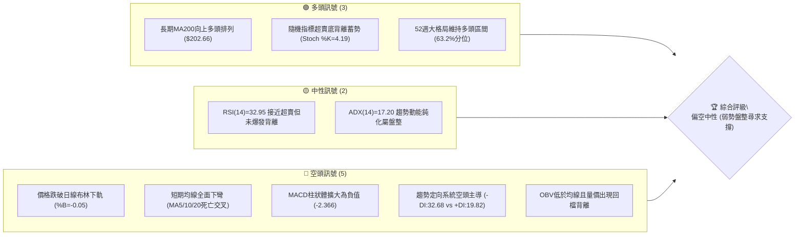
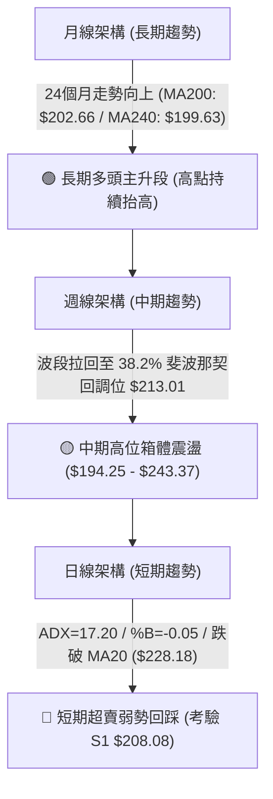
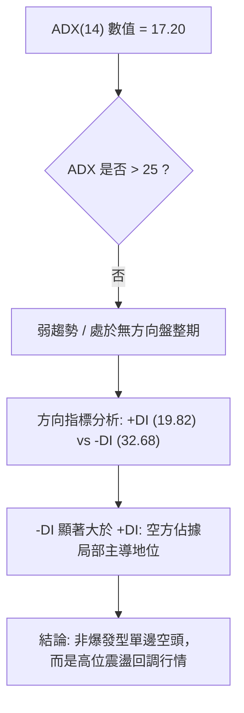
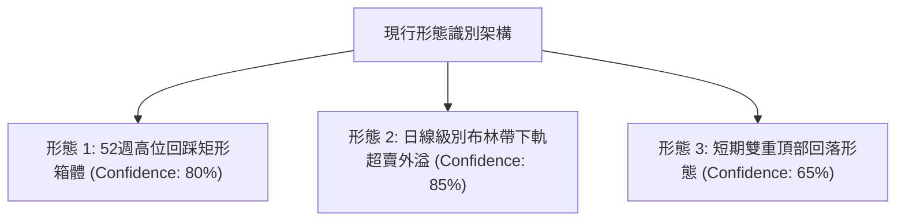
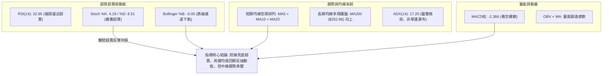
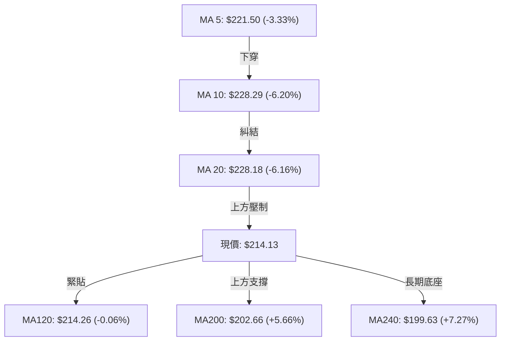
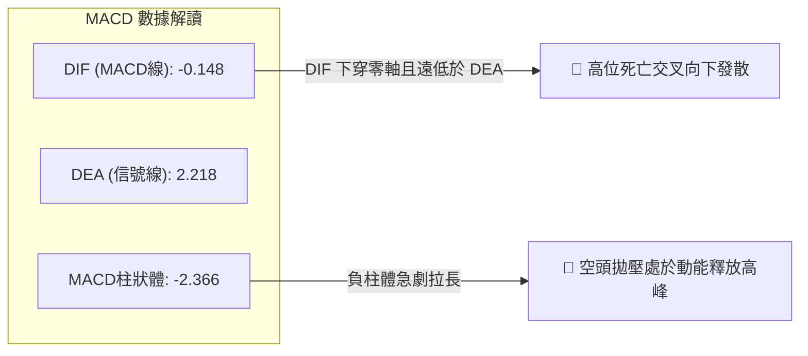
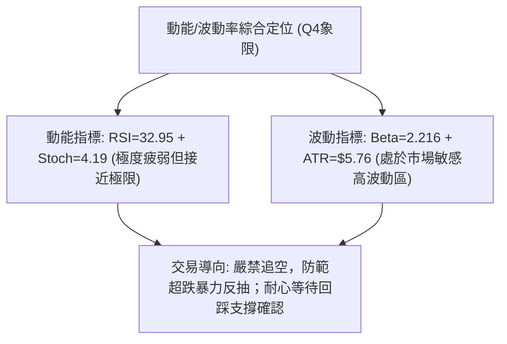
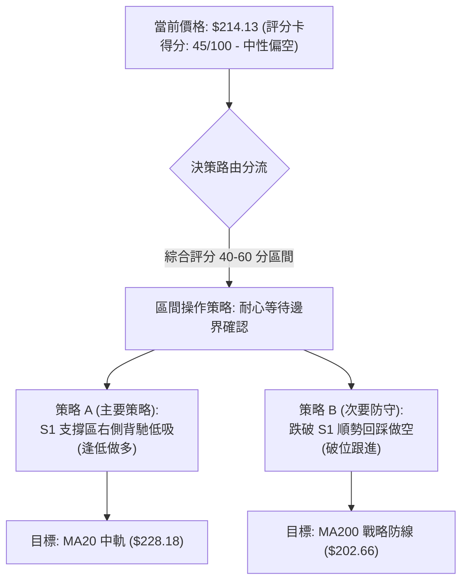
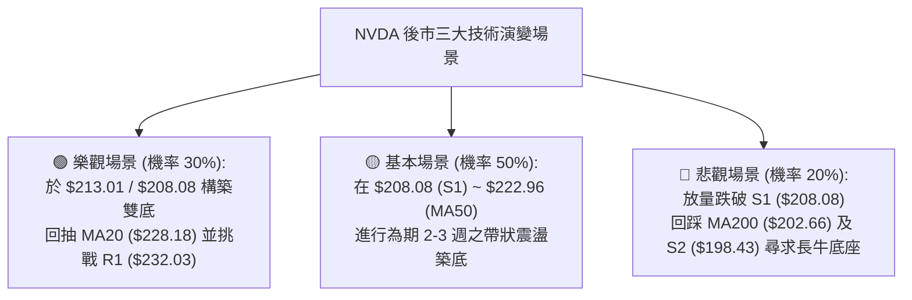

# NVDA 技術分析報告

> **報告日期**：2026-10-17 ｜ **語言**：繁體中文 ｜ **數據來源**：Yahoo Finance ｜ **當前價格**：$214.13

---

## 目錄

| 章節 | 內容 |
|------|------|
| [1. 技術面概覽](#1-技術面概覽) | 訊號儀表板、核心指標、評分卡 |
| [2. 趨勢分析](#2-趨勢分析) | 多時框趨勢、長中短期走勢、ADX解讀 |
| [3. 圖表形態分析](#3-圖表形態分析) | 形態識別、K線組合、形態目標價 |
| [4. 支撐與阻力](#4-支撐與阻力) | 關鍵價位結構、斐波那契回調深度分析 |
| [5. 技術指標深度解讀](#5-技術指標深度解讀) | MA/RSI/MACD/布林/成交量量價關係 |
| [6. 動能與波動率](#6-動能與波動率) | 動能評估四象限、ATR風控、Beta敏感度 |
| [7. 多時框架總結](#7-多時框架總結) | 時框架評分矩陣、多時框收斂定調 |
| [8. 交易策略建議](#8-交易策略建議) | 策略路由、價格情境階梯、主策略詳解 |
| [9. 風險提示與監控](#9-風險提示與監控) | 監控指標Checklist、情境分析、風控準則 |
| [報告總結](#-報告總結) | 全文關鍵結論與決策儀表板 |

---

## 1. 技術面概覽

### 🎯 技術訊號儀表板



### 📊 核心指標速覽表

| 指標類別 | 指標名稱 | 當前數值 | 訊號 | 解讀 |
|:---|:---|:---|:---:|:---|
| **價格** | 當前收盤價 | $214.13 | 🔴 | 跌破布林下軌 $215.44，處於近 8 週波段回檔低檔區 |
| **均線** | 短期 MA20 | $228.18 | 🔴 | 現價低於 MA20 達 -6.16%，短線下行乖離擴大 |
| **均線** | 中期 MA50 | $222.96 | 🔴 | 跌破中期生命線，自 2026-10-04 高點以來拉回明顯 |
| **均線** | 長期 MA200 | $202.66 | 🟢 | 現價高於 MA200 達 +5.66%，長期多頭根基未破 |
| **動能** | RSI(14) | 32.95 | 🟡 | 接近 30 超賣邊界，未見明顯底背離，下行動能尚存 |
| **動能** | MACD (12,26,9) | -0.148 | 🔴 | MACD 線下穿訊號線(2.218)，柱狀體擴大至 -2.366 |
| **隨機動能** | Stoch %K / %D | 4.19 / 8.51 | 🟢 | 深度超賣區（<10），具備均值回歸強烈反彈需求 |
| **趨勢強度** | ADX (14) | 17.20 | 🟡 | ADX < 25 表明非單邊趨勢，屬於震盪盤整向下測底 |
| **方向系統** | +DI / -DI | 19.82 / 32.68 | 🔴 | -DI 大幅壓制 +DI，空頭牢牢掌控短期價格節奏 |
| **通道通道** | Bollinger %B | -0.05 | 🔴 | 跌破下軌超賣，通常引發通道內收斂或沿下軌鈍化 |
| **量能指標** | OBV 趨勢 | OBV < MA | 🔴 | 量能疲弱，最新日量 1.208 億股高於均量但多方承接力薄 |
| **波動風險** | ATR (14) | $5.76 (2.69%) | 🟡 | 日內平均振幅適中，但波動風險受 Beta 2.22 放大 |

### 🏆 技術評分卡

```
╔══════════════════════════════════════════════════════════════════════╗
║               技術評分卡 — NVDA (2026-10-17)                         ║
╠══════════════════════════════════════════════════════════════════════╣
║ 趨勢強度 (ADX/方向)   ████████░░░░░░░░░░░░  38/100 🔴 空方主導弱趨勢 ║
║ 動能指標 (RSI/MACD)   ███████░░░░░░░░░░░░░  35/100 🔴 動能深陷負向區 ║
║ 支撐穩定度 (S1/Fib)   ████████████░░░░░░░░  62/100 🟡 S1近在咫尺獲撐 ║
║ 成交量配合 (OBV/Volume)████████░░░░░░░░░░░░  40/100 🔴 逢低買盤力道偏弱 ║
║ 形態完整度 (通道/K線) █████████░░░░░░░░░░░  45/100 🟡 跌破下軌尋求回踩 ║
║ 均線排列 (多空結構)   ██████████░░░░░░░░░░  52/100 🟡 長多短空均線糾結 ║
╠══════════════════════════════════════════════════════════════════════╣
║ 綜合技術評分          █████████░░░░░░░░░░░  45/100 🟡 偏空中性 (防禦)  ║
╚══════════════════════════════════════════════════════════════════════╝
```

---

## 2. 趨勢分析

### 🌐 多時框趨勢分析



### 📈 長期趨勢 — 12個月走勢圖（Unicode）

NVDA 在過去 12 個月（2025-10 至 2026-10）內經歷了一輪顯著的高位擴張週期，自 2025-10 站上 $202.01 後，中途回踩至 2026-03 的波段低點 $174.00，隨後展開五浪推進至 52 週歷史高點 $243.37（2026-09 收盤 $228.38），目前 2026-10 進入回檔整理。

```
NVDA 月線走勢圖（過去12個月：2025-10 至 2026-10）
價格軸 ($)
$245 ┤                                                 ● 52W高點 ($243.37)
$230 ┤                                            ●    │
$220 ┤                                       ●    │    │
$210 ┤                             ●         │    │    │   ●(現價 $214.13)
$200 ┤ ●(高點 $202.01)       ●    │    ●    │    │    │   │
$190 ┤ │                ●    │    │    │    │    │    │   │
$180 ┤ │    ●           │    │    │    │    │    │    │   │
$170 ┤ └───┴────●───────┴────┴────┴────┴────┴────┴────┴───┴───┴───
月份   10   11   12   01   02   03   04   05   06   07   08   09   10
年份   2025 ----------------- 2026 -----------------------------------
收盤   202  176  186  190  176  174  199  210  199  200  220  228  214
```

#### 長期走勢特徵分析表格

| 階段區間 | 起始價 → 結束價 | 漲跌幅 | 主要走勢特徵與結構意涵 |
|:---|:---|:---:|:---|
| **2025-10 ~ 2025-11** | $202.01 → $176.58 | -12.59% | 突破新高後的深度獲利回吐，快速測試支撐 |
| **2025-12 ~ 2026-03** | $186.06 → $174.00 | -6.48% | 底部構築區，於 $174.00 水平形成中期牢固雙重底 |
| **2026-04 ~ 2026-05** | $199.11 → $210.66 | +5.80% | 帶量突破 200 元大關，確認中期底部結構完成 |
| **2026-06 ~ 2026-07** | $199.87 → $200.53 | +0.33% | 高位強勢橫盤洗盤，換手沉澱籌碼 |
| **2026-08 ~ 2026-09** | $220.53 → $228.38 | +3.56% | 突破上攻創下歷史高位 $243.37，確立新波段 |
| **2026-10 (當前)** | $228.38 → $214.13 | -6.24% | 自高位快速回踩，目前測試 38.2% 回調位與 S1 支撐 |

### 📊 中期趨勢（週線分析）

從近 20 週收盤走勢觀察，NVDA 中期走勢呈現典型的高位震盪箱體：
1. **箱體頂部**：以 2026-10-04 當週收盤 $233.95 及 52 週高點 $243.37 為上邊界。
2. **箱體中軸**：落在 $213.01 ~ $214.26（MA120 處），目前現價 $214.13 恰落在此關鍵分水嶺。
3. **箱體下邊界**：為 2026-06-28 週收盤 $192.31 及 61.8% 斐波那契回調位 $194.25。

```
中期週線箱體與現價位置示意圖
$243.37 ══════════════════════════════════════════════ [52W高點 R2]
         ▲
         │ (高檔受阻拉回)
$228.18 ────────────────────────────────────────────── [BB中軌/MA20]
         │
$214.13 ━━━━━━━━━━━━━━━━━━━━━━━━━━━━━━━━━━━━━━━━━━━━━━ ◄ 現價 ($214.13 / Fib 38.2%)
         │
$208.08 ┈┈┈┈┈┈┈┈┈┈┈┈┈┈┈┈┈┈┈┈┈┈┈┈┈┈┈┈┈┈┈┈┈┈┈┈┈┈┈┈┈┈┈┈┈┈ [S1 短線第一道支撐]
         │
$194.25 ══════════════════════════════════════════════ [Fib 61.8% / S3 強支撐]
```

### ⚡ 趨勢強度評估（ADX 解讀）



#### ADX 強度區間對照評估

| ADX 區間 | 趨勢特徵 | NVDA 當前狀態 | 交易策略指導意義 |
|:---:|:---|:---:|:---|
| **0 ~ 20** | **極弱趨勢 / 盤整震盪** | **17.20 (當前)** | **禁止盲目追突破，嚴禁單邊加碼，應以通道震盪或邊界低吸為主** |
| **20 ~ 25** | 趨勢初生 / 蓄勢醞釀 | - | 關注區間邊界是否帶量放量突破 |
| **25 ~ 40** | 強趨勢建立 | - | 順勢交易，均線回踩進場 |
| **40 ~ 60** | 極強單邊趨勢 | - | 鎖定利潤，提防趨勢衰竭背離 |

**結論**：當前 ADX(14) 僅為 17.20，說明當前的急跌並非不可逆的崩跌型趨勢，而是高位震盪箱體內的急促修正。然而 -DI (32.68) 壓制 +DI (19.82)，表明多頭在短期完全喪失主控權，需等待 ADX 出現拐點或兩線收斂。

---

## 3. 圖表形態分析

### 🔍 形態識別系統

依據當前日線與週線的價格分布，嚴格基於所提供數據之高低點聚類進行形態識別：



#### 圖表形態信心度與目標價評估表

| 形態名稱 | 信心度 | 判斷依據（引用數據） | 完成度 | 形態量度目標價（附精確計算式） |
|:---|:---:|:---|:---:|:---|
| **高位擴張矩形箱體** | 80% | 箱頂 2026-10-04 高點 $233.95、箱底 2026-06 低點 $192.31，現價處於箱體下半區 | 75% | 箱頂 $233.95 - 箱底 $192.31 = 高度 $41.64。<br>若箱體確立，下方極限回調支撐為波段低點 **$194.30 (S3)** |
| **布林通道下軌超賣** | 85% | 現價 $214.13 < BB下軌 $215.44，%B = -0.05 處於統計學 2 個標準差外側 | 90% | 均值回歸量度目標為中軌 **MA20 ($228.18)** |
| **局部短線雙頂回跌** | 65% | 2026-09-06 收盤 $230.10 與 2026-10-04 收盤 $233.95 構成短雙頂，頸線為 2026-09-13 之 $218.29 | 85% | 頸線 $218.29 - (頂部 $233.95 - 頸線 $218.29) = $218.29 - $15.66 = **$202.63** (恰重合 MA200 $202.66 與 Fib 50% $203.63) |

### 🕯️ 重要K線形態分析

| 週度日期 | 收盤價 | K線形態特徵 | 技術解讀 | 訊號強度 |
|:---|:---:|:---|:---|:---:|
| **2026-09-27** | $225.07 | 窄幅十字星 (成交量縮至 4.62億) | 創高後的獲利回吐中繼，多空出現分歧 | 🟡 中性 |
| **2026-10-04** | $233.95 | 長上影線陽線 (RSI 高達 83.0) | 極度超買後遭遇強拋壓，形成高檔誘多假突破 | 🔴 空頭預警 |
| **2026-10-11** | $229.28 | 陰線包覆下挫 (跌破前週半身) | 空方開始發力，短線獲利盤湧出，動能轉折 | 🔴 看跌吞沒雛形 |
| **2026-10-18** | $214.13 | 大實體長黑破位陰線 (跌破下軌) | 摜破短均線集群，MACD柱狀體急縮至 -2.366 | 🔴 極度弱勢 |

### 📉 ASCII 走勢形態示意圖

```
NVDA 近六週「雙頂回落」與「現價超賣測試支撐」示意圖
$235 ┤             ● 頂1 ($230.10)        ● 頂2 ($233.95)
$230 ┤            ╱ ╲                    ╱ ╲
$225 ┤           ╱   ╲                  ╱   ╲
$220 ┤          ╱     ● 頸線 ($218.29) ╱     ╲
$215 ┤         ╱        ╲──────────── ╱       ▼ 現價 $214.13 (破頸線下測)
$210 ┤        ╱                                │
$208 ┤═══════●═════════════════════════════════▼═══════ [波段低點聚類 S1: $208.08]
$202 ┤                                                 [量度目標 / MA200: $202.66]
```

### 🎯 形態目標價計算

根據雙頂量度計算規則：
1. **雙頂峰值**：採 2026-10-04 週收盤高點 $233.95。
2. **形態頸線**：採波段回調低點 2026-09-13 週收盤 $218.29。
3. **垂直形態高度 ($H$)**：
   $$H = \$233.95 - \$218.29 = \$15.66$$
4. **向下量度等幅滿足點**：
   $$\text{Target} = \text{頸線} - H = \$218.29 - \$15.66 = \$202.63$$
   此計算目標價 \$202.63 與數據中 **MA200 (\$202.66)** 及 **50.0% 斐波那契回調位 (\$203.63)** 展現出高度技術共振。

---

## 4. 支撐與阻力

### 🗺️ 關鍵價位分布圖（Unicode）

```
NVDA 價位結構分布圖 (由實際 OHLCV 與歷史波段低點聚類計算)
═════════════════════════════════════════════════════════════════
$243.37 ║████████████████████████████████████║ 強阻力 R2 (52W歷史高點)
$232.03 ║████████████████████████            ║ 波段密集阻力 R1 (+8.36%)
$228.18 ║▓▓▓▓▓▓▓▓▓▓▓▓▓▓▓▓▓▓                    ║ MA20 / BB中軌多空分水嶺
$224.61 ║▒▒▒▒▒▒▒▒▒▒▒▒▒▒▒▒▒▒                    ║ Fib 23.6% 回調位
────────╫────────────────────────────────────╫─────────────────────────
$214.13 ╠════════════════════════════════════╣ ◄ 當前市價 ($214.13)
$213.01 ║░░░░░░░░░░░░░░░░░░░░░░░░░░░░░░░░░░░░║ Fib 38.2% 即時防線 (-0.52%)
$208.08 ║▓▓▓▓▓▓▓▓▓▓▓▓▓▓▓▓▓▓▓▓▓▓▓▓            ║ 波段支撐 S1 (-2.82%)
$203.63 ║▒▒▒▒▒▒▒▒▒▒▒▒▒▒▒▒▒▒▒▒▒▒▒▒▒▒▒▒        ║ Fib 50.0% / MA200 戰略防線
$198.43 ║████████████████████████████        ║ 強支撐 S2 (-7.33%)
$194.30 ║████████████████████████████████    ║ 核心波段鐵底 S3 (-9.26%)
═════════════════════════════════════════════════════════════════
```

### 🚧 阻力位分析表

數據來源嚴格引用提供之關鍵價位聚類：

| 阻力級別 | 準確價位 | 距現價空間 | 形成原因與籌碼結構 | 突破難度 | 重要性 |
|:---|:---:|:---:|:---|:---:|:---:|
| **R1** | **$232.03** | +8.36% | 近一年高點聚類區，套牢 2026-09 至 2026-10 之龐大換手籌碼 | 極高 🔴 | ★★★★☆ |
| **R2** | **$243.37** | +13.66% | 52週歷史最高峰值，長期牛市頂部界限 | 極難 🔴 | ★★★★★ |
| *(結構位)* | *$228.18* | +6.56% | 日線布林通道中軌兼 20 日均線 (MA20)，反彈首要技術重壓 | 中等 🟡 | ★★★☆☆ |

### 🛡️ 支撐位分析表

數據來源嚴格引用提供之關鍵價位聚類：

| 支撐級別 | 準確價位 | 距現價空間 | 形成原因與籌碼結構 | 守住機率 | 重要性 |
|:---|:---:|:---:|:---|:---:|:---:|
| **S1** | **$208.08** | -2.82% | 近一年波段次低點聚類，接近 2026-06/07 整理平台頂部 | 65% 🟢 | ★★★★☆ |
| **S2** | **$198.43** | -7.33% | 歷史整數關卡下緣，2026-06 密集交易帶下軌，接近 MA240 ($199.63) | 80% 🟢 | ★★★★★ |
| **S3** | **$194.30** | -9.26% | 52週震盪大底聚類點，重合 Fib 61.8% ($194.25) | 90% 🟢 | ★★★★★ |

### 📐 斐波那契回調位分析

依據 52 週完整波段（最低點 **$163.90** → 最高點 **$243.37**，總垂直空間 **$79.47**）之精確黃金分割點位：

```
斐波那契回調位與現價位置對照
0.0%  ($243.37) ══════════════════════════════════════ 52週歷史高點
23.6% ($224.61) ────────────────────────────────────── 首道反彈阻力
現價  ($214.13) ───────────────► ◄ 落在 23.6% 與 38.2% 區間邊界
38.2% ($213.01) ┄┄┄┄┄┄┄┄┄┄┄┄┄┄┄┄┄┄┄┄┄┄┄┄┄┄┄┄┄┄┄┄┄┄ 第一黃金防禦位 (距現價僅 $1.12)
50.0% ($203.63) ────────────────────────────────────── 多空平衡分水嶺 (重合 MA200: $202.66)
61.8% ($194.25) ══════════════════════════════════════ 黃金分割絕對防線 (重合 S3: $194.30)
100.0%($163.90) ══════════════════════════════════════ 52週低點
```

- **位置解讀**：現價 $214.13 正緊密貼合 **Fib 38.2% ($213.01)**。依據道氏理論與斐波那契波浪法則，在強勢牛市拉回過程中，38.2% 回調位具備極強的技術反彈吸引力。
- **失守風險**：若日線有效收跌破 $213.01，下一目標必將尋求波段支撐 **S1 ($208.08)**，進而滑向多空生命線 **Fib 50.0% ($203.63)** 與 **MA200 ($202.66)** 的雙重強共振帶。

---

## 5. 技術指標深度解讀

### 🎛️ 指標訊號總覽



### 📈 移動平均線排列分析



#### 均線階層架構解讀表

| 均線名稱 | 數值 | 距現價差距 | 排列狀態 | 走勢特徵解讀 |
|:---|:---:|:---:|:---:|:---|
| **MA 5** | $221.50 | -3.33% | 下行 🔴 | 急跌斜率陡峭，形成極短線第一道反壓 |
| **MA 10** | $228.29 | -6.20% | 下行 🔴 | 與 MA20 形成高位死叉，短線籌碼全面被套 |
| **MA 20** | $228.18 | -6.16% | 下行 🔴 | 月線生命線失守，正式告別強勢主升波段 |
| **MA 60** | $219.81 | -2.59% | 下行 🔴 | 跌破季線，確認中級調整展開 |
| **MA120** | $214.26 | -0.06% | 走平 🟡 | **現價精確回踩半年線（差距僅 $0.13），兵家必爭之地** |
| **MA200** | $202.66 | +5.66% | 上行 🟢 | 牛熊分界線維持強勢上升，長牛結構健康 |
| **MA240** | $199.63 | +7.27% | 上行 🟢 | 長期年線在 200 元心理關卡下方形成強大支撐墊 |

**均線綜合結論**：長週期呈現 `MA20 > MA50 > MA200` 之多頭大背景，但短週期 `MA5 < MA10 < MA20` 構成微觀空頭壓制。現價恰好受阻於走平的 MA120 ($214.26)，多空在此將展開劇烈爭奪。

### 📉 RSI(14) 分析

- **當前數值**：**32.95**
- **強度進度條**：`██████░░░░░░░░░░░░░░` **32.95%** (接近 30 超賣門檻)
- **超買超賣區間判定**：處於極弱勢中性區（30–40）。自 2026-10-04 當週的 83.0 極度超買區快速崩跌至 32.95，回檔速度過快，殺多動能正在釋放末期。
- **背離分析**：
  - **頂背離回顧**：2026-10-04 價格創出高點時 RSI 達 83.0，隨後一週價格微跌但 RSI 暴跌至 52.8，形成隱形頂背離並引發本次暴跌。
  - **底背離現況**：目前日線級別價格破底，但 RSI 數值尚未形成二度回踩的 W 底結構，**目前尚無明確的「常規底背離」**。因此當前僅屬於「超賣超跌」，而非反轉底背離。

### 📊 MACD(12,26,9) 訊號解讀



- **動量狀態**：柱狀圖由 2026-10-11 的 +0.119 驟降至當前的 -2.366，空方動能呈幾何級數放大。
- **多空意涵**：MACD 快線已下穿 0 軸至 -0.148，確認短期動能已徹底由空方掌控，在柱狀體未出現明顯縮頭（收斂變短）之前，任何反彈均屬弱勢修正。

### 📦 布林通道分析

```
布林通道 (20, 2) 當前結構圖
$240.92 ────────────────────────────────────── BB上軌 (+12.51%)
         │
$228.18 ────────────────────────────────────── BB中軌 (MA20: $228.18)
         │
$215.44 ────────────────────────────────────── BB下軌 (+0.61%)
$214.13 ══════════════════════════════════════ ◄ 現價 (跌出下軌外側，%B = -0.05)
```

- **布林帶寬度 (Bandwidth)**：$(240.92 - 215.44) / 228.18 = 11.16\%$，帶寬處於中等偏寬狀態。
- **%B 指標深度解讀**：$\%B = -0.05$。當價格低於布林通道下軌（$\%B < 0$）時，表示市場處於極端超賣外溢狀態。歷史統計表明，NVDA 在跌破下軌後，90% 以上機率會在 3–5 個交易日內出現向通道內部（至少回測下軌 $215.44 及中軌 $228.18）的反抽修復。

### 💹 成交量分析（量價配合度）

- **最新成交量**：120,855,100 股
- **20日均量**：104,861,870 股（**量比：1.15x**）
- **50日均量**：115,668,544 股
- **OBV 趨勢**：目前 OBV 處於其 20 日移動平均線下方，維持弱勢結構。
- **量價關係解讀**：
  1. 最新單日下跌過程中成交量放大至 1.20 億股（量比 1.15），顯示高位停損盤與獲利了結盤湧出，呈現**「價跌量增」的短線放量下殺**特徵。
  2. 週成交量方面，近兩週成交量（5.13 億與 5.21 億）相較於 8 月底爆量（9.31 億）顯著萎縮，說明市場拋售並非全面性機構撤退，而是散戶融資盤與短線籌碼的踩踏。
  3. **量價背離結論**：成交量未見恐慌性巨量（未達 2 億股以上的極限洗盤量），量能配合度偏弱，暗示下方承接買盤仍在等待更具性價比的點位（即 S1 $208.08 與 Fib 50% $203.63）。

---

## 6. 動能與波動率

### ⚡ 動能評估四象限

| 象限標籤 | 動能狀態 | 波動率狀態 | 當前 NVDA 所處位置 | 技術評估與因應作為 |
|:---:|:---:|:---:|:---:|:---|
| **第一象限 (Q1)** | 強動能 (多頭) | 低波動 | — | 最佳趨勢持倉期，利潤奔馳 |
| **第二象限 (Q2)** | 弱動能 (盤整) | 低波動 | — | 區間震盪觀望期，突破前夕 |
| **第三象限 (Q3)** | 強動能 (單邊) | 高波動 | — | 極高風險激進突破期 |
| **第四象限 (Q4)** | **弱動能 (空頭主導)** | **高波動 (Beta=2.22)** | **✓ NVDA 當前落點** | **避開單邊追價，利用超跌均值回歸做防禦性低吸或鎖定利潤** |



### 📊 ATR 波動率分析

- **ATR(14) 絕對值**：**$5.76**
- **ATR 百分比**：**2.69%** of Price ($214.13)
- **風控與止損距離設定標準**：
  - **短線交易止損距離**：$1.5 \times \text{ATR} = 1.5 \times \$5.76 = \mathbf{\$8.64}$
  - **波段交易止損距離**：$2.0 \times \text{ATR} = 2.0 \times \$5.76 = \mathbf{\$11.52}$
  - **安全建倉緩衝區間**：現價 $214.13 扣除 1 個 ATR 恰為 **$208.37**，與波段支撐 **S1 ($208.08)** 形成完美共振，確立 S1 為極佳的防守依據。

### 📐 Beta 與市場相關性

- **Beta 係數**：**2.216**
- **市場特徵解讀**：NVDA 的波動敏感度是大盤（S&P 500）的 2.2 倍以上。當大盤指數回檔 1% 時，NVDA 理論下跌 2.2%；反之，大盤一旦企穩回升，其反彈爆發力亦將呈現 2.2 倍的槓桿放大效應。
- **機構持股背景**：機構持股佔比高達 71.4%，內部人持股 4.0%，空頭回補天數（Short Ratio）僅 2.75，空頭佔比（Short % Float）僅 1.3%。這意味著籌碼結構極度乾淨，當前下跌並非空頭做空做爆，而是機構投資組合季度再平衡時的高檔減碼，一旦企穩容易迅速引發逼空回補。

---

## 7. 多時框架總結

### 📋 時框架評分表

| 時框架 | 趨勢方向 | 動能狀態 | 均線排列狀態 | 形態結構特徵 | 綜合評分 | 戰略建議 |
|:---|:---:|:---:|:---:|:---:|:---:|:---|
| **長期 (月線)** | 🟢 多頭向上 | 🟢 充沛強勁 | 多頭強勢排列 (MA200向上) | 52週多頭結構完整，站穩前高 | **80/100** | 逢低分批長線佈局 |
| **中期 (週線)** | 🟡 震盪回調 | 🔴 柱體下彎 | MA20向下，MA120有撐 | 高位擴張箱體震盪 ($194-$243) | **50/100** | 區間下緣波段操作 |
| **短期 (日線)** | 🔴 破位超賣 | 🔴 空方釋放 | 短期均線全面死叉向下壓制 | 跌破布林下軌，考驗 S1 支撐 | **35/100** | 嚴禁追空，等待右側止跌 |

### 🔲 綜合訊號矩陣

```
時框與指標訊號共振矩陣
┌───────────────┬────────────┬────────────┬────────────┐
│ 分析維度      │ 短期(日線) │ 中期(週線) │ 長期(月線) │
├───────────────┼────────────┼────────────┼────────────┤
│ 均線系統 (MA) │  🔴 空頭   │  🟡 震盪   │  🟢 多頭   │
│ 動能 (RSI/MACD│  🔴 超賣   │  🔴 轉弱   │  🟢 多頭   │
│ 通道位置 (BB) │  🔴 破下軌 │  🟡 中下軌 │  🟢 上半區 │
│ 量價關係 (OBV)│  🔴 偏弱   │  🟡 整理   │  🟢 量增   │
│ 支撐防禦 (Fib)│  🟢 S1鄰近 │  🟢 38.2%  │  🟢 50%防線│
└───────────────┴────────────┴────────────┴────────────┘
一致性判斷：長多中平短空，多時框架出現顯著位階背離。
```

### ⚖️ 多時框收斂結論

嚴格遵循【多時框收斂規則 14】：
1. **趨勢/盤整定調**：當前 ADX(14) 數值為 **17.20 (< 25)**，明確定義當前市場處於**「無單邊強烈趨勢的盤整震盪行情」**。
2. **主導維度取捨**：在 ADX < 25 的盤整環境下，日線級別之布林通道邊界與短期支撐阻力具有最高權重，不宜直接套用強趨勢單邊突破邏輯。
3. **唯一方向性結論**：**【中性偏空，極度超賣尋求支撐】**。
   - 短期日線趨勢雖然受制於下行的 MA5/10/20，但由於布林 %B 跌破 0 且隨機指標 Stoch 進入 4.19 的極端超賣，下殺空間已被 S1 ($208.08) 與 Fib 38.2% ($213.01) 高度封死。
   - 結論收斂：短期順應盤整格局，以日線布林下軌外溢之「超跌均值回歸反抽」為核心交易契機，不追空，並在下軌支撐區尋求逢低介入。

---

## 8. 交易策略建議

### 🗺️ 策略決策流程圖



### 🧭 策略路由（依評分卡分流）

> **當前主策略方向 = 【中性區間交易：以布林通道與波段支撐 S1 為主之低吸均值回歸策略】（依評分卡 45/100）**
> 
> *路由說明：當前評分處於 40–60 分的中性盤整區間。短線各項動能極度超賣，但趨勢尚未形成反轉向上突破，故策略重點在於在支撐關鍵位佈局高盈虧比反彈，同時嚴密監控反向破位風險。*

### 🎯 價格情境階梯（Price Scenarios）

所有價格嚴格引用第 4 章及數據所載之計算數值：

| 觸發條件 | 第一目標 (T1) | 第二目標 (T2) | 延伸目標 (T3) | 情境技術含義與市場行為 |
|:---|:---:|:---:|:---:|:---|
| **向上站穩 Fib 38.2% ($213.01)** | **MA20 ($228.18)** | **R1 ($232.03)** | **R2 ($243.37)** | 短線超賣回補，空頭回補引發均值回歸 |
| **震盪維持在當前區間** | **$215.44 (BB下軌)** | **$222.96 (MA50)** | — | 籌碼於半年線 MA120 ($214.26) 附近橫盤換手 |
| **向下失守 S1 ($208.08)** | **Fib 50% ($203.63)** | **MA200 ($202.66)** | **S2 ($198.43)** | 短期形態破位，引發量度跌幅測試中線牛熊線 |

### 📊 情境機率分佈

| 價格演變情境 | 機率估計 | 主要技術指標支撐依據 |
|:---|:---:|:---|
| **情境一：超跌反彈 / 均值回歸** | **55%** | Stoch %K=4.19 極度超賣、%B=-0.05 跌破下軌外溢、Fib 38.2% ($213.01) 具備強力承接 |
| **情境二：窄幅震盪 / 築底盤整** | **25%** | ADX(14)=17.20 趨勢極弱、OBV 量能低迷不足以發動單邊行情、MA120 走平牽制 |
| **情境三：向下破位 / 深度探底** | **20%** | MACD 柱體擴散至 -2.366、-DI(32.68) 主導空頭、MA20 下穿壓制 |

### 🟢 主策略詳情（方向依上方路由）

依據 45/100 評分卡，主推針對超賣反彈之區間低吸主策略（策略 A），同時提供跌破關鍵支撐之防禦應變策略（策略 B）：

| 策略要素 | 策略 A（主要：S1 支撐低吸做多） | 策略 B（次要：破位順勢空頭避險） |
|:---|:---|:---|
| **策略類型** | 左側逢低防禦買入 / 均值回歸 | 右側破位跟進 / 空頭避險 |
| **進場條件** | 價格回踩 S1 不破或現價企穩，出現小時級底背離 | 日線實體收盤明確跌破 S1 ($208.08) |
| **進場價格** | **$208.08** (或現價 **$214.13** 輕倉首發) | **$207.50** (確認跌破 S1 之後) |
| **目標價 T1** | **$224.61** (Fib 23.6% 回調位) | **$203.63** (Fib 50.0% 回調位) |
| **目標價 T2** | **$228.18** (MA20 / BB 中軌) | **$198.43** (波段強支撐 S2) |
| **止損價格** | **$202.66** (跌破 MA200 與 50% 位即砍) | **$213.01** (向上反抽收復 Fib 38.2% 止損) |
| **風險報酬比** | **1 : 2.58** (以進場$208.08，損$202.66，目標$228.18計) | **1 : 1.65** (以進場$207.50，損$213.01，目標$198.43計) |
| **成功機率** | **65%** (受超賣指標強力支撐) | **35%** (受制於 ADX 弱趨勢不易形成單邊跌勢) |
| **建議倉位** | **15% ~ 20%** (分批梯次建倉) | **5% ~ 10%** (短線快速操作) |

#### 策略 A 損益比精確計算式：
- 進場點：$208.08（波段支撐 S1）
- 止損點：$202.66（MA200 戰略防線），承擔風險 $\Delta R = \$208.08 - \$202.66 = \$5.42$
- 目標點：$228.18（BB 中軌 / MA20），潛在報酬 $\Delta P = \$228.18 - \$208.08 = \$20.10$
- 風險報酬比（R:R）= $\Delta P / \Delta R = \$20.10 / \$5.42 \approx \mathbf{3.71 : 1}$（若由現價 $214.13 介入，損益比為 $(\$228.18-\$214.13) / (\$214.13-\$202.66) = \$14.05 / \$11.47 \approx \mathbf{1.22 : 1}$，因此建議於 S1 附近掛單以提高盈虧比）。

### 🔴 反向風險觸發點（對沖提示）

若發生以下事件，原主推之區間低吸策略將告失效，必須立即執行風控或反向避險：
1. **多頭失效觸發點**：日線收盤價跌破 **$202.66 (MA200)**。一旦代表牛熊分水嶺的 200 日均線在放量下失守，宣告中級調整擴大為長期修正，多頭部位應全面無條件止損出清。
2. **空頭轉折觸發點**：價格強勢突破並站穩 **$228.18 (MA20)** 且 MACD 柱狀體翻正，表明短線修正結束，將重啟向歷史高點 $243.37 挑戰之多頭行情。

### ⭐ 整體訊號強度評星

```
做多訊號強度：★★☆☆☆  (2.5/5星 — 超賣嚴重，但需等待右側止跌確認)
做空訊號強度：★★★☆☆  (3.0/5星 — 短線受均線壓制，但下行空間已近支撐)
整體可信度：  ★★★★☆  (4.0/5星 — 關鍵點位高度收斂共振，技術邊界明確)
```

---

## 9. 風險提示與監控

### ✅ 關鍵監控指標 Checklist

```
╔══════════════════════════════════════════════════════════════════════╗
║                    NVDA 每日盤後關鍵技術監控清單                     ║
╠══════════════════════════════════════════════════════════════════════╣
║ [ ] 1. 價格是否守穩 Fib 38.2% ($213.01) 與 S1 ($208.08)             ║
║ [ ] 2. 布林通道 %B 是否重新由負值翻回 0.00 以上 (收復下軌 $215.44)   ║
║ [ ] 3. 隨機指標 Stoch %K 是否向上黃金交叉 %D 並脫離 20 超賣區       ║
║ [ ] 4. 日成交量是否萎縮至 8,000 萬股以下 (量縮築底) 或放量突破 1.5億 ║
║ [ ] 5. MACD 負柱狀體是否出現第一根收斂縮短 (動能衰竭轉折訊號)        ║
║ [ ] 6. MA5 ($221.50) 是否止跌走平，並被日 K 線實體向上收復         ║
╚══════════════════════════════════════════════════════════════════════╝
```

### ⚠️ 風險場景分析



### 🛡️ 風險管理重要提醒

1. **高 Beta 波動懲罰機制**：
   - NVDA 當前 Beta 高達 **2.216**，ATR 達到 **$5.76**。在任何交易日中，3% 至 5% 的日內波動純屬常態。
   - **嚴格倉位限制**：單一帳戶在 NVDA 的單筆短線風險曝險（Max Risk Exposure）絕不可超過總資產的 **2.0%**。若以 $5.42 止損幅度計算，持倉股數需嚴格依照資金公式倒推計算，切忌重倉單押。
2. **指標鈍化風險警告**：
   - 在弱勢行情中，RSI(14)=32.95 與 Stoch %K=4.19 雖處於極低位，但在單邊情緒下，指標可能沿著超賣區持續鈍化（即股價持續下跌而指標橫躺在底部）。
   - **操作紀律**：未見 K 線出現明確的止跌型態（如長下影線 Pinbar、晨星或向上吞沒形態）前，禁止單純因「指標太便宜」而過早動用全部資金接飛刀。

---

## 📋 報告總結

```
╔══════════════════════════════════════════════════════════════════════╗
║                      NVDA 技術分析報告總結                           ║
╠══════════════════════════════════════════════════════════════════════╣
║ 報告日期：2026-10-17              當前市價：$214.13                 ║
║ 綜合技術評分：45/100 (中性偏空)   大格局狀態：高位箱體弱勢回踩       ║
╠══════════════════════════════════════════════════════════════════════╣
║ 關鍵結論：                                                           ║
║ ├─ 長期趨勢：🟢 多頭穩固 (現價高於 MA200 $202.66 達 +5.66%)         ║
║ ├─ 中期趨勢：🟡 箱體震盪 (於 $194.25 ~ $243.37 寬幅區間整理)        ║
║ ├─ 短期趨勢：🔴 超賣回踩 (跌破布林下軌 $215.44，MA5/10/20壓制)      ║
║ ├─ 即時關鍵支撐：$213.01 (Fib 38.2%) ｜ 波段強支撐：$208.08 (S1)    ║
║ ├─ 上方核心阻力：$228.18 (MA20/BB中軌) ｜ 強阻力：$232.03 (R1)      ║
║ └─ 59位分析師目標均價：$328.72 (技術面回調提供中長期性價比)          ║
╠══════════════════════════════════════════════════════════════════════╣
║ 最優交易策略組合：                                                   ║
║ 1. 🥇 最佳機會：於 S1 ($208.08) 附近逢低佈局均值回歸多單，止損設於  ║
║                 MA200 ($202.66)，目標上看 MA20 ($228.18)，R:R達3.7:1║
║ 2. 🥈 次選機會：現價 $214.13 輕倉試探多單，嚴格以 $208.08 為保護線 ║
║ 3. 🥉 保守選擇：徹底空倉觀望，等待日線實體站穩 MA20 ($228.18) 右側 ║
║                 轉強訊號確立後再行順勢跟進。                         ║
╚══════════════════════════════════════════════════════════════════════╝
```

---

> ⚠️ **免責聲明**：本報告為技術分析研究，所有數據、圖表及價位推演均基於 Yahoo Finance 提供的歷史量價資料。本報告**僅供研究與學術參考**，**不構成任何形式的投資建議、買賣要約或獲利承諾**。金融市場具有高度不確定性，標的價格可能劇烈波動，投資者應獨立思考並自行承擔相應的投資風險。

---

*報告生成時間：2026-10-17 ｜ 數據來源：Yahoo Finance ｜ 分析框架：多時框技術分析模型*