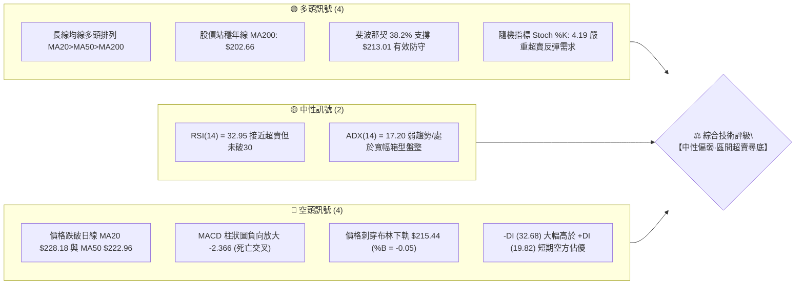
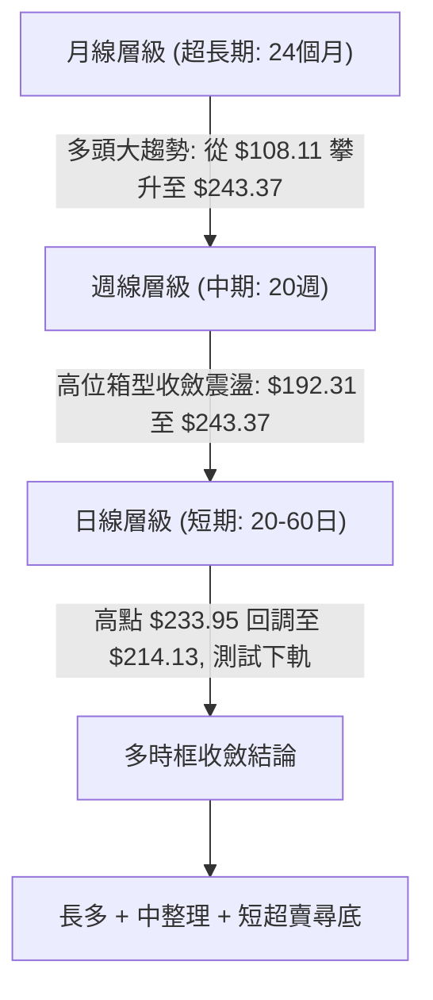
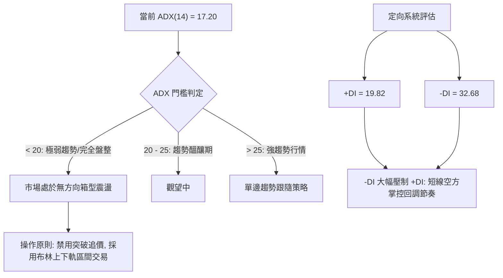
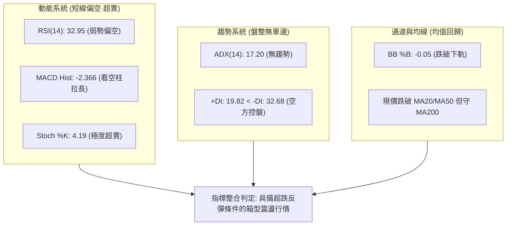
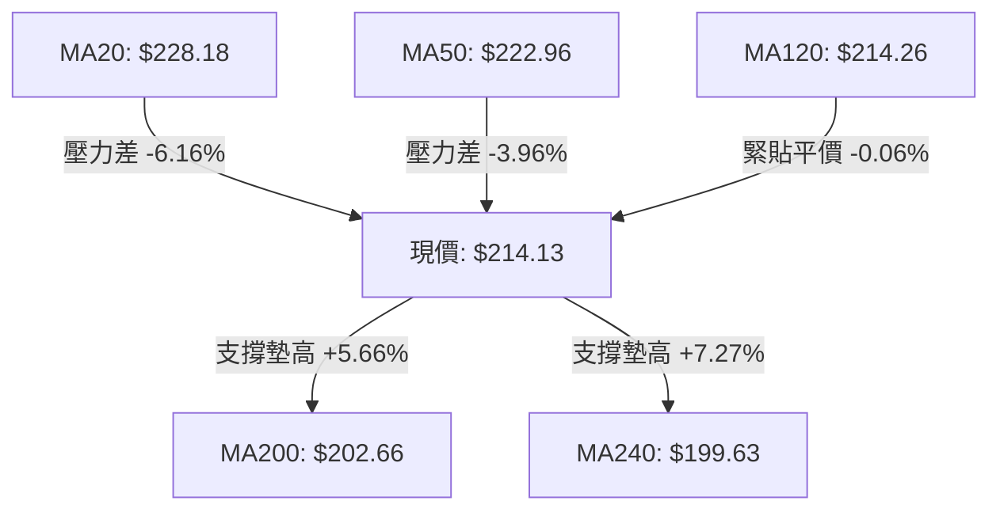
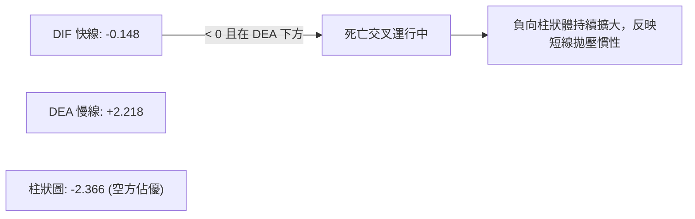
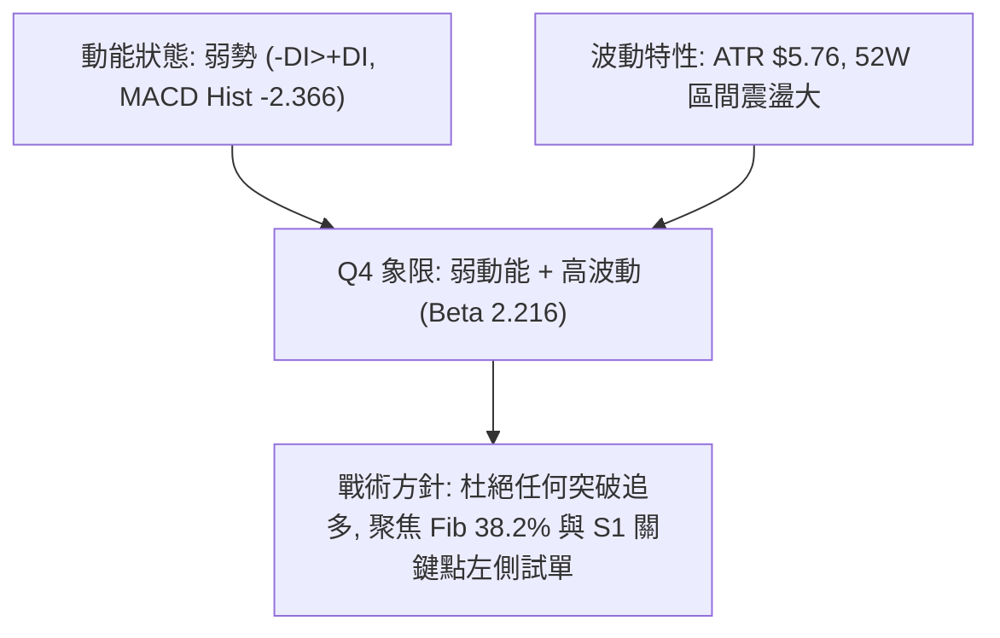
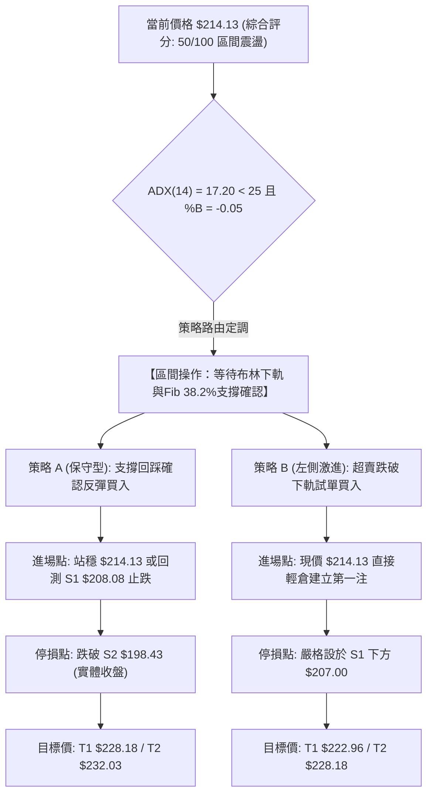
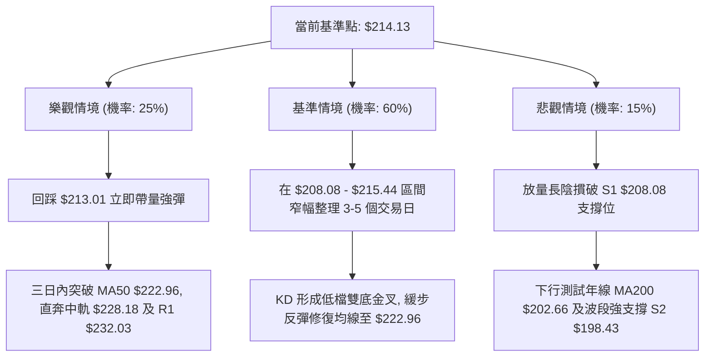

# NVDA 技術分析報告

> **報告日期**：2026-10-18 ｜ **語言**：繁體中文 ｜ **數據來源**：Yahoo Finance ｜ **當前價格**：$214.13

---

## 目錄

| 章節 | 內容 |
|------|------|
| [1. 技術面概覽](#1-技術面概覽) | 訊號儀表板、核心指標、評分卡 |
| [2. 趨勢分析](#2-趨勢分析) | 多時框趨勢、長中短期走勢、ADX強度 |
| [3. 圖表形態分析](#3-圖表形態分析) | 形態識別、K線組合、目標價推算 |
| [4. 支撐與阻力](#4-支撐與阻力) | 關鍵價位聚類、斐波那契回調結構 |
| [5. 技術指標深度解讀](#5-技術指標深度解讀) | 均線系統、RSI、MACD、布林通道、OBV |
| [6. 動能與波動率](#6-動能與波動率) | 動能象限、ATR波動分析、Beta風險 |
| [7. 多時框架總結](#7-多時框架總結) | 時框架評分矩陣、多時框收斂定調 |
| [8. 交易策略建議](#8-交易策略建議) | 策略路由、區間操作佈局、風報比精算 |
| [9. 風險提示與監控](#9-風險提示與監控) | 監控指標Checklist、情境演變路徑 |
| [10. 報告總結](#10-報告總結) | 核心結論與最佳策略組合 |

---

## 1. 技術面概覽

### 🎯 技術訊號儀表板



### 📊 核心指標速覽表

| 指標類別 | 指標名稱 | 當前數值 | 訊號 | 解讀 |
|:---|:---|:---|:---:|:---|
| **價格** | 當前收盤價 | $214.13 | 🟡 | 位於52週區間 ($163.90–$243.37) 的 63.2% 分位，短期自高點回調 |
| **均線** | 短期 MA20 | $228.18 | 🔴 | 現價位於 MA20 下方 -6.16%，短線空頭排列形成阻力 |
| **均線** | 中期 MA50 | $222.96 | 🔴 | 現價位於 MA50 下方 -3.96%，短中期轉為整理回調格局 |
| **均線** | 長期 MA200 | $202.66 | 🟢 | 現價高於 MA200 達 +5.66%，長期多頭牛市生命線未遭破壞 |
| **動能** | RSI (14) | 32.95 | 🟡 | 位於弱勢區間 (30–40)，逼近超賣臨界點，尚未形成底背離 |
| **動能** | MACD 柱狀圖 | -2.366 | 🔴 | DIF (-0.148) 位於 Signal (2.218) 下方，綠柱持續拉長，空方動能釋放中 |
| **動能** | KD (%K / %D) | 4.19 / 8.51 | 🟢 | 進入極度超賣區間（<10），具備強烈的技術性超跌反彈動能 |
| **趨勢** | ADX (14) | 17.20 | 🟡 | ADX < 25 表示無明顯單邊趨勢，行情定調為寬幅震盪盤整 |
| **通道** | 布林通道 %B | -0.05 | 🟢 | 跌破下軌 ($215.44) 產生通道擴張超跌，易引發向中軌 ($228.18) 的均值回歸 |
| **量能** | 量比 / OBV | 1.15x / 弱 | 🔴 | 單日成交量 1.208 億股略放量下跌，OBV < MA 顯示主力買盤尚未大規模回流 |
| **波動** | ATR (14) | $5.76 | 🟡 | 日內平均波動率 2.69%，波動維持常態，下檔風險相對可控 |

### 🏆 技術評分卡

```
╔══════════════════════════════════════════════════════════════════╗
║                技術評分卡 — NVDA (2026-10-18)                    ║
╠══════════════════════════════════════════════════════════════════╣
║ 趨勢強度 (ADX/趨勢方向)  ████████░░░░░░░░░░░░  40/100  🟡 盤整無主升 ║
║ 動能指標 (RSI/MACD/KD)  ████████░░░░░░░░░░░░  42/100  🔴 動能處弱勢 ║
║ 支撐穩定度 (Fib/支撐位)  ██████████████░░░░░░  70/100  🟢 38.2%關鍵守 ║
║ 成交量配合 (量比/OBV)    ████████░░░░░░░░░░░░  40/100  🔴 量價背離弱 ║
║ 形態結構 (箱型/回調)    ██████████░░░░░░░░░░  50/100  🟡 箱型下緣處 ║
║ 長期均線排列 (MA結構)   ████████████░░░░░░░░  60/100  🟢 仍處多頭頂 ║
╠══════════════════════════════════════════════════════════════════╣
║ 綜合技術評分             ██████████░░░░░░░░░░  50/100  ⚖️ 區間震盪   ║
╚══════════════════════════════════════════════════════════════════╝
```

---

## 2. 趨勢分析

### 🌐 多時框趨勢分析



### 📈 長期趨勢 — 12個月走勢圖（Unicode）

NVDA 在過去 12 個月內自 2025 年末的 $176.58 一路沿上升通道走高，並於 2026 年 9 月創下歷史收盤高點 $228.38，最高觸及 52 週最高價 $243.37。目前價格在 $214.13 進行漲幅消化。

```
NVDA 月線走勢圖（過去12個月：2025-11 至 2026-10）
價格軸 ($)
$245 ┤                                                        ● (52W高點 $243.37)
$230 ┤                                                  ●228.38
$220 ┤                                            ●220.53
$215 ┤                                                  ▲現價 $214.13
$210 ┤                                  ●210.66
$200 ┤        ●202.01             ●199.11   ●199.87 ●200.53
$190 ┤                  ●190.68
$185 ┤             ●186.06
$175 ┤  ●176.58             ●176.78 ●174.00 (波段起漲點)
     └────┬──────┬──────┬──────┬──────┬──────┬──────┬──────┬──────┬──────┬──────┬─────
        25-11  25-12  26-01  26-02  26-03  26-04  26-05  26-06  26-07  26-08  26-09  26-10
```

#### 走勢特徵分析表格

| 階段區間 | 時間週期 | 起始/結束價 | 區間漲跌幅 | 形態特徵與量能解析 |
|:---|:---:|:---:|:---:|:---|
| **階段一：築底回升** | 2025-11 ~ 2026-03 | $176.58 → $174.00 | -1.46% | 於 $174.00–$190.68 建立寬幅底部支撐，清洗浮額 |
| **階段二：主升突破** | 2026-03 ~ 2026-05 | $174.00 → $210.66 | +21.07% | 強勢突破 $200 整數關卡，均線呈現發散排列 |
| **階段三：高位換手** | 2026-05 ~ 2026-07 | $210.66 → $200.53 | -4.81% | 在 $200 心理關卡上方高位橫盤整理，多空拉鋸 |
| **階段四：推升破頂** | 2026-07 ~ 2026-09 | $200.53 → $228.38 | +13.89% | 沿 MA20 加速上攻，盤中最高達 52W 高點 $243.37 |
| **階段五：獲利回吐** | 2026-09 ~ 2026-10 | $228.38 → $214.13 | -6.24% | 遭遇獲利了結賣壓，回踩測試斐波那契 38.2% 回調位 |

### 📊 中期趨勢（週線分析）

從近 20 週的收盤價演進可見，NVDA 的波段結構具有明顯的「階梯式墊高」特徵：
- **前期支撐底**：2026-06-28 收盤 $192.31，隨後迅速拉起，確立 $194.30–$198.43 為堅固支撐帶。
- **波段高點壓制**：2026-10-04 週收盤達 $233.95，RSI 飆升至 83.0（嚴重超買），隨即引發近兩週的回調，分別收在 $229.28 與最新週 $214.13。
- **週線 MACD 變化**：週線 MACD 柱狀圖由正值 (+0.822、+0.119) 急轉為負值 (-2.366)，顯示中期上漲動能被中斷，進入回調週期。

```
中期關鍵價位防線示意圖
$243.37 ══════════════════════════════════════════ 52週極限高點 (強阻力 R2)
$232.03 ────────────────────────────────────────── 阻力位 R1 (近期週線密集套牢區)
$214.13 ◄────────────── [ 當前價格 $214.13 ]
$208.08 ------------------------------------------ 近期低點支撐 S1 (第一道防線)
$198.43 ══════════════════════════════════════════ 強支撐 S2 (中期多空分水嶺)
$194.30 ══════════════════════════════════════════ 關鍵支撐 S3 (61.8% 斐波那契重合帶)
```

### ⚡ 趨勢強度評估（ADX 解讀）



#### ADX 趨勢強度指標對照表

| 數值區間 | 趨勢狀態 | NVDA 當前狀態 | 交易戰略意涵 |
|:---:|:---:|:---:|:---|
| **0 – 20** | **極弱趨勢 / 盤整市場** | **✅ 17.20** | **趨勢跟隨策略失效，應以區間震盪操作與支撐低吸為主** |
| 20 – 25 | 趨勢形成過渡期 | ❌ | 密切留意布林通道帶寬收窄後的突破方向 |
| 25 – 40 | 強勁單邊趨勢 | ❌ | 順勢操作，拉回均線加碼（目前不適用） |
| 40 – 60 | 極強單邊動能 | ❌ | 需提防趨勢末端衰竭竭盡（目前不適用） |

---

## 3. 圖表形態分析

### 🔍 形態識別系統

依據近 24 個月的月線數據與近 20 週的收盤價波動，當前 NVDA 的幾何圖形呈現出「高位寬幅震盪箱型」疊加「短期雙頂回調」結構。


#### 形態識別信心度與目標價精算表

| 形態名稱 | 信心度 | 判斷依據（嚴格引用數據） | 完成度 | 形態目標價（附精確計算式） |
|:---|:---:|:---|:---:|:---|
| **高位寬幅震盪箱型** | **75%** | 箱頂為 52W 高點聚類 R2 $243.37，箱底為波段低點聚類 S3 $194.30，中軌為 MA20 $228.18 | **70%** | 箱體下緣支撐目標：**$194.30**<br>（計算式：箱頂 $243.37 壓制，回測箱底低點 $194.30） |
| **短期次級雙重頂** | **65%** | 左頂 2026-08-16 週收盤 $224.91，右頂 2026-10-04 週收盤 $233.95，頸線落在 2026-08-23 收盤 $214.48（與現價重合） | **85%** | 雙頂等距下跌目標：**$195.01**<br>（計算式：頸線 $214.48 - (右頂 $233.95 - 頸線 $214.48) = $195.01，高度接近 S3 $194.30） |
| **布林下軌刺穿超跌** | **85%** | 當前收盤 $214.13 刺穿下軌 $215.44，%B = -0.05，ADX=17.20 盤整狀態下假突破機率極高 | **90%** | 均值回歸中軌目標：**$228.18**<br>（計算式：回歸 BB 中軌 MA20 = $228.18） |

### 🕯️ 重要K線形態分析

| 週期 / 月份 | 收盤價 | K線組合形態 | 技術解讀 | 訊號方向 |
|:---:|:---:|:---|:---|:---:|
| **2026-08** | $220.53 | 長陽帶上影線 | 突破 $210 平台阻力，盤中創波段新高後遇壓，奠定多頭基調 | 🟢 多頭推進 |
| **2026-09** | $228.38 | 高位吊頸線 | 上衝 $243.37 後多方動能收窄，收盤留出高位長上影，顯示獲利回吐壓力聚集 | 🟡 警示滯漲 |
| **2026-10 (至今)** | $214.13 | 實體中陰線回調 | 連續跌破 MA5、MA10、MA20，實體下穿布林中軌直探下軌 | 🔴 空方釋放 |
| **近兩週K線** | $214.13 | 空方吞噬組合 | 2026-10-18 週收盤 $214.13，完全包覆前兩週漲幅，空頭取得短線定價權 | 🔴 空方主導 |

### 📉 ASCII 走勢形態示意圖

```
NVDA 高位震盪箱型與回調示意圖
價格 ($)
$243.37 ┼───────────────────────● 52W 歷史極限高點 (雙頂之右頂)
        │                      / \
$232.03 ┼──────● 阻力 R1      /   \
        │     / \            /     \
$228.18 ┼────/───\──────────/───────\──── [ 布林中軌 / MA20 頸線區 ]
        │   /     \        /         \
$222.96 ┼──/───────\──────/───────────\── [ MA50 防線被向下跌破 ]
        │ /         \    /             \
$214.13 ┼/───────────\──/───────────────▼◄=== 現價 $214.13 (測試布林下軌 $215.44)
        │             \/ (2026-08-23 頸線 $214.48)
$208.08 ┼ - - - - - - - - - - - - - - - -  支撐位 S1 (波段前低)
        │
$198.43 ┼───────────────────────────────── 強支撐 S2 (50% 斐波那契 $203.63 ~ MA200)
        │
$194.30 ┼═════════════════════════════════ 箱底關鍵防線 S3 (61.8% 斐波那契 $194.25)
```

---

## 4. 支撐與阻力

### 🗺️ 關鍵價位分布圖（Unicode）

```
╔══════════════════════════════════════════════════════════════════╗
║               NVDA 關鍵價位空間結構與分布密度圖                  ║
╠══════════════════════════════════════════════════════════════════╣
║ $243.37 ║████████████████████████████████║ 極限強阻力 R2 (52W 高點)║
║ $232.03 ║████████████████████████        ║ 波段強阻力 R1 (套牢聚類)║
║ $228.18 ║████████████                    ║ 動態均線阻力 MA20/BB中軌║
║ $222.96 ║████████                        ║ 短期反彈阻力 MA50       ║
║ $214.13 ╠════════════════════════════════╣ ◄ 現價位置 (38.2% 處)   ║
║ $208.08 ║▓▓▓▓▓▓▓▓▓▓▓▓▓▓▓▓                ║ 第一防守支撐 S1 (近低)  ║
║ $202.66 ║▓▓▓▓▓▓▓▓▓▓▓▓▓▓▓▓▓▓▓▓            ║ 牛市生命線 MA200        ║
║ $198.43 ║▓▓▓▓▓▓▓▓▓▓▓▓▓▓▓▓▓▓▓▓▓▓▓▓        ║ 中期波段強支撐 S2       ║
║ $194.30 ║▓▓▓▓▓▓▓▓▓▓▓▓▓▓▓▓▓▓▓▓▓▓▓▓▓▓▓▓▓▓║ 鐵底防線 S3 (61.8%黃金點)║
╚══════════════════════════════════════════════════════════════════╝
```

### 🚧 阻力位分析表

所有價位均嚴格取自 OHLCV 波段高點與均線系統：

| 阻力級別 | 精確價位 | 距現價幅離 | 形成依據與技術意義 | 突破難度 | 重要性權重 |
|:---:|:---:|:---:|:---|:---:|:---:|
| **R1** | **$232.03** | +8.36% | 近一年波段高點聚類；2026-10-04 當週收盤 $233.95 附近套牢密集成交區 | 🔴 極高 | ★★★★★ |
| **R2** | **$243.37** | +13.66% | 52 週歷史最高價；斐波那契回調 0.0% 基準點；多頭主升浪終極天花板 | 🔴 極難 | ★★★★★ |
| **動態R**| **$228.18** | +6.56% | 日線 MA20 與布林通道中軌重合位，為短線反彈首道重壓 | 🟡 中等 | ★★★★☆ |

### 🛡️ 支撐位分析表

所有價位均嚴格取自 OHLCV 波段低點與均線支撐：

| 支撐級別 | 精確價位 | 距現價幅離 | 形成依據與技術意義 | 守住機率 | 重要性權重 |
|:---:|:---:|:---:|:---|:---:|:---:|
| **S1** | **$208.08** | -2.82% | 近一年波段低點聚類；整數大關前的第一道緩衝區 | 🟢 70% | ★★★★☆ |
| **S2** | **$198.43** | -7.33% | 近一年波段強支撐低點；下方緊鄰 MA200 ($202.66) 與 MA240 ($199.63) | 🟢 85% | ★★★★★ |
| **S3** | **$194.30** | -9.26% | 2026 年中波段低點聚類（2026-07-05 收盤 $194.61 雙底）；61.8% 黃金分割位 | 🟢 95% | ★★★★★ |

### 📐 斐波那契回調位分析

依據 52 週完整波動區間（低點 $163.90 至 高點 $243.37，總垂直落差 $79.47）：

| 斐波那契層級 | 精確點位 | 當前相對位置與技術解讀 |
|:---:|:---:|:---|
| **0.0% (52W High)** | **$243.37** | 歷史極值頂部，多頭竭盡點 |
| **23.6%** | **$224.61** | 前期拉回支撐，跌破後轉為當前強阻力，靠近 MA50 ($222.96) |
| **38.2%** | **$213.01** | **◄ 現價 $214.13 恰好落於此線上方 0.5% 處！**<br>此處為第一級強回調關鍵防線，若日線收盤守穩，多頭將展開技術反彈 |
| **50.0%** | **$203.63** | 多空平衡分水嶺，與年線 MA200 ($202.66) 高度共振，提供強大結構支撐 |
| **61.8%** | **$194.25** | 黃金分割強防線，與歷史低點聚類 S3 ($194.30) 完美重疊，為中期多頭底線 |
| **78.6%** | **$180.90** | 深度回調防禦點，已接近機構法人長期持倉成本線 |
| **100.0% (52W Low)**| **$163.90** | 52 週最低點，牛市極端情境底線 |

---

## 5. 技術指標深度解讀

### 🎛️ 指標訊號總覽



### 📈 移動平均線排列分析



#### 均線多空排列診斷表

| 均線名稱 | 當前價位 | 距現價差距 | 斜率與運行軌跡特徵 | 多空信號評估 |
|:---|:---:|:---:|:---|:---:|
| **MA 5** | $221.50 | -3.33% | 短期快速向下拐頭（走勢特徵：▄▄▅▄▄▂▁▁▁▁） | 🔴 極短線空頭 |
| **MA 10** | $228.29 | -6.20% | 短線下壓加劇，與 MA20 形成死叉 | 🔴 短線空頭阻力 |
| **MA 20** | $228.18 | -6.16% | 自高位見頂拐頭向下，成為反彈第一道天花板 | 🔴 中短線空頭 |
| **MA 60** | $219.81 | -2.59% | 走平微幅向下，反彈至此面臨季線阻力 | 🟡 震盪整理 |
| **MA 120** | $214.26 | -0.06% | **與現價 $214.13 形成零軸重合，為當前半半年生命線** | 🟢 關鍵支撐點 |
| **MA 200** | $202.66 | +5.66% | **長期均線平穩向上上揚，維持標準長期多頭架構** | 🟢 長線強支撐 |
| **MA 240** | $199.63 | +7.27% | 歷史牛熊分界線，向上發散角度健康 | 🟢 極強保護網 |

### 📉 RSI(14) 分析

當前數值：**32.95**
```
RSI(14) 強度儀：
0 ────── 超賣(30) ────────── 中軸(50) ────────── 超買(70) ────── 100
[█████████████░░░░░░░░░░░░░░░░░░░░░░░░░░░] 32.95%
```
- **超買超賣判定**：數值 32.95 位於 30–70 中性偏弱區間，但已高度逼近 30 超賣臨界點。相較於 2026-10-04 當週的高達 83.0（極端過熱），短線指標已經歷充分去泡沫與修正。
- **背離判斷**：
  - **頂背離**：無。先前高點 $243.37 出現時週線 RSI 達 83.0，量價配合見頂，屬於正常動能竭盡。
  - **底背離**：**目前尚無底背離形成**。日線 RSI 與價格同步下挫，屬於常態性單邊下跌探底過程。若後續價格跌破 $208.08 但 RSI 守穩 33 以上，將觸發標準日線底背離買訊。

### 📊 MACD(12/26/9) 訊號解讀


- **當前數值解析**：MACD 線已下穿零軸（-0.148），Signal 線仍處於正值區（2.218），柱狀圖為 -2.366。
- **技術意義**：快線跌破零軸確認了短期波段走勢正式進入「空方主導期」。然而負柱狀體放大速率已開始放緩，一旦柱體收窄，將出現空頭動能衰竭的第一類買點。

### 📦 布林通道分析

```
NVDA 布林通道日線運行狀態 (帶寬收縮後向下擴張)
$240.92 ┬────────────────────────────────────────── BB 上軌
        │
$228.18 ┼ - - - - - - - - - - - - - - - - - - - -  BB 中軌 (MA20)
        │
$215.44 ┴────────────────────────────────────────── BB 下軌
$214.13   ▼ [現價刺穿下軌, %B = -0.05]
```
- **通道指標數值**：上軌 $240.92，中軌 $228.18，下軌 $215.44。
- **%B 指標深度解讀**：%B 為 -0.05，明確顯示價格已滑落至下軌之外。在 ADX 為 17.20（無單邊趨勢）的市場結構中，價格跌穿布林下軌屬於典型的**「超賣假突破（Oversold False Breakdown）」**，統計上具有極高的均值回歸概率，極易在下探後迅速拉回至下軌上方並向中軌 $228.18 靠攏。

### 💹 成交量分析（量價配合度）

- **最新成交量**：120,855,100 股。
- **成交量均線比對**：相較於 20 日均量 (104,861,870 股) 的量比為 **1.15x**，相較於 50 日均量 (115,668,544 股) 略微放量。
- **量價關係解讀**：價格跌破 MA20 過程中伴隨溫和放量（量比 1.15x），顯示有被動止損與去槓桿籌碼釋出，但並未出現恐慌性拋售巨量（如 2026-06 初週成交量曾破 9.5 億股）。
- **OBV 能量潮解讀**：OBV 指標目前處於其移動平均線下方（OBV < MA），證實資金呈現淨流出狀態，量能尚未確認反轉信號，多頭反攻前仍需縮量築底。

---

## 6. 動能與波動率

### ⚡ 動能評估四象限

| 象限 | 動能維度 (RSI / MACD) | 波動維度 (ATR / Beta) | NVDA 當前狀態 | 策略應對指引 |
|:---:|:---:|:---:|:---:|:---|
| **第一象限 (Q1)** | 強動能 (Bullish) | 低波動 (Low Vol) | ❌ | 穩步上行，最舒適順勢加碼區間 |
| **第二象限 (Q2)** | 弱動能 (Bearish) | 低波動 (Low Vol) | ❌ | 橫盤陰跌，需防範波動率放大破位 |
| **第三象限 (Q3)** | 強動能 (Bullish) | 高波動 (High Vol) | ❌ | 主升浪爆發，追漲需設嚴格跟蹤止損 |
| **第四象限 (Q4)** | **弱動能 (Bearish)** | **高波動 (High Vol)** | **✅ 當前定位** | **短期處於空方修正釋放期，Beta 2.22，應採防禦性網格分批低吸** |



### 📊 ATR 波動率分析

- **ATR(14) 絕對值**：**$5.76**
- **ATR 佔比率**：$5.76 / $214.13 = **2.69%**
- **日間交易區間推算**：
  - 當日上行壓力邊界：$214.13 + $5.76 = **$219.89**（恰好與 MA60 $219.81 重疊）
  - 當日下行支撐邊界：$214.13 - $5.76 = **$208.37**（精確契合支撐位 S1 $208.08）
- **止損距離建議**：
  - 短線波段止損：建議採用 **1.5 × ATR** = 1.5 × $5.76 = **$8.64**。以現價進場計，短線止損應設於 $214.13 - $8.64 = $205.49。
  - 中期波段止損：建議採用 **2.0 × ATR** = 2.0 × $5.76 = **$11.52**，下方落點約在 $202.61（精準錨定在 MA200 $202.66 之微幅下方）。

### 📐 Beta 與市場相關性

- **Beta 係數**：**2.216**
- **市場特徵解讀**：NVDA 具備高彈性成長股的典型屬性，波動幅度約為 S&P 500 指數的 2.22 倍。在整體市場情緒低迷或半導體板塊回調時，NVDA 會承擔放大下挫的壓力；然而，一旦市場企穩反彈，其超跌修復彈性亦為科技權值股之冠。

---

## 7. 多時框架總結

### 📋 時框架評分表

| 時框架 | 趨勢方向 | 動能狀態 | 均線排列特徵 | 關鍵形態結構 | 綜合評分 | 操作建議 |
|:---:|:---:|:---:|:---|:---|:---:|:---|
| **長期 (月線)** | 🟢 多頭上行 | 🟢 強勢 | MA200/MA240 向上發散 | 沿 52W 低點 $163.90 建立大底上升通道 | **78/100** | 長線多單堅定續抱，回踩年線皆為買點 |
| **中期 (週線)** | 🟡 高位箱型 | 🔴 衰退 | 跌破 5 週均線，測試 20 週均線 | $194.30 至 $243.37 寬幅高位箱體橫盤 | **48/100** | 區間震盪看待，不可在高位追漲 |
| **短期 (日線)** | 🔴 回調探底 | 🔴 超賣 | 均線短死叉，跌破 MA20/MA50 | 跌破布林下軌，測試 Fib 38.2% $213.01 | **40/100** | 靜待放量止跌K線，尋找超跌反彈買點 |

### 🔲 綜合訊號矩陣

```
╔══════════════════════════════════════════════════════════════════╗
║                    多時框架技術指標訊號矩陣                      ║
╠══════════════════════════════════════════════════════════════════╣
║ 維度 / 週期       日線 (短期)          週線 (中期)       月線 (長期) ║
╠══════════════════════════════════════════════════════════════════╣
║ 趨勢方向判定      🔴 空頭回調          🟡 橫盤震盪       🟢 多頭排列 ║
║ 均線結構系統      🔴 MA20 下方         🟡 考驗 MA20      🟢 遠高 MA200║
║ 動能指標狀態      🟢 極度超賣 (KD<10)  🔴 MACD柱轉負     🟢 多頭掌控 ║
║ 波動與通道        🟢 刺穿布林下軌      🟡 處中軌附近     🟢 開口向上 ║
║ 成交量配合度      🔴 溫和放量下挫      🟡 縮量整理       🟢 突破放量 ║
╚══════════════════════════════════════════════════════════════════╝
```

### ⚖️ 多時框收斂結論

> **依據「嚴格要求 14」之多時框收斂規則執行判定：**
> 1. **趨勢判定**：當前 ADX(14) 僅為 **17.20 (< 25)**，明確指示當前非單邊趨勢行情，而是處於**「盤整行情（Range-bound Consolidation）」**。
> 2. **主導時框與交易邊界**：在盤整行情下，應以**日線布林通道上下軌（$215.44 ~ $240.92）**與**關鍵斐波那契點位（$213.01 ~ $232.03）**為主要交易區間。
> 3. **多時框權衡**：長期月線處於健康多頭通道（MA200 $202.66 向上），日線短期技術指標（KD=4.19、BB %B=-0.05）顯示嚴重超賣與通道外溢。日線的下跌並非趨勢性崩跌，而是箱型震盪內部的下邊界探底。
> 
> **唯一收斂方向結論**：**【中性觀望·區間超跌防守型買入】**。嚴禁順勢追空，應在箱體下緣關鍵支撐區（$208.08 ~ $213.01）佈局超賣修復之反彈機會。

---

## 8. 交易策略建議

### 🗺️ 策略決策流程圖



### 🧭 策略路由（依評分卡分流）

**當前主策略方向 = 【中性區間操作·超賣防守反彈】（依綜合評分 50/100 定調）**
- 評分落於 40–60 區間，ADX 為 17.20，明確處於布林帶上下軌拉鋸箱型。此處嚴禁在下軌處追空，主策略應採取**「箱體下邊緣超賣低吸、回歸中軌分批獲利」**之區間交易模式。

### 🎯 價格情境階梯（Price Scenarios）

價位嚴格引用第四章及數據中波段點位：

| 觸發條件 | 下一目標 | 後續延伸 | 情境含義與技術演變路徑 |
|:---|:---:|:---:|:---|
| **向上突破 R1 $232.03** | **R2 $243.37** | 歷史新高拓展 | 徹底消化短頂套牢浮額，重新開啟週線多頭單邊主升浪 |
| **向上突破 MA20 $228.18** | **R1 $232.03** | R2 $243.37 | 布林下軌超跌反彈完成，多頭收復中軌重奪短線主導權 |
| **守穩現價區間 $213.01–$214.13**| **MA50 $222.96**| **MA20 $228.18**| 斐波那契 38.2% 防線確立，於布林下軌展開均值回歸修復 |
| **跌破 S1 $208.08** | **MA200 $202.66**| **S2 $198.43** | 短線超賣反彈失敗，向下尋求 50% 斐波那契及牛市生命線支撐 |
| **跌破 S3 $194.30** | $180.90 (78.6%) | $163.90 (52W底)| 中期上升箱體徹底瓦解，長期多頭結構轉為大型雙頂下跌趨勢 |

### 📊 情境機率分佈

| 情境劃分 | 機率預估 | 主要依據（指標狀態與市場結構） |
|:---|:---:|:---|
| **情境一：超賣回歸 / 區間反彈** | **55%** | Stoch %K=4.19 極端超賣；布林 %B=-0.05 跌破下軌觸發修復買盤；現價貼緊斐波那契 38.2% ($213.01) 強支撐 |
| **情境二：區間震盪 / 築底拉鋸** | **30%** | ADX=17.20 趨勢動能極弱；OBV < MA 顯示量能疲弱，市場在 $208.08–$222.96 間進行 1–2 週的收斂整理 |
| **情境三：摜破支撐 / 深度探底** | **15%** | MACD 負柱放大 (-2.366)；-DI (32.68) 主導拋壓；若大盤劇震，可能短暫摜破 S1 向 MA200 ($202.66) 尋求支撐 |

### 🟢 主策略詳情（區間操作與超賣反彈）

| 策略要素 | 策略 A（右側穩健：支撐確認買入） | 策略 B（左側激進：下軌超跌分批試單） |
|:---|:---|:---|
| **策略邏輯** | 等待日K收出止跌吞噬線並回踩 $213.01 不破確認 | 現價刺穿布林下軌，利用超賣極值先行左側佈局 |
| **進場條件** | 盤中站穩 $214.13 且 KD 出現低檔金叉 | 市價在 $213.01–$214.13 區間直接掛單分批建倉 |
| **進場價格** | **$214.50**（突破當前盤整確認） | **$214.13**（現價直接進場） |
| **目標價 T1** | **$222.96**（MA50 阻力，鎖定部分獲利） | **$222.96**（MA50 阻力位） |
| **目標價 T2** | **$228.18**（布林中軌 / MA20 重阻力） | **$228.18**（布林中軌均值回歸位） |
| **終極目標 T3**| **$232.03**（波段阻力 R1） | **$232.03**（波段阻力 R1） |
| **止損價格** | **$207.50**（跌破 S1 $208.08 緩衝區） | **$205.49**（現價 - 1.5×ATR，精準控險） |
| **風險空間** | $7.00 ($214.50 → $207.50, -3.26%) | $8.64 ($214.13 → $205.49, -4.03%) |
| **報酬空間 (至T2)**| $13.68 ($214.50 → $228.18, +6.38%) | $14.05 ($214.13 → $228.18, +6.56%) |
| **風險報酬比** | **1.95 : 1** (若至 T3 則為 **2.50 : 1**) | **1.63 : 1** (若至 T3 則為 **2.07 : 1**) |
| **成功機率估計** | **62%** | **55%** |
| **建議倉位** | **總資金 15% - 20%** | **總資金 8% - 10%**（分兩批進場） |

### 🔴 反向風險觸發點（對沖與風控提示）

若出現以下訊號，證明區間震盪下邊界失效，多頭必須無條件停損出場或建立反向空頭對沖：
1. **實體日K跌破 S1 $208.08**：成交量超過 1.3 億股且收盤價低於 $208.08，宣告超賣反彈失敗，價格將直奔 MA200 ($202.66) 與 S2 ($198.43)。
2. **MACD 柱狀圖無縮腳跡象且進一步擴大至 -3.00 以下**：代表空方出現恐慌性殺盤加速，應取消所有左側買單。

### ⭐ 整體訊號強度評星

```
╔══════════════════════════════════════════════════════════════════╗
║                    技術交易訊號強度評星                          ║
╠══════════════════════════════════════════════════════════════════╣
║ 多頭反彈做多強度：  ★★★☆☆  (3.0/5星)  — 處於下軌超賣但需量能配合║
║ 順勢突破做空強度：  ★★☆☆☆  (2.0/5星)  — 空間有限, 追空極度危險  ║
║ 區間波段可信度：    ★★★★☆  (4.0/5星)  — 箱型邊界明確, 適合網格  ║
║ 整體技術面可信度：  ★★★★☆  (4.0/5星)  — 指標信號共振無矛盾      ║
╚══════════════════════════════════════════════════════════════════╝
```

---

## 9. 風險提示與監控

### ✅ 關鍵監控指標 Checklist

```
╔══════════════════════════════════════════════════════════════════╗
║               每日盤後技術監控清單 (Trader's Checklist)           ║
╠══════════════════════════════════════════════════════════════════╣
║ [ ] 價格收盤是否重新站回布林下軌 $215.44 之上？ (確認假跌破)      ║
║ [ ] 斐波那契 38.2% 關鍵點 $213.01 日線收盤是否守穩？               ║
║ [ ] KD 指標 (%K: 4.19) 是否自超賣區向上金叉 %D？ (首要進場訊號)  ║
║ [ ] 日成交量是否萎縮至 9,000 萬股以下？ (縮量代表浮額清洗完畢)    ║
║ [ ] ADX 是否維持在 25 以下？ (若突破 25 代表下行空頭趨勢成立)     ║
║ [ ] 是否跌破波段停損紅線 S1: $208.08？ (跌破立即執行避險減倉)    ║
╚══════════════════════════════════════════════════════════════════╝
```

### ⚠️ 風險場景分析



### 🛡️ 風險管理重要提醒

1. **嚴格控制總曝險**：由於 NVDA 的 Beta 高達 **2.216**，日內 ATR 達 **$5.76**，單日波動幅度可達 3–5%，在當前大盤方向尚未完全明朗前，單檔個股總持倉建議控制在總投資組合資金的 **15%–20%** 以內。
2. **禁止追高殺跌**：在 ADX 僅有 17.20 的低趨勢盤整市況中，「追高必套、殺跌必彈」。任何操作必須在靠近支撐位（S1 $208.08、Fib 38.2% $213.01）時低吸，靠近阻力位（MA20 $228.18、R1 $232.03）時獲利了結。
3. **二階段止損防守**：
   - 第一階段：以 S1 **$208.08** 為警戒線，若盤中跌破但收盤拉回，可繼續觀察；
   - 第二階段：若日K收盤實體跌破 **$207.50**，則必須果斷止損離場，保留現金等待 $198.43–$202.66 年線共振區再行介入。

---

## 10. 報告總結

```
╔══════════════════════════════════════════════════════════════════╗
║                   NVDA 技術分析報告總結                          ║
╠══════════════════════════════════════════════════════════════════╣
║ 報告日期：2026-10-18                                             ║
║ 當前價格：$214.13                                                ║
║ 綜合技術評級：⚖️ 中性觀望·區間超賣尋底 (綜合評分: 50/100)        ║
║                                                                  ║
║ 關鍵結論：                                                       ║
║ ├─ 長期趨勢：🟢 偏多向上 (MA200 $202.66 向上發散, 52W長多結構完整) ║
║ ├─ 中期趨勢：🟡 寬幅箱型 ($194.30 至 $243.37 高位大箱體橫盤換手)  ║
║ ├─ 短期趨勢：🔴 弱勢超賣 (跌破 MA20, 但觸及布林下軌 $215.44 外溢) ║
║ ├─ 關鍵支撐：S1: $208.08 ｜ Fib 38.2%: $213.01 ｜ MA200: $202.66 ║
║ ├─ 關鍵阻力：MA50: $222.96 ｜ MA20: $228.18 ｜ R1: $232.03       ║
║ └─ 機構分析師共識：Strong Buy (59位分析師目標均價: $328.72)      ║
║                                                                  ║
║ 最優策略組合：                                                   ║
║ 1. 🥇 最佳機會（區間反彈）：現價 $214.13 或守穩 $213.01 分批進場，║
║    停損設於 $207.50，目標直指 MA20 中軌 $228.18 (風報比 1.95:1) ║
║ 2. 🥈 次選機會（深蹲低吸）：若下探破位，於 MA200 年線 $202.66 至  ║
║    S2 $198.43 間大舉左側加碼，博弈長期多頭牛市重啟              ║
║ 3. 🥉 保守選擇（右側確認）：空手觀望，靜待日K收盤站回 MA50       ║
║    $222.96 後再行順勢跟進，規避下探 S1 之時間摩擦成本           ║
╚══════════════════════════════════════════════════════════════════╝
```

---

> ⚠️ **免責聲明**：本報告為依據客觀市場數據進行之專業量化技術分析，所有關鍵價位與指標均取自交易所歷史行情資料庫。本報告**僅供研究與學術參考**，**不構成任何形式的投資要約、招攬或具體操作建議**。金融市場具有高度波動風險，投資人應獨立評估自身財務狀況與風險承受度，並自行承擔交易損益。

---
*報告生成時間：2026-10-18 ｜ 數據來源：Yahoo Finance ｜ 分析框架：多時框技術分析體系*