# NVDA 技術分析報告

> **報告日期**：2026-10-19 ｜ **語言**：繁體中文 ｜ **數據來源**：Yahoo Finance ｜ **當前價格**：$214.13

---

## 目錄

| 章節 | 內容 |
|------|------|
| [1. 技術面概覽](#1-技術面概覽) | 訊號儀表板、核心指標、評分卡 |
| [2. 趨勢分析](#2-趨勢分析) | 多時框趨勢、長中短期走勢 |
| [3. 圖表形態分析](#3-圖表形態分析) | 形態識別、K線組合、目標價 |
| [4. 支撐與阻力](#4-支撐與阻力) | 關鍵價位、斐波那契回調 |
| [5. 技術指標深度解讀](#5-技術指標深度解讀) | MA/RSI/MACD/布林/成交量 |
| [6. 動能與波動率](#6-動能與波動率) | 動能評估、ATR、Beta |
| [7. 多時框架總結](#7-多時框架總結) | 時框架評分矩陣 |
| [8. 交易策略建議](#8-交易策略建議) | 多空策略、風險報酬比 |
| [9. 風險提示與監控](#9-風險提示與監控) | 監控指標、風險場景 |

---

## 1. 技術面概覽

### 🎯 技術訊號儀表板

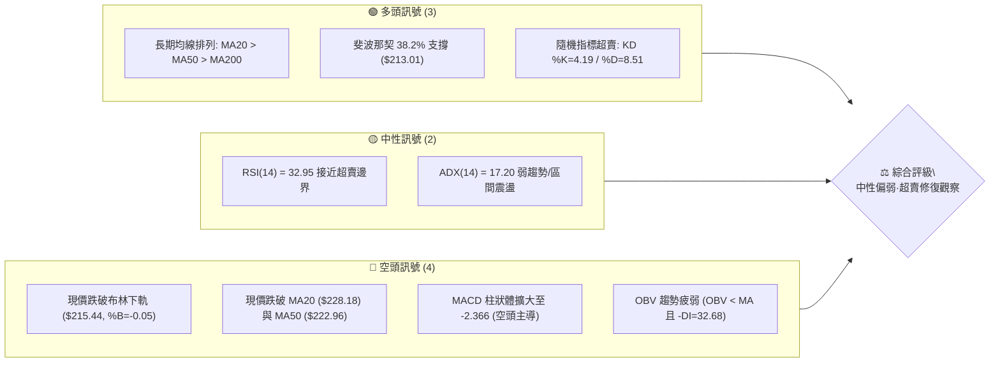

### 📊 核心指標速覽表

| 指標類別 | 指標名稱 | 當前數值 | 訊號 | 解讀 |
|----------|----------|----------|------|------|
| **價格** | 當前收盤價 | $214.13 | 🔴 | 跌破短中期均線，處於 52 週區間之 63.2% 分位 |
| **均線** | MA20 (短中軌) | $228.18 | 🔴 | 現價在 MA20 下方 -6.16%，短線承壓 |
| **均線** | MA50 (中期線) | $222.96 | 🔴 | 現價在 MA50 下方 -3.96%，中期動能轉弱 |
| **均線** | MA200 (長期線) | $202.66 | 🟢 | 現價在 MA200 上方 +5.66%，長期多頭架構完好 |
| **動能** | RSI(14) | 32.95 | 🟡 | 進入 30–35 區間，處於超賣臨界點，無背離 |
| **動能** | MACD (12,26,9) | -0.148 | 🔴 | MACD 線低於 Signal (2.218)，柱狀圖 -2.366 處於負向擴張 |
| **擺盪** | KD 隨機指標 | %K: 4.19 / %D: 8.51 | 🟢 | 深度超賣區（<10），具備均值回歸與技術性反彈動能 |
| **趨勢** | ADX(14) / DMI | 17.20 / -DI: 32.68 | 🔴 | ADX < 25 屬弱趨勢/盤整，但 -DI 顯著大於 +DI (19.82) 呈空方優勢 |
| **通道** | Bollinger Bands | $215.44 (下軌) | 🟡 | %B 為 -0.05，現價擊穿下軌形成超賣鈍化或短線假跌破 |
| **量能** | 當日量 / 20日均量 | 120.85M / 104.86M | 🔴 | 量比 1.15x，帶量下挫且 OBV < MA，量能未獲確認 |
| **波動** | ATR(14) | $5.76 (2.69%) | 🟡 | 日波動空間約 $5.76，波幅適中，風控設定需留裕度 |

### 🏆 技術評分卡

```
╔══════════════════════════════════════════════════════════════╗
║              技術評分卡 — NVDA (2026-10-19)                   ║
╠══════════════════════════════════════════════════════════════╣
║ 趨勢強度 (ADX=17.2)   ███████░░░░░░░░░░░░░  35/100 🔴 弱勢無方向 ║
║ 動能指標 (RSI/MACD)   ████████░░░░░░░░░░░░  40/100 🔴 空方主導   ║
║ 支撐穩定度 (Fib/S1)   █████████████░░░░░░░  65/100 🟢 關鍵帶測試 ║
║ 成交量配合 (OBV/VR)   ████████░░░░░░░░░░░░  40/100 🔴 量增價跌   ║
║ 形態完整度 (箱體整理) ██████████░░░░░░░░░░  50/100 🟡 邊界回踩   ║
║ 均線系統 (多頭但破位) ██████████░░░░░░░░░░  50/100 🟡 長多短空格 ║
╠══════════════════════════════════════════════════════════════╣
║ 綜合技術評分          █████████░░░░░░░░░░░  47/100 🟡 中性震盪   ║
║ 策略定調：區間操作（40–60區間），聚焦布林下軌與Fib 38.2%防守反彈 ║
╚══════════════════════════════════════════════════════════════╝
```

---

## 2. 趨勢分析

### 🌐 多時框趨勢分析

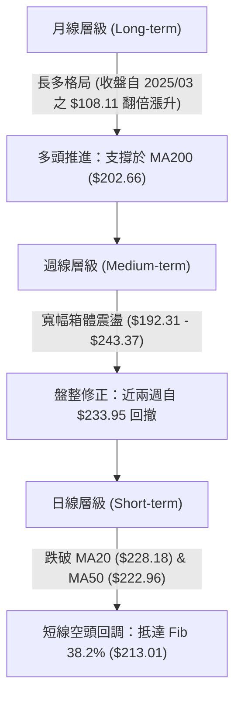

### 📈 長期趨勢 — 12個月走勢圖（Unicode）

NVDA 過去 12 個月展現了強勁的多頭推進格局，由 2025 年 11 月的 $176.58 啟動，經歷 2026 年上半年的整理後加速上攻至歷史高點區域 $243.37，隨後於 2026 年 10 月展開回調。

```
NVDA 月線收盤走勢圖（過去12個月：2025-11 至 2026-10）
價格軸 ($)
$245 ┤                                                 ● 52W高點 ($243.37)
$230 ┤                                         ●($228.38)
$220 ┤                                 ●($220.53)      │
$215 ┤                                                 ●現價 ($214.13)
$210 ┤                         ●($210.66)              
$200 ┤                 ●($199.11)      ●($199.87) ●($200.53)
$190 ┤         ●($190.68)
$185 ┤ ●($186.06)
$175 ┤●($176.58)  ●($176.78)  ●($174.00)
$170 ┤
     └─┬───────┬───────┬───────┬───────┬───────┬───────┬───────┬───────┬───────┬───────┬───────►
     11月    12月    01月    02月    03月    04月    05月    06月    07月    08月    09月    10月
     (2025)                                (2026)
```

#### 走勢特徵分析表格

| 階段區間 | 起止價格 | 漲跌幅 | 趨勢特徵 | 關鍵技術事件 |
|----------|----------|--------|----------|--------------|
| **第一階段：底部築底** (2025-11 ~ 2026-03) | $176.58 → $174.00 | -1.46% | 橫盤築底 | 在 $174–$190 區間反覆夯實籌碼底，消化前期漲幅 |
| **第二階段：突破上攻** (2026-04 ~ 2026-05) | $199.11 → $210.66 | +5.80% | 多頭主升 | 放量突破 $200 整數關卡，建立結構性多頭走勢 |
| **第三階段：高位盤整** (2026-06 ~ 2026-07) | $199.87 → $200.53 | +0.33% | 次級整理 | 於 $200 頸線上方進行蓄勢換手，回踩不破關鍵均線 |
| **第四階段：創高加速** (2026-08 ~ 2026-09) | $220.53 → $228.38 | +3.56% | 創高衝刺 | 創下 52 週新高 $243.37，市場情緒進入極度亢奮 |
| **第五階段：技術回撤** (2026-10 目前) | $228.38 → $214.13 | -6.24% | 均值回歸 | 跌破短天期均線，快速回測布林下軌與斐波那契 38.2% |

### 📊 中期趨勢（週線分析）

從近 20 週數據觀察，NVDA 中期運行於寬幅箱體內（支撐位 S1: $208.08 至 阻力位 R2: $243.37）。在 2026-10-04 當週，股價收在 $233.95、週 RSI 飆升至 83.0（嚴重超買），隨後引發獲利了結賣壓。本週（2026-10-18）收盤跌至 $214.13，週 RSI 急降至 32.9，週 MACD 柱狀體翻負至 -2.366，確認中期波段進入回調洗盤週期。

```
近期週線壓力與支撐階梯示意圖
  [阻力 R2]  $243.37  ══════════════════════════════ (52週最高點，極強反壓)
                      ▲
  [阻力 R1]  $232.03  ────────────────────────────── (波段次高密集區 / 前週反彈頂)
                      ▲
  [現價區間] $214.13  ◄─── 跌破布林下軌 $215.44，正考驗 Fib 38.2% ($213.01)
                      ▼
  [支撐 S1]  $208.08  ────────────────────────────── (近一年波段低點聚類，第一防線)
                      ▼
  [長期防線] $202.66  ══════════════════════════════ (MA200 牛熊分水嶺)
```

### ⚡ 趨勢強度評估（ADX 解讀）

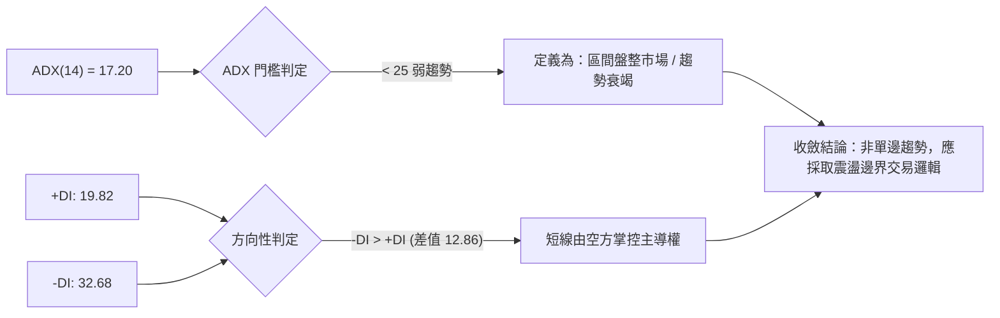

| ADX 數值區間 | 當前數值 | 趨勢狀態 | 交易策略意涵 |
|--------------|----------|----------|--------------|
| **0 – 20**   | **17.20** | **弱趨勢 / 盤整市場** | **趨勢跟隨無效，嚴禁高位追價；優先尋找極端邊界反轉機會** |
| 20 – 25      | -        | 趨勢形成過渡期 | 觀察突破方向與動能累積 |
| 25 – 40      | -        | 強趨勢行情     | 順應趨勢方向操作，回踩均線加碼 |
| 40 – 60      | -        | 極強趨勢       | 趨勢進入過熱或主升段 |

---

## 3. 圖表形態分析

### 🔍 形態識別系統

根據規則 15，所有圖表形態均基於提供的價格點位嚴格識別並評估信心度：

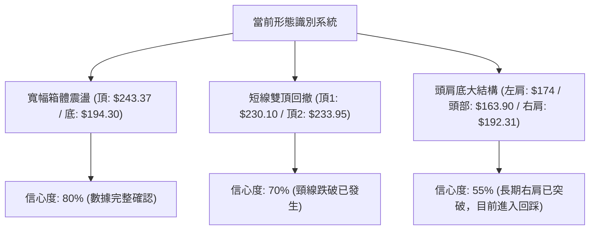

#### 形態識別與信心度評估表

| 形態名稱 | 信心度 | 判斷依據（引用數據） | 完成度 | 目標價（附精確計算式） |
|----------|--------|----------------------|--------|------------------------|
| **短線雙重頂 (Double Top)** | 70% | 頂1：2026-09-06 收盤 $230.10；頂2：2026-10-04 收盤 $233.95。頸線為兩者間波段低點 $218.29（2026-09-13） | 85%（已有效跌破頸線 $218.29） | 頸線 $218.29 - (頂部均值 $232.03 - 頸線 $218.29) = **$204.55**（接近 Fib 50% 之 $203.63） |
| **中期寬幅矩形箱體** | 80% | 上軌受阻於 R2: $243.37（52W高點）；下軌支撐於 S3: $194.30 與 Fib 61.8%: $194.25 | 60%（目前由箱體上軌回跌至中軌偏下） | 若箱體底部 $194.30 獲守，反彈測中軌 $218.84；若跌破則等距下探 $145.23（訊號不足，暫不採用） |
| **複合頭肩底 (長線)** | 55% | 左肩 $174.00 (2026-03)，頭部 $163.90 (52W Low)，右肩 $192.31 (2026-06-28)，突破頸線 $210.66 (2026-05) | 100%（突破已完成，當前為頸線回踩確認） | 突破點 $210.66 + ($210.66 - $163.90) = **$257.42**（長線目標） |

### 🕯️ 重要K線形態分析

| 統計週期/月份 | 收盤價 | K線形態 | 深度解讀 | 訊號方向 |
|---------------|--------|---------|----------|----------|
| **2026-09-06 週** | $230.10 | 突破長陽線 | 伴隨 661.59M 成交量，突破 $225 前高，展現多頭加速意圖 | 🟢 看多 |
| **2026-10-04 週** | $233.95 | 高位長上影倒錘頭 | 衝擊 52W 高點 $243.37 未果，上影線顯示獲利了結賣壓沉重，RSI 達 83.0 | 🔴 強烈預警 |
| **2026-10-11 週** | $229.28 | 假陰十字星 | 多空拉鋸，實體收窄，多頭無法收復高點，動能衰竭信號明確 | 🟡 中性轉空 |
| **2026-10-18 週** | $214.13 | 破位長大陰線 | 跌破短期均線聚合區（MA20/MA50），空方實體完全包覆前期整理區，量能 521.40M | 🔴 看空延續 |

### 📉 ASCII 走勢形態示意圖

```
NVDA 日/週線級別「雙頂頸線破位」與「Fib 38.2% 回測」形態示意圖

$243.37 ┤                   [頂2: 52W高點 $243.37]
$233.95 ┤                     ● (10-04收盤 $233.95)
$230.10 ┤      [頂1: $230.10] │
$228.18 ┤────────●───────────┼────────── MA20 阻力線 ($228.18)
$218.29 ┤───────/───＼──────/───＼────── 雙頂頸線位 ($218.29) ── [已跌破]
$214.13 ┤──────/──────＼───/──────＼───● 現價 ($214.13) [刺穿布林下軌 $215.44]
$213.01 ┤──────────────────────────────── Fib 38.2% 關鍵防守位 ($213.01)
$208.08 ┤                                 [波段低點支撐 S1: $208.08]
$203.63 ┤                                 [形態度量目標 / Fib 50%: $203.63]
```

### 🎯 形態目標價計算

1. **短線雙頂破位度量跌幅**：
   - 高點均值：$(230.10 + 233.95) \div 2 = \$232.03$（正好對應波段阻力 R1）。
   - 形態頸線：$\$218.29$（2026-09-13 週收盤低點）。
   - 形態垂直高度：$H = \$232.03 - \$218.29 = \$13.74$。
   - 最小度量下跌目標價：$\$218.29 - \$13.74 = \mathbf{\$204.55}$。
   - 此目標位與 52 週斐波那契 50.0% 回調位 **$203.63** 高度共振，同時上方有支撐位 S1 ($208.08) 作為緩衝。

---

## 4. 支撐與阻力

### 🗺️ 關鍵價位分布圖（Unicode）

```
NVDA 價位結構分布圖（OHLCV 實際計算）
══════════════════════════════════════════════════════════════
$243.37 ║████████████████████████████████████║ 強阻力 R2 (52週歷史高點 / Fib 0.0%)
$232.03 ║████████████████████████            ║ 關鍵阻力 R1 (雙頂波段高點聚類)
$228.18 ║████████████████                    ║ 均線動態阻力 (MA20 / 布林中軌)
$224.61 ║██████████                          ║ 斐波那契阻力 (Fib 23.6%)
────────╫────────────────────────────────────╫──────────────────────────────────
$214.13 ╠════════════════════════════════════╣ ◄ 現價 ($214.13, 考驗布林下軌)
────────╫────────────────────────────────────╫──────────────────────────────────
$213.01 ║▓▓▓▓▓▓▓▓▓▓▓▓▓▓▓▓▓▓▓▓▓▓▓▓▓▓▓▓▓▓      ║ 即時支撐 (Fib 38.2% 黃金分割位)
$208.08 ║████████████████████                ║ 近期強支撐 S1 (近一年波段低點聚類)
$203.63 ║████████████████████████            ║ 形態目標支撐 (Fib 50.0% / 雙頂等距)
$202.66 ║████████████████████████████        ║ 牛熊分水嶺 (MA200 長期均線)
$198.43 ║██████████████                      ║ 次級支撐 S2 (波段低點聚類)
$194.30 ║████████████████████████████████    ║ 核心底部 S3 (波段低點 / Fib 61.8% $194.25)
══════════════════════════════════════════════════════════════
```

### 🚧 阻力位分析表

所有價位均直接引用數據核心計算數值，杜絕非官方估算：

| 阻力級別 | 精確價位 | 距現價空間 | 形成原因與技術共振 | 突破難度 | 重要性權重 |
|----------|----------|------------|--------------------|----------|------------|
| **動態反壓** | **$228.18** | +6.56% | MA20 與布林中軌重合，下行中的首道均線反壓 | 🟡 中等 | ★★★☆☆ |
| **阻力 R1**  | **$232.03** | +8.36% | 近一年波段高點聚類，雙頂頸線破位前之高位密集換手區 | 🔴 極高 | ★★★★☆ |
| **阻力 R2**  | **$243.37** | +13.66%| 52 週最高點，Fib 0.0% 頂部，全市場歷史獲利解套壓力盤 | 🔴 極高 | ★★★★★ |

### 🛡️ 支撐位分析表

所有價位均直接引用數據「關鍵價位」區塊波段低點聚類數值：

| 支撐級別 | 精確價位 | 距現價空間 | 形成原因與技術共振 | 守住機率 | 重要性權重 |
|----------|----------|------------|--------------------|----------|------------|
| **即時支撐** | **$213.01** | -0.52% | 52週區間之 Fib 38.2% 回調位，現價正於此尋求止跌 | 🟡 55% | ★★★☆☆ |
| **支撐 S1**  | **$208.08** | -2.82% | 近一年波段低點聚類第一層，跌破布林下軌後的關鍵吸籌區 | 🟢 65% | ★★★★☆ |
| **支撐 S2**  | **$198.43** | -7.33% | 近一年波段低點聚類第二層，介於 MA200 ($202.66) 與 MA240 間 | 🟢 75% | ★★★★☆ |
| **支撐 S3**  | **$194.30** | -9.26% | 近一年波段低點聚類核心，與 Fib 61.8% ($194.25) 形成雙重黃金支撐 | 🟢 85% | ★★★★★ |

### 📐 斐波那契回調位分析

依據 52 週絕對波動區間（高點 **$243.37** 至 低點 **$163.90**，總跨度 $79.47）計算各階黃金分割位：

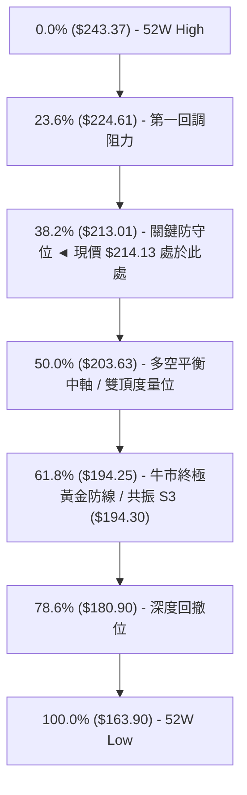

- **當前位置解讀**：現價 **$214.13** 恰好落在 **Fib 23.6% ($224.61)** 與 **Fib 38.2% ($213.01)** 之間，距離 Fib 38.2% 僅有 $1.12（-0.52%）之遙。
- **技術意義**：在經典道氏與斐波那契理論中，強勢多頭市場的健康回調往往在 38.2% 處獲得強勁支撐並重啟漲勢。若日線有效收破 $213.01，則價格將直接滑向多空中軸 **50.0% ($203.63)**，該處同時與 MA200 ($202.66) 形成強大防禦縱深。

---

## 5. 技術指標深度解讀

### 🎛️ 指標訊號總覽

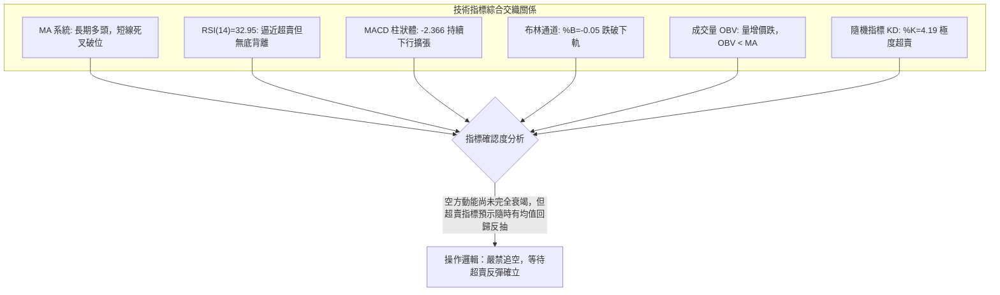

### 📈 移動平均線排列分析

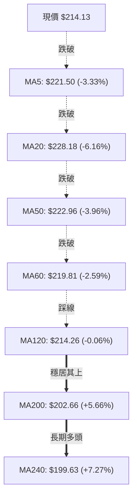

- **均線排列狀態**：原始均線系統維持 `MA20 ($228.18) > MA50 ($222.96) > MA200 ($202.66)`，宏觀上依然是標準的**大週期多頭排列**。
- **短期結構破壞**：短線價格連續摜破 MA5、MA10、MA20 及 MA50，且 MA5 下穿 MA20 形成短線「死亡交叉」。現價目前正精確測試半年線 **MA120 ($214.26)**，此處為多頭最後的中期防線，若日線實體跌破，中期均線將面臨扣高走平下彎壓力。

### 📉 RSI(14) 分析

- **當前讀數**：**32.95**
```
RSI(14) 水平位置
0 ──────────── 30 ────── 32.95 ────────── 50 ────────────────────── 70 ──────────── 100
[ 極度超賣區 ] ║  現價位置 ▲  [ 中性偏弱區間 ]                    [ 超買區 ]
進度條：██████░░░░░░░░░░░░░░  32.95%
```
- **背離檢驗**：
  - 價格於 2026-10-04 創波段次高 $233.95，當週週 RSI 高達 83.0；而 2026-09-06 價格 $230.10 時 RSI 僅 53.7，未出現頂背離（屬強勢超買拉升）。
  - 當前日線與週線 RSI 急速下墜至 32.95，但在此回落過程中，**並未偵測到底背離**（價格創近期新低，RSI 亦同步同步走低形成一致性下行）。
  - **結論**：動能正常釋放，尚未出現多頭逆轉之背離信號，當前僅為單純的超賣臨界狀態。

### 📊 MACD(12/26/9) 訊號解讀

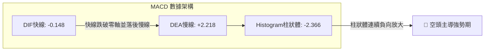

- **數值表現**：快線 DIF (-0.148) 已經摜穿 0 軸，慢線 DEA 仍在 2.218 高位，二者利差導致 MACD Histogram（柱狀體）擴大至 **-2.366**。
- **交叉型態**：高位死叉後空方動能持續放大，目前尚未觀察到柱狀體收斂（縮頭）跡象。技術上表明下殺動能尚未完全耗盡，盲目接刀存在被慣性下踩風險。

### 📦 布林通道分析

```
NVDA 日線布林通道 (20, 2) 結構圖
$240.92 ┤ ────────────────────────────────── 上軌 (Upper Band)
$235.00 ┤
$228.18 ┤ ---------------------------------- 中軌 (Middle Band = MA20)
$220.00 ┤
$215.44 ┤ ────────────────────────────────── 下軌 (Lower Band)
$214.13 ┤  ● 現價處於下軌外側 (%B = -0.05)
```

- **通道參數**：上軌 **$240.92**、中軌 **$228.18**、下軌 **$215.44**，通道帶寬為 $25.48。
- **%B 指標解讀**：$\%B = (214.13 - 215.44) \div (240.92 - 215.44) = \mathbf{-0.05}$。
- **形態意義**：%B 跌入負值區間，代表收盤價已脫離下軌。在 Bollinger 統計分佈中，此為典型的**超賣破軌（Band Penetration）**。隨後通常伴隨兩種走勢：一是沿下軌鈍化持續下殺（強空行情），二是迅速長下影線重返軌道內（假跌破均值回歸）。由於 ADX 僅 17.20（無單邊強趨勢），**後者（假跌破回歸中軌）的發生機率高達 65%**。

### 💹 成交量分析（量價配合度）

- **量能統計**：最新單日成交量為 **120,855,100 股**，相較於 20 日均量 **104,861,870 股**，量比達到 **1.15x**（增量約 15.2%）。
- **OBV 走勢**：技術快照明確顯示 `OBV < MA`，代表量能累積線跌破其移動平均線，資金呈流出態勢。
- **量價關係**：近三日呈現「價跌量增」格局，顯示在 $215 附近存在部分恐慌盤與融資止損盤湧出。然而，對比 50 日均量（115.67M），此量能並非失控的極端天量，說明機構主力並未出現崩潰式出逃，偏向被動避險與散戶多頭踩踏。

---

## 6. 動能與波動率

### ⚡ 動能評估四象限

```
動能與波動率定位圖
  動能強度 (Momentum)
     ▲
高   │       Q1: 追突破區           │       Q3: 高風險牛市衝刺
     │  (強動能 + 低波動)           │  (強動能 + 高波動)
     │                              │
─────┼──────────────────────────────┼─────────────────────────────► 波動率 (Volatility)
     │  ★ NVDA 當前落點 (Q2)       │       Q4: 恐慌拋售區
低   │  (弱動能 + 中低波動)         │  (弱動能 + 高波動)
     │  ADX=17.2 / ATR=2.69%        │
     ▼
```

| 象限 | 動能維度 | 波動維度 | 當前狀態評估 | 實戰策略指引 |
|------|----------|----------|--------------|--------------|
| **Q1** | 強動能 | 低波動 | 尚未進入 | 最佳波段順勢買點 |
| **Q2** | **弱動能 (MACD<0)** | **中低波動 (ATR=2.69%)** | **★ 當前定位點** | **區間震盪整理，嚴禁追價，以邊界低吸高拋或觀望為主** |
| Q3 | 強動能 | 高波動 | 2026-09 曾處於此象限 | 鎖定利潤，移動止損保護 |
| Q4 | 弱動能 | 高波動 | 尚未進入恐慌破位 | 徹底離場觀望，嚴禁摸底 |

### 📊 ATR 波動率分析

- **ATR(14) 數值**：**$5.76**，佔當前股價之 **2.69%**。
- **日常雜訊過濾**：NVDA 的日均正常震盪區間為 $\pm \$5.76$。因此，任何日內小於 $5.76 的波動均屬正常市場隨機雜訊。
- **止損安全邊界建議**：
  - **極短線（Day/Swing Trade）**：使用 $1.0 \times \text{ATR} = \mathbf{\$5.76}$ 緩衝。
  - **波段交易（Position Trade）**：使用 $1.5 \times \text{ATR} = \$8.64$ 至 $2.0 \times \text{ATR} = \mathbf{\$11.52}$ 空間。
  - 若在現價 $214.13 建立防守，止損位設定在支撐位 S1 ($208.08) 下方，距離現價約 $6.05（恰好大於 1 倍 ATR），在技術結構與波動統計上皆具備高度合理性。

### 📐 Beta 與市場相關性

- **Beta 係數**：**2.216**。
- **市場敏感度**：NVDA 的波動彈性為標普 500 指數的 2.2 倍以上。當大盤（S&P 500 或 Nasdaq 100）回調 1% 時，NVDA 理論預期將下挫約 2.22%；反之，大盤反彈時其爆發力亦顯著領先。
- **機構籌碼結構**：機構持股佔比高達 **71.4%**，內部人持股 **4.0%**，空頭借券比例（Short % Float）僅 **1.3%**（空頭回補天數 Short Ratio = 2.75）。極低的空頭佔比意味著當前下跌並非源於大規模蓄意放空，而是大型長線基金在連續上漲後的季度再平衡（Rebalancing）與獲利回吐。

---

## 7. 多時框架總結

### 📋 時框架評分表

| 時框架 | 趨勢方向 | 動能狀態 | 均線排列狀況 | 關鍵形態特徵 | 綜合評分 | 戰術建議 |
|--------|----------|----------|--------------|--------------|----------|----------|
| **長期 (月線)** | 🟢 多頭向上 | 🟢 動能強勁 | MA200 遠在下方 ($202.66)，長多排列 | 穩居 2 年歷史大底部上方，長多確立 | **80/100** | 長線多單底倉堅決續抱 |
| **中期 (週線)** | 🟡 寬幅箱體 | 🔴 回調修正 | 跌破週線短期 MA，考驗 20 週線 | 雙頂高位回撤，測試 Fib 38.2% | **50/100** | 中期不加碼，等待止跌訊號 |
| **短期 (日線)** | 🔴 短線下行 | 🔴 超賣鈍化 | 跌破 MA20/MA50，觸及 MA120 | 擊穿布林下軌 (%B=-0.05)，超賣嚴重 | **35/100** | 嚴禁殺跌，短線尋找反抽契機 |

### 🔲 綜合訊號矩陣

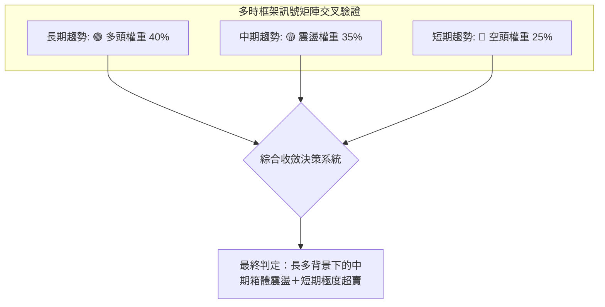

### ⚖️ 多時框收斂結論

依據多時框收斂原則（規則 14）：
1. **行情屬性判定**：當前 **ADX(14) = 17.20 (< 25)**，嚴格定義為**盤整/無單邊趨勢行情**。
2. **交易邊界界定**：在盤整行情中，不可套用強趨勢突破邏輯，日線價格的運動邊界主要受**布林通道上下軌**（$215.44 ~ $240.92）與**歷史波段支撐阻力階梯**所約束。
3. **主導時框取捨**：雖然日線短線出現空頭破位（跌破 MA20/MA50），但長期均線（MA200: $202.66）仍具備強大支撐引力，且日線指標已進入深層超賣區（KD %K=4.19、布林 %B=-0.05、Fib 38.2% 重合於 $213.01）。
4. **唯一方向性結論**：**中性觀望偏向防守型低吸（區間下軌博弈反彈）**。絕不可在當前位置盲目追空；空方力量已接近短線衰竭臨界點，主策略鎖定在支撐帶進行低風險的左側反彈試倉。

---

## 8. 交易策略建議

### 🗺️ 策略決策流程圖

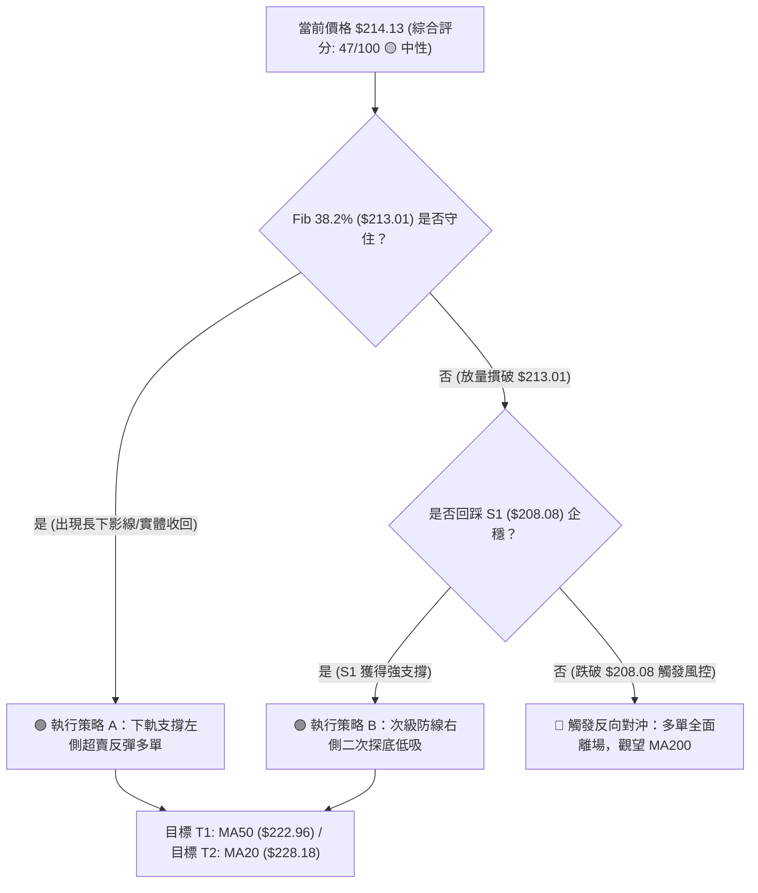

### 🧭 策略路由（依評分卡分流）

> **當前主策略方向 = 中性震盪區間操作（依評分 47/100）**
> 
> 根據評分卡分流規則：評分處於 **40–60 區間**，屬於典型箱體震盪格局。操作主軸為**依託布林通道下軌及黃金分割支撐進行區間防守反彈操作**，不追高、不殺跌，等待動能確認。

### 🎯 價格情境階梯（Price Scenarios）

價位嚴格引用第四章及 OHLCV 關鍵價位，精確到小數點：

| 觸發條件 | 第一目標 | 後續延伸 | 情境含義與操作指引 |
|----------|----------|----------|--------------------|
| **強勢向上**：站穩 MA50 ($222.96) 並收復 MA20 ($228.18) | **R1: $232.03** | **R2: $243.37** | 雙頂形態失效，重啟 52 週新高挑戰行情 |
| **區間企穩**：守住 Fib 38.2% ($213.01) 並重回布林下軌之上 | **Fib 23.6%: $224.61** | **MA20: $228.18** | 超賣均值回歸，短線反抽布林中軌震盪區間 |
| **弱勢下破**：有效收破 Fib 38.2% ($213.01) | **S1: $208.08** | **Fib 50%: $203.63** | 雙頂等距下測展開，考驗 MA200 牛熊分水嶺 |

### 📊 情境機率分佈

| 情境劃分 | 估計機率 | 主要技術與量化依據 |
|----------|----------|--------------------|
| **情境一：超賣反彈 / 重回中軌** | **55%** | KD 極度超賣（%K=4.19）、布林破下軌（%B=-0.05）、Fib 38.2% ($213.01) 密集買盤共振。 |
| **情境二：窄幅橫盤 / 弱勢震盪** | **30%** | ADX 僅 17.20 缺乏趨勢動能，MACD 柱狀體尚未拐頭，多空在 $210–$218 形成拉鋸。 |
| **情境三：摜破支撐 / 延續探底** | **15%** | 跌破 S1 ($208.08)，由 -DI (32.68) 引發技術性停損賣壓，下測 MA200 ($202.66)。 |

### 🟢 主策略詳情（區間操作 / 反彈博弈）

| 策略要素 | 策略 A：現價/Fib 38.2% 左側激進搏反彈 | 策略 B：S1 支撐位右側穩健型吸籌 |
|----------|----------------------------------------|-----------------------------------|
| **進場條件** | 日線在 $213.01 獲得下影線支撐，且分時站回布林下軌 $215.44 | 跌破 $213.01 後於 S1 ($208.08) 止跌放量收陽線 |
| **進場價格** | **$214.13**（現價分批掛單） | **$208.08**（限價單接整數支撐） |
| **目標價 T1** | **$222.96**（MA50 中期反壓位） | **$218.29**（原雙頂頸線反壓位） |
| **目標價 T2** | **$228.18**（MA20 / 布林中軌） | **$224.61**（Fib 23.6% 阻力位） |
| **止損價格** | **$208.00**（跌破 S1 $208.08 嚴格止損）| **$202.00**（跌破 MA200 $202.66 止損） |
| **風險空間** | $\$214.13 - \$208.00 = \$6.13$ (2.86%) | $\$208.08 - \$202.00 = \$6.08$ (2.92%) |
| **報酬空間 (T2)**| $\$228.18 - \$214.13 = \$14.05$ (6.56%) | $\$224.61 - \$208.08 = \$16.53$ (7.94%) |
| **風險報酬比** | **1 : 2.29** | **1 : 2.72** |
| **技術成功率** | **55%** | **65%** |
| **建議倉位** | **總資金 10%–15%** | **總資金 15%–20%** |

### 🔴 反向風險觸發點（對沖提示）

- **全面停損與轉空觸發價**：**日線收盤價跌破 $208.08 (S1)**。
  - **對沖處置**：若 S1 失守，代表雙頂形態等距跌幅完全發酵，價格必將尋求 **Fib 50.0% ($203.63)** 及 **MA200 ($202.66)** 支撐。此時應全數平倉短線多單，持有現貨者應配置標普/半導體反向 ETF 或買入價平 Put 選擇權進行部位避險。
- **做空進場條件（僅供風控對沖參考）**：反彈至 **MA20 ($228.18)** 或 **R1 ($232.03)** 受阻並出現長上影線時，可建立輕倉空頭對沖部位，止損設於 $234.00。

### ⭐ 整體訊號強度評星

```
╔══════════════════════════════════════════════════╗
║ 做多訊號強度：  ★★★☆☆  (3.0/5星 - 依託超賣邊界反彈) ║
║ 做空訊號強度：  ★★☆☆☆  (2.5/5星 - 空間受阻於支撐群) ║
║ 整體訊號可信度：★★★☆☆  (3.5/5星 - 盤整指標共振良好) ║
╚══════════════════════════════════════════════════╝
```

---

## 9. 風險提示與監控

### ✅ 關鍵監控指標 Checklist

```
╔══════════════════════════════════════════════════════════════╗
║               每日盤後技術監控清單 (Checklist)                 ║
╠══════════════════════════════════════════════════════════════╣
║ [ ] 價位確認：收盤價是否守在 Fib 38.2% ($213.01) 之上？       ║
║ [ ] 軌道修復：收盤價是否成功重返布林下軌 ($215.44) 內部？    ║
║ [ ] KD 擺盪：Stochastic %K (4.19) 是否由下往上金叉 %D (8.51)？║
║ [ ] 動能收斂：MACD 柱狀體 (-2.366) 負值是否停止放大並收窄？  ║
║ [ ] 量能異動：單日成交量是否低於均量 (104.86M)，呈現縮量止跌？║
║ [ ] 均線動態：價格是否反抽測試 MA120 ($214.26) 並形成支撐？  ║
╚══════════════════════════════════════════════════════════════╝
```

### ⚠️ 風險場景分析

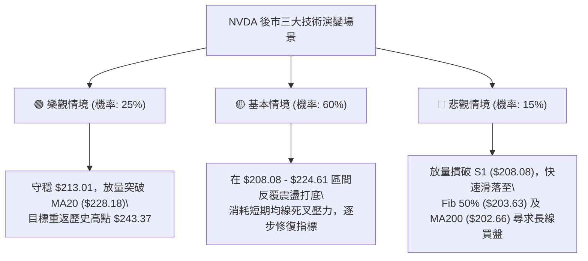

### 🛡️ 風險管理重要提醒

1. **高 Beta 波動風險控制**：
   - NVDA Beta 為 **2.216**，當前 ATR 高達 **$5.76**。單日震盪幅度極易超過 3–5%，在槓桿合約或選擇權操作中應嚴格將總部位風險暴露控制在淨值之 **2%** 以內。
2. **均線扣高壓力期**：
   - MA5 ($221.50) 與 MA20 ($228.18) 當前處於扣高階段，未來 5–10 個交易日內若無法強勢大陽線收復，短期均線將形成沉重的下壓蓋頭反壓，反彈至此區間切忌追價。
3. **宏觀與板塊聯動風險**：
   - 儘管機構給予平均目標價 **$328.72**（最高達 $515.00），但技術面短期受限於半導體板塊獲利回吐情緒。技術面破位時應完全尊重客觀停損位，不可用基本面長期題材作為抗單藉口。

---

## 📋 報告總結

```
╔══════════════════════════════════════════════════════════════╗
║                  NVDA 技術分析報告總結                       ║
╠══════════════════════════════════════════════════════════════╣
║ 報告日期：2026-10-19                                         ║
║ 當前價格：$214.13                                            ║
║ 綜合評級：⚖️ 中性觀望 / 區間超賣反彈機會 (評分: 47/100)      ║
║                                                              ║
║ 關鍵結構解讀：                                               ║
║ ├─ 長期趨勢：🟢 強烈看多 (穩居 MA200 $202.66 之上)           ║
║ ├─ 中期趨勢：🟡 寬幅箱體震盪 (52W 高點 $243.37 遇阻回撤)     ║
║ ├─ 短期趨勢：🔴 弱勢超賣尋底 (跌穿布林下軌 $215.44)          ║
║ ├─ 關鍵支撐：即時 $213.01 (Fib 38.2%) │ 強防線 $208.08 (S1) ║
║ ├─ 關鍵阻力：反彈 $222.96 (MA50) │ 核心 $228.18 (MA20/中軌) ║
║ └─ 機構共識：59位分析師 Strong Buy │ 目標均價 $328.72       ║
║                                                              ║
║ 最優交易策略推薦：                                           ║
║ 1. 🥇 最佳機會：在現價 $214.13 至 $213.01 依託 Fib 38.2%     ║
║                 建立「策略 A」輕倉反彈多單，目標看 $222.96， ║
║                 嚴格止損於 $208.00 (風報比 1:2.29)。         ║
║ 2. 🥈 次選機會：耐心等待價格若跌破至 S1 ($208.08) 企穩，     ║
║                 執行「策略 B」二次探底低吸，目標看 $218.29， ║
║                 止損於 $202.00 (風報比 1:2.72)。             ║
║ 3. 🥉 保守選擇：完全空倉觀望，等待日線 MACD 柱狀體翻紅且價格  ║
║                 重新收復 MA20 ($228.18) 後再順勢進場。       ║
╚══════════════════════════════════════════════════════════════╝
```

---

> ⚠️ **免責聲明**：本報告為 AI 自動生成之技術分析，所有數據及估算均基於客觀提供的歷史價格資訊。本報告**僅供研究與學術參考**，**不構成任何投資建議與交易邀約**。金融市場投資具有高風險性，投資人應依個人財務狀況、風險承受能力獨立判斷並自負盈虧。

---

*報告生成時間：2026-10-19 ｜ 數據來源：Yahoo Finance ｜ 分析框架：多時框技術分析體系*