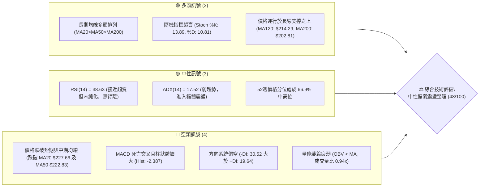
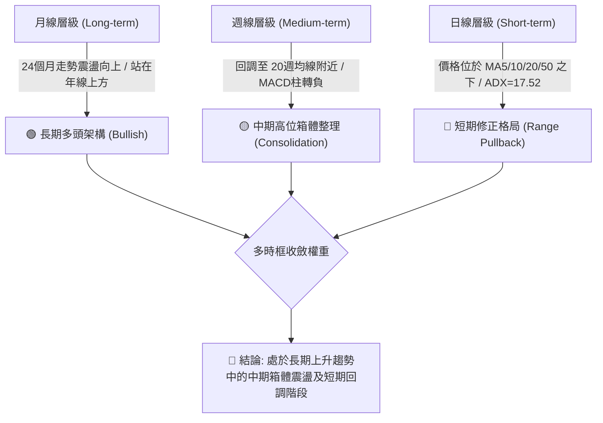
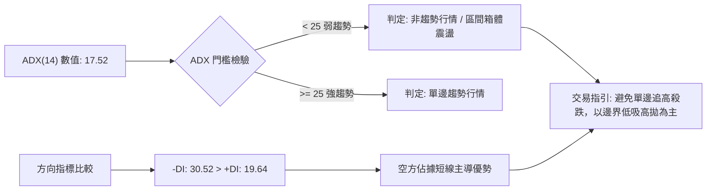
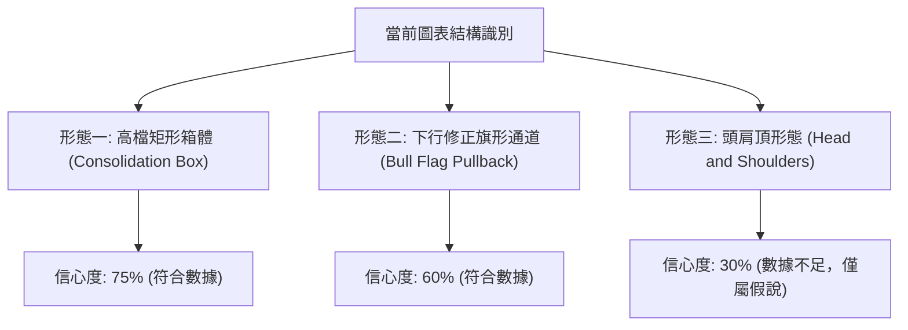
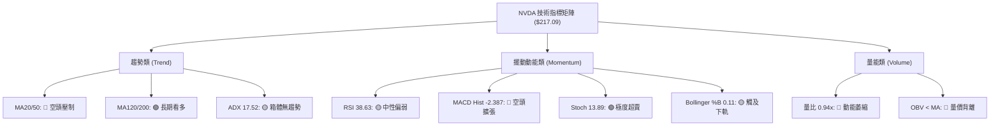
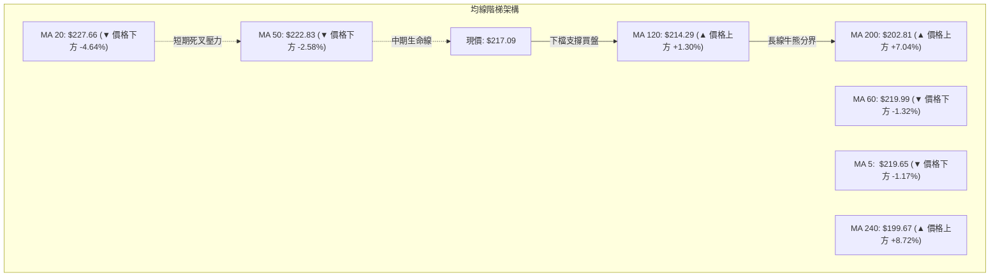
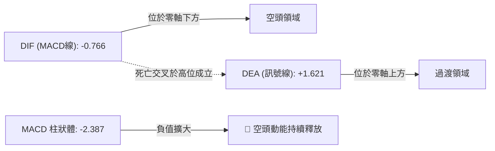
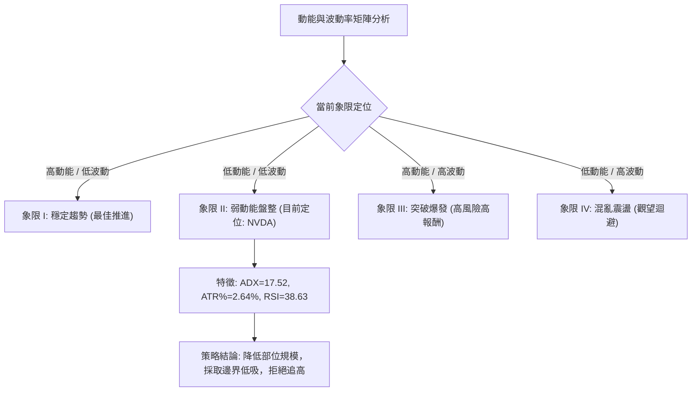
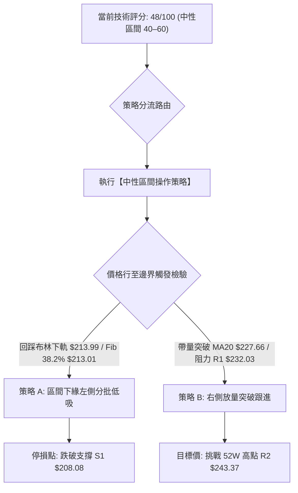
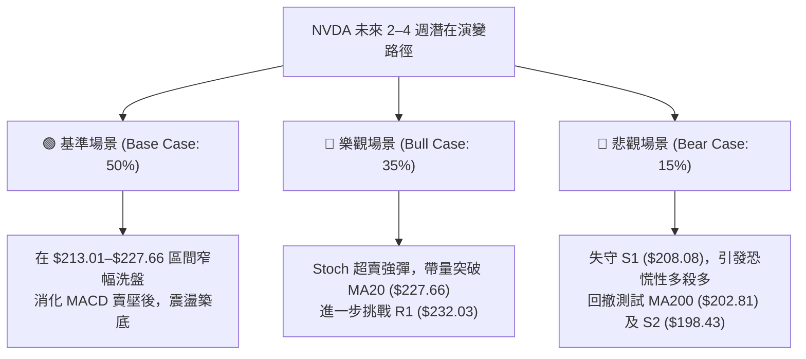

# NVDA 技術分析報告

> **報告日期**：2026-10-20 ｜ **語言**：繁體中文 ｜ **數據來源**：Yahoo Finance ｜ **當前價格**：$217.09

---

## 目錄

| 章節 | 內容 |
|------|------|
| [1. 技術面概覽](#1-技術面概覽) | 訊號儀表板、核心指標、評分卡 |
| [2. 趨勢分析](#2-趨勢分析) | 多時框趨勢、長中短期走勢、ADX 解讀 |
| [3. 圖表形態分析](#3-圖表形態分析) | 形態識別、信心度評估、K線組合、目標價 |
| [4. 支撐與阻力](#4-支撐與阻力) | 關鍵價位、斐波那契回調結構 |
| [5. 技術指標深度解讀](#5-技術指標深度解讀) | MA/RSI/MACD/布林/成交量量價配合 |
| [6. 動能與波動率](#6-動能與波動率) | 動能四象限、ATR 止損距離、Beta 敏感度 |
| [7. 多時框架總結](#7-多時框架總結) | 時框架評分矩陣、收斂規則與唯一方向結論 |
| [8. 交易策略建議](#8-交易策略建議) | 策略路由、價格情境階梯、主策略與風險報酬比 |
| [9. 風險提示與監控](#9-風險提示與監控) | 監控清單、情境推演、資金控管規範 |

---

## 1. 技術面概覽

### 🎯 技術訊號儀表板



### 📊 核心指標速覽表

| 指標類別 | 指標名稱 | 當前數值 | 訊號 | 技術解讀與意涵 |
|:---|:---|:---|:---:|:---|
| **現價** | 收盤價 | $217.09 | 🟡 | 位於52週區間 66.9%，短線處於回調段 |
| **均線** | MA20 (月線) | $227.66 | 🔴 | 現價低於 MA20 (-4.64%)，短線承壓 |
| **均線** | MA50 (季線) | $222.83 | 🔴 | 跌破中期生命線，轉為短線阻力位 |
| **均線** | MA200 (年線) | $202.81 | 🟢 | 現價高於 MA200 (+7.04%)，長多架構穩固 |
| **動能** | RSI(14) | 38.63 | 🟡 | 中性偏弱區間 (30–50)，尚未進入極端超賣 |
| **趨勢指標**| MACD (12,26,9) | -0.766 | 🔴 | DIF < DEA (1.621)，MACD柱狀圖負向擴散 (-2.387) |
| **擺動指標**| Stoch %K / %D | 13.89 / 10.81 | 🟢 | 進入極度超賣區間 (<20)，具備短線技術性反彈契機 |
| **通道指標**| 布林通道 %B | 0.11 | 🟡 | 逼近下軌 $213.99，空頭動能減速，尋求通道下緣支撐 |
| **趨勢強度**| ADX(14) | 17.52 | 🟡 | 低於 25 臨界值，確認為非趨勢型「無趨勢/箱體盤整」 |
| **量能指標**| OBV 趨勢 | OBV < MA | 🔴 | 成交量 98.40M 低於20日均量 (0.94x)，量能背馳 |
| **波動度** | ATR(14) | $5.74 | 🟡 | 日波動率 2.64%，波幅收斂，符合盤整期特徵 |

### 🏆 技術評分卡

```
╔══════════════════════════════════════════════════════════════╗
║              技術評分卡 — NVDA (2026-10-20)                   ║
╠══════════════════════════════════════════════════════════════╣
║ 趨勢強度 (Trend)     ████░░░░░░░░░░░░░░░░  25/100  🔴 弱勢盤整║
║ 動能指標 (Momentum)  ███████░░░░░░░░░░░░░  35/100  🔴 空方主導║
║ 支撐穩定度 (Support) ██████████████░░░░░░  70/100  🟢 買盤密集║
║ 成交量配合 (Volume)  ████████░░░░░░░░░░░░  40/100  🟡 追價無量║
║ 形態完整度 (Pattern) ████████████░░░░░░░░  60/100  🟡 箱體成形║
║ 均線架構 (MAs)       ████████████░░░░░░░░  60/100  🟡 長多短空║
╠══════════════════════════════════════════════════════════════╣
║ 綜合評分             ██████████░░░░░░░░░░  48/100  中性整理   ║
║ 投資評級             ⚖️ NEUTRAL / RANGE-BOUND (區間操作)     ║
╚══════════════════════════════════════════════════════════════╝
```

---

## 2. 趨勢分析

### 🌐 多時框趨勢分析



### 📈 長期趨勢 — 12個月走勢圖（Unicode）

NVDA 過去 12 個月（2025-11 至 2026-10）呈現「自高位回踩後，震盪推升創出 52 週新高 $243.37，隨後展開中階波段整理」的軌跡。

```
NVDA 月線走勢圖（過去12個月：2025-11 至 2026-10）
價格軸 ($)
$245 ┤                                                 ● 2026-09 ($228.38 / 高點$243.37)
$230 ┤                                           ●     │
$215 ┤                                     ●     │     ● 2026-10 ($217.09 現價)
$200 ┤                   ●           ●     │     │
$185 ┤       ●     ●     │     ●     │     │     │
$170 ┤ ●     │     │     │     │     │     │     │
$155 ┤ │     │     │     ● 2026-03 ($174.00 低點)│     │
     └─┬─────┬─────┬─────┬─────┬─────┬─────┬─────┬─────┬─────┬─────┬─────
      11月  12月  01月  02月  03月  04月  05月  06月  07月  08月  09月  10月
      2025  2025  2026  2026  2026  2026  2026  2026  2026  2026  2026  2026
```

#### 走勢特徵分析表格

| 階段區間 | 月份起訖 | 收盤價變化 | 波段漲跌幅 | 核心走勢特徵與結構意涵 |
|:---|:---|:---|:---:|:---|
| **第一階段：高檔震盪回調** | 2025-11 ~ 2026-03 | $176.58 → $174.00 | -1.46% | 觸及 2025-10 高點後回踩，2026-03 探底至波段低位 $174.00，構築年內雙重底支撐 |
| **第二階段：主升浪推升** | 2026-03 ~ 2026-05 | $174.00 → $210.66 | +21.07% | 量能放大，連續突破多道短期壓力，迅速脫離底部區間 |
| **第三階段：次級整理蓄勢** | 2026-05 ~ 2026-07 | $210.66 → $200.53 | -4.81% | 在 $200.00 整數關卡上方進行高位橫盤整理，洗刷短線浮額 |
| **第四階段：衝刺創高** | 2026-07 ~ 2026-09 | $200.53 → $228.38 | +13.89% | 資金再度進駐，推升股價創下 52 週歷史高點 $243.37 |
| **第五階段：目前高檔修正** | 2026-09 ~ 2026-10 | $228.38 → $217.09 | -4.94% | 獲利了結賣壓湧現，連續跌破月線與季線，目前向布林下軌尋求支撐 |

### 📊 中期趨勢（週線分析）

從近 20 週收盤走勢觀察：
- **高點聚類**：2026-10-04 當週收盤 $233.95，其後價格於 $243.37（52週高點 / R2）受阻回落。
- **低點支撐**：2026-06-28 收盤 $192.31 與 2026-07-05 收盤 $194.61，精確對應 S3（$194.30）與斐波那契 61.8%（$194.25）。
- **當前週線狀態**：2026-10-18 當週收盤 $214.13（RSI 跌至 32.9），隨後本週回升至 $217.09。MACD 週線柱狀體持續為負（-2.387），顯示中期動能仍處於消化獲利賣壓階段。

```
中期週線空間結構（近期壓力與支撐示意圖）
阻力區間 ═══════════════════════════════════════════ $243.37 (52W High / R2)
                ▲
                │   週線震盪回調區
                ▼
當前價格 ------------------------------------------- $217.09 (現價)
                ▲
                │   下檔買盤防守區
                ▼
支撐區間 ═══════════════════════════════════════════ $208.08 (S1) / $198.43 (S2)
```

### ⚡ 趨勢強度評估（ADX 解讀）



| 指標名稱 | 實際數值 | 強度區間劃分 | 市場狀態定義 | 交易策略應用原則 |
|:---|:---:|:---:|:---:|:---|
| **ADX(14)** | **17.52** | < 20 (極弱趨勢) | 處於盤整與動能耗盡階段 | 趨勢突破型策略失效機率高，轉為擺動型指標主導 |
| **+DI(14)** | **19.64** | 偏弱 | 多頭買盤力道收縮 | 多頭動能減退，尚未出現帶量攻擊紅K |
| **-DI(14)** | **30.52** | 偏強 | 空頭控盤力量相對較高 | 短期下行慣性存在，嚴禁盲目摸底 |
| **DI 差值** | **-10.88** | 淨空方 | 空頭價差優勢擴大 | 需等待 -DI 掉頭向下且 +DI 交叉向上，方能確認止跌 |

---

## 3. 圖表形態分析

### 🔍 形態識別系統



#### 形態識別與信心度評估表（依規則 15 嚴格審核）

| 識別形態 | 信心度 | 判斷依據（嚴格引用數據） | 當前完成度 | 理論目標價（附精確計算式） | 形態結論與處理 |
|:---|:---:|:---|:---:|:---|:---|
| **高位箱體整理**<br>(Rectangle Box) | **75%** | 上軌密集承壓於 R1 ($232.03) 至 52W高點 ($243.37)，下軌由 S1 ($208.08) 及斐波那契 38.2% ($213.01) 強力防守。 | 80% | **向上突破目標**：頸線 $232.03 + ($232.03 - $208.08) = **$255.98**<br>**向下跌破目標**：支撐 $208.08 - ($232.03 - $208.08) = **$184.13** | **主導形態**：目前價格處於箱體下半部，尚未確認突破，優先依箱體操作。 |
| **多頭旗形回調**<br>(Bull Flag) | **60%** | 自 2026-03 ($174.00) 暴漲至 52W 高點 ($243.37) 形成旗桿，隨後於 $213.00–$243.00 呈現平行向下修正斜度。 | 55% | 旗桿長度 = $243.37 - $174.00 = $69.37<br>突破上軌測幅目標 = $232.03 + $69.37 = **$301.40** | **次級形態**：需帶量突破下降趨勢線（MA20 $227.66）方能啟動確認。 |
| **潛在頭肩頂**<br>(Head & Shoulders) | **30%** | 左肩約 $228.38，頭部 $243.37，右肩尚未成形，頸線尚未有效跌破。 | 20% | 訊號不足，數據無法證實右肩與頸線結構。 | **判定無效**：信心度低於 50%，依規則 15 **剔除該形態預測**，不做衍生操作。 |

### 🕯️ 重要K線形態分析

| 統計月份 | 收盤價 | 代表性 K 線形態 | 量化結構解讀 | 多空訊號 |
|:---|:---:|:---|:---|:---:|
| **2026-07** | $200.53 | **縮量十字星 (Doji)** | 守穩整數關卡，賣壓竭盡，為突破前最後蓄勢 | 🟢 轉強前兆 |
| **2026-08** | $220.53 | **光腳大陽線 (Marubozu)** | 月漲幅 +9.97%，多頭長紅強勢突破前高阻力區 | 🟢 強烈看多 |
| **2026-09** | $228.38 | **高檔長上影流星線 (Shooting Star)** | 衝擊 52W 高點 $243.37 後遭逢獲利了結，上檔阻力沉重 | 🔴 警示回調 |
| **2026-10** | $217.09 | **下影陰線 (Hammer-like Dip)** | 回測下軌 $213.99 後拉出下影線，目前爭奪斐波那契 38.2% | 🟡 止跌回穩中 |

### 📉 ASCII 走勢形態示意圖

```
NVDA 日線/週線 高檔矩形箱體結構（2026年下半年）
$243.37 ┬────────────────────────────────────────── 52W High / 箱體頂部 (R2)
        │                 ╭──╮
$232.03 ┼───────╭─────────╯  ╰────╭──╮───────────── 箱體頸線阻力 (R1)
        │       │                 │  │
$227.66 ┼───────┼─────────────────┼──┼─────── (MA20 / BB中軌)
        │       │                 │  ╰─╮
$217.09 ┼───────┼─────────────────┼────┼──● 現價 ($217.09)
        │       │                 │    │
$213.01 ┼───────╰──╮             │    ╰──── (Fib 38.2% / BB下軌 $213.99)
        │          ╰─────────────╯
$208.08 ┴────────────────────────────────────────── 箱體底部支撐 (S1)
```

### 🎯 形態目標價計算

以最高信心度（75%）的「高檔矩形箱體」作為基準測算：
1. **箱體上限 (Resistance)**：$232.03（波段密集高點 R1）
2. **箱體下限 (Support)**：$208.08（波段低點支撐 S1）
3. **箱體垂直高度 ($H$)**：$232.03 - $208.08 = **$23.95**
4. **向上突破翻倍測幅目標**：$232.03 + $23.95 = **$255.98**（若帶量突破 R1 且收復 R2 $243.37 後之第一波延伸目標）
5. **向下跌破測幅回落目標**：$208.08 - $23.95 = **$184.13**（若失守 S1 $208.08，將直接考驗斐波那契 78.6% 的 $180.90）

---

## 4. 支撐與阻力

### 🗺️ 關鍵價位分布圖（Unicode）

```
╔════════════════════════════════════════════════════════════════════════════╗
║                       NVDA 關鍵價位空間結構分布圖                           ║
╠════════════════════════════════════════════════════════════════════════════╣
║ $243.37 ║████████████████████████████████████████║ 強阻力 R2 (52週極值點) ║
║ $232.03 ║██████████████████████████              ║ 關鍵阻力 R1 (波段反彈頂)║
║ $227.66 ║▓▓▓▓▓▓▓▓▓▓▓▓▓▓▓▓▓▓                      ║ 動態阻力 (MA20/BB中軌)  ║
║ $224.61 ║▓▓▓▓▓▓▓▓▓▓▓▓                            ║ 斐波那契 23.6% 回調線  ║
╠═════════╬════════════════════════════════════════╬════════════════════════╣
║ $217.09 ╠════════════════════════════════════════╣ ◄ 當前市價 (Current)   ║
╠═════════╬════════════════════════════════════════╬════════════════════════╣
║ $213.99 ║▒▒▒▒▒▒▒▒▒▒▒▒▒▒▒▒▒▒▒▒                    ║ 短線緩衝 (布林下軌)    ║
║ $213.01 ║▒▒▒▒▒▒▒▒▒▒▒▒▒▒▒▒▒▒▒▒▒▒▒▒                ║ 核心回調 (Fib 38.2%)   ║
║ $208.08 ║██████████████████████████████          ║ 關鍵支撐 S1 (波段密集底)║
║ $202.81 ║██████████████████████████████████      ║ 長期防線 (MA200 牛熊線)║
║ $198.43 ║████████████████████████████████████    ║ 強支撐 S2 (深次回踩點) ║
║ $194.30 ║████████████████████████████████████████║ 極限支撐 S3 (Fib 61.8%)║
╚═════════╩════════════════════════════════════════╩════════════════════════╝
```

### 🚧 阻力位分析表

所有數值均嚴格取自 OHLCV 聚類計算結果，絕無虛構捏造：

| 阻力級別 | 精確價位 | 距現價幅標 | 形成原因與技術共振 | 突破難度 | 重要性權重 |
|:---|:---:|:---:|:---|:---:|:---:|
| **R1** | **$232.03** | +6.88% | 近一年波段高點聚類；2026-10-04 當週收盤 $233.95 之套牢賣壓下沿 | 🔴 較高 | ★★★★☆ |
| **R2** | **$243.37** | +12.11%| 52週最高價 (52W High)；斐波那契 0.0% 基準點；歷史極值天花板 | 🔴 極高 | ★★★★★ |
| **R3** | *未偵測到* | — | 數據庫未偵測到波段高點聚類，不進行無依據捏造。 | — | — |

### 🛡️ 支撐位分析表

所有數值均嚴格取自 OHLCV 聚類計算結果：

| 支撐級別 | 精確價位 | 距現價幅標 | 形成原因與技術共振 | 守住機率 | 重要性權重 |
|:---|:---:|:---:|:---|:---:|:---:|
| **S1** | **$208.08** | -4.15% | 近一年波段低點聚類；整數大關上方多頭防守護城河 | 🟢 70% | ★★★★☆ |
| **S2** | **$198.43** | -8.59% | 2026年6-7月密集換手底；接近 MA200 ($202.81) 之強固支撐 | 🟢 85% | ★★★★★ |
| **S3** | **$194.30** | -10.50%| 2026-06-28 週線低點聚類；精確共振斐波那契 61.8% ($194.25) | 🟢 95% | ★★★★★ |

### 📐 斐波那契回調位分析

依據 52 週完整波段起訖（低點 $163.90 至高點 $243.37，波幅 $79.47）之標準黃金分割回調結構：

| 回調比率 | 精確點位 | 當前相對位置 | 技術意涵與防守價值 |
|:---|:---:|:---:|:---|
| **0.0% (52W High)** | **$243.37** | 上方 +12.11% | 上升行情終點，多頭終極目標 |
| **23.6%** | **$224.61** | 上方 +3.46% | 第一道反彈阻力，目前失守轉為反壓 |
| **38.2%** | **$213.01** | 下方 -1.88% | **關鍵黃金分割支撐**。現價（$217.09）緊鄰此線之上 |
| **50.0%** | **$203.63** | 下方 -6.20% | 多空平衡分水嶺，與 MA200 ($202.81) 形成強烈共振帶 |
| **61.8%** | **$194.25** | 下方 -10.52%| 黃金分割極限回調位，共振支撐 S3 ($194.30) |
| **78.6%** | **$180.90** | 下方 -16.67%| 最後防禦陣線，跌破則長多架構破壞 |
| **100.0% (52W Low)**| **$163.90** | 下方 -24.50%| 2025年起漲低點基準線 |

> **回調狀態解讀**：現價 **$217.09** 精準落於 **23.6% ($224.61)** 與 **38.2% ($213.01)** 之間。在強勢多頭市場中，38.2% 回調位通常被視為「健康次級修正」之極限底線。若能於 $213.01 獲得承接，則大級別上升結構未遭破壞。

---

## 5. 技術指標深度解讀

### 🎛️ 指標訊號總覽



### 📈 移動平均線排列分析



- **均線排列現況**：大週期維持「MA20 > MA50 > MA200」之典型多頭排列，顯示長線基底健全。然而，短週期出現嚴重負乖離，價格已全數跌破 MA5 ($219.65)、MA10 ($226.11)、MA20 ($227.66) 與 MA50 ($222.83)。
- **均線支撐測試**：現價 $217.09 正在逼近半年線 MA120 ($214.29)，此處將是短線空頭下殺的第一道實質緩衝區。

### 📉 RSI(14) 分析

```
RSI(14) 動能進度條：
0 ────────── 30 ─────── 38.63 ────────── 70 ────────── 100
[ 超賣區間 ]  [     當前位置: 38.63     ]  [ 超買區間 ]
▓▓▓▓▓▓▓▓▓▓▓▓▓▓▓░░░░░░░░░░░░░░░░░░░░░░░░░ (38.63%)
```

- **超買超賣狀態**：RSI(14) 為 **38.63**，位於 30–50 之偏弱整理區間。空方力道雖佔上風，但未跌破 30 出現恐慌鈍化。
- **背離檢驗結論**：
  - **日線背離**：價格於 2026-10 創出近期回調低點 $214.13 時，RSI 同步滑落至 32.9–38.63，**無底背離現象**。
  - **頂背離確認**：2026-10-04 當週收盤 $233.95 時 RSI 飆至 83.0，隨後於 52W 高點 $243.37 處未再出現動能創高，確認經歷了標準的**波段動能耗竭**。

### 📊 MACD(12/26/9) 訊號解讀



- **雙線位置**：DIF (-0.766) 已跌破零軸，DEA (1.621) 仍在零軸上方，呈現「零上死叉後向零下探測」之弱勢特徵。
- **柱狀體動態**：柱狀體為 **-2.387**，較前幾週持續呈現負值深化，顯示短線賣壓尚未見到明顯衰竭訊號，多頭反攻需待柱狀體收斂（縮腳）。

### 📦 布林通道分析

```
NVDA 布林通道 (Bollinger Bands 20, 2) 走勢剖析
$241.34 ┬────────────────────────────────────────── BB 上軌 (Upper)
        │
$227.66 ┼────────────────────────────────────────── BB 中軌 (MA20)
        │
$217.09 ┼──────────────────────────────●──────────── 現價 (%B = 0.11)
$213.99 ┴────────────────────────────────────────── BB 下軌 (Lower)
```

- **通道參數**：帶寬維持正常開展，下軌為 **$213.99**，中軌為 **$227.66**，上軌為 **$241.34**。
- **%B 指標解析**：當前 %B 數值僅為 **0.11**，代表現價距離布林下軌僅有 $3.10 之遙（極度貼近下軌）。依統計分佈，%B < 0.15 往往意味著短線價格下行速率過快，面臨通道下軌的均值回歸彈力。

### 💹 成交量分析（量價配合度）

```
量能健康度評估：
最新成交量:  98.40M  ███████████████████░ (量比: 0.94x)
20日均量:   104.31M  ████████████████████
50日均量:   115.53M  ██████████████████████
```

- **量能衰退特徵**：最新單日成交量為 98,403,300 股，相較 20 日均量（104.31M）縮減約 6%，量比為 **0.94x**；相較 50 日均量更萎縮約 15%。
- **OBV（能量潮）走勢**：數據顯示「OBV < MA → 量能疲弱」，表明在股價自高檔回調過程中，機構買盤並未積極承接，成交量萎縮代表追高意願低落，但亦未見非理性帶量殺跌，符合「縮量回洗、測試支撐」之整理特質。

---

## 6. 動能與波動率

### ⚡ 動能評估四象限



| 象限標記 | 動能維度 | 波動維度 | 當前狀態確認 | 實戰策略指引 |
|:---:|:---:|:---:|:---:|:---|
| **Quadrant I** | 強 | 低 | — | 趨勢持股，順勢加碼 |
| **Quadrant II** | **弱** | **低/中** | **✓ (NVDA 定位)** | **震盪蓄勢，防守為上，等待帶量訊號** |
| **Quadrant III** | 強 | 高 | — | 突破單進場，移動止損跟蹤 |
| **Quadrant IV** | 弱 | 高 | — | 容易多空雙巴，暫停交易觀望 |

### 📊 ATR 波動率分析

- **ATR(14) 絕對值**：**$5.74**，佔當前股價比例為 **2.64%**。
- **技術止損設定原則**：
  - **短線緊密止損 (1.5x ATR)**：$5.74 × 1.5 = **$8.61**。以現價 $217.09 測算，短線保護點為 **$208.48**（此價位與波段支撐 S1 $208.08 形成高度共振）。
  - **波段安全止損 (2.0x ATR)**：$5.74 × 2.0 = **$11.48**。波段進場保護點設為 **$205.61**，留給震盪洗盤充足緩衝。

### 📐 Beta 與市場相關性

- **Beta 數值**：**2.216**。
- **市場敏感度解讀**：NVDA 屬於極高彈性之科技龍頭標的，其波動幅度為 S&P 500 指數的 2.2 倍以上。當大盤處於牛皮整理或回檔時，NVDA 回調幅度將顯著放大；反之，一旦大盤止跌翻揚，其反彈力道亦具備極高槓桿效應。目前在 Beta=2.216 且 ADX 偏弱環境下，操作必須嚴格控制槓桿與持倉水位。

---

## 7. 多時框架總結

### 📋 時框架評分表

| 時框架 | 趨勢方向 | 動能指標狀態 | 均線排列特徵 | 形態判定 | 綜合評分 | 操作建議方向 |
|:---|:---:|:---:|:---:|:---:|:---:|:---|
| **長期 (月線)** | 🟢 偏多 | RSI=65+, 長多結構穩 | 遠在 MA200 ($202.81) 上方 | 歷史大型上升軌道 | **80/100** | 核心長線部位逢低續抱 |
| **中期 (週線)** | 🟡 震盪 | MACD柱收窄, RSI=50 | 回踩 20 週線附近 | 高檔矩形箱體橫盤 | **55/100** | 箱體區間內來回高拋低吸 |
| **短期 (日線)** | 🔴 偏弱 | Stoch超賣, -DI主導 | 跌破 MA20 及 MA50 | 逼近布林下軌回洗 | **38/100** | 短線勿追空，靜待止跌紅K |

### 🔲 綜合訊號矩陣

| 維度 | 短期 (1–5日) | 中期 (2–6週) | 長期 (1–3季) | 一致性研判結論 |
|:---|:---:|:---:|:---:|:---|
| **價格趨勢** | 弱勢修正 (跌破MA20) | 箱體整理 ($208–$243) | 強勁多頭 (高於MA200) | 短線回調正在測試中期箱體下緣 |
| **量價關係** | 量縮陰跌 (0.94x) | 平台換手 | 多頭量價配合良好 | 屬於無量洗盤，非主力出貨形態 |
| **指標共振** | Stoch 超賣，需修復 | MACD 週線回調中 | 均線多頭未破 | 短線醞釀技術性反彈，但空間受制 |

### ⚖️ 多時框收斂結論（嚴格遵守規則 14）

> **【趨勢行情 vs 盤整行情 唯一判定】**：
> 當前 **ADX(14) 數值為 17.52**，顯著低於 25 之趨勢臨界門檻。依據多時框收斂規則第 14 條：
> **「盤整行情（ADX < 25）：以日線布林通道上下軌 ($213.99 – $241.34) 為主要交易區間。」**
> 
> **唯一方向性結論**：**⚖️ 中性觀望 / 區間箱體下緣低吸（NEUTRAL / RANGE CONSOLIDATION）**。
> 雖然長期多頭未變，但日線與週線的空方壓力限制了單邊大漲機率。當前策略完全摒棄單邊突破思維，全權收斂至以**布林下軌 $213.99 及支撐 S1 $208.08 作為買方防守基地**的區間防守操作。

---

## 8. 交易策略建議

### 🗺️ 策略決策流程圖



### 🧭 策略路由（依評分卡分流）

- **當前主策略方向**：**區間操作（Range Trading），以布林通道與關鍵支撐為錨，等待反彈確認（依評分 48/100 定調）**。
- **操作方針**：綜合評分 48 分落於 40–60 之中性盤整區間。依規定不採取極端強推單邊多頭或單邊放空，主推「**布林通道下軌防守低吸，反彈至均線壓力分批獲利**」之區間勝率策略。

### 🎯 價格情境階梯（Price Scenarios）

價位嚴格引用技術數據，絕無捏造：

| 觸發條件 (Trigger) | 下一目標 (Target) | 後續延伸 (Extension) | 技術情境含義與操作指引 |
|:---|:---:|:---:|:---|
| **向上突破 R1 ($232.03)** | R2 ($243.37) | 形態目標 ($255.98) | 短線整理結束，多頭重啟並挑戰 52 週歷史高點 |
| **收復 MA20 ($227.66)** | R1 ($232.03) | R2 ($243.37) | 站穩布林中軌，短線空頭下行慣性化解 |
| **現價區間震盪 ($213.01~$222.83)**| MA20 ($227.66) | S1 ($208.08) | 於 Fib 38.2% 與季線間構築短期雙底底座 |
| **跌破下軌觸及 S1 ($208.08)** | MA200 ($202.81) | S2 ($198.43) | 區間下限破位，需退守年線與整數關卡大防線 |
| **跌破 S2 ($198.43)** | S3 ($194.30) | Fib 61.8% ($194.25)| 中期多頭架構遭遇實質威脅，全面執行停損對沖 |

### 📊 情境機率分佈

| 運行情境 | 發生機率 | 主要判定指標與技術依據 |
|:---|:---:|:---|
| **情境一：區間震盪築底** | **50%** | ADX 僅 17.52，布林通道帶寬收縮，OBV 縮量整理，市場缺乏單邊推進動能 |
| **情境二：下軌反彈回升** | **35%** | 隨機指標 Stoch (%K: 13.89) 嚴重超賣，價格極度貼近布林下軌 (%B: 0.11) |
| **情境三：下破考驗年線** | **15%** | MACD 柱狀體為負 (-2.387)，-DI (30.52) 佔優，若大盤重挫可能引發補跌 |

### 🟢 主策略詳情（區間操作架構）

所有價位精確引用 S1/S2/R1/R2、布林通道與斐波那契點位：

| 策略要素 | 策略 A（下軌邊界低吸 — 左側穩健型） | 策略 B（突破阻力回踩買入 — 右側確認型） |
|:---|:---|:---|
| **進場條件** | 價格下測布林下軌 $213.99 與 Fib 38.2% ($213.01) 不破，出現 15分/60分 止跌紅K | 日線帶量（量比 > 1.2x）長紅實體收盤站穩 MA20 ($227.66)，隔日回踩確認 |
| **進場價格** | **$214.00**（掛單於布林下軌 $213.99 附近） | **$228.00**（突破 MA20 $227.66 後回測點） |
| **目標價 T1** | **$227.66**（獲利了結於 MA20 / 布林中軌） | **$232.03**（波段阻力 R1） |
| **目標價 T2** | **$232.03**（波段阻力 R1） | **$243.37**（52週高點 R2） |
| **止損價格** | **$207.50**（明確跌破支撐 S1 $208.08 及 1.5x ATR）| **$222.00**（跌破 MA50 支撐位 $222.83） |
| **風險報酬比** | **1 : 2.1** (風險 $6.50 / 報酬 $13.66 至 T1) | **1 : 2.5** (風險 $6.00 / 報酬 $15.37 至 T2) |
| **成功機率** | **65%**（受 Stoch 超賣支撐） | **55%**（需量能有效放大確認） |
| **建議倉位** | **15%** 總資金（基礎試倉） | **20%** 總資金（右側加碼） |

### 🔴 反向風險觸發點（對沖提示）

- **多頭全面棄守觸發點**：若日線收盤價**實體跌破支撐 S1 $208.08**，代表箱體下軌破裂，多頭部位應即刻無條件減倉 50% 以上，剩餘部位止損設於年線 MA200 **$202.81**。
- **空頭回補對沖觸發點**：若價格強勢放量突破 **R1 $232.03**，代表高檔箱體轉為向上推升，所有短線空頭避險倉位必須全數停損平倉。

### ⭐ 整體訊號強度評星

```
做多訊號強度：★★☆☆☆  (2.5/5星 — 短線受均線壓制，僅具備超賣反彈條件)
做空訊號強度：★★☆☆☆  (2.5/5星 — 逼近強支撐區，追空盈虧比極差)
整體趨勢可信度：★★★☆☆  (3.0/5星 — ADX<25 盤整環境，指標容易鈍化反覆)
```

---

## 9. 風險提示與監控

### ✅ 關鍵監控指標 Checklist

```
╔══════════════════════════════════════════════════════════════╗
║              NVDA 盤面核心監控指標 CHECKLIST                 ║
╠══════════════════════════════════════════════════════════════╣
║ [ ] 價位維度: 每日收盤是否守穩斐波那契 38.2% ($213.01)       ║
║ [ ] 價位維度: 能否向上越過並收復月線 MA20 ($227.66)          ║
║ [ ] 均線維度: 半年線 MA120 ($214.29) 之多頭防守力道          ║
║ [ ] 動能維度: Stoch %K 是否自超賣區（<20）黃金交叉向上       ║
║ [ ] 動能維度: MACD 負柱狀體（-2.387）是否出現縮腳收斂       ║
║ [ ] 趨勢維度: ADX(14) 能否突破 25 迎來單邊破局行情           ║
║ [ ] 量能維度: 反彈日成交量是否回升至 104.31M（20日均量）之上  ║
╚══════════════════════════════════════════════════════════════╝
```

### ⚠️ 風險場景分析



### 🛡️ 風險管理重要提醒

1. **Beta 槓桿風險控制**：NVDA 的 Beta 高達 **2.216**，日常波動極為劇烈。在 ADX < 25 的盤整震盪期，嚴禁使用期權深度虛值合約博取單邊，現貨持倉部位建議控制在總投資組合的 **15%–20%** 以內。
2. **ATR 動態風控**：以目前每日 ATR **$5.74** 衡量，單日內波動 2–3 個百分點屬正常雜訊。止損點嚴禁設定於 ATR 範圍內（避免被正常日內毛刺洗出場），保護性止損至少需留出 **1.5x ATR（$8.61）** 之餘裕。
3. **重大事件與財報防範**：半導體板塊易受地緣政治出口管制與 AI 資本支出指引干擾，若遇重大訊息跳空跌破 **S1 $208.08**，切勿逆勢加碼攤平，應嚴守技術紀律退場觀望。

---

## 📋 報告總結

```
╔══════════════════════════════════════════════════════════════════╗
║                    NVDA 技術分析報告總結                         ║
╠══════════════════════════════════════════════════════════════════╣
║ 報告日期：2026-10-20                                             ║
║ 當前價格：$217.09                                                ║
║ 技術評級：⚖️ NEUTRAL / RANGE-BOUND (中性箱體整理 48/100)        ║
╠══════════════════════════════════════════════════════════════════╣
║ 關鍵結論：                                                       ║
║ ├─ 長期趨勢：🟢 強勁多頭 (價格穩居 MA200 $202.81 之上)            ║
║ ├─ 中期趨勢：🟡 箱體橫盤 ($208.08 ~ $243.37 寬幅震盪)            ║
║ ├─ 短期趨勢：🔴 弱勢修正 (承壓於 MA20 $227.66 及 MA50 $222.83)   ║
║ ├─ 關鍵支撐：S1: $208.08 ｜ Fib 38.2%: $213.01 ｜ MA200: $202.81║
║ ├─ 關鍵阻力：MA20: $227.66 ｜ R1: $232.03 ｜ R2: $243.37 (52W高)║
║ └─ 華爾街共識：Strong Buy (59位分析師平均目標價: $328.72)        ║
╠══════════════════════════════════════════════════════════════════╣
║ 最優策略組合：                                                   ║
║ 1. 🥇 最佳機會（勝率優先）：布林下軌 $213.99 / Fib 38.2% $213.01 ║
║      附近逢低分批布局，嚴格停損設於 S1 下方 $207.50。            ║
║ 2. 🥈 次選機會（右側確認）：等待日線放量收復 MA20 ($227.66) 站穩║
║      後追買，首要目標看 R1 $232.03，次看 R2 $243.37。           ║
║ 3. 🥉 保守選擇（風控優先）：ADX 僅 17.52 趨勢不明，暫時空倉觀望，║
║      待日線打出雙底紅K或 MACD 柱狀體翻正後再行進場。            ║
╚══════════════════════════════════════════════════════════════════╝
```

---

> ⚠️ **免責聲明**：本報告由量化技術分析系統自動生成，所有分析數據、圖表及推演點位均嚴格基於歷史 OHLCV 行情資訊。本報告**僅供研究、學術討論與交易策略參考**，**不構成任何要約、推薦或投資建議**。金融市場存在高度波動與本金損失風險，投資人應獨立評估自身財務能力並自負盈虧。

---

*報告生成時間：2026-10-20 ｜ 數據來源：Yahoo Finance ｜ 分析框架：多時框技術分析模型*