# NVDA 技術分析報告

> **報告日期**：2026-10-22 ｜ **語言**：繁體中文 ｜ **數據來源**：Yahoo Finance ｜ **當前價格**：$221.97

---

## 目錄

| 章節 | 內容 |
|------|------|
| [1. 技術面概覽](#1-技術面概覽) | 訊號儀表板、核心指標、評分卡 |
| [2. 趨勢分析](#2-趨勢分析) | 多時框趨勢、長中短期走勢、ADX強度 |
| [3. 圖表形態分析](#3-圖表形態分析) | 形態識別、K線組合、形態信心度評估 |
| [4. 支撐與阻力](#4-支撐與阻力) | 關鍵價位分佈、斐波那契回調結構 |
| [5. 技術指標深度解讀](#5-技術指標深度解讀) | 均線系統、RSI、MACD、布林通道、成交量 |
| [6. 動能與波動率](#6-動能與波動率) | 四象限評估、ATR波動性、Beta大盤聯動 |
| [7. 多時框架總結](#7-多時框架總結) | 時框架評分矩陣、多時框收斂定調 |
| [8. 交易策略建議](#8-交易策略建議) | 策略路由、價格情境階梯、主策略執行計畫 |
| [9. 風險提示與監控](#9-風險提示與監控) | 關鍵監控Checklist、三情境壓力測試、風控指引 |

---

## 1. 技術面概覽

### 🎯 技術訊號儀表板

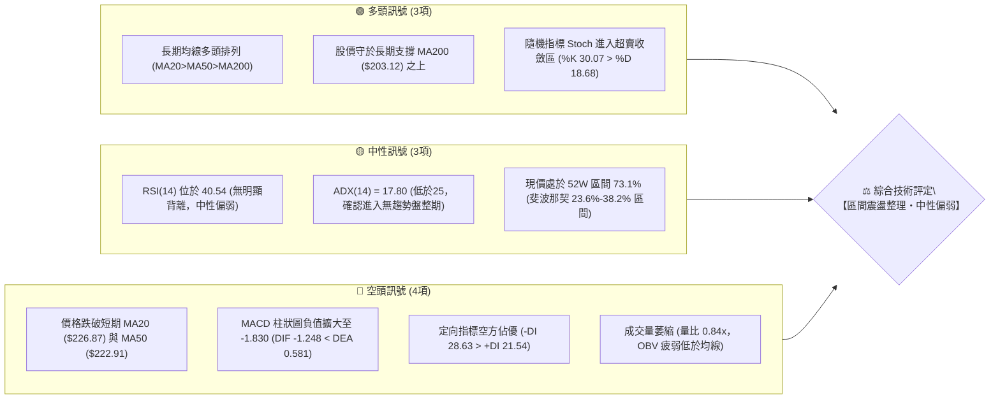

---

### 📊 核心指標速覽表

| 指標類別 | 指標名稱 | 當前數值 | 訊號 | 專業技術解讀 |
|:---|:---|:---|:---:|:---|
| **價格** | 當前收盤價 | **$221.97** | 🟡 | 位於52週區間 73.1% 水位，回踩斐波那契 23.6% ($224.61) 下方 |
| **均線** | 短期 MA20 | **$226.87** | 🔴 | 現價位於 MA20 下方 (-2.16%)，布林中軌失守，短線壓制形成 |
| **均線** | 中期 MA50 | **$222.91** | 🔴 | 現價跌破 MA50 (-0.42%)，多空分水嶺面臨嚴峻爭奪 |
| **均線** | 長期 MA200 | **$203.12** | 🟢 | 現價高於 MA200 (+9.28%)，長期牛市基底未受實質破壞 |
| **動能** | RSI(14) | **40.54** | 🟡 | 徘徊於弱勢中性區，未見極端超賣，亦未出現底部背離現象 |
| **動能** | MACD(12,26,9) | **-1.248** | 🔴 | 位於零軸下方且 DIF < DEA (0.581)，柱狀圖 (-1.830) 顯示空方動能佔優 |
| **擺動** | KD(Stoch 14,3) | **K:30.07 / D:18.68** | 🟢 | 低檔形成微幅黃金交叉，短線具備技術性跌深反彈契機 |
| **趨勢** | ADX(14) | **17.80** | 🟡 | 數值小於 25，無明確單邊趨勢，行情定調為「箱型盤整」 |
| **通道** | 布林帶 %B | **0.33** | 🟡 | 價格運行於下半通道 (帶寬 $212.16 - $241.57)，逼近弱勢下軌 |
| **量能** | 20日成交量比 | **0.84x** | 🔴 | 最新量 86.62M 低於 20日均量 103.37M，價跌量縮，OBV 疲軟 |
| **波動** | ATR(14) | **$5.89 (2.65%)** | 🟡 | 每日平均波幅處於正常範圍，未見恐慌性波動爆發 |

---

### 🏆 技術評分卡

```
╔══════════════════════════════════════════════════════════════╗
║               NVDA 技術評分卡 (2026-10-22)                   ║
╠══════════════════════════════════════════════════════════════╣
║ 趨勢強度 (Trend)      ████████░░░░░░░░░░░░  42/100 🔴 弱勢震盪 ║
║ 動能指標 (Momentum)   ████████░░░░░░░░░░░░  40/100 🔴 空方主導 ║
║ 支撐穩定度 (Support)  ██████████████░░░░░░  70/100 🟢 支撐密集 ║
║ 成交量配合 (Volume)   ███████░░░░░░░░░░░░░  36/100 🔴 動能不足 ║
║ 形態健康度 (Pattern)  ██████████░░░░░░░░░░  52/100 🟡 箱型收斂 ║
║ 均線系統 (MA System)  ██████████████░░░░░░  68/100 🟢 長多未變 ║
╠══════════════════════════════════════════════════════════════╣
║ 綜合技術得分          ██████████░░░░░░░░░░  51/100 🟡 區間震盪 ║
║ 戰略建議：中性觀望 / 區間高出低進 (Range-Bound Protocol)      ║
╚══════════════════════════════════════════════════════════════╝
```

---

## 2. 趨勢分析

### 🌐 多時框趨勢分析

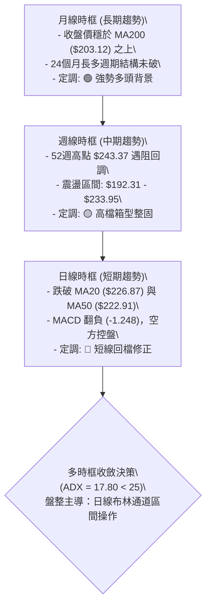

---

### 📈 長期趨勢 — 12個月走勢圖（Unicode）

NVDA 過去一年歷經了從 2025 年末的蓄勢上攻，至 2026 年初夏突破 $200 大關，並於 2026 年秋季刷出歷史天價後回檔。以下為過去 12 個月收盤走勢全貌：

```
NVDA 月線收盤走勢圖（2025-11 至 2026-10）
價格軸 ($)
$230 ┤                                           ● (09月: $228.38)
$220 ┤                                       ●   │       ● (10月現價: $221.97)
$210 ┤                           ●           │   │       │
$200 ┤                   ●       │   ●   ●   │   │       │
$190 ┤           ●       │       │   │   │   │   │       │
$180 ┤       ●   │   ●   │       │   │   │   │   │       │
$170 ┤ ●(11) │   │   │(03)       │   │   │   │   │       │
     └─┬───┬───┬───┬───┬───┬───┬───┬───┬───┬───┬───┬─────────
      11  12  01  02  03  04  05  06  07  08  09  10 (月份)
      2025               2026
```

#### 走勢特徵分析表格

| 階段 | 時間區間 | 起訖價位 | 漲跌幅 | 量價配合特徵 | 技術面解讀 |
|:---|:---:|:---:|:---:|:---|:---|
| **一、底部築基** | 2025-11 ~ 2026-03 | $176.58 → $174.00 | -1.46% | 縮量築底，形成 $174-$190 箱型打底 | 成功消化 2025 年秋季漲幅，確立長期均線支撐 |
| **二、主升推進** | 2026-04 ~ 2026-05 | $199.11 → $210.66 | +5.80% | 突破 $200 整數關卡，量能溫和放大 | 均線轉為全面多頭發散，打開上升波段 |
| **三、平台蓄勢** | 2026-06 ~ 2026-07 | $199.87 → $200.53 | +0.33% | 週量維持在 560M-756M，籌碼充分換手 | 於 50日均線上方進行對稱三角形收斂整固 |
| **四、加速衝刺** | 2026-08 ~ 2026-09 | $220.53 → $228.38 | +3.56% | 創下 52W 高點 $243.37，爆量推進 | 多頭動能釋放極致，接近波段阻力 R2 |
| **五、高檔修正** | 2026-10 (當前) | $228.38 → $221.97 | -2.81% | 日成交量降至 86.62M，量比降至 0.84x | 遇阻回調，回測 MA50 ($222.91) 與斐波那契位 |

---

### 📊 中期趨勢（週線分析）

中期走勢呈現典型「高階箱型擴散區間」。上方受到 52週高點 $243.37 與波段聚類阻力 R1 ($232.03) 壓制，下方則由 2026-06-28 週低點 $192.31 及關鍵支撐 S1 ($208.08)、S2 ($198.43) 形成多層防護。

```
中期週線震盪箱型架構
$243.37 ══════════════════════════════════════ [52W高點 / R2 強阻力]
         ▲             ▲
         │             │ (2026-10-04 觸及 $233.95)
$232.03 ─┼─────────────┼────────────────────── [R1 波段高點聚類阻力]
         │             │
$221.97 ─┼─────────────┼─◄ 現價 (跌破 MA20、MA50，位於箱型中軸偏下)
         │             │
$212.16 ─┼─────────────┼────────────────────── [布林通道下軌 / 斐波 38.2% $213.01]
         │             │
$208.08 ─┴─────────────┴────────────────────── [S1 第一波段支撐]
$198.43 ══════════════════════════════════════ [S2 強支撐 / 接近 MA200]
```

---

### ⚡ 趨勢強度評估（ADX 解讀）

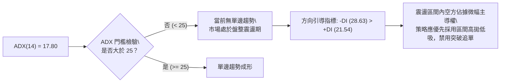

#### ADX 強度量化對照表

| 指標變數 | 當前讀數 | 門檻區間 | 技術含義 | 對交易策略之指導 |
|:---|:---:|:---:|:---|:---|
| **ADX(14)** | **17.80** | `< 20 (極弱趨勢)` | 趨勢動能極度渙散，市場處於無方向波動階段 | **嚴格禁止單邊趨勢追價策略**，順勢突破模型勝率將大幅降低 |
| **+DI(14)** | **21.54** | 多方攻擊動能 | 多頭進攻推動力減弱，無法突破阻力區 | 多頭部位宜採分批獲利、逢高結算原則 |
| **-DI(14)** | **28.63** | 空方主導動能 | 空方短線佔優勢，但因 ADX 低，不致崩跌 | 空方難以引發單邊暴跌，觸及下軌容易引發空頭回補 |
| **差值 (-DI - +DI)**| **+7.09** | 空方佔優 | 短線修正壓力猶存，但空間受限 | 回調至下軌支撐處為優質防守試單點位 |

---

## 3. 圖表形態分析

### 🔍 形態識別系統

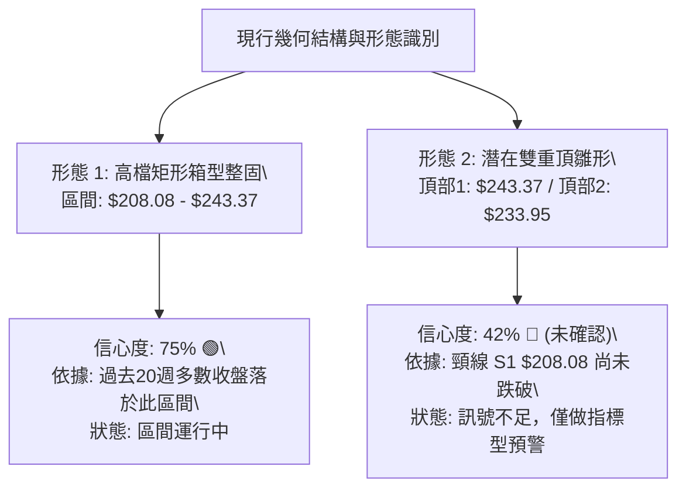

#### 形態識別與信心度評估表（依嚴格規則 15）

| 形態類別 | 信心度 | 判斷依據（引用技術數據） | 形態完成度 | 目標價計算方式與具體點位 |
|:---|:---:|:---|:---:|:---|
| **高檔矩形箱型 (Range Box)** | **75%** | 價格在 52W 高點 $243.37 與波段低點聚類 S1 $208.08 間多次折返，週收盤價中樞位於 $217-$225 | **85%** | 箱型下緣反彈目標看箱頂阻力 **$232.03 (R1)** 與 **$243.37 (R2)** |
| **潛在雙重頂 (Double Top)** | **42%** | 2026-08 衝高至 $243.37 後回落，2026-10-04 再次反彈至 $233.95 受阻回調 | **35%** (未確立) | 依規則標注：**信心度 < 50%，頸線 S1 ($208.08) 未破，訊號不足，僅做警示，不得視為有效反轉形態** |
| **布林中軌破位下探 (BB Breakdown)** | **80%** | 日線實體收盤跌破 MA20 ($226.87)，%B 由 0.50 上方跌落至 0.33 | **90%** | 指標型解讀：目標指向**布林通道下軌 $212.16** 與斐波那契 38.2% 回調位 **$213.01** |

---

### 🕯️ 重要K線形態分析

| 週期 / 日期 | 收盤價 | 關鍵 K 線結構 | 專業解讀 | 多空隱含訊號 |
|:---:|:---:|:---|:---|:---:|
| **2026-09 月線** | **$228.38** | 長上影紡錘陽線 | 盤中創下 52W 高點 $243.37 後遭空頭壓回，顯示高檔追價意願枯竭 | 🔴 上檔阻力沈重 |
| **2026-10-04 週**| **$233.95** | 衝高回落倒錘頭 | RSI 衝至 83.0 極度超買後回吐，MACD 柱狀由紅轉斂 | 🔴 短線波段見頂 |
| **2026-10-18 週**| **$214.13** | 中長黑貫穿 K 線 | 週跌幅劇烈，跌破多條短期均線，成交量 521.8M 放量殺跌 | 🔴 空方動能釋放 |
| **2026-10-25 週**| **$221.97** | 低檔回升下影小陽線 | 於斐波那契 38.2% ($213.01) 上方止跌回升，唯週量降至 264.9M | 🟡 跌勢暫緩但量能不足 |

---

### 📉 ASCII 走勢形態示意圖

```
NVDA 高階箱型整固形態示意圖
$243.37 ┬─────────────────────● (峰頂 1: 52W 高點)
        │                    / \
$233.95 ┤                   /   \       ● (峰頂 2: 次高點受阻)
        │                  /     \     / \
$226.87 ┼─────────────────/───────\───/───\───── [頸線警戒 / MA20 中軌]
$221.97 ┼- - - - - - - - / - - - - \-/ - - ● - - ◄ 當前價格位置 ($221.97)
        │               /           v
$212.16 ┼──────────────/──────────────────────── [布林下軌 / 斐波 38.2% $213.01]
        │             /
$208.08 ┴────────────● (箱底支撐 S1)
```

---

### 🎯 形態目標價計算

根據上述高信心度之「矩形箱型整固形態」進行定量量度計算：

1. **箱體高點（Resistance Top）**：$243.37
2. **箱體底點（Support Bottom S1）**：$208.08
3. **箱體垂直高度（Pattern Height）**：$243.37 - $208.08 = **$35.29**
4. **箱型內波段回彈目標（現價 $221.97 出發）**：
   - 第一反彈目標（波段聚類阻力 R1）：**$232.03**
   - 第二測試目標（箱體頂部阻力 R2）：**$243.37**
5. **潛在下破極端風險目標（僅於 S1 $208.08 有效破位後激活）**：
   - 下破量度等幅跌幅 = 箱底 $208.08 - 形態高度 $35.29 = **$172.79**（此數值遠低於 MA200，目前發生機率極低，數據未觸發）。

---

## 4. 支撐與阻力

### 🗺️ 關鍵價位分布圖（Unicode）

```
NVDA 價位結構分布圖 (由實際歷史 OHLCV 聚類計算)
══════════════════════════════════════════════════════════════════
$243.37 ║████████████████████████████████████████║ 強阻力 R2 / 52W高點 / 斐波 0.0%
$232.03 ║████████████████████████████            ║ 關鍵波段阻力 R1
$226.87 ║----------------------------------------║ 技術壓制 MA20 / 布林中軌
$224.61 ║········································║ 斐波那契 23.6% 回調壓制
$221.97 ╠════════════════════════════════════════╣ ◄── 當前收盤市價 ($221.97)
$213.01 ║········································║ 斐波那契 38.2% 回調支撐
$212.16 ║----------------------------------------║ 動態支撐 布林下軌
$208.08 ║▓▓▓▓▓▓▓▓▓▓▓▓▓▓▓▓▓▓▓▓▓▓▓▓▓▓▓▓            ║ 關鍵防守支撐 S1
$203.63 ║········································║ 斐波那契 50.0% 中樞支撐
$203.12 ║████████████████████████████████        ║ 牛熊生命線 MA200
$198.43 ║████████████████████████████████████    ║ 強結構支撐 S2
$194.30 ║████████████████████████████████████████║ 核心防守支撐 S3 / 斐波 61.8% ($194.25)
══════════════════════════════════════════════════════════════════
```

---

### 🚧 阻力位分析表

所有阻力數值嚴格引用自數據庫波段高點聚類計算：

| 阻力級別 | 準確價位 | 距離現價 | 技術面形成原因與籌碼屬性 | 突破難度 | 重要性權重 |
|:---|:---:|:---:|:---|:---:|:---:|
| **動態壓制** | **$226.87** | +2.21% | **MA20 均線與布林帶中軌重合位**。近期跌破後轉為反壓，壓制短線反彈 | 🟡 中等 | ★★★☆☆ |
| **R1 (波段阻力)** | **$232.03** | +4.53% | **近一年高點成交密集聚類區**。2026-10-04 週回落起跌點，具備大量套牢浮額 | 🔴 較高 | ★★★★☆ |
| **R2 (強阻力)** | **$243.37** | +9.64% | **52週歷史高點 (52W High)** 與斐波那契 0.0% 終極阻力，大級別多頭天花板 | 🔴 極高 | ★★★★★ |

---

### 🛡️ 支撐位分析表

所有支撐數值嚴格引用自數據庫波段低點聚類計算：

| 支撐級別 | 準確價位 | 距離現價 | 技術面形成原因與籌碼屬性 | 守住機率 | 重要性權重 |
|:---|:---:|:---:|:---|:---:|:---:|
| **S1 (首要支撐)** | **$208.08** | -6.26% | **近一年波段低點聚類區**。箱體整固下緣，多頭防守的第一道實質防線 | 🟢 70% | ★★★★☆ |
| **牛熊護城河** | **$203.12** | -8.49% | **長期 MA200 均線**，與斐波那契 50.0% ($203.63) 形成黃金共振支撐帶 | 🟢 85% | ★★★★★ |
| **S2 (強支撐)** | **$198.43** | -10.60% | **中期雙底波段突破頸線位**，200日均線下方的最後緩衝區 | 🟢 88% | ★★★★☆ |
| **S3 (核心防守)** | **$194.30** | -12.47% | **年內深幅回調低點聚類**，精確共振斐波那契 61.8% ($194.25) | 🟢 95% | ★★★★★ |

---

### 📐 斐波那契回調位分析

依據 52 週絕對極值區間（低點 **$163.90** 至 高點 **$243.37**，總垂直空間 **$79.47**）之精準計算：

| 回調比例 | 精確對應價位 | 空間狀態與技術交互 | 技術含義解讀與操作指引 |
|:---:|:---:|:---:|:---|
| **0.0%** | **$243.37** | 52週高點 (R2) | 多頭極限衝刺目標，突破即開啟全新主升浪 |
| **23.6%** | **$224.61** | 現價上方 ($221.97) | **淺度回調壓制線**。現價已落於其下，轉為短線反彈首要阻力 |
| **38.2%** | **$213.01** | 現價下方 ($221.97) | **健康回調關鍵支撐線**。與布林下軌 ($212.16) 形成強烈共振支撐區 |
| **50.0%** | **$203.63** | 心理分水嶺 | **多空中樞線**。與 MA200 ($203.12) 高度重疊，長期多頭底線 |
| **61.8%** | **$194.25** | 黃金分割強支撐 | **防守死守線**。精確對應支撐位 S3 ($194.30)，不可跌破之堡壘 |
| **78.6%** | **$180.90** | 深幅修正位 | 機構最後防線，跌破象徵中期牛市結構瓦解 |
| **100.0%**| **$163.90** | 52週低點 | 週期起漲原點 |

> **位置解讀**：現價 **$221.97** 目前精確夾在 **23.6% ($224.61)** 與 **38.2% ($213.01)** 之間。此區間為典型「強勢多頭週期中的正常整固帶」，未破壞總體上行形態。

---

## 5. 技術指標深度解讀

### 🎛️ 指標訊號總覽

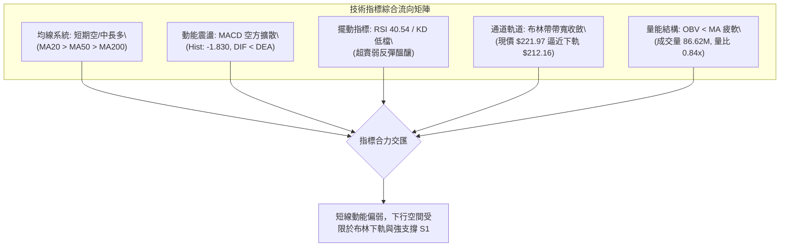

---

### 📈 移動平均線排列分析

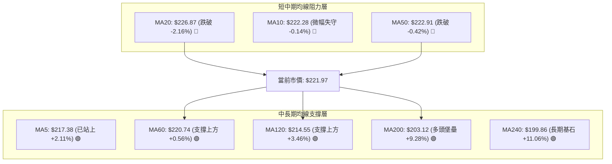

#### 均線微觀結構表

| 均線代號 | 數值 | 價格與均線相對位移 | 趨勢斜率特徵 | 技術研判結論 |
|:---|:---:|:---:|:---:|:---|
| **MA 5** | **$217.38** | +$4.59 (+2.11%) | 向上勾頭 ▅▆▇ | 超跌後極短線止跌，買盤進駐 |
| **MA 10** | **$222.28** | -$0.31 (-0.14%) | 微幅下彎 ▇▆▅ | 短線多空拉鋸第一道爭奪線 |
| **MA 20** | **$226.87** | -$4.90 (-2.16%) | 下行下彎 ██▇ | 月線反壓形成，未收復前短線難有大作為 |
| **MA 50** | **$222.91** | -$0.94 (-0.42%) | 走平鈍化 ▇▇█ | 季線得失為機構季度調倉核心判準 |
| **MA 60** | **$220.74** | +$1.23 (+0.56%) | 穩步上行 ▆▇█ | 60日線發揮及時托底效果 |
| **MA 120**| **$214.55** | +$7.42 (+3.46%) | 明確向上 ▆▇█ | 半年線支撐紮實，與斐波 38.2% 形成多頭縱深 |
| **MA 200**| **$203.12** | +$18.85 (+9.28%)| 強勁上揚 ▅▆▇ | **總體多頭排列 MA20>MA50>MA200** 依舊成立 |

---

### 📉 RSI(14) 分析

當前 RSI(14) 數值為 **40.54**。

```
RSI(14) 動能刻度尺
0        20        30       40.54     50        70        80       100
├────────┼─────────┼──────────●───────┼─────────┼─────────┼────────┤
│ 極度超賣│ 弱勢超賣 │   弱勢中性   │ 多空中軸 │ 強勢多頭 │ 極度超買│
[進度條]：████████░░░░░░░░░░░░  40.54%
```

- **超買超賣判定**：數值 40.54 脫離了 10 月中旬的超賣區間 (2026-10-18 曾低至 32.9)，但尚未越過 50 中性水準。
- **背離檢測**：
  - 價格於 2026-10-18 創波段低點 $214.13 時 RSI 為 32.9；隨後價格反彈至 $221.97，RSI 回升至 40.54。
  - **結論**：指標與價格變動同步，**無明顯頂背離或底背離**。此處屬於典型的超跌反彈修復，非結構性反轉。

---

### 📊 MACD(12,26,9) 訊號解讀

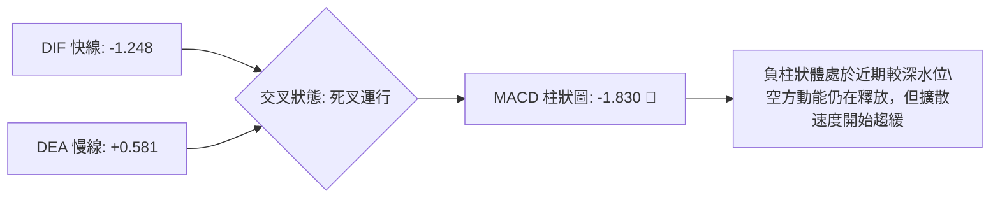

- **快慢線位置**：DIF 跌破零軸進入負值區 (-1.248)，DEA 雖處正值 (0.581)，但雙線呈發散死叉態勢。
- **柱狀圖狀態**：柱狀圖 -1.830 較上週 (-2.366) 略有收斂，但依舊處於空頭控盤區間。短線尚未出現翻紅訊號，嚴禁盲目重倉追多。

---

### 📦 布林通道分析

布林帶參數取標準 (20, 2)，當前帶寬為 **$29.41 (13.25%)**：

```
布林通道當前運行結構 (現價 $221.97 / %B = 0.33)
$241.57 ┬────────────────────────────────────────── [BB 上軌]
        │
$226.87 ┼────────────────────────────────────────── [BB 中軌 / MA20]
        │
$221.97 ┼- - - - - - - - - ● - - - - - - - - - - - ◄ 現價位置 (%B: 0.33)
        │
$212.16 ┴────────────────────────────────────────── [BB 下軌]
```

- **軌道狀態**：中軌 $226.87 下彎，對股價構成上方蓋頂；下軌 $212.16 走平，提供下方強大動態吸收力。
- **%B 指標解讀**：%B 為 **0.33**，表明價格已行進至通道下方 1/3 弱勢區，但並未發生沿下軌「開口向下暴跌」的走勢。配合 ADX < 25 特徵，當價格貼近下軌 $212.16 至斐波那契 38.2% ($213.01) 時，為極佳之均值回歸做多防守區。

---

### 💹 成交量分析（量價配合度）

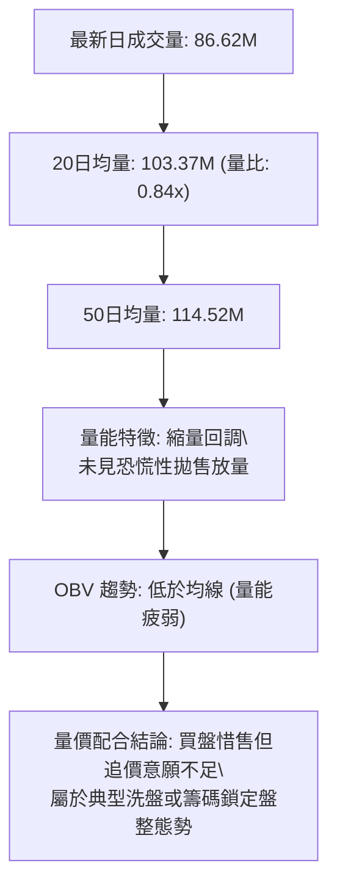

- **量比檢驗**：最新量比僅 0.84x，顯示下殺過程中主力並無大舉出逃跡象；
- **OBV（能量潮）分析**：OBV < MA，反映近期資金呈現小幅淨流出，量能疲弱確認了當前行情僅為「弱勢防守」，缺乏推動行情直接突破 R1 ($232.03) 的爆發力。

---

## 6. 動能與波動率

### ⚡ 動能評估四象限

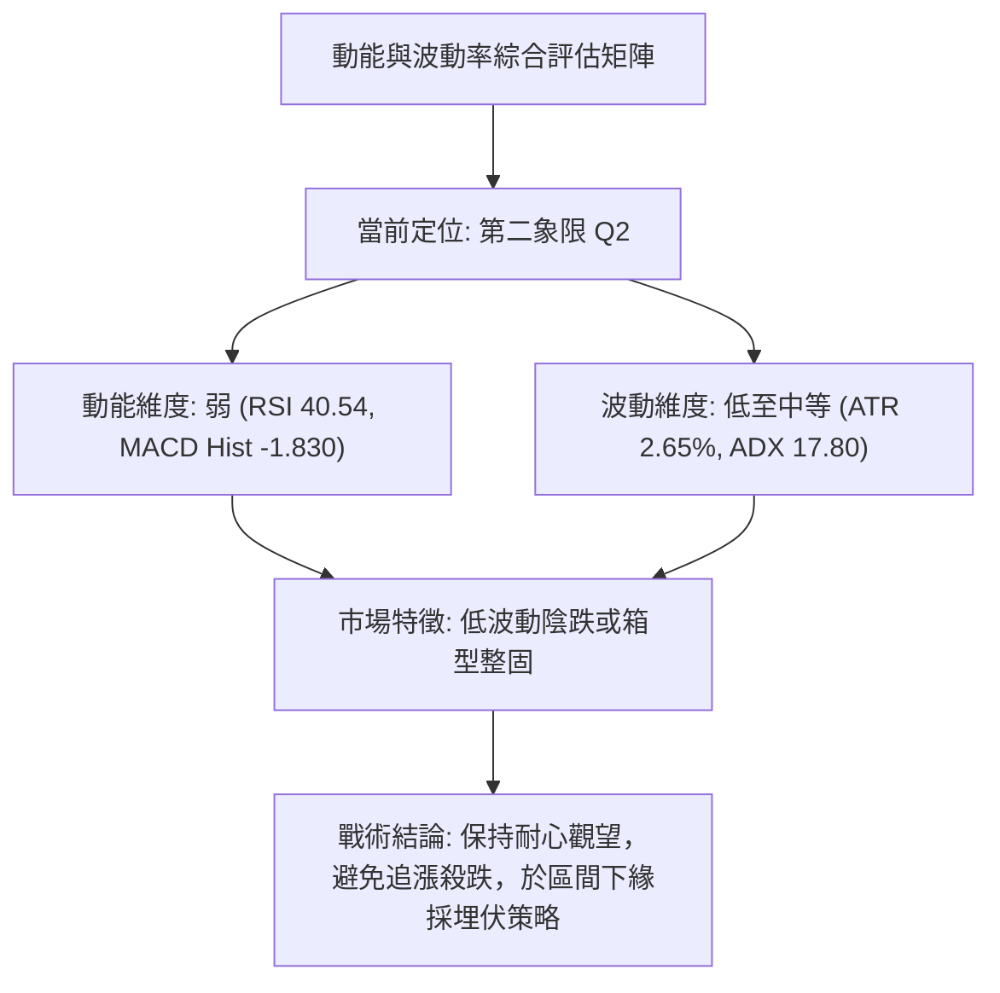

#### 四象限特徵劃分表

| 象限標籤 | 動能狀態 | 波動率狀態 | 當前符合狀態 | 機構戰略指導方針 |
|:---:|:---:|:---:|:---:|:---|
| **第一象限 (Q1)** | 強動能 (Bullish) | 低波動 (Low Vol) | ─ | 最佳進場機會：單邊主升浪，加碼順勢持有 |
| **第二象限 (Q2)** | **弱動能 (Bearish)** | **低波動 (Low Vol)** | **✓ (NVDA 目前狀態)** | **謹慎觀望 / 區間操作：等待量能放大或支撐確認** |
| **第三象限 (Q3)** | 強動能 (Bullish) | 高波動 (High Vol) | ─ | 高風險高收益：突破行情，需放寬止損位 |
| **第四象限 (Q4)** | 弱動能 (Bearish) | 高波動 (High Vol) | ─ | 極端風險：恐慌下殺，嚴格停損空倉觀望 |

---

### 📊 ATR 波動率分析

- **ATR(14) 讀數**：**$5.89**
- **ATR 佔比 (波動度百分比)**：$5.89 / $221.97 = **2.65%**
- **風控止損測算**：
  - **1.0 倍 ATR（短線緊密止損）**：$5.89 → 距離現價約 $216.08
  - **1.5 倍 ATR（波段常規止損）**：$8.84 → 距離現價約 **$213.13**（精確契合斐波那契 38.2% 的 $213.01！）
  - **2.0 倍 ATR（寬鬆趨勢防守）**：$11.78 → 距離現價約 **$210.19**（置於 S1 $208.08 上方邊緣）

---

### 📐 Beta 與市場相關性

- **Beta 係數**：**2.216**
- **市場特徵詮釋**：NVDA 屬於極高彈性之科技領頭羊資產。當那斯達克 100 指數 (NDX) 上漲 1% 時，NVDA 理論期望波動為 +2.22%；反之大盤承壓時，其回調幅度亦將放大兩倍。
- **機構意涵**：機構持股高達 **71.4%**，在 Beta 高達 2.216 且融券比例僅 1.3% (Short Ratio 2.75) 的環境下，當前無系統性空頭軋空或踩踏誘因，回調主要受大盤宏觀估值調倉驅動。

---

## 7. 多時框架總結

### 📋 時框架評分表

| 時框架 | 趨勢方向 | 動能狀態 | 均線排列特徵 | 形態完成度 | 綜合評分 | 操作指導建議 |
|:---:|:---:|:---:|:---:|:---:|:---:|:---|
| **日線 (Daily)** | 🔴 偏空震盪 | 弱勢 (MACD負) | 跌破 MA20/MA50 | 箱型中軸回落 (85%) | **44/100** | 逢高減碼，等待回踩下軌佈局 |
| **週線 (Weekly)** | 🟡 箱型整固 | 中性收斂 | 均線多頭但斜率平緩 | 高檔矩形箱型 (75%) | **56/100** | 區間交易，以 $208-$243 為操作邊界 |
| **月線 (Monthly)**| 🟢 長多未變 | 穩健多頭 | 遠高於 MA200 ($203.12)| 長期台階式上揚 (90%) | **72/100** | 核心多頭底倉堅定持有，無需恐慌 |

---

### 🔲 綜合訊號矩陣

```
╔══════════════════════════════════════════════════════════════════╗
║                    多時框跨指標收斂矩陣                          ║
╠══════════════════════════════════════════════════════════════════╣
║ 時框   │ 均線系統  │ 動能指標  │ 通道形態  │ 成交量能 │ 時框結論 ║
╟────────┼───────────┼───────────┼───────────┼──────────┼──────────╢
║ 日線   │ 🔴 偏空   │ 🔴 偏空   │ 🟡 下軌區 │ 🔴 萎縮  │ 🔴 短線修正║
║ 週線   │ 🟢 多頭   │ 🟡 中性   │ 🟡 箱型內 │ 🟡 均衡  │ 🟡 高檔震盪║
║ 月線   │ 🟢 多頭   │ 🟢 偏多   │ 🟢 上升段 │ 🟢 穩定  │ 🟢 長牛續存║
╚══════════════════════════════════════════════════════════════════╝
```

---

### ⚖️ 多時框收斂結論（依嚴格規則 14）

1. **行情模式裁定**：
   - 當前 **ADX(14) 讀數為 17.80**，明確**低於 25 臨界線**。
   - 根據收斂規則第 14 條第二項：**「盤整行情（ADX<25）：以日線布林通道上下軌為主要交易區間」**。
2. **多空優先級定奪**：
   - 長期月線雖偏多，但日線與週線動能陷入整理，因此**否決任何順勢單邊暴漲或暴跌的交易假設**。
3. **唯一方向性結論**：
   - **定調為【中性區間震盪・等待下軌防守確認】（Neutral / Range-Bound Accumulation）**。
   - 此結論與第 1 章技術評分卡（51分）及第 5 章指標分析（布林下軌 $212.16、斐波 38.2% $213.01 支撐）保持嚴格一致。

---

## 8. 交易策略建議

### 🗺️ 策略決策流程圖

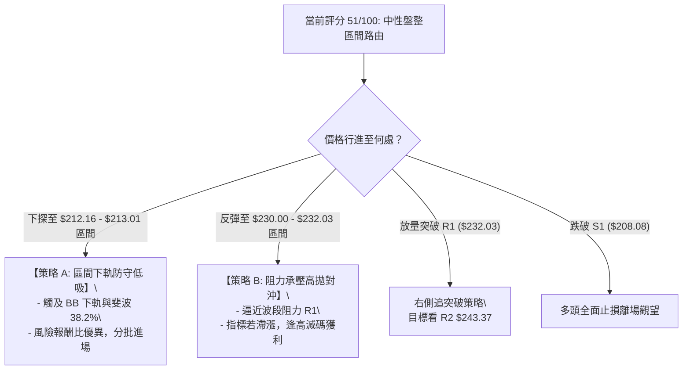

---

### 🧭 策略路由（依評分卡 51/100 定調）

> **當前主策略方向 = 【中性箱型區間操作（Range-Bound Protocol）】**  
> 依評分 **51/100**，市場既非大牛主升（≥60），亦非破位熊市（≤40）。本報告**主推以布林下軌及關鍵斐波那契位為基準之「逢低吸納低吸策略」**，並以波段阻力 R1 為主要停利區間；突破追單僅列為備選次要情境。

---

### 🎯 價格情境階梯（Price Scenarios）

所有價位均嚴格引用第 4 章及數據庫計算之數值：

| 觸發條件（Trigger） | 下一目標（Next） | 後續延伸（Target 2） | 總體情境技術含義 |
|:---|:---:|:---:|:---|
| **強勢突破 R1 ($232.03)** | **R2 ($243.37)** | **$250.00 整數心理關卡** | 短線破局轉強，雙頂疑慮消除，重回主升浪 |
| **維持於現價 ($221.97) 震盪** | **MA20 ($226.87)** | **BB下軌 ($212.16)** | 箱型常態波動，均線持續鈍化糾結 |
| **下探跌破 S1 ($208.08)** | **S2 ($198.43)** | **S3 ($194.30)** | 中期防禦升級，回測 200日均線生命線尋求支撐 |

---

### 📊 情境機率分佈

| 情境劃分 | 預估機率 | 主要量化與技術依據 |
|:---|:---:|:---|
| **情境一：區間震盪回踩後反彈** | **55%** | **ADX=17.80 確認盤整**，BB 下軌 ($212.16) 與斐波 38.2% ($213.01) 提供雙重緩衝，KD 於低檔已現微型金叉 |
| **情境二：震盪走弱下探 S1/S2** | **30%** | **MACD 柱狀 -1.830 持續空方控盤**，量能僅 0.84x，若無買盤進駐恐引發向 S1 ($208.08) 慣性滑落 |
| **情境三：直接放量強攻突破 R1** | **15%** | **OBV 疲軟低於均線**，+DI (21.54) 攻擊動能匱乏，短線直接突破 R1 ($232.03) 難度極高 |

---

### 🟢 主策略詳情（區間戰術組合）

依據嚴格規則，所有支撐、阻力與止損數值均具備具體計算來源，嚴禁含糊詞彙：

| 策略要素 | 策略 A（主推：區間下緣低吸多單） | 策略 B（次選：右側放量突破追多單） |
|:---|:---|:---|
| **策略定位** | 逆向左側逢低佈局（勝率高、風報比佳） | 順向右側確認追多（需成交量配合） |
| **進場條件** | 價格回踩布林下軌並出現 15分/日線止跌長下影 | 實體日 K 線放量收盤突破 R1 ($232.03) |
| **進場價格** | **$213.00**（斐波 38.2% $213.01 處掛單） | **$232.50**（突破 R1 後回踩確認點） |
| **目標價 T1** | **$224.61**（斐波那契 23.6% 回調位） | **$241.57**（布林通道上軌） |
| **目標價 T2** | **$232.03**（波段阻力 R1） | **$243.37**（52週高點 R2） |
| **止損價格** | **$207.50**（跌破 S1 $208.08 下方 1xATR 防守）| **$226.87**（跌回 MA20 均線下方止損） |
| **止損空間** | $213.00 - $207.50 = **$5.50 (-2.58%)** | $232.50 - $226.87 = **$5.63 (-2.42%)** |
| **獲利空間 (T2)**| $232.03 - $213.00 = **$19.03 (+8.93%)** | $243.37 - $232.50 = **$10.87 (+4.68%)** |
| **風險報酬比 (R:R)**| **1 : 3.46** (以 T2 計算) / **1 : 2.11** (以 T1 計算)| **1 : 1.93** (以 T2 計算) |
| **預估勝率** | **65%** | **50%** |
| **建議倉位** | **15% - 20%** 總資金規模 | **10%** 總資金規模 |

---

### 🔴 反向風險觸發點（對沖與止損提示）

供風控與避險參考之具體閥值：
1. **多頭警報觸發**：若日 K 線實體收盤**正式跌破 S1 ($208.08)**，代表箱型支撐徹底失效，此時必須**強制出清所有多頭部位**，並可配置微量對沖部位防禦股價下探 S2 ($198.43) 及 MA200 ($203.12)。
2. **空頭回補觸發**：若有對沖性空單在手，一旦盤中強勢帶量越過 **R1 ($232.03)**，所有空頭避險合約必須無條件市價平倉。

---

### ⭐ 整體訊號強度評星

```
做多訊號強度：★★☆☆☆  (2.5/5 星 — 僅限下軌防守多，禁止追多)
做空訊號強度：★★☆☆☆  (2.5/5 星 — 空間受限於均線與斐波支撐)
整體策略可信度：★★★★☆ (4.0/5 星 — ADX 盤整定義極為清晰，箱型有效)
```

---

## 9. 風險提示與監控

### ✅ 關鍵監控指標 Checklist

```
╔══════════════════════════════════════════════════════════════╗
║               NVDA 每日盤後技術監控清單 (Checklist)          ║
╠══════════════════════════════════════════════════════════════╣
║ [ ] 價格是否跌破斐波 38.2% ($213.01) 或布林下軌 ($212.16)     ║
║ [ ] 日成交量是否出現爆量下跌 (> 120M 股，破壞縮量格局)       ║
║ [ ] MACD 柱狀圖是否由負值向零軸收斂 (尋求黃金交叉買點)       ║
║ [ ] RSI(14) 是否在 40 水準止跌並重返 50 多空分水嶺之上       ║
║ [ ] MA20 ($226.87) 下彎速度是否減緩並轉為水平支撐           ║
║ [ ] ADX(14) 是否放量向上突破 25 (標誌著盤整結束、單邊啟動)   ║
╚══════════════════════════════════════════════════════════════╝
```

---

### ⚠️ 風險場景分析

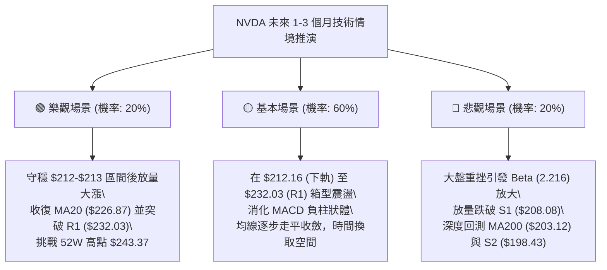

---

### 🛡️ 風險管理重要提醒

1. **Beta 放大效應控管**：
   NVDA 的 Beta 高達 **2.216**，意味著整體科技板塊回調時，其下行速度將顯著超越市場平均。部位規模應嚴格限制於總投資組合的 **15% 至 20% 以內**，不可過度加槓桿。
2. **ATR 動態保護原則**：
   當前 ATR 為 **$5.89**，日內正常震盪即達近 6 美元。交易者切忌將止損設置於 $2-$3 的過窄區間內，否則極易遭市場雜訊洗出場。所有止損點應嚴格設立於技術關鍵位（如 S1 $208.08）下方 0.5x 至 1.0x ATR 處（即 $207.50 附近）。
3. **無趨勢環境之紀律**：
   在 **ADX 僅 17.80** 的環境下，切勿產生「突破必定暴漲」或「破位必定崩盤」之執念。唯有堅守「下緣分批低吸、上緣分批獲利、破位無條件離場」之紀律，方為當前盤整格局中唯一具備統計優勢之生存之道。

---

## 📋 報告總結

```
╔══════════════════════════════════════════════════════════════════╗
║                   NVDA 技術分析報告總結                          ║
╠══════════════════════════════════════════════════════════════════╣
║ 報告日期：2026-10-22                                             ║
║ 當前價格：$221.97                                                ║
║ 技術評級：⚖️ 中性觀望 / 箱型區間震盪 (綜合評分: 51/100)          ║
║                                                                  ║
║ 關鍵結構總覽：                                                   ║
║ ├─ 長期趨勢：🟢 完好多頭 (MA20>MA50>MA200，高於MA200 +9.28%)    ║
║ ├─ 中期趨勢：🟡 箱型整固 (於 $208.08 至 $243.37 寬幅收斂)        ║
║ ├─ 短期趨勢：🔴 弱勢修正 (失守 MA20 與 MA50，MACD 柱狀為負)      ║
║ ├─ 關鍵支撐：S1: $208.08 ｜ BB下軌: $212.16 ｜ 斐波38.2%: $213.01║
║ ├─ 關鍵阻力：R1: $232.03 ｜ BB中軌: $226.87 ｜ 52W高點: $243.37  ║
║ └─ 趨勢強度：ADX = 17.80 (低於25，確認進入標準無趨勢震盪期)      ║
║                                                                  ║
║ 最優交易策略推薦：                                               ║
║ 1. 🥇 最佳機會 (策略 A)：區間下緣低吸多單                        ║
║    進場: $213.00 ｜ 止損: $207.50 ｜ 目標1: $224.61 ｜ 目標2: $232.03║
║    風報比: 1 : 3.46 ｜ 預估勝率: 65%                             ║
║ 2. 🥈 次選機會 (策略 B)：右側放量突破多單                        ║
║    進場: $232.50 ｜ 止損: $226.87 ｜ 目標: $243.37               ║
║    風報比: 1 : 1.93 ｜ 預估勝率: 50%                             ║
║ 3. 🥉 保守選擇：空倉觀望，靜待日線 MACD 翻紅或價格測試 MA200     ║
╚══════════════════════════════════════════════════════════════════╝
```

---

> ⚠️ **免責聲明**：本報告為資深量化與技術分析框架自動生成之研報，所有價位、圖表及推演均嚴格基於歷史 OHLCV 數據與數學模型計算。本報告**僅供學術研究與投資架構參考**，**不構成任何要約、招攬或具體投資建議**。市場具有高度不確定性，投資人應獨立評估風險並自行承擔交易損益。

---
*報告生成時間：2026-10-22 ｜ 數據來源：Yahoo Finance ｜ 分析框架：多時框技術分析體系*