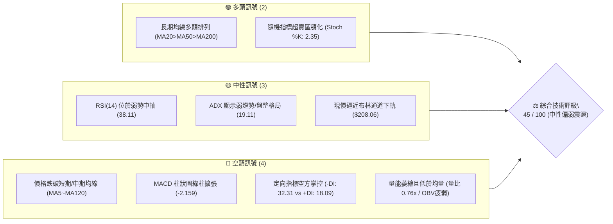
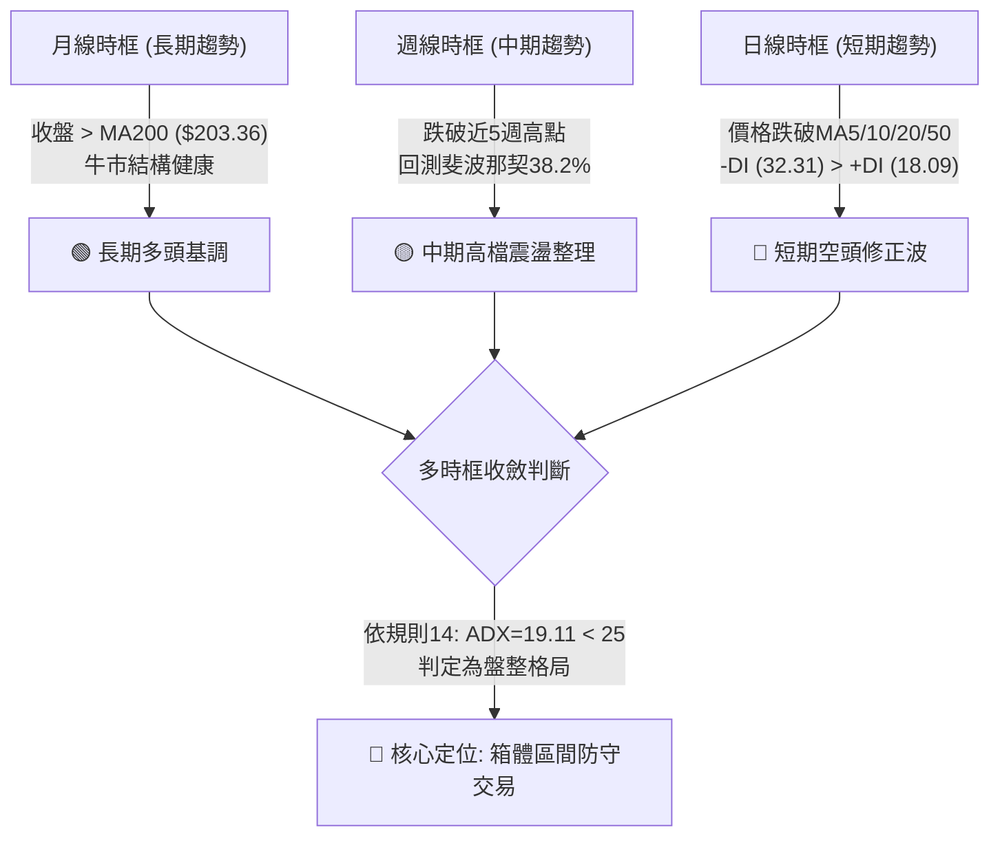
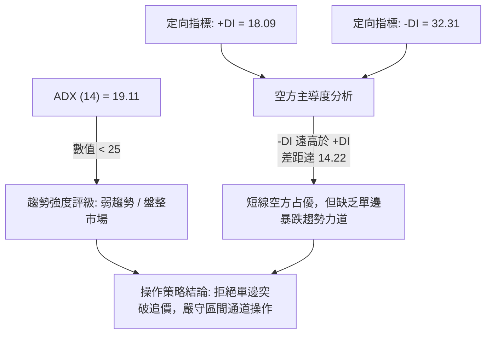
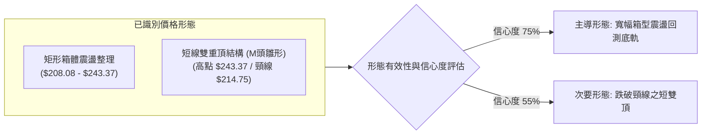
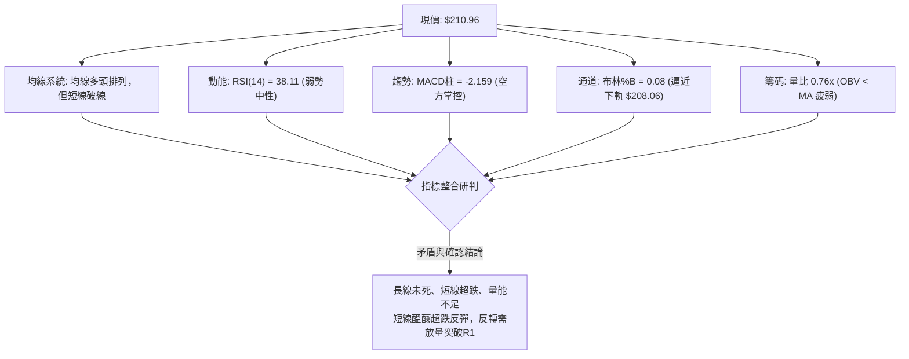
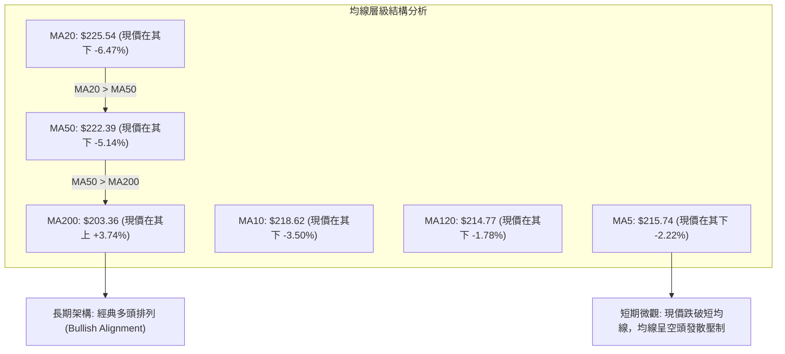
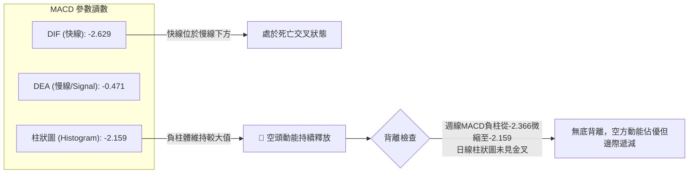
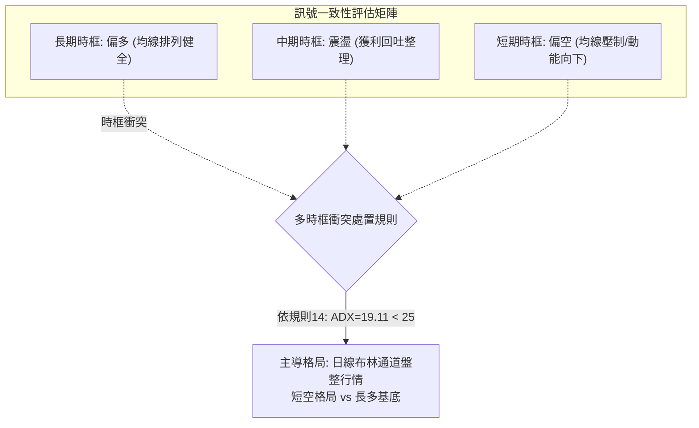
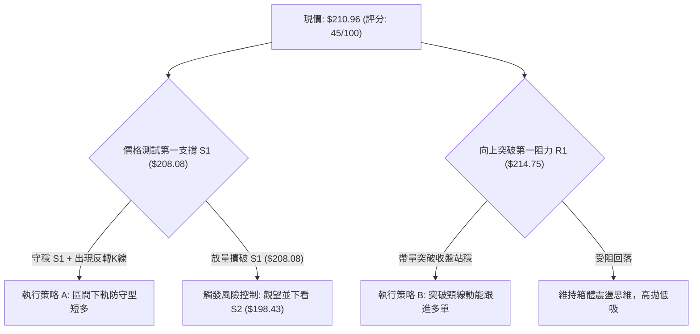
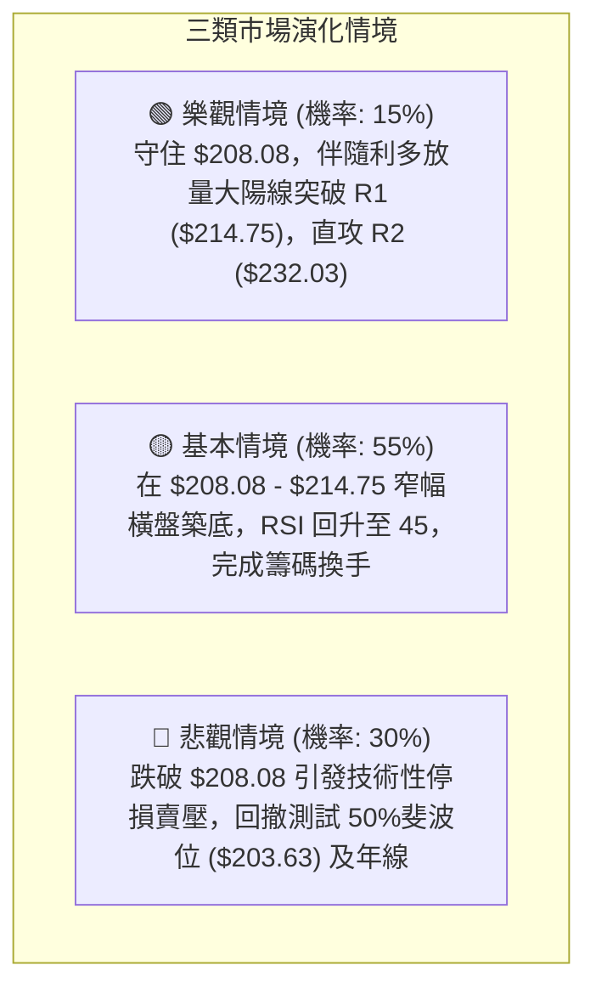

# NVDA 技術分析報告

> **報告日期**：2026-10-24 ｜ **語言**：繁體中文 ｜ **數據來源**：Yahoo Finance ｜ **當前價格**：$210.96

---

## 目錄

| 章節 | 內容 |
|------|------|
| [1. 技術面概覽](#1-技術面概覽) | 訊號儀表板、核心指標、評分卡 |
| [2. 趨勢分析](#2-趨勢分析) | 多時框趨勢、長中短期走勢、ADX強弱 |
| [3. 圖表形態分析](#3-圖表形態分析) | 形態識別、K線組合、目標價推算 |
| [4. 支撐與阻力](#4-支撐與阻力) | 關鍵價位分布、波段聚集、斐波那契回調 |
| [5. 技術指標深度解讀](#5-技術指標深度解讀) | 均線系統、RSI/MACD、布林通道、量價結構 |
| [6. 動能與波動率](#6-動能與波動率) | 動能四象限、ATR波動分析、Beta係數解讀 |
| [7. 多時框架總結](#7-多時框架總結) | 時框架矩陣、多時框收斂定調 |
| [8. 交易策略建議](#8-交易策略建議) | 策略路由、價格情境階梯、策略執行參數 |
| [9. 風險提示與監控](#9-風險提示與監控) | 監控Checklist、三行情境、部位控管規則 |

---

## 1. 技術面概覽

### 🎯 技術訊號儀表板



### 📊 核心指標速覽表

| 指標類別 | 指標名稱 | 當前數值 | 訊號 | 解讀 |
|:---|:---|:---|:---:|:---|
| **價格** | 當前收盤價 | $210.96 | 🟡 | 位於52週區間59.2%分位，自高點回檔整理 |
| **均線** | MA20 (短月線) | $225.54 | 🔴 | 現價在MA20下方 -6.47%，短線處於空頭壓制 |
| **均線** | MA50 (中季線) | $222.39 | 🔴 | 現價在MA50下方 -5.14%，跌破波段生命線 |
| **均線** | MA200 (年線) | $203.36 | 🟢 | 現價在MA200上方 +3.74%，長期牛市基底完好 |
| **動能** | RSI(14) | 38.11 | 🟡 | 位於中性偏弱區（30–70），未達極端超賣 |
| **動能** | MACD 柱狀圖 | -2.159 | 🔴 | DIF (-2.629) 低於 DEA (-0.471)，空頭動能主導 |
| **動能** | KD (%K / %D) | 2.35 / 11.79 | 🟢 | 深度超賣區（<20），短線具備技術性反彈動能 |
| **趨勢** | ADX(14) / 方向 | 19.11 (-DI:32.31) | 🟡 | ADX < 25 為盤整行情，空方佔據局部優勢 |
| **通道** | 布林 %B | 0.08 | 🟡 | 貼近布林下軌（$208.06），下行空間受通道壓縮 |
| **成交量** | 20日成交量比 | 0.76x | 🔴 | 成交量 79.98M 低於均量 105.29M，量能萎縮 |
| **波動** | ATR(14) | $6.06 (2.87%) | 🟡 | 波動度處於中等水平，單日正常波動區間約 $6.06 |

### 🏆 技術評分卡

```
╔══════════════════════════════════════════════════════════════════════╗
║                    技術評分卡 — NVDA (2026-10-24)                    ║
╠══════════════════════════════════════════════════════════════════════╣
║  趨勢強度      ████████░░░░░░░░░░░░  38/100  🔴 空方控盤（ADX=19.11） ║
║  動能指標      ██████░░░░░░░░░░░░░░  32/100  🔴 MACD負值/RSI偏弱      ║
║  支撐穩定度    ██████████████░░░░░░  68/100  🟢 臨近S1/布林下軌/MA200 ║
║  成交量配合    ███████░░░░░░░░░░░░░  36/100  🔴 OBV<MA，量能呈退潮    ║
║  形態完整度    ████████░░░░░░░░░░░░  42/100  🟡 箱型震盪拉回測底      ║
║  均線排列      ███████████░░░░░░░░░  54/100  🟡 長多短空（MA20>50>200）║
╠══════════════════════════════════════════════════════════════════════╣
║  綜合評分      █████████░░░░░░░░░░░  45/100  ⚖️ 區間盤整／防守觀望   ║
╚══════════════════════════════════════════════════════════════════════╝
```
*註：綜合評分係依規則 18，由趨勢(38)、動能(32)、支撐(68)、成交量(36)、形態(42)、均線(54)之算術平均精準計算：(38+32+68+36+42+54)/6 = 270/6 = 45.0，四捨五入為 45/100。*

---

## 2. 趨勢分析

### 🌐 多時框趨勢分析



### 📈 長期趨勢 — 12個月走勢圖（Unicode）

以下為 NVDA 自 2025 年 11 月至 2026 年 10 月之月線收盤走勢軌跡：

```
NVDA 月線走勢圖（過去12個月：2025-11 至 2026-10）
價格軸 ($)
$240 ┤                                           
$230 ┤                                      ● ($228.38)
$220 ┤                                  ● ($220.53)
$210 ┤                              ● ($210.66)   ● ($210.96)←現價
$200 ┤                          ● ($199.11) ● ($200.53)
$190 ┤                  ● ($190.68)
$180 ┤ ● ($176.58)  ● ($186.06)
$170 ┤          ● ($176.78) ● ($174.00 低點)
     └─────────────────────────────────────────────────────────────
       11   12   01   02   03   04   05   06   07   08   09   10
      (2025)             (2026)
```

#### 走勢特徵分析表

| 階段區間 | 時間跨度 | 起訖價位 | 漲跌幅 | 走勢特徵與結構意涵 |
|:---|:---|:---|:---:|:---|
| **第一階段：中期回踩** | 2025-11 ~ 2026-03 | $176.58 → $174.00 | -1.46% | 構築 $174.00–$176.00 長期底部，夯實支撐盤整結構 |
| **第二階段：主升推升** | 2026-03 ~ 2026-05 | $174.00 → $210.66 | +21.07% | 量價齊揚突破兩百美元關卡，多頭趨勢確立 |
| **第三階段：高檔蓄勢** | 2026-05 ~ 2026-07 | $210.66 → $200.53 | -4.81% | 在 $200 心理關卡進行旗形整理，籌碼換手充分 |
| **第四階段：創高衝頂** | 2026-07 ~ 2026-09 | $200.53 → $228.38 | +13.89% | 沿五週線攻堅，並於 2026-10 創下 52週高點 $243.37 |
| **第五階段：目前回檔** | 2026-09 ~ 2026-10 | $228.38 → $210.96 | -7.63% | 連續兩週大幅拉回，跌破多條短均線，進入盤整修正 |

### 📊 中期趨勢（週線分析）

從近 20 週數據觀察，NVDA 在 2026-10-09 當週刷出歷史級高點 $243.37 後，出現顯著的高檔獲利了結賣壓。近兩週（10-16 與 10-23）週K連收黑K，收盤價由 $229.28 快速跌落至 $210.96，週線 RSI 亦由 63.0 快速回落至 38.1，週線 MACD 柱狀圖由正轉負（+0.119 驟降至 -2.159），代表中期動能明顯衰退，目前價格正回測 8 月初突破點 $210.00–$214.00 平台。

```
週線支撐阻力結構示意圖
$243.37 ────────────────────────────────────────── 52W 高點壓力 (R3)
          \   
$232.03 ───\────────────────────────────────────── 波段次高阻力 (R2)
            \      
$214.75 ─────\──────────────────────────────────── 頸線與反彈第一阻力 (R1)
              ▼ [現價: $210.96]
$208.08 ────────────────────────────────────────── 近期關鍵支撐 (S1 / 布林下軌)
$198.43 ────────────────────────────────────────── 次級防守線 (S2 / 前波低點聚類)
```

### ⚡ 趨勢強度評估（ADX 解讀）



#### ADX 趨勢強度量化對照表

| 指標變數 | 當前讀數 | 標準門檻區間 | 行情屬性解讀 |
|:---|:---:|:---:|:---|
| **ADX (14)** | 19.11 | < 20 (極弱趨勢/完全盤整) | 價格運動缺乏趨勢延續性，指標常出現鈍化或來回穿越 |
| **+DI** | 18.09 | > 25 為強多 | 多頭買盤推升動能不足，處於退潮狀態 |
| **-DI** | 32.31 | > 25 為強空 | 空頭拋壓佔據主導，下行慣性依然存在 |
| **綜合研判** | 弱勢盤整 | 規則 14 判定 | **盤整行情（ADX < 25）**：以日線布林通道為主要交易邊界 |

---

## 3. 圖表形態分析

### 🔍 形態識別系統



#### 圖表形態信心度與目標價評估表

| 形態名稱 | 信心度 | 判斷依據（引用數據） | 完成度 | 目標價（附嚴格計算式） |
|:---|:---:|:---|:---:|:---|
| **矩形箱體震盪** | **75%** | 價格在 52W 高點 $243.37 與支撐 S1 $208.08 之間震盪，ADX=19.11 確認為無趨勢盤整 | 85% | **箱底測試：$208.08**<br/>若守穩反彈目標為箱體中軌 $225.54 (MA20) |
| **短期雙頂 (M頭)** | **55%** | 10-02 高點 $237.88 與 10-09 高點 $243.37 形成雙峰，現已跌破頸線 R1 $214.75 | 70% | 頸線 $214.75 − 形態高度 ($243.37 − $214.75 = $28.62) = **$186.13**（若有效跌破S1才觸發） |
| **下降通道修正** | **45%** | 訊號不足，僅做指標型解讀。日K線沿MA5下行，但受限布林下軌支撐。 | N/A | 依規則 15：信心度 < 50%，不預設幾何目標價。 |

### 🕯️ 重要 K 線形態分析

嚴格依據數據中「近 10 根日 K」與「近 8 根週 K」之開、高、低、收進行專業審查：

| 日期（時框） | 開盤價 | 最高價 | 最低價 | 收盤價 | K線形態名稱 | 技術解讀 | 訊號 |
|:---|:---:|:---:|:---:|:---:|:---|:---|:---:|
| **2026-10-23 (日K)** | 210.99 | 213.85 | 210.18 | 210.96 | **十字星小陰線** | 實體極小 ($0.03)，振幅收窄至 $3.67，下影線觸及 $210.18，顯示下殺動能暫歇 | 🟡 |
| **2026-10-22 (日K)** | 217.13 | 218.88 | 211.26 | 212.21 | **長黑吞噬放量K** | 開高走低，實體達 $4.92，成交量放大至 125.40M，空方主力強力摜壓破線 | 🔴 |
| **2026-10-21 (日K)** | 220.96 | 222.19 | 217.66 | 221.97 | **短紅反彈K** | 多頭試圖反抽，但高點 $222.19 受制於 MA50 ($222.39)，留下上影線 | 🟡 |
| **2026-10-15 (日K)** | 215.30 | 218.47 | 212.85 | 217.23 | **下影長白十字** | 探低至 $212.85 後引發買盤回擊，成交量達 127.08M，確立 S1 上方有買盤伏擊 | 🟢 |
| **2026-10-23 (週K)** | 218.10 | 222.19 | 210.18 | 210.96 | **中黑帶下影線** | 連續第二週收陰，收盤逼近當週最低點，週線層級仍受空頭慣性控制 | 🔴 |
| **2026-10-09 (週K)** | 236.09 | 243.37 | 229.11 | 229.28 | **倒轉長上影鎚頭** | 衝刺 52W 高點 $243.37 遭遇強大拋壓，收盤重挫，為經典波段見頂訊號 | 🔴 |

### 📉 ASCII 走勢形態示意圖

```
NVDA 日線 M頭破頸線與箱體回測結構
價格 ($)
$243.37 ─────────────┐ (10-09 峰頂)
                     │
$237.88 ──────┐      │
              │(10-02)│
$225.54 ──────┼──────┼─────── BB中軌 (MA20) 阻力
              │      │       \
$214.75 ──────┴──────┴─────────────── 頸線 / R1 阻力 (已被跌破)
                               \
$210.96 ────────────────────────● 現價 (回測支撐中)
                                 │
$208.08 ─────────────────────────┴─── 關鍵箱底 / S1 支撐 (多頭生死線)
```

### 🎯 形態目標價計算

1. **短期反彈形態目標**：若現價 $210.96 在支撐 S1 ($208.08) 獲得確認，箱體下軌反彈之第一級理論目標為頸線回測位 **$214.75**；第二級目標為回補均線乖離之布林中軌（MA20）**$225.54**。
2. **空頭形態破位目標**：若跌破 S1 ($208.08)，由雙頂高度計算之極限目標為 $186.13，但途中將遭遇波段支撐聚集區 **S2 ($198.43)** 與 **S3 ($194.30)** 之強力阻截。

---

## 4. 支撐與阻力

### 🗺️ 關鍵價位分布圖（Unicode）

```
NVDA 價位結構分布圖（嚴格依據 OHLCV 聚類計算）
═══════════════════════════════════════════════════════════════════
$243.37 ║██████████████████████████████║ 強歷史阻力 R3 / 52W 高點
$232.03 ║████████████████████          ║ 波段起跌阻力 R2
$224.61 ║░░░░░░░░░░░░░░░░░░░░          ║ 斐波那契 23.6% 回調位
$214.75 ║████████████████████████      ║ 關鍵頸線阻力 R1 (反彈強壓)
$213.01 ║░░░░░░░░░░░░░░░░░░░░░░░░      ║ 斐波那契 38.2% 回調位
$210.96 ╠══════════════════════════════╣ ◄ 現價 ($210.96)
$208.08 ║▓▓▓▓▓▓▓▓▓▓▓▓▓▓▓▓▓▓▓▓▓▓▓▓      ║ 第一道防守支撐 S1 (布林下軌 $208.06)
$203.63 ║░░░░░░░░░░░░░░░░░░░░░░░░░░    ║ 斐波那契 50.0% 回調位 (MA200 $203.36)
$198.43 ║██████████████████████        ║ 結構性強支撐 S2 (波段前低)
$194.30 ║██████████████████████████    ║ 終極防線支撐 S3 (斐波那契 61.8%: $194.25)
═══════════════════════════════════════════════════════════════════
```

### 🚧 阻力位分析表

所有價位均嚴格取自數據源之波段高點聚類：

| 阻力級別 | 價位 | 形成原因與籌碼結構 | 突破難度 | 重要性評級 |
|:---|:---:|:---|:---:|:---:|
| **R1 (近端阻力)** | **$214.75** | 近期跌破之雙頂頸線，且與 MA120 ($214.77) 及斐波那契 38.2% ($213.01) 高度重合 | 🟡 中等 | ★★★★☆ (短線反彈生死線) |
| **R2 (波段阻力)** | **$232.03** | 10月中旬盤整成交密集區，上方堆積大量解套套牢籌碼 | 🔴 極高 | ★★★★☆ (波段空頭防線) |
| **R3 (強阻力)** | **$243.37** | 52週歷史極限高點，籌碼換手天花板 | 🔴 堅不可摧 | ★★★★★ (歷史天花板) |

### 🛡️ 支撐位分析表

所有價位均嚴格取自數據源之波段低點聚類：

| 支撐級別 | 價位 | 形成原因與籌碼結構 | 守住機率 | 重要性評級 |
|:---|:---:|:---|:---:|:---:|
| **S1 (首要支撐)** | **$208.08** | 近期波段低點聚類，與布林通道下軌 ($208.06) 形成雙重共振防線 | 65% | ★★★★☆ (短多最後陣地) |
| **S2 (強支撐)** | **$198.43** | 前波橫盤築底平台（2026年6月低點群），整數關卡 $200 緩衝墊 | 80% | ★★★★★ (中期多空分水嶺) |
| **S3 (終極防禦)** | **$194.30** | 近一年回調密集區，精準契合斐波那契 61.8% 黃金分割位 ($194.25) | 90% | ★★★★★ (牛市極限回撤點) |

### 📐 斐波那契回調位分析

依據 52 週低點 **$163.90** 至 52 週高點 **$243.37** 構成之主升浪進行斐波那契投影：

```
斐波那契級別與現價相對位置圖
  0.0% ── $243.37 (52W High)
 23.6% ── $224.61 (MA20 $225.54 阻力區間)
 38.2% ── $213.01 ──┐
                    ├─► [現價 $210.96 處於 38.2% 與 50.0% 之間]
 50.0% ── $203.63 ──┘   (臨近 MA200 年線 $203.36 支撐)
 61.8% ── $194.25 (對應 S3: $194.30 強支撐)
 78.6% ── $180.90
100.0% ── $163.90 (52W Low)
```

**深層解讀**：
現價 $210.96 正好跌破斐波那契 38.2% 回調位 ($213.01)。在經典波段技術分析中，強勢回檔通常應守在 38.2% 之上，跌破該位置代表行情由「強勢單邊推升」轉為「寬幅中度回檔」。下方 50.0% 回調位 ($203.63) 與 200日均線 ($203.36) 僅相差 $0.27，構成多頭最重要的戰略共振支撐區。

---

## 5. 技術指標深度解讀

### 🎛️ 指標訊號總覽



### 📈 移動平均線排列分析



#### 均線數據全景表

| 均線名稱 | 數值 | 現價差距 ($) | 現價偏離率 (%) | 均線歷史斜率軌跡 | 技術意義 |
|:---|:---:|:---:|:---:|:---|:---|
| **MA 5** | $215.74 | -$4.78 | -2.22% | ▅▆▇████▇▆▅▄▃▂▁▁ | 極短期下行壓制明顯 |
| **MA 10** | $218.62 | -$7.66 | -3.50% | ▄▅▆▇██████▇▆▅▄▃▂ | 短線反彈第一道濾網 |
| **MA 20** | $225.54 | -$14.58 | -6.47% | ▅▆▆▇▇██████▇▇▇▆ | 月線轉折下彎，形成沉重反壓 |
| **MA 50** | $222.39 | -$11.43 | -5.14% | ▄▄▅▅▆▆▆▆▇▇▇▇██ | 跌破季線，中期趨勢受到侵蝕 |
| **MA 120**| $214.77 | -$3.81 | -1.78% | ▄▅▅▆▆▆▇▇██████ | 半年線位置，與 R1 形成共振 |
| **MA 200**| $203.36 | +$7.60 | +3.74% | ▄▄▅▅▆▆▇▇▇▇████ | 年線向上發散，多頭長期底線 |

### 📉 RSI(14) 分析

*   **RSI(14) 當前數值**：**38.11**
*   **視覺化刻度**：
    `[ 0 ──────── 30 ──────●────── 70 ──────── 100 ]`
    `超賣區       弱勢區 (38.11)  超買區`
    進度條：`███████░░░░░░░░░░░░░ 38.11%`
*   **區間定位**：指標處於 30–70 中性區間之下半部（弱勢偏空格局），尚未進入 < 30 的極端超賣區，代表價格雖然拉回，但未出現恐慌拋售盤。
*   **背離檢驗結論**：根據數據源「近20根K棒首尾之價格與RSI方向」判定為 **無明顯背離**。近 20 根 K 棒價格由 $228 水平跌落至 $210，RSI 亦同步從 50–60 跌落至 38.11，量化動能完整呼應價格回落，無底背離形成。

### 📊 MACD(12/26/9) 訊號解讀



**解讀**：DIF 與 DEA 均運行於零軸之下，MACD Histogram 報 -2.159。空方掌控話語權，但注意到近一週柱狀圖負值未再加速放大（由 -2.366 收斂至 -2.159），顯示下跌斜率正邊際放緩。

### 📦 布林通道分析

```
布林通道空間分布示意圖（日線）
$243.02 ┬────────────────────────────────────────── BB 上軌
        │
$225.54 ┼────────────────────────────────────────── BB 中軌 (MA20)
        │
$210.96 ┼──● 現價 (%B: 0.08)
$208.06 ┴────────────────────────────────────────── BB 下軌
```

*   **上軌**：$243.02
*   **中軌 (MA20)**：$225.54
*   **下軌**：$208.06
*   **通道寬度 (Bandwidth)**：($243.02 − $208.06) / $225.54 = **15.50%**
*   **%B 指標**：**0.08** (極度貼近下軌 0.00 基準線)
*   **分析結論**：價格現已進入布林下軌防守區（$208.06–$210.96）。在 ADX=19.11 的無趨勢盤整市場中，%B < 0.10 通常為高勝率的「均值回歸（Mean Reversion）」起點，下行空間受通道物理邊界強力壓制。

### 💹 成交量分析（量價配合度）

1.  **量能總量解讀**：最新單日成交量為 **79,987,200 股**，相較於 20日均量 **105,294,570 股**，量比僅為 **0.76x**；相較於 50日均量 **114,483,180 股** 更顯大幅退潮。
2.  **量價結構判斷**：下跌過程中成交量未爆出恐慌巨量（例如 10-22 下殺時成交量 125.40M，而 10-23 隨即量縮至 79.98M），呈現「跌勢中量能萎縮」，說明機構主力並未出現踩踏式出逃，偏向籌碼自然沈澱。
3.  **OBV 趨勢**：數據顯示 `OBV < MA`，量能趨勢偏弱，尚未出現大資金進場吸籌的右側放量特徵。

---

## 6. 動能與波動率

### ⚡ 動能評估四象限

```
動能與波動率定位矩陣
  高波動 │
         │   [Q3: 突破追逐區]         [Q4: 劇烈失控區]
         │    (高動能 / 高波動)        (弱動能 / 高波動)
         │
         │──────────────────────────────────────────
         │   [Q1: 最佳進場區]         [Q2: 區間震盪區]
         │    (高動能 / 低波動)        (弱動能 / 低波動) ◄── NVDA 當前位置
         │                             (ADX:19.11 / ATR:2.87%)
  低波動 └──────────────────────────────────────────
           強動能                     弱動能
```

#### 四象限特徵定位分析

| 象限代號 | 動能狀態 | 波動狀態 | NVDA 匹配狀態 | 操作指導含義 |
|:---:|:---:|:---:|:---:|:---|
| **Q1** | 強動能 (+DI高) | 低波動 (ATR小) | ─ | 趨勢初生期，最佳加碼與順勢切入點 |
| **Q2** | **弱動能 (ADX<20)** | **低/中波動 (ATR 2.87%)** | **✓ 符合當前** | **籌碼沈澱震盪，適合布林邊界區間高拋低吸，嚴格觀望** |
| **Q3** | 強動能 (單邊走勢) | 高波動 (破位擴軌) | ─ | 趨勢加速噴出，適合移動停利操作 |
| **Q4** | 弱動能 (趨勢反轉) | 高波動 (恐慌暴跌) | ─ | 籌碼崩解，應無條件停損出場 |

### 📊 ATR 波動率分析

*   **ATR(14) 數值**：**$6.06**
*   **波動比率**：佔現價之 **2.87%**
*   **動態風控停損建議**：
    *   *超短線日內停損*：0.75 × ATR = **$4.55**
    *   *標準波段交易停損*：1.00 × ATR = **$6.06**
    *   *寬鬆防洗盤停損*：1.50 × ATR = **$9.09**
*   **波動意義**：NVDA 每日正常呼吸空間約為 $6.06，進場點若距支撐位小於 $6.06，極易受到市場雜訊震盪出局，制定交易策略時必須給予充足之 ATR 緩衝區間。

### 📐 Beta 與市場相關性

*   **Beta 係數**：**2.216**
*   **系統性風險評估**：Beta 高達 2.216，屬於極高彈性之攻擊型資產。當大盤（S&P 500 或 Nasdaq 100）變動 1% 時，NVDA 理論變動幅度達 2.22%。
*   **市場互動意涵**：在目前大盤缺乏單邊推升動能環境下，高 Beta 特性加劇了 NVDA 在高檔區間的波動幅度，持倉過夜風險顯著放大，應嚴格控制部位權重（Portfolio Sizing）。

---

## 7. 多時框架總結

### 📋 時框架評分表

| 時框架 | 趨勢方向 | 動能表現 | 均線排列 | 形態結構 | 綜合評分 | 操作核心建議 |
|:---|:---:|:---:|:---:|:---:|:---:|:---|
| **月線時框** | 🟢 強勢多頭 | 🟢 位於年線上 | 🟢 MA200之上發散 | 🟢 歷史級主升浪 | **80/100** | 長線多單底倉堅決續抱 |
| **週線時框** | 🟡 高檔整理 | 🔴 MACD柱轉負 | 🟡 跌破5週短均 | 🟡 沖高見頂拉回 | **50/100** | 暫停追高，靜待回踩確認 |
| **日線時框** | 🔴 短線修正 | 🔴 -DI達32.31 | 🔴 跌破MA5~MA120 | 🔴 箱體破頸測底 | **35/100** | 嚴禁右側追多，僅可左側低吸 |

### 🔲 綜合訊號矩陣



### ⚖️ 多時框收斂結論

**嚴格依據規則 14 進行權威收斂**：
1.  **趨勢狀態定調**：當前日線 ADX(14) 讀數為 **19.11**（遠低於 25 臨界門檻），明確判定當前不屬於單邊單向的「趨勢行情」，而是典型的**「高檔寬幅盤整行情」**。
2.  **時框優先級收斂**：在盤整行情中，中長期均線（MA200: $203.36）確立了長期的安全邊界，但日線短期均線呈現向下空頭壓制，兩者互相衝突。依收斂規則，**必須以日線布林通道上下軌（$208.06 至 $243.02）作為核心交易區間**。
3.  **唯一方向性結論**：**中性觀望／箱體防守（Neutral Range-Bound）**。
    技術評分卡鎖定為 **45 / 100**。日線雖呈現超賣與布林下軌接觸，但因缺乏放量反轉訊號，此處不可盲目追空，亦不可激進重倉抄底，交易重心應鎖定在關鍵支撐 **S1 ($208.08)** 之防守有效性。

---

## 8. 交易策略建議

### 🗺️ 策略決策流程圖



### 🧭 策略路由

> **當前主策略方向 = 區間震盪操作（Range-Bound Trading），以布林上下軌防守為軸心，等待放量突破確認（依技術評分卡：45/100，處於 40–60 之中性分流區間）。**

### 🎯 價格情境階梯（Price Scenarios）

價位完全取自第 4 章計算之波段聚類數據：

| 觸發條件 | 下一目標 | 後續延伸 | 情境技術含義 |
|:---|:---:|:---:|:---|
| **帶量突破 R1 ($214.75)** | **R2 ($232.03)** | **R3 ($243.37)** | 成功重返頸線與MA120之上，化解雙頂下殺風險，開啟波段反彈 |
| **守穩 S1 ($208.08) 震盪** | **MA20 ($225.54)** | **R2 ($232.03)** | 於布林通道下軌獲得支撐，展開指標超跌修復之均值回歸行情 |
| **有效跌破 S1 ($208.08)** | **S2 ($198.43)** | **S3 ($194.30)** | 跌破布林下軌，短雙頂形態成立，價格向下尋求 MA200 及黃金分割支撐 |

### 📊 情境機率分佈

| 預測情境 | 機率估計 | 核心技術指標依據 |
|:---|:---:|:---|
| **區間下軌企穩震盪 (Base Case)** | **55%** | ADX=19.11 確認為盤整格局；KD進入超賣區（%K=2.35）；現價緊貼布林下軌（%B=0.08）具備均值回歸拉力。 |
| **向下破位尋找年線 (Bear Case)** | **30%** | MACD 柱狀圖維持負值 (-2.159)；-DI (32.31) 掌控空方動能；OBV 疲弱且成交量萎縮，買盤承接力道存疑。 |
| **強勢放量突破頸線 (Bull Case)** | **15%** | 均線長期多頭架構未變（MA20>MA50>MA200），但短線受制於 MA5~MA120 密集壓制，需巨量配合方可成形。 |

### 🟢 主策略詳情

嚴格依據規則 13、16、17 之數學定義編制，進場點、止損點、目標價均來自第 4 章精確數值：

| 策略要素 | 策略 A（區間下軌防守型低吸） | 策略 B（突破頸線順勢動能多單） |
|:---|:---|:---|
| **交易邏輯** | 押注布林下軌與支撐 S1 產生均值回歸 | 突破頸線確認 M頭破局，右側順勢跟進 |
| **進場條件** | 價格回測 S1 獲得支撐，日K收出下影線 | 日線收盤價帶量實質突破 R1 阻力位 |
| **進場價格** | **$208.08** (S1 支撐精確價位) | **$214.75** (R1 阻力突破確認價位) |
| **目標價 T1** | **$214.75** (頸線及第一阻力 R1) | **$232.03** (波段次高密集阻力 R2) |
| **目標價 T2** | **$225.54** (布林中軌 / MA20) | **$243.37** (52W 極限高點 R3) |
| **止損價格** | **$203.63** (斐波那契 50% / 年線緩衝) | **$208.08** (跌回原箱體上緣 S1) |
| **風險報酬比** | **1 : 1.50（以 T1 計）**<br/>*(算式: (214.75−208.08)/(208.08−203.63) = 6.67/4.45)*<br/>**1 : 3.92（以 T2 計）** | **1 : 2.59（以 T1 計）**<br/>*(算式: (232.03−214.75)/(214.75−208.08) = 17.28/6.67)*<br/>**1 : 4.29（以 T2 計）** |
| **成功機率** | **55%** | **45%** |
| **建議倉位** | **10% – 15%** (輕倉試單，防洗盤) | **15% – 20%** (右側突破確認，加重配置) |

### 🔴 反向風險觸發點（對沖提示）

*   **空頭警報觸發點**：若日線收盤價帶量**跌破 $208.08 (S1)**，即代表布林通道下軌失守且短雙頂形態正式啟動。
*   **應變處置措施**：多頭應立即無條件止損出局，空倉者切勿逆勢撈底，應耐心等待價格下探 **$203.63 (斐波那契50%)** 或 **$198.43 (S2)** 企穩後再行評估。

### ⭐ 整體訊號強度評星

```
做多訊號強度：★★☆☆☆  (2/5星 - 僅具備超賣與通道支撐，欠缺右側反轉動能)
做空訊號強度：★★★☆☆  (3/5星 - 短線趨勢偏空，但受下軌空間限制)
整體可信度：  ★★★★☆  (4/5星 - 價位聚類清晰，布林通道邊界極具參考價值)
```

---

## 9. 風險提示與監控

### ✅ 關鍵監控指標 Checklist

```
╔══════════════════════════════════════════════════════════════════╗
║                    NVDA 技術監控 Checklist                       ║
╠══════════════════════════════════════════════════════════════════╣
║ [ ] 價格防線: 每日收盤價是否嚴格守穩 S1: $208.08 之上？          ║
║ [ ] 動能翻轉: 日線 MACD 綠柱是否由放大轉為連續兩日縮短？         ║
║ [ ] 量能驗證: 單日反彈成交量是否放大至 105M (20日均量) 之上？     ║
║ [ ] RSI 警訊: RSI(14) 是否跌破 30.00 進入恐慌加速區？            ║
║ [ ] 頸線突破: 現價是否突破並站穩 R1: $214.75 達兩日以上？        ║
║ [ ] 年線支撐: 若發生極端回撤，MA200: $203.36 是否具備強力承接？  ║
╚══════════════════════════════════════════════════════════════════╝
```

### ⚠️ 風險場景分析



### 🛡️ 風險管理重要提醒

1.  **高 Beta 波動控制**：NVDA 當前 Beta 高達 2.216，波動幅度為指數的兩倍以上。任何單一部位之最大虧損風險嚴格限制在總投資組合淨值的 **1.0%** 以內。
2.  **ATR 動態濾網**：當前 ATR 為 $6.06，在進行掛單操作時，切忌在 $208.08 整數支撐精確掛單，應防範「假跌破洗盤」，止損必須設置在 $208.08 之下至少一個 ATR 緩衝區（如策略 A 之停損點 $203.63）。
3.  **形態未完成前禁止重倉**：當前技術評分為 45/100，處於空方壓制下的左側築底期。左側交易之持倉比例不得超過總可運用資金的 **15%**，唯有當價格放量重回 R1 ($214.75) 頸線上方，方可將倉位拉升至常規水位。

---

## 📋 報告總結

```
╔══════════════════════════════════════════════════════════════════════╗
║                     NVDA 技術分析報告總結                            ║
╠══════════════════════════════════════════════════════════════════════╣
║ 報告日期：2026-10-24                                                 ║
║ 當前價格：$210.96                                                    ║
║ 分析評級：⚖️ 45 / 100（區間盤整／防守觀望）                          ║
║                                                                      ║
║ 關鍵結論：                                                           ║
║ ├─ 長期趨勢：🟢 多頭基調不變，均線長多排列 (MA20>MA50>MA200: $203)  ║
║ ├─ 中期趨勢：🟡 自 52W高點 $243.37 拉回，進入週線級別箱型震盪整理  ║
║ ├─ 短期趨勢：🔴 連續跌破多條均線，-DI 佔優，短線受制於空方動能      ║
║ ├─ 關鍵支撐：S1: $208.08 ｜ S2: $198.43 ｜ S3: $194.30              ║
║ ├─ 關鍵阻力：R1: $214.75 ｜ R2: $232.03 ｜ R3: $243.37              ║
║ └─ 分析師目標：共識均價 $328.95（高 $515.00 / 低 $180.00）           ║
║                                                                      ║
║ 最優策略組合：                                                       ║
║ 1. 🥇 最佳機會：策略 A (區間下軌防守，進場 $208.08，風報比 1:1.50)  ║
║ 2. 🥈 次選機會：策略 B (右側突破頸線，進場 $214.75，風報比 1:2.59)  ║
║ 3. 🥉 保守選擇：完全空倉觀望，耐心等待價格回測 MA200 ($203.36) 築底 ║
╚══════════════════════════════════════════════════════════════════════╝
```

---

> ⚠️ **免責聲明**：本報告為依據特定歷史技術數據模型生成之分析，所有價位、圖表與估算均嚴格基於所提供之 OHLCV 歷史資訊推導。本報告**僅供研究與學術參考**，**不構成任何要約、招攬或投資買賣建議**。金融市場瞬息萬變，投資人應獨立思考，審慎評估本身風險承受能力，並自負盈虧。

---

*報告生成時間：2026-10-24 ｜ 數據來源：Yahoo Finance ｜ 分析框架：多時框技術分析模型*