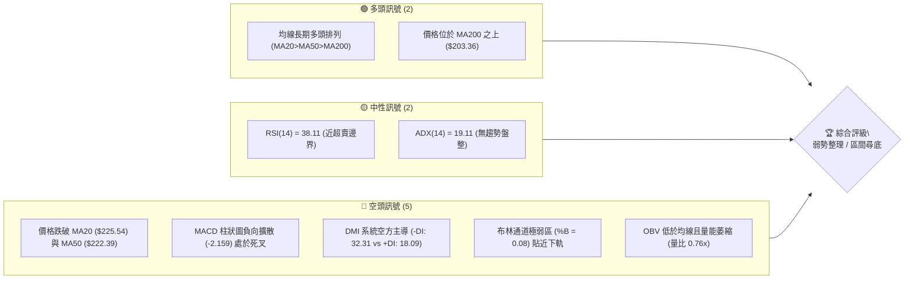
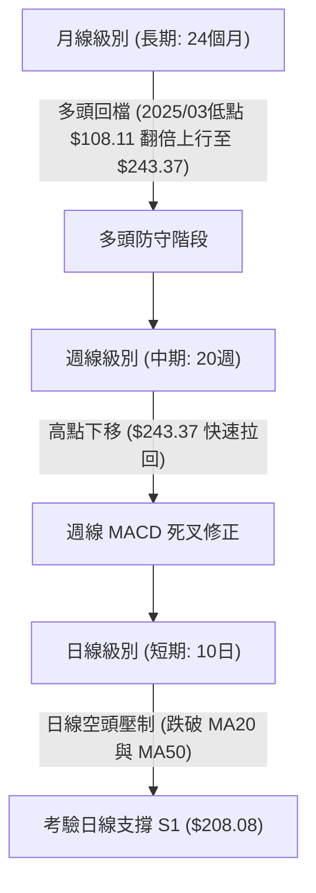
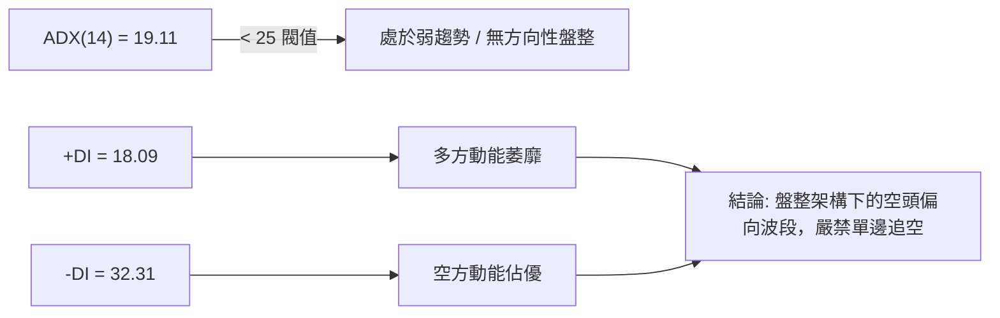
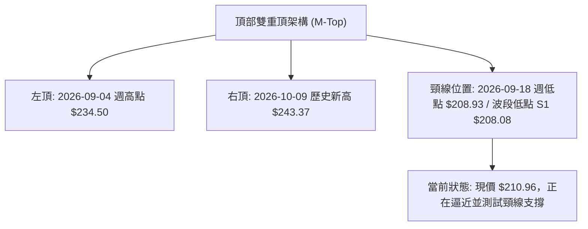
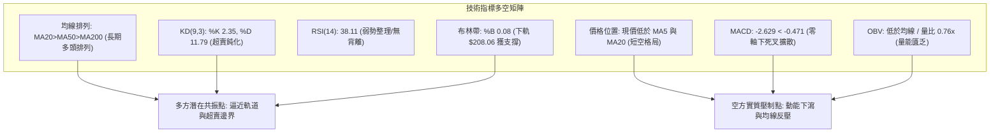
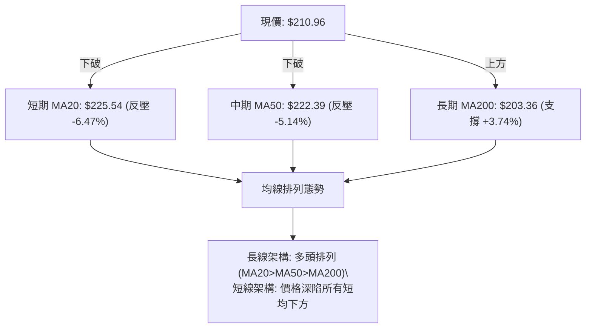
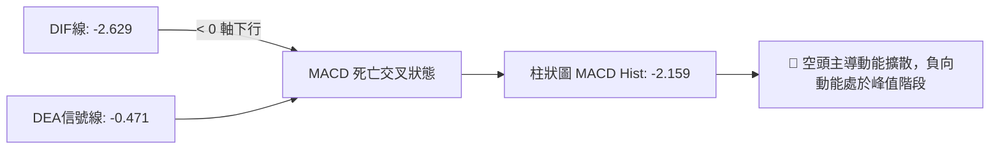
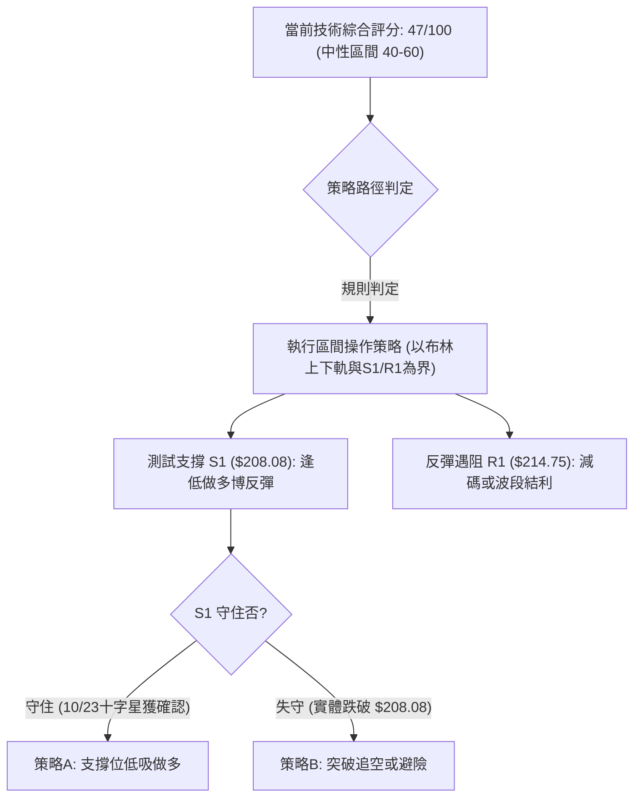
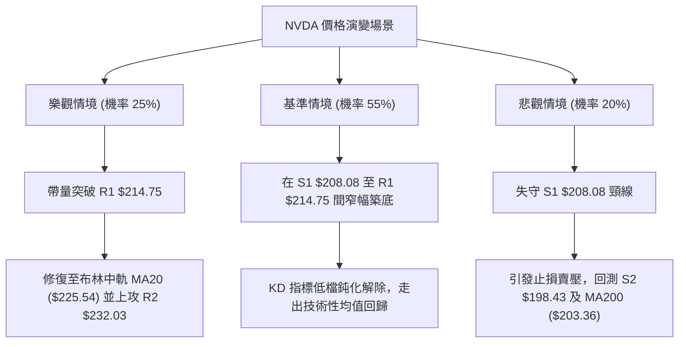

# NVDA 技術分析報告

> **報告日期**：2026-10-25 ｜ **語言**：繁體中文 ｜ **數據來源**：Yahoo Finance ｜ **當前價格**：$210.96

---

## 目錄

| 章節 | 內容 |
|------|------|
| [1. 技術面概覽](#1-技術面概覽) | 訊號儀表板、核心指標、評分卡 |
| [2. 趨勢分析](#2-趨勢分析) | 多時框趨勢、長中短期走勢 |
| [3. 圖表形態分析](#3-圖表形態分析) | 形態識別、K線組合、目標價 |
| [4. 支撐與阻力](#4-支撐與阻力) | 關鍵價位、斐波那契回調 |
| [5. 技術指標深度解讀](#5-技術指標深度解讀) | MA/RSI/MACD/布林/成交量 |
| [6. 動能與波動率](#6-動能與波動率) | 動能評估、ATR、Beta |
| [7. 多時框架總結](#7-多時框架總結) | 時框架評分矩陣 |
| [8. 交易策略建議](#8-交易策略建議) | 多空策略、風險報酬比 |
| [9. 風險提示與監控](#9-風險提示與監控) | 監控指標、風險場景 |

---

## 1. 技術面概覽

### 🎯 技術訊號儀表板



### 📊 核心指標速覽表

| 指標類別 | 指標名稱 | 當前數值 | 訊號 | 解讀 |
|----------|----------|----------|------|------|
| **價格** | 當前收盤價 | $210.96 | 🔴 | 位於 52 週區間之 59.2%，處於短線急跌修正段 |
| **均線** | MA20 | $225.54 | 🔴 | 現價低於 MA20 達 -6.47%，短期下行趨勢明確 |
| **均線** | MA50 | $222.39 | 🔴 | 現價跌破中期生命線，短中期動能轉弱 |
| **均線** | MA200 | $203.36 | 🟢 | 現價高於長期年線 +3.74%，長期牛市結構尚未破壞 |
| **動能** | RSI(14) | 38.11 | 🟡 | 位於中性偏空弱勢區，尚未觸及 30 極端超賣 |
| **動能** | MACD(12,26,9) | -2.629 / Hist -2.159 | 🔴 | DIF 位於零軸下方且快慢線呈現空頭死叉擴散 |
| **動能** | KD(9,3,3) | %K: 2.35 / %D: 11.79 | 🟢 | 進入極度超賣區，存在隨時技術性抽頭反彈契機 |
| **波動** | ATR(14) | $6.06 (2.87%) | 🟡 | 波動度適中偏收斂，短線急殺後動能出現衰竭 |
| **趨勢** | ADX(14) | 19.11 | 🟡 | ADX < 25 表明非單邊趨勢，屬高位寬幅震盪修正 |
| **通道** | 布林通道下軌 | $208.06 (%B: 0.08) | 🔴 | 價格緊貼下軌運作，反映極度疲弱但具備軌道支撐 |

### 🏆 技術評分卡

```
╔══════════════════════════════════════════════════════════════╗
║                技術評分卡 — NVDA (2026-10-25)               ║
╠══════════════════════════════════════════════════════════════╣
║ 趨勢強度      ████████░░░░░░░░░░░░  40/100  🔴 空方佔優      ║
║ 動能指標      ██████░░░░░░░░░░░░░░  30/100  🔴 嚴重受挫      ║
║ 支撐穩定度    ████████████░░░░░░░░  60/100  🟡 臨近S1考驗    ║
║ 成交量配合    ████████░░░░░░░░░░░░  40/100  🔴 量縮無買盤    ║
║ 形態完整度    ██████████░░░░░░░░░░  50/100  🟡 區間下緣測底  ║
║ 均線排列      ████████████░░░░░░░░  60/100  🟡 均線長多短空  ║
╠══════════════════════════════════════════════════════════════╣
║ 綜合評分      ██████████░░░░░░░░░░  47/100  🟡 中性偏弱觀望  ║
╚══════════════════════════════════════════════════════════════╝
```
*註：綜合評分由六項子指標取算術平均計算：(40 + 30 + 60 + 40 + 50 + 60) ÷ 6 = 46.67，四捨五入為 47/100。*

---

## 2. 趨勢分析

### 🌐 多時框趨勢分析



### 📈 長期趨勢 — 12個月走勢圖（Unicode）

NVDA 在過去 12 個月內經歷了波瀾壯闊的高位推進段。自 2025 年末的整理平台一路震盪推升，於 2026 年 9 月創下月收盤新高 $228.38，並在 10 月盤中創下 52 週新高 $243.37，隨後受到獲利了結賣壓回吐至 $210.96。

```
NVDA 月線走勢圖（過去12個月：2025-11 至 2026-10）
價格軸 ($)
$245 ┤                                                 
$235 ┤                                         ● $228.38
$225 ┤                                 ● $220.53       
$215 ┤                         ● $210.66       ● $210.96 (現價)
$205 ┤                 ● $199.11       ● $200.53
$195 ┤         ● $190.68       ● $199.87
$185 ┤ ● $186.06
$175 ┤ ● $176.58       ● $176.78
$165 ┤                 ● $174.00 (低點)
     └─┬───────┬───────┬───────┬───────┬───────┬───────
     2025-11 2025-12 2026-02 2026-04 2026-06 2026-08 2026-10
```

#### 長期走勢特徵分析表格

| 階段區間 | 起始價 ($) | 結束價 ($) | 區間漲跌幅 | 走勢特徵分析 |
|----------|------------|------------|------------|--------------|
| **2025-11 ~ 2026-03** | $176.58 | $174.00 | -1.46% | 區間沉澱打底期，在 $174.00~$190.68 間反覆洗盤，夯實籌碼底部 |
| **2026-04 ~ 2026-07** | $199.11 | $200.53 | +0.71% | 向上跳空換檔期，站穩 $200 整數關卡，建立 $199.87~$210.66 整理平台 |
| **2026-08 ~ 2026-09** | $220.53 | $228.38 | +3.56% | 主升段加速延伸，市場情緒狂熱，月線連續大陽線推進突破前高 |
| **2026-10 (當前)** | $228.38 | $210.96 | -7.63% | 高檔遭遇獲利調節賣壓，月線留長上影線（高點 $243.37），回測前期平台 |

### 📊 中期趨勢（週線分析）

從近 20 週的收盤價演變觀察，NVDA 中期走勢呈現標準的「階梯式盤堅後快速回吐」。9 月底至 10 月初，NVDA 展開強勢衝頂，2026-10-02 週收盤達 $233.95，次週（2026-10-09）更是觸及 52 週歷史高點 $243.37，但當週收盤回落至 $229.28。隨後兩週（10-16 與 10-23）空方全面發難，連續錄得大黑 K，週收盤價急跌至 $214.13 與 $210.96。

週線動能指標出現了決定性的翻空訊號：週 MACD 柱狀圖在 2026-10-09 當週仍為 +0.119，隨後兩週瞬間重挫至 -2.366 與 -2.159，週線 RSI 也從 63.0 暴跌至 38.1，顯示中期籌碼出現嚴重鬆動。

```
中期壓力與支撐示意圖（週線視角）
$243.37 ══════════════════════════════════ 52週歷史高點 / 頂部強阻力 R3
           ▲ 10/09 上攻乏力留長上影線
$229.28 ────────────────────────────────── 前波平台頸線突破破位點
$222.27 ────────────────────────────────── MA50 聚落防線 ($222.39)
$214.75 ────────────────────────────────── 近期波段反彈阻力 R1
$210.96 ·································· [目前現價位置]
$208.08 ══════════════════════════════════ 週線/日線共振強支撐 S1
$198.43 ────────────────────────────────── 8月起漲點防守層 S2
```

### ⚡ 趨勢強度評估（ADX 解讀）



#### ADX 趨勢強度對照解讀表

| 指標變數 | 當前讀數 | 狀態門檻 | 技術涵義與市場心理分析 |
|----------|----------|----------|------------------------|
| **ADX(14)** | **19.11** | < 25 (弱趨勢) | 數值低於 25 明確定義當前並非單邊強烈主跌趨勢，而是處於大型震盪箱體內的下行回檔波。此時順勢追空策略易遭嘎空反彈。 |
| **+DI(14)** | **18.09** | 弱勢 (< 20) | 多頭買盤力道極度渙散，追價意願不足，機構主力處於按兵不動狀態。 |
| **-DI(14)** | **32.31** | 強勢 (> 30) | 賣方掌控日內與波段主導權，短線賣壓仍持續釋放中。 |
| **方向組合** | **-DI > +DI** | 空頭優勢差值 (14.22) | 雖然方向由空頭主導，但因 ADX 尚未拉升至 25 上方，表明空頭動能尚未形成趨勢性共振，隨時可能在關鍵支撐區轉入無趨勢橫盤。 |

---

## 3. 圖表形態分析

### 🔍 形態識別系統

在近期的日 K 與週 K 線圖中，NVDA 於高檔形成了兩個主要的幾何架構：一個是 10 月初在高點 $243.37 與 9 月初高點形成的短線「雙重頂（M頭）雛形」，另一個是自 2026 年 6 月以來的「大型上升通道下軌回測」。



#### 形態識別與信心度評估表

| 形態類別 | 信心度 | 判斷依據（引用數據） | 完成度 | 目標價（附嚴謹計算式） |
|----------|--------|----------------------|--------|------------------------|
| **雙重頂 (M-Top)** | **55%** | 兩次波段高點分別為 9 月高點 $234.50 與 10 月高點 $243.37；頸線為波段低點 S1 $208.08（近週低 $208.93）。目前現價 $210.96 尚未實質跌破頸線。 | 75% | 若確認跌破頸線 $208.08：<br>形態高度 = $243.37 - $208.08 = $35.29<br>量度下行目標 = 頸線 $208.08 - $35.29 = **$172.79**<br>*(註：此目標價低於歷史支撐 S3，需先觀察 S2 $198.43 之支撐力道)* |
| **矩形箱體震盪** | **70%** | 上軌為歷史波段高點聚類 R3 $243.37，下軌為波段密集支撐區 S1 $208.08。價格在過去 3 個月內多次在此區間往返震盪。 | 90% | 區間下限回測已達標，短線反彈目標指向箱體中軸：<br>中軸 = ($243.37 + $208.08) ÷ 2 = **$225.73**<br>*(極為接近 MA20 之 $225.54)* |
| **頭肩頂形態** | **30%** | 數據中左肩與頭部可勉強對應，但右肩完全未成形且右側缺乏成交量配合結構。 | 20% | 訊號不足，信心度低於 50%，依規則不進行幾何推演，僅做指標型解讀。 |

### 🕯️ 重要K線形態分析

根據提供的「近10根日K」與「近8根週K」實際開高低收數據進行精準解讀：

| 日期（層級） | 開 | 高 | 低 | 收 | K線形態 | 技術解讀與籌碼心理 | 訊號 |
|--------------|----|----|----|----|---------|--------------------|------|
| **2026-10-09 (週K)** | 236.09 | 243.37 | 229.11 | 229.28 | **高檔長上影大陰線** | 盤中衝擊歷史天花板 $243.37 後引發極大解套與獲利倒倉，實體收於下半部，多頭竭盡。 | 🔴 |
| **2026-10-14 (日K)** | 225.53 | 226.00 | 219.64 | 221.30 | **破位中陰線** | 開盤即跌破 MA50，成交量擴大至 1.18 億股，主力棄守訊號。 | 🔴 |
| **2026-10-15 (日K)** | 215.30 | 218.47 | 212.85 | 217.23 | **跳空低開下影線** | 向下跳空超 10 美元開出，引發恐慌盤，成交量放大至 1.27 億股（波段最大量），有初步承接盤。 | 🟡 |
| **2026-10-21 (日K)** | 220.96 | 222.19 | 217.66 | 221.97 | **弱勢反彈陽線** | 價格試圖回補上方缺口並挑戰 MA50 ($222.39)，但量能僅 8,700 萬股，呈現典型的無量反抽。 | 🟡 |
| **2026-10-22 (日K)** | 217.13 | 218.88 | 211.26 | 212.21 | **長黑吞噬實體** | 高開低走，完全吞沒前一日陽線實體，成交量激增至 1.25 億股，空方再次大舉進攻。 | 🔴 |
| **2026-10-23 (日K)** | 210.99 | 213.85 | 210.18 | 210.96 | **極窄幅十字星陀螺** | 收盤價幾與開盤平齊，下影線觸及 $210.18（逼近 S1 $208.08），量能萎縮至 7,998 萬股，空方推動力道減弱，醞釀短線變盤。 | 🟢 |

### 📉 ASCII 走勢形態示意圖

```
NVDA 近期日 K 線形態結構示意圖（2026-10-12 至 2026-10-23）
價格
$230 ┤ ┌─┐ (10/12-13 高位震盪 $228.64)
$226 ┤ █ █   
$222 ┤ └─┘ ┌─┐                     ┌─┐ (10/21 反彈遇阻 $222.19)
$218 ┤     │ │ (10/14 跳空下殺)      │ │ ┌─┐
$214 ┤     █ █   ┌─┐         ┌─┐     │ │ │ │ (10/22 大陰長挫)
$210 ┤     └─┘   │ │         │ │     └─┘ █ █ ┼ (10/23 縮量十字星 $210.96)
$206 ┤           └─┘ (10/15-16 測底)     └─┘ 
     └────┬───────┬───────────┬───────────┬─────┬─────
        10-12   10-14       10-16       10-21 10-22 10-23
     支撐線 S1: ═════════════════════════════════════════ $208.08
```

### 🎯 形態目標價計算

根據日線雙頂與箱體結構計算，若 10-23 十字星能成功守住下方關鍵支撐 S1 $208.08，則短線形態將確立為「箱體底部探底回升」：
- **反彈第 1 目標價 (T1)**：直接指向近期反彈波段高點阻力 **R1 = $214.75**（計算式：由日線波段高點聚類直接定義，同時對應 10-19 日 K 高點 $219.62 前之短期套牢阻力帶）。
- **反彈第 2 目標價 (T2)**：指向箱體中軸兼波段阻力 **R2 = $232.03**（計算式：引用波段高點聚類 R2，該位置同時覆蓋 MA20 $225.54 與前波週收盤平台）。
- **破位下行目標價**：若日收盤價有效擊穿 S1 $208.08，則雙頂成立，波段下探目標將直接尋求 **S2 = $198.43**。

---

## 4. 支撐與阻力

### 🗺️ 關鍵價位分布圖（Unicode）

```
NVDA 價位結構分布圖 (由 OHLCV 精確計算)
═══════════════════════════════════════════════════════════════
$243.37 ║████████████████████████████████████████║ 強阻力 R3 (52W歷史最高點)
$232.03 ║██████████████████████████              ║ 阻力 R2 (近一年密集高點聚類)
$224.61 ║----------------------------------------║ 斐波那契 23.6% 回調位
$214.75 ║██████████████                          ║ 關鍵阻力 R1 (反彈頸線阻力)
$213.01 ║- - - - - - - - - - - - - - - - - - - - ║ 斐波那契 38.2% 回調位
$210.96 ╠════════════════════════════════════════╣ ◄ 現價 ($210.96)
$208.08 ║▓▓▓▓▓▓▓▓▓▓▓▓▓▓▓▓▓▓▓▓▓▓▓▓▓▓              ║ 近期強支撐 S1 (近一年波段低點)
$203.63 ║----------------------------------------║ 斐波那契 50.0% 回調 / MA200 ($203.36)
$198.43 ║████████████████████████████████        ║ 強支撐 S2 (8月多頭起漲防線)
$194.30 ║████████████████████████████████████    ║ 終極防守 S3 (斐波那契 61.8% $194.25)
═══════════════════════════════════════════════════════════════
```

### 🚧 阻力位分析表

阻力位嚴格引用 OHLCV 計算之關鍵價位：

| 阻力級別 | 價位 | 形成原因（精確數據支持） | 突破難度 | 重要性 |
|----------|------|--------------------------|----------|--------|
| **R1** | **$214.75** | 近一年波段高點聚類；與 10-16 收盤價 $214.13、10-23 週 K 高點 $222.19 前之日內震盪帶重合，距現價 +1.79%。 | 中等 | 🟢 短線多空翻轉之第一道分水嶺 |
| **R2** | **$232.03** | 近一年波段高點聚類；與 9 月初週收盤 $230.10、9 月中週高點 $233.45 構成極強密集成交沉積區，距現價 +9.99%。 | 極高 | 🔴 中期多頭收復失地的核心陣地 |
| **R3** | **$243.37** | 52 週最高價（2026-10-09 當週高點）；歷史天花板，距現價 +15.36%。 | 極高 | 🔴 長期多頭終極目標 |

### 🛡️ 支撐位分析表

支撐位嚴格引用 OHLCV 計算之關鍵價位：

| 支撐級別 | 價位 | 形成原因（精確數據支持） | 守住機率 | 重要性 |
|----------|------|--------------------------|----------|--------|
| **S1** | **$208.08** | 近一年波段低點聚類；與布林通道下軌 $208.06 高度重合，且 10-23 日低點為 $210.18，距現價僅 -1.36%。 | 65% | 🟢 短線防守核心，多頭最後防線 |
| **S2** | **$198.43** | 近一年波段低點聚類；對應 2026 年 6-7 月平台整理低點（7-31 收盤 $200.53），距現價 -5.94%。 | 80% | 🔴 跌破則宣告波段走勢正式翻空 |
| **S3** | **$194.30** | 近一年波段低點聚類；與斐波那契 61.8% 黃金分割點 $194.25 共振，距現價 -7.90%。 | 90% | 🔴 牛市長期趨勢之底線 |

### 📐 斐波那契回調位分析

以 52 週波段低點 **$163.90** 至 52 週歷史高點 **$243.37** 進行完整黃金分割回調測量（總波幅 $79.47）：

```
0.0%  (52W High) ────────────────────────── $243.37 (頂部壓力)
23.6%            ────────────────────────── $224.61 (已跌破，轉為壓力)
38.2%            ────────────────────────── $213.01 (關鍵分界點)
                 ◄◄◄ 現價: $210.96 位於 38.2% 與 50.0% 之間
50.0%            ────────────────────────── $203.63 (心理平衡點，共振 MA200 $203.36)
61.8%            ────────────────────────── $194.25 (黃金分割極限防守，共振 S3 $194.30)
78.6%            ────────────────────────── $180.90 (深度回調位)
100.0% (52W Low) ────────────────────────── $163.90 (波段起點)
```

**深入解讀**：
當前收盤價 **$210.96** 正好處於 **38.2% ($213.01)** 與 **50.0% ($203.63)** 之間。在強勢多頭市場中，38.2% 通常被視為強勢回調的極限，現價在 $213.01 之下微幅運行，表明市場正面臨「強勢回檔」向「深度平衡回檔（50.0%）」滑落的風險。
極為關鍵的是，**50.0% 回調位 $203.63 與日線長期均線 MA200 ($203.36) 形成了令人矚目的精確共振**。這意味著若 S1 $208.08 失守，$203.36 ~ $203.63 區間將匯聚技術面最強大的多頭買盤防禦矩陣。

---

## 5. 技術指標深度解讀

### 🎛️ 指標訊號總覽



### 📈 移動平均線排列分析



#### 移動平均線數據全視圖

| 均線名稱 | 數值 | 現價差距 | 差距幅度 | 形態斜率與趨勢意義 |
|----------|------|----------|----------|--------------------|
| **MA 5** | $215.74 | -$4.78 | -2.22% | 快速下彎，構成日內超短線第一道下壓阻力 |
| **MA 10** | $218.62 | -$7.66 | -3.50% | 下行加速，壓制近兩週多頭反抽企圖 |
| **MA 20** | $225.54 | -$14.58 | -6.47% | 走平後轉折向下，跌破此線代表波段上漲節奏遭到實質破壞 |
| **MA 50** | $222.39 | -$11.43 | -5.14% | 中期趨勢線，目前被有效跌破，由支撐轉為強阻力 |
| **MA 60** | $221.39 | -$10.43 | -4.71% | 季線位置，壓制在 $221-$222 形成密集成交蓋頭網 |
| **MA 120** | $214.77 | -$3.81 | -1.78% | 半年線，與波段阻力 R1 $214.75 完美共振 |
| **MA 200** | $203.36 | +$7.60 | +3.74% | 牛熊分水嶺，維持穩健向上傾斜，長期多頭堡壘 |
| **MA 240** | $200.06 | +$10.90 | +5.45% | 年線防守點，與整數心理關卡 $200.00 重疊 |

### 📉 RSI(14) 分析

當前 Wilder 算法計算之 RSI(14) 讀數為 **38.11**。

```
RSI(14) 強度儀表
0 ══════════ 30 ════════════ 50 ════════════ 70 ══════════ 100
[█████████████░░░░░░░░░░░░░░░░░░░░░░░░░░] 38.11
             ▲ 超賣區 (30)   ▲ 中軸 (50)    ▲ 超買區 (70)
```

- **區間評估**：RSI 落在 30 至 40 之間的「弱勢沉澱區」，表明市場受到強烈拋壓，但尚未陷入盲目恐慌殺跌（< 30）。
- **背離分析**：嚴格比對近 20 根 K 棒走勢，價格在 10 月 9 日創高 $243.37 時，週線 RSI 達 63.0，隨後價格震盪滑落至 $210.96，RSI 亦同步從 53.0 滑落至 38.11。**結論：數據顯示「無明顯背離」**，指標與價格方向一致，未出現底背離買訊，亦無頂背離滯後現象。

### 📊 MACD(12/26/9) 訊號解讀



- **數值分析**：快線 DIF (-2.629) 深度穿透慢線 DEA (-0.471)，柱狀圖讀數為 **-2.159**。
- **動能演變**：檢視近 3 週的 MACD 柱狀圖：10-09 為 +0.119、10-16 為 -2.366、10-23 為 -2.159。柱狀圖在大幅下殺後負值微幅收斂（由 -2.366 微收至 -2.159），顯示空方最暴力的傾瀉階段或已暫告段落，但因快慢線雙雙深陷零軸下方，任何向上修復仍屬技術性弱反彈。

### 📦 布林通道分析

布林帶參數取 (20, 2)，中軌為 MA20 ($225.54)，帶寬由上軌 $243.02 延伸至下軌 $208.06。

```
布林通道當前結構 ASCII 示意圖
$243.02 ┬────────────────────────────────────────── 布林上軌 (強壓)
        │
$225.54 ┼────────────────────────────────────────── 布林中軌 (MA20 基準線)
        │
$210.96 ┼·········● 現價 ($210.96)
$208.06 ┴────────────────────────────────────────── 布林下軌 (支撐測試)
        通道帶寬 = $34.96 ｜ %B 指標位置 = 0.08 [▓░░░░░░░░░]
```

- **%B 解析**：當前 %B 讀數為 **0.08**，極度逼近下軌 0.00 臨界點。依據統計概率，當 %B 跌破 0.10 且伴隨成交量縮小，價格往往出現均值回歸拉回中軌的傾向。布林下軌 **$208.06** 與關鍵支撐 **S1 $208.08** 呈現僅 0.02 美元的重合，奠定了此處極強的技術共振支撐。

### 💹 成交量分析（量價配合度）

- **量比檢視**：最新交易日（10-23）成交量為 **79,987,200 股**，相較於 20 日均量（105,294,570 股）量比僅為 **0.76x**，縮量明顯。
- **價量結構解讀**：
  - 10-14 至 10-16 連續三天下殺跌破 $220，日均量衝高至 1.2 億股以上，顯示有機構性停損或調倉賣盤湧出。
  - 10-22 再度放量至 1.25 億股大跌，然而 10-23 價格下探 $210.18 時，成交量銳減至 7,998 萬股。這種「破底縮量」反映低檔殺跌動能開始衰竭，賣盤不願在 $210 以下不計成本出逃。
- **OBV 能量潮**：OBV 指標持續位於其均線下方，定義為「OBV < MA → 量能疲弱」。這表明過去兩週資金以淨流出為主，缺乏增量資金進場推升，限制了未來反彈的高度。

---

## 6. 動能與波動率

### ⚡ 動能評估四象限

| 象限 | 動能狀態 | 波動率狀態 | 當前標的狀態 | 交易策略指導 |
|------|----------|------------|--------------|--------------|
| **Q1 (強動能/低波動)** | 強勁突破 | 低波動聚集 | — | 趨勢順勢加碼的最佳環境 |
| **Q2 (弱動能/低波動)** | 動能衰減 | 波動收窄 | **✓ (NVDA當前位置)** | **謹慎觀望，以區間低吸高拋或等待方向突破為主** |
| **Q3 (強動能/高波動)** | 趨勢噴出 | 劇烈震盪 | — | 高風險高收益，防範大幅滑點 |
| **Q4 (弱動能/高波動)** | 恐慌拋售 | 波動擴散 | — | 嚴禁盲目摸底，資金極易折損 |

NVDA 當前 ADX 為 19.11（弱趨勢），ATR 佔價格比為 2.87%（波動未極端失控），RSI 為 38.11，落入 **Q2 弱動能/低波動整理象限**。此階段市場特點是趨勢追單（不論追多或追空）均容易遭受雙向洗盤。

### 📊 ATR 波動率分析

- **ATR(14) 讀數**：精確值為 **$6.06**（Wilder 平滑），佔現價比例為 **2.87%**。
- **每日波動區間推算**：在常態分佈下，NVDA 次日交易之正常波動半徑為 ±$6.06。當前價格 $210.96 對應的次日理論波動區間為 **$204.90 ~ $217.02**。
- **止損距離設計建議**：
  - **保守型交易者 (2.0 × ATR)**：緩衝距離需設定為 $12.12。
  - **波段型交易者 (1.5 × ATR)**：緩衝距離需設定為 $9.09。
  - **短線日內交易者 (1.0 × ATR)**：緩衝距離需設定為 $6.06。

### 📐 Beta 與市場相關性

- **Beta 數值**：**2.216**。
- **市場特徵解讀**：NVDA 具有典型的高彈性成長股屬性，其波動率為標普 500 指數的 2.2 倍以上。當大盤（如納斯達克或標普）出現 1% 的回檔時，NVDA 平均跌幅達 2.2%；反之，一旦科技板塊回暖，其反彈力道亦將呈現雙倍槓桿效應。高 Beta 特性決定了交易時必須嚴格控制單筆名義本金與槓桿比例。

---

## 7. 多時框架總結

### 📋 時框架評分表

| 時框架 | 趨勢方向 | 動能狀態 | 均線排列 | 形態結構 | 綜合評分 | 策略建議 |
|--------|----------|----------|----------|----------|----------|----------|
| **月線 (長期)** | 🟢 多頭主導 | 🟡 擴散後修正 | 多頭排列 | 歷史高檔長影回踩 | **75/100** | 長期投資者逢低分批佈局 |
| **週線 (中期)** | 🟡 震盪回檔 | 🔴 MACD死叉擴散 | MA20附近爭奪 | 區間震盪測試下軌 | **48/100** | 觀察 S1 $208.08 是否守穩 |
| **日線 (短期)** | 🔴 短空格局 | 🟢 KD極度超賣 | 空頭下壓反叛 | 縮量十字星待變盤 | **42/100** | 區間下緣博超跌短彈 |

### 🔲 綜合訊號矩陣

```
訊號一致性交叉檢視矩陣
─────────────────────────────────────────────────────────────────
指標類別        短期訊號 (日線)      中期訊號 (週線)      長期訊號 (月線)
─────────────────────────────────────────────────────────────────
趨勢方向        🔴 空方壓制          🟡 高檔回檔          🟢 牛市推進
均線排列        🔴 跌破MA20/50       🟡 測試中期均線      🟢 MA200之上
動能指標        🟢 超賣尋求金叉      🔴 動能柱負向擴散    🟡 動能收斂
成交量能        🟡 縮量探底          🔴 週放量回吐        🟢 資金沉積雄厚
─────────────────────────────────────────────────────────────────
矩陣結論：長多、中調、短超賣，三級時框出現典型的週期衝突。
```

### ⚖️ 多時框收斂結論

依據多時框收斂優先級規則進行裁決：
1. **行情屬性判定**：當前 ADX(14) 讀數為 **19.11**，明確低於 25 臨界線，技術面嚴格定義為**「無趨勢之盤整行情」**。
2. **主導時框與交易規則**：在盤整行情下，單邊均線追隨系統失效，交易必須**以日線布林通道上下軌（$208.06 ~ $243.02）及關鍵波段支撐/阻力為主要交易區間**。
3. **時框衝突取捨**：雖然日線短均呈空頭排列，但由於當前價格 $210.96 已經逼近布林下軌 $208.06 與波段支撐 S1 $208.08，且 KD(%K=2.35) 陷入極度超賣，空頭盈虧比已嚴重惡化。
4. **唯一方向性結論**：**中性偏弱觀望，以區間下軌高盈虧比低吸為主（不追空）**。

---

## 8. 交易策略建議

### 🗺️ 策略決策流程圖



### 🧭 策略路由（依評分卡分流）

> **當前主策略方向 = 區間震盪操作（Range Trading），偏向於下軌防守型低吸做多（依評分 47/100，落於 40–60 中性區間，嚴禁追漲殺跌，嚴格依據布林下軌 $208.06 與 S1 $208.08 執行邊界交易）。**

### 🎯 價格情境階梯（Price Scenarios）

價位嚴格引用第四章 OHLCV 計算之實際數值：

| 觸發條件 | 下一目標 | 後續延伸 | 技術情境含義與操作指引 |
|----------|----------|----------|------------------------|
| **向上突破 R1 ($214.75)** | **R2 ($232.03)** | **R3 ($243.37)** | 短線超賣反彈確立，重回 MA120 之上，多頭挑戰 MA20/MA50 核心防線。 |
| **站穩現價區間 ($208.08 ~ $214.75)** | — | — | 於布林下軌處縮量築底，指標逐步修復，屬典型區間拉鋸。 |
| **跌破 S1 ($208.08)** | **S2 ($198.43)** | **S3 ($194.30)** | 宣告日線雙頂頸線失守，下行空間打開，將考驗 MA200 及斐波那契 50% 防線。 |

### 📊 情境機率分佈

| 情境劃分 | 機率估計 | 主要技術指標支撐依據 |
|----------|----------|----------------------|
| **區間震盪 / 探底反彈** | **55%** | ADX=19.11 缺乏單邊主跌趨勢；布林帶 %B=0.08 極度超賣；KD(%K=2.35) 鈍化；10-23 出現量縮十字星陀螺，S1 $208.08 提供強大技術底座。 |
| **橫盤縮量拉鋸** | **25%** | 成交量比降至 0.76x，市場觀望氣氛濃烈；MA5 與 MA10 快速下壓，抑制短線反彈斜率。 |
| **實體擊穿 S1 破位下殺** | **20%** | MACD 柱狀圖仍處負值 (-2.159)；-DI (32.31) 顯著高於 +DI (18.09)；OBV 低於均線，若大盤重挫可能引發多殺多。 |

### 🟢 主策略詳情（方向：區間下軌防守型多頭）

以進場價區間中點進行嚴格風險報酬比計算：
- **策略 A 進場區間**：$208.08 ~ $210.96，**區間中點進場價 = $209.52**。
- **策略 B 進場價格**：$214.75（突破 R1 追買）。

| 策略要素 | 策略 A（下軌支撐左側低吸） | 策略 B（突破 R1 右側順勢加碼） |
|----------|----------------------------|--------------------------------|
| **進場條件** | 股價回踩 S1 $208.08 不破，或現價附近縮量止跌時佈局 | 日 K 收盤價實體突破 R1 $214.75 且成交量放大確認 |
| **進場價格** | **$209.52**（區間中點） | **$214.75**（精確點位） |
| **目標價 T1** | **$214.75**（引用 R1，前波阻力） | **$232.03**（引用 R2，密集高點） |
| **目標價 T2** | **$232.03**（引用 R2，波段目標） | **$243.37**（引用 R3，歷史天花板） |
| **止損價格** | **$206.90**（跌破 S1 $208.08 達 0.5×ATR） | **$210.96**（跌回原突破點與現價） |
| **風險報酬比 (T1)** | **1 : 2.00（以 T1 計）**<br>*(計算: ($214.75-$209.52) ÷ ($209.52-$206.90) = 5.23 ÷ 2.62 = 2.00)* | **1 : 4.56（以 T1 計）**<br>*(計算: ($232.03-$214.75) ÷ ($214.75-$210.96) = 17.28 ÷ 3.79 = 4.56)* |
| **風險報酬比 (T2)** | **1 : 8.59（以 T2 計）**<br>*(計算: ($232.03-$209.52) ÷ ($209.52-$206.90) = 22.51 ÷ 2.62 = 8.59)* | **1 : 7.55（以 T2 計）**<br>*(計算: ($243.37-$214.75) ÷ ($214.75-$210.96) = 28.62 ÷ 3.79 = 7.55)* |
| **成功機率** | **60%** | **45%** |
| **建議倉位** | **15% 名義本金** | **10% 名義本金** |

### 🔴 反向風險觸發點（對沖提示）

若發生下列技術破位事件，必須立即推翻多頭反彈預期，啟動避險對沖或全面止損：
1. **實體跌破 $208.08**：若日 K 收盤價有效低於 **S1 $208.08**，代表布林通道下軌遭到空頭「開軌跌破」，雙頂形態確認成形。
2. **對沖操作**：多單全面離場，空方可建立輕倉對沖部位，下看目標 **S2 = $198.43** 與 **S3 = $194.30**，止損反設於 $210.96。

### ⭐ 整體訊號強度評星

```
做多訊號強度：★★☆☆☆  (2.5/5星 — 僅限於超賣技術反彈)
做空訊號強度：★★☆☆☆  (2.0/5星 — 空間受阻於下軌支撐)
整體可信度：  ★★★☆☆  (3.0/5星 — 盤整期訊號雜訊較多)
```

---

## 9. 風險提示與監控

### ✅ 關鍵監控指標 Checklist

```
╔══════════════════════════════════════════════════════════════╗
║               關鍵技術監控指標 CHECKLIST                    ║
╠══════════════════════════════════════════════════════════════╣
║ [ ] 價位監控：日收盤是否守穩 S1 $208.08 關鍵支撐線          ║
║ [ ] 動能監控：日線 KD 是否於超賣區形成向上黃金交叉          ║
║ [ ] 阻力監控：多頭反撲能否放量站上 R1 $214.75              ║
║ [ ] 成交量能：成交量是否回升至 20 日均量 (1.05 億股) 之上    ║
║ [ ] 均線動態：現價與 MA20 ($225.54) 之負乖離是否修復收斂     ║
║ [ ] 波動指標：ATR 是否持續下降至 $5.50 以下表明拋壓平息      ║
╚══════════════════════════════════════════════════════════════╝
```

### ⚠️ 風險場景分析



### 🛡️ 風險管理重要提醒

1. **高 Beta 槓桿防護**：NVDA 的 Beta 高達 2.216，在當前大盤科技板塊情緒反覆之際，單日價格波動極易放大。嚴禁使用高倍數槓桿金融衍生品進行隔夜博弈。
2. **資金管理配置**：當前處於綜合評分 47 分的「中性偏弱」盤整期，整體持倉暴露應控制在總資金的 **25% 以內**。策略 A 與策略 B 建議採用「分批建倉、移動止損」原則。
3. **止損紀律絕對執行**：策略 A 止損設於 **$206.90**，距離現價僅 1.92%，一旦觸發不可抱持僥倖心理，防範下行至 $198.43 之深幅回檔。

---

## 📋 報告總結

```
NVDA 技術分析報告總結
════════════════════════════════════════════════════════
報告日期：2026-10-25
當前價格：$210.96
分析評級：⚖️ 弱勢盤整 / 區間尋底（綜合評分: 47/100）

關鍵結論：
├─ 長期趨勢：🟢 多頭牛市完好 (價格遠高於 MA200 $203.36 與年線)
├─ 中期趨勢：🟡 高檔寬幅震盪 (歷史高點 $243.37 回吐，週線 MACD 死叉)
├─ 短期趨勢：🔴 空方佔優但極度超賣 (KD %K=2.35，布林 %B=0.08)
├─ 關鍵支撐：S1: $208.08 ｜ S2: $198.43 ｜ S3: $194.30
├─ 關鍵阻力：R1: $214.75 ｜ R2: $232.03 ｜ R3: $243.37
└─ 分析師目標：共識 Target Mean $328.95 (遠期基本面看好)

最優策略組合：
1. 🥇 最佳機會：策略 A (區間下軌左側低吸，進場 $209.52，目標 T1 $214.75，風報比 1:2.00)
2. 🥈 次選機會：策略 B (突破 R1 右側追買，進場 $214.75，目標 T1 $232.03，風報比 1:4.56)
3. 🥉 保守選擇：空倉觀望，耐心等待價格跌破 $208.08 或有效收復 $214.75 確立新方向
════════════════════════════════════════════════════════
```

---

> ⚠️ **免責聲明**：本報告為 AI 自動生成之技術分析，所有數據及估算均基於提供的歷史價格資訊。本報告**僅供研究與學術參考**，**不構成任何投資建議**。投資有風險，入市需謹慎。

---

*報告生成時間：2026-10-25 ｜ 數據來源：Yahoo Finance ｜ 分析框架：多時框技術分析*