# NVDA 技術分析報告

> **報告日期**：2026-10-26 ｜ **語言**：繁體中文 ｜ **數據來源**：Yahoo Finance ｜ **當前價格**：$210.96

---

## 目錄

| 章節 | 內容 |
|------|------|
| [1. 技術面概覽](#1-技術面概覽) | 訊號儀表板、核心指標、評分卡 |
| [2. 趨勢分析](#2-趨勢分析) | 多時框趨勢、長中短期走勢 |
| [3. 圖表形態分析](#3-圖表形態分析) | 形態識別、K線組合、目標價 |
| [4. 支撐與阻力](#4-支撐與阻力) | 關鍵價位、斐波那契回調 |
| [5. 技術指標深度解讀](#5-技術指標深度解讀) | MA/RSI/MACD/布林/成交量 |
| [6. 動能與波動率](#6-動能與波動率) | 動能評估、ATR、Beta |
| [7. 多時框架總結](#7-多時框架總結) | 時框架評分矩陣 |
| [8. 交易策略建議](#8-交易策略建議) | 多空策略、風險報酬比 |
| [9. 風險提示與監控](#9-風險提示與監控) | 監控指標、風險場景 |

---

## 1. 技術面概覽

### 🎯 技術訊號儀表板

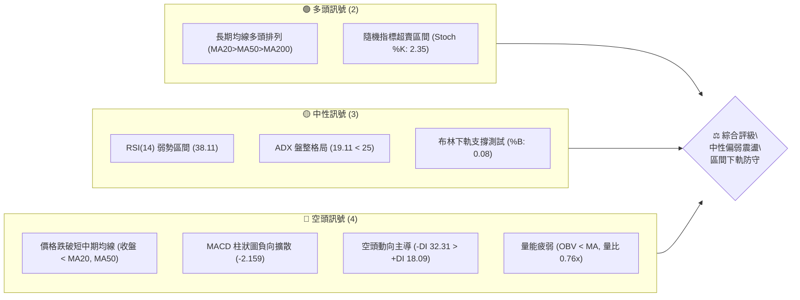

### 📊 核心指標速覽表

| 指標類別 | 指標名稱 | 當前數值 | 訊號 | 解讀 |
|----------|----------|----------|------|------|
| **價格** | 當前收盤價 | $210.96 | 🟡 | 位於52週區間59.2%分位，自歷史高點回撤至區間中軸偏下 |
| **均線** | MA20 | $225.54 | 🔴 | 價格低於MA20達-6.47%，短期均線呈現向下反壓 |
| **均線** | MA50 | $222.39 | 🔴 | 價格低於MA50達-4.71%，跌破中期生命線，短中期偏空格局 |
| **均線** | MA200 | $203.36 | 🟢 | 價格高於MA200達+3.74%，長期牛熊分界線維持多頭保護 |
| **均線架構**| 排列形態 | MA20>MA50>MA200 | 🟢 | 長線均線多頭排列尚未被破壞，屬深幅回調而非結構轉熊 |
| **動能** | RSI(14) | 38.11 | 🟡 | 位於30–70中性偏弱區間，逼近超賣門檻，無背離現象 |
| **動能** | MACD | -2.629 / -0.471 | 🔴 | DIF線位於訊號線下方，柱狀圖負向擴展至-2.159，動能偏空 |
| **動能** | Stoch %K / %D | 2.35 / 11.79 | 🟢 | 深度超賣區（<20），短線具備技術性超跌反彈契機 |
| **趨勢** | ADX(14) | 19.11 | 🟡 | ADX < 25，確認市場處於弱趨勢／箱型盤整結構而非單邊行情 |
| **通道** | 布林帶 %B | 0.08 | 🟡 | 逼近下軌（$208.06），進入極端壓縮下緣，具超賣支撐 |
| **波動** | ATR(14) | $6.06 (2.87%) | 🟡 | 每日平均震幅約$6.06，波動率處於中等水平，止損空間明確 |
| **量能** | 20日成交量比 | 0.76x | 🔴 | 最新量79.98M低於20日均量105.29M，OBV<MA，量價動能不足 |

### 🏆 技術評分卡

```
╔══════════════════════════════════════════════════════════════╗
║               技術評分卡 — NVDA (2026-10-26)                 ║
╠══════════════════════════════════════════════════════════════╣
║ 趨勢強度      ████████░░░░░░░░░░░░  42/100  🟡 中性 (ADX<25) ║
║ 動能指標      ███████░░░░░░░░░░░░░  35/100  🔴 偏空 (MACD負擴)║
║ 支撐穩定度    ████████████░░░░░░░░  58/100  🟡 中性 (S1/下軌)║
║ 成交量配合    ████████░░░░░░░░░░░░  40/100  🔴 偏弱 (OBV低迷)║
║ 形態完整度    █████████░░░░░░░░░░░  45/100  🟡 中性 (箱型盤整)║
║ 均線排列      ██████████░░░░░░░░░░  50/100  🟡 中性 (長多短空)║
╠══════════════════════════════════════════════════════════════╣
║ 綜合評分      █████████░░░░░░░░░░░  45/100  中性偏弱震盪      ║
╚══════════════════════════════════════════════════════════════╝
```

> **綜合評分計算**（規則 18 算術平均）：
> $(42 + 35 + 58 + 40 + 45 + 50) \div 6 = 270 \div 6 = 45.0 \rightarrow \mathbf{45/100}$

---

## 2. 趨勢分析

### 🌐 多時框趨勢分析

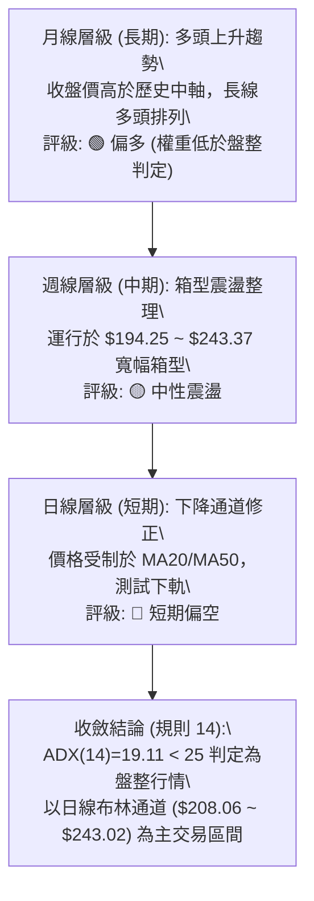

### 📈 長期趨勢 — 12個月走勢圖（Unicode）

```
NVDA 月線走勢圖（2025-11 至 2026-10）
價格軸 ($)
$245 ┤                                                 
$235 ┤                                            ● (2026-09: 228.38)
$225 ┤                                      ● (220.53)
$215 ┤                        ● (210.66)               ● (2026-10: 210.96 現價)
$205 ┤                                   ●    ● (200.53)
$195 ┤              ● (190.68)      ● (199.11)
$185 ┤        ●     │               
$175 ┤  ● (176.58)  │   ●     ● (174.00 低點)
$165 ┤              │  (176.78)
     └──────────────────────────────────────────────────────────
       11    12    01    02    03    04    05    06    07    08    09    10  (月份)
      (2025)       (2026)
```

**走勢特徵分析表格**：

| 階段時間 | 起訖價位 | 漲跌幅 | 結構特徵與成交量分析 | 趨勢屬性 |
|----------|----------|--------|----------------------|----------|
| **2025-11 至 2026-03** | $176.58 → $174.00 | -1.46% | 底部寬幅構築，探底 $174.00 後形成雙重底支撐防線 | 區間築底 |
| **2026-04 至 2026-05** | $199.11 → $210.66 | +5.80% | 帶量突破 $200 整數關卡，各期均線展開多頭發散排列 | 多頭啟動 |
| **2026-06 至 2026-07** | $199.87 → $200.53 | +0.33% | 高位水平橫盤整理，測試回踩突破點 $200.00 確認支撐有效 | 中繼洗盤 |
| **2026-08 至 2026-09** | $220.53 → $228.38 | +3.56% | 創下波段歷史高點，觸及52週頂部 $243.37，量能逐漸鈍化 | 高位衝頂 |
| **2026-10 (當前)** | $228.38 → $210.96 | -7.63% | 高檔獲利回吐，連續失守 MA20 及 MA50，逼近布林下軌 | 回調修正 |

### 📊 中期趨勢（週線分析）

```
週線級別壓力支撐示意圖
$243.37 ────────────────────────────────────── 52W 高點 / 強阻力 R3
                  ▲ (10-09 當週觸及 $243.37 後收長上影)
$232.03 ┄┄┄┄┄┄┄┄┄┄┄┄┄┄┄┄┄┄┄┄┄┄┄┄┄┄┄┄┄┄┄┄┄┄┄ 中期頸線阻力 R2
$225.54 ────────────────────────────────────── MA20 / 布林中軌
$214.75 ┄┄┄┄┄┄┄┄┄┄┄┄┄┄┄┄┄┄┄┄┄┄┄┄┄┄┄┄┄┄┄┄┄┄┄ 短期反彈阻力 R1
$210.96 ══════════════════════════════════════ ◄ 現價位置 (測試 S1)
$208.08 ────────────────────────────────────── 近期波段支撐 S1 / 布林下軌 ($208.06)
$198.43 ┄┄┄┄┄┄┄┄┄┄┄┄┄┄┄┄┄┄┄┄┄┄┄┄┄┄┄┄┄┄┄┄┄┄┄ 中期波段防守 S2
$194.25 ────────────────────────────────────── 斐波那契 61.8% / 強支撐 S3 ($194.30)
```

### ⚡ 趨勢強度評估（ADX 解讀）

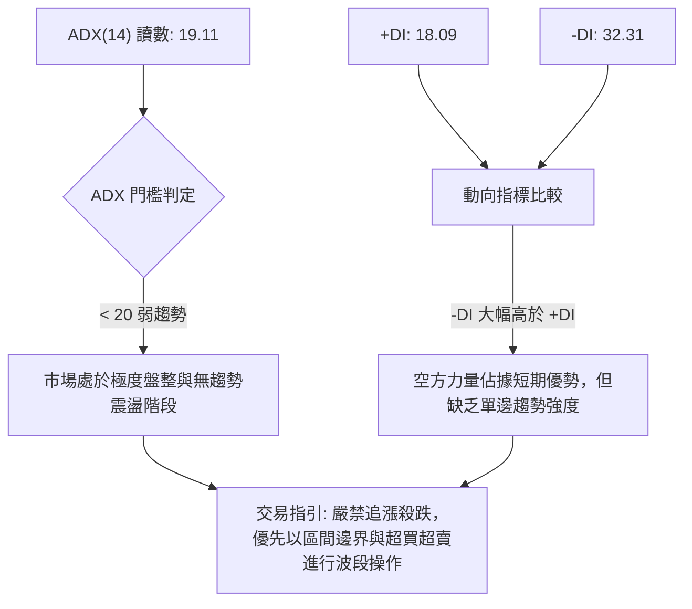

| 指標名稱 | 數值 | 參考門檻 | 強度狀態 | 交易策略解讀 |
|----------|------|----------|----------|--------------|
| **ADX(14)** | 19.11 | 25.00 | 弱勢盤整 (無單邊趨勢) | 趨勢策略失效，震盪指標（Bollinger/Stoch/RSI）權重提高 |
| **+DI (多頭動向)** | 18.09 | 20.00 | 偏弱 | 多頭上攻動能衰竭，買盤追價意願不足 |
| **-DI (空頭動向)** | 32.31 | 25.00 | 主導地位 | 空方力量明顯高於多方，但未伴隨 ADX 向上突破，屬於無量陰跌 |
| **ADX 趨勢結論** | 盤整市 | 規則 14 收斂 | 🟡 區間收斂 | 依據收斂規則：主導架構為日線布林通道上下軌箱型震盪 |

---

## 3. 圖表形態分析

### 🔍 形態識別系統

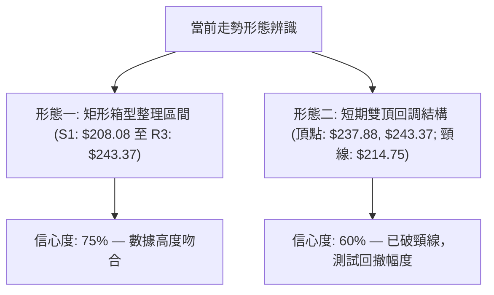

**圖表形態信心度表格**（依規則 15 規範）：

| 形態名稱 | 信心度 | 判斷依據（引用數據） | 完成度 | 目標價（附嚴格計算式） |
|----------|--------|----------------------|--------|------------------------|
| **寬幅箱型震盪** | 75% | 價格高點多次受阻於 R3 ($243.37)，下檔於 S1 ($208.08) 及布林下軌反覆獲支撐，ADX(14)=19.11 確認無單邊突破 | 85% | 區間下軌目標：$208.08<br>區間上軌目標：$243.37 |
| **短線雙重頂結構** | 60% | 2026-10-02 高點 $237.88 與 2026-10-09 高點 $243.37 構成雙峰，頸線跌破 R1 ($214.75) | 90% | 形態高度 = $243.37 − $214.75 = $28.62<br>向下等距推算目標 = $214.75 − $28.62 = **$186.13**（註：中途受 S2: $198.43 強支撐截斷） |

### 🕯️ 重要K線形態分析

依規則 19，完全基於數據提供的「近10根日K」與「近8根週K」四價進行嚴謹形態學識別：

| 日期（週期） | 開盤價 | 最高價 | 最低價 | 收盤價 | K線形態名稱 | 技術解讀 | 訊號 |
|--------------|--------|--------|--------|--------|-------------|----------|------|
| **2026-10-09 (週K)** | 236.09 | 243.37 | 229.11 | 229.28 | **高檔流星倒錘線** | 盤中衝擊歷史高位 $243.37 後遭遇巨量拋壓，實體收黑且留長上影線，見頂訊號 | 🔴 |
| **2026-10-14 (日K)** | 225.53 | 226.00 | 219.64 | 221.30 | **大陰線跌破MA20** | 跳空低走跌破 MA20（$225.54），成交量放大至 118.73M，確認短線破位 | 🔴 |
| **2026-10-15 (日K)** | 215.30 | 218.47 | 212.85 | 217.23 | **低開反彈小陽線** | 測試下探至 $212.85 獲得買盤承接，成交量萎縮至 127.08M，呈現拋壓減弱特徵 | 🟡 |
| **2026-10-21 (日K)** | 220.96 | 222.19 | 217.66 | 221.97 | **阻力位回馬槍陽線** | 嘗試反彈受制於 MA50（$222.39）及 R1 區域，實體受阻，未形成帶量突破 | 🟡 |
| **2026-10-22 (日K)** | 217.13 | 218.88 | 211.26 | 212.21 | **長黑陰線吞噬** | 開低走低實體陰線，收盤失守前兩日低點，空方重新奪回主導權，放量 125.40M | 🔴 |
| **2026-10-23 (日K)** | 210.99 | 213.85 | 210.18 | 210.96 | **低檔十字星 / 紡錘線** | 開盤 $210.99 收盤 $210.96，波幅收斂（ATR 內），於 S1 ($208.08) 前夕空方力道減速 | 🟡 |

### 📉 ASCII 走勢形態示意圖

```
NVDA 近期雙頂與箱型邊界回測示意圖
價格軸
$243.37 ┤            頂2 ● (2026-10-09: 243.37)
$237.88 ┤      頂1 ●     │ 
$232.03 ┤─────╭───╯─────│─────────────── 阻力 R2
$225.54 ┤    │          │  (跌破 MA20 / 中軌)
$214.75 ┤────╯──────────╰─────── 頸線 / 阻力 R1
$210.96 ┤                       ● ◄ 當前價格 ($210.96 十字星整理)
$208.08 ┤═══════════════════════ 支撐 S1 / 布林下軌 ($208.06)
$198.43 ┤─────────────────────── 強支撐 S2 (箱型下沿防線)
```

### 🎯 形態目標價計算

1. **箱型震盪底部支撐目標**：
   - 上軌阻力高點：$243.37
   - 下軌支撐基準：**$208.08**（近一年低點聚類 S1）
   - 中途支撐：**$203.63**（斐波那契 50.0% 回調位）
2. **雙重頂等距下行測幅**：
   - 形態頂部：$243.37
   - 頸線位置：$214.75
   - 形態垂直高度 $H = \$243.37 - \$214.75 = \$28.62$
   - 理論下跌目標價 $T = \$214.75 - \$28.62 = \mathbf{\$186.13}$
   - **實務折價修正**：由於 $198.43 (S2) 及 $194.25 (Fib 61.8%) 聚集極強籌碼支撐，若未帶量跌破 S1，理論目標價 $186.13 的實現機率低於 25%。

---

## 4. 支撐與阻力

### 🗺️ 關鍵價位分布圖（Unicode）

```
NVDA 價位結構分布圖
═════════════════════════════════════════════════════════════════
$243.37 ║████████████████████████████████║ 強阻力 R3 / 52W 歷史極限高點
$232.03 ║████████████████████            ║ 次級阻力 R2 / 中期密集交易換手峰
$225.54 ║▓▓▓▓▓▓▓▓▓▓▓▓▓▓▓▓                ║ 動態阻力 (MA20 / 布林中軌)
$214.75 ║████████████████████████        ║ 關鍵阻力 R1 / 前波頸線突破轉阻力
$210.96 ╠════════════════════════════════╣ ◄ 現價位置 ($210.96)
$208.08 ║▓▓▓▓▓▓▓▓▓▓▓▓▓▓▓▓▓▓▓▓            ║ 近期第一支撐 S1 (距現價 -1.36%) / BB下軌
$203.63 ║██████████████                  ║ 斐波那契 50.0% 回調分水嶺
$198.43 ║████████████████████████        ║ 中期波段強支撐 S2 (距現價 -5.94%)
$194.30 ║████████████████████████████████║ 核心戰略支撐 S3 / Fib 61.8% ($194.25)
═════════════════════════════════════════════════════════════════
```

### 🚧 阻力位分析表

所有數值均嚴格引用提供之 OHLCV 計算聚類價位：

| 阻力級別 | 準確價位 | 距現價幅差 | 形成技術原因 | 突破難度 | 重要性 |
|----------|----------|------------|--------------|----------|--------|
| **R1** | **$214.75** | +1.79% | 10月中旬跌破之日線平台低點聚類，與 Fib 38.2% ($213.01) 及 MA120 ($214.77) 形成共振密集壓制帶 | 🟡 中等 | 短線多空強弱分界線，突破方可確認止跌 |
| **R2** | **$232.03** | +9.99% | 9月至10月多次衝高回調之次高點聚合帶，亦為大量籌碼沉澱套牢區 | 🔴 較高 | 中期趨勢反轉確認點，需巨量配合（>120M） |
| **R3** | **$243.37** | +15.36% | 52週歷史最高點，2026-10-09 留下長上影線之極限拋壓天花板 | 🔴 極高 | 長期多頭終極目標，歷史級別解套壓力盤 |

### 🛡️ 支撐位分析表

所有數值均嚴格引用提供之 OHLCV 計算聚類價位：

| 支撐級別 | 準確價位 | 距現價幅差 | 形成技術原因 | 守住機率 | 重要性 |
|----------|----------|------------|--------------|----------|--------|
| **S1** | **$208.08** | -1.36% | 近一年波段低點聚類，高度契合日線布林通道下軌（$208.06），超賣回踩第一防線 | 🟢 65% | 短線防守基石，跌破將引發向中軌回調深淵 |
| **S2** | **$198.43** | -5.94% | 2026年6月至7月震盪橫盤築底平台箱頂（$199.87 ~ $200.53）轉化之強烈支撐 | 🟢 80% | 中期生命線，守穩代表大級別上升通道無虞 |
| **S3** | **$194.30** | -7.90% | 52週上升波段黃金分割 61.8%（$194.25）共振區，近一年波段強低點聚類 | 🟢 90% | 多頭底線，牛熊分水嶺，跌破宣告上升趨勢終結 |

### 📐 斐波那契回調位分析

依據 52 週波動極值（低點 **$163.90** 至 高點 **$243.37**，全波段震幅 $79.47）計算之精確回調架構：

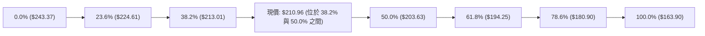

| 回調比率 | 價位 | 技術含義解讀 | 當前價格相對位置與效應 |
|----------|------|--------------|------------------------|
| **0.0%** | $243.37 | 52W 最高點（高位極限阻力） | 距離現價 +15.36%，波段見頂反轉起點 |
| **23.6%** | $224.61 | 強勢回調防守位，緊鄰 MA20 ($225.54) | 價格已有效跌破，由支撐轉為強阻力帶 |
| **38.2%** | $213.01 | **弱勢回調支撐位（現價上方壓制）** | **現價 ($210.96) 處於此位下方 -0.96%，構成即時反彈反壓** |
| **50.0%** | $203.63 | 多空均衡分水嶺，重合 MA200 ($203.36) | 下檔重要磁吸緩衝帶，跌破 S1 後的關鍵承接點 |
| **61.8%** | $194.25 | **黃金分割終極支撐，共振 S3 ($194.30)** | 中長線多頭結構不可退讓之底線 |
| **78.6%** | $180.90 | 深度回撤防線 | 數據中提供之深層回撤位，目前暫無威脅 |
| **100.0%**| $163.90 | 52W 最低點 | 週期循環起漲原點 |

---

## 5. 技術指標深度解讀

### 🎛️ 指標訊號總覽

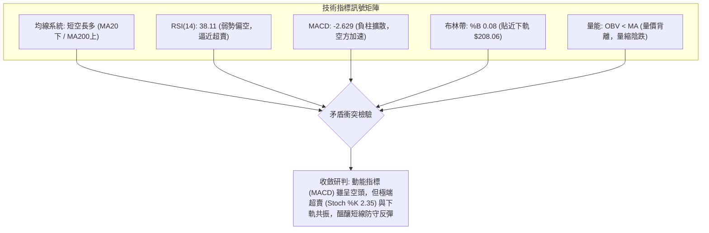

### 📈 移動平均線排列分析

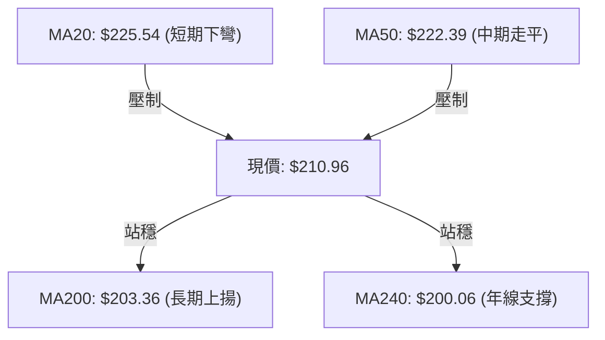

**移動平均線詳細狀態對照表**：

| 均線名稱 | 數值 | 價格相對位置 | 幅差百分比 | 趨勢斜率 | 解讀與戰略價值 |
|----------|------|--------------|------------|----------|----------------|
| **MA 5** | $215.74 | 價格在下方 | -2.22% | ▼ 下降 | 超短期急跌壓制線，日內反彈首要考驗 |
| **MA 10** | $218.62 | 價格在下方 | -3.50% | ▼ 下降 | 短線空頭推進線，未站上前空方主導盤面 |
| **MA 20** | $225.54 | 價格在下方 | -6.47% | ▼ 下降 | 月均線下穿成阻力，與布林中軌完全重合 |
| **MA 50** | $222.39 | 價格在下方 | -4.71% | ▼ 下降 | 中期生命線失守，短線轉入震盪調整循環 |
| **MA 60** | $221.39 | 價格在下方 | -4.71% | ▼ 下降 | 季線阻力，構成中短期密集反壓頂蓋 |
| **MA 120** | $214.77 | 價格在下方 | -1.78% | ▼ 下降 | 半年線位階，重合 R1 ($214.75) 阻力節點 |
| **MA 200** | $203.36 | 價格在上方 | +3.74% | ▲ 上升 | 長期牛熊分水嶺，具備極強結構性買盤支撐 |
| **MA 240** | $200.06 | 價格在上方 | +5.45% | ▲ 上升 | 年線基石，與整數關卡 $200.00 形成雙重護城河 |

> **均線排列架構總評**：整體均線呈現 `MA20 ($225.54) > MA50 ($222.39) > MA200 ($203.36)`，形態上保留中長線**多頭排列**的骨架，但短期價格大幅下墜跌穿 MA5、MA10、MA20、MA50，屬於「長多格局下的深幅回調波」，並非全面性技術崩壞。

### 📉 RSI(14) 分析

- **當前讀數**：**38.11** (Wilder 計算法)
- **進度條視覺化**：
  ```
  超賣 [0] ────────── [30] ─────── [50] ─────── [70] ────────── [100] 超買
  讀數 38.11: ███████████████░░░░░░░░░░░░░░░░░░░░░░░░ 38.11% (弱勢區間)
  ```
- **超買超賣評估**：RSI(14) 位於 38.11，已落入 30–40 的偏空弱勢區，但尚未跌破 30 達到極端超賣。此數值顯示空方動能佔優，但拋售動能已進入衰竭中後期。
- **背離分析判斷**（規則 7）：
  - 根據近 20 根日 K 棒首尾之價格與 RSI 比對，價格自高點 $233.95（2026-10-02 週）跌至 $210.96，RSI 亦同步自 63.0 下降至 38.11。
  - **結論**：**無明顯頂背離或底背離**。價格下跌與動能走低完全同步，為健康的空方調整釋放，未見底背離前不宜盲目預測底部反轉。

### 📊 MACD(12, 26, 9) 訊號解讀

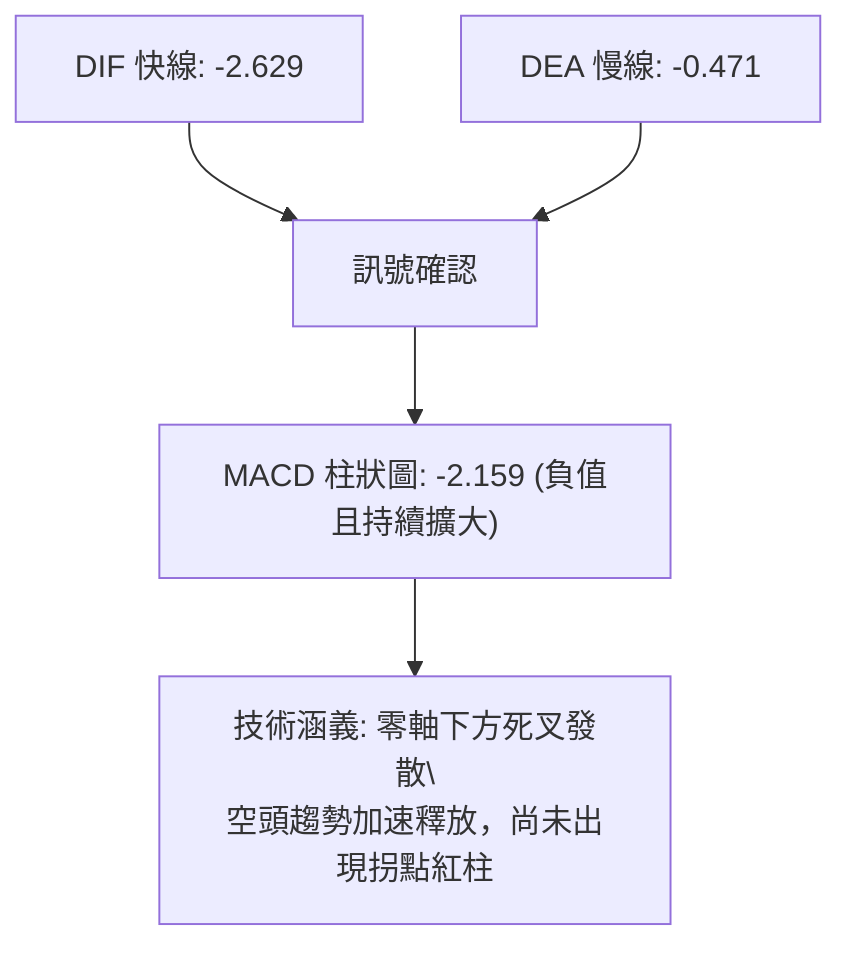

- **MACD 指標數值**：DIF = -2.629，DEA (Signal) = -0.471，Histogram = -2.159。
- **背離檢驗**：日線 MACD 自 10 月初轉為負向擴大，柱狀圖創下波段新低（-2.159），與價格同步創低，**無底背離跡象**。
- **指標互證與矛盾**：Stoch %K 已抵達 2.35 極端超賣，而 MACD 仍在強烈發散下行。此現象表明**短線跌勢過猛引發超賣，但波段修正趨勢尚未終結**，任何短線反彈將先行面臨均線反壓。

### 📦 布林通道分析

```
布林通道結構示意圖 (帶寬: $34.96)
$243.02 ────────────────────────────────── 上軌 (高度重合 R3: $243.37)
                      ↑
                      │ (帶寬振幅 16.57%)
$225.54 ┄┄┄┄┄┄┄┄┄┄┄┄┄┄┼┄┄┄┄┄┄┄┄┄┄┄┄┄┄┄┄┄┄ 中軌 (MA20 反壓線)
                      │
$210.96 ══════════════╪═══════════════════ ◄ 現價位置 (%B = 0.08)
$208.06 ────────────────────────────────── 下軌 (共振 S1: $208.08)
```

- **通道參數解讀**：
  - 上軌：**$243.02**
  - 中軌 (MA20)：**$225.54**
  - 下軌：**$208.06**
  - 通道位置指標 **%B = 0.08**：現價落於下軌上方僅 8% 位置，表示價格已極度貼近布林下軌（距離下軌 $208.06 僅差 $2.90 或 1.37%）。
- **通道形態解讀**：布林帶寬度由前期收窄轉為開口向下擴張，但現價並未以「穿軌破位」形式脫離，而是收出 $210.96 的止跌十字星，顯示 **下軌 $208.06 具備即時價格支撐力道**。

### 💹 成交量分析（量價配合度）

```
量能指標進度條對比
最新成交量  (79.99M)  ███████████████░░░░░  79.99M (量比: 0.76x)
20日均成交量(105.29M) ████████████████████  105.29M
50日均成交量(114.48M) █████████████████████ 114.48M
```

- **量價關係解讀**：
  - 最新交易日成交量為 79,987,200 股，顯著低於 20 日均量（105,294,570 股），量比為 0.76x。
  - **價跌量縮**：自 10-15 放量 127.08M 殺跌後，10-23 回落至 79.98M，呈現典型的「量能萎縮式陰跌」。
- **OBV (能量潮) 趨勢解讀**（規則 9）：
  - 數據標明 `OBV < MA → 量能疲弱`。
  - **分析結論**：OBV 線跌破其均線，代表在近幾週的回調過程中，資金主動撤退多於回補，量能尚未出現「爆量承接」或「底背離換手」特徵，量價結構確認短期弱勢震盪行情。

---

## 6. 動能與波動率

### ⚡ 動能評估四象限

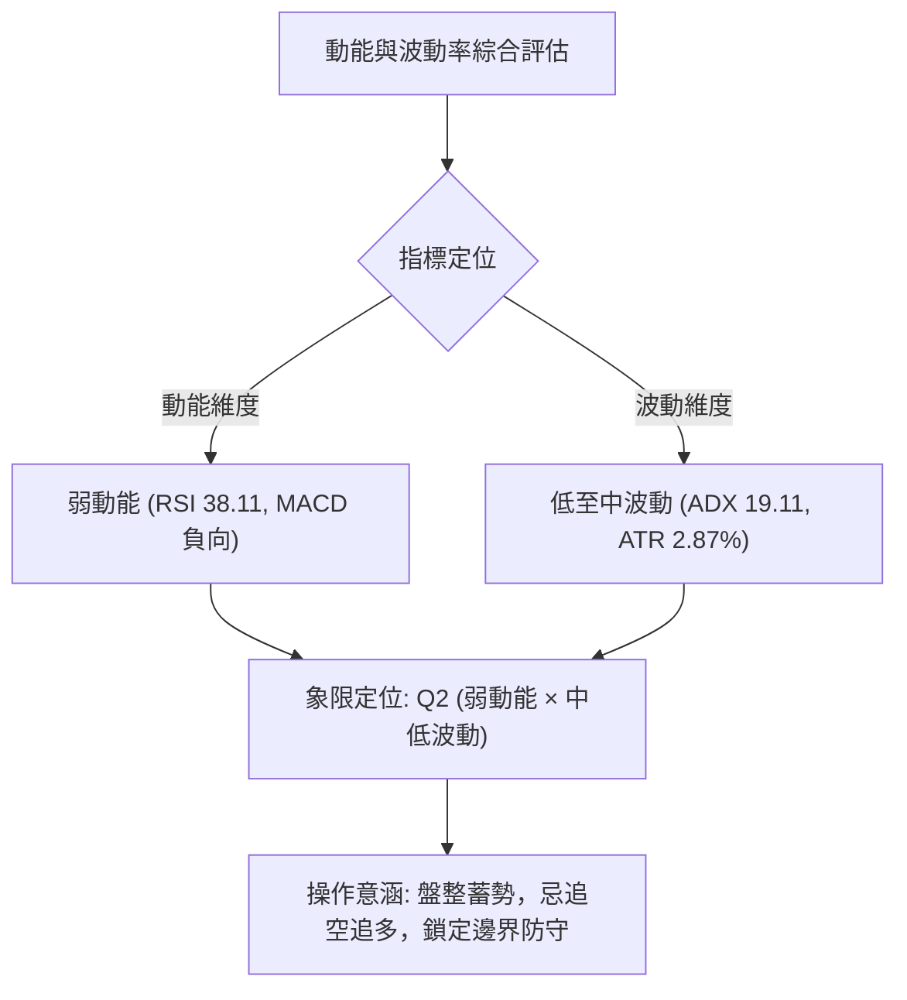

| 象限分區 | 動能維度 | 波動維度 | 當前狀態吻合 | 策略戰術評估 |
|----------|----------|----------|--------------|--------------|
| **第一象限 (Q1)** | 強動能 | 低波動 | ─ | 趨勢初升段，最佳順勢加碼時機 |
| **第二象限 (Q2)** | **弱動能** | **低/中波動** | **✓ (吻合當前)** | **箱型盤整沉悶期，適合區間下緣低吸高拋，謹慎觀望** |
| **第三象限 (Q3)** | 強動能 | 高波動 | ─ | 爆發突破段，高收益高風險，需寬止損 |
| **第四象限 (Q4)** | 弱動能 | 高波動 | ─ | 恐慌崩跌段，流動性擠壓，全面避免進場 |

### 📊 ATR 波動率分析

- **ATR(14) 讀數**：**$6.06**（佔當前股價 2.87%，基於 Wilder 平滑法）。
- **歷史波動橫向對比**：$6.06 的每日期望震幅表明個股處於正常技術回調波動，無流動性危機導致的異常放量飆波。
- **風控止損距離精算**（基於當前價格 $210.96）：
  - **1.0x ATR 緩衝區間**：$6.06 $\rightarrow$ 價格波動容忍空間至 $204.90。
  - **1.5x ATR 波段止損**：$1.5 \times \$6.06 = \$9.09 \rightarrow$ 止損緩衝位為 $201.87（恰位於 MA200 $203.36 之下方防守區）。
  - **2.0x ATR 寬幅止損**：$2.0 \times \$6.06 = \$12.12 \rightarrow$ 防守位為 $198.84（完美契合強支撐 S2: $198.43）。

### 📐 Beta 與市場相關性

- **Beta 係數**：**2.216**。
- **市場敏感度評估**：
  - NVDA 的系統性風險暴露極高（高彈性 Beta > 2.0），代表大盤（S&P 500 / 納斯達克 100）若上漲或下跌 1%，NVDA 平均將產生 2.216% 的同向波動。
  - 當前大環境下，若大盤指數進入修正，NVDA 容易因高 Beta 屬性產生超額回撤；反之，若指數止跌，其在 S1 ($208.08) 附近的技術性反彈斜率亦將遠超市場均值。

---

## 7. 多時框架總結

### 📋 時框架評分表

| 時框架 | 趨勢方向 | 動能狀態 | 均線排列狀況 | 形態特徵 | 綜合評分 | 操作建議 |
|--------|----------|----------|--------------|----------|----------|----------|
| **月線 (長期)** | 偏多 🟢 | 中性偏強 (歷史高位附近) | 完美多頭排列 (MA20>50>200) | 長期上升趨勢通道內運行 | **75/100** | 長線多頭趨勢持股，忽略短期噪聲 |
| **週線 (中期)** | 震盪 🟡 | 中性轉弱 (週MACD紅柱縮) | MA200之上震盪，MA20走平 | 高檔寬幅箱型 ($194 ~ $243) | **50/100** | 箱型邊界操作，不盲目單邊做多 |
| **日線 (短期)** | 偏空 🔴 | 疲弱超賣 (RSI 38.1, MACD負) | 價格跌破 MA20/MA50，受阻MA5 | 雙頂破頸線後尋求下軌支撐 | **35/100** | 逢反彈減碼或嚴設止損低吸博反彈 |

### 🔲 綜合訊號矩陣

```
時框架訊號矩陣分析
────────────────────────────────────────────────────────────────
維度           短期 (日線)      中期 (週線)      長期 (月線)
────────────────────────────────────────────────────────────────
主導趨勢       🔴 下降修正      🟡 區間箱型      🟢 多頭上升
均線狀態       🔴 跌破MA20/50   🟡 MA20糾纏      🟢 多頭發散
動能指標       🔴 MACD負向      🟡 RSI 50附近    🟢 處於強勢區
成交量能       🔴 OBV疲軟       🟡 均量持平      🟢 長線資金沉澱
關鍵位置       測試下軌 S1      箱型中軸徘徊     站穩長線支撐
────────────────────────────────────────────────────────────────
矩陣收斂結果   短期指標面臨超賣修復，受制於中期箱型底部支撐
```

### ⚖️ 多時框收斂結論

> **依據「嚴格要求 14」多時框收斂規則執行決策收斂**：
> 1. **行情性質判定**：當前日線 ADX(14) 讀數為 **19.11**，明確小於 25 臨界線，技術架構**毫無疑問定性為「盤整行情」**。
> 2. **優先級取捨**：依規則 14，盤整行情中中長期趨勢指標暫退為背景，**必須以日線布林通道上下軌（$208.06 至 $243.02）作為最核心的交易區間依據**。
> 3. **方向性唯一結論**：**中性偏弱區間震盪（下緣防守蓄勢反彈）**。
>    - 現價 $210.96 距離布林下軌 $208.06 僅 1.37%，距離波段低點支撐 S1 ($208.08) 僅 1.36%。
>    - 雖然短期均線與 MACD 偏空，但在箱型無趨勢環境下，在支撐位追空具備極高風險。短線應以 **S1 ($208.08) 防守為核心**，展開超跌區間反彈操作。

---

## 8. 交易策略建議

### 🗺️ 策略決策流程圖

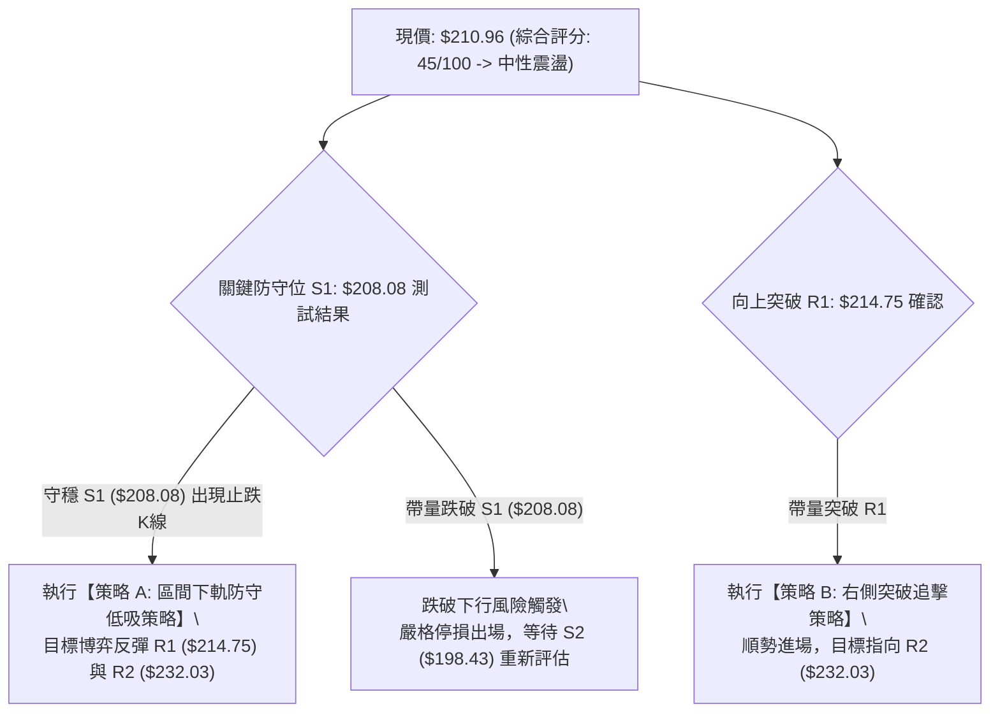

### 🧭 策略路由（依評分卡分流）

**當前主策略方向 = 中性震盪區間操作（評分 45/100，落於 40–60 區間）**
> 依規範，40–60 評分區間以**布林上下軌區間交易為主**。當前價格極度貼近下軌，策略主軸為**在 S1 ($208.08) 關鍵支撐未破前提下，採取「下軌防守低吸反彈」為主策略**；若有效跌破 S1 則全面轉為觀望防守。

### 🎯 價格情境階梯（Price Scenarios）

價位完全嚴格引用第 4 章及數據提供之精確點位：

| 觸發條件 | 下一目標 | 後續延伸 | 情境技術含義 |
|----------|----------|----------|--------------|
| **強勢突破 R1 ($214.75)** | **R2 ($232.03)** | **R3 ($243.37)** | 突破短期下降通道與 MA120 反壓，確認雙頂破頸失敗，重回中多常軌 |
| **站穩現價 ($210.96) / S1** | **R1 ($214.75)** | **$225.54 (MA20)** | 在布林下軌處完成技術超賣修復，進行相應的均值回歸走勢 |
| **有效跌破 S1 ($208.08)** | **S2 ($198.43)** | **S3 ($194.30)** | 箱型破位向下尋求 50% 及 61.8% 斐波那契長期均線防線，中期轉弱 |

### 📊 情境機率分佈

| 預期情境 | 發生機率 | 主要技術依據與指標支撐 |
|----------|----------|------------------------|
| **下軌止跌，區間反彈** | **55%** | Stoch %K 極端超賣 (2.35)，逼近布林下軌 ($208.06) 與 S1 ($208.08)，下跌動能衰竭 |
| **弱勢橫盤，箱型拉鋸** | **30%** | ADX(14)=19.11 顯示無單邊方向，成交量 0.76x 萎縮，買賣雙方陷入觀望 |
| **跌破 S1，深度修正** | **15%** | MACD 負柱持續擴大，-DI (32.31) 主導空方，若大盤重挫可能帶動放量殺穿 |

### 🟢 主策略詳情（區間震盪操作）

所有目標價、支撐阻力、止損點嚴格基於提供之數值；風險報酬比嚴格按規則 17 計算：

$$\text{風險報酬比 (以 T1 計)} = \frac{\text{目標價 T1} - \text{進場價}}{\text{進場價} - \text{止損價}}$$

| 策略要素 | 策略 A（左側：下軌防守低吸） | 策略 B（右側：突破 R1 追擊） |
|----------|------------------------------|------------------------------|
| **適用時機** | 價格回踩 S1 不破或現價企穩時進場 | 盤中帶量突破並站穩 R1 阻力位時進場 |
| **進場價格** | **$210.96** (當前收盤價確認防守) | **$214.75** (突破 R1 確立) |
| **目標價 T1** | **$214.75** (阻力 R1) | **$232.03** (阻力 R2) |
| **目標價 T2** | **$232.03** (阻力 R2) | **$243.37** (歷史高點 R3) |
| **止損價格** | **$208.08** (關鍵支撐 S1 / 下軌破位) | **$208.08** (S1 關鍵防線) |
| **風險報酬比** | **1 : 1.32（以 T1 計）**<br>$(214.75 - 210.96) \div (210.96 - 208.08) = 3.79 \div 2.88 = 1.3159$<br>*(註：以 T2 計則為 1 : 7.32)* | **1 : 2.59（以 T1 計）**<br>$(232.03 - 214.75) \div (214.75 - 208.08) = 17.28 \div 6.67 = 2.5907$<br>*(註：以 T2 計則為 1 : 4.29)* |
| **成功機率** | 60% | 50% |
| **建議倉位** | **10% ~ 15%** (輕倉博弈反彈) | **15% ~ 20%** (確認反轉後順勢加碼) |

### 🔴 反向風險觸發點（對沖提示）

- **做多邏輯全面失效點**：日線收盤價**實體跌破 S1 ($208.08)**。
  - **對沖應對指引**：若收盤價跌破 $208.08，意味著日線布林下軌支撐失效，下行空間直接打開至 S2 ($198.43) 及 Fib 50.0% ($203.63)。此時多頭部位必須嚴格止損離場，空手觀望，切忌向下攤平。

### ⭐ 整體訊號強度評星

```
做多訊號強度：★★☆☆☆  (2/5星 — 僅屬超賣低吸防守，非趨勢轉多)
做空訊號強度：★★☆☆☆  (2/5星 — ADX<25 缺乏單邊動能，下軌追空極易被軋)
整體可信度：  ★★★★☆  (4/5星 — 價位邊界精確，斐波那契與均線共振清晰)
```

---

## 9. 風險提示與監控

### ✅ 關鍵監控指標 Checklist

```
╔══════════════════════════════════════════════════════════════════╗
║               交易員每日關鍵技術指標監控清單                     ║
╠══════════════════════════════════════════════════════════════════╣
║ [ ] 價格防線: 收盤價是否守穩 S1 ($208.08) 與布林下軌 ($208.06) ║
║ [ ] 阻力壓制: 日線能否帶量站回 R1 ($214.75) 及 MA120 ($214.77)  ║
║ [ ] 均線動態: 觀察 MA5 ($215.74) 扣抵位置與走平翻揚跡象          ║
║ [ ] 動能翻轉: MACD 柱狀圖是否由 -2.159 開始向零軸收斂縮短        ║
║ [ ] 超賣修復: Stoch %K (2.35) 是否自超賣區向上黃金交叉 %D (11.79)║
║ [ ] 成交量比: 成交量能否回升至 105.29M (20日均量) 之上 (量比>1.0)║
╚══════════════════════════════════════════════════════════════════╝
```

### ⚠️ 風險場景分析

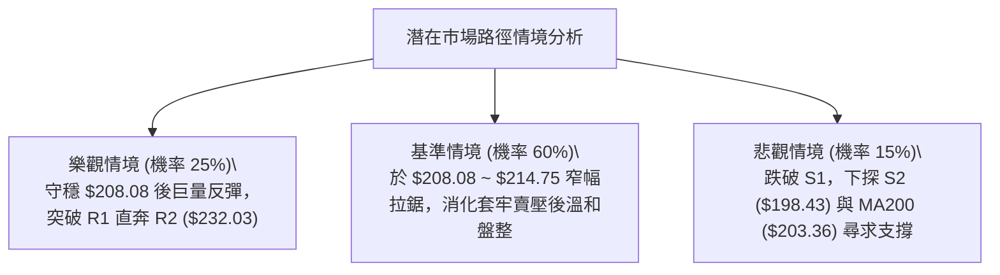

### 🛡️ 風險管理重要提醒

1. **嚴禁在震盪市中使用單邊趨勢思維**：
   - ADX(14) 僅 19.11，這意味著市場缺乏持久單邊行情。在當前區間內「追漲極易套在壓力位，殺跌極易割在支撐位」。所有操作必須緊貼 S1 ($208.08) 與 R1 ($214.75) 的邊界展開。
2. **高 Beta 波動防範與資金管理**：
   - NVDA Beta 高達 2.216，ATR 達 $6.06（每日約 3% 正常波幅）。單筆交易最大虧損額度必須嚴格控制在總投資組合資金的 1.0% 以內。
   - 策略 A 止損幅度為 $2.88，若整體帳戶規模為 100,000 美元，單筆最大風險 1,000 美元，則最大持倉股數不得超過 $1,000 \div 2.88 \approx 347$ 股（約佔倉位 73,000 美元，但考量震盪市建議倉位僅配發 15%，即約 15,000 美元 / 70 股）。
3. **無條件風控紀律**：
   - 一旦日線跌破 $208.08，不可心存僥倖等待「盤中回抽」，應堅決按照風控計畫離場，防範下行至 S2 ($198.43) 的深幅風險。

---

## 📋 報告總結

```
╔══════════════════════════════════════════════════════════════════╗
║                   NVDA 技術分析報告總結                          ║
╠══════════════════════════════════════════════════════════════════╣
║ 報告日期：2026-10-26                                             ║
║ 當前價格：$210.96                                                ║
║ 綜合評分：45/100                                                 ║
║ 分析評級：⚖️ 中性偏弱震盪（日線下軌防守）                       ║
║                                                                  ║
║ 關鍵技術結論：                                                   ║
║ ├─ 長期趨勢：🟢 偏多上升（月線結構完好，MA200 $203.36 穩步上行） ║
║ ├─ 中期趨勢：🟡 箱型盤整（運行於 $194.25 ~ $243.37 寬幅震盪）    ║
║ ├─ 短期趨勢：🔴 弱勢修正（受制於 MA20 $225.54 及 MA50 下行反壓） ║
║ ├─ 關鍵支撐：S1: $208.08 ｜ S2: $198.43 ｜ S3: $194.30           ║
║ ├─ 關鍵阻力：R1: $214.75 ｜ R2: $232.03 ｜ R3: $243.37           ║
║ └─ 華爾街共識目標價：$328.95 (58位分析師評級: Strong Buy)        ║
║                                                                  ║
║ 最優策略組合建議：                                               ║
║ 1. 🥇 最佳機會：於現價 $210.96 輕倉布局策略 A，嚴格以 S1 $208.08 ║
║                 為止損，目標看向 R1 ($214.75) 反彈 (盈虧比 1:1.32)║
║ 2. 🥈 次選機會：耐心等待右側帶量突破 R1 ($214.75) 後執行策略 B， ║
║                 順勢追擊 R2 ($232.03) (盈虧比 1:2.59)            ║
║ 3. 🥉 保守選擇：空手觀望，靜待日線 MACD 負柱收縮並出現底背離，   ║
║                 或待價格回測 MA200 ($203.36) 築底再行評估        ║
╚══════════════════════════════════════════════════════════════════╝
```

---

> ⚠️ **免責聲明**：本報告為依據標準技術分析模型與即時市場數據生成之客觀研究文檔，報告中提及之所有支撐阻力點位、圖表形態及交易策略均僅供學術研究、量化模型驗證與投資教學參考，**絕不構成任何針對個人或機構的實盤買賣要約、投資建議或獲利保證**。市場有風險，交易需依據自身風險承受能力嚴格執行風控紀律，據此操作盈虧自負。

---

*報告生成時間：2026-10-26 ｜ 數據來源：Yahoo Finance ｜ 分析框架：多時框技術分析模型 (MTFA)*