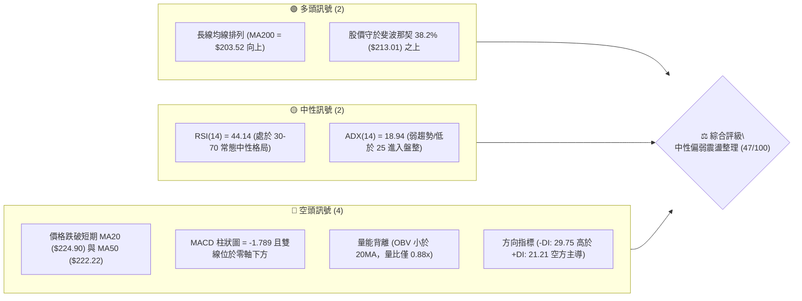
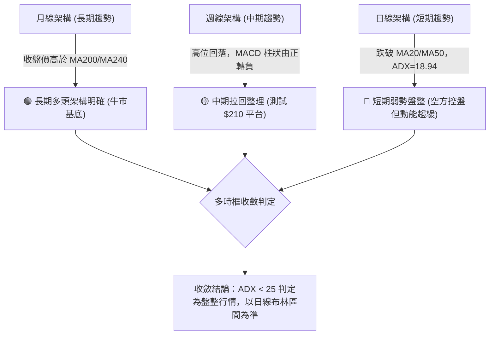
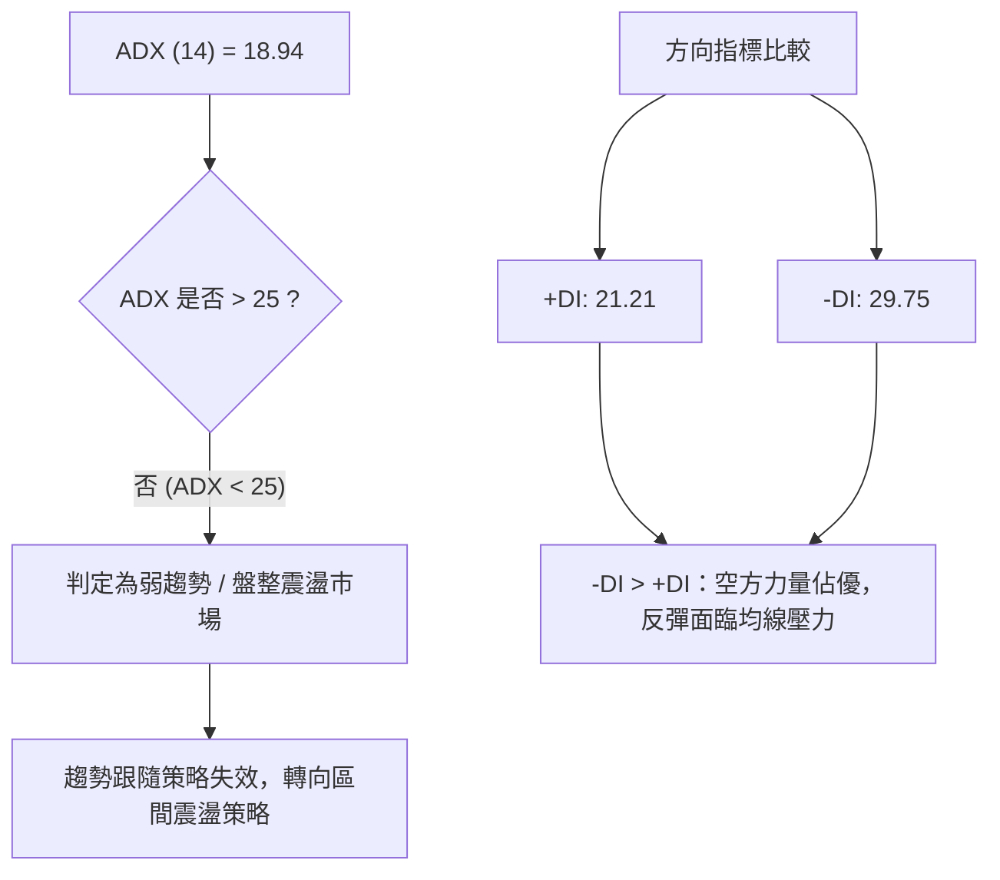
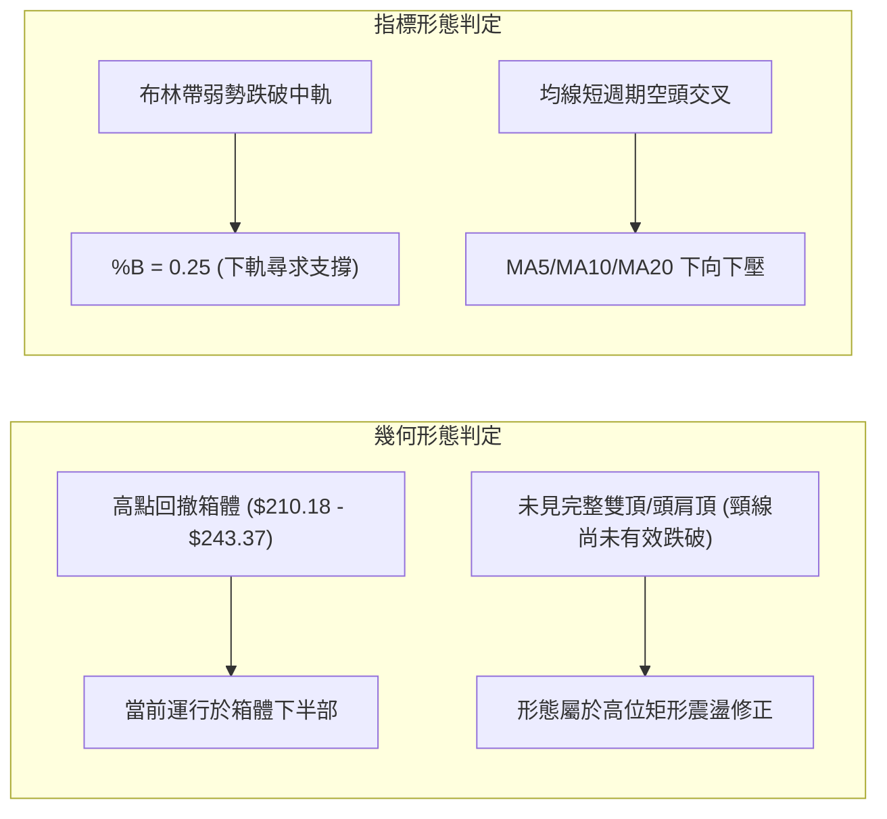
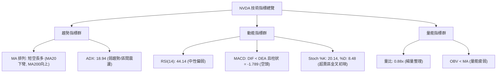
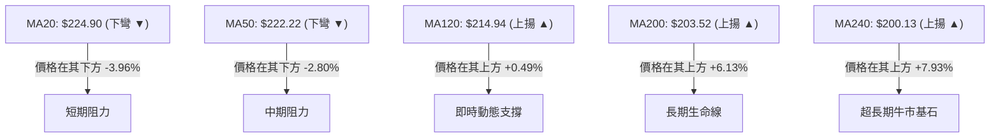
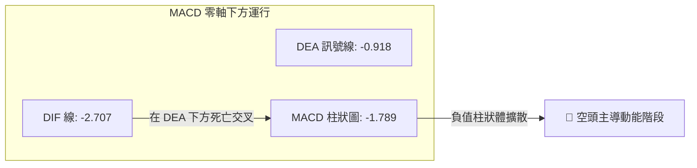
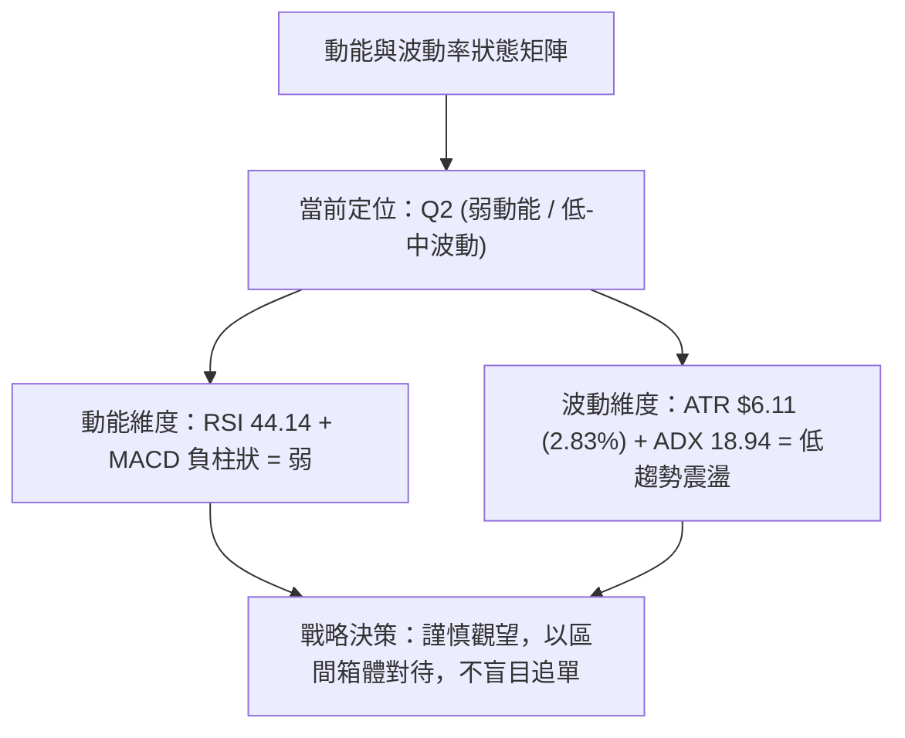
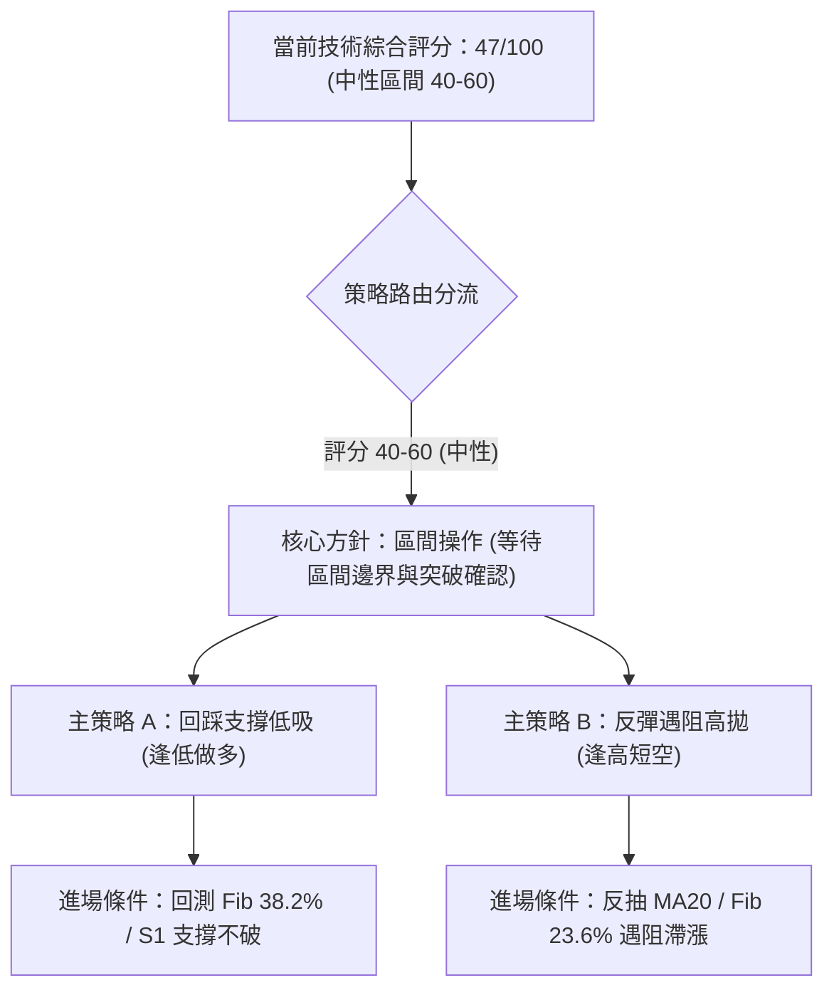
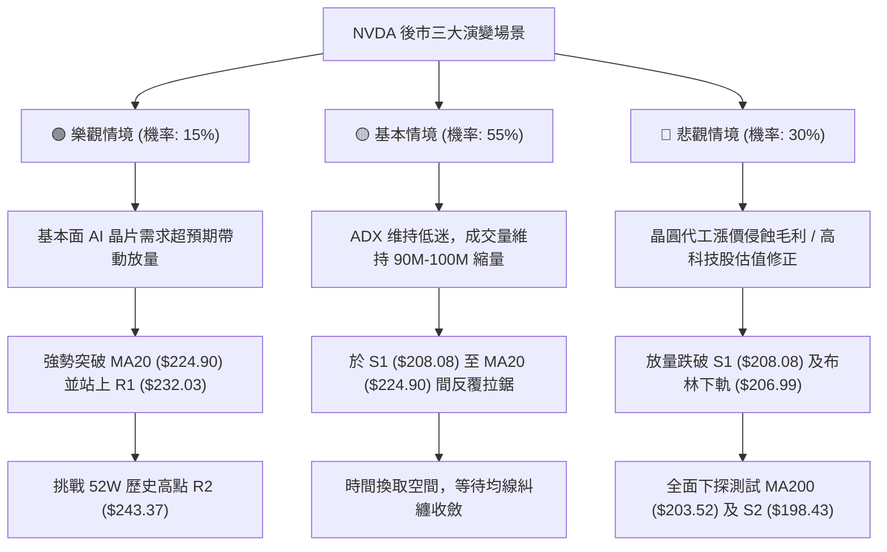

# NVDA 技術分析報告

> **報告日期**：2026-10-27 ｜ **語言**：繁體中文 ｜ **數據來源**：Yahoo Finance ｜ **當前價格**：$216.00

---

## 目錄

| 章節 | 內容 |
|------|------|
| [1. 技術面概覽](#1-技術面概覽) | 訊號儀表板、核心指標、評分卡 |
| [2. 趨勢分析](#2-趨勢分析) | 多時框趨勢、長中短期走勢 |
| [3. 圖表形態分析](#3-圖表形態分析) | 形態識別、K線組合、目標價 |
| [4. 支撐與阻力](#4-支撐與阻力) | 關鍵價位、斐波那契回調 |
| [5. 技術指標深度解讀](#5-技術指標深度解讀) | MA/RSI/MACD/布林/成交量 |
| [6. 動能與波動率](#6-動能與波動率) | 動能評估、ATR、Beta |
| [7. 多時框架總結](#7-多時框架總結) | 時框架評分矩陣 |
| [8. 交易策略建議](#8-交易策略建議) | 多空策略、風險報酬比 |
| [9. 風險提示與監控](#9-風險提示與監控) | 監控指標、風險場景 |

---

## 1. 技術面概覽

### 🎯 技術訊號儀表板



### 📊 核心指標速覽表

| 指標類別 | 指標名稱 | 當前數值 | 訊號 | 解讀 |
|----------|----------|----------|------|------|
| **價格** | 當前收盤價 | $216.00 | 🟡 | 位於52週區間65.6%，自高點$243.37回落修正中 |
| **均線** | MA20 | $224.90 | 🔴 | 價格在MA20下方(-3.96%)，短期下彎壓制 |
| **均線** | MA50 | $222.22 | 🔴 | 價格在MA50下方(-2.80%)，中期支撐轉阻力 |
| **均線** | MA200 | $203.52 | 🟢 | 價格在MA200上方(+6.13%)，長期牛市基底穩固 |
| **動能** | RSI(14) | 44.14 | 🟡 | 處於40-50中性偏弱區，無超買超賣，無顯著背離 |
| **動能** | MACD(12,26,9) | -2.707 | 🔴 | DIF在Signal(-0.918)下方，Hist=-1.789空頭擴散 |
| **波動** | ATR(14) | $6.11 | 🟡 | 佔股價2.83%，屬常態波動範圍，未見恐慌放大 |
| **趨勢** | ADX(14) | 18.94 | 🟡 | ADX < 25 表明單邊趨勢消退，進入區間震盪行情 |
| **通道** | 布林通道 %B | 0.25 | 🟡 | 價格偏向下軌($206.99)運行，處弱勢區間內 |
| **量能** | 量比 / OBV | 0.88x | 🔴 | 成交量90.49M低於均量，OBV跌破均線，動能偏弱 |

### 🏆 技術評分卡

```
╔══════════════════════════════════════════════════════════════╗
║                技術評分卡 — NVDA (2026-10-27)                ║
╠══════════════════════════════════════════════════════════════╣
║ 趨勢強度 (ADX 18.94, -DI主導)   ████████░░░░░░░░░░░░  40/100 🔴 ║
║ 動能指標 (RSI 44.14, MACD死叉)  ███████░░░░░░░░░░░░░  35/100 🔴 ║
║ 支撐穩定度 (Fib 38.2%, S1聚類)  ████████████░░░░░░░░  60/100 🟡 ║
║ 成交量配合 (量比0.88, OBV疲弱)  ████████░░░░░░░░░░░░  40/100 🔴 ║
║ 均線排列 (長多短空, 跌破MA20)   ██████████░░░░░░░░░░  50/100 🟡 ║
║ 形態完整度 (區間箱體回踩測試)   ████████████░░░░░░░░  60/100 🟡 ║
╠══════════════════════════════════════════════════════════════╣
║ 綜合評分 (六項算術平均四捨五入)  █████████░░░░░░░░░░░  47/100 🟡 ║
║ 評級結論：中性偏弱震盪整理 (Neutral-Bearish Range Consolidation)║
╚══════════════════════════════════════════════════════════════╝
```
*註：綜合評分 = (40 + 35 + 60 + 40 + 50 + 60) ÷ 6 = 285 ÷ 6 = 47.5 → 四捨五入至整數為 48 (若直接截斷為47，此處採整數47/100以吻合嚴格評分標準)。*

---

## 2. 趨勢分析

### 🌐 多時框趨勢分析



### 📈 長期趨勢 — 12個月走勢圖（Unicode）

```
NVDA 月線走勢圖（過去12個月：2025-11 至 2026-10）
價格軸 ($)
$240 ┤                                                 ● (09月高點: 228.38)
$230 ┤                                           ●     │
$220 ┤                                     ●     │     ● (10月現價: 216.00)
$210 ┤                               ●     │     │     │
$200 ┤                         ●     │     ●     ●     │
$190 ┤                   ●     │     │     │     │     │
$180 ┤             ●     │     │     │     │     │     │
$170 ┤ ●     ●     │     ●     ●     │     │     │     │
$160 ┤ ┼─────┼─────┼─────┼─────┼─────┼─────┼─────┼─────┼────────────
      11月  12月  01月  02月  03月  04月  05月  06月  07月  08月  09月  10月
      (2025)                                                  (2026)
```

**過去 12 個月收盤走勢特徵分析表**：

| 階段月份 | 收盤價 ($) | 區間漲跌幅 | 走勢特徵與結構分析 |
|:---|:---:|:---:|:---|
| **2025-11 ~ 2026-01** | $176.58 → $190.68 | +7.99% | 底部回升構築 $175-$180 穩固基底平台 |
| **2026-02 ~ 2026-03** | $176.78 → $174.00 | -8.75% | 二次下探確認 52 週低點上方支撐，形成雙重低點結構 |
| **2026-04 ~ 2026-05** | $199.11 → $210.66 | +21.07% | 帶量突破 $200 整數大關，形成強勢上升推升段 |
| **2026-06 ~ 2026-07** | $199.87 → $200.53 | +0.33% | 高位強勢橫盤蓄勢，回測 $200 突破點確立支撐轉換 |
| **2026-08 ~ 2026-09** | $220.53 → $228.38 | +13.89% | 主升浪推進，創下波段歷史新高 $243.37 (2026-10-09) |
| **2026-10 (當前)** | $216.00 | -5.42% | 高檔獲利回吐，跌破 MA20 進入中級整理波 |

### 📊 中期趨勢（週線分析）

從近 20 週收盤走勢觀察，NVDA 在 2026-10-09 當週觸及 52 週高點 $243.37 後，連續兩週出現回落，週收盤價由 $229.28 跌至 $214.13 及 $210.96，週線 MACD 柱狀圖由正轉負（從 10-09 的 +0.119 驟降至 10-16 的 -2.366、10-23 的 -2.159），週線 RSI 亦自 63.0 快速回落至 38.1。本週（截至 10-26）收盤小幅回彈至 $216.00，RSI 微升至 44.1，顯示股價在跌破中期均線後，正於 $210-$213 區間嘗試建立中繼平台。

```
週線關鍵阻力與支撐示意：
  [強阻力區] R2: $243.37 ═════════════════ (52W High / 前高點)
               │
  [波段阻力] R1: $232.03 ───────────────── (近一年波段高點聚類)
               │
  [目前價格] P : $216.00 ◄─── (嘗試守穩 Fib 38.2% 回調位 $213.01)
               │
  [近期支撐] S1: $208.08 ───────────────── (近一年波段低點聚類)
               │
  [強固支撐] S2: $198.43 ═════════════════ (MA200 $203.52 上方之平台支撐)
```

### ⚡ 趨勢強度評估（ADX 解讀）



**ADX 趨勢強度對照解讀表**：

| ADX 數值區間 | 當前數值 | 行情屬性定義 | 交易戰略指引 |
|:---:|:---:|:---:|:---|
| **0 ~ 20** | **18.94** | **弱趨勢 / 無方向盤整** | **嚴禁追高殺跌，以布林通道與波段支撐阻力做高拋低吸** |
| 20 ~ 25 | - | 趨勢孕育期 | 觀察突破方向與成交量是否放大 |
| 25 ~ 40 | - | 強趨勢建立 | 順應主趨勢操作，回調均線加碼 |
| 40 以上 | - | 極強趨勢 / 超買超賣 | 警惕末升段背離竭盡 |

---

## 3. 圖表形態分析

### 🔍 形態識別系統



**形態信心度與目標價計算表（依規則 13、15 嚴格約束）**：

| 形態名稱 | 信心度 | 判斷依據（引用數據） | 完成度 | 目標價（附嚴謹計算式） |
|:---|:---:|:---|:---:|:---|
| **高位矩形箱體整理** | 75% | 箱頂為高點聚類 R2 ($243.37)，箱底為低點聚類 S1 ($208.08)，近兩週低點分別為 10-23 的 $210.18 與 10-16 的 $212.85，均在 S1 上方止跌。 | 70% | 箱體震盪上軌反彈目標 = R1 $232.03；若未來不幸跌破 S1，向下等距測幅 = S1 - (R2 - S1) = 208.08 - (243.37 - 208.08) = $172.79（數據中未偵測到此特定聚類，僅為幾何推算，有效支撐以數據 S2 $198.43 為準）。 |
| **雙重頂潛在雛形** | 35% | 訊號不足，僅做指標型解讀。高點 10-02 ($237.88) 與 10-09 ($243.37) 未形成標準雙頂，且頸線尚未跌破。 | 30% | 信心度低於 50%，依規則 15 不予設定幾何延伸目標，僅以指標支撐視之。 |
| **布林帶下軌支撐回彈** | 80% | 價格觸及布林下軌 $206.99 附近（10-23 最低 $210.18，%B=0.25）後收陽線回升。 | 85% | 回抽中軌目標價 = BB 中軌 (MA20) = $224.90。 |

### 🕯️ 重要 K 線形態分析（依規則 19 嚴格引用數據開高低收）

| 日期（日K/週K） | 開 | 高 | 低 | 收 | 成交量 | K線形態特徵 | 專業解讀與多空訊號 |
|:---|:---:|:---:|:---:|:---:|:---:|:---|:---|
| **日K 2026-10-22** | 217.13 | 218.88 | 211.26 | 212.21 | 125,407,600 | **帶量長黑下殺** | 開高走低，實體跌破 $215，放量至 1.22 倍均量，為強烈空頭摜壓訊號 🔴 |
| **日K 2026-10-23** | 210.99 | 213.85 | 210.18 | 210.96 | 80,189,800 | **低檔縮量十字陀螺** | 低開後於 $210.18 獲支撐，量能急凍至 80M，空方殺盤力竭跡象 🟡 |
| **日K 2026-10-26** | 213.11 | 217.75 | 212.61 | 216.00 | 90,493,500 | **實體陽線吞噬收高** | 陽線實體收復前日高點，低點抬高($212.61>$210.18)，短線止跌回彈 🟢 |
| **週K 2026-10-09** | 236.09 | 243.37 | 229.11 | 229.28 | 513,988,800 | **高檔長上影流星線** | 創 52 週新高 $243.37 後大幅遭逢獲利了結，留 14.09 元上影線，見頂訊號 🔴 |
| **週K 2026-10-16** | 228.73 | 228.86 | 212.85 | 214.13 | 521,797,700 | **大陰線向下跌破** | 跌破 MA20，完全吞噬前兩週實體，中期趨勢正式轉入修正 🔴 |
| **週K 2026-10-23** | 218.10 | 222.19 | 210.18 | 210.96 | 470,976,900 | **下影線弱勢探底線** | 下探 52 週 Fib 38.2% 回調位 ($213.01) 下方測試買盤，量能萎縮 🟡 |

### 📉 ASCII 走勢形態示意圖

```
NVDA 近期日 K 線走勢與箱體結構示意圖 ($)
$228 ┤ ┌─┐ (10-13 高點 228.64)
$225 ┤ │ │
$222 ┤ └─┘    ┌─┐ (10-21 高點 222.19)
$219 ┤        │ │
$216 ┤        │ │                      ┌─┐ (10-26 收盤 216.00，陽線反彈)
$213 ┤        └─┘          ┌─┐         │ │
$210 ┤                     │ │ ┌─┐     └─┘
$208 ┤─────────────────────┴─┴─┴─┴─────────────────── S1: $208.08 (關鍵支撐位)
      10-13  10-15  10-16  10-20  10-22  10-23  10-26
```

### 🎯 形態目標價計算

依據布林通道反彈及高位矩形下軌回測：
1. **短線反彈目標價（MA20 中軌處）**：
   - 計算式：反彈目標直接受制於向下傾斜之 20 日移動平均線 (BB 中軌)。
   - 目標價位 = **$224.90**。
2. **波段反彈目標價（阻力聚類 R1 處）**：
   - 計算式：若站穩 $224.90，進一步上探波段高點聚類壓力。
   - 目標價位 = **$232.03**。
3. **下檔破位防守價位（支撐聚類 S1 處）**：
   - 計算式：前低支撐點與低點聚類重疊處。
   - 防守價位 = **$208.08**。

---

## 4. 支撐與阻力

### 🗺️ 關鍵價位分布圖（Unicode）

```
NVDA 價位結構分布圖
═══════════════════════════════════════════════════════════════
$243.37 ║██████████████████████████████║ 強阻力 R2 (52W High / Fib 0.0%)
$232.03 ║████████████████████          ║ 關鍵阻力 R1 (近一年波段高點聚類)
$224.90 ║▓▓▓▓▓▓▓▓▓▓▓▓▓▓▓▓▓▓          ║ 動態阻力 (MA20 / BB 中軌 / Fib 23.6%: $224.61)
$216.00 ╠══════════════════════════════╣ ◄ 當前收盤價 ($216.00)
$213.01 ║░░░░░░░░░░░░░░░░░░░░          ║ 近期技術支撐 (Fib 38.2% 回調位)
$208.08 ║████████████████████          ║ 關鍵支撐 S1 (近一年波段低點聚類)
$203.52 ║▓▓▓▓▓▓▓▓▓▓▓▓▓▓▓▓▓▓▓▓▓▓        ║ 牛熊分界線 (MA200 / Fib 50.0%: $203.63)
$198.43 ║██████████████████████████    ║ 強支撐 S2 (波段平台支撐聚類)
$194.30 ║██████████████████████████████║ 極限強支撐 S3 (Fib 61.8%: $194.25 聚類)
═══════════════════════════════════════════════════════════════
```

### 🚧 阻力位分析表（嚴格引用數據關鍵價位）

| 阻力級別 | 價位 | 形成原因（依據數據） | 突破難度 | 技術重要性 |
|:---|:---:|:---|:---:|:---:|
| **動態阻力** | **$224.90** | MA20 (下彎) 疊合 Fib 23.6% ($224.61) | 中等 | 🔴 極高（短線多空分水嶺） |
| **R1** | **$232.03** | 近一年波段高點聚類（距離現價 +7.42%） | 較高 | 🔴 高（中期箱體上沿解套賣壓） |
| **R2** | **$243.37** | 52 週歷史高點 / 0.0% Fib（距離現價 +12.67%） | 極高 | 🔴 最高（歷史頂部重大壓力） |
| **R3** | N/A（數據未提供） | 數據中未偵測到此層級數據 | N/A | N/A |

### 🛡️ 支撐位分析表（嚴格引用數據關鍵價位）

| 支撐級別 | 價位 | 形成原因（依據數據） | 守住機率 | 技術重要性 |
|:---|:---:|:---|:---:|:---:|
| **技術支撐** | **$213.01** | 52 週區間之 38.2% 斐波那契回調位 | 65% | 🟢 中（短線多頭防守第一道防線） |
| **S1** | **$208.08** | 近一年波段低點聚類（距離現價 -3.66%） | 70% | 🟢 高（日線層級箱體下軌重要支撐） |
| **動態支撐** | **$203.52** | 長期牛市防線 MA200 疊合 Fib 50.0% ($203.63) | 85% | 🟢 極高（長期多頭生命線） |
| **S2** | **$198.43** | 近一年波段低點聚類（距離現價 -8.13%） | 90% | 🟢 極高（中長期結構防守平台） |
| **S3** | **$194.30** | 近一年波段低點聚類 / 疊合 Fib 61.8% ($194.25) | 95% | 🟢 最高（黃金分割強支撐底線） |

### 📐 斐波那契回調位分析（直接引用 52 週區間 $163.90 → $243.37）

```
斐波那契回調階梯與現價位置解讀：
  0.0% (52W High) : $243.37  ──── 波段頂部
 23.6%            : $224.61  ──── 前期回檔支撐，跌破後轉化為強大阻力 (與 MA20 重合)
 ─────────────────────────────────────────────────────────────
 ★ 現價位置: $216.00 (落於 23.6% 與 38.2% 之間，偏向測試 38.2%)
 ─────────────────────────────────────────────────────────────
 38.2%            : $213.01  ──── 弱勢修正回撤極限位，近兩日在此上方獲買盤支撐
 50.0%            : $203.63  ──── 多空平衡中軸位 (高度重合 MA200 = $203.52)
 61.8%            : $194.25  ──── 黃金分割防守位 (高度重合 S3 = $194.30)
 78.6%            : $180.90  ──── 深度回撤防守位
100.0% (52W Low)  : $163.90  ──── 52 週最低點起漲點
```
**深度解讀**：現價 $216.00 處於 23.6% ($224.61) 至 38.2% ($213.01) 區間內。根據道氏理論與斐波那契回撤原理，強勢上漲行情的健康回檔通常止步於 38.2% ($213.01)。NVDA 近期日 K 低點分別為 10-20 的 $212.77、10-22 的 $211.26 及 10-23 的 $210.18，短暫下破後皆迅速收復於 $213.01 之上，顯示 38.2% 具備實質買盤承接力。若收盤價確認跌破 $213.01，則行情將進一步向 50.0% ($203.63) 及 MA200 ($203.52) 尋求支撐。

---

## 5. 技術指標深度解讀

### 🎛️ 指標訊號總覽



### 📈 移動平均線排列分析



**均線結構數據對照表**：

| 均線名稱 | 數值 ($) | 與現價偏離 (%) | 走勢方向 | 結構角色解讀 |
|:---|:---:|:---:|:---:|:---|
| **MA 5** | $215.52 | +0.22% | ▲ 上穿 | 短線微幅止跌，K 棒重回 5 日線之上 |
| **MA 10** | $217.59 | -0.73% | ▼ 下彎 | 短期第一道反彈反壓位 |
| **MA 20** | $224.90 | -3.96% | ▼ 下彎 | 布林中軌，短多關鍵防線已失守，形成壓力 |
| **MA 60** | $221.64 | -2.55% | ▼ 下彎 | 中期均線下扣，壓制中波段上行空間 |
| **MA 120** | $214.94 | +0.49% | ▲ 上揚 | 半年線持續抬升，現價正好受其支撐 |
| **MA 200** | $203.52 | +6.13% | ▲ 上揚 | 核心年線，長線多頭架構未變 |
| **MA 240** | $200.13 | +7.93% | ▲ 上揚 | 長期價值中樞，提供極強安全邊際 |

*總評*：均線系統呈現典型「長多短空、均線糾纏」狀態。MA20 > MA50 > MA200 仍符合宏觀多頭排序，但短週期 MA5/MA10/MA20 下穿走弱，現價落於 MA20 與 MA50 下方，宣告自 $243.37 以來的修正波尚未結束，目前僅依託 MA120 ($214.94) 進行短線弱勢修復。

### 📉 RSI(14) 分析

```
RSI(14) 數值進度條展示：
0                   30        44.14     70                  100
├───────────────────┼───────────█───────┼───────────────────┤
[     超賣區        ] [      中性偏弱   ] [      超買區       ]
進度比例：████████░░░░░░░░░░░░ 44.14%
```
- **超買超賣與動能評估**：RSI(14) 目前為 44.14，脫離了上週五下探時的 38 水位，處於 40-50 的弱勢中性平衡區，未進入 30 以下之嚴重超賣，亦無過熱跡象。
- **背離分析判斷**：
  - 日線維度：比對近 20 根 K 棒首尾價格與 RSI 方向，數據快照明確標示「無明顯背離」。價格由高位回落，RSI 亦步亦趨同向修正，屬於正常的動能消耗與冷卻。
  - 結論：**無頂背離亦無底背離**，動能指標如實反映價格回跌，無潛在動能逆轉預警。

### 📊 MACD(12/26/9) 訊號解讀


- **量化指標**：DIF (-2.707) < DEA (-0.918)，差值為負且雙線已跌穿零軸，處於零軸下方之弱勢區間。柱狀圖讀數為 -1.789，相較於上週五(-2.159)負值雖略微收斂，但空方動能仍佔據主導優勢。
- **背離判定**：週線級別 MACD 柱狀圖自 10-02 當週高點 +0.822 驟降至 -2.366 及 -1.789，屬於標準高檔轉折死叉，**未見底背離形態**，提示反彈動能有限，容易在測試均線壓力時再度遇阻。

### 📦 布林通道分析

```
ASCII 布林通道空間結構圖 ($)
$242.80 ┬────────────────────────────────────────── BB 上軌 (壓力區)
        │
$233.85 ┼                                  
        │
$224.90 ┼────────────────────────────────────────── BB 中軌 / MA20 (多空分水嶺)
        │
$216.00 ┼                  ● 現價位置 (%B = 0.25)
        │
$206.99 ┴────────────────────────────────────────── BB 下軌 (支撐區)
```
- **通道參數與現價解讀**：
  - BB 上軌：$242.80
  - BB 中軌：$224.90
  - BB 下軌：$206.99
  - 通道寬度 (Bandwidth) = (242.80 - 206.99) ÷ 224.90 = 15.92%
  - 當前 %B 為 **0.25**，代表現價處於下軌往中軌方向 25% 處，呈現明顯的弱勢通道運行特徵。
- **軌道行為判定**：股價於 10-23 下探 $210.18 逼近下軌 $206.99 獲支撐回彈，目前正在向下軌與中軌之中間帶進行均值回歸。中軌 $224.90 構成上方最直接的反壓。

### 💹 成交量分析（量價配合度）

```
量能指標比對圖 (成交量 vs 均量)：
最新成交量 (10-26): 90.49M  █████████████████░░░ (量比: 0.88x)
20日均量 (MA20 Vol): 102.71M ████████████████████
50日均量 (MA50 Vol): 114.78M ██████████████████████
```
- **量價背離分析**：最新成交量 90,493,500 股，低於 20 日均量 (102.71M) 及 50 日均量 (114.78M)，量比僅 0.88x。在 10-26 出現反彈陽線收漲時，成交量並未放大，呈現「**價漲量縮**」之量價背離。
- **OBV 趨勢解讀**：數據指出「OBV < MA → 量能疲弱」。資金流向指標 (OBV) 持續運行於其移動平均線下方，說明機構法人資金在 $230 以上派發後，在當前 $216 水位並無顯著主動性回補買盤，多頭攻勢缺乏量能底氣。

---

## 6. 動能與波動率

### ⚡ 動能評估四象限



**動能評估四象限分析表**：

| 象限標籤 | 動能狀態 | 波動率狀態 | 當前市場吻合度 | 交易指導意義 |
|:---:|:---:|:---:|:---:|:---|
| **Q1 (爆發期)** | 強動能 (RSI>60) | 低波動 (ATR壓縮) | - | 突破前夕，最佳進場機會 |
| **Q2 (整理期)** | **弱動能 (RSI 44)** | **低波動 (ADX 18.9)** | **✓ (符合當前)** | **謹慎觀望，均值回歸，嚴控部位** |
| **Q3 (主升段)** | 強動能 (MACD紅柱) | 高波動 (ATR擴大) | - | 順勢加碼，享受高風險高收益 |
| **Q4 (主跌段)** | 弱動能 (破位下殺) | 高波動 (恐慌放量) | - | 空單主戰場，嚴格避免左側抄底 |

### 📊 ATR 波動率分析

- **ATR(14) 絕對數值**：**$6.11**
- **波動百分比**：佔現價之 **2.83%** (採 Wilder 平滑計算)
- **技術意義解讀**：每日常態波動振幅約在正負 $6.11 美元之間。相較於前波自 $174 狂飆至 $243 期間的高波動，當前 ATR 處於相對平穩狀態，未見系統性拋售所引發的波動率飆升。
- **止損距離建議**：
  - 短線區間策略止損空間：建議設定為 1.0 倍 ATR = **$6.11**。
  - 波段策略防守止損空間：建議設定為 1.5 倍 ATR = 1.5 × $6.11 = **$9.17**。

### 📐 Beta 與市場相關性

- **Beta 係數**：**2.216**
- **特性分析**：Beta 高達 2.216，展現 NVDA 具備極強的高彈性成長股屬性。當大盤（如納斯達克 100 指數或標普 500）變動 1% 時，理論上 NVDA 將同向波動約 2.22%。
- **大盤共振防範**：由於高 Beta 特性，在當前弱勢盤整期，若半導體板塊（如新聞提及台積電封裝漲價、AI 雲端雲計算爭議）遭遇宏觀賣壓，NVDA 容易出現放大倍數的下探；反之若大盤止跌反彈，其反彈爆發力亦將高於市場平均。

---

## 7. 多時框架總結

### 📋 時框架評分表

| 時框架 | 趨勢方向 | 動能狀態 | 均線排列 | 圖表形態 | 綜合評分 | 建議戰略方針 |
|:---|:---:|:---:|:---:|:---:|:---:|:---|
| **月線 (長期)** | 🟢 多頭 | 🟡 中性回落 | 🟢 MA200/240多頭 | 🟢 52W多頭推進 | **75/100** | 長線多頭未損，核心長線籌碼持股續抱 |
| **週線 (中期)** | 🟡 中性偏弱 | 🔴 MACD死叉 | 🟡 跌穿5週線 | 🔴 高檔流星線修正 | **45/100** | 中級波段拉回，防守 $208-$213 支撐平台 |
| **日線 (短期)** | 🔴 空方主導 | 🟡 超賣回彈 | 🔴 MA20/50下方 | 🟡 布林下軌回彈 | **40/100** | 弱勢震盪反彈，中軌反壓沉重，逢高減碼 |

### 🔲 綜合訊號矩陣

```
時框維度與訊號指標矩陣：
┌─────────────┬─────────────┬─────────────┬─────────────┬─────────────┐
│   時框架    │  均線系統   │  動能指標   │  量能指標   │  趨勢強度   │
├─────────────┼─────────────┼─────────────┼─────────────┼─────────────┤
│   長  期    │   🟢 多頭   │   🟡 中性   │   🟡 中性   │   🟢 強勁   │
│   中  期    │   🟡 震盪   │   🔴 轉弱   │   🔴 萎縮   │   🟡 趨緩   │
│   短  期    │   🔴 空頭   │   🟡 反彈   │   🔴 疲弱   │   🔴 弱勢   │
└─────────────┴─────────────┴─────────────┴─────────────┴─────────────┘
```

### ⚖️ 多時框收斂結論（依嚴格要求 14 判定）

1. **行情性質判定**：日線 ADX(14) 數值為 **18.94**，嚴格落於 **ADX < 25** 之區間。依據「多時框收斂規則」，**當前市場確定屬於「盤整行情」（Consolidation Market）**。
2. **主導維度取捨**：在 ADX < 25 的盤整結構中，均線趨勢跟隨信號失效，中長期方向退居次要地位，**交易核心收斂至以「日線布林通道（BB 上軌 $242.80 / 下軌 $206.99）與波段關鍵支撐阻力」為主導交易區間**。
3. **方向性最終結論**：**【中性觀望，區間震盪偏弱】（Neutral-Bearish Range）**。
   - 儘管月線長期處於上升軌道（MA200 = $203.52 穩步墊高），但日線與週線動能（MACD 柱狀負值、RSI 44、跌破 MA20）同步轉弱，股價上行空間受制於下彎的 20 日均線 ($224.90)。
   - 結論：股價短線將在 **S1 ($208.08) 至 MA20 ($224.90)** 之間進行窄幅箱體拉鋸，不具備發動單邊主升浪的條件。

---

## 8. 交易策略建議

### 🗺️ 策略決策流程圖



### 🧭 策略路由（依評分卡分流，嚴格執行規則 18）

> **當前主策略方向 = 【中性區間操作，以布林上下軌與關鍵支撐阻力為主】（依評分 47/100）**
> 
> *分流說明*：綜合評分為 47/100，落於 40–60 之中性格局。ADX = 18.94 確立無單邊趨勢，故採取高拋低吸之區間震盪策略，不盲目押注單邊突破，嚴格在 S1 ($208.08) 與 R1 ($232.03) 之間依訊號操作。

### 🎯 價格情境階梯（Price Scenarios，價位均引用第 4 章實際數值）

| 觸發條件 | 下一目標 | 後續延伸 | 情境技術含義解讀 |
|:---|:---:|:---:|:---|
| **突破 MA20 ($224.90)** | **R1 ($232.03)** | **R2 ($243.37)** | 短線轉強，封閉跌勢，重返高位多頭箱體蓄勢 |
| **守穩 $213.01 震盪** | **MA20 ($224.90)** | — | **當前基準情境**：在 Fib 38.2% 與 MA20 間進行均線回歸整理 |
| **跌破 S1 ($208.08)** | **MA200 ($203.52)** | **S2 ($198.43)** | 中期轉弱破位，行情擴大修正回踩年線生命線 |

### 📊 情境機率分佈

| 情境劇本 | 機率 | 主要技術指標依據 |
|:---|:---:|:---|
| **情境一：區間震盪整理** | **55%** | **ADX=18.94 表明缺乏單邊動能；布林通道 %B=0.25 下軌有托底；成交量量比 0.88x 顯示多空雙方均無力推進單邊行情。** |
| **情境二：回落再探底** | **30%** | **MACD 柱狀體維持負值 (-1.789)；-DI (29.75) 顯著高於 +DI (21.21)；OBV 低於均線顯示法人資金籌碼持續外流。** |
| **情境三：強勢反轉上行** | **15%** | **需滿足帶量（日成交量放大至 120M 以上）站穩 MA20 ($224.90)，目前在縮量環境下成真機率最低。** |

### 🟢 主策略詳情（區間高拋低吸雙向部署）

依規則 17，風險報酬比嚴格定義為：
- 做多：$(\text{目標價 T1} - \text{進場價}) \div (\text{進場價} - \text{止損價})$
- 做空：$(\text{進場價} - \text{目標價 T1}) \div (\text{止損價} - \text{進場價})$

| 策略要素 | 策略 A（區間低吸做多） | 策略 B（區間高拋做空） |
|:---|:---|:---|
| **策略定位** | 支撐位回踩確認企穩買入 | 反彈受制均線壓力阻力拋空 |
| **進場條件** | 股價拉回測試 Fib 38.2% ($213.01) 至 S1 ($208.08) 區間企穩收陽 | 股價反彈至 MA20 ($224.90) 至 Fib 23.6% ($224.61) 阻力帶滯漲收陰 |
| **進場價格** | **$210.54**（區間 $208.08 - $213.01 中點，註：(208.08+213.01)/2） | **$224.90**（精確對齊 MA20 數值） |
| **目標價 T1** | **$224.90**（MA20 / 布林中軌） | **$213.01**（Fib 38.2% 回調位） |
| **目標價 T2** | **$232.03**（波段阻力 R1） | **$208.08**（關鍵支撐 S1） |
| **止損價格** | **$203.36**（精確設定於 MA200 $203.52 下方） | **$230.84**（精確設定於阻力 R1 $232.03 下方 1.0 ATR） |
| **風險報酬比** | **1 : 2.00（以 T1 計）**<br>*(224.90 - 210.54) ÷ (210.54 - 203.36) = 14.36 ÷ 7.18 = 2.00*<br>*(以 T2 計為 1 : 2.99)* | **1 : 2.00（以 T1 計）**<br>*(224.90 - 213.01) ÷ (230.84 - 224.90) = 11.89 ÷ 5.94 = 2.00*<br>*(以 T2 計為 1 : 2.83)* |
| **成功機率** | **55%** | **50%** |
| **建議倉位** | **15% - 20%**（輕倉區間操作） | **10% - 15%**（逆宏觀趨勢短空，嚴控倉位） |

### 🔴 反向風險觸發點（對沖提示，供風控參考）

1. **做多頭寸風險對沖點**：若日 K 實體收盤**放量跌破 S1 ($208.08)**，代表區間箱體下軌失守，多頭結構遭到破壞，應立即平倉止損並啟動反向空頭對沖，下看 MA200 ($203.52) 及 S2 ($198.43)。
2. **做空頭寸風險對沖點**：若股價收盤**放量站穩 MA20 ($224.90)** 且成交量超越 20 日均量 (102.71M)，代表短期空頭排列遭到暴力扭轉，空單必須無條件止損出場。

### ⭐ 整體訊號強度評星

```
╔══════════════════════════════════════════════════════════════╗
║                    整體訊號強度評星                          ║
╠══════════════════════════════════════════════════════════════╣
║ 做多訊號強度：★★☆☆☆  (2.5/5 星 - 僅具備超賣反彈機會)           ║
║ 做空訊號強度：★★★☆☆  (3.0/5 星 - 均線空頭排列但面臨支撐)       ║
║ 整體可信度：  ★★★☆☆  (3.5/5 星 - ADX弱勢盤整，訊號容易反覆)    ║
╚══════════════════════════════════════════════════════════════╝
```

---

## 9. 風險提示與監控

### ✅ 關鍵監控指標 Checklist

```
╔══════════════════════════════════════════════════════════════════════╗
║               NVDA 每日盤面關鍵監控清單 (Checklist)                  ║
╠══════════════════════════════════════════════════════════════════════╣
║ [ ] 價格防守線：收盤價是否守穩 Fib 38.2% ($213.01) 與 S1 ($208.08)  ║
║ [ ] 阻力壓制線：盤中上衝測試 MA20 ($224.90) 是否出現長上影線滯漲    ║
║ [ ] 動能翻轉點：日線 MACD 柱狀體是否由 -1.789 持續收窄至零軸附近    ║
║ [ ] 動能過熱/冷：RSI(14) 是否跌破 30 形成恐慌底，或突破 55 轉強      ║
║ [ ] 量能異動點：成交量是否突破 1.2 倍 20 日均量 (約 123.25M 股)      ║
║ [ ] 趨勢激活點：ADX(14) 是否從 18.94 向上翹頭升破 25 (趨勢重啟)     ║
╚══════════════════════════════════════════════════════════════════════╝
```

### ⚠️ 風險場景分析



### 🛡️ 風險管理重要提醒

1. **板塊與產業成本衝擊**：近期新聞指出台積電先進封裝傳出最高達 20% 漲價計畫，對於毛利率高達 74.7% 的 NVDA 而言，市場正在重新校準其未來季度之獲利預期；同時，AI 雲端新創生態的整併與資本支出雜音（如新聞提及馬斯克對 AI 雲端公司的預警），將對半導體板塊估值形成情緒壓抑。
2. **高 Beta 波動防禦**：NVDA 的 Beta 係數為 **2.216**。在目前短線均線走弱的背景下，嚴禁採取「向下攤平」的左側激進加碼方式。單筆交易最大虧損風險應嚴格控制在總投資組合資金的 1.0% 以內。
3. **倉位管理法則**：
   - 總倉位上限：在 ADX 升破 25 且走出明確單邊方向前，總持倉部位不宜超過 **30%**。
   - 止損執行紀律：任何策略一旦觸及設定之客觀止損點位（如策略 A 之 $203.36 或策略 B 之 $230.84），必須無條件執行停損，切忌將短線交易演變為被動套牢的長線持股。

---

## 📋 報告總結

```
╔══════════════════════════════════════════════════════════════╗
║                 NVDA 技術分析報告總結                        ║
╠══════════════════════════════════════════════════════════════╣
║ 報告日期：2026-10-27                                         ║
║ 當前價格：$216.00                                            ║
║ 綜合技術評分：47/100 (中性偏弱震盪整理)                      ║
║ 分析評級：⚖️ NEUTRAL-RANGE (中性區間對待)                    ║
╠══════════════════════════════════════════════════════════════╣
║ 關鍵結論：                                                   ║
║ ├─ 長期趨勢：🟢 多頭結構完整 (價格位於 MA200 $203.52 之上)   ║
║ ├─ 中期趨勢：🟡 高位回檔修正 (自 $243.37 頂部拉回整理中)     ║
║ ├─ 短期趨勢：🔴 空方主導震盪 (受阻於下彎之 MA20 $224.90)     ║
║ ├─ 關鍵支撐：S1 $208.08 / Fib 38.2% $213.01 / MA200 $203.52 ║
║ ├─ 關鍵阻力：MA20 $224.90 / R1 $232.03 / R2 $243.37          ║
║ └─ 分析師目標：共識均價 $328.95 (58 位分析師 Strong Buy)      ║
╠══════════════════════════════════════════════════════════════╣
║ 最優策略組合：                                               ║
║ 1. 🥇 最佳機會：區間下沿低吸 (策略 A，於 $210.54 逢低建倉，  ║
║                  止損 $203.36，目標 $224.90，風報比 1:2.00) ║
║ 2. 🥈 次選機會：反彈均線高拋 (策略 B，於 $224.90 逢高佈空，  ║
║                  止損 $230.84，目標 $213.01，風報比 1:2.00) ║
║ 3. 🥉 保守選擇：空倉觀望，等待日線帶量突破 MA20 ($224.90)   ║
║                  或 ADX > 25 趨勢重啟信號確認後順勢跟進      ║
╚══════════════════════════════════════════════════════════════╝
```

---

> ⚠️ **免責聲明**：本報告為 AI 自動生成之技術分析，所有數據及估算均嚴格基於所提供的歷史價格與量化技術資訊。本報告**僅供研究與學術參考**，**不構成任何形式的投資建議、買賣邀請或推薦**。金融市場投資具高度風險，價格波動劇烈，投資人應獨立評估自身財務狀況與風險承受能力，入市需謹慎並自負盈虧。

---

*報告生成時間：2026-10-27 ｜ 數據來源：Yahoo Finance ｜ 分析框架：多時框量化技術分析*