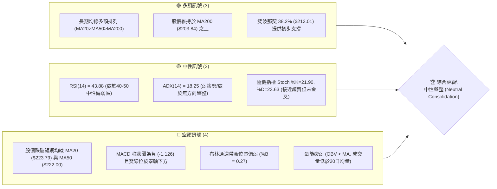
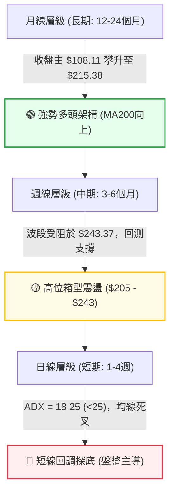
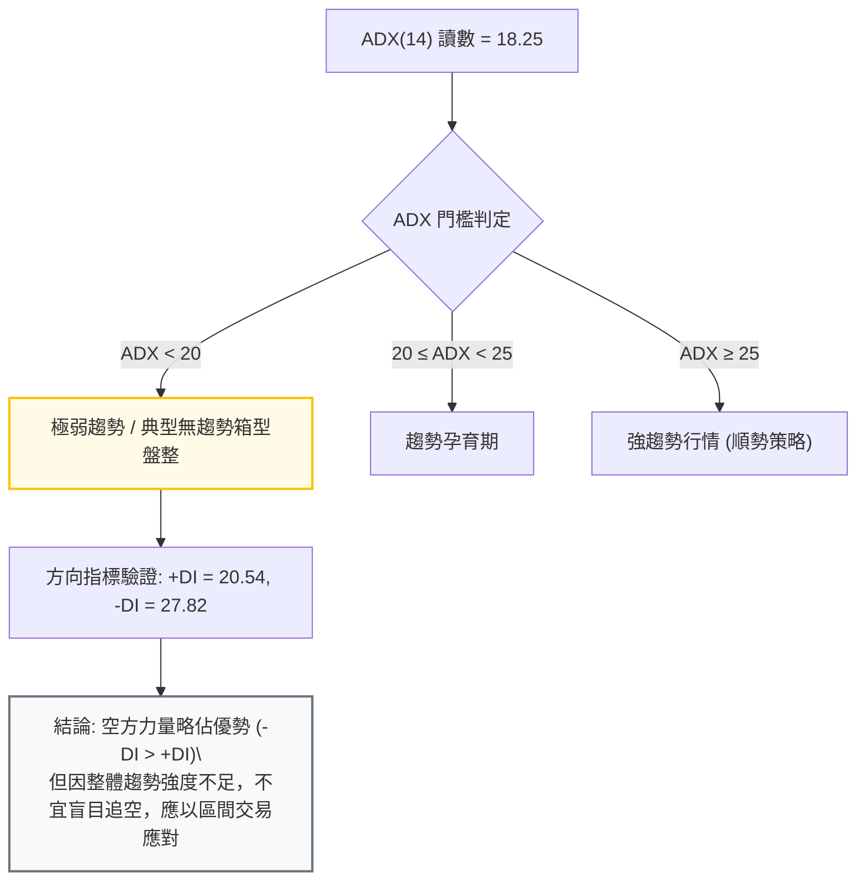
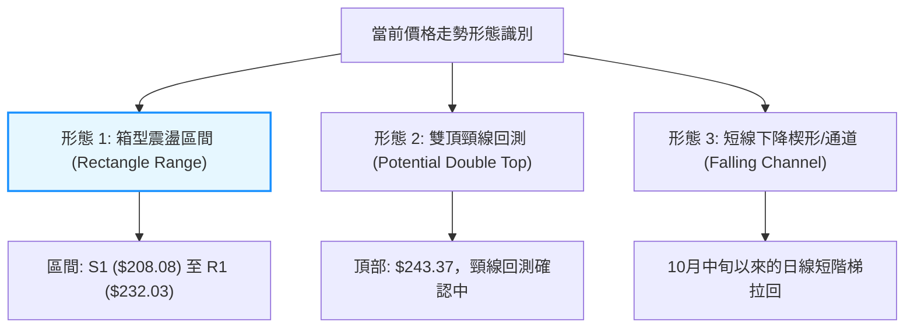
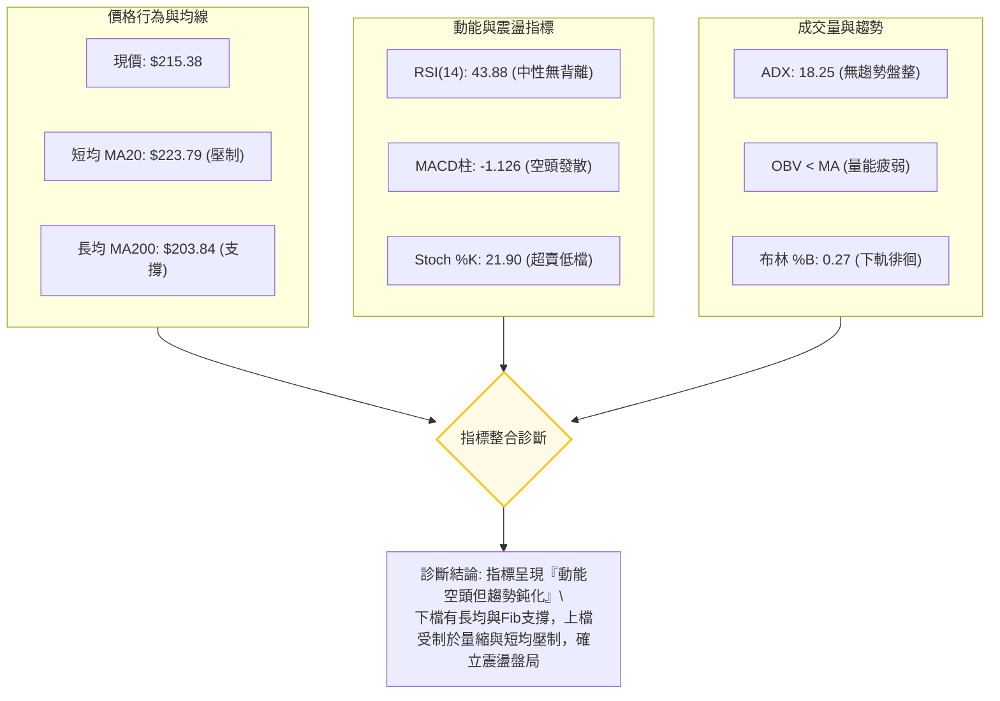
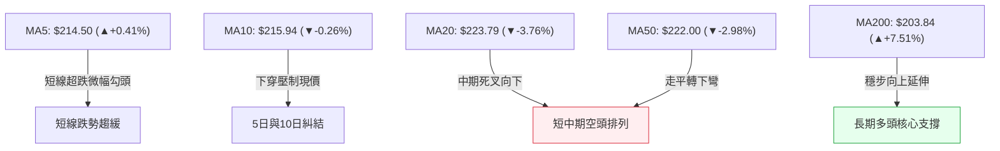
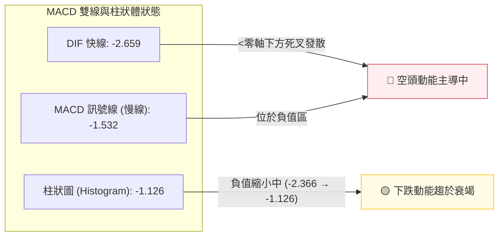
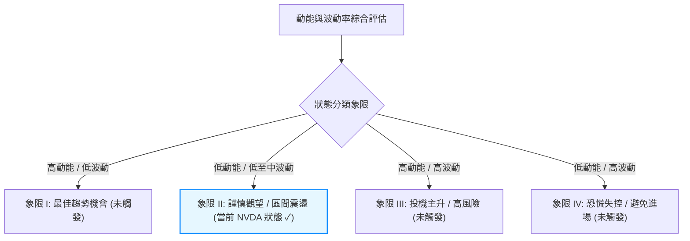
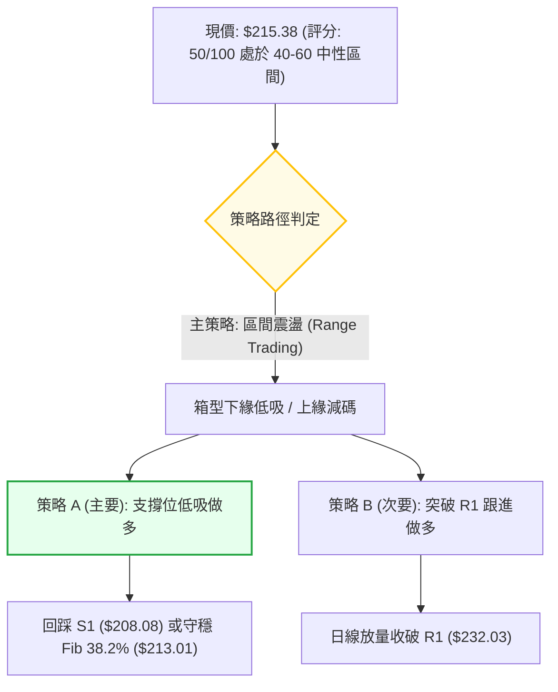
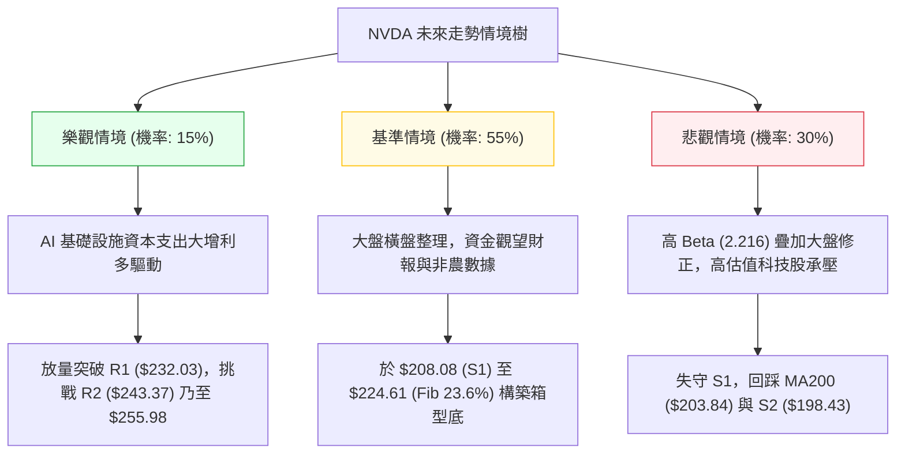

# NVDA 技術分析報告

> **報告日期**：2026-10-29 ｜ **語言**：繁體中文 ｜ **數據來源**：Yahoo Finance ｜ **當前價格**：$215.38 USD

---

## 目錄

| 章節 | 內容 |
|------|------|
| [1. 技術面概覽](#1-技術面概覽) | 訊號儀表板、核心指標、評分卡 |
| [2. 趨勢分析](#2-趨勢分析) | 多時框趨勢、長中短期走勢 |
| [3. 圖表形態分析](#3-圖表形態分析) | 形態識別、K線組合、目標價 |
| [4. 支撐與阻力](#4-支撐與阻力) | 關鍵價位、斐波那契回調 |
| [5. 技術指標深度解讀](#5-技術指標深度解讀) | MA/RSI/MACD/布林/成交量 |
| [6. 動能與波動率](#6-動能與波動率) | 動能評估、ATR、Beta |
| [7. 多時框架總結](#7-多時框架總結) | 時框架評分矩陣 |
| [8. 交易策略建議](#8-交易策略建議) | 多空策略、風險報酬比 |
| [9. 風險提示與監控](#9-風險提示與監控) | 監控指標、風險場景 |

---

## 1. 技術面概覽

### 🎯 技術訊號儀表板



### 📊 核心指標速覽表

| 指標類別 | 指標名稱 | 當前數值 | 訊號 | 解讀 |
|:---|:---|:---|:---:|:---|
| **價格** | 當前收盤價 | $215.38 | 🟡 | 位於52週區間之64.8%，短線自歷史高點回檔整理 |
| **均線** | 短期 MA20 | $223.79 | 🔴 | 現價低於 MA20 (-3.76%)，短線承壓 |
| **均線** | 中期 MA50 | $222.00 | 🔴 | 現價低於 MA50 (-2.98%)，中線動能轉弱 |
| **均線** | 長期 MA200 | $203.84 | 🟢 | 現價高於 MA200 (+5.66%)，長期多頭格局未破 |
| **動能** | RSI(14) | 43.88 | 🟡 | Wilder 平滑中性偏弱，未落入超賣區（<30），無背離 |
| **動能** | MACD (12,26,9) | -2.659 | 🔴 | 訊號線 -1.532，柱狀圖 -1.126，空頭發散 |
| **趨勢** | ADX(14) | 18.25 | 🟡 | 數值小於25，顯示當前缺乏明確趨勢，為箱型整理 |
| **趨勢** | 方向指標 (+DI/-DI) | 20.54 / 27.82 | 🔴 | -DI 大於 +DI，空頭力量暫時主導盤面 |
| **通道** | 布林帶寬 %B | 0.27 | 🔴 | 接近下軌 ($205.32)，處於通道弱勢區間 |
| **波動** | ATR(14) | $5.91 | 🟡 | 佔股價 2.74%，處於正常波動水準 |
| **量能** | 成交量比率 | 0.92x | 🔴 | 成交量 92.46M 低於20日均量 100.43M，OBV < MA |

### 🏆 技術評分卡

```
╔══════════════════════════════════════════════════════════════════╗
║                   技術評分卡 — NVDA (2026-10-29)                 ║
╠══════════════════════════════════════════════════════════════════╣
║ 趨勢強度 (Trend)     █████████░░░░░░░░░░░   45/100   🟡 中性偏弱 ║
║ 動能指標 (Momentum)  ████████░░░░░░░░░░░░   40/100   🔴 偏弱看空 ║
║ 支撐穩定度 (Support) █████████████░░░░░░░   65/100   🟢 支撐良好 ║
║ 成交量配合 (Volume)  ████████░░░░░░░░░░░░   42/100   🔴 量能不足 ║
║ 形態完整度 (Pattern) ██████████░░░░░░░░░░   50/100   🟡 箱型整理 ║
║ 均線排列 (MA System) ████████████░░░░░░░░   58/100   🟡 長多短空 ║
╠══════════════════════════════════════════════════════════════════╣
║ 綜合評分 (Overall)   ██████████░░░░░░░░░░   50/100   ⚖️ 中性盤整  ║
║                                  （依規則 18：六項算術平均）     ║
╚══════════════════════════════════════════════════════════════════╝
```

---

## 2. 趨勢分析

### 🌐 多時框趨勢分析



### 📈 長期趨勢 — 12個月走勢圖（Unicode）

NVDA 過去 12 個月（2025-11 至 2026-10）呈現顯著的階梯式上升後進入高位震盪：

```
NVDA 月線走勢圖（2025-11 至 2026-10）
價格軸 ($)
$245 ┤                                                 
$235 ┤                                            ●(2026-09: 228.38)
$225 ┤                                        ●   │
$215 ┤                                ●       │   ●(現價: 215.38)
$205 ┤                        ●       │       │
$195 ┤                    ●   │   ●   │       │
$185 ┤        ●       ●   │   │   │   │
$175 ┤●       │       │   │   ●   ●   │
$165 ┤│       │       │   │
     └┬───────┬───────┬───┬───┬───┬───┬───┬───┬───┬───┬───┬───
     11      12      01  02  03  04  05  06  07  08  09  10 (月份)
    2025    2025    2026 (低點:174.00)                 2026 (高點:243.37)
```

#### 走勢特徵分析表格

| 階段 | 時間區間 | 起訖價格區間 | 累計漲跌幅 | 結構特徵與走勢解讀 |
|:---|:---|:---|:---:|:---|
| **第一階段：高位築底** | 2025-11 ~ 2026-03 | $176.58 → $174.00 | -1.46% | 價格在 $174.00 - $190.68 構築雙重底支撐，回測年線獲得強韌買盤 |
| **第二階段：主升拉升** | 2026-03 ~ 2026-05 | $174.00 → $210.66 | +21.07% | 量增價升，強勢突破 $200 整數關卡，建立中期上升通道 |
| **第三階段：高位洗盤** | 2026-05 ~ 2026-07 | $210.66 → $200.53 | -4.81% | 在 $200 關卡進行回踩確認，獲利了結賣壓湧現，但未跌破 $198 前低 |
| **第四階段：衝頂回檔** | 2026-08 ~ 2026-10 | $200.53 → $215.38 | +7.41% | 創下 52 週歷史新高 $243.37 後遇阻拉回，目前於 $215 附近展開整理 |

### 📊 中期趨勢（週線分析）

週線角度觀察，近 20 週收盤自 2026-06-26 之低點 $192.31 逐波走高，至 2026-10-09 當週盤中創下 52 週高點 $243.37，隨後連續三週拉回（週收盤依序為 $229.28 → $214.13 → $210.96 → 目前 $215.38）。

```
週線級別阻力與支撐分佈示意圖
$243.37 ────────────────────────────────────────── 52週歷史高點阻力 (R2)
                 ▲ (衝頂遇阻回落)
$232.03 ────────────────────────────────────────── 近期週波段高點阻力 (R1)
                 │
$222.00-$223.79 ─── MA50 / MA20 (週線回檔首道阻力帶)
                 │
$215.38 ───────── ◄ 當前價格 (測試斐波那契 38.2% 回調位 $213.01)
                 │
$208.08 ────────────────────────────────────────── 近期關鍵低點聚類支撐 (S1)
                 │
$203.84 ────────────────────────────────────────── MA200 牛熊分界線 / Fib 50.0% ($203.63)
```

### ⚡ 趨勢強度評估（ADX 解讀）



#### ADX 趨勢強度對照表

| 指標變數 | 當前讀數 | 門檻區間 | 技術含義 | 對交易策略之指導 |
|:---|:---:|:---:|:---|:---|
| **ADX(14)** | 18.25 | < 25.00 | 市場缺乏單邊推動力，處於橫向震盪 | 禁用單邊突破追價策略；以震盪指標為主 |
| **+DI (14)** | 20.54 | — | 多頭推升力道疲弱，買盤追價意願低 | 多頭波段進場需等待右側突破訊號 |
| **-DI (14)** | 27.82 | — | 空頭力道相對主導，但未達極端發散 | 警惕下探測試支撐，但空方下殺空間受限 |
| **趨勢定性** | **無明確趨勢** | ADX < 25 | **盤整行情（Range-bound Market）** | **嚴格依據規則 14：以布林通道與支撐阻力為交易區間** |

---

## 3. 圖表形態分析

### 🔍 形態識別系統



#### 形態識別與信心度評估表

| 識別形態名稱 | 信心度 (%) | 判斷依據（嚴格引用數據） | 當前完成度 | 形態目標價（附精確計算式） |
|:---|:---:|:---|:---:|:---|
| **箱型整理區間**<br>(Trading Range) | **75%** | 價格受阻於 R1 ($232.03)，下檔在 S1 ($208.08) 及 Fib 38.2% ($213.01) 展現支撐，ADX=18.25 印證盤整 | 85% | **向上突破目標**：$232.03 + ($232.03 - $208.08) = **$255.98**<br>**向下跌破目標**：$208.08 - ($232.03 - $208.08) = **$184.13** |
| **高位潛在雙頂**<br>(Double Top) | **45%** | 2026-10-09 創高 $243.37 後拉回，若以 2026-09-18 低點 $208.93 或 S1 ($208.08) 為頸線，尚未有效跌破 | 40% | *信心度 < 50%，依規則 15 判定訊號不足，僅做指標型防範解讀，不預設成形* |
| **均線短線空頭排列**<br>(MA Crossover) | **80%** | 現價 ($215.38) 連續跌破 MA20 ($223.79) 與 MA50 ($222.00)，MA5/MA10 下彎 | 90% | **下行回測目標**：斐波那契 50.0% 回調位 **$203.63** 與 MA200 **$203.84** 共振區 |

### 🕯️ 重要K線形態分析

嚴格依據數據中「近 10 根日 K」與「近 8 根週 K」之實際開高低收數據進行客觀解讀：

#### 近 10 根日 K 線形態解讀

| 日期 (日K) | 開盤價 ($) | 最高價 ($) | 最低價 ($) | 收盤價 ($) | 實體/影線特徵 | K線形態與技術解讀 | 短期訊號 |
|:---|:---:|:---:|:---:|:---:|:---|:---|:---:|
| 2026-10-15 | 215.30 | 218.47 | 212.85 | 217.23 | 實體 +1.93，下影長 2.45 | 下影陽線，下檔買盤於 $212.85 浮現支撐 | 🟢 偏多反彈 |
| 2026-10-16 | 216.56 | 218.68 | 213.32 | 214.13 | 實體 -2.43，吞噬前日收盤 | 陰線包覆，多頭反彈受制於 $218.68 | 🔴 空方壓制 |
| 2026-10-19 | 218.10 | 219.62 | 214.70 | 217.09 | 實體 -1.01，上下影線均勻 | 高檔小陰十字星，市場在 $218 附近觀望 | 🟡 盤整猶豫 |
| 2026-10-20 | 215.98 | 218.46 | 212.77 | 216.47 | 實體 +0.49，下影線達 3.21 | 長下影紡錘陽線，再次力守 $212.77 支撐 | 🟢 支撐測試 |
| 2026-10-21 | 220.96 | 222.19 | 217.66 | 221.97 | 實體 +1.01，跳空高開收高 | 跳空突破陽線，上衝測試 MA50 ($222.00) 阻力 | 🟢 多頭上攻 |
| 2026-10-22 | 217.13 | 218.88 | 211.26 | 212.21 | 實體 -4.92，實體大陰線 | 長陰破位，完全吞噬前日漲幅，形成看跌吞噬 | 🔴 強烈空頭 |
| 2026-10-23 | 210.99 | 213.85 | 210.18 | 210.96 | 實體 -0.03，十字星形態 | 低檔十字星，最低觸及 $210.18（逼近S1），下殺動能趨緩 | 🟡 變盤十字 |
| 2026-10-26 | 213.11 | 217.75 | 212.61 | 216.00 | 實體 +2.89，光腳中陽線 | 晨星組合初步確認，自低檔穩步推升 | 🟢 止跌回升 |
| 2026-10-27 | 218.31 | 219.19 | 215.53 | 217.94 | 實體 -0.37，上影線 1.25 | 高開衝高回落小陰星，受阻於 $219.19 | 🟡 上檔承壓 |
| 2026-10-28 | 219.92 | 219.99 | 214.47 | 215.38 | 實體 -4.54，實體偏長陰線 | 開高走低收於低檔，回吐前兩日反彈漲幅 | 🔴 弱勢收跌 |

#### 近 8 根週 K 線形態解讀

| 日期 (週末) | 開盤價 ($) | 最高價 ($) | 最低價 ($) | 收盤價 ($) | 實體/影線特徵 | 週K線形態與結構意義 | 中期訊號 |
|:---|:---:|:---:|:---:|:---:|:---|:---|:---:|
| 2026-09-11 | 232.85 | 233.45 | 217.20 | 218.29 | 實體 -14.56，大長陰線 | 週線高位回調，實體跌破五週均線 | 🔴 週線拉回 |
| 2026-09-18 | 211.24 | 222.73 | 208.93 | 222.27 | 實體 +11.03，長下影陽線 | 下影錘頭陽線，守住 $208.93（奠定S1基準） | 🟢 止跌強彈 |
| 2026-09-25 | 222.94 | 229.98 | 221.09 | 225.07 | 實體 +2.13，中陽線連續 | 連續回升，週線級別多頭重啟排列 | 🟢 持續推升 |
| 2026-10-02 | 229.75 | 237.88 | 227.03 | 233.95 | 實體 +4.20，突破長陽 | 強勢突破前高，直逼歷史高點區間 | 🟢 強勢多頭 |
| 2026-10-09 | 236.09 | 243.37 | 229.11 | 229.28 | 實體 -6.81，上影長達 7.28 | **天量流星線 (Shooting Star)**，觸及 $243.37 遭狙擊 | 🔴 見頂反轉 |
| 2026-10-16 | 228.73 | 228.86 | 212.85 | 214.13 | 實體 -14.60，光頭大長陰 | 空方全面反撲，吞噬前三週漲幅 | 🔴 深度修正 |
| 2026-10-23 | 218.10 | 222.19 | 210.18 | 210.96 | 實體 -7.14，下影弱陰線 | 弱勢陰線跌破 $211，探底尋求支撐 | 🔴 探底格局 |
| 2026-10-28 | 213.11 | 219.99 | 212.61 | 215.38 | 實體 +2.27，小實體陽線 | 當週前三個交易日呈現弱陽縮量回穩 | 🟡 企穩醞釀 |

### 📉 ASCII 走勢形態示意圖

```
NVDA 近期價格走勢與箱型結構 (2026-10-09 至 2026-10-28)
$243.37 ┤        ▲ 歷史高點 (2026-10-09 流星線頂部)
$238.00 ┤       ╱ ╲
$232.03 ┼──────╱───╲──────────────────────────── 關鍵阻力位 R1
$226.00 ┤     ╱     ╲      ▲
$222.00 ┼────╱───────╲────┼─╲───────────────── MA50 / MA20 阻力帶
$218.00 ┤   ╱         ╲  ╱   ╲     ▲
$215.38 ┼──╱───────────●─────┼─────●───────────── 當前價格 ($215.38)
$213.01 ┼─╱────────────────────┼───────╲──────── Fib 38.2% 回調位
$208.08 ┼─●─────────────────────●────────●─────── 關鍵支撐位 S1
        └┬────────────┬─────────┬─────────┬──────
       10-09        10-16     10-21     10-28 (時間)
        [創頂]      [重挫]    [反彈受阻] [區間築底]
```

---

## 4. 支撐與阻力

### 🗺️ 關鍵價位分布圖（Unicode）

```
NVDA 價位結構分布圖（嚴格依據 OHLCV 歷史聚類與回調計算）
═══════════════════════════════════════════════════════════════════
$243.37 ║████████████████████████████████║ 52週歷史高點 / 強阻力 R2 (Fib 0.0%)
        ║                                ║
$232.03 ║████████████████████            ║ 波段高點聚類 / 關鍵阻力 R1
        ║                                ║
$224.61 ║▓▓▓▓▓▓▓▓▓▓▓▓▓▓▓▓▓▓▓             ║ 斐波那契 23.6% 回調位 / MA20阻力區
        ║                                ║
$215.38 ╠════════════════════════════════╣ ◄ 當前收盤價 ($215.38)
        ║                                ║
$213.01 ║▓▓▓▓▓▓▓▓▓▓▓▓▓▓▓▓                ║ 斐波那契 38.2% 回調位 (短線關鍵屏障)
        ║                                ║
$208.08 ║████████████████████            ║ 波段低點聚類 / 核心支撐 S1
        ║                                ║
$203.63 ║▓▓▓▓▓▓▓▓▓▓▓▓▓▓▓▓▓▓▓▓▓▓          ║ 斐波那契 50.0% 回調位 / 緊鄰 MA200 ($203.84)
        ║                                ║
$198.43 ║████████████████████████        ║ 波段低點聚類 / 強支撐 S2
        ║                                ║
$194.30 ║████████████████████████████    ║ 關鍵波段低點 / 終極防線 S3 (Fib 61.8% $194.25)
═══════════════════════════════════════════════════════════════════
```

### 🚧 阻力位分析表

所有價位均直接引用數據「關鍵價位」區塊之精確數值：

| 阻力級別 | 價位 ($) | 距離現價 (%) | 形成原因與技術共振 | 突破難度評估 | 重要性 |
|:---|:---:|:---:|:---|:---:|:---:|
| **阻力 R1** | **$232.03** | +7.73% | 近一年波段高點聚類；與 9月上旬跳空缺口及 10-02 當週高點重疊 | 🔴 極高（需補量至1.2億股以上） | ★★★★★ |
| **阻力 R2** | **$243.37** | +13.00% | 52 週歷史天價（2026-10-09 盤中創下）；流星線頂部套牢區 | 🔴 極限阻力（多頭終極天花板） | ★★★★★ |
| **阻力 R3** | *數據中未偵測到* | — | *數據中未偵測到 R3 聚類數值（依規則 13 嚴禁捏造）* | — | — |

*注：短線動態阻力帶介於 MA50 ($222.00) 與 MA20 ($223.79)，亦與斐波那契 23.6% ($224.61) 形成密集阻力帶。*

### 🛡️ 支撐位分析表

所有價位均直接引用數據「關鍵價位」區塊之精確數值：

| 支撐級別 | 價位 ($) | 距離現價 (%) | 形成原因與技術共振 | 守住機率評估 | 重要性 |
|:---|:---:|:---:|:---|:---:|:---:|
| **支撐 S1** | **$208.08** | -3.39% | 近一年波段低點聚類；9-18 週低點 ($208.93) 與 10-23 日低點 ($210.18) 構築之防線 | 🟢 高（約 70%） | ★★★★☆ |
| **支撐 S2** | **$198.43** | -7.87% | 近一年重要波段轉折低點聚類；整數心理關卡 $200 下方防禦圈 | 🟢 極高（約 85%） | ★★★★★ |
| **支撐 S3** | **$194.30** | -9.79% | 近一年波段底部聚類；高度共振黃金分割 61.8% ($194.25) | 🟢 終極防線（>90%） | ★★★★★ |

### 📐 斐波那契回調位分析

依據 52 週波動區間：低點 **$163.90** 至 高點 **$243.37**，波動總幅度為 **$79.47**。

| 回調比率 | 價位 ($) | 與現價 ($215.38) 相對位置 | 技術意義與多空攻防解讀 |
|:---:|:---:|:---:|:---|
| **0.0%** (52W High) | **$243.37** | 上方 +13.00% | 多頭歷史極限，波段起跌點 |
| **23.6%** | **$224.61** | 上方 +4.29% | 弱勢回調防守線；現已轉化為強大反彈阻力（共振 MA20 $223.79） |
| **38.2%** | **$213.01** | 下方 -1.10% | **當前多空決戰點**；現價 ($215.38) 正處於 38.2% 關鍵支撐上方進行震盪守禦 |
| **50.0%** | **$203.63** | 下方 -5.46% | 多空平衡中軸；與長期上升趨勢線 MA200 ($203.84) 形成極強「雙重共振支撐帶」 |
| **61.8%** | **$194.25** | 下方 -9.81% | 黃金分割強防守位；與波段低點聚類 S3 ($194.30) 誤差僅 $0.05，為多頭中期生命線 |
| **78.6%** | **$180.90** | 下方 -16.01% | 深度回調極限位；跌破則宣告長期多頭行情終結 |
| **100.0%** (52W Low) | **$163.90** | 下方 -23.90% | 52 週波段起漲原點 |

*現價落點解讀：現價 $215.38 介於 38.2% ($213.01) 與 23.6% ($224.61) 之間，表明市場處於健康修正的合理回調區間，只要日線收盤不破 $213.01，中期多頭架構依然完好。*

---

## 5. 技術指標深度解讀

### 🎛️ 指標訊號總覽



### 📈 移動平均線排列分析



#### 均線系統數據與排列特徵表

| 均線名稱 | 當前價位 ($) | 與現價偏差率 (%) | 均線趨勢方向 | 歷史形態特徵 (Sparkline) | 技術訊號 |
|:---|:---:|:---:|:---:|:---|:---:|
| **MA 5** | $214.50 | +0.41% | ▲ 轉折微升 | ▁▁▂▃▄▅▅▅▅▅▆▆▇████▇▆▅▄▃▂▂▂▁▁▁▁▁ | 🟢 短線企穩 |
| **MA 10** | $215.94 | -0.26% | ▼ 持續下行 | ▂▂▂▂▂▃▃▄▅▅▆▆▇▇██████▇▆▅▄▄▃▂▁▁▁ | 🔴 即時壓制 |
| **MA 20** | $223.79 | -3.76% | ▼ 顯著下彎 | ▁▁▁▂▃▃▃▃▄▄▄▅▅▆▆▇▇██████▇▇▇▆▆▅▅ | 🔴 月線反壓 |
| **MA 50** | $222.00 | -2.98% | ▼ 轉折向下 | （季線與MA60 $221.90共振） | 🔴 季線失守 |
| **MA 60** | $221.90 | -2.94% | ▼ 緩步走低 | ▁▁▁▂▂▂▃▃▃▄▄▅▅▅▆▆▆▆▇▇▇▇▇▇██████ | 🔴 中期受阻 |
| **MA 120**| $215.07 | +0.15% | ▲ 向上微升 | ▁▁▂▂▂▃▃▄▄▅▅▅▆▆▆▇▇▇▇███████████ | 🟢 半年線支撐 |
| **MA 200**| $203.84 | +5.66% | ▲ 強勢上揚 | （年線牛熊分水嶺，長期多頭堡壘） | 🟢 長多護盤 |
| **MA 240**| $200.33 | +7.51% | ▲ 穩定向上 | ▁▁▁▁▂▂▂▃▃▃▄▄▅▅▆▆▆▇▇▇▇▇▇▇██████ | 🟢 基底雄厚 |

*解讀：短期均線 (MA20/50) 形成死亡交叉且壓制現價，但長期均線 (MA200/240) 仍呈多頭排列且持續向上發散，現價剛好回踩 MA120 ($215.07) 獲得支撐，呈現典型的「短線回調、長線多頭」的均線分歧格局。*

### 📉 RSI(14) 分析

```
RSI(14) 讀數儀表 (當前: 43.88)
0               30             43.88    50             70             100
├───────────────┼───────────────●───────┼───────────────┼───────────────┤
│    超賣區     │    弱勢區間   │       │   強勢區間    │    超買區     │
└───────────────┴───────────────┴───────┴───────────────┴───────────────┘
數值進度條: █████████░░░░░░░░░░░ 43.88% (Wilder 平滑計算)
```

- **區間評估**：RSI 位於 43.88，處於 30 至 50 之中性偏弱區間，未觸及 30 以下之極端超賣區，表示空方雖佔據微弱優勢，但並未引發市場恐慌性拋售。
- **背離分析**：依據近 20 根 K 棒比對，價格自高點回落過程中，RSI 同步滑落；最近 3 日價格在 $215-$217 築底，RSI 亦自 37.6 回升至 43.88，**無明顯頂背離或底背離**，動能與價格走勢相符，確認當前屬於正常波段回調。

### 📊 MACD(12/26/9) 訊號解讀



- **絕對數值**：MACD 快線為 `-2.659`，慢線為 `-1.532`，快線持續低於慢線。
- **柱狀圖動態**：當前 MACD Hist 為 `-1.126`，相較於前兩週的 `-2.366` 與 `-2.159`，負向柱狀圖已顯著收斂萎縮，意味著短線殺跌力道減緩，空頭賣壓開始鈍化，具備醞釀技術性反彈的先決條件。

### 📦 布林通道分析

```
NVDA 布林通道 (Bollinger Bands 20,2) 現況示意圖
$242.25 ┬────────────────────────────────────────── BB 上軌 (Upper Band)
        │
$230.00 ┤
        │
$223.79 ┼ - - - - - - - - - - - - - - - - - - - -  BB 中軌 (MA20)
        │
$215.38 ┼──────────────────●─────────────────────── 當前收盤價 (%B = 0.27)
        │                  │
$205.32 ┴──────────────────┴─────────────────────── BB 下軌 (Lower Band)
```

- **通道參數與軌道值**：
  - **布林上軌**：`$242.25`
  - **布林中軌 (MA20)**：`$223.79`
  - **布林下軌**：`$205.32`
- **通道指標解讀**：
  - **%B 指標 = 0.27**：說明股價處於通道下半區（低於中軌 0.50），接近下軌支撐。
  - **帶寬走勢**：帶寬呈現開口擴大後趨緩，股價並未沿著下軌「單邊開口下殺」，而是在 $210 獲得有力支撐後脫離下軌，預示價格正嘗試在下軌 ($205.32) 至中軌 ($223.79) 之間形成箱型震盪。

### 💹 成交量分析（量價配合度）

```
成交量與均量對比 (單位: 股)
最新成交量: 92,463,400  ███████████████████░ (92%)
20日均量:  100,430,750  ████████████████████ (100%)
50日均量:  114,399,324  ███████████████████████ (114%)
```

- **量比與換手解讀**：最新成交量 92.46M，量比為 `0.92x`，量能連續多日萎縮，低於 20 日均量與 50 日均量。
- **量價配合分析**：
  1. 在回檔過程中量能萎縮（自 10-15 之 127M 萎縮至近期約 80M-90M），表明並非主力恐慌性出逃，而是買盤追價乏力造成的「縮量陰跌」。
  2. **OBV 趨勢**：系統明確顯示 `OBV < MA`，能量潮指標低於其移動平均線，確立當前市場人氣不足，資金暫無規模性淨流入，屬於典型的「量能疲弱」整理特徵。

---

## 6. 動能與波動率

### ⚡ 動能評估四象限



#### 動能與波動率定位表

| 象限 | 動能維度 (Momentum) | 波動維度 (Volatility) | 當前判定 | 戰略應對方針 |
|:---:|:---:|:---:|:---:|:---|
| **Q1** | 強 (ADX>25, MACD柱>0) | 低 (ATR% < 2%) | — | 趨勢穩健，全力加碼順勢單 |
| **Q2** | **弱 (ADX=18.25, MACD柱<0)** | **中低 (ATR% = 2.74%)** | **✓ 當前狀態** | **謹慎觀望，避免突破追單，僅在關鍵支撐阻力做高拋低吸** |
| **Q3** | 強 (+DI 極度放大) | 高 (ATR% > 4%) | — | 爆發性行情，嚴設動態移動止盈 |
| **Q4** | 弱 (-DI 擴大下殺) | 高 (恐慌放量) | — | 資金出逃，絕對觀望嚴禁接飛刀 |

### 📊 ATR 波動率分析

- **ATR(14) 讀數**：`$5.91`（佔當前股價之 `2.74%`）。
- **日內波動特徵**：Wilder 平滑之 14 日平均真實波幅為 $5.91，代表 NVDA 日內正常的噪音波動區間約在 ±$6.00 左右。
- **止損距離建議**：
  - **激進型（短線交易）**：採用 1.0 倍 ATR = **$5.91**（防守點位距進場點應保持至少 $6.00 空間）。
  - **穩健型（波段交易）**：採用 1.5 倍 ATR = **$8.87**（避開日內掃損，給予充分震盪緩衝）。
  - **保守型（中長線佈局）**：採用 2.0 倍 ATR = **$11.82**（防禦波段回撤）。

### 📐 Beta 與市場相關性

- **Beta 係數**：`2.216`。
- **大盤敏感度分析**：
  1. NVDA 之 Beta 高達 2.216，屬於極高系統性風險曝險標的。當標普 500 指數 (SPX) 或那斯達克 100 (NDX) 上漲 1% 時，理論上 NVDA 將擴大變動 2.22%；反之若大盤下挫，NVDA 亦將承擔逾兩倍之修正壓力。
  2. 當前在高 Beta 且 ADX 趨弱背景下，任何宏觀科技板塊的風吹草動均會引發個股放量巨震，交易者必須適度縮小部位規模以平衡整體組合波動風險。

---

## 7. 多時框架總結

### 📋 時框架評分表

| 時框架 | 趨勢方向 | 動能狀態 | 均線系統 | 關鍵形態 | 評分 (100) | 核心建議 |
|:---|:---:|:---:|:---:|:---:|:---:|:---|
| **日線 (短期)** | 🔴 回調探底 | MACD死叉，RSI 43.88 偏弱 | 承壓於 MA20/MA50 | 區間震盪下軌回穩 | 42/100 | 嚴禁追高，以支撐位防守為主 |
| **週線 (中期)** | 🟡 高位盤整 | 負柱狀體收斂，RSI 43.9 | 守於 MA20 之上，長多架構 | 天量流星線後的高位消化 | 55/100 | 區間操作，回踩支撐分批低吸 |
| **月線 (長期)** | 🟢 向上多頭 | 長期多頭推升，回調幅度可控 | 均線完美多頭排列 | 階梯式長期上升通道 | 78/100 | 長期基本面與多頭格局未變 |

### 🔲 綜合訊號矩陣

```
時框訊號一致性矩陣
維度           短期 (日線)      中期 (週線)      長期 (月線)      一致性判定
────────────────────────────────────────────────────────────────────────
趨勢方向       🔴 看空回調     🟡 中性震盪     🟢 強勢多頭     🟡 衝突中（長多短空）
動能指標       🔴 動能衰退     🟡 柱狀收斂     🟢 多頭佔優     🟡 修正中
均線排列       🔴 短期死叉     🟢 多頭排列     🟢 完美多頭     🟢 核心長期支撐完好
成交量能       🔴 縮量疲弱     🔴 連續縮量     🟢 總體充沛     🔴 人氣暫時退潮
────────────────────────────────────────────────────────────────────────
```

### ⚖️ 多時框收斂結論

**嚴格依據規則 14 進行優先級收斂**：

1. **趨勢強度定性**：當前日線 ADX(14) 讀數為 **18.25**（遠小於 25 臨界值），明確判定當前市場處於**「盤整行情（ADX < 25）」**，而非單邊趨勢行情。
2. **多時框權重取捨**：依規則 14，在 ADX < 25 的盤整格局中，市場缺乏單邊推動力，中長期的多頭大趨勢暫時退居背景，**日線布林通道上下軌 ($205.32 ~ $242.25) 與關鍵支撐阻力區間成為主導交易的核心依據**。
3. **最終方向性結論**：
   
   ╔═══════════════════════════════════════════════════════════════╗
   ║  **唯一收斂結論：中性觀望 / 區間震盪操作（Neutral Range-Bound）**  ║
   ╚═══════════════════════════════════════════════════════════════╝
   
   短線既不具備追空的動能空間（下檔緊鄰 Fib 38.2% $213.01 與 S1 $208.08 強支撐），亦不具備順勢追多的技術條件（受制於 MA20 $223.79 與量能萎縮）。策略必須採取「不破支撐高拋低吸，等待放量突破再行跟進」。

---

## 8. 交易策略建議

### 🗺️ 策略決策流程圖



### 🧭 策略路由

> **當前主策略方向 = 中性震盪區間操作（依技術評分卡綜合評分 50/100，處於 40–60 區間）**  
> 依規範，不進行單邊強推，而以布林帶下軌至上軌、S1 支撐至 R1 阻力進行區間高拋低吸，嚴禁於區間中軸追價。

### 🎯 價格情境階梯（Price Scenarios）

所有價位均嚴格引用第 4 章「關鍵價位」與斐波那契精確數值：

| 觸發條件 | 下一目標價 ($) | 後續延伸價 ($) | 情境技術含義與市場行為解讀 |
|:---|:---:|:---:|:---|
| **向上放量突破 R1 ($232.03)** | **R2: $243.37** | **$255.98** *(由箱體高度推算)* | 短線全面轉強，消化流星線套牢盤，向 52 週歷史新高發起挑戰 |
| **站穩現價區間 ($213.01 - $215.38)**| **$223.79** *(MA20)* | **$232.03** *(R1)* | 區間震盪反彈，測試布林中軌與月均線壓力 |
| **向下跌破 S1 ($208.08)** | **S2: $198.43** | **S3: $194.30** | 中期走勢轉弱，回撤測試年線 MA200 ($203.84) 與波段核心低點 |

### 📊 情境機率分佈

| 情境劃分 | 預估機率 (%) | 主要技術指標依據（嚴格引用指標現狀） |
|:---|:---:|:---|
| **情境一：區間震盪築底** | **55%** | ADX = 18.25 確立弱趨勢；布林帶 %B = 0.27 顯示超賣收斂；成交量比 0.92x 呈現典型量縮整理特徵 |
| **情境二：回測支撐再探底** | **30%** | MACD 柱狀體仍為負 (-1.126)；-DI (27.82) 壓制 +DI (20.54)；股價受制於下彎的 MA20 ($223.79) |
| **情境三：直接放量強勢反彈**| **15%** | OBV < MA 量能匱乏；20日均量下行，欠缺推升股價一舉跨越 R1 ($232.03) 所需之充沛買盤 |

### 🟢 主策略詳情（區間操作多頭）

嚴格依據規則 13（引用數據既有價位）與規則 17（風險報酬比計算式）制定：

| 策略要素 | 策略 A：區間下緣逢低吸納（首選） | 策略 B：突破阻力右側跟進（次選） |
|:---|:---|:---|
| **策略定位** | 震盪區間逢低做多（逆勢短波段） | 關鍵阻力放量突破追多（順勢波段） |
| **進場條件** | 股價回踩 S1 ($208.08) 獲得確認，或守穩 Fib 38.2% ($213.01) 出現止跌K棒 | 日線收盤價有效站上 R1 ($232.03)，且單日成交量突破 20 日均量 (100.43M) |
| **進場價格 ($)** | **$208.08**（精確引用支撐位 S1） | **$232.03**（精確引用阻力位 R1） |
| **目標價 T1 ($)** | **$232.03**（精確引用阻力位 R1） | **$243.37**（精確引用阻力位 R2 / 52W高點） |
| **目標價 T2 ($)** | **$243.37**（精確引用阻力位 R2） | **$255.98**（由箱體高度推算：$232.03 + ($232.03-$208.08)） |
| **止損價格 ($)** | **$198.43**（精確引用支撐位 S2） | **$224.61**（精確引用 Fib 23.6% 回調位） |
| **風險報酬比** | **1 : 2.48（以 T1 計）**<br>*計算式：($232.03 - $208.08) ÷ ($208.08 - $198.43) = 23.95 ÷ 9.65*<br>另：1 : 3.66（以 T2 計） | **1 : 1.53（以 T1 計）**<br>*計算式：($243.37 - $232.03) ÷ ($232.03 - $224.61) = 11.34 ÷ 7.42*<br>另：1 : 3.23（以 T2 計） |
| **成功機率估計** | **65%** | **50%** |
| **建議倉位** | **15% - 20%**（分批佈局） | **10%**（突破確認後加碼） |

### 🔴 反向風險觸發點（對沖提示）

若出現以下訊號，主策略（區間做多）立即失效，應果斷執行對沖或停損：
1. **破位警報**：日線收盤價帶量跌破 **$208.08 (S1)**，代表箱型震盪下軌失守，短線可能加速回測 **$203.63 (Fib 50.0%)** 或 **$198.43 (S2)**。
2. **動能惡化**：RSI 跌破 35 且 MACD 負柱狀體再度擴大（跌破 -2.50），表明盤整轉化為單邊下殺行情。
3. **對沖建議**：跌破 $208.08 後，可買入 SPY/QQQ 賣權 (Put) 或利用相應空頭工具，鎖定整體部位之系統性下行風險。

### ⭐ 整體訊號強度評星

```
做多訊號強度：★★☆☆☆  (2.5/5星 — 長期架構良好，但短期缺乏動能)
做空訊號強度：★★☆☆☆  (2.5/5星 — 短線受壓，但下檔關鍵支撐密集)
整體可信度：  ★★★★☆  (4.0/5星 — 多時框價位收斂清晰，指標無矛盾)
```

---

## 9. 風險提示與監控

### ✅ 關鍵監控指標 Checklist

```
╔══════════════════════════════════════════════════════════════════╗
║                     每日盤後關鍵技術監控清單                     ║
╠══════════════════════════════════════════════════════════════════╣
║ [ ] 價格防守：收盤價是否嚴格守穩 Fib 38.2% ($213.01) 與 S1 ($208.08)║
║ [ ] 均線動態：現價何時突破並站穩 MA20 ($223.79) 阻力帶          ║
║ [ ] 趨勢指標：ADX(14) 是否由 18.25 攀升至 25 以上，宣告趨勢啟動 ║
║ [ ] 震盪動能：MACD Histogram 能否由負翻正 (當前 -1.126)         ║
║ [ ] 成交量能：單日量能能否放大至 20日均量 (100.43M) 之 1.2 倍   ║
║ [ ] 能量潮：  OBV 線是否金叉突破其均線，確認資金回流             ║
╚══════════════════════════════════════════════════════════════════╝
```

### ⚠️ 風險場景分析



### 🛡️ 風險管理重要提醒

1. **嚴控部位規模**：由於 NVDA 的 Beta 高達 **2.216**，隱含著顯著放大的市場波動風險。在當前 ADX 為 18.25 的震盪無趨勢階段，總持倉部位不宜超過個人投資組合之 **20%**，避免在震盪洗盤中被反覆磨損。
2. **嚴格執行 ATR 止損機制**：進場前必須預設止損位。若採取波段策略，建議以進場點外加 1.5 倍 ATR（約 **$8.87**）作為最大容忍虧損限度，一旦有效跌破既定支撐位（如 S1 $208.08 或 S2 $198.43），必須無條件停損出場。
3. **時間停損法則**：在箱型操作中，若買入後連續 5 至 8 個交易日股價依然無法脫離成本區（例如持續壓制在 $215 附近無量橫盤），應主動降低倉位，以防盤久必跌的突破風險。

---

## 📋 報告總結

```
╔══════════════════════════════════════════════════════════════════╗
║                    NVDA 技術分析報告總結                         ║
╠══════════════════════════════════════════════════════════════════╣
║ 報告日期：2026-10-29                                             ║
║ 當前價格：$215.38 USD                                            ║
║ 綜合評級：⚖️ 中性盤整 (評分: 50/100，長多短空，以區間震盪應對)   ║
╠══════════════════════════════════════════════════════════════════╣
║ 關鍵結論：                                                       ║
║ ├─ 長期趨勢：🟢 強勢多頭 (股價穩居 MA200 $203.84 之上，均線多頭) ║
║ ├─ 中期趨勢：🟡 高位震盪 (受阻於 $243.37 流星線，於高位進行消化)║
║ ├─ 短期趨勢：🔴 回調築底 (受制於 MA20 $223.79，量縮考驗支撐)     ║
║ ├─ 關鍵支撐：S1: $208.08 ｜ Fib 38.2%: $213.01 ｜ S2: $198.43    ║
║ ├─ 關鍵阻力：R1: $232.03 ｜ Fib 23.6%: $224.61 ｜ R2: $243.37    ║
║ └─ 分析師目標：共識均價 $328.95 (區間: $180.00 - $515.00)        ║
╠══════════════════════════════════════════════════════════════════╣
║ 最優策略組合：                                                   ║
║ 1. 🥇 最佳機會：策略 A (逢低吸納) — 於 S1 ($208.08) 支撐確認處進場║
║                 目標 T1: $232.03，止損: $198.43，風報比 1 : 2.48║
║ 2. 🥈 次選機會：策略 B (右側突破) — 帶量突破 R1 ($232.03) 後順勢加碼║
║                 目標 T1: $243.37，止損: $224.61，風報比 1 : 1.53║
║ 3. 🥉 保守選擇：空倉觀望 — 等待 ADX 回升至 25 以上、突破布林中軌 ║
║                 確認趨勢重啟後，再行順勢跟進                     ║
╚══════════════════════════════════════════════════════════════════╝
```

---

> ⚠️ **免責聲明**：本報告為 AI 自動生成之技術分析，所有數據及估算均基於提供的歷史價格資訊。本報告**僅供研究與學術參考**，**不構成任何投資建議**。投資有風險，入市需謹慎。

---

*報告生成時間：2026-10-29 ｜ 數據來源：Yahoo Finance ｜ 分析框架：多時框技術分析*