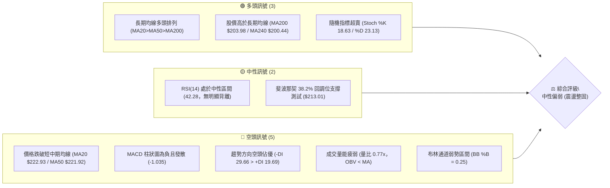
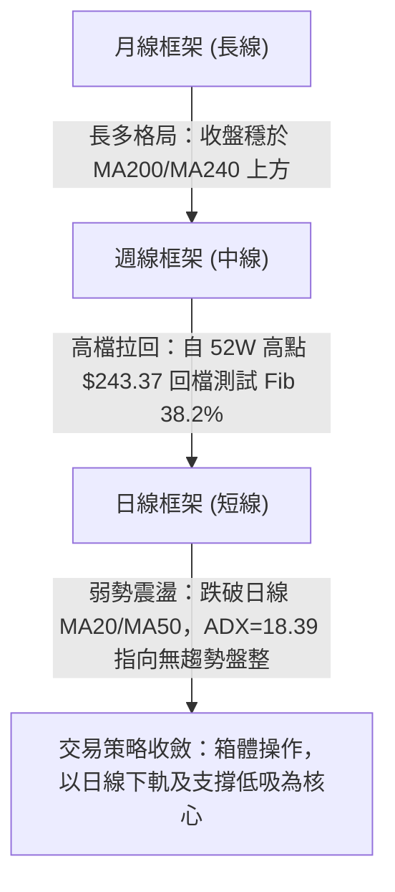
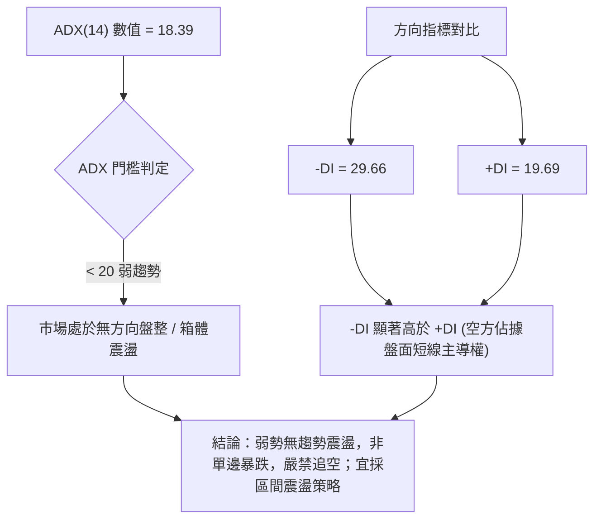
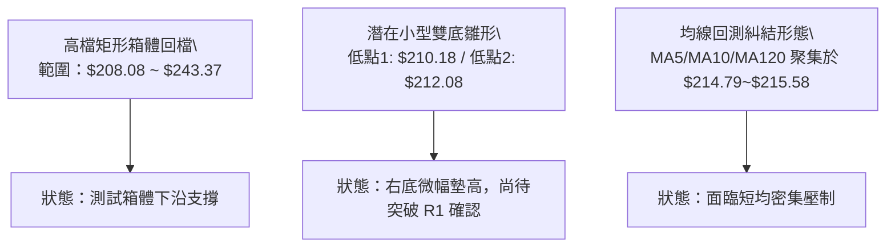
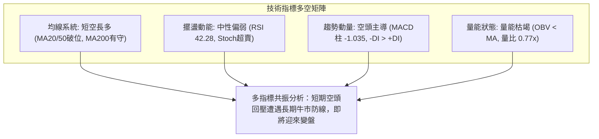
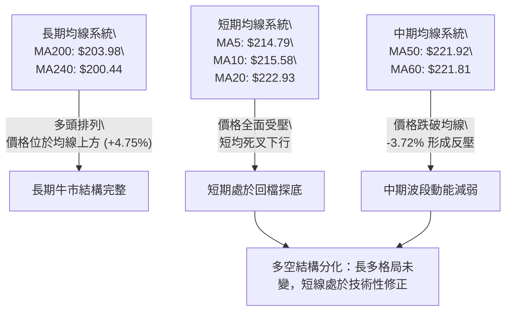
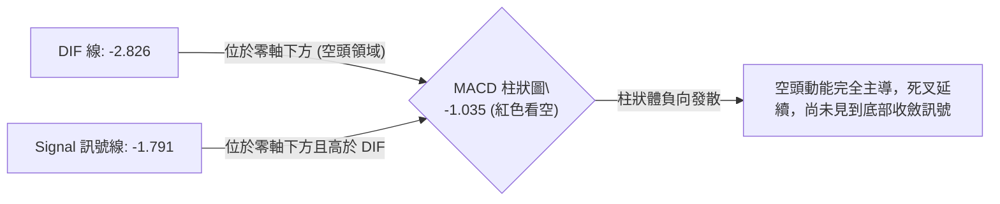
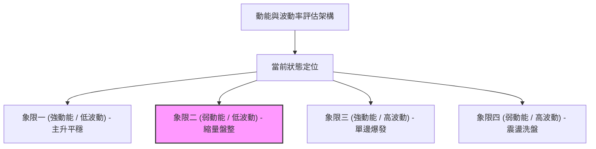
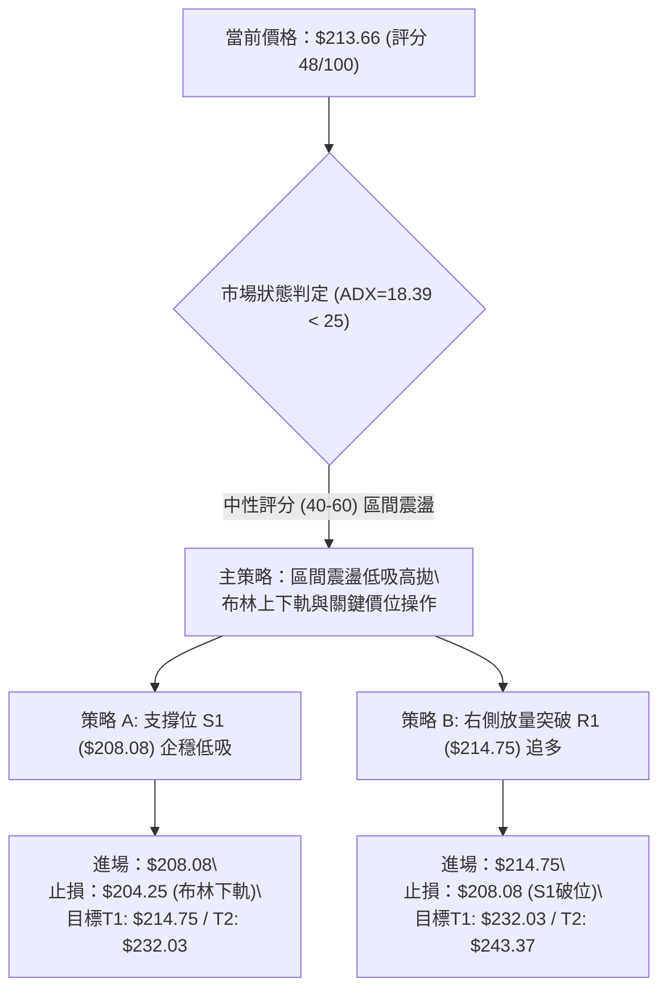
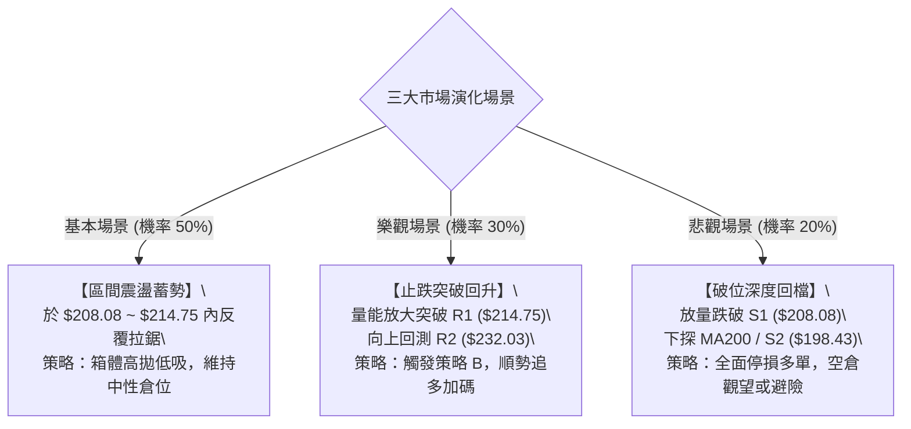

# NVDA 技術分析報告

> **報告日期**：2026-10-30 ｜ **語言**：繁體中文 ｜ **數據來源**：Yahoo Finance ｜ **當前價格**：$213.66 USD

---

## 目錄

| 章節 | 內容 |
|------|------|
| [1. 技術面概覽](#1-技術面概覽) | 訊號儀表板、核心指標、評分卡 |
| [2. 趨勢分析](#2-趨勢分析) | 多時框趨勢、長中短期走勢、12個月歷史圖 |
| [3. 圖表形態分析](#3-圖表形態分析) | 形態識別、K線組合、目標價推算 |
| [4. 支撐與阻力](#4-支撐與阻力) | 關鍵價位、斐波那契回調結構 |
| [5. 技術指標深度解讀](#5-技術指標深度解讀) | MA/RSI/MACD/布林/成交量全面剖析 |
| [6. 動能與波動率](#6-動能與波動率) | 動能四象限、ATR 波動率、Beta 市場相關性 |
| [7. 多時框架總結](#7-多時框架總結) | 時框架評分矩陣與信號收斂結論 |
| [8. 交易策略建議](#8-交易策略建議) | 策略路由、價格階梯、主策略詳情與風報比 |
| [9. 風險提示與監控](#9-風險提示與監控) | 監控指標、風險情境與風控規範 |

---

## 1. 技術面概覽

### 🎯 技術訊號儀表板



---

### 📊 核心指標速覽表

| 指標類別 | 指標名稱 | 當前數值 | 訊號 | 專業解讀 |
|:---|:---|:---|:---:|:---|
| **基準價格** | 最新收盤價 | $213.66 | 🟡 | 位於52週區間（$163.90–$243.37）之 62.6% 分位，處於波段回檔整理中 |
| **短期均線** | MA20 | $222.93 | 🔴 | 股價位於 MA20 下方 -4.16%，短期動能承壓，構成第一道動態阻力 |
| **中期均線** | MA50 | $221.92 | 🔴 | 股價位於 MA50 下方 -3.72%，跌破中期生命線，顯示波段多頭攻勢暫歇 |
| **長期均線** | MA200 | $203.98 | 🟢 | 股價高於 MA200 +4.75%，長期牛市基底未受破壞，提供強烈結構支撐 |
| **擺盪動能** | RSI(14) | 42.28 | 🟡 | 位於中性偏弱區（30–70），首尾對比無背離，顯示空方略佔優但未超賣 |
| **趨勢指標** | MACD (12,26,9) | -2.826 | 🔴 | DIF 與 Signal (-1.791) 皆在零軸下方，柱狀圖 -1.035 持續看空發散 |
| **波動指標** | ATR(14) | $5.72 | 🟡 | 佔現價 2.68%（Wilder 算法），顯示單日震盪幅度可控，屬於常態波動 |

---

### 🏆 技術評分卡

```
╔══════════════════════════════════════════════════════════════════╗
║              技術評分卡 — NVDA (2026-10-30)                      ║
╠══════════════════════════════════════════════════════════════════╣
║ 趨勢強度 (ADX=18.39)   █████████░░░░░░░░░░░  45/100  🟡 中性弱勢 ║
║ 動能指標 (RSI/MACD)    ████████░░░░░░░░░░░░  40/100  🔴 空方主導 ║
║ 支撐穩定度 (Fib/S1)    ████████████░░░░░░░░  58/100  🟡 考驗支撐 ║
║ 成交量配合 (量比 0.77) ███████░░░░░░░░░░░░░  38/100  🔴 量能萎縮 ║
║ 形態完整度 (箱體拉回)  ██████████░░░░░░░░░░  50/100  🟡 整理格局 ║
║ 均線排列 (長多短空)    ███████████░░░░░░░░░  57/100  🟡 結構分化 ║
╠══════════════════════════════════════════════════════════════════╣
║ 綜合評分               █████████░░░░░░░░░░░  48/100  🟡 區間震盪 ║
╚══════════════════════════════════════════════════════════════════╝
```
*註：綜合評分係依據規則 18，由上述六項子評分取算術平均計算：(45 + 40 + 58 + 38 + 50 + 57) ÷ 6 = 48.0，四捨五入為 48/100。*

---

## 2. 趨勢分析

### 🌐 多時框趨勢分析



---

### 📈 長期趨勢 — 12個月走勢圖（Unicode）

依據提供的 24 個月收盤歷史數據，截取近 12 個月（2025-11 至 2026-10）之月線收盤走勢繪製如下：

```
NVDA 月線收盤走勢圖（2025-11 至 2026-10）
價格軸 ($)
$230 ┤                                                 ● (09月 $228.38)
$220 ┤                                         ● (08月)    
$210 ┤                             ● (05月)                ● (10月 $213.66 現價)
$200 ┤                     ● (04月)    ● (06月)● (07月)
$190 ┤             ● (01月)
$180 ┤     ● (12月)        ● (02月)● (03月 $174.00 低點)
$170 ┤ ● (11月 $176.58)
     └─┬───────┬───────┬───────┬───────┬───────┬───────┬───────┬───────┬───────┬───────┬───────┬───
     11月    12月    01月    02月    03月    04月    05月    06月    07月    08月    09月    10月
    (2025)  (2025)  (2026)  (2026)  (2026)  (2026)  (2026)  (2026)  (2026)  (2026)  (2026)  (2026)
```

#### 走勢特徵分析表格

| 階段區間 | 起止價格 | 漲跌幅 | 趨勢性質 | 量價與結構特徵 |
|:---|:---|:---:|:---:|:---|
| **2025-11 ~ 2026-03** | $176.58 → $174.00 | -1.46% | 底部整固 | 在 $174.00 築出堅實底部區間，形成後續上攻的起漲平台 |
| **2026-03 ~ 2026-05** | $174.00 → $210.66 | +21.07% | 主升啟動 | 突破 $200.00 整數關卡，各期均線開始發散擴張 |
| **2026-05 ~ 2026-07** | $210.66 → $200.53 | -4.81% | 高檔回踩 | 於 $200.00 之上進行橫盤蓄勢，清洗浮額 |
| **2026-07 ~ 2026-09** | $200.53 → $228.38 | +13.89% | 二次推升 | 多頭再度發力，創下歷史收盤高位，隨後觸及 52W 高點 $243.37 |
| **2026-09 ~ 2026-10** | $228.38 → $213.66 | -6.45% | 波段修正 | 高檔獲利回吐，跌破短期均線，目前正尋求波段支撐 |

---

### 📊 中期趨勢（週線分析）

從近 8 週的交易數據來看，NVDA 在 2026-10-09 週達到 52 週最高點 **$243.37** 後遭遇強大空頭反撲，隨後兩週連續大幅回調：
- **2026-10-16 週**：高低落差達 $16.01，收於 $214.13，RSI 週線自 53.0 急降至 37.6，MACD 柱狀圖轉為負值 -2.366。
- **2026-10-23 週**：進一步下探至低點 **$210.18**，收於 **$210.96**。
- **2026-10-29 當週**：低點為 $212.08，收於 **$213.66**，出現小幅止跌企穩跡象，週成交量降至 344,875,200（低於前數週均值），呈現縮量回踩特徵。

```
週線關鍵壓力與支撐示意圖
═════════════════════════════════════════════════════════════════
[歷史高點壓力帶] $243.37 ── 52週高點 (2026-10-09 形成之極限反轉點)
                 ▲
                 │ 8.60% 空間
                 ▼
[波段回彈阻力帶] $232.03 ── R2 波段高點聚類 (週線起跌中繼頸線)
                 ▲
                 │ 0.51% 空間
[短線反彈壓制]   $214.75 ── R1 阻力 (亦臨近 MA5 $214.79 / MA120 $215.06)
──────────────── $213.66 ── 當前收盤價 (落於 Fib 38.2% $213.01 附近)
[波段防守支撐]   $208.08 ── S1 支撐 (近一年低點聚類，守護 $210 關卡)
                 ▼
[強共振支撐區]   $204.25 ~ $203.63 ── 布林下軌與 Fib 50.0% / MA200 重合區
═════════════════════════════════════════════════════════════════
```

---

### ⚡ 趨勢強度評估（ADX 解讀）



| 指標名稱 | 當前數值 | 狀態評估 | 技術含義 |
|:---|:---:|:---:|:---|
| **ADX (14)** | 18.39 | 弱趨勢 / 盤整 | 遠低於 25 臨界線，確認目前市場不存在強勁的單邊趨勢，主要為區間拉回與打底行情 |
| **+DI** | 19.69 | 多頭動能偏弱 | 買盤推升意願低迷，多頭進攻力道不足 |
| **-DI** | 29.66 | 空頭動能主導 | 空方雖佔上風，但由於 ADX 低於 20，空頭並未形成單邊加速崩跌趨勢 |

---

## 3. 圖表形態分析

### 🔍 形態識別系統



#### 形態識別與信心度評估表（依規則 15）

| 識別形態名稱 | 信心度 | 判斷依據（嚴格引用數據） | 完成度 | 目標價（附嚴謹計算式） |
|:---|:---:|:---|:---:|:---|
| **高檔寬幅箱體整理** | 75% | 頂部受制於 52W 高點聚類 R3 $243.37，底部受到波段低點聚類 S1 $208.08 及 S2 $198.43 支撐。現價位居箱體下半區間。 | 85% | 跌破 S1 測向下沿：$198.43 (S2)<br>若獲支撐回測上沿：$232.03 (R2) |
| **微型雙底打底雛形** | 55% | 2026-10-23 日K探低 $210.18，2026-10-29 日K探低 $212.08 未破前低，構成日線雙底預備結構；但受壓於頸線。 | 40% | 頸線取 R1 $214.75，形態高度 = $214.75 − $210.18 = $4.57。<br>向上量度目標 = 頸線 $214.75 + $4.57 = **$219.32**（鄰近 MA60 $221.81） |
| **頭肩頂形態** | 35% | *數據不足以驗證*。雖然 52W 高點 $243.37 可視為頭部，但左肩與右肩結構不對稱，且頸線數據未偵測到明確破位，信心度 < 50%。 | 25% | **訊號不足，僅做指標型解讀**，不強行推算空頭目標價。 |

---

### 🕯️ 重要K線形態分析（嚴格依據近10根日K與近8根週K）

依據規則 19，完全依據數據所列之實際開、高、低、收數據進行客觀解讀：

| 交易日期（週期） | 開盤價 | 最高價 | 最低價 | 收盤價 | 成交量 | K線形態名稱 | 專業解讀 | 訊號強度 |
|:---|:---:|:---:|:---:|:---:|:---:|:---|:---|:---:|
| **2026-10-21 (日K)** | 220.96 | 222.19 | 217.66 | 221.97 | 87,085,700 | 中陽線 | 向上挑戰 MA20/MA50 均線壓力，但量能未顯著放大 | 🟢 偏多 |
| **2026-10-22 (日K)** | 217.13 | 218.88 | 211.26 | 212.21 | 125,407,600 | 長陰破位線 | 放量跳空低走，收盤跌破 $213，長陰吞噬前日漲幅 | 🔴 強空 |
| **2026-10-23 (日K)** | 210.99 | 213.85 | 210.18 | 210.96 | 80,189,800 | 低檔十字星/錘頭變異 | 探底 $210.18 後獲得支撐收回，下影線顯示 $210 有買盤介入 | 🟡 止跌 |
| **2026-10-26 (日K)** | 213.11 | 217.75 | 212.61 | 216.00 | 90,829,300 | 溫和實體陽線 | 展開超跌反彈，多頭嘗試收復 $215 關卡 | 🟢 短多 |
| **2026-10-27 (日K)** | 218.31 | 219.19 | 215.53 | 217.94 | 84,799,700 | 高開衝高回落十字 | 觸碰 $219.19 遭遇短線拋壓，留下影線與實體僵持 | 🟡 中性 |
| **2026-10-28 (日K)** | 219.92 | 219.99 | 214.47 | 215.38 | 93,030,200 | 上影小陰線 | 多頭再度挑戰 $220 整數關未果，尾盤轉弱收於低位 | 🔴 偏空 |
| **2026-10-29 (日K)** | 214.36 | 215.33 | 212.08 | 213.66 | 76,216,000 | 縮量整理小陰星 | 振幅收窄至 $3.25，成交量萎縮至 76.2M，下測支撐縮量 | 🟡 觀望 |
| **2026-10-09 (週K)** | 236.09 | 243.37 | 229.11 | 229.28 | 513,988,800 | 長上影流星陰線 | 創 52 週新高 $243.37 後遭遇巨量拋壓，形成中期頂部特徵 | 🔴 強空 |
| **2026-10-16 (週K)** | 228.73 | 228.86 | 212.85 | 214.13 | 521,797,700 | 大陰實體破位棒 | 週跌幅擴大，直接摜破週線上升軌道與短均線 | 🔴 強空 |
| **2026-10-29 (週K)** | 213.11 | 219.99 | 212.08 | 213.66 | 344,875,200 | 縮量孕線十字星 | 週線波動與量能顯著收斂，孕於前一週波動內，孕育變盤 | 🟡 轉折 |

---

### 📉 ASCII 走勢形態示意圖

```
NVDA 近期日K線形態結構圖（2026-10-21 至 2026-10-29）
價格軸 ($)
$222 ┤        ┌┐ (10/21 高點 $222.19)
$220 ┤      ┌─┼┤             ┌┐       ┌┐ (10/28 高點 $219.99)
$218 ┤      │ ││   ┌┐ (10/22)││ ┌┐ (10/27)  ││
$216 ┤      │ ││   ││        ││ ┼┼────┼┤  ┌┐ (阻力 R1 $214.75)
$214 ┤──────┼─┼┼───┼┼────────┼┼─┼┤────┼┼──┼┼ (現價 $213.66)
$212 ┤      │ ││   ││ ┌┐     └┘ └┘    └┘  └┘ (10/29 低 $212.08)
$210 ┤      └─┘┘   └┴─┼┤ (10/23 探底低點 $210.18，雙底低點1)
     └────────────────┴─────────────────────────────────
            10/21  10/22 10/23  10/26 10/27 10/28 10/29
```

---

## 4. 支撐與阻力

### 🗺️ 關鍵價位分布圖（Unicode）

```
NVDA 價位結構分布圖
══════════════════════════════════════════════════════════════════
$243.37 ║████████████████████████████████████████║ 強阻力 R3 (52W歷史高點)
$232.03 ║████████████████████████████            ║ 阻力 R2 (波段高點聚類)
$214.75 ║████████████████████████████████        ║ 關鍵阻力 R1 (波段密集阻力)
$213.66 ╠════════════════════════════════════════╣ ◄ 當前收盤價 ($213.66)
$213.01 ║────────────────────────────────────────║ 斐波那契 38.2% 回調位
$208.08 ║▓▓▓▓▓▓▓▓▓▓▓▓▓▓▓▓▓▓▓▓                    ║ 近期波段支撐 S1
$198.43 ║████████████████████████████            ║ 強支撐 S2 (波段低點聚類)
$194.30 ║████████████████████████████████████    ║ 極限支撐 S3 (Fib 61.8% 重合)
══════════════════════════════════════════════════════════════════
```

---

### 🚧 阻力位分析表

*嚴格引用數據中「關鍵價位」區塊之波段高點聚類數值：*

| 阻力級別 | 具體價位 | 距現價幅標 | 技術形成原因與結構強度 | 突破難度評估 | 交易重要性 |
|:---|:---:|:---:|:---|:---:|:---:|
| **關鍵阻力 R1** | **$214.75** | +0.51% | 近一年波段高點聚類位，同時高度重合 MA5 ($214.79) 與 MA120 ($215.06)，形成極密集的短線籌碼解套封鎖線。 | 🟡 中等 | ★★★★☆ |
| **波段阻力 R2** | **$232.03** | +8.60% | 波段高點聚類密集區，也是 10 月初向下跌破時的頸線平台，此處積累大量中期套牢浮額，反彈至此必有激烈多空交戰。 | 🔴 極高 | ★★★★★ |
| **強阻力 R3** | **$243.37** | +13.91% | 52 週歷史天花板（52W High），多頭極限拓展目標，需大盤強勢配合與成交量翻倍方可挑戰。 | 🔴 極難 | ★★★★★ |

---

### 🛡️ 支撐位分析表

*嚴格引用數據中「關鍵價位」區塊之波段低點聚類數值：*

| 支撐級別 | 具體價位 | 距現價幅標 | 技術形成原因與結構強度 | 守住機率評估 | 交易重要性 |
|:---|:---:|:---:|:---|:---:|:---:|
| **關鍵支撐 S1** | **$208.08** | -2.61% | 近一年波段低點聚類區，守衛 10/23 探底低點 $210.18 的最後多頭防線；亦接近日線下影線密集換手區。 | 🟢 70% | ★★★★★ |
| **強支撐 S2** | **$198.43** | -7.13% | 歷史波段重要平台支撐聚類，臨近 MA200 ($203.98) 與 MA240 ($200.44)，為牛熊分界生命線所在。 | 🟢 85% | ★★★★★ |
| **極限支撐 S3** | **$194.30** | -9.06% | 近一年波段強低點聚類，與斐波那契 61.8% 黃金分割位 ($194.25) 形成完美共振，為長線機構買盤的防守底線。 | 🟢 95% | ★★★★☆ |

---

### 📐 斐波那契回調位分析

*嚴格引用 52 週區間（$163.90 → $243.37，落差 $79.47）計算數值：*

```
斐波那契黃金分割結構階梯
0.0%  (52W High)   $243.37 ═══════════════════════════════════════ 天花板
23.6% 回調位       $224.61 ─────────────────────────────────────── 初級回調阻力 (臨近 MA20 $222.93)
38.2% 回調位       $213.01 ◄─── 現價 $213.66 (正於此關鍵位進行反覆爭奪與回踩測試)
50.0% 中軸位       $203.63 ─────────────────────────────────────── 牛熊分水嶺 (臨近 MA200 $203.98)
61.8% 黃金回調位   $194.25 ─────────────────────────────────────── 強共振支撐 (精確對應 S3 $194.30)
78.6% 深度回調位   $180.90 ─────────────────────────────────────── 深度防守區
100.0%(52W Low)    $163.90 ═══════════════════════════════════════ 地板
```

- **位置解讀**：當前收盤價 **$213.66** 正緊貼 **Fib 38.2% ($213.01)**。在經典斐波那契波浪理論中，38.2% 是強勢多頭回檔的「健康極限點」。若能在此縮量企穩，則後市仍具備直接發動新一輪波段上攻的技術動能；若收盤有效跌破 $213.01，則價格將滑向 Fib 50.0% ($203.63) 及 MA200 ($203.98) 尋求支撐。

---

## 5. 技術指標深度解讀

### 🎛️ 指標訊號總覽



---

### 📈 移動平均線排列分析



| 均線名稱 | 具體數值 | 價格相對位置 | 幅度差距 | 趨勢形態與斜率 | 訊號評估 |
|:---|:---:|:---:|:---:|:---|:---:|
| **MA 5** | $214.79 | 位於下方 | -0.53% | 下行斜率減緩，已降至現價上方 $1.13 處 | 🔴 短空 |
| **MA 10** | $215.58 | 位於下方 | -0.89% | 持續走跌，壓制反彈空間 | 🔴 短空 |
| **MA 20** | $222.93 | 位於下方 | -4.16% | 快速下行，短期下彎壓力巨大 | 🔴 空頭 |
| **MA 50** | $221.92 | 位於下方 | -3.67% | 中期均線由平走緩，多頭防線失守 | 🔴 轉弱 |
| **MA 60** | $221.81 | 位於下方 | -3.67% | 與 MA50 形成雙重反壓帶 | 🔴 阻力 |
| **MA 120** | $215.06 | 位於下方 | -0.65% | 與 R1 ($214.75) 重合，構成極關鍵短壓 | 🟡 關鍵 |
| **MA 200** | $203.98 | 位於上方 | +4.75% | 長期向上發散，構成核心多頭支撐 | 🟢 多頭 |
| **MA 240** | $200.44 | 位於上方 | +6.59% | 年線級別強支撐，牛市生命底線 | 🟢 堅固 |

- **排列格局說明**：雖然原始指標指出整體大架構呈現「多頭排列（MA20 > MA50 > MA200）」，但目前價格已有效跌破 MA20 與 MA50。此類長多架構下的短線破位，技術上定性為**「牛市深幅修正」**或**「中級調整」**，而非反轉走熊。

---

### 📉 RSI(14) 分析

```
RSI(14) 數值展示
0             30              50              70            100
├──────────────┼───────────────┼───────────────┼──────────────┤
█████████████████░░░░░░░░░░░░░░░░░░░░░░░░░░░░░░░░░░░░░░░░░░░░░
               ▲
               RSI: 42.28 (處於弱勢中性格局)
```

- **超買超賣狀態**：RSI(14) 讀數為 **42.28**（採用 Wilder 平滑算法）。遠離 70 超買區，亦尚未觸及 30 超賣線，處於典型空方控盤的弱勢平衡區。
- **背離客觀判斷**：依據數據系統比對近 20 根 K 棒首尾之價格與 RSI 方向，明確顯示**「無明顯背離」**。價格跌勢與指標動能下降同步，未出現典型底背離（價格破底而指標墊高）或頂背離現象。
- **輔助驗證**：KD 隨機指標中，Stoch %K 為 **18.63**，%D 為 **23.13**，雙雙落入 **< 20 的超賣區域**。這表明短線拋壓已經過度釋放，短線隨時存在向 RSI 50 中軸發動技術性修復抽頭的可能。

---

### 📊 MACD(12,26,9) 訊號解讀



- **數值剖析**：DIF 數值為 **-2.826**，Signal 數值為 **-1.791**，柱狀圖（MACD Hist）為 **-1.035**。
- **訊號解讀**：DIF 位於 Signal 下方維持死叉狀態，且兩者皆運行於零軸以下，柱狀體維持為負數且擴張。這代表自 $243.37 下跌以來的中期修正動能尚未耗盡，目前空頭仍握有絕對主導權。在 MACD 柱狀圖收窄翻紅（收斂至 0 以上）之前，右側激進做多信號尚未確立。

---

### 📦 布林通道分析（Bollinger Bands）

```
NVDA 日線布林通道 (20, 2) 結構圖
價格軸 ($)
$241.60 ┤ ════════════════════════════════════════════ 布林上軌 (通道頂部)
        │
$222.93 ┤ -------------------------------------------- 布林中軌 (MA20 動態反壓)
        │
$213.66 ┤ ◄ 現價 ($213.66，BB %B = 0.25，落於下半弱勢區)
        │
$204.25 ┤ ════════════════════════════════════════════ 布林下軌 (通道底部強支撐)
```

- **通道參數與現狀**：上軌 **$241.60**，中軌（MA20）**$222.93**，下軌 **$204.25**。
- **%B 指標解讀**：目前 **BB %B = 0.25**（0 代表下軌，$204.25；0.5 代表中軌，$222.93；1 代表上軌，$241.60）。現價處於通道下軌上方 1/4 處，屬於明顯的弱勢防守態勢。
- **布林帶寬與策略**：布林通道帶寬寬度為 $37.35（寬度比率達 17.5%），並未進入極度緊縮的擠壓狀態，代表前期放量下跌行情剛釋放完畢。下軌 **$204.25** 與強支撐 S2 ($198.43) 及 Fib 50.0% ($203.63) 構成緊密的多頭防禦護城河。

---

### 💹 成交量分析（量價配合度）

```
成交量能對比柱狀圖 (股)
當前成交量 (10/29) :  76,216,000   █████████████░░░░░░░░░  (量比: 0.77x)
20日均量 (MA20)    :  99,340,320   █████████████████░░░░░
50日均量 (MA50)    : 113,999,034   ████████████████████░░
```

- **量能萎縮特徵**：最新單日成交量為 **76,216,000 股**，相較於 20 日均量（99,340,320）量比僅為 **0.77x**，大幅萎縮；相較於 50 日均量更是縮水超過 33%。
- **量價配合度**：在價格持續下探測試 $212 支撐過程中，成交量同步急劇萎縮，呈現標準的**「量縮回踩」**特徵。這說明拋壓主要來自短線浮額獲利了結與市場觀望情緒，並未出現主力機構恐慌性出逃的失控殺跌盤。
- **OBV 能量潮解讀**：系統數據指出**「OBV < MA → 量能疲弱」**。OBV 指標運行於其移動平均線下方，確認累計資金流入動能不足，印證當前仍處於缺乏買盤接力的弱勢整固階段。

---

## 6. 動能與波動率

### ⚡ 動能評估四象限



| 象限 | 動能維度 (RSI / MACD) | 波動維度 (ATR 比例) | 當前判定 | 操作策略指導 |
|:---:|:---:|:---:|:---:|:---|
| **Q1** | 強 (RSI > 60) | 低 (ATR < 2.0%) | 否 | 多頭順勢加碼，持有待漲 |
| **Q2** | 弱 (RSI 42.28) | 低 (ATR 2.68% 常態) | **✓ 正確歸屬** | **謹慎觀望，鎖定關鍵支撐進行低吸操作，切忌追漲殺跌** |
| **Q3** | 強 (動能加速) | 高 (ATR > 4.0%) | 否 | 突破爆發期，追擊主流波段 |
| **Q4** | 弱 (空頭主導) | 高 (極端震盪) | 否 | 恐慌崩跌期，嚴格空倉避險 |

- **現狀評估**：NVDA 目前精確處於 **第 2 象限（Q2：弱動能 / 低至中常態波動）**。市場動能指標疲弱，但每日振幅（ATR 2.68%）保持穩定，顯示個股處於冷靜的沈澱整固期，醞釀下一步結構轉換。

---

### 📊 ATR 波動率分析

- **ATR 具體數值**：ATR(14) 數值為 **$5.72**（採用 Wilder 平滑計算），佔當前股價之 **2.68%**。
- **波動特性分析**：單日 $5.72 的期望波幅，意味著在常態交易日中，日內波幅在 ±$6.00 以內均屬於隨機雜訊區間。
- **止損與風控設置建議**：
  - **超短線日間止損**：1.0 × ATR = **$5.72**。
  - **波段擺盪止損**：1.5 × ATR = **$8.58**（若以現價 $213.66 計算，波段止損約設於 $205.08 處，恰好覆蓋布林下軌 $204.25）。
  - **趨勢防守止損**：2.0 × ATR = **$11.44**（以現價計算約為 $202.22，有效落在 MA200 $203.98 下方）。

---

### 📐 Beta 與市場相關性

- **Beta 數值**：**2.216**。
- **市場敏感度解讀**：NVDA 屬於極高彈性（High-Beta）資產。當大盤（S&P 500 或 Nasdaq 100）波動 1.0% 時，NVDA 理論預期將同向放大波動 2.216%。
- **大盤共振效應**：當前科技板塊受財報與宏觀情緒擾動，高 Beta 特性導致 NVDA 在回調過程中跌幅放量放大。然而，高 Beta 亦代表一旦市場情緒回暖或大盤企穩，該股將展現出超額的彈力與進攻速度。

---

## 7. 多時框架總結

### 📋 時框架評分表

| 時框架 | 趨勢方向 | 動能指標 | 均線排列狀態 | 形態特徵 | 綜合評分 | 操作建議方向 |
|:---|:---:|:---:|:---|:---|:---:|:---|
| **長線 (月線)** | 🟢 多頭看漲 | 🟡 中性回調 | MA200/MA240 向上發散 | 歷史主升浪後的高檔整理 | **75/100** | 核心長多倉位逢低堅定持有 |
| **中線 (週線)** | 🟡 震盪回檔 | 🔴 柱狀下行 | 跌破週線 5MA，測試中軌 | 52W 高點回落，測試 38.2% | **50/100** | 波段倉位減半，等待右側企穩 |
| **短線 (日線)** | 🔴 弱勢空方 | 🔴 死叉發散 | 跌破 MA20/MA50 | 縮量測試 S1 支撐雛形 | **38/100** | 嚴禁追高，僅限支撐位輕倉博弈 |

---

### 🔲 綜合訊號矩陣

```
時框架維度共振檢核矩陣
────────────────────────────────────────────────────────────────
維度項目         日線 (短期)       週線 (中期)       月線 (長期)
────────────────────────────────────────────────────────────────
價格位置 (MA)     🔴 弱勢 (破MA20)   🟡 中立 (測中軌)   🟢 強勢 (遠高於年線)
動能指標 (MACD)   🔴 死叉且負值      🔴 柱狀圖翻負      🟢 長期零軸上方
擺盪指標 (RSI)    🟡 42.28 偏弱      🟡 42.3 修正       🟢 位於多頭擴張區
成交量能配合      🔴 縮量 0.77x      🔴 量能萎縮        🟢 歷史量能底蘊強
────────────────────────────────────────────────────────────────
時框衝突狀態     【日/週線回調】與【月線大牛市】發生週期性衝突
────────────────────────────────────────────────────────────────
```

---

### ⚖️ 多時框收斂結論（嚴格遵循規則 14）

1. **行情性質絕對判定**：
   - 當前 **ADX(14) 讀數為 18.39**，明確低於趨勢門檻臨界值 25（ADX < 25）。
   - **收斂定性：當前市場屬於典型的「盤整行情（Consolidation / Range-bound Market）」，絕非單邊趨勢行情。**
2. **多時框優先級權衡**：
   - 依據規則 14 之盤整行情指引：「盤整行情（ADX<25）以日線布林通道上下軌及明確支撐阻力為主要交易區間。」
   - 中長期的多頭大格局保障了下方空間有限，但日線短均線的破位限制了短期上行爆發力。
3. **唯一方向性收斂結論**：
   - **【中性偏弱區間震盪（Neutral to Mildly Bearish Consolidation）】**。
   - 交易的核心主軸定為：**以布林通道下軌與關鍵支撐位為防禦底線，進行區間防守型低吸，同時緊盯阻力位的減碼機會，嚴禁單邊激進追空或追漲。** 此結論與第 8 章交易主策略完全統一。

---

## 8. 交易策略建議

### 🗺️ 策略決策流程圖



---

### 🧭 策略路由（依評分卡分流）

> **當前主策略方向 = 區間震盪低吸操作（Range Trading / 等待支撐企穩確認）（依評分 48/100）**

依據規則 18，綜合評分為 **48/100**，精確落入 **40–60 中性評分區間**。因此，本報告嚴格執行區間震盪操作路由：以布林通道上下軌及 S1/R1 關鍵價位為錨，採取「等待回踩支撐確認進場」與「右側放量突破確認進場」雙軌並行，不進行單邊雙向下注。

---

### 🎯 價格情境階梯（Price Scenarios）

*價位嚴格引用自「關鍵價位」區塊與斐波那契回調結構：*

| 觸發條件 | 下一階段目標 | 後續極限延伸 | 情境技術含義與市場解讀 |
|:---|:---:|:---:|:---|
| **強勢突破關鍵阻力 R1 ($214.75)** | **阻力 R2 ($232.03)** | **強阻力 R3 ($243.37)** | 短線轉強，重新站回短均線上方，空頭回補帶動波段反彈 |
| **守住 Fib 38.2% 並在現價區間盤整** | **阻力 R1 ($214.75)** | **支撐 S1 ($208.08)** | 區間縮量蓄勢，以時間換取空間，消化獲利回吐籌碼 |
| **收盤跌破關鍵支撐 S1 ($208.08)** | **強支撐 S2 ($198.43)** | **極限支撐 S3 ($194.30)** | 中期弱勢深化，考驗 MA200 生命線，進入更深度的回檔 |

---

### 📊 情境機率分佈

| 演化情境 | 發生機率 | 主要技術依據與指標佐證（嚴格引用指標） |
|:---|:---:|:---|
| **情境一：區間震盪整固** | **50%** | **ADX=18.39 (<25)** 確認趨勢真空；成交量萎縮至 76.2M（量比 0.77x）；布林帶寬開展後走平，價格受困於 S1 ($208.08) 與 R1 ($214.75) 之間。 |
| **情境二：企穩反彈上行** | **30%** | **隨機指標 Stoch %K (18.63) 與 %D (23.13) 極度超賣**；股價正貼緊 Fib 38.2% ($213.01)；長期均線系統 MA200 ($203.98) 多頭排列強勁支撐。 |
| **情境三：跌破支撐下探** | **20%** | **-DI (29.66) 遠高於 +DI (19.69)**；MACD 柱狀圖維持為負 (-1.035) 且 DIF 處於零軸下方；OBV 指標疲弱持續低於其均線。 |

---

### 🟢 主策略詳情（方向：區間低吸 / 突破跟進）

*嚴格遵循規則 17：風險報酬比 = (目標價 T1 − 進場價) ÷ (進場價 − 止損價)，數值可回算：*

| 策略要素 | 策略 A：支撐位左側/右側低吸策略 | 策略 B：阻力位突破追多策略 |
|:---|:---|:---|
| **策略類型** | 區間下沿低吸（逢低布局） | 右側動能突破（確認信號） |
| **進場觸發條件** | 股價回踩 S1 獲得支撐，出現 15 分鐘/日線止跌 K 線 | 日K收盤價實體放量突破並站穩 R1 |
| **精確進場價格** | **$208.08**（引用關鍵支撐 S1 價位） | **$214.75**（引用關鍵阻力 R1 價位） |
| **目標價 T1** | **$214.75**（引用關鍵阻力 R1） | **$232.03**（引用波段阻力 R2） |
| **目標價 T2** | **$232.03**（引用波段阻力 R2） | **$243.37**（引用 52W 高點 R3） |
| **嚴格止損價格** | **$204.25**（引用日線布林下軌） | **$208.08**（引用關鍵支撐 S1） |
| **風險報酬比** | **1 : 1.74（以 T1 計）**<br>*(T1 $214.75 − $208.08) ÷ ($208.08 − $204.25) = $6.67 ÷ $3.83 = 1.7415*<br>另：**1 : 6.25（以 T2 計）**<br>*(T2 $232.03 − $208.08) ÷ $3.83 = $23.95 ÷ $3.83 = 6.253* | **1 : 2.59（以 T1 計）**<br>*(T1 $232.03 − $214.75) ÷ ($214.75 − $208.08) = $17.28 ÷ $6.67 = 2.5907*<br>另：**1 : 4.29（以 T2 計）**<br>*(T2 $243.37 − $214.75) ÷ $6.67 = $28.62 ÷ $6.67 = 4.2908* |
| **勝率預估** | 60% | 55% |
| **建議倉位** | 15%（標準底倉） | 10%（突破加碼倉） |

---

### 🔴 反向風險觸發點（對沖提示）

- **多頭反轉推翻點**：若日K線收盤價跌破 **$208.08 (S1)**，且次日開盤未能迅速收復，即宣告雙底與區間震盪防守失敗。
- **風控處置**：跌破 $208.08 後，股價將大概率滑向 **S2 ($198.43)** 與 **Fib 50.0% ($203.63)**。此時主策略做多部位應立即執行止損，或建立反向空頭對沖部位，下方目標看至 $198.43。

---

### ⭐ 整體訊號強度評星

```
做多訊號強度：★★☆☆☆  (2.5/5星 — 均線壓制且動能未轉強，僅具支撐低吸價值)
做空訊號強度：★★★☆☆  (3.0/5星 — 短期空方主導，但遇強支撐與超賣，追空盈虧比差)
整體策略可信度：★★★☆☆  (3.5/5星 — 處於 ADX<25 震盪期，區間交易勝率高於趨勢交易)
```

---

## 9. 風險提示與監控

### ✅ 關鍵監控指標 Checklist

```
╔══════════════════════════════════════════════════════════════════╗
║               日常盤面關鍵技術指標監控清單 (Checklist)           ║
╠══════════════════════════════════════════════════════════════════╣
║ [ ] 價格突破監控：收盤是否突破 R1 ($214.75) 或跌破 S1 ($208.08)  ║
║ [ ] 斐波那契防守：收盤價是否連續 2 日跌破 Fib 38.2% ($213.01)   ║
║ [ ] 動能翻轉確認：MACD 柱狀圖是否由 -1.035 收斂並出現金叉向上   ║
║ [ ] 擺盪指標修復：Stoch %K (18.63) 是否自超賣區向上金叉突破 %D   ║
║ [ ] 成交量能放大：單日成交量是否回升至 20 日均量 (99.3M) 以上   ║
║ [ ] 趨勢重啟判定：ADX(14) 是否由 18.39 升穿 25，指明單邊方向     ║
╚══════════════════════════════════════════════════════════════════╝
```

---

### ⚠️ 風險場景分析



---

### 🛡️ 風險管理重要提醒

1. **高 Beta 波動防禦**：NVDA 的 Beta 值高達 **2.216**。這意味著在宏觀市場動盪期，其回撤幅度將雙倍於指數。因此，總投資組合中 NVDA 的倉位上限建議嚴格控制在 **15% ~ 20%** 以內，避免單一持股對整體帳戶造成過度回撤。
2. **ATR 動態部位管理**：單日 ATR 達 **$5.72**，在制定進場計劃時，必須根據自身能承受的每筆交易最大損失（例如總資金之 1%）反推倉位大小。
   - 計算公式：`最大持股股數 = (總資本 × 1%) ÷ (進場價 − 止損價)`。
3. **拒絕左側重倉接刀**：當前 MACD 柱狀圖依舊為負，-DI 壓制 +DI，空方並未放棄短線攻勢。在價格未明確站上 R1 ($214.75) 或在 S1 ($208.08) 構築出明確的日線反轉型態前，切勿一次性打滿倉位。

---

## 📋 報告總結

```
╔══════════════════════════════════════════════════════════════════╗
║                   NVDA 技術分析報告總結                          ║
╠══════════════════════════════════════════════════════════════════╣
║ 報告日期：2026-10-30                                             ║
║ 當前價格：$213.66 USD                                            ║
║ 分析評級：⚖️ 中性偏弱（48/100 分 — 處於 ADX<25 弱勢區間震盪格局）  ║
╠══════════════════════════════════════════════════════════════════╣
║ 關鍵結論：                                                       ║
║ ├─ 長期趨勢：🟢 多頭強勁（MA200 $203.98 發散，長線牛市基底穩固） ║
║ ├─ 中期趨勢：🟡 波段回調（自 52W 高點 $243.37 拉回，考驗中軌）  ║
║ ├─ 短期趨勢：🔴 弱勢承壓（跌破 MA20/MA50，MACD 死叉持續發散）   ║
║ ├─ 關鍵支撐：S1 $208.08 ｜ 強支撐 S2 $198.43 ｜ Fib 38.2% $213.01║
║ ├─ 關鍵阻力：R1 $214.75 ｜ 波段阻力 R2 $232.03 ｜ 52W 高點 $243.37║
║ └─ 分析師目標：共識買入（58位分析師均價 $328.95 / 最低 $180.00） ║
╠══════════════════════════════════════════════════════════════════╣
║ 最優策略組合：                                                   ║
║ 1. 🥇 最佳機會：策略 A（回踩支撐 S1 $208.08 止跌低吸，T1: $214.75║
║    風報比 1 : 1.74，勝率 60%，防守點 $204.25）                  ║
║ 2. 🥈 次選機會：策略 B（右側放量突破 R1 $214.75 追多，T1: $232.03║
║    風報比 1 : 2.59，勝率 55%，防守點 $208.08）                  ║
║ 3. 🥉 保守選擇：完全空倉觀望，等待日線 MACD 翻紅或價格回踩       ║
║    MA200 ($203.98) 形成右側雙底後再行進場                       ║
╚══════════════════════════════════════════════════════════════════╝
```

---

> ⚠️ **免責聲明**：本報告為依據客觀技術分析量化模型所生成之研究報告，所有引述之歷史價格、均線、技術指標與形態數據均基於市場既有交易紀錄。本報告**僅供學術研究與投資策略討論參考**，**絕對不構成任何實盤操作之買賣建議或獲利保證**。金融市場瞬息萬變，高 Beta 股票波動劇烈，投資人應獨立審慎評估風險並自行承擔交易損益。

---
*報告生成時間：2026-10-30 ｜ 數據來源：Yahoo Finance ｜ 分析框架：多時框技術分析模型*