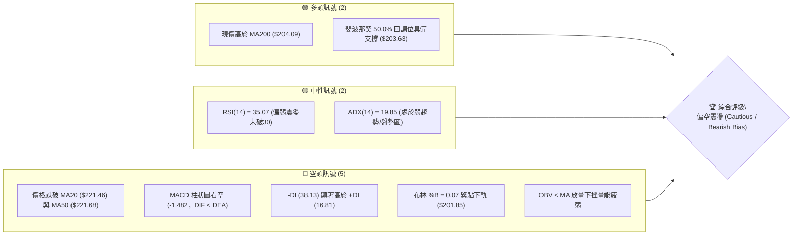
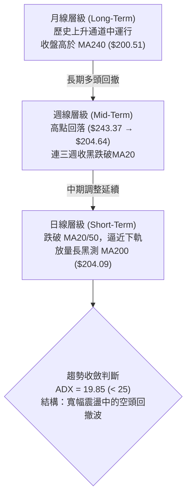
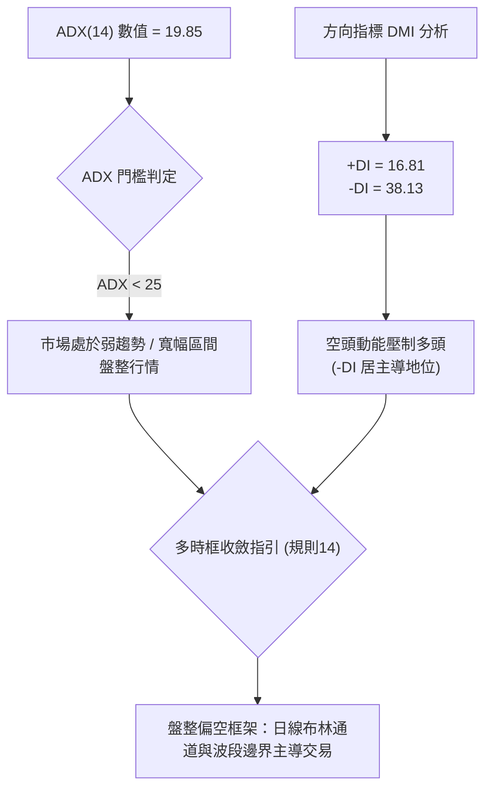
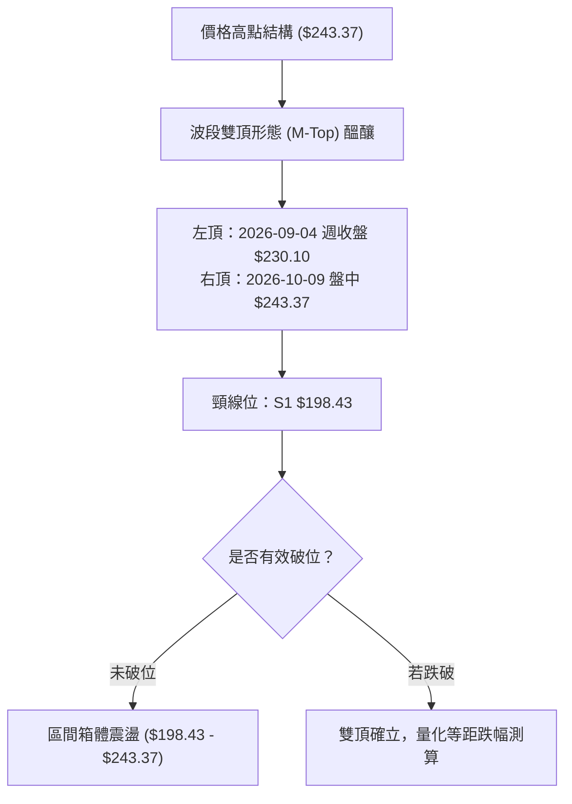
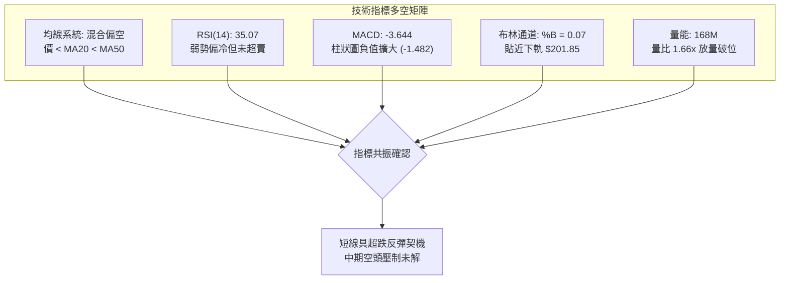
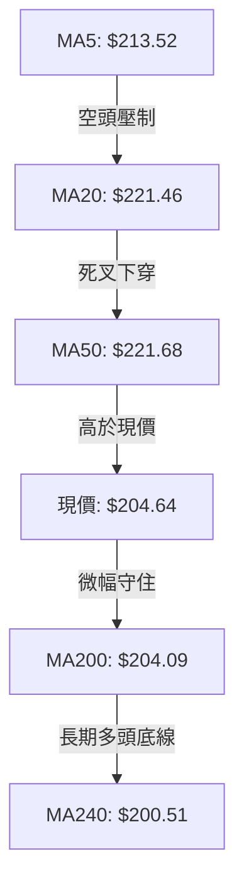
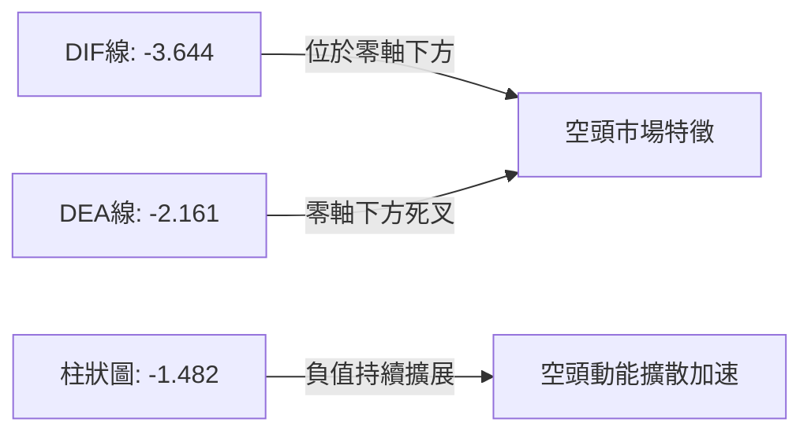
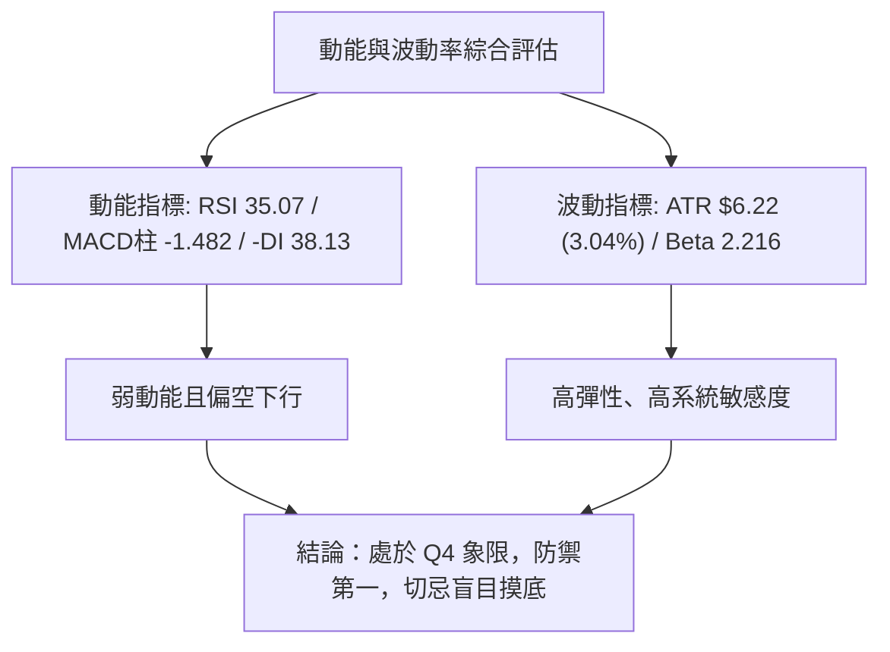
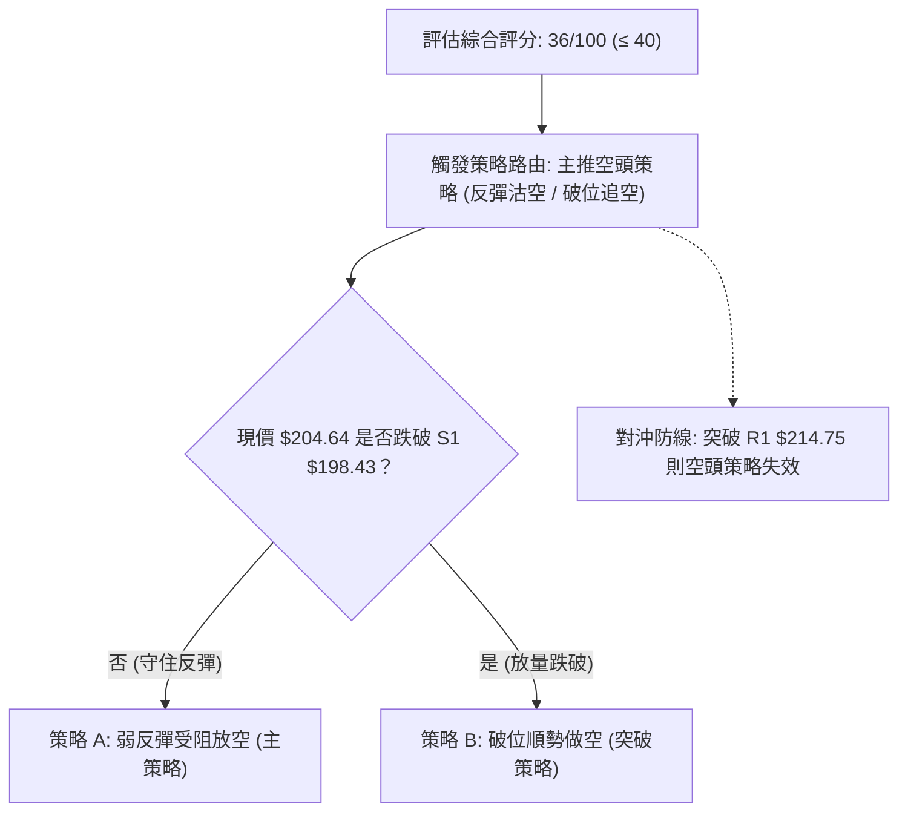
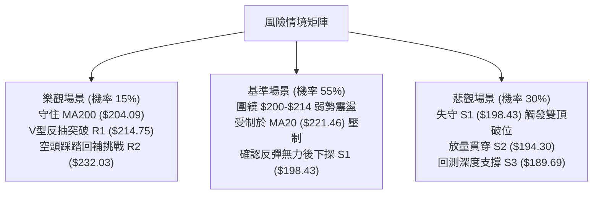

# NVDA 技術分析報告

> **報告日期**：2026-10-31 ｜ **語言**：繁體中文 ｜ **數據來源**：Yahoo Finance ｜ **當前價格**：$204.64

---

## 目錄

| 章節 | 內容 |
|------|------|
| [1. 技術面概覽](#1-技術面概覽) | 訊號儀表板、核心指標、評分卡 |
| [2. 趨勢分析](#2-趨勢分析) | 多時框趨勢、長中短期走勢 |
| [3. 圖表形態分析](#3-圖表形態分析) | 形態識別、K線組合、目標價 |
| [4. 支撐與阻力](#4-支撐與阻力) | 關鍵價位、斐波那契回調 |
| [5. 技術指標深度解讀](#5-技術指標深度解讀) | MA/RSI/MACD/布林/成交量 |
| [6. 動能與波動率](#6-動能與波動率) | 動能評估、ATR、Beta |
| [7. 多時框架總結](#7-多時框架總結) | 時框架評分矩陣 |
| [8. 交易策略建議](#8-交易策略建議) | 多空策略、風險報酬比 |
| [9. 風險提示與監控](#9-風險提示與監控) | 監控指標、風險場景 |

---

## 1. 技術面概覽

### 🎯 技術訊號儀表板



### 📊 核心指標速覽表

| 指標類別 | 指標名稱 | 當前數值 | 訊號 | 解讀 |
|----------|----------|----------|------|------|
| **價格** | 當前收盤價 | $204.64 | 🔴 | 位於 52 週區間之 51.3%，短線下探近期低點 |
| **均線** | MA20 | $221.46 | 🔴 | 價格低於 MA20 達 -7.59%，短期均線呈現向下蓋頭態勢 |
| **均線** | MA50 | $221.68 | 🔴 | 價格低於 MA50，中期多頭架構遭到破壞 |
| **均線** | MA200 | $204.09 | 🟢 | 現價微幅高於 MA200（高出 $0.55），長期牛熊分界線正在接受考驗 |
| **動能** | RSI(14) | 35.07 | 🟡 | 位於 30–70 中性區偏低檔，接近超賣但未現底背離 |
| **動能** | MACD(12,26,9) | -3.644 / -2.161 | 🔴 | DIF < DEA 且雙雙位於零軸之下，柱狀圖 -1.482 擴大看空 |
| **趨勢** | ADX / DMI | 19.85 (ADX) | 🔴 | ADX < 25 屬盤整/弱趨勢，但 -DI(38.13) 遠高於 +DI(16.81) 空頭主導 |
| **通道** | 布林通道 | %B = 0.07 | 🔴 | 現價逼近下軌 $201.85，屬極端弱勢帶，面臨向下破軌風險 |
| **波動** | ATR(14) | $6.22 | 🟡 | 佔股價 3.04%，日均振幅適中偏活躍，提供明確風控邊界 |
| **籌碼** | OBV 與量能 | 168.04M (1.66x) | 🔴 | 下跌放量，量比達 1.66 倍，OBV 低於均線顯示法人籌碼調節 |

### 🏆 技術評分卡

```
╔══════════════════════════════════════════════════════════════╗
║                技術評分卡 — NVDA (2026-10-31)                ║
╠══════════════════════════════════════════════════════════════╣
║ 趨勢強度      ██████░░░░░░░░░░░░░░  30/100  🔴 空方佔優      ║
║ 動能指標      ███████░░░░░░░░░░░░░  35/100  🔴 負向動能擴大  ║
║ 支撐穩定度    ██████████░░░░░░░░░░  50/100  🟡 考驗MA200與S1 ║
║ 成交量配合    ██████░░░░░░░░░░░░░░  30/100  🔴 帶量長黑下殺  ║
║ 形態完整度    ████████░░░░░░░░░░░░  40/100  🟡 頭部破位邊緣  ║
║ 均線排列      ██████░░░░░░░░░░░░░░  31/100  🔴 短中均線蓋頭  ║
╠══════════════════════════════════════════════════════════════╣
║ 綜合評分      ███████░░░░░░░░░░░░░  36/100  🔴 偏空格局      ║
╚══════════════════════════════════════════════════════════════╝
```
*(註：綜合評分 = (30 + 35 + 50 + 30 + 40 + 31) ÷ 6 = 36.0，四捨五入為 36/100，符合規則 18)*

---

## 2. 趨勢分析

### 🌐 多時框趨勢分析



### 📈 長期趨勢 — 12個月走勢圖（Unicode）

```
NVDA 月線走勢圖（過去12個月：2025-11 至 2026-10）
價格軸 ($)
$240 ┤                                                    
$230 ┤                                          ●(09月 228.38)
$220 ┤                                    ●(08月 220.53)
$210 ┤                        ●(05月 210.66)      
$200 ┤              ●(04月 199.11)  ●(07月 200.53)  ●(10月 204.64)←現在
$190 ┤        ●(01月 190.68)      
$180 ┤  ●(12月 186.06)
$170 ┤●(11月 176.58)  ●(02月 176.78) ●(03月 174.00 低點)
     └────────────────────────────────────────────────────────
       11   12   01   02   03   04   05   06   07   08   09   10  (月份)
```

**走勢特徵分析表格**：

| 時間階段 | 起訖收盤價 | 區間漲跌幅 | 主要走勢特徵與結構意涵 |
|----------|------------|------------|------------------------|
| **2025-11 ~ 2026-03** | $176.58 → $174.00 | -1.46% | 構築底部平台，於 $174.00 築出堅實支撐基底 |
| **2026-03 ~ 2026-05** | $174.00 → $210.66 | +21.07% | 帶量突破前高，主升段啟動，站上 $200 整數關卡 |
| **2026-05 ~ 2026-07** | $210.66 → $200.53 | -4.81% | 高檔橫盤整理，於 $200 形成換手籌碼密集區 |
| **2026-07 ~ 2026-09** | $200.53 → $228.38 | +13.89% | 二次衝高創下 52 週天花板區間，盤中創 $243.37 高點 |
| **2026-09 ~ 2026-10** | $228.38 → $204.64 | -10.39% | 獲利了結賣壓湧現，單月長陰回吐，直接逼退至 MA200 |

### 📊 中期趨勢（週線分析）

```
週線結構阻力與支撐分佈示意圖
$243.37 ─────────────┬─────────────────────────────── (52W High / R3 強阻力)
                     │ 頂部換手出貨賣壓
$232.03 ─────────────┼─────────────────────────────── (R2 波段次高阻力)
                     │ 中軌反壓區域 (MA20: $221.46)
$214.75 ─────────────┼─────────────────────────────── (R1 反彈第一道阻力)
$204.64 ═════════════╪═══════════════════════════════ ◄ 當前收盤價 ($204.64)
$203.63 ─────────────┼─────────────────────────────── (Fibonacci 50.0% 回調線)
$198.43 ─────────────┴─────────────────────────────── (S1 關鍵波段支撐)
```

週線層面顯示，NVDA 自 2026-10-09 當週觸及 52 週高點 $243.37 後，連續三週收長黑（收盤價分別為 $214.13、$210.96、$204.64），週成交量均維持在 4.7 億至 5.2 億股之間的高檔水位，MACD 週柱狀圖自 +0.119 驟降至 -1.482，顯示中期上升浪潮已遭遇空頭強力阻擊，轉入修正回調。

### ⚡ 趨勢強度評估（ADX 解讀）



**ADX 趨勢強度對照表**：

| 指標名稱 | 數值 | 參考區間標準 | 當前趨勢解讀 |
|----------|------|--------------|--------------|
| **ADX(14)** | 19.85 | < 20: 極弱趨勢 / 盤整<br/>20-25: 弱趨勢轉折<br/>> 25: 強趨勢成形 | 當前處於盤整行情階段，未形成單邊不可逆暴跌，但空頭壓制明顯 |
| **+DI(14)** | 16.81 | > 25 多方主導 | 多頭動能匱乏，無力發起向上波段推進 |
| **-DI(14)** | 38.13 | > 25 空方主導 | 賣方力量處於強勢支配區（> 35），具有高度向下貫性 |

---

## 3. 圖表形態分析

### 🔍 形態識別系統



**圖表形態信心度評估表**：

| 形態名稱 | 信心度 | 判斷依據（引用數據） | 完成度 | 目標價（附計算式） |
|----------|--------|----------------------|--------|--------------------|
| **高檔雙頂 (M-Top)** | 60% | 兩次衝高於 $230.10 與 $243.37 受阻回落，目前正測試頸線支撐 S1 $198.43 | 75% | 若跌破頸線 $198.43：頸線 $198.43 − 形態高度 ($243.37 − $198.43 = $44.94) = **$153.49**（數據中未偵測到該價位支撐，下方實質支撐見 52W Low $163.90） |
| **布林通道破軌回測** | 80% | 日線 %B 降至 0.07，逼近布林下軌 $201.85，屬超賣極端指標形態 | 90% | 下軌支撐測試 $201.85，反彈第一阻力為 R1 **$214.75** |
| **頭肩頂形態** | 35% | 數據不足以確認完整右肩結構，右肩量能尚未成形 | 35% | *訊號不足，僅做指標型解讀，不預設目標價* |

### 🕯️ 重要K線形態分析

依據規則 19，嚴格採用數據中提供之實際開高低收數據進行客觀解讀：

| 日期（維度） | 開 | 高 | 低 | 收 | 成交量 | K線形態名稱 | 技術解讀與訊號 |
|--------------|----|----|----|----|--------|-------------|----------------|
| **2026-10-21 (日K)** | 220.96 | 222.19 | 217.66 | 221.97 | 87,085,700 | 光頭中紅棒 | 短線反彈挑戰 MA20/50 反壓，收盤於高點，但量能未放大 🟢 |
| **2026-10-22 (日K)** | 217.13 | 218.88 | 211.26 | 212.21 | 125,407,600 | 帶量吞噬長黑 | 開低走低實體吞噬前日紅K，量增至 1.25 億，確立反彈失敗 🔴 |
| **2026-10-23 (日K)** | 210.99 | 213.85 | 210.18 | 210.96 | 80,189,800 | 縮量十字陰線 | 跌勢暫歇，上下影線收斂，多空於 $210 關卡短暫觀望 🟡 |
| **2026-10-26 (日K)** | 213.11 | 217.75 | 212.61 | 216.00 | 90,829,300 | 震盪中紅棒 | 嘗試回補上方缺口，最高觸及 $217.75，但上影線顯示追價乏力 🟡 |
| **2026-10-27 (日K)** | 218.31 | 219.19 | 215.53 | 217.94 | 84,799,700 | 墓碑十字變體 | 跳空開高至 $218.31 卻震盪收低，多頭上攻再度遭到空方狙擊 🔴 |
| **2026-10-28 (日K)** | 219.92 | 219.99 | 214.47 | 215.38 | 93,030,200 | 下跌倒轉鎚頭 | 盤中摸高 $219.99 後一路走低，長上影線確認 MA20 反壓沉重 🔴 |
| **2026-10-29 (日K)** | 214.36 | 215.33 | 212.08 | 213.66 | 77,568,100 | 連續走低陰線 | 高低點持續下移，量縮陰跌，買盤嚴重退縮 🔴 |
| **2026-10-30 (日K)** | 208.94 | 209.06 | 200.92 | 204.64 | 168,039,400 | 爆量下影大長黑 | 盤中灌破 $201.85 布林下軌至 $200.92，爆出 1.68 億巨量，收帶下影陰線 🔴 |
| **2026-10-09 (週K)** | 236.09 | 243.37 | 229.11 | 229.28 | 513,988,800 | 創高流星倒狀線 | 創 52 週天價 $243.37 後收出近 14 美元長上影線，主力出貨 🔴 |
| **2026-10-30 (週K)** | 213.11 | 219.99 | 200.92 | 204.64 | 514,266,700 | 破位光腳週大黑 | 週跌幅 -3.00%，連續三週走陰，低點直逼 MA200 關鍵防線 🔴 |

### 📉 ASCII 走勢形態示意圖

```
NVDA 近10個交易日走勢形態示意圖（2026-10-19 至 10-30）
$222 ┤      ╭● (10/21 高點 $222.19)
$220 ┤      │  │        ╭● (10/28 $219.99 反彈高點)
$218 ┤  ●──╯  │  ●──●  │  │
$216 ┤  │      │  │  │  ╰──╯  │
$214 ┤  │      ╰──╯  │        ╰──● (10/29 $213.66)
$212 ┤  │                            │
$210 ┤  │                            ╰──╮ 
$208 ┤  │                                │  (10/30 開盤 $208.94)
$206 ┤  │                                ╰──● 10/30 收盤 $204.64
$204 ┤  │                                    │  MA200: $204.09
$202 ┤  │                                    │
$200 ┴──┴────────────────────────────────────● (10/30 盤中低點 $200.92)
       10/19 10/21 10/23 10/26 10/27 10/28 10/29 10/30
```

### 🎯 形態目標價計算

根據日線雙頂與布林通道極端偏離推算關鍵點位：

1. **破位雙頂對等跌幅目標**：
   - 頂部高點：$243.37
   - 形態頸線：S1 $198.43
   - 垂直高度：$243.37 − $198.43 = $44.94
   - 若正式跌破頸線 $198.43，理論推算目標 = $198.43 − $44.94 = **$153.49**（此數值低於 52W Low $163.90，若發生系統性破位，下檔首要支撐為 S3 **$189.69** 與 52W Low **$163.90**）。
2. **短線超賣技術修復目標**：
   - 當前價格 $204.64 緊貼布林下軌 $201.85，若守穩 MA200（$204.09），短線回抽中軌的最小反彈目標為波段阻力 R1 = **$214.75**。

---

## 4. 支撐與阻力

### 🗺️ 關鍵價位分布圖（Unicode）

```
NVDA 價位結構分布圖 (由歷史 OHLCV 聚類計算)
═════════════════════════════════════════════════════════════════
$243.37 ║████████████████████████████████████████║ 強阻力 R3 (52W High)
$232.03 ║████████████████████████████            ║ 阻力 R2 (波段次高點)
$224.61 ║▒▒▒▒▒▒▒▒▒▒▒▒▒▒▒▒▒▒▒▒▒▒▒▒▒▒▒▒▒▒▒▒        ║ Fib 23.6% 回調位
$221.46 ║────────────────────────────────────────║ MA20 / MA50 均線反壓密集帶
$214.75 ║████████████████████                    ║ 關鍵阻力 R1 (反彈頸線)
$213.01 ║▒▒▒▒▒▒▒▒▒▒▒▒▒▒▒▒▒▒                      ║ Fib 38.2% 回調位
$204.64 ╠════════════════════════════════════════╣ ◄ 當前收盤價 ($204.64)
$204.09 ║════════════════════════════════════════║ MA200 長期牛熊線 ($204.09)
$203.63 ║▒▒▒▒▒▒▒▒▒▒▒▒▒▒▒▒▒▒▒▒▒▒▒▒▒▒▒▒▒▒▒▒▒▒▒▒▒   ║ Fib 50.0% 關鍵平衡位
$201.85 ║- - - - - - - - - - - - - - - - - - - - ║ 布林下軌支撐
$198.43 ║▓▓▓▓▓▓▓▓▓▓▓▓▓▓▓▓▓▓▓▓                    ║ 近期關鍵支撐 S1 (頸線防線)
$194.30 ║████████████████████████                ║ 強支撐 S2 (波段密集低點)
$194.25 ║▒▒▒▒▒▒▒▒▒▒▒▒▒▒▒▒▒▒▒▒▒▒▒▒▒▒▒▒▒▒▒▒▒▒▒▒▒   ║ Fib 61.8% 黃金分割強支撐
$189.69 ║████████████████████████████████        ║ 極強支撐 S3 (中期防禦底線)
═════════════════════════════════════════════════════════════════
```

### 🚧 阻力位分析表

*(價位嚴格引用自數據中「關鍵價位」區塊)*

| 阻力級別 | 價位 | 距現價幅幅 | 形成原因與籌碼解讀 | 突破難度 | 重要性 |
|----------|------|------------|--------------------|----------|--------|
| **R1** | **$214.75** | +4.94% | 10月中下旬多個交易日橫盤低點轉阻力，亦為近一年波段高點聚類位 | 🟡 中等 | 關鍵短線反彈試金石 |
| **R2** | **$232.03** | +13.38% | 9月震盪高點及10月初週K收盤聚類位，套牢籌碼密集 | 🔴 極高 | 中期趨勢反轉分水嶺 |
| **R3** | **$243.37** | +18.93% | 歷史 52 週最高點，強烈出貨長上影線所在 | 🔴 頂級 | 長期天花板阻力 |

### 🛡️ 支撐位分析表

*(價位嚴格引用自數據中「關鍵價位」區塊)*

| 支撐級別 | 價位 | 距現價幅幅 | 形成原因與籌碼解讀 | 守住機率 | 重要性 |
|----------|------|------------|--------------------|----------|--------|
| **S1** | **$198.43** | -3.03% | 近一年波段低點聚類位，雙頂頸線關卡，跌破將引發停損賣壓 | 🟡 55% | 短期多頭最後防線 |
| **S2** | **$194.30** | -5.05% | 7月波段起漲平台低點聚類，與斐波那契 61.8% ($194.25) 高度重合 | 🟢 70% | 中期強力護盤底座 |
| **S3** | **$189.69** | -7.30% | 2026年首季成交密集區低點，具備極強結構性換手支撐 | 🟢 85% | 長期多頭生死防禦底線 |

### 📐 斐波那契回調位分析

依據 52 週波動區間（低點 $163.90 至 高點 $243.37，總落差 $79.47）計算之黃金分割水準：

| 回調比率 | 價格水準 | 當前相對位置與技術意義解讀 |
|----------|----------|----------------------------|
| **0.0% (52W High)** | $243.37 | 多頭極限天花板，頂部阻力 |
| **23.6%** | $224.61 | 弱度回調位，目前已失守，轉化為上方中期阻力 |
| **38.2%** | $213.01 | 正常回調分界，緊鄰阻力位 R1 ($214.75)，反彈重要關卡 |
| **50.0%** | **$203.63** | **◄ 現價 ($204.64) 正位於此線上，多空半數籌碼平衡生命線** |
| **61.8%** | $194.25 | 黃金分割強支撐位，與支撐 S2 ($194.30) 誤差僅 $0.05，共振支撐區 |
| **78.6%** | $180.90 | 深度回調防守線，跌破則 52 週多頭結構徹底瓦解 |
| **100.0% (52W Low)**| $163.90 | 起漲基準底座 |

**位置解讀**：現價 $204.64 剛好壓在 **50.0% 回調位 ($203.63)** 與 **MA200 ($204.09)** 的微幅上方，此處是典型的多空臨界區。若此位置失守，價格必然直奔 61.8% 回調位 **$194.25** 與支撐 S2 **$194.30**。

---

## 5. 技術指標深度解讀

### 🎛️ 指標訊號總覽



### 📈 移動平均線排列分析



**均線架構解讀**：
- **MA20 ($221.46)** 與 **MA50 ($221.68)** 形成極度收斂的死叉蓋頭結構，價格已大幅落後均線達 -7.59% 與 -7.64%，表明過去 1-2 個月的平均持倉者全面陷入套牢。
- 長期均線 **MA200 ($204.09)** 與 **MA240 ($200.51)** 仍維持緩慢向上爬升軌跡，現價高出 MA200 僅 $0.55（+0.27%），現已形成「短期空頭排列 vs 長期牛市底線」的決戰格局。

### 📉 RSI(14) 分析

```
RSI(14) 動能強度表
0 ──────────── 30 ────── 35.07 ────────────── 70 ─────────── 100
[  極度超賣區  ]  [ 當前: 偏弱震盪區 ]         [   強勢多頭區   ]
進度條: ███████░░░░░░░░░░░░░ 35.07%
```

- **超買超賣狀態**：RSI(14) 為 **35.07**，雖然進入 40 以下的弱勢弱動能區，但並未跌破 30 形成絕對超賣，表示市場下殺慣性尚未耗盡。
- **背離分析**：依據近 20 根 K 棒走勢判定，價格自 10/21 高點 $222.19 跌至 10/30 低點 $200.92（創低），RSI 同步走低，**無明顯底背離**現象。量化結論：純屬單邊順勢回跌，不可盲目逆勢抄底。

### 📊 MACD(12,26,9) 訊號解讀



MACD 雙線在零軸下方運行，DIF (-3.644) 遠落後於 DEA (-2.161)，柱狀圖（Hist）錄得 -1.482，顯示短期負向動能持續擴張。在 MACD 柱狀圖收斂翻紅前，任何價格反抽均應視為技術性弱反彈而非反轉。

### 📦 布林通道分析

```
布林通道 (Bollinger Bands, 20, 2) 結構示意圖
$241.07 ┬────────────────────────────────────────── 布林上軌
        │
$221.46 ┼────────────────────────────────────────── 布林中軌 (MA20)
        │ 
$204.64 ┼══════════════════════════════════════════ ◄ 現價 ($204.64, %B = 0.07)
$201.85 ┴────────────────────────────────────────── 布林下軌 (10/30 盤中曾跌破至 $200.92)
```

- **當前位置**：%B 值為 **0.07**，極度逼近下軌（0 代表下軌，0.5 代表中軌）。10/30 盤中低點 $200.92 曾短暫摜破下軌 $201.85，終場收回軌內，形成典型的「超跌出軌後的拉回」。
- **帶寬意涵**：通道呈現開口擴張趨勢，下軌被動打開，若無法迅速收復回 $210 以上，通道將轉為向下開口型態。

### 💹 成交量分析（量價配合度）

- **最新成交量**：168,039,400 股，相較於 20 日均量（101,051,505 股），量比達到 **1.66 倍**。
- **量價背離與籌碼解讀**：最新一根日K是在跌破均線的背景下放量殺跌，創下近兩週最大單日量。
- **OBV 趨勢**：數據確認「**OBV < MA → 量能疲弱**」，代表主力資金正在縮手退潮，逢高賣盤湧出，量能完全不支持當前發動 V 型反轉。

---

## 6. 動能與波動率

### ⚡ 動能評估四象限

| 象限 | 動能維度 | 波動維度 | 當前狀態吻合 | 策略應對評估 |
|------|----------|----------|--------------|--------------|
| **Q1 (突破發散)** | 強動能 (Bullish) | 低波動 | — | 最佳波段加碼點 |
| **Q2 (盤整蟄伏)** | 弱動能 (Neutral) | 低波動 | — | 區間高拋低吸，等待突破 |
| **Q3 (極限宣洩)** | 強動能 (Bearish) | 高波動 | — | 恐慌拋售段，尋找極端反轉點 |
| **Q4 (陰跌釋放)** | **弱動能 (負向擴散)** | **中高波動** | **✓ (當前狀態)** | **空方佔優，波動加劇，以防禦與反彈減倉為主** |



### 📊 ATR 波動率分析

- **ATR(14) 數值**：**$6.22**（佔當前股價之 3.04%）。
- **日內波動特徵**：NVDA 每日正常平均波幅達 $6.22。以 10/30 為例，當日高低落差達 $8.14（$209.06 − $200.92 = $8.14，約為 1.3 倍 ATR），顯示市場拋壓集中釋放。
- **風控止損測算依據**：
  - *短期波段停損空間*：建議設定為 1.0 ~ 1.5 倍 ATR，即 **$6.22 ~ $9.33**。
  - *保守防守底線*：現價 $204.64 扣除 1.0 倍 ATR ($6.22) 為 **$198.42**，與關鍵波段支撐 **S1 ($198.43)** 出現極其精確的技術共振點。

### 📐 Beta 與市場相關性

- **Beta 係數**：**2.216**。
- **市場敏感度**：NVDA 具有極高的高彈性屬性，其波動幅度為 S&P 500 大盤的 2.2 倍以上。在當前半導體類股震盪加劇背景下，大盤每拉回 1%，NVDA 技術面下檔將面臨超過 2.2% 的下壓測試，進一步放大了失守 MA200 的潛在風險。

---

## 7. 多時框架總結

### 📋 時框架評分表

| 時框架 | 趨勢方向 | 動能狀態 | 均線排列 | 圖表形態 | 綜合評分 | 操作指引 |
|--------|----------|----------|----------|----------|----------|----------|
| **月線 (長期)** | 🟢 多頭回調 | 🟡 擴張放緩 | 🟢 MA240之上 | 長期通道上升 | 65/100 | 長期基本面牛市未死，但面臨深幅去槓桿 |
| **週線 (中期)** | 🔴 頂部回落 | 🔴 MACD翻黑 | 🟡 跌破MA20 | 52W高點長上影 | 35/100 | 中期波段進入ABC調整浪，測試支撐平台 |
| **日線 (短期)** | 🔴 弱勢破位 | 🔴 負向加速 | 🔴 死叉蓋頭 | 貼下軌爆量下影 | 30/100 | 短線空方控盤，需確認 MA200 支撐有效性 |

### 🔲 綜合訊號矩陣

```
時框衝突檢視矩陣：
┌───────────┬──────────────┬──────────────┬──────────────┐
│ 維度      │ 日線 (短期)  │ 週線 (中期)  │ 月線 (長期)  │
├───────────┼──────────────┼──────────────┼──────────────┤
│ 價格 vs MA│ 跌破 MA20/50 │ 跌破 MA20    │ 高於 MA200/24│
│ 動能方向  │ 空頭加速     │ 空頭主導     │ 多頭收斂     │
│ 關鍵防線  │ MA200 $204.09│ S1 $198.43   │ 52W底 $163.90│
│ 信號結論  │ 🔴 極度偏空  │ 🔴 震盪偏空  │ 🟢 結構多頭  │
└───────────┴──────────────┴──────────────┴──────────────┘
```

### ⚖️ 多時框收斂結論

依據多時框收斂規則（規則 14）：
1. **行情模式鑑定**：當前 ADX(14) 錄得 **19.85 (< 25)**，指標確認市場處於「**盤整行情（Range/Correction Market）**」，而非單邊趨勢行情。
2. **優先級收斂指針**：在盤整架構下，應以日線布林通道上下軌（**$201.85 ~ $241.07**）以及近一年高低點聚類形成的波段支撐/阻力為核心交易依據。
3. **最終唯一收斂方向**：**偏空震盪（Bearish Bias Range）**。
   - 儘管長期月線仍處於多頭框架，但日線與週線在動能（MACD 柱負值擴大）、量能（OBV < MA）及均線（MA20/50 蓋頭）上形成高度空頭共振。
   - 結論完全收斂於：**價格正在日線布林下軌及 MA200 邊界進行防守，任何反彈均受制於下降均線反壓，主導格局為「反彈逢高減磅，防範破位下殺」**。第 8 章之主策略將以此唯一結論展開。

---

## 8. 交易策略建議

### 🗺️ 策略決策流程圖



### 🧭 策略路由

**當前主策略方向 = 主推空頭策略（依技術評分卡 36/100，綜合評分 ≤ 40 觸發空方主導路由）**

### 🎯 價格情境階梯（Price Scenarios）

*(價位嚴格引用自「關鍵價位」區塊之客觀數值)*

| 觸發條件 | 下一目標 | 後續延伸 | 情境含義與技術心理 |
|----------|----------|----------|--------------------|
| **向上突破 R1 $214.75** | R2 **$232.03** | R3 **$243.37** | 短線轉強，多頭強勢回補缺口，空方全面停損退場 |
| **震盪站穩 $203.63~$204.64** | R1 **$214.75** | — | 超跌技術修復，在 MA200 與布林下軌間構築反彈 |
| **向下跌破 S1 $198.43** | S2 **$194.30** | S3 **$189.69** | 中期雙頂破位，停損賣壓全面傾巢而出，加速尋底 |

### 📊 情境機率分佈

| 情境劇本 | 機率 | 主要指標依據 |
|----------|------|--------------|
| **弱勢反彈後受阻回落** | **55%** | MACD 負柱擴大 (-1.482)、-DI 高達 38.13，上檔 MA20/50 重兵壓境 |
| **直接下破 S1 尋找新底** | **30%** | 下跌爆量 1.68 億股，OBV 量能破位，布林通道有向下開口風險 |
| **強勢反轉站回 R1 之上** | **15%** | 現價僅高出 MA200 $0.55，多頭抵抗力道脆弱，缺乏底背離確認 |

### 🔴 主策略詳情（空頭主導策略）

*(風險報酬比定義嚴格遵循規則 17：做空風報比 = (進場價 − 目標價 T1) ÷ (止損價 − 進場價))*

| 策略要素 | 策略 A：反彈遇阻做空（首選） | 策略 B：跌破支撐追空（次選） |
|----------|------------------------------|------------------------------|
| **交易類型** | 順勢逢高反彈沽空 | 關鍵支撐破位順勢放空 |
| **進場條件** | 股價反彈至阻力位 R1 受阻收陰線時進場 | 日K實體跌破支撐位 S1 時追空進場 |
| **進場價格** | **$214.75** (精確引用 R1) | **$198.43** (精確引用 S1) |
| **目標價 T1** | **$198.43** (波段支撐 S1) | **$194.30** (強支撐 S2) |
| **目標價 T2** | **$194.30** (強支撐 S2) | **$189.69** (極強支撐 S3) |
| **止損價格** | **$221.46** (MA20 均線反壓位) | **$201.85** (布林下軌轉阻力位) |
| **風險報酬比** | **1 : 2.43（以 T1 計）**<br/>*(計算式：(214.75 − 198.43) ÷ (221.46 − 214.75) = 16.32 ÷ 6.71 = 2.43)* | **1 : 1.21（以 T1 計）**<br/>*(計算式：(198.43 − 194.30) ÷ (201.85 − 198.43) = 4.13 ÷ 3.42 = 1.21)* |
| **T2 風報比** | **1 : 3.05（以 T2 計）**<br/>*(計算式：(214.75 − 194.30) ÷ 6.71 = 20.45 ÷ 6.71 = 3.05)* | **1 : 2.56（以 T2 計）**<br/>*(計算式：(198.43 − 189.69) ÷ 3.42 = 8.74 ÷ 3.42 = 2.56)* |
| **成功機率** | 60% | 55% |
| **建議倉位** | 15% 總資金規模 | 10% 總資金規模 |

### 🟢 反向風險觸發點（對沖多頭提示）

- **推翻條件**：若股價帶量突破並連續兩日收於 **R1 ($214.75)** 之上，或在現價附近出現放量長紅完全覆蓋 10/30 之大陰線，代表空頭回補浪潮啟動。
- **對沖應對**：若觸發此訊號，空頭必須無條件平倉，多頭可伺機小幅建立部位，上看次要阻力 R2 **$232.03**，停損設於 MA200 **$204.09**。

### ⭐ 整體訊號強度評星

```
做多訊號強度：★☆☆☆☆  (1.5/5星 - 僅存MA200與Fib 50%支撐博弈)
做空訊號強度：★★★★☆  (4.0/5星 - 均線死叉蓋頭，量能與MACD共振偏空)
整體可信度：  ★★★★☆  (4.0/5星 - 歷史關鍵點位聚合，破位訊號清晰)
```

---

## 9. 風險提示與監控

### ✅ 關鍵監控指標 Checklist

```
╔══════════════════════════════════════════════════════════════╗
║               每日盤後技術監控清單 (Checklist)               ║
╠══════════════════════════════════════════════════════════════╣
║ [ ] 監控項 1: 收盤價是否跌破 MA200 ($204.09)？                ║
║     → 若連續兩日收於其下，宣告牛熊轉換正式確立。            ║
║ [ ] 監控項 2: 頸線防線 S1 ($198.43) 的多頭承接買盤強度？     ║
║     → 是否出現跌破後帶量收回的「假跌破」訊號。              ║
║ [ ] 監控項 3: MACD 柱狀圖是否收斂？ (目前為 -1.482)          ║
║     → 若負值持續超過 -1.50，警惕加速趕底風險。               ║
║ [ ] 監控項 4: 成交量是否萎縮回 20日均量 ($101.05M) 之下？    ║
║     → 量縮意味下殺動能暫竭，爆量陰線則代表持續出貨。        ║
║ [ ] 監控項 5: 反彈時能否突破 R1 ($214.75) 頸線壓制？         ║
║     → 未突破前所有上衝皆為「誘多」或解套逃命波。            ║
╚══════════════════════════════════════════════════════════════╝
```

### ⚠️ 風險場景分析



### 🛡️ 風險管理重要提醒

1. **極高 Beta 波動防禦**：NVDA 當前 Beta 高達 2.216，ATR 達 $6.22，代表市場微小擾動均可能引發劇烈震盪。任何單筆操作之曝險金額嚴禁超過總投資本金的 **1.5%**。
2. **嚴格禁止左側預測性抄底**：在 ADX 的 -DI 高達 38.13 且未出現日線級別 RSI 底背離前，禁止在 $200 關卡進行盲目「猜底」買入。
3. **倉位管理紀律**：當前總評分為 **36/100**，技術面處於防禦弱勢期，整體多頭總持倉上限建議壓低在 **30% 以下**，保留充沛現金儲備以因應 S1/S2 測試時的系統性波動。

---

## 📋 報告總結

```
╔══════════════════════════════════════════════════════════════╗
║                 NVDA 技術分析報告總結                        ║
╠══════════════════════════════════════════════════════════════╣
║ 報告日期：2026-10-31                                         ║
║ 當前價格：$204.64                                             ║
║ 分析評級：🔴 偏空震盪 / 破位邊緣 (綜合技術評分: 36/100)       ║
║                                                              ║
║ 關鍵結論：                                                   ║
║ ├─ 長期趨勢：🟢 結構尚在 (高於 MA240 $200.51)，但牛熊線受測   ║
║ ├─ 中期趨勢：🔴 頂部確立 (高點 $243.37 回落，週線連三黑)     ║
║ ├─ 短期趨勢：🔴 均線蓋頭 (收盤低於 MA20/50，布林貼近下軌)    ║
║ ├─ 關鍵支撐：S1: $198.43 ｜ S2: $194.30 ｜ S3: $189.69        ║
║ ├─ 關鍵阻力：R1: $214.75 ｜ R2: $232.03 ｜ R3: $243.37        ║
║ └─ 斐波那契生命線：Fib 50.0% ($203.63) 正在接受回踩考驗      ║
║                                                              ║
║ 最優策略組合：                                               ║
║ 1. 🥇 最佳機會：反彈至阻力位 R1 ($214.75) 受阻順勢放空       ║
║    (止損: $221.46, 目標: $198.43, 風報比: 1 : 2.43)          ║
║ 2. 🥈 次選機會：實體黑K跌破 S1 ($198.43) 破位追空            ║
║    (止損: $201.85, 目標: $194.30, 風報比: 1 : 1.21)          ║
║ 3. 🥉 保守選擇：空手觀望，靜待 $194.25 ~ $194.30 (Fib 61.8%) ║
║    共振支撐區之築底訊號再做決策                              ║
╚══════════════════════════════════════════════════════════════╝
```

---

> ⚠️ **免責聲明**：本報告為 AI 自動生成之技術分析，所有數據及估算均嚴格基於所提供之歷史價格與指標資訊。本報告**僅供研究與學術參考**，**不構成任何形式之投資建議或買賣邀約**。金融市場瞬息萬變，投資具有高度風險，交易者應獨立評估風險並嚴格執行資金管理。

---

*報告生成時間：2026-10-31 ｜ 數據來源：Yahoo Finance ｜ 分析框架：多時框技術分析體系*