# NVDA 技術分析報告

> **報告日期**：2026-11-01 ｜ **語言**：繁體中文 ｜ **數據來源**：Yahoo Finance ｜ **當前價格**：$204.64

---

## 目錄

| 章節 | 內容 |
|------|------|
| [1. 技術面概覽](#1-技術面概覽) | 訊號儀表板、核心指標、評分卡 |
| [2. 趨勢分析](#2-趨勢分析) | 多時框趨勢、長中短期走勢、ADX強度 |
| [3. 圖表形態分析](#3-圖表形態分析) | 形態識別、K線組合、目標價推算 |
| [4. 支撐與阻力](#4-支撐與阻力) | 關鍵價位結構、斐波那契回調位 |
| [5. 技術指標深度解讀](#5-技術指標深度解讀) | 均線系統、RSI、MACD、布林通道、成交量 |
| [6. 動能與波動率](#6-動能與波動率) | 動能矩陣、ATR波動、Beta相關性 |
| [7. 多時框架總結](#7-多時框架總結) | 時框架評分矩陣、多時框收斂判定 |
| [8. 交易策略建議](#8-交易策略建議) | 策略路由、多空情境階梯、精確風報比 |
| [9. 風險提示與監控](#9-風險提示與監控) | 監控清單、情境推演、資金控管 |

---

## 1. 技術面概覽

### 🎯 技術訊號儀表板

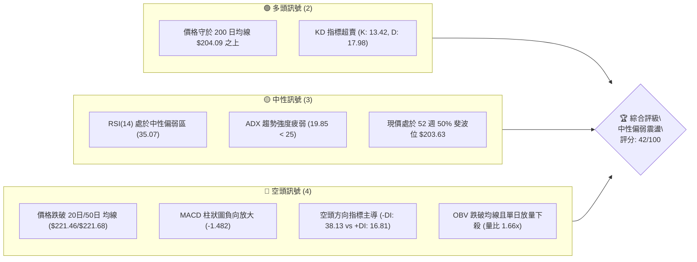

### 📊 核心指標速覽表

| 指標類別 | 指標名稱 | 當前數值 | 訊號 | 解讀 |
|----------|----------|----------|:----:|------|
| **價格** | 當前收盤價 | $204.64 | 🟡 | 位於 52 週高低區間 51.3% 位置，處於中軌下方偏弱區 |
| **均線** | MA20 (月線) | $221.46 | 🔴 | 價格低於 MA20 達 -7.59%，短期趨勢受壓 |
| **均線** | MA50 (季線) | $221.68 | 🔴 | 價格低於 MA50 達 -7.69%，中期均線反轉向下形成重壓 |
| **均線** | MA200 (年線) | $204.09 | 🟢 | 價格微幅高於 MA200 (+0.27%)，長期多空分水嶺面臨考驗 |
| **動能** | RSI(14) | 35.07 | 🟡 | 接近 30 超賣門檻但未破，下行動能尚未衰竭，無背離訊號 |
| **動能** | MACD (12/26/9) | -3.644 / -2.161 | 🔴 | DIF 線低於訊號線，Hist 柱狀體為 -1.482，空頭動能主導 |
| **動能** | 隨機指標 (KD) | %K 13.42 / %D 17.98 | 🟢 | 雙線深入 20 以下超賣鈍化區，隨時具備技術性反彈契機 |
| **趨勢** | ADX(14) | 19.85 | 🟡 | 數值小於 25，顯示當前缺乏單邊單向趨勢，屬於盤整格局 |
| **通道** | 布林通道 %B | 0.07 | 🟡 | 貼近布林下軌 $201.85，極限承壓但具備均值回歸拉力 |
| **波動** | ATR(14) | $6.22 | 🟡 | 日波動率為 3.04%，波動處於中等水準，單日風控需預留空間 |
| **成交量**| 最新量 / 20日均量 | 168.04M / 101.05M | 🔴 | 單日量比 1.66x，放量收大陰線，OBV 疲弱顯示籌碼鬆動 |

### 🏆 技術評分卡

```
╔══════════════════════════════════════════════════════════════╗
║               技術評分卡 — NVDA (2026-11-01)                 ║
╠══════════════════════════════════════════════════════════════╣
║ 趨勢強度 (Trend)     ████████░░░░░░░░░░░░  38/100  🔴 空頭佔優 ║
║ 動能指標 (Momentum)  ███████░░░░░░░░░░░░░  36/100  🔴 下行發散 ║
║ 支撐穩定度 (Support) ████████████░░░░░░░░  62/100  🟢 年線支撐 ║
║ 成交量配合 (Volume)  ██████░░░░░░░░░░░░░░  32/100  🔴 放量下殺 ║
║ 形態完整度 (Pattern) █████████░░░░░░░░░░░  44/100  🟡 頂部回調 ║
║ 均線排列 (MAs)       ████████░░░░░░░░░░░░  40/100  🔴 空頭排列 ║
╠══════════════════════════════════════════════════════════════╣
║ 綜合評分 (Overall)   ████████░░░░░░░░░░░░  42/100  🟡 區間震盪 ║
╚══════════════════════════════════════════════════════════════╝
```
*(註：綜合評分由六項子指標算術平均計算：(38 + 36 + 62 + 32 + 44 + 40) / 6 = 42.0)*

---

## 2. 趨勢分析

### 🌐 多時框趨勢分析

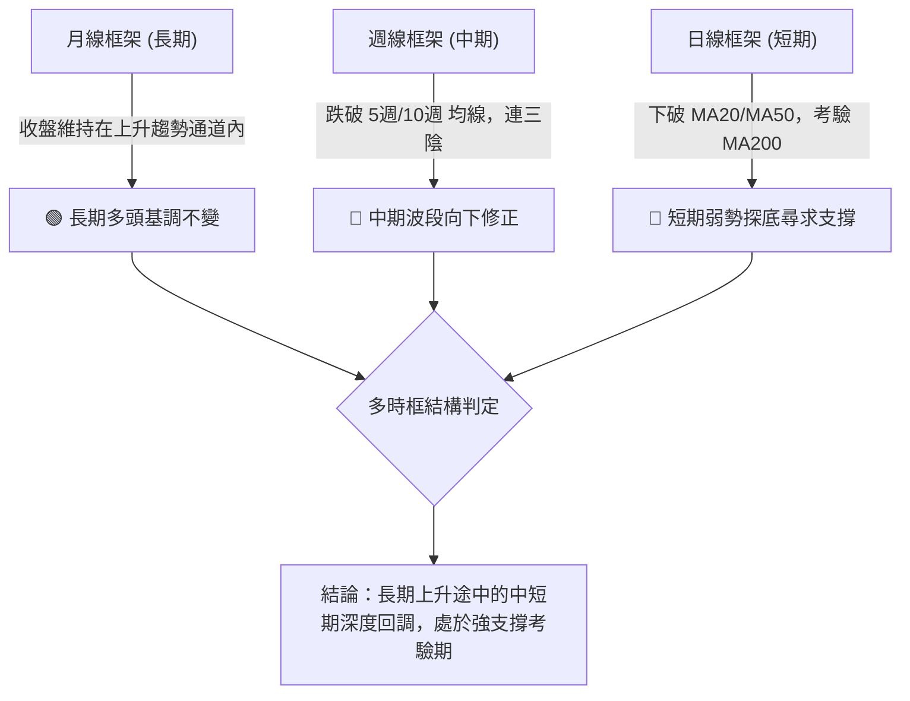

### 📈 長期趨勢 — 12個月走勢圖（Unicode）

NVDA 在過去 12 個月經歷了從 $176.58 起步、最高推升至歷史區間峰值（52W High $243.37 / 月收盤高點 $228.38），隨後回調至當前 $204.64 的歷程。

```
NVDA 月線走勢圖（過去12個月：2025-11 至 2026-10）
價格軸 ($)
$240 ┤                                                 ●(09月 $228.38)
$220 ┤                                         ●       │
$210 ┤                         ●               │       │
$200 ┤                 ●       │       ●       │       │       ●(10月現價 $204.64)
$190 ┤         ●       │       │       │       │       │       │
$180 ┤ ●       │       │       │       │       │       │       │
$170 ┤ │       │   ●   │   ●   │       │       │       │       │
     └─┬───────┬───┬───┬───┬───┬───────┬───────┬───────┬───────┬────────────
      11月    12月 01月 02月 03月 04月    06月    07月    08月    10月 (2026)
```

**走勢特徵分析表格**：

| 階段區間 | 起止價格 | 區間漲跌幅 | 主要技術特徵 |
|----------|----------|------------|--------------|
| **2025-11 ~ 2026-01** | $176.58 → $190.68 | +7.98% | 底部穩健墊高，多頭換手蓄勢 |
| **2026-01 ~ 2026-03** | $190.68 → $174.00 | -8.75% | 形成 52 週波段次低點聚類，回踩長期均線 |
| **2026-03 ~ 2026-05** | $174.00 → $210.66 | +21.07%| 強力多頭推進，突破 $200 整數心理大關 |
| **2026-05 ~ 2026-07** | $210.66 → $200.53 | -4.81% | 平台整理，消化獲利籌碼 |
| **2026-07 ~ 2026-09** | $200.53 → $228.38 | +13.89%| 主升浪加速，盤中創 52 週新高 $243.37 |
| **2026-09 ~ 2026-10** | $228.38 → $204.64 | -10.39%| 月線收出穿頭破腳大陰線，獲利盤集中了結 |

### 📊 中期趨勢（週線分析）

週線架構上，NVDA 於 2026-10-09 該週創下高點 $243.37 後，連續三週形成收黑的空頭反轉回調結構：
- **波段高點阻力聚類**：歷史最高點 $243.37 形成顯著的長上影線頂部射擊之星（Shooting Star）。
- **關鍵支撐考驗**：當前價格 $204.64 正在逼近週線級別平台支撐群 $198.43 ~ $200.51。
- **週線 MACD 柱狀體**：從 10 月初的 +0.822 驟降至當前 -1.482，顯示中期波段多頭動能已徹底衰竭，轉入空頭修正循環。

```
週線級別價格壓力與支撐結構示意：
[阻力 3] $243.37 ════════════════════════════════════ 52W 歷史最高點 (10-09)
                  │
[阻力 2] $232.03 ──────────────────────────────────── 10月初震盪整理密集平台
                  │
[阻力 1] $214.75 ┄┄┄┄┄┄┄┄┄┄┄┄┄┄┄┄┄┄┄┄┄┄┄┄┄┄┄┄┄┄ 10月中旬反彈頸線阻力位
                  │
[現  價] $204.64 ◄────────── 現價位於 MA200 ($204.09) 與 Fib 50% ($203.63)
                  │
[支撐 1] $198.43 ┄┄┄┄┄┄┄┄┄┄┄┄┄┄┄┄┄┄┄┄┄┄┄┄┄┄┄┄┄┄ 近一年波段低點聚類 S1
                  │
[支撐 2] $194.30 ──────────────────────────────────── Fib 61.8% 黃金分割支撐 S2
```

### ⚡ 趨勢強度評估（ADX 解讀）

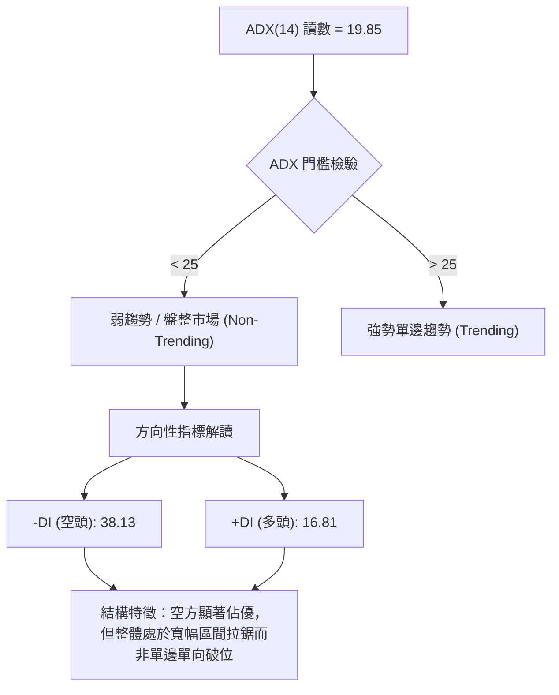

| 指標變量 | 具體讀數 | 狀態評估 | 操作指導含義 |
|----------|----------|:--------:|--------------|
| **ADX(14)** | 19.85 | 弱趨勢 / 無方向震盪 | 禁用單邊趨勢突破追單策略；嚴禁在通道邊界外追價 |
| **+DI (14)** | 16.81 | 多方動能低迷 | 多頭缺乏主動性推升意願，買盤多為被動承接 |
| **-DI (14)** | 38.13 | 空方主導下行 | 下殺主導權在空頭手中，短線尚未見到底部確認信號 |
| **結論收斂** | 盤整市 (-DI 主導) | 🔴 空方控盤的區間市 | 依據規則 14，行情定性為盤整，以布林通道與斐波那契為操作邊界 |

---

## 3. 圖表形態分析

### 🔍 形態識別系統

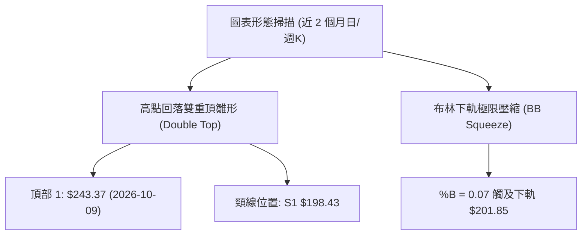

依據規則 15 嚴格定義形態信心度，凡未達標準者不進行臆測：

| 識別形態 | 信心度 | 判斷依據（引用數據） | 完成度 | 目標價（附嚴格計算式） |
|----------|:------:|----------------------|:------:|------------------------|
| **雙重頂回調雛形** | 72% | 週K高點 $243.37 形成長上影線後連續回落，頸線為近一年低點聚類 S1 ($198.43) | 65% | 跌破頸線 $198.43 則向下推算：<br>形態高度 = $243.37 − $198.43 = $44.94<br>推算極限目標 = $198.43 − $44.94 = **$153.49**（數據中未跌破頸線，僅屬假想推演） |
| **布林下軌超賣反彈形態** | 80% | 現價 $204.64 逼近布林下軌 $201.85，%B 達 0.07，KD 入超賣區 | 85% | 均值回歸目標價（布林中軌/MA20）= **$221.46** |
| **頭肩底形態** | 0% | 訊號不足，僅做指標型解讀（近 3 個月未見符合幾何對稱之三波谷） | 0% | 數據不足，不予計算 |

### 🕯️ 重要K線形態分析

根據數據提供之「近10根日K」與「近8根週K」，嚴格依開、高、低、收價格進行解讀：

| 日期（週期） | 開盤價 | 最高價 | 最低價 | 收盤價 | K線形態名稱 | 形態專業解讀 | 訊號強度 |
|--------------|--------|--------|--------|--------|-------------|--------------|:--------:|
| **2026-10-09 (週K)** | 236.09 | 243.37 | 229.11 | 229.28 | 射擊之星 (Shooting Star) | 創 52 週新高 $243.37 後大幅回吐，收盤逼近最低，高檔出貨明確 | 🔴 強空 |
| **2026-10-16 (週K)** | 228.73 | 228.86 | 212.85 | 214.13 | 大陰線破位 (Bearish Line) | 跳空低開低走，完全吞噬前週實體，確認中期反轉下跌開始 | 🔴 強空 |
| **2026-10-21 (日K)** | 220.96 | 222.19 | 217.66 | 221.97 | 光腳陽線 (Bullish Rebound) | 多頭試圖挑戰阻力位，但受阻於 MA20 ($221.46) | 🟢 弱多 |
| **2026-10-22 (日K)** | 217.13 | 218.88 | 211.26 | 212.21 | 破位長陰線 (Bearish Candle) | 成交量放大至 125M，反彈夭折，重新展開下行通道 | 🔴 中空 |
| **2026-10-28 (日K)** | 219.92 | 219.99 | 214.47 | 215.38 | 上影陰十字 (Gravestone Doji) | 多頭衝擊 $220 整數關卡無功而返，空方再度取回定價權 | 🔴 弱空 |
| **2026-10-30 (日K)** | 208.94 | 209.06 | 200.92 | 204.64 | 放量長陰帶下影 (Volume Drop) | 單日爆量 168M 下殺測試 $200 關卡與下軌，盤尾獲 MA200 護盤收回 | 🟡 止跌觀察 |

### 📉 ASCII 走勢形態示意圖

```
NVDA 近期高檔見頂回調形態示意圖 (2026-10)
$243.37 ──────┐ (10-09 射擊之星高點)
               │\
$230.00 ───────┘ \
                  \  (跌破反彈小平台)
$221.46 ───────────┼───────┐ (MA20 / MA50 形成死叉反壓)
                    \      │\
$214.75 ─────────────┼──────┘ \ (10-28 弱勢反彈高點 R1)
                      \        \
$204.64 ───────────────┼─────────●◄ 當前收盤價 (測試 MA200 $204.09)
                        \       /
$201.85 ─────────────────┴─────┴── 布林下軌與 $200 整數防線
$198.43 ────────────────────────── 頸線關鍵支撐 S1
```

### 🎯 形態目標價計算

基於當前所形成的短期頂部回調形態，計算潛在目標：
1. **反彈回測目標（均值回歸）**：
   - 基準頸線位：阻力 R1 = **$214.75**
   - 若突破 R1，則挑戰 20 日均線（布林中軌）= **$221.46**
2. **下行破位量度目標（極端風險）**：
   - 跌破關鍵支撐 S1 ($198.43) 後的量度幅度：
   - 下一級目標價直接指向數據中確認的強支撐 S2 = **$194.30**（與 61.8% 斐波回調位 $194.25 形成重合重疊區）。

---

## 4. 支撐與阻力

### 🗺️ 關鍵價位分布圖（Unicode）

```
NVDA 價位結構分布圖 (由 OHLCV 聚類嚴格計算)
══════════════════════════════════════════════════════════════
$243.37 ║██████████████████████████████║ 強阻力 R3 / 52W 最高點 / 0.0% Fib
$232.03 ║████████████████████          ║ 密集阻力 R2 / 波段密集成交頂部
$224.61 ║░░░░░░░░░░░░░░░░░░░░░░        ║ 阻力位 / 23.6% 斐波那契回調
$221.46 ║████████████████████          ║ 動態阻力 / MA20 及 MA50 均線重壓
$214.75 ║████████████████████████      ║ 關鍵阻力 R1 / 38.2% Fib ($213.01)
════════╠══════════════════════════════╣ ◄ 當前收盤價: $204.64
$204.09 ║▓▓▓▓▓▓▓▓▓▓▓▓▓▓▓▓▓▓▓▓▓▓▓▓▓▓▓▓  ║ 動態支撐 / MA200 年線生死線
$203.63 ║▓▓▓▓▓▓▓▓▓▓▓▓▓▓▓▓▓▓▓▓▓▓▓▓▓▓▓▓  ║ 核心支撐 / 50.0% 斐波那契回調位
$201.85 ║▓▓▓▓▓▓▓▓▓▓▓▓▓▓▓▓▓▓▓▓          ║ 動態支撐 / 布林通道下軌
$198.43 ║██████████████████████████████║ 近期強支撐 S1 / 近一年波段低點聚類
$194.30 ║████████████████████████      ║ 關鍵支撐 S2 / 61.8% Fib ($194.25)
$189.69 ║████████████                  ║ 深度防禦 S3 / 近一年低點聚類
══════════════════════════════════════════════════════════════
```

### 🚧 阻力位分析表

阻力位完全引用數據庫中波段高點聚類與指標計算值：

| 阻力級別 | 精確價位 | 距現價空間 | 形成原因與技術共振 | 突破難度 | 重要性權重 |
|:--------:|:--------:|:----------:|--------------------|:--------:|:----------:|
| **R1** | **$214.75** | +4.94% | 10月中旬盤整下邊界，與斐波那契 38.2% ($213.01) 及 MA5 ($213.52) 共振 | 中等 | ★★★★☆ |
| **R2** | **$232.03** | +13.38% | 9月下旬至10月初週K高點密集成交區，籌碼套牢深水區 | 極高 | ★★★★★ |
| **R3** | **$243.37** | +18.93% | 52 週歷史最高紀錄點，強烈射擊之星空頭頂部 | 極高 | ★★★★★ |

### 🛡️ 支撐位分析表

支撐位完全引用數據庫中波段低點聚類計算值：

| 支撐級別 | 精確價位 | 距現價空間 | 形成原因與技術共振 | 守住機率 | 重要性權重 |
|:--------:|:--------:|:----------:|--------------------|:--------:|:----------:|
| **S1** | **$198.43** | -3.03% | 近一年多次下探低點聚類，接近 2026-07 月底平台 $200.53 | 68% | ★★★★☆ |
| **S2** | **$194.30** | -5.05% | 近一年次強波段低點，與斐波那契 61.8% 黃金分割 ($194.25) 極度重合 | 82% | ★★★★★ |
| **S3** | **$189.69** | -7.30% | 2026 年初反覆震盪打底密集群，中期多頭最後防線 | 90% | ★★★★☆ |

### 📐 斐波那契回調位分析

依據 52 週完整波段起訖點（最低點 $163.90 至 最高點 $243.37，總垂直落差 $79.47）進行回調位定位：

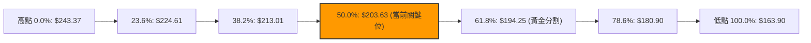

**現價落點解讀**：
- 當前收盤價 **$204.64** 恰好落在 **38.2% ($213.01)** 與 **50.0% ($203.63)** 之間，且距 50.0% 僅有 **+$1.01 (+0.50%)** 的微幅差距。
- **50.0% 回調位 ($203.63)** 與 **200 日移動平均線 MA200 ($204.09)** 構成了極強的「雙重匯聚技術支撐帶」。只要此支撐帶未在日線級別有效收盤跌破，空頭便無法確認啟動新一輪深幅主跌浪。

---

## 5. 技術指標深度解讀

### 🎛️ 指標訊號總覽

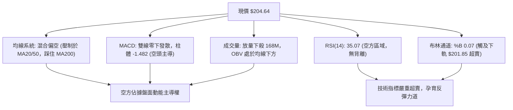

### 📈 移動平均線排列分析

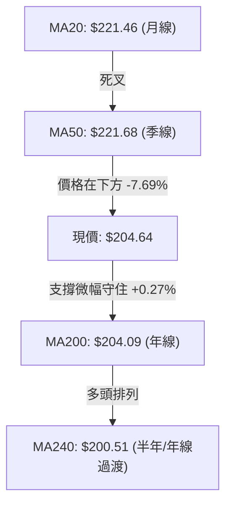

均線系統詳細參數與距離分析：
- **MA5 ($213.52) & MA10 ($214.63)**：呈陡峭下行態勢，現價距離 MA5 為 -4.16%，短線下墜速度極快。
- **MA20 ($221.46) & MA50 ($221.68)**：形成「死亡交叉」形態，兩者於 $221.50 附近重合，構建出中期難以逾越的「鋼鐵反壓天花板」。
- **MA200 ($204.09)**：牛熊分界線。目前現價與 MA200 僅差距 $0.55，顯示長期上升趨勢正在接受最終檢驗。

### 📉 RSI(14) 分析

- **RSI 當前讀數**：`35.07`
```
RSI(14) 水平儀：
0 ──────────── 30 ────── 35.07 ───────────── 50 ─────────────────── 70 ──────────── 100
[  極度超賣區  ] [超賣邊緣]  ▲當前位置         [    中軸平衡線    ] [  極度超買區  ]
進度條展示：███████░░░░░░░░░░░░░ 35.07%
```
- **超買超賣解讀**：數值 35.07 處於 30~50 的弱勢空頭區間，尚未跌入 30 以下的極度超賣鈍化區，意味著拋壓雖然沉重，但尚未出現恐慌盤耗盡的反轉特徵。
- **背離判斷**：
  - 根據近 20 根 K 棒的首尾價格與 RSI 進行檢驗：價格創出 10 月以來新低，RSI 同步滑落至 35 水平，**明確判定為：無底背離，亦無頂背離**。指標與價格運行趨勢完全一致。

### 📊 MACD(12/26/9) 訊號解讀

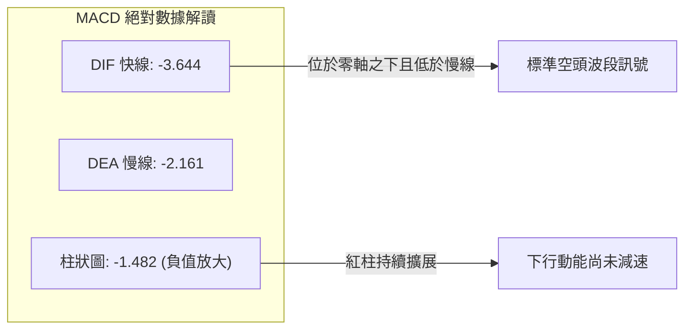
- DIF (-3.644) 與 DEA (-2.161) 均位於零軸之下，且快線與慢線開口持續張開，MACD Histogram 錄得 -1.482，顯示短期拋售勢能正在增強，沒有任何黃金交叉的早期跡象。

### 📦 布林通道分析

```
布林通道 (20, 2) 結構示意圖 ($)
$241.07 ────────────────────────────── 上軌 (Band Top)
          │
          │
$221.46 ──┼─────────────────────────── 中軌 (MA20 / Middle Band)
          │
          │
$204.64 ──┼───────● 現價 (%B = 0.07)
$201.85 ──┴─────────────────────────── 下軌 (Band Bottom)
```
- 通道上軌為 $241.07，中軌為 $221.46，下軌為 $201.85，帶寬（Bandwidth）高達 $39.22。
- **%B 指標為 0.07**：顯示當前價格已經貼近下軌邊緣（0.00 代表觸及下軌，1.00 代表觸及上軌）。依據均值回歸理論，股價在下軌外側或邊緣往往會觸發波動率收斂帶來的技術性拉回中軌走勢。

### 💹 成交量分析（量價配合度）

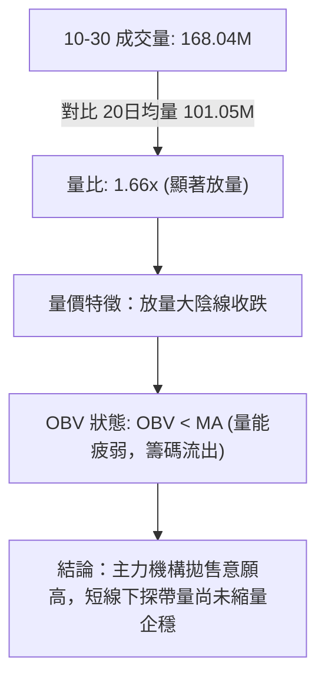

---

## 6. 動能與波動率

### ⚡ 動能評估四象限

評估 NVDA 當前所處的動能強度與波動率狀態：

| 象限分區 | 動能維度 (Momentum) | 波動維度 (Volatility) | 當前判定狀態 | 戰略應對方針 |
|:--------:|:-------------------:|:---------------------:|:------------:|--------------|
| **第一象限 (Q1)** | 強（多頭） | 低（收斂） | — | 最佳趨勢加碼點 |
| **第二象限 (Q2)** | 弱（空頭/震盪）| 低（收斂） | — | 觀望等待方向明朗 |
| **第三象限 (Q3)** | 強（單邊下衝） | 高（發散） | — | 高風險極限博弈 |
| **第四象限 (Q4)** | **弱 (負動能)** | **中高 (ATR擴張)** | **✓ (當前狀態)** | **控制倉位，嚴禁盲目摸底** |

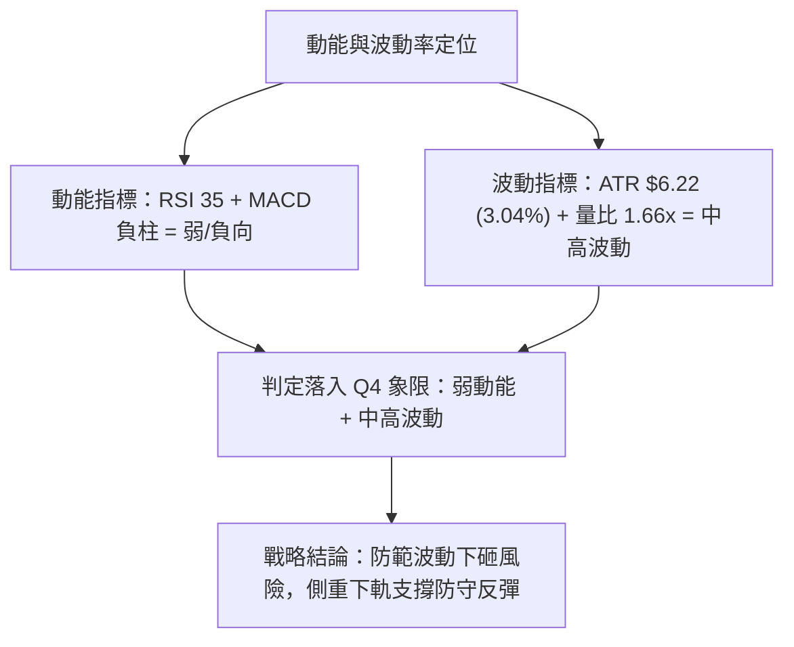

### 📊 ATR 波動率分析

- **ATR(14) 讀數**：`$6.22` (佔現價比例 **3.04%**，採用 Wilder 平滑算法)。
- **波動特性分析**：單日 $6.22 的平均真實波幅意味著 NVDA 在正常交易日內具備上下 ±$6 到 ±$12 的擺動能量。
- **止損距離配置原則**：
  - 短線波段交易：止損寬度至少需設置為 **1.0x ~ 1.5x ATR**（即 **$6.22 ~ $9.33**），以避免被日內隨機噪音洗盤掃出場。
  - 當前現價 $204.64 距離 S1 支撐 $198.43 剛好為 $6.21（約 1.0x ATR），具備天然的技術防護縱深。

### 📐 Beta 與市場相關性

- **Beta 係數**：`2.216`
- **市場特徵解讀**：
  - NVDA 的 Beta 高達 2.22，屬於超高彈性標的。當標普 500 指數或納斯達克 100 指數波動 1% 時，NVDA 平均理論波動達 2.22%。
  - 在整體半導體板塊面臨回調壓力時，其跌幅會被顯著放大；同理，若大盤止跌反彈，其反彈爆發力亦將居市場領頭地位。

---

## 7. 多時框架總結

### 📋 時框架評分表

| 時框架 | 趨勢方向 | 動能狀態 | 均線排列 | 形態特徵 | 綜合評分 | 操作建議 |
|:------:|:--------:|:--------:|:--------:|:--------:|:--------:|:--------:|
| **月線 (長期)** | 🟢 偏多 | 🟡 中性回落 | 🟢 位於 MA200/240 上方 | 長期上升通道回踩 | 70/100 | 長期投資者無需恐慌 |
| **週線 (中期)** | 🔴 偏空 | 🔴 MACD柱轉負 | 🔴 跌破週線 5MA/10MA | 高檔射擊之星反轉 | 35/100 | 波段交易者防禦減倉 |
| **日線 (短期)** | 🔴 弱勢 | 🟡 超賣醞釀 | 🔴 均線死叉空頭排列 | 考驗年線與布林下軌 | 38/100 | 短線博弈僅限下軌低吸 |

### 🔲 綜合訊號矩陣

```
時框維度與技術要素一致性矩陣：
┌───────────┬─────────────┬─────────────┬─────────────┬─────────────┐
│ 時 框     │ 趨勢 (Trend)│ 動能 (Mom)  │ 均線 (MAs)  │ 支撐 (Supp) │
├───────────┼─────────────┼─────────────┼─────────────┼─────────────┤
│ 短期 (日) │ 🔴 空方主導 │ 🔴 弱勢下探 │ 🔴 空頭交叉 │ 🟢 考驗MA200│
│ 中期 (週) │ 🔴 回調進行 │ 🔴 動能流失 │ 🟡 逼近關鍵 │ 🟢 逼近 S1  │
│ 長期 (月) │ 🟢 多頭完好 │ 🟡 漲勢趨緩 │ 🟢 完好發散 │ 🟢 遠高於底 │
└───────────┴─────────────┴─────────────┴─────────────┴─────────────┘
```

### ⚖️ 多時框收斂結論

嚴格遵守規則 14 進行優先級收斂判定：
1. **行情定性檢驗**：當前日線 **ADX(14) 讀數為 19.85**（嚴格小於 25 門檻），因此當前行情性質被明確鎖定為**「無單邊強趨勢之盤整行情（Consolidation Regime）」**。
2. **多時框衝突收斂規則**：在盤整行情架構下，日線級別的布林通道區間（上軌 $241.07 至 下軌 $201.85）為核心波動邊界，不再以單邊破位邏輯主導。
3. **最終唯一收斂結論**：**中性偏弱震盪觀望（Neutral-Bearish Range-Bound）**。
   - 現價 $204.64 緊貼布林下軌 $201.85 與斐波那契 50% 回調位 $203.63，下方有 MA200 年線 ($204.09) 托底。雖然日、週線指標呈現空頭，但由於 ADX 疲軟且指標深入超賣區，空頭在此位置不宜盲目追空，多頭亦須等待明確放量止跌信號。

---

## 8. 交易策略建議

### 🗺️ 策略決策流程圖

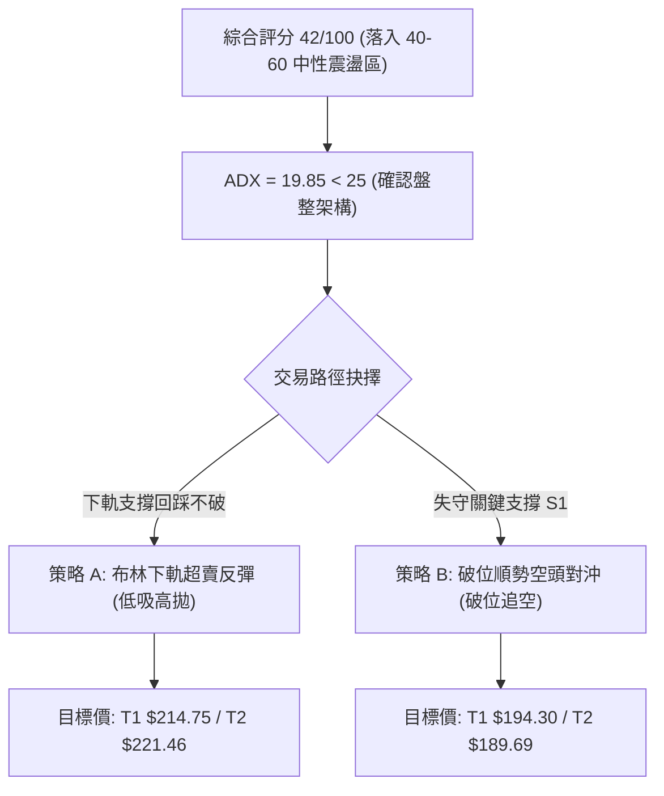

### 🧭 策略路由

**當前主策略方向 = 中性震盪區間操作（依評分 42/100，處於 40–60 區間）**
> 行情處於盤整與多空膠著期，禁止單邊重倉博弈。以布林通道下軌與 50.0% 斐波位為依託進行區間反彈操作，同時制定跌破強支撐後的空頭對沖預案。

### 🎯 價格情境階梯（Price Scenarios）

價位完全嚴格引用數據庫計算點位：

| 觸發條件 | 下一目標 | 後續延伸 | 情境技術含義 |
|----------|:--------:|:--------:|--------------|
| **向上突破 R1 $214.75** | **R2 $232.03** | **R3 $243.37** | 站上 38.2% 斐波位，短線確立見底，展開均值回歸走勢 |
| **站穩現價區間 ($201.85 ~ $204.64)** | **R1 $214.75** | — | 年線與布林下軌發揮防禦效能，轉入築底震盪 |
| **向下跌破 S1 $198.43** | **S2 $194.30** | **S3 $189.69** | 失守近一年低點聚類，中期頭部確認，下探 61.8% 斐波位 |

### 📊 情境機率分佈

| 演化情境 | 發生機率 | 主要客觀技術依據 |
|----------|:--------:|------------------|
| **區間震盪築底（下軌反彈）** | **55%** | ADX 僅 19.85 無法支持持續單邊崩跌；KD (13.42) 極度超賣；%B 達 0.07 觸及下軌 |
| **跌破下行探底（波段修正）** | **30%** | MACD 零下柱狀體負向擴大 (-1.482)；10-30 放量下殺量比達 1.66x；OBV 疲軟 |
| **強勢 V 型反轉（重返升勢）** | **15%** | MA20/MA50 呈死亡交叉反壓，上方 $214.75 及 $221.46 套牢籌碼沉重 |

### 🟢 主策略詳情（精確數值計算）

嚴格依據規則 13、17 執行計算，所有價位均來自關鍵價位區塊：
- **風險報酬比公式**：做多 RRR = $(T1 − 進場價) ÷ (進場價 − 止損價)$；做空 RRR = $(進場價 − T1) ÷ (止損價 − 進場價)$

| 策略要素 | 策略 A：布林下軌超跌反彈多單 (主推薦) | 策略 B：跌破關鍵支撐追空對沖單 (備選防守) |
|----------|----------------------------------------|------------------------------------------|
| **操作邏輯** | 依託 50% 斐波位 $203.63 與年線守穩買入 | 跌破一年波段低點 S1 $198.43 順勢避險對沖 |
| **進場價格** | **$203.63** (斐波那契 50.0% 回調位) | **$198.43** (突破跌破 S1 觸發價) |
| **止損價格** | **$198.43** (波段低點聚類 S1) | **$203.63** (反抽斐波 50% 突破即止損) |
| **止損距離** | $203.63 − $198.43 = **$5.20** (-2.55%) | $203.63 − $198.43 = **$5.20** (+2.62%) |
| **目標價 T1** | **$214.75** (阻力位 R1 / 38.2% Fib) | **$194.30** (關鍵支撐 S2 / 61.8% Fib) |
| **目標價 T2** | **$221.46** (動態中軌 MA20 均值回歸) | **$189.69** (深度防禦支撐 S3) |
| **獲利空間 (T1)**| $214.75 − $203.63 = **$11.12** (+5.46%) | $198.43 − $194.30 = **$4.13** (+2.08%) |
| **獲利空間 (T2)**| $221.46 − $203.63 = **$17.83** (+8.76%) | $198.43 − $189.69 = **$8.74** (+4.40%) |
| **風險報酬比** | **1 : 2.14（以 T1 計）**<br>*(註：以 T2 計為 1 : 3.43)* | **1 : 0.79（以 T1 計）**<br>*(註：以 T2 計為 1 : 1.68)* |
| **策略成功率** | **58%** | **42%** |
| **建議配置倉位**| **15% ~ 20%** | **5% ~ 10% (純對沖)** |

### 🔴 反向風險觸發點（對沖提示）

- **多單失效風控點**：若日線收盤價實質跌破 **$198.43 (S1)**，代表年線 $204.09 與布林下軌支撐徹底瓦解，必須無條件止損多單，不得抗單。
- **空單失效風控點**：若價格強勢收復 **$214.75 (R1)** 並伴隨量能超過 120M，代表短線底部反轉成型，空頭對沖倉位必須立即離場。

### ⭐ 整體訊號強度評星

```
做多訊號強度：★★☆☆☆  (2/5星 - 僅限下軌邊界之技術性短線低吸)
做空訊號強度：★★★☆☆  (3/5星 - 均線偏空但受制於超賣與下軌支撐)
整體可信度：  ★★★★☆  (4/5星 - 指標數據與結構收斂具備高度一致性)
```

---

## 9. 風險提示與監控

### ✅ 關鍵監控指標 Checklist

```
╔══════════════════════════════════════════════════════════════╗
║               NVDA 即時技術風控監控清單 (Checklist)           ║
╠══════════════════════════════════════════════════════════════╣
║ [ ] 監控點 1：MA200 年線 ($204.09) 日線收盤是否有效守住？    ║
║ [ ] 監控點 2：斐波那契 50% ($203.63) 是否出現長下影線承接？  ║
║ [ ] 監控點 3：布林通道 %B 是否自 0.07 回升至 0.20 以上？     ║
║ [ ] 監控點 4：隨機指標 KD (13.42) 是否在超賣區形成黃金交叉？ ║
║ [ ] 監控點 5：日成交量是否自 168M 回落至 100M 以下形成縮量？ ║
║ [ ] 監控點 6：阻力位 R1 ($214.75) 是否形成有效反彈壓制？     ║
╚══════════════════════════════════════════════════════════════╝
```

### ⚠️ 風險場景分析

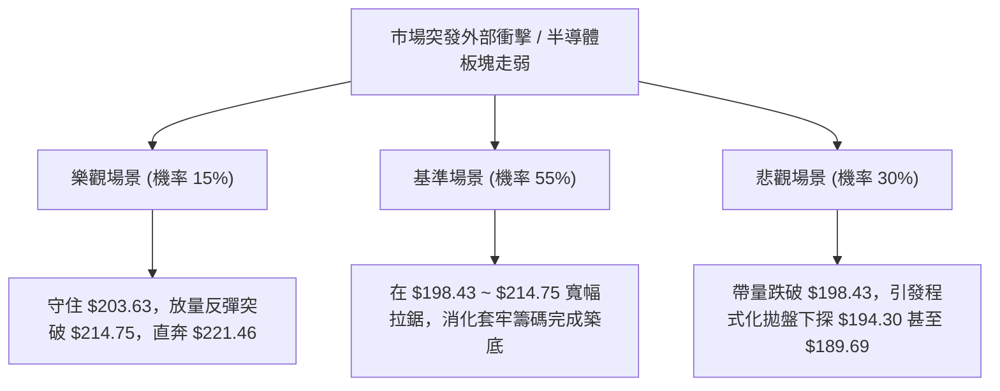

### 🛡️ 風險管理重要提醒

1. **Beta 槓桿效應控制**：鑑於 NVDA 擁有高達 **2.216** 的高 Beta 值，任何個股部位的波動劇烈程度均為標普大盤的兩倍以上。在整體倉位配置上，單一標的暴露不應超過總投資組合的 **15%**。
2. **ATR 動態倉位計算**：當前 ATR 為 **$6.22**。若以單筆交易承受總資金 1% 的損失風險為例（設總資金為 $100,000，1% 即 $1,000），當止損空間設定為 $5.20 時：
   $$\text{最大允許開倉股數} = \frac{\$1,000}{\$5.20} \approx 192 \text{ 股}$$
   絕對不可盲目滿倉交易。
3. **重大基本面財報事件窗口防範**：技術指標在財報發布與指引公布瞬間易發生「技術線路跳空失效」，必須密切跟蹤後續重大事件日期並在事件前降低槓桿。

---

## 📋 報告總結

```
╔══════════════════════════════════════════════════════════════════╗
║                   NVDA 技術分析報告總結                          ║
╠══════════════════════════════════════════════════════════════════╣
║ 報告日期：2026-11-01              當前價格：$204.64              ║
║ 分析評級：⚖️ 中性偏弱區間震盪 (綜合評分: 42/100)               ║
╠══════════════════════════════════════════════════════════════════╣
║ 關鍵結論：                                                       ║
║ ├─ 長期趨勢：🟢 完好多頭 (站穩月線通道與長期均線)                ║
║ ├─ 中期趨勢：🔴 空頭修正 (週K高檔長上影反轉，連三陰調整)        ║
║ ├─ 短期趨勢：🟡 弱勢築底 (貼近布林下軌 $201.85，KD 超賣)         ║
║ ├─ 關鍵支撐：S1: $198.43 ｜ S2: $194.30 (Fib 61.8%)             ║
║ ├─ 關鍵阻力：R1: $214.75 ｜ R2: $232.03 ｜ MA20: $221.46         ║
║ └─ 華爾街共識目標價：$328.95 (58位分析師，覆蓋區間 $180~$515)    ║
╠══════════════════════════════════════════════════════════════════╣
║ 最優策略組合：                                                   ║
║ 1. 🥇 最佳機會：回踩 50% 斐波位 $203.63 輕倉試多，目標 R1 $214.75║
║                 (止損 $198.43，風報比 1 : 2.14)                  ║
║ 2. 🥈 次選機會：跌破 S1 $198.43 順勢啟動空頭對沖，目標 S2 $194.30 ║
║ 3. 🥉 保守選擇：空倉觀望，等待日線有效突破並站穩 R1 $214.75 再介入║
╚══════════════════════════════════════════════════════════════════╝
```

---

> ⚠️ **免責聲明**：本報告為 AI 自動生成之技術分析，所有數據及估算均基於提供的歷史價格資訊。本報告**僅供研究與學術參考**，**不構成任何投資建議**。投資有風險，入市需謹慎。

---

*報告生成時間：2026-11-01 ｜ 數據來源：Yahoo Finance ｜ 分析框架：多時框技術分析*