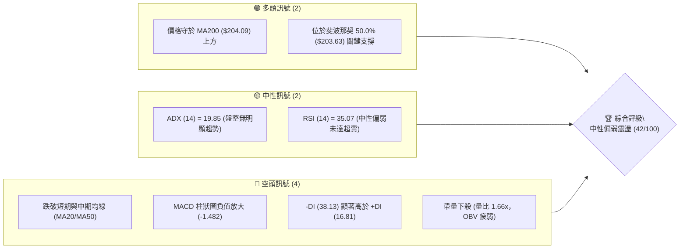
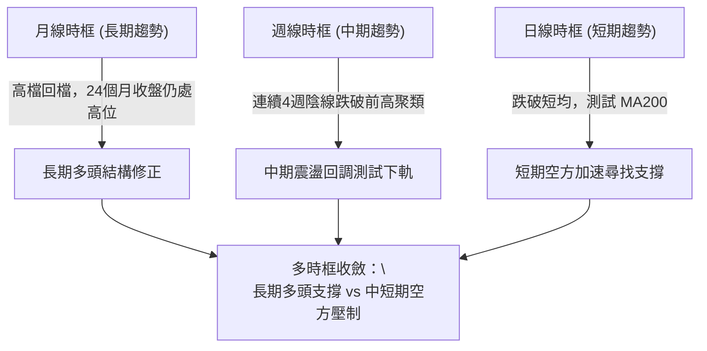
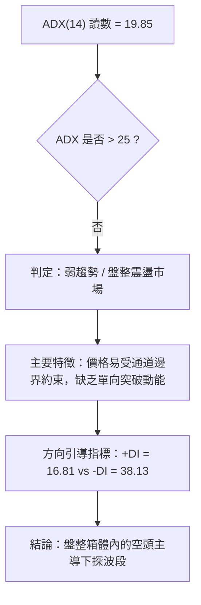
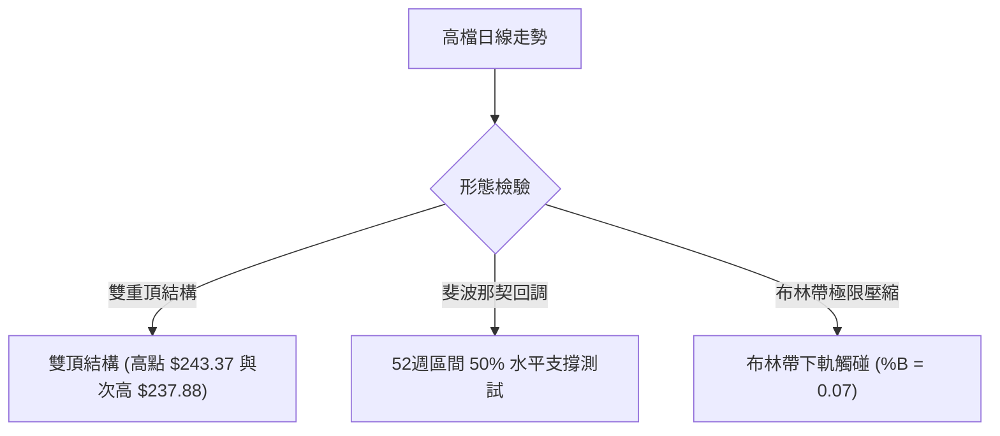
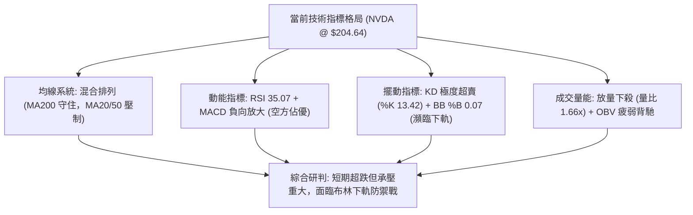
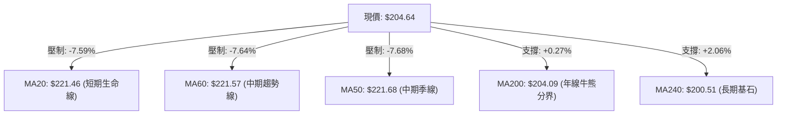
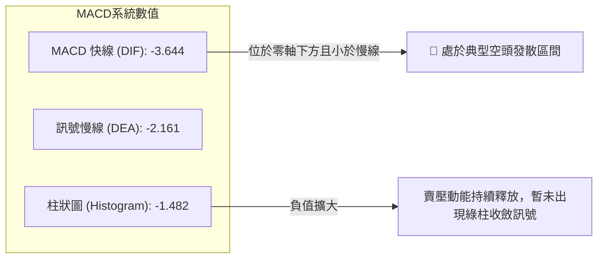
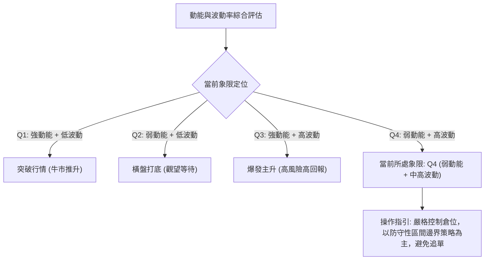
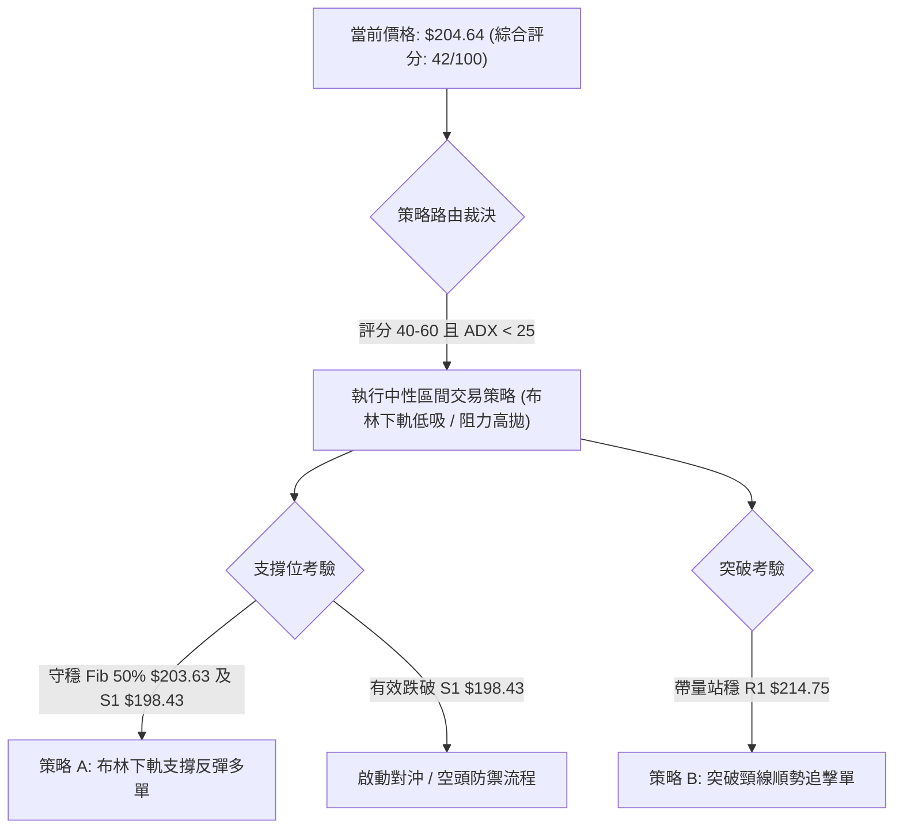
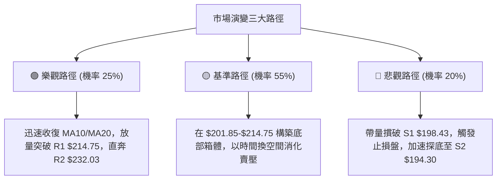

# NVDA 技術分析報告

> **報告日期**：2026-11-02 ｜ **語言**：繁體中文 ｜ **數據來源**：Yahoo Finance ｜ **當前價格**：$204.64

---

## 目錄

| 章節 | 內容 |
|------|------|
| [1. 技術面概覽](#1-技術面概覽) | 訊號儀表板、核心指標、評分卡 |
| [2. 趨勢分析](#2-趨勢分析) | 多時框趨勢、長中短期走勢 |
| [3. 圖表形態分析](#3-圖表形態分析) | 形態識別、K線組合、目標價 |
| [4. 支撐與阻力](#4-支撐與阻力) | 關鍵價位、斐波那契回調 |
| [5. 技術指標深度解讀](#5-技術指標深度解讀) | MA/RSI/MACD/布林/成交量 |
| [6. 動能與波動率](#6-動能與波動率) | 動能評估、ATR、Beta |
| [7. 多時框架總結](#7-多時框架總結) | 時框架評分矩陣 |
| [8. 交易策略建議](#8-交易策略建議) | 多空策略、風險報酬比 |
| [9. 風險提示與監控](#9-風險提示與監控) | 監控指標、風險場景 |

---

## 1. 技術面概覽

### 🎯 技術訊號儀表板



### 📊 核心指標速覽表

| 指標類別 | 指標名稱 | 當前數值 | 訊號 | 解讀 |
|----------|----------|----------|------|------|
| **價格** | 當前收盤價 | $204.64 | 🟡 | 位於52週區間51.3%分位，回測長線中樞 |
| **均線** | MA20 (短線生命線) | $221.46 | 🔴 | 價格在MA20下方 -7.59%，短線空方壓制 |
| **均線** | MA50 (中線趨勢線) | $221.68 | 🔴 | 價格在MA50下方，短中期均線形成死叉壓力 |
| **均線** | MA200 (牛熊分界線) | $204.09 | 🟢 | 現價微幅高於MA200 (+0.27%)，多方最後防線 |
| **動能** | RSI(14) | 35.07 | 🟡 | 落在30–70中性偏弱區間，未現背離，空方主導動能 |
| **動能** | MACD (12, 26, 9) | -3.644 | 🔴 | 位於零軸下方且低於訊號線 (-2.161)，柱狀圖為負 |
| **動能** | KD (Stochastic 14) | %K: 13.42 / %D: 17.98 | 🟢 | 進入極度超賣區間 (<20)，具短線技術性抽頭契機 |
| **趨勢** | ADX(14) / ±DI | ADX: 19.85 / -DI: 38.13 | 🔴 | ADX<25屬盤整格局，但-DI大幅壓制+DI，空頭控盤 |
| **通道** | 布林通道 (BB 20, 2) | %B: 0.07 / 下軌 $201.85 | 🟡 | 逼近下軌支撐，處於極限壓縮邊緣 |
| **波動** | ATR(14) | $6.22 (3.04%) | 🟡 | 每日平均波動幅度約 $6.22，屬中度波動區間 |
| **量能** | 當日量 / 20日均量 | 168.04M / 101.05M | 🔴 | 賣壓放量 (量比 1.66x)，量價配合偏空 |

### 🏆 技術評分卡

```
╔══════════════════════════════════════════════════════════╗
║             技術評分卡 — NVDA (2026-11-02)              ║
╠══════════════════════════════════════════════════════════╣
║ 趨勢強度 (Trend)     ███████░░░░░░░░░░░░░  35/100   🔴 偏空  ║
║ 動能指標 (Momentum)  ███████░░░░░░░░░░░░░  35/100   🔴 偏空  ║
║ 支撐穩定度 (Support) ████████████░░░░░░░░  60/100   🟢 偏多  ║
║ 成交量配合 (Volume)  ███████░░░░░░░░░░░░░  35/100   🔴 偏空  ║
║ 形態完整度 (Pattern) █████████░░░░░░░░░░░  45/100   🟡 中性  ║
║ 均線排列 (MA System) ████████░░░░░░░░░░░░  42/100   🟡 中性  ║
╠══════════════════════════════════════════════════════════╣
║ 綜合評分 (Overall)   ████████░░░░░░░░░░░░  42/100   🟡 中性  ║
║ 評級結論：中性震盪偏弱（算術平均 42分，區間操作為宜）    ║
╚══════════════════════════════════════════════════════════╝
```
*(註：依規則 18，綜合評分 = (35 + 35 + 60 + 35 + 45 + 42) ÷ 6 = 42/100)*

---

## 2. 趨勢分析

### 🌐 多時框趨勢分析



### 📈 長期趨勢 — 12個月走勢圖（Unicode）

依據月度收盤數據（2025-11 至 2026-10）繪製過去 12 個月歷史價格軌跡：

```
NVDA 月線走勢圖（過去12個月：2025-11 至 2026-10）
價格軸 ($)
$240 ┤                                        
$230 ┤                                  ●(09月:228.38)
$220 ┤                            ●           │
$210 ┤                ●           │     ●     ●←現在(10月:204.64)
$200 ┤          ●     │     ●     │     │     
$190 ┤    ●     │     │     │     │     │     
$180 ┤●   │     │     │     │     │     │     
$170 ┤│   ●     ●     │     │     │     │     
     └┼───┼─────┼─────┼─────┼─────┼─────┼─────┼─────┼─────┼─────┼─────┤
     11   12    01    02    03    04    05    06    07    08    09    10 (月份)
    2025        2026
```

#### 走勢特徵分析表格

| 階段 | 時間區間 | 起始價 → 結束價 | 漲跌幅 (%) | 趨勢特徵與價量結構 |
|------|----------|-----------------|------------|--------------------|
| 階段 I（洗盤築底） | 2025-11 ~ 2026-03 | $176.58 → $174.00 | -1.46% | 圍繞 $174–$190 寬幅箱體洗盤，最低探至 $174.00 |
| 階段 II（主升推升）| 2026-03 ~ 2026-05 | $174.00 → $210.66 | +21.07% | 強勢突破 $200 整數關卡，連兩月長陽推升 |
| 階段 III（高檔整理）| 2026-05 ~ 2026-07 | $210.66 → $200.53 | -4.81% | 在 $200 心理關卡上方進行高檔換手，籌碼沉澱 |
| 階段 IV（創高衝刺）| 2026-07 ~ 2026-09 | $200.53 → $228.38 | +13.89% | 帶動 AI 族群攻頂，最高觸及 52W 高點 $243.37 |
| 階段 V（急跌修正） | 2026-09 ~ 2026-10 | $228.38 → $204.64 | -10.39% | 週線連續走弱，跌回至斐波那契 50.0% 及 MA200 |

### 📊 中期趨勢（週線分析）

從近 20 週收盤數據觀察，自 2026-10-02 當週見高收 $233.95、盤中見 52 週歷史高點 $243.37（2026-10-09 當週高點）後，出現連續 4 週回落：
- 2026-10-09 週收盤：$229.28（高點 $243.37，帶長上影線）
- 2026-10-16 週收盤：$214.13（跌幅擴大，MACD柱轉負至 -2.366）
- 2026-10-23 週收盤：$210.96（低點觸及 $210.18，持續承壓）
- 2026-10-30 週收盤：$204.64（週跌破多條均線，低點探至 $200.92）

```
中期週線阻力與支撐示意圖
阻力區 R3: ═══════════════════════════ $243.37 (52週歷史高點)
阻力區 R2: --------------------------- $232.03 (波段次高點聚集)
阻力區 R1: - - - - - - - - - - - - - - $214.75 (波段頸線密集區)
當前價格:  >>>>>>>>>>>>>>>>>>>>>>>>>>> $204.64 (測 MA200 $204.09)
支撐區 S1: . . . . . . . . . . . . . . $198.43 (近期回測低點聚類)
支撐區 S2: =========================== $194.30 (強支撐 / 61.8% Fib $194.25)
支撐區 S3: ≡≡≡≡≡≡≡≡≡≡≡≡≡≡≡≡≡≡≡≡≡≡≡≡≡≡≡ $189.69 (中期波段防線)
```

### ⚡ 趨勢強度評估（ADX 解讀）



#### ADX 趨勢強度指標對照表

| 指標名稱 | 當前數值 | 參考臨界值 | 狀態評估 | 技術意涵 |
|----------|----------|------------|----------|----------|
| **ADX(14)** | 19.85 | 25.00 | 弱趨勢 / 盤整 | 未形成顯著單邊趨勢，追空或殺跌風險極高 |
| **+DI(14)** | 16.81 | 20.00 | 多方虛弱 | 買盤動能衰竭，難以發動主動性上攻 |
| **-DI(14)** | 38.13 | 25.00 | 空方壓制 | 空方動能占據主導地位，主動性賣盤強勁 |
| **趨勢定性**| 盤整偏弱 | - | 🟡 震盪探底 | 依規則 14：以日線布林通道下軌與關鍵支撐為操作依據 |

---

## 3. 圖表形態分析

### 🔍 形態識別系統



#### 形態識別信心度評估表（依規則 15）

| 形態名稱 | 信心度 | 判斷依據（引用數據） | 完成度 | 目標價（附精確計算式） |
|----------|--------|----------------------|--------|------------------------|
| **高檔雙頂形態 (M-Top)** | 55% | 2026-10-09 當週高點 $243.37，與 2026-10-02 高點 $237.88 形成雙峰；頸線位於 2026-10-23 週低點 $210.18。 | 85% | 頸線 $210.18 − (峰頂 $243.37 − 頸線 $210.18) = $176.99（若跌破頸線之量度跌幅） |
| **斐波那契 50% 箱體回調** | 75% | 自 52W 低點 $163.90 至高點 $243.37 之精確 50.0% 回調位為 $203.63，與 2026-10-30 低點 $200.92 及收盤 $204.64 契合。 | 90% | 守穩 $203.63 則反彈測試 38.2% 回調位 $213.01（對應阻力位 R1 $214.75） |
| **頭肩底 / 三角形等複合形態** | <30% | 數據中未偵測到完整幾何結構，成交量分布不符典型形態特徵。 | N/A（數據未提供） | 訊號不足，僅做指標型解讀 |

### 🕯️ 重要K線形態分析（依規則 19 嚴格列出）

#### 近 10 根日 K 線形態解讀

| 日期 | 開盤價 ($) | 最高價 ($) | 最低價 ($) | 收盤價 ($) | 成交量 (股) | K線形態 | 技術解讀與訊號 |
|------|------------|------------|------------|------------|-------------|---------|----------------|
| 2026-10-19 | 218.10 | 219.62 | 214.70 | 217.09 | 98,684,700 | 小黑實體 | 高檔遇阻，於 MA20 下方弱勢整理 🟡 |
| 2026-10-20 | 215.98 | 218.46 | 212.77 | 216.47 | 79,609,100 | 紡錘十字線 | 上下影線對稱，量能萎縮，方向不明 🟡 |
| 2026-10-21 | 220.96 | 222.19 | 217.66 | 221.97 | 87,085,700 | 中陽線 | 盤中站上 MA20，但量能未放大 🟢 |
| 2026-10-22 | 217.13 | 218.88 | 211.26 | 212.21 | 125,407,600 | 帶量長陰 | 放量摜破前日低點，空方吞噬啟動 🔴 |
| 2026-10-23 | 210.99 | 213.85 | 210.18 | 210.96 | 80,189,800 | 假陽十字星 | 開收極近，收盤未能收復跌幅 🔴 |
| 2026-10-26 | 213.11 | 217.75 | 212.61 | 216.00 | 90,829,300 | 溫和陽線 | 嘗試反彈，受制於短期均線壓力 🟡 |
| 2026-10-27 | 218.31 | 219.19 | 215.53 | 217.94 | 84,799,700 | 衝高回落十字 | 高點未碰觸 MA20 即回落，多方氣餒 🟡 |
| 2026-10-28 | 219.92 | 219.99 | 214.47 | 215.38 | 93,030,200 | 倒狀陰線 | 開盤即最高點，多頭上攻完全失敗 🔴 |
| 2026-10-29 | 214.36 | 215.33 | 212.08 | 213.66 | 77,568,100 | 弱勢小陰線 | 量縮陰跌，重心下移，支撐前移 🔴 |
| 2026-10-30 | 208.94 | 209.06 | 200.92 | 204.64 | 168,039,400 | 放量大長陰帶下影 | 暴量下殺探至 $200.92，觸碰布林下軌回抽 🔴 |

#### 近 8 根週 K 線形態解讀

| 日期 (週末) | 開盤價 ($) | 最高價 ($) | 最低價 ($) | 收盤價 ($) | 成交量 (股) | 週K形態 | 技術解讀與訊號 |
|-------------|------------|------------|------------|------------|-------------|---------|----------------|
| 2026-09-11 | 232.85 | 233.45 | 217.20 | 218.29 | 400,749,200 | 長黑陰線 | 高檔爆發獲利了結賣壓 🔴 |
| 2026-09-18 | 211.24 | 222.73 | 208.93 | 222.27 | 601,369,200 | 帶長下影陽線 | 低檔承接買盤強烈，支撐確立 🟢 |
| 2026-09-25 | 222.94 | 229.98 | 221.09 | 225.07 | 462,517,700 | 續揚小陽線 | 震盪走高，多方重掌短期發球權 🟢 |
| 2026-10-02 | 229.75 | 237.88 | 227.03 | 233.95 | 599,330,600 | 實體中陽線 | 量增價揚，直逼歷史高點區間 🟢 |
| 2026-10-09 | 236.09 | 243.37 | 229.11 | 229.28 | 513,988,800 | 射擊之星 (長上影) | 創 52W 高點 $243.37 後遭空方狙擊 🔴 |
| 2026-10-16 | 228.73 | 228.86 | 212.85 | 214.13 | 521,797,700 | 穿頭破腳大陰線 | 破位下殺，正式確認雙頂威脅 🔴 |
| 2026-10-23 | 218.10 | 222.19 | 210.18 | 210.96 | 470,976,900 | 弱勢小陰線 | 連三黑，反彈無力，空方持續推動 🔴 |
| 2026-10-30 | 213.11 | 219.99 | 200.92 | 204.64 | 514,266,700 | 下探測試大陰線 | 探測 MA200 及布林下軌，帶下影線 🔴 |

### 📉 ASCII 走勢形態示意圖

```
NVDA 近期日線走勢形態示意圖 (2026-10-09 至 2026-10-30)
$243.37 ┤      ▲ 雙頂頂點1 (10/09)
$235.00 ┤     / \            ▲ 頂點2 (10/02 週高 $237.88)
$225.00 ┤    /   \          / \
$221.46 ┤───/─────\────────/───\──────── MA20 / MA50 壓力線 ($221.46 / $221.68)
$214.75 ┤──/───────\──────/─────\─────── 頸線 / 阻力 R1 ($214.75)
$210.00 ┤           \    /       \
$204.64 ┤            \  /         ●← 當前價格 ($204.64)
$204.09 ┤─────────────\/───────────┴──── MA200 牛熊線 ($204.09) / Fib 50% ($203.63)
$201.85 ┤                          │← 10/30 探底 $200.92 觸碰布林下軌 ($201.85)
$198.43 ┤                          └── 近期支撐 S1 ($198.43)
```

---

## 4. 支撐與阻力

### 🗺️ 關鍵價位分布圖（Unicode）

```
NVDA 價位結構分布圖（嚴格依據 OHLCV 計算）
═══════════════════════════════════════════════════════════
$243.37 ║████████████████████████████████║ 強阻力 R3 (52W歷史高點)
$232.03 ║████████████████████████        ║ 次級阻力 R2 (波段高點聚類)
$224.61 ║▒▒▒▒▒▒▒▒▒▒▒▒▒▒▒▒▒▒▒▒▒▒▒▒        ║ 斐波那契 23.6% 回調位
$221.46 ║--------------------------------║ BB中軌 / MA20 短線分界
$214.75 ║████████████████████████████    ║ 關鍵頸線阻力 R1 (Fib 38.2% $213.01)
$204.64 ╠════════════════════════════════╣ ◄ 當前收盤價 ($204.64)
$204.09 ║~~~~~~~~~~~~~~~~~~~~~~~~~~~~~~~~║ MA200 年線支撐 ($204.09)
$203.63 ║▓▓▓▓▓▓▓▓▓▓▓▓▓▓▓▓▓▓▓▓▓▓▓▓▓▓▓▓▓▓▓▓║ 斐波那契 50.0% 關鍵防線
$201.85 ║................................║ 布林通道下軌 (BB Lower)
$198.43 ║▓▓▓▓▓▓▓▓▓▓▓▓▓▓▓▓▓▓▓▓            ║ 第一波段支撐 S1
$194.30 ║████████████████████████████████║ 強支撐 S2 (Fib 61.8% $194.25)
$189.69 ║████████████████████            ║ 深度回撤防禦 S3
═══════════════════════════════════════════════════════════
```

### 🚧 阻力位分析表

| 阻力級別 | 精確價位 | 距現價幅差 | 形成技術依據 | 突破難度 | 重要性權重 |
|----------|----------|------------|--------------|----------|------------|
| **R1** | $214.75 | +4.94% | 頸線密集聚類區、斐波那契 38.2% ($213.01)、MA10 ($214.63) 及 MA120 ($214.94) 交會區 | ★★★☆☆ (中等) | 🟢 短線反彈第一道天花板 |
| **R2** | $232.03 | +13.38% | 近一年多次波段高點聚類、2026-09-11 週開盤價 ($232.85) 重疊區 | ★★★★☆ (較高) | 🟡 中期多空結構翻轉關鍵 |
| **R3** | $243.37 | +18.93% | 52 週歷史絕對高點 (2026-10-09 盤中天花板)，獲利了結賣壓極重 | ★★★★★ (極難) | 🔴 長期多頭終極壓力位 |

### 🛡️ 支撐位分析表

| 支撐級別 | 精確價位 | 距現價幅差 | 形成技術依據 | 守住機率 | 重要性權重 |
|----------|----------|------------|--------------|----------|------------|
| **S1** | $198.43 | -3.03% | 近一年波段低點聚類、整數心理關卡 $200 下方防禦位 | 65% | 🟡 短線多頭不可跌破底線 |
| **S2** | $194.30 | -5.05% | 斐波那契 61.8% 黃金分割位 ($194.25) 與低點聚類共振 | 80% | 🟢 中期牛市防線，強支撐 |
| **S3** | $189.69 | -7.30% | 2026-01~03 月線多頭起漲換手平台、籌碼密集堆積區 | 90% | 🔴 長期趨勢最後防波堤 |

### 📐 斐波那契回調位分析

依據 52 週完整波段起點 $163.90 至高點 $243.37 計算：

| 斐波那契比率 | 精確價位 | 相對現價位置 | 技術意義解讀 |
|--------------|----------|--------------|--------------|
| **0.0% (52W High)** | $243.37 | +18.93% | 本輪牛市推升波段頂部，形成歷史級強壓力 |
| **23.6%** | $224.61 | +9.76% | 強勢回檔保護位，目前已被跌破轉化為反彈阻力 |
| **38.2%** | $213.01 | +4.09% | 弱勢修正回調位，與阻力 R1 ($214.75) 構成密集共振帶 |
| **50.0%** | $203.63 | -0.49% | **關鍵多空中樞（現價 $204.64 正坐落於此）**，具備強大支撐引力 |
| **61.8%** | $194.25 | -5.08% | 黃金分割強支撐位，與支撐 S2 ($194.30) 完全重疊，中線買盤重鎮 |
| **78.6%** | $180.90 | -11.60% | 深度回檔極限位，若觸及意味著大級別牛市結構受到嚴重破壞 |
| **100.0% (52W Low)**| $163.90 | -19.91% | 全年多頭起漲基石 |

**現價定位結論**：現價 $204.64 精準卡位在 50.0% 回調位 $203.63 與 MA200 ($204.09) 的重疊共振帶之上，屬於多頭「退無可退」的核心防禦節點。

---

## 5. 技術指標深度解讀

### 🎛️ 指標訊號總覽



### 📈 移動平均線排列分析



#### 移動平均線數據對比表

| 均線名稱 | 當前價格 ($) | 現價與 MA 價差 ($) | 幅度 (%) | 排列狀態 | 走勢微型結構 |
|----------|--------------|-------------------|----------|----------|--------------|
| **MA 5** | $213.52 | -$8.88 | -4.16% | 下方 🔴 | ▅▆▆▇████▇▆▅▄▃▃▂▂▂▁▁▁ (急墜) |
| **MA 10** | $214.63 | -$9.99 | -4.66% | 下方 🔴 | ▆▇▇████████▇▆▅▄▃▂▂▁▁▁▁ (下彎) |
| **MA 20** | $221.46 | -$16.82 | -7.59% | 下方 🔴 | ▆▆▇▇█████▇▇▆▆▅▅▄▄▂ (死叉下穿) |
| **MA 50** | $221.68 | -$17.04 | -7.69% | 下方 🔴 | 走平轉下，與 MA20 形成密集蓋頂壓力 |
| **MA 60** | $221.57 | -$16.93 | -7.64% | 下方 🔴 | ▆▆▆▇▇▇▇▇▇████████ (高檔走平) |
| **MA 120**| $214.94 | -$10.30 | -4.79% | 下方 🔴 | ▆▆▆▇▇▇▇████████████ (中長線下彎) |
| **MA 200**| $204.09 | +$0.55 | +0.27% | 上方 🟢 | 守在現價腳下，長線牛市最後閥門 |
| **MA 240**| $200.51 | +$4.13 | +2.06% | 上方 🟢 | ▅▅▆▆▆▆▇▇▇▇▇▇▇██████ (長線上行) |

### 📉 RSI(14) 分析

- **當前讀數**：35.07（Wilder 計算方法）
- **動能評估進度條**：
  ```
  RSI(14) = 35.07  [███████░░░░░░░░░░░░░] 35% 🟡 (中性偏弱區)
  超賣臨界 (30) ◄───── 現價 (35.07) ─────────────► 超買臨界 (70)
  ```
- **區間評估**：當前 RSI 位於 30–70 中性區間之下緣，尚未正式跌入 <30 的絕對超賣區，顯示空方動能尚未衰竭至極致，但下行斜率已開始放緩。
- **背離檢驗**：近 20 根 K 棒價格由 10 月初之高點一路走低，RSI 亦同步由 60+ 回落至 35.07，**並無出現明顯的底背離或頂背離**，走勢與動能一致，屬於健康但偏空的指標回調。

### 📊 MACD(12, 26, 9) 訊號解讀



- **狀態研判**：快線 DIF (-3.644) 深度跌入零軸下方，並遠離慢線 DEA (-2.161)，柱狀圖讀數為 -1.482，顯示中期下行動能仍具慣性。投資人切忌在負柱持續放大時盲目抄底，須等待負柱首次縮短作為止跌第一信號。

### 📦 布林通道分析

```
NVDA 布林通道 (BB 20, 2) 結構圖
$241.07 ┬────────────────────────────────────────── BB 上軌 (Upper Band)
        │
$221.46 ┼────────────────────────────────────────── BB 中軌 (MA20 Baseline)
        │
$204.64 ┼─ ◄ 現價 ($204.64，%B = 0.07)
$201.85 ┴────────────────────────────────────────── BB 下軌 (Lower Band)
```

- **通道帶寬與參數**：上軌 $241.07、中軌 $221.46、下軌 $201.85。
- **%B 指標狀態**：當前 %B 讀數為 **0.07**（0 代表下軌，$201.85；0.5 代表中軌，$221.46；1 代表上軌，$241.07）。
- **解讀**：現價已極度貼近布林下軌（10/30 當日最低點 $200.92 甚至一度刺破下軌）。在 ADX=19.85 的震盪市況下，通道極端位置通常引發均值回歸（Mean Reversion）修復效應，下軌具備顯著的彈性支撐力道。

### 💹 成交量分析（量價配合度）

```
成交量對比柱狀圖 (單位: 百萬股)
最新量 (10/30) : ████████████████████████ 168.04M (量比 1.66x) 🔴
20日均量       : ██████████████░░░░░░░░░░ 101.05M
50日均量       : ████████████████░░░░░░░░ 115.54M
```

- **量價動態分析**：2026-10-30 成交量放大至 168,039,400 股，相較於 20 日均量（101.05M）擴大達 1.66 倍，呈現標準的「價跌量增」放量長陰格局。
- **OBV 趨勢解讀**：OBV 指標持續位於其移動平均線下方（OBV < MA），明確指出籌碼面呈現淨流出狀態，法人機構減碼意願高於散戶承接意願，量能未確認反轉前不可視為企穩。

---

## 6. 動能與波動率

### ⚡ 動能評估四象限



#### 動能評估四象限明細表

| 象限標記 | 動能維度 | 波動維度 | 典型市場特徵 | 當前 NVDA 狀態 | 戰略對策 |
|----------|----------|----------|--------------|----------------|----------|
| **第一象限 (Q1)** | 強動能 | 低波動 | 穩定多頭主升浪 | 否 | 積極做多順勢持股 |
| **第二象限 (Q2)** | 弱動能 | 低波動 | 窄幅橫盤築底 | 否 | 輕倉布局耐心等待 |
| **第三象限 (Q3)** | 強動能 | 高波動 | 快速衝刺突破 | 否 | 嚴設動態移動止盈 |
| **第四象限 (Q4)** | **弱動能** | **中高波動** | **空方釋放與寬幅拉鋸** | **✓ 正處此象限** | **避免盲目追價，依賴支撐低吸高拋** |

### 📊 ATR 波動率分析

- **ATR(14) 絕對值**：**$6.22**
- **波動率佔價格比率**：**3.04%**（$6.22 ÷ $204.64）
- **技術意涵**：在 Wilder 體系下，當前單日真實波幅為 $6.22。這意味著正常的日內噪音波動可達 ±$6.22，任何交易策略的止損間距若小於 1.0 倍 ATR（$6.22），極易被常態市場噪音掃出場。
- **風控參數指引**：
  - 短線交易止損安全距離（1.0 × ATR）：$6.22
  - 波段交易防守安全間距（1.5 × ATR）：$9.33
  - 核心防守安全緩衝邊界（2.0 × ATR）：$12.44

### 📐 Beta 與市場相關性

- **Beta 係數**：**2.216**
- **市場屬性剖析**：NVDA 的 Beta 高達 2.216，屬於極高彈性（High-Beta）龍頭成長股。當 S&P 500 或 Nasdaq 波動 1.0% 時，NVDA 理論上將產生 2.216% 的同向放大波動。在當前大盤科技板塊面臨拋售壓力的環境下，高 Beta 特性導致下行波動被顯著放大，持倉風險權重必須相應調低。

---

## 7. 多時框架總結

### 📋 時框架評分表

| 時框架 | 趨勢方向 | 動能狀態 | 均線排列 | 主要形態 | 綜合評分 | 操作建議 |
|--------|----------|----------|----------|----------|----------|----------|
| **月線 (長期)** | 🟢 多頭修正 | 中性回調 | 仍維持中長多排列 | 歷史高點區間消化換手 | 68/100 | 長線投資者逢關鍵支撐分批關注 |
| **週線 (中期)** | 🟡 震盪探底 | 偏弱 (RSI 35.1) | 跌破中短期均線 | 高檔 M 頭陰影未除 | 45/100 | 中線暫停追價，等待止跌結構 |
| **日線 (短期)** | 🔴 空方釋放 | 弱勢超賣 (KD 13.4)| 均線空頭排列蓋頂 | 暴量下殺觸碰布林下軌 | 38/100 | 短線博弈僅限於支撐位左側快進快出 |

### 🔲 綜合訊號矩陣

```
綜合訊號矩陣 (Signal Matrix)
══════════════════════════════════════════════════════════════════
時框層級    均線系統    動能振盪    布林通道    價量配合    方向裁決
──────────────────────────────────────────────────────────────────
短期 (日線)    🔴 負向     🟡 超賣     🟢 下軌彈     🔴 增量跌    🔴 空方偏強
中期 (週線)    🔴 負向     🔴 負柱     🟡 中軌下     🔴 偏弱      🟡 盤整探底
長期 (月線)    🟢 多頭     🟡 中性     🟢 上半區     🟢 穩定      🟢 長多格局
──────────────────────────────────────────────────────────────────
權重收斂    42/100     中性偏弱震盪格局 (ADX=19.85 < 25 鎖定盤整)
══════════════════════════════════════════════════════════════════
```

### ⚖️ 多時框收斂結論（依規則 14 明確收斂）

1. **趨勢/盤整機制判定**：當前 ADX(14) 讀數為 **19.85**（嚴格小於 25 臨界值），技術結構正式定義為**「無單邊趨勢之盤整行情」**。
2. **多時框衝突取捨優先級**：
   - 根據規則 14，在 ADX < 25 的盤整市況下，**必須以日線布林通道（上下軌：$201.85 ~ $241.07）及關鍵支撐阻力為核心交易區間**。
   - 週線與日線的空頭訊號主導了短期的壓制，但由於長期 MA200 ($204.09) 與斐波那契 50.0% ($203.63) 正好在現價發揮支撐，單邊追空具有極大踏空與軋空反抽風險。
3. **唯一方向性結論**：**中性觀望偏弱震盪（等待下軌支撐回測確認）**。在跌破關鍵支撐 S1 ($198.43) 之前，嚴禁過度看空；在突破頸線 R1 ($214.75) 之前，亦不可盲目看多。

---

## 8. 交易策略建議

### 🗺️ 策略決策流程圖



### 🧭 策略路由（依評分卡分流）

> **當前主策略方向 = 中性區間震盪操作（等待下軌支撐確認）（依綜合評分 42/100 判定）**

依據規則 14 與規則 18，當前評分為 42/100（落於 40–60 之中性區間），且 ADX 為 19.85（典型盤整市），主策略**主推在布林通道下軌與關鍵支撐處尋求勝率較高的高盈虧比反彈佈局**，並明確標注以關鍵價位為止損邊界，不得兩頭下注。

### 🎯 價格情境階梯（Price Scenarios）

價位嚴格引用第 4 章計算之關鍵價位：

| 觸發條件 | 下一目標 | 後續延伸 | 情境技術含義 |
|----------|----------|----------|--------------|
| **強勢突破阻力 R1 ($214.75)** | 阻力 R2 ($232.03) | 阻力 R3 ($243.37) | 短線空頭結構被破壞，重啟挑戰歷史高點行情 |
| **守穩現價及 Fib 50% ($203.63)**| 阻力 R1 ($214.75) | MA20 ($221.46) | 成功於 MA200 獲得支撐，展開布林通道內部均值回歸修復 |
| **有效跌破支撐 S1 ($198.43)** | 支撐 S2 ($194.30) | 支撐 S3 ($189.69) | 破位下行，中期頭部形成，考驗黃金分割 61.8% 極限防線 |

### 📊 情境機率分佈

| 預測情境 | 發生機率 | 主要技術依據 |
|----------|----------|--------------|
| **區間震盪回升 (反彈測試 R1)** | **55%** | 現價坐落於 MA200 ($204.09) 與 Fib 50% ($203.63)，KD 極度超賣 (%K 13.42)，布林 %B=0.07 具強烈抽頭動能 |
| **橫盤弱勢拉鋸 (窄幅整固)** | **25%** | ADX=19.85 顯示缺乏趨勢動能，多空於 $200–$210 關卡進行籌碼沉澱與換手 |
| **破位再探底 (跌向 S1/S2)** | **20%** | 賣盤量能持續放大 (量比 1.66x)，MACD 負向發散未收斂，-DI 高達 38.13 |

### 🟢 主策略詳情（區間與反彈策略）

本報告設計兩套互補策略：策略 A 專注於當前下軌支撐位低吸；策略 B 專注於右側突破後順勢跟進。

| 策略要素 | 策略 A（下軌與斐波那契支撐低吸單） | 策略 B（突破反轉右側跟進單） |
|----------|------------------------------------|------------------------------|
| **進場條件** | 回踩斐波那契 50% 支撐 $203.63 企穩，分批布局 | 盤中帶量站穩阻力位 R1 ($214.75) 頸線上方確認 |
| **進場價格** | **$203.63** (Fib 50.0% 關鍵位) | **$214.75** (阻力 R1 突破位) |
| **目標價 T1**| **$214.75** (阻力 R1 頸線位) | **$232.03** (阻力 R2 波段高點) |
| **目標價 T2**| **$232.03** (阻力 R2 次高點) | **$243.37** (阻力 R3 歷史高點) |
| **止損價格** | **$198.43** (跌破關鍵支撐 S1 止損) | **$204.64** (回落破當前收盤價止損) |
| **風險報酬比**| **1 : 2.14（以 T1 計）** <br> *(算式: (214.75 - 203.63) ÷ (203.63 - 198.43) = 11.12 ÷ 5.20 = 2.14)* | **1 : 1.71（以 T1 計）** <br> *(算式: (232.03 - 214.75) ÷ (214.75 - 204.64) = 17.28 ÷ 10.11 = 1.71)* |
| **目標 T2 盈虧比** | **1 : 5.46（以 T2 計）** <br> *(算式: (232.03 - 203.63) ÷ 5.20 = 28.40 ÷ 5.20 = 5.46)* | **1 : 2.83（以 T2 計）** <br> *(算式: (243.37 - 214.75) ÷ 10.11 = 28.62 ÷ 10.11 = 2.83)* |
| **成功機率** | **55%** | **45%** |
| **建議倉位** | **總資金之 10%–15%** (輕倉防守) | **總資金之 15%–20%** (右側加碼) |

### 🔴 反向風險觸發點（對沖提示）

- **全面轉空防禦警戒線**：若日線收盤價跌破 **$198.43 (支撐 S1)**，代表 MA200 與 50% 斐波那契防線全面告破，M 頭形態量度跌幅將向 $176–$194 延伸。
- **對沖處置措施**：此時多頭部位應即刻無條件停損出場，或透過購買看跌期權（Put Option）對沖現貨下跌風險，空頭第一延伸目標為 **$194.30 (支撐 S2)**，次級目標為 **$189.69 (支撐 S3)**。

### ⭐ 整體訊號強度評星

```
做多訊號強度：★★☆☆☆  (2.5/5星 — 短線受制於均線壓制，僅具技術性超跌反彈機會)
做空訊號強度：★★★☆☆  (3.0/5星 — 空方佔優但面臨強支撐與超賣，下行空間受限)
整體可信度：  ★★★★☆  (4.0/5星 — 價位與斐波那契/布林指標高度契合，邊界清晰)
```

---

## 9. 風險提示與監控

### ✅ 關鍵監控指標 Checklist

```
╔══════════════════════════════════════════════════════════════╗
║             交易員每日盤面監控清單 (Checklist)               ║
╠══════════════════════════════════════════════════════════════╣
║ [ ] 價格能否守穩 MA200 ($204.09) 與 Fib 50% ($203.63)        ║
║ [ ] 日線布林下軌 ($201.85) 是否出現長下影線或止跌陽線        ║
║ [ ] 成交量是否從 168M 高位縮減至 20日均量 (101M) 以下        ║
║ [ ] RSI(14) 是否在 30 附近止跌回升，KD 指標是否完成低檔金叉  ║
║ [ ] MACD 柱狀圖負值 (-1.482) 是否出現向上收斂跡象            ║
║ [ ] 盤中反彈若觸及 R1 ($214.75)，觀察是否有量能配合突破      ║
║ [ ] 跌破 S1 ($198.43) 是否果斷觸發風控停損機制               ║
╚══════════════════════════════════════════════════════════════╝
```

### ⚠️ 風險場景分析



### 🛡️ 風險管理重要提醒

1. **單筆交易最大虧損限制**：嚴格恪守單筆交易虧損不超過投資組合淨資產 1.5% 的原則。以策略 A 為例，進場價 $203.63，止損價 $198.43，每股風險為 $5.20（約 2.55%），倉位可配置在 15%–20% 之間，以符合整體風控閾值。
2. **高 Beta 波動性調控**：NVDA 的 Beta 高達 2.216，疊加單日 ATR 高達 $6.22，操作時切忌在盤中急拉或急殺時情緒化下單。
3. **宏觀與板塊聯動風險**：當前科技板塊估值敏感度極高，需密切注意美股大盤指數波動與美債收益率走向對晶片半導體龍頭之溢出效應。

---

## 📋 報告總結

```
╔══════════════════════════════════════════════════════════════════╗
║                    NVDA 技術分析報告總結                         ║
╠══════════════════════════════════════════════════════════════════╣
║ 報告日期：2026-11-02                                            ║
║ 當前收盤：$204.64                                                ║
║ 技術評分：42/100 (算術平均精確計算)                              ║
║ 綜合評級：⚖️ 中性觀望偏弱（區間震盪整理格局）                    ║
╠══════════════════════════════════════════════════════════════════╣
║ 關鍵技術維度結論：                                              ║
║ ├─ 長期趨勢：🟢 偏多（月線多頭結構未壞，股價仍處於年線上方）    ║
║ ├─ 中期趨勢：🟡 偏弱（雙頂回調壓力釋放中，連續 4 週承壓下行）   ║
║ ├─ 短期趨勢：🔴 弱勢（暴量長陰跌破 MA20/50，逼近布林下軌）      ║
║ ├─ 核心支撐：$203.63 (Fib 50%) / $198.43 (S1) / $194.30 (S2)     ║
║ ├─ 核心阻力：$214.75 (R1) / $232.03 (R2) / $243.37 (R3)         ║
║ └─ 華爾街共識目標：$328.95 (58位分析師均價，當前處於強烈技術折價) ║
╠══════════════════════════════════════════════════════════════════╣
║ 最優策略組合建議：                                              ║
║ 1. 🥇 最佳機會（左側低吸）：依策略 A 在 $203.63 支撐位附近輕倉    ║
║    布局反彈，嚴設止損於 $198.43，上看 T1 $214.75 (盈虧比 1:2.14)║
║ 2. 🥈 次選機會（右側突破）：等待帶量收復 R1 $214.75 後追擊多單， ║
║    止損設於 $204.64，上看 T1 $232.03 (盈虧比 1:1.71)            ║
║ 3. 🥉 保守選擇（空倉觀望）：在 ADX<25 且 MACD 負柱未收斂前，保持 ║
║    高現金水位，靜待股價回測 S1–S2 區間築底型態確認              ║
╚══════════════════════════════════════════════════════════════════╝
```

---

> ⚠️ **免責聲明**：本報告為技術分析研究，所有數據、圖表及價位推算均嚴格基於歷史量價與技術指標公式。本報告**僅供學術研究與投資參考**，**不構成任何具體投資買賣建議**。金融市場瞬息萬變，投資人應獨立思考，嚴格執行風控紀律，自負盈虧責任。

---

*報告生成時間：2026-11-02 ｜ 數據來源：Yahoo Finance ｜ 分析框架：多時框量化技術分析*