# NVDA 技術分析報告

> **報告日期**：2026-11-03 ｜ **語言**：繁體中文 ｜ **數據來源**：Yahoo Finance ｜ **當前價格**：$202.06 USD

---

## 目錄

| 章節 | 內容 |
|------|------|
| [1. 技術面概覽](#1-技術面概覽) | 訊號儀表板、核心指標、評分卡 |
| [2. 趨勢分析](#2-趨勢分析) | 多時框趨勢、長中短期走勢 |
| [3. 圖表形態分析](#3-圖表形態分析) | 形態識別、K線組合、目標價 |
| [4. 支撐與阻力](#4-支撐與阻力) | 關鍵價位、斐波那契回調 |
| [5. 技術指標深度解讀](#5-技術指標深度解讀) | MA/RSI/MACD/布林/成交量 |
| [6. 動能與波動率](#6-動能與波動率) | 動能評估、ATR、Beta |
| [7. 多時框架總結](#7-多時框架總結) | 時框架評分矩陣 |
| [8. 交易策略建議](#8-交易策略建議) | 多空策略、風險報酬比 |
| [9. 風險提示與監控](#9-風險提示與監控) | 監控指標、風險場景 |
| [📋 報告總結](#-報告總結) | 關鍵結論與策略清單 |

---

## 1. 技術面概覽

### 🎯 技術訊號儀表板

本交易日 NVDA 收盤價為 **$202.06**，整體技術訊號處於「中短期弱勢回檔、下軌關鍵支撐測試」之收斂結構。日線層級均線呈現空頭壓制，但隨價格逼近布林通道下軌（$199.98）與 240 日均線（$200.57），超賣動能與下檔支撐聚類正在醞釀短線區間防守反彈力量。

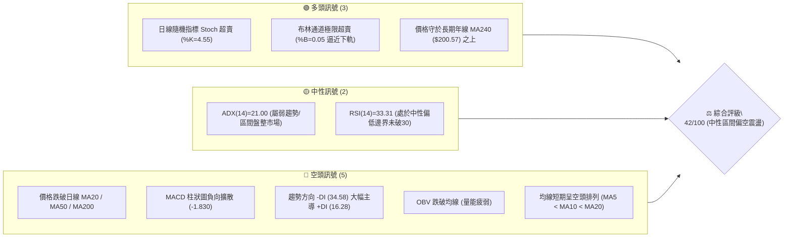

---

### 📊 核心指標速覽表

| 指標類別 | 指標名稱 | 當前數值 | 訊號 | 專業解讀 |
|----------|----------|----------|------|----------|
| **價格結構** | 當前收盤價 | $202.06 | 🟡 | 位於 52 週高低區間 48.0% 位置，自高點回調近半 |
| **短期均線** | MA20 | $219.62 | 🔴 | 價格低於 MA20 達 -7.99%，短期受制於下行月線壓力 |
| **中期均線** | MA50 | $221.44 | 🔴 | 價格顯著受壓於季線之下，中期多頭架構遭到破壞 |
| **長期均線** | MA200 | $204.17 | 🔴 | 價格失守 200 日牛熊分界線 (-1.03%)，進入關鍵防守期 |
| **超長均線** | MA240 | $200.57 | 🟢 | 價格仍維持在 240 日年線上方 (+0.74%)，長期基底未失 |
| **震盪動能** | RSI(14) | 33.31 | 🟡 | 逼近 30 超賣門檻，空頭動能衰竭但尚未正式翻多 |
| **趨勢指標** | MACD (12,26,9) | -4.449 / -2.619 | 🔴 | DIF 位於信號線下方，柱狀圖 -1.830，維持空頭主導 |
| **擺動指標** | Stoch %K / %D | 4.55 / 12.20 | 🟢 | 雙線低於 20 深度超賣區，形成短線潛在鈍化或底背離醞釀 |
| **通道指標** | 布林通道 %B | 0.05 | 🟢 | 股價逼近布林下軌 $199.98，短線下行空間受統計邊界壓制 |
| **趨勢強度** | ADX (14) | 21.00 | 🟡 | ADX < 25 表明非強烈單邊趨勢，行情轉入區間寬幅震盪 |
| **市場波動** | ATR(14) | $6.37 | 🟡 | 日波動率為 3.15%，提供足夠的日內與跨日擺動空間 |
| **成交量能** | 20日量比 | 1.18x | 🔴 | 近日下殺伴隨量能略微放大，OBV 處於均線下方偏弱 |

---

### 🏆 技術評分卡

評分機制涵蓋六大客觀技術維度，滿分各為 100 分。依據嚴格規則 18，**綜合評分 = 六項子評分之算術平均數**：
$$(35 + 32 + 68 + 42 + 48 + 27) \div 6 = 42.0 \rightarrow \mathbf{42 / 100}$$

```
╔══════════════════════════════════════════════════════════════════╗
║                技術評分卡 — NVDA (2026-11-03)                    ║
╠══════════════════════════════════════════════════════════════════╣
║ 趨勢強度 (Trend)     ███████░░░░░░░░░░░░░  35/100  🔴 空頭壓制   ║
║ 動能指標 (Momentum)  ██████░░░░░░░░░░░░░░  32/100  🔴 負向主導   ║
║ 支撐穩定度 (Support) █████████████░░░░░░░  68/100  🟢 聚類強韌   ║
║ 成交量配合 (Volume)  ████████░░░░░░░░░░░░  42/100  🟡 量價背離   ║
║ 形態完整度 (Pattern) ██████████░░░░░░░░░░  48/100  🟡 通道下緣   ║
║ 均線排列 (MA Align)  █████░░░░░░░░░░░░░░░  27/100  🔴 混合偏空   ║
╠══════════════════════════════════════════════════════════════════╣
║ 綜合評分             ████████░░░░░░░░░░░░  42/100  🟡 中性區間   ║
╚══════════════════════════════════════════════════════════════════╝
```

---

## 2. 趨勢分析

### 🌐 多時框趨勢分析

分析多時框架走勢，月線長線多頭基礎仍存，週線處於由高點 $243.37 回落的次級回撤波，日線則跌破 MA200 形成短期弱勢震盪。多時框架呈現「長多、中偏空、短超賣」的收斂分歧態勢。

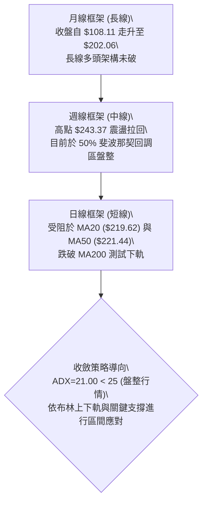

---

### 📈 長期趨勢 — 12個月走勢圖（Unicode）

NVDA 過去 12 個月（2025-11 至 2026-11）經歷了顯著的階梯式推升，自 $170–$190 區間盤整後，於 2026 年夏季強勢突破 $220，並於 2026-09 創下月線最高收盤價 $228.38（其間歷史高點為 2026-10-09 週線所創之 $243.37），隨後兩月進入獲利了結回調。

```
NVDA 月線走勢圖（過去12個月：2025-11 至 2026-11）
價格 ($)
$230 ┤                                      ● $228.38 (2026-09)
$220 ┤                                ●
$210 ┤                        ●
$200 ┤                                            ● $204.64  ● $202.06 (現價)
$190 ┤                ●
$180 ┤        ●               ●
$170 ┤●               ●
     └────────────────────────────────────────────────────────────
      11  12  01  02  03  04  05  06  07  08  09  10  11 (月份)
      25  25  26  26  26  26  26  26  26  26  26  26  26 (年份)
```

#### 走勢特徵分析表格

| 階段區間 | 起訖月份 | 起點收盤 | 終點收盤 | 區間漲跌幅 | 主要走勢特徵解讀 |
|----------|----------|----------|----------|------------|------------------|
| **第 1 階段** | 2025-11 ~ 2026-03 | $176.58 | $174.00 | -1.46% | 底部構築震盪期，於 $174–$190 區間形成堅實籌碼換手區 |
| **第 2 階段** | 2026-03 ~ 2026-05 | $174.00 | $210.66 | +21.07% | 主升段發動，連續突破 $190 與 $200 整數心理關卡 |
| **第 3 階段** | 2026-05 ~ 2026-07 | $210.66 | $200.53 | -4.81% | 平台整理洗盤，回測 $200 獲得強烈支撐 |
| **第 4 階段** | 2026-07 ~ 2026-09 | $200.53 | $228.38 | +13.89% | 第二波推升，創下月線收盤紀錄，動能達到高峰 |
| **第 5 階段** | 2026-09 ~ 2026-11 | $228.38 | $202.06 | -11.52% | 頂部回檔整理，價格重回 $200–$204 關鍵支撐平台驗證 |

---

### 📊 中期趨勢（週線分析）

中期走勢以 2026-10-09 當週高點 **$243.37** 為波段高點。隨後四週連續收黑（$229.28 $\rightarrow$ $214.13 $\rightarrow$ $210.96 $\rightarrow$ $204.64 $\rightarrow$ $202.06），週線 MACD 柱狀圖自高點 +0.822 快速翻負至 -1.830，週線 RSI 亦自 63.0 大幅回落至 33.3。

```
中期週線價格波段架構示意：
$243.37 (2026-10-09 波段高點 R3)
   │╲
   │ ╲
   │  ▼ $232.03 (次級反彈高點聚類 R2)
   │     ╲
   │      ▼ $214.75 (阻力密集區 R1 / 38.2% 回調位附近)
   │         ╲
   │          ▼ $204.64 / $202.06 (現價測試 50% 回調位 $203.63)
   │             │
   └─────────────┴──► 核心支撐防線：S1 $198.43 ──► S2 $194.30 (61.8%位)
```

---

### ⚡ 趨勢強度評估（ADX 解讀）

當前日線 ADX(14) 讀數為 **21.00**。依據技術分析量化準則，ADX < 25 明確定義為「無強烈單邊趨勢之盤整行情」。雖然 -DI 達到 34.58，大幅壓制 +DI 的 16.28，顯示空方完全掌握短期節奏，但 ADX 數值未達趨勢啟動門檻（25），預示該回調並非具備持續破位暴跌動能之主跌浪，更偏向寬幅區間震盪下軌的尋底過程。

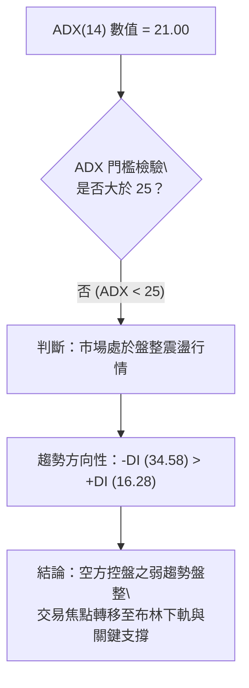

#### ADX 強度量化對照表

| ADX 區間 | 行情屬性特徵 | NVDA 當前狀態 | 對應操作指導原則 |
|----------|--------------|:-------------:|------------------|
| 0 – 20 | 缺乏趨勢，極度鈍化 | 否 | 觀望或超短線高拋低吸 |
| **20 – 25** | **弱趨勢 / 盤整震盪過渡期** | **✓ (21.00)** | **嚴禁追空，關注區間邊界支撐反彈** |
| 25 – 40 | 明確強趨勢展開 | 否 | 順應趨勢方向持倉加碼 |
| 40 – 60 | 極強趨勢，單邊主升/主跌 | 否 | 趨勢末段警惕背離與反轉 |

---

## 3. 圖表形態分析

### 🔍 形態識別系統

根據近一年與近期日K走勢，NVDA 價格結構呈現兩大主要形態特徵：一是自 $243.37 高點展開之「下降矩形/通道回調」，二是當前價格於 $198–$204 區間測試「年線與布林下軌之潛在雙底平台」。

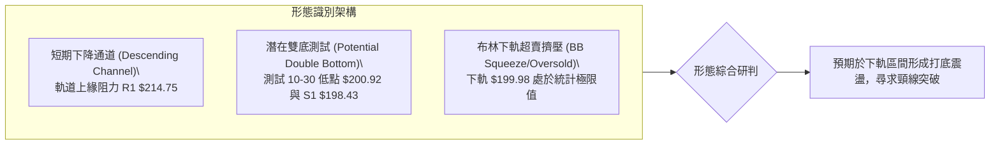

#### 形態識別信心度與量化表

依據嚴格規則 15，各形態之信心度、數據依據與幾何目標價計算如下：

| 形態名稱 | 信心度 | 判斷依據（引用數據） | 完成度 | 目標價（附嚴謹計算式） |
|----------|:------:|----------------------|:------:|------------------------|
| **短期下降回調通道** | 75% | 頂點 $243.37、高點 $219.99 形成下行壓制線；低點 $200.92、$201.66 構成下緣 | 80% | 通道破位/突破測量：若向上突破通道上軌 R1（$214.75），上行目標 = $214.75 + ($214.75 - $198.43) = **$231.07**（接近阻力位 R2 $232.03） |
| **潛在雙底支撐形態** | 52% | 10-30 探低 $200.92，11-02 探低 $201.66，兩次低點均逼近 S1 $198.43 | 40% | 需突破短線頸線 10-27 高點 $219.19（對齊 MA20 $219.62）：形態高度 = $219.19 - $200.92 = $18.27。測量目標 = $219.19 + $18.27 = **$237.46** |
| **布林極限下軌擠壓** | 70% | %B 達到 0.05 極限值，連續 2 根日 K 觸及下軌 $199.98 後留收斂下影線 | 85% | 均值回歸測量目標：回歸布林中軌（MA20），精確目標價為 **$219.62** |

---

### 🕯️ 重要K線形態分析

依據嚴格規則 19，以下完整列出數據中「近 10 根日 K」與「近 8 根週 K」之實際開、高、低、收數據，並進行專業 K 線組合解讀：

#### 近 10 根日 K 形態解讀表

| 日期 | 開 | 高 | 低 | 收 | 成交量 | K線形態 | 專業技術解讀 | 訊號 |
|:----:|:---:|:---:|:---:|:---:|:------:|:-------:|--------------|:----:|
| **2026-10-20** | 215.98 | 218.46 | 212.77 | 216.47 | 79,609,100 | 小陽線 | 探底回升，於 $212 展現初步承接力 | 🟡 |
| **2026-10-21** | 220.96 | 222.19 | 217.66 | 221.97 | 87,085,700 | 中陽線 | 向上跳空挑戰 MA50，形成短線反彈高點 | 🟢 |
| **2026-10-22** | 217.13 | 218.88 | 211.26 | 212.21 | 125,407,600 | 帶量中陰線 | 吞噬前日漲幅，放量跌破反彈支撐，空方發力 | 🔴 |
| **2026-10-23** | 210.99 | 213.85 | 210.18 | 210.96 | 80,189,800 | 紡錘十字線 | 縮量橫盤，多空於 $210 關卡形成短暫僵持 | 🟡 |
| **2026-10-26** | 213.11 | 217.75 | 212.61 | 216.00 | 90,829,300 | 溫和陽線 | 多方反撲，收盤收復開盤價，維持震盪 | 🟢 |
| **2026-10-27** | 218.31 | 219.19 | 215.53 | 217.94 | 84,799,700 | 假陰十字星 | 開高走低，上影線受阻於 $219.19，多頭上攻無力 | 🟡 |
| **2026-10-28** | 219.92 | 219.99 | 214.47 | 215.38 | 93,030,200 | 下跌陰線 | 形成雙頂受阻形態，收盤跌破多根短期均線 | 🔴 |
| **2026-10-29** | 214.36 | 215.33 | 212.08 | 213.66 | 77,568,100 | 弱勢小陰線 | 連續下跌，波動率收縮，醞釀變盤 | 🔴 |
| **2026-10-30** | 208.94 | 209.06 | 200.92 | 204.64 | 168,386,400 | 長下影大陰破位 | 放量下殺測試 $200.92，下影線長達 $3.72，主力護盤 | 🟡 |
| **2026-11-02** | 207.53 | 209.98 | 201.66 | 202.06 | 118,687,200 | 縮量探底假陰線 | 再次探低 $201.66 未破前低，量能自 1.68億縮至 1.18億，空頭動能衰減 | 🟢 |

#### 近 8 根週 K 形態解讀表

| 日期 | 開 | 高 | 低 | 收 | 週成交量 | 週K形態 | 專業技術解讀 | 訊號 |
|:----:|:---:|:---:|:---:|:---:|:--------:|:-------:|--------------|:----:|
| **2026-09-18** | 211.24 | 222.73 | 208.93 | 222.27 | 601,369,200 | 下影大陽線 | 突破 $220 壓力區，多頭趨勢凌厲 | 🟢 |
| **2026-09-25** | 222.94 | 229.98 | 221.09 | 225.07 | 462,517,700 | 續漲陽線 | 穩健墊高低點，買盤持續進駐 | 🟢 |
| **2026-10-02** | 229.75 | 237.88 | 227.03 | 233.95 | 599,330,600 | 突破長陽 | 強勢突破 $230 阻力，動能進入亢奮期 | 🟢 |
| **2026-10-09** | 236.09 | 243.37 | 229.11 | 229.28 | 513,988,800 | 射擊之星 (流星線) | 創歷史新高 $243.37 後遭空頭痛擊，長上影線預示頂部 | 🔴 |
| **2026-10-16** | 228.73 | 228.86 | 212.85 | 214.13 | 521,797,700 | 實體長陰線 | 確認流星線反轉信號，長陰跌破前兩週起漲點 | 🔴 |
| **2026-10-23** | 218.10 | 222.19 | 210.18 | 210.96 | 470,976,900 | 下探中陰線 | 持續尋底，跌破 20 週均線支撐 | 🔴 |
| **2026-10-30** | 213.11 | 219.99 | 200.92 | 204.64 | 514,613,700 | 帶下影長陰線 | 快速刺穿 $205 關卡，下探至 $200.92 引發買盤反彈 | 🟡 |
| **2026-11-02** | 207.53 | 209.98 | 201.66 | 202.06 | 118,687,200 | 單日週初小陰線 | 週初測試前週低點未破，呈現築底特徵 | 🟡 |

---

### 📉 ASCII 走勢形態示意圖

以下展示近期日線自 $222 反彈失敗並在 $200–$202 構築「下影線雙針探底」之幾何結構：

```
NVDA 近期日線形態示意圖（測試布林下軌與支撐區）
價格 ($)
$222 ┤        ┌──┐ (10-21 反彈高點 $222.19)
$218 ┤   ┌──┐ │  │ ┌──┐ ┌──┐ (10-27 阻力 $219.19)
$214 ┤   │  │ │  │ │  │ │  │ ┌──┐
$210 ┤   │  │ └──┘ │  │ └──┘ │  │
$206 ┤   │  │      └──┘      │  │ ┌──┐
$202 ┤   └──┘                └──┘ │  │ ◄ 現價 $202.06
$198 ┤         ●(10-30: $200.92)  └──┘
$194 ┤         │ (下影線長針)       ●(11-02: $201.66 雙針支撐)
     └──────────────────────────────────────────────
        10-20  10-22  10-26  10-28  10-30  11-02
```

---

### 🎯 形態目標價計算

基於嚴格客觀計算規則，形態突破測量目標價完全取決於關鍵節點差值：

1. **區間震盪反彈目標（均值回歸）**：
   * 形態定義：布林通道下軌極限超賣回歸。
   * 計算公式：$\text{目標價} = \text{布林中軌 (MA20)} = \mathbf{\$219.62}$。
   * 次級目標：若突破 MA20，則挑戰阻力區 R1 = $\mathbf{\$214.75}$ 與季線 MA50 = $\mathbf{\$221.44}$。

2. **雙針探底形態向上測算**：
   * 頸線位置：10-27 波段高點 $219.19。
   * 底部支撐：10-30 低點 $200.92。
   * 形態高度：$H = \$219.19 - \$200.92 = \$18.27$。
   * 理論突破目標價：$\text{頸線} + H = \$219.19 + \$18.27 = \mathbf{\$237.46}$（介於 R2 $232.03 與 R3 $243.37 之間）。

---

## 4. 支撐與阻力

### 🗺️ 關鍵價位分布圖（Unicode）

本圖表完全採用數據中由 OHLCV 聚類計算得出之關鍵價位、斐波那契回調位與均線位置進行映射：

```
NVDA 價位結構分布圖
═══════════════════════════════════════════════════════════════════
$243.37 ║████████████████████████████████║ 強阻力 R3 / 52W 最高點 (0.0%)
$239.25 ║▓▓▓▓▓▓▓▓▓▓▓▓▓▓▓▓▓▓▓▓▓▓▓▓▓▓▓▓    ║ 布林通道上軌
$232.03 ║████████████████████████        ║ 重要阻力 R2 (波段高點聚類)
$224.61 ║░░░░░░░░░░░░░░░░░░░░            ║ 斐波那契 23.6% 回調位
$221.44 ║▓▓▓▓▓▓▓▓▓▓▓▓▓▓▓▓                ║ 季線 MA50 / MA60 ($221.21)
$219.62 ║▓▓▓▓▓▓▓▓▓▓▓▓                    ║ 月線 MA20 / 布林通道中軌
$214.75 ║████████████████████████████    ║ 關鍵阻力 R1 (高點聚類 / MA120 $214.79)
$213.01 ║░░░░░░░░░░░░░░░░                ║ 斐波那契 38.2% 回調位
$204.17 ║▓▓▓▓▓▓▓▓                        ║ 半年線 MA200 (牛熊分水嶺)
$203.63 ║░░░░░░░░░░░░░░░░░░░░░░░░        ║ 斐波那契 50.0% 回調位
$202.06 ╠════════════════════════════════╣ ◄ 當前收盤價位 ($202.06)
$200.57 ║▓▓▓▓▓▓▓▓▓▓▓▓▓▓▓▓▓▓▓▓▓▓▓▓▓▓▓▓    ║ 年線 MA240 (長期基底強支撐)
$199.98 ║▓▓▓▓▓▓▓▓▓▓▓▓▓▓▓▓▓▓▓▓▓▓▓▓▓▓▓▓    ║ 布林通道下軌 (統計支撐邊界)
$198.43 ║████████████████████████████    ║ 核心支撐 S1 (波段低點聚類)
$194.30 ║████████████████████████████████║ 強支撐 S2 (波段低點 / 斐波 61.8% $194.25)
$189.69 ║████████████████████████        ║ 極限支撐 S3 (波段低點聚類)
═══════════════════════════════════════════════════════════════════
```

---

### 🚧 阻力位分析表

依據數據庫精確波段高點聚類計算，阻力價位與突破難度評估如下：

| 阻力級別 | 精確價位 | 距現價幅標 | 形成原因與籌碼技術面背景 | 突破難度 | 重要性 |
|:--------:|:--------:|:----------:|--------------------------|:--------:|:------:|
| **R1** | **$214.75** | +6.28% | 近一年密集高點聚類；重合 MA120（$214.79）與斐波那契 38.2%（$213.01） | 中等 | ★★★★☆ |
| **R2** | **$232.03** | +14.83% | 10 月初次級頭部頸線；大量籌碼套牢區，反彈解套賣壓沉重 | 較高 | ★★★★☆ |
| **R3** | **$243.37** | +20.44% | 52 週歷史歷史天花板（2026-10-09 週線高點），多頭終極目標 | 極高 | ★★★★★ |

---

### 🛡️ 支撐位分析表

支撐價位完全源自數據庫波段低點聚類計算，嚴禁臆測：

| 支撐級別 | 精確價位 | 距現價幅標 | 形成原因與籌碼技術面背景 | 守住機率 | 重要性 |
|:--------:|:--------:|:----------:|--------------------------|:--------:|:------:|
| **S1** | **$198.43** | -1.80% | 近一年波段低點聚類；與布林下軌（$199.98）及年線 MA240（$200.57）構成共振防線 | 65% | ★★★★☆ |
| **S2** | **$194.30** | -3.84% | 強力低點聚類；精準共振斐波那契黃金分割 61.8%（$194.25），為中期多頭防守命脈 | 80% | ★★★★★ |
| **S3** | **$189.69** | -6.12% | 深度回調支撐；若 S2 跌破後之最後波段多頭防波堤，接近 2026 年初起漲平台 | 90% | ★★★☆☆ |

---

### 📐 斐波那契回調位分析

本斐波那契回調序列嚴格以 52 週完整波動區間（最低點 **$163.90** 至最高點 **$243.37**，總波幅 $79.47）進行幾何分割計算：

$$0.0\% = \$243.37 \quad (\text{52W High})$$
$$23.6\% = \$243.37 - (0.236 \times \$79.47) = \mathbf{\$224.61}$$
$$38.2\% = \$243.37 - (0.382 \times \$79.47) = \mathbf{\$213.01}$$
$$50.0\% = \$243.37 - (0.500 \times \$79.47) = \mathbf{\$203.63} \quad \mathbf{\blacktriangleleft\ 現價 (\$202.06) 緊貼此處}$$
$$61.8\% = \$243.37 - (0.618 \times \$79.47) = \mathbf{\$194.25} \quad (\text{高度共振 S2 } \$194.30)$$
$$78.6\% = \$243.37 - (0.786 \times \$79.47) = \mathbf{\$180.90}$$
$$100.0\% = \$163.90 \quad (\text{52W Low})$$

*   **當前位置解讀**：現價 **$202.06** 剛好刺穿 50.0% 中軸回調位（$203.63），目前正處於 **50.0%（$203.63）** 與 **61.8%（$194.25）** 之黃金防守緩衝區間內。在經典技術分析中，50%–61.8% 區域為強勢上升趨勢中最關鍵的「次級折返支撐帶」，若能在此區域成功收斂，將保留重啟中長期多頭的主導權。

---

## 5. 技術指標深度解讀

### 🎛️ 指標訊號總覽

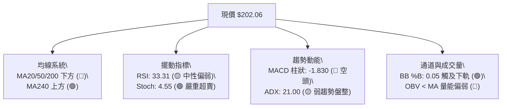

---

### 📈 移動平均線排列分析

當前均線系統呈現「長多短空、均線混合向下發散」特徵。短中期均線（MA5、MA10、MA20、MA60）呈現由上而下的空頭排列，但下方超長期均線 MA240 依然維持向上傾斜，展現長線防護力。

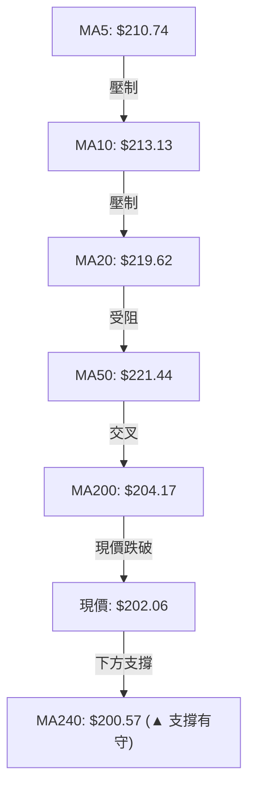

#### 完整均線數據監控表

| 均線名稱 | 當前價格 | 與現價乖離 | 走勢狀態 | 走勢微型圖表 | 技術含義解讀 |
|:--------:|:--------:|:----------:|:--------:|:------------:|--------------|
| **MA 5** | $210.74 | -4.12% | ▼ 下行 | ▄▅▆▇██▇▆▄▂▁ | 超短線下壓劇烈，未站上前短線難有強攻 |
| **MA 10** | $213.13 | -5.19% | ▼ 下行 | ▃▄▆▇████▇▄▂▁ | 短期下降趨勢斜率依然陡峭 |
| **MA 20** | $219.62 | -7.99% | ▼ 下行 | ▁▃▄▅▆▇███▆▃▁ | 月線關鍵反壓，亦為布林中軌，反彈第一反壓 |
| **MA 50** | $221.44 | -8.75% | ▼ 下行 | ▁▂▃▄▅▆▇█████ | 中期生命線，多空分界線已由支撐轉為強阻力 |
| **MA 60** | $221.21 | -8.66% | ▼ 下行 | ▁▂▃▄▅▆▇█████ | 季線下彎，顯示近三個月進場籌碼全面套牢 |
| **MA 120**| $214.79 | -5.92% | ▼ 下行 | ▁▃▄▅▆▇██████ | 半年均線扣抵走平，與 R1（$214.75）重疊阻力 |
| **MA 200**| $204.17 | -1.03% | ▼ 下行 | ▁▂▃▄▅▆▇█████ | 200日牛熊線失守，當前需迅速收復以防技術賣壓 |
| **MA 240**| $200.57 | +0.74% | ▲ 上行 | ▁▂▃▄▅▆▇█████ | **年線上升中，股價仍在其上，為核心多頭火種** |

---

### 📉 RSI(14) 分析

*   **RSI 數值**：**33.31**（Wilder 計算法）
*   **強度視覺化進度條**：
    $$\text{RSI(14) = 33.31} \quad \left[ \blacksquare\blacksquare\blacksquare\blacksquare\blacksquare\blacksquare\square\square\square\square\square\square\square\square\square\square\square\square\square\square \right] \quad 33.3\%$$
*   **超買超賣狀態**：指標已進入 30–35 之「極度弱勢/潛在超賣邊界」。從歷史慣性看，NVDA 的 RSI 跌至 30–33 區間通常伴隨短線反彈或築底。
*   **背離分析**：
    *   頂背離：無（前波高點已結清）。
    *   底背離：**無明顯背離**（比對近 20 根 K 棒首尾價格與 RSI 方向，價格自 $216.47 下挫至 $202.06，RSI 同步自 37.6 回落至 33.31，動能與價格同向，顯示空方動能按常規释放，尚未出現動能提前向上的經典底背離形態）。

---

### 📊 MACD(12,26,9) 訊號解讀

*   **DIF 快速線**：`-4.449`
*   **DEA 慢速信號線**：`-2.619`
*   **MACD 柱狀圖 (Histogram)**：`-1.830`（持續處於零軸下方）

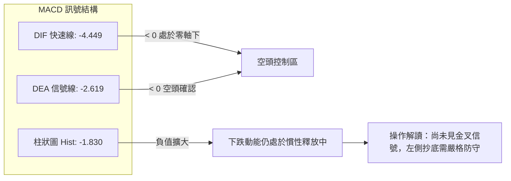

---

### 📦 布林通道分析

當前布林通道（參數 20, 2）各軌道數值精確如下：
*   **上軌**：`$239.25`
*   **中軌 (MA20)**：`$219.62`
*   **下軌**：`$199.98`
*   **當前收盤價**：`$202.06`
*   **布林極限指標 %B**：`0.05`

```
布林通道垂直截面示意圖：
$239.25 ┬────────────────────────────────────────── 布林上軌 (空頭防禦極限)
        │
$219.62 ┼────────────────────────────────────────── 布林中軌 (MA20 生命線 / 反彈強阻力)
        │
$202.06 ┼───► 現價 ($202.06, %B = 0.05，緊壓下軌)
$199.98 ┴────────────────────────────────────────── 布林下軌 (統計支撐底線，隨時引發均值回歸)
```

*   **通道行為分析**：%B 讀數為 **0.05**，代表現價距離下軌僅有 5% 的帶寬距離。統計學上，價格進入下軌與 %B < 0.10 通常意味著非理性恐慌拋售已達極限，下行空間受制於 2 個標準差統計邊界，容易誘發向中軌（$219.62）進行「均值回歸」的修復行情。

---

### 💹 成交量分析（量價配合度）

*   **最新成交量**：`118,687,200 股`
*   **20日均量**：`100,644,640 股`（量比為 **1.18x**）
*   **50日均量**：`115,941,022 股`
*   **OBV 狀態**：`OBV < MA`（能量潮指標低於均線，量能疲弱）

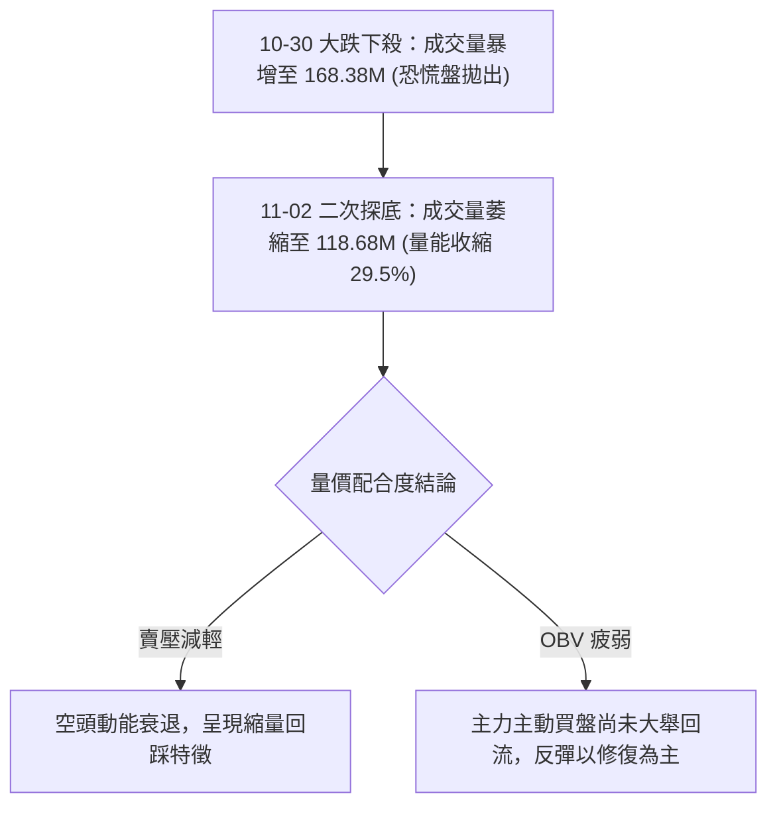

*   **量價深度解讀**：10 月 30 日收出 168.38M 股的近期天量陰線，反映市場在跌破 $205 時引發大量停損賣壓；然而在 11 月 02 日價格再次探測 $201.66 時，成交量明顯降至 118.68M 股，這表明低位「追空意願顯著降低」，浮額籌碼在下軌附近初步獲得承接。

---

## 6. 動能與波動率

### ⚡ 動能評估四象限

評估市場在「動能強度」與「波動率」的相對維度：NVDA 目前動能偏弱（RSI=33.31，MACD=-4.449），而日波動率 ATR(14) 為 $6.37（3.15%），處於中低波動區間，整體座標落在 **象限 2（弱動能 / 中低波動）**。

| 象限 | 動能維度 | 波動維度 | 當前狀態 | 策略應對指引 |
|:---:|:---:|:---:|:---:|---|
| **Q1** | 強動能 (多頭) | 低波動 | — | 最佳趨勢波段持有期 |
| **Q2** | **弱動能 (偏空)** | **中低波動** | **✓ (NVDA 目前定位)** | **謹慎觀望，避免追空，依區間下緣打底分批佈局** |
| **Q3** | 強動能 (單邊) | 高波動 | — | 爆發性破位或飆升行情，適合突破動量策略 |
| **Q4** | 弱動能 (恐慌) | 高波動 | — | 恐慌主跌段，全面離場或嚴格避險 |

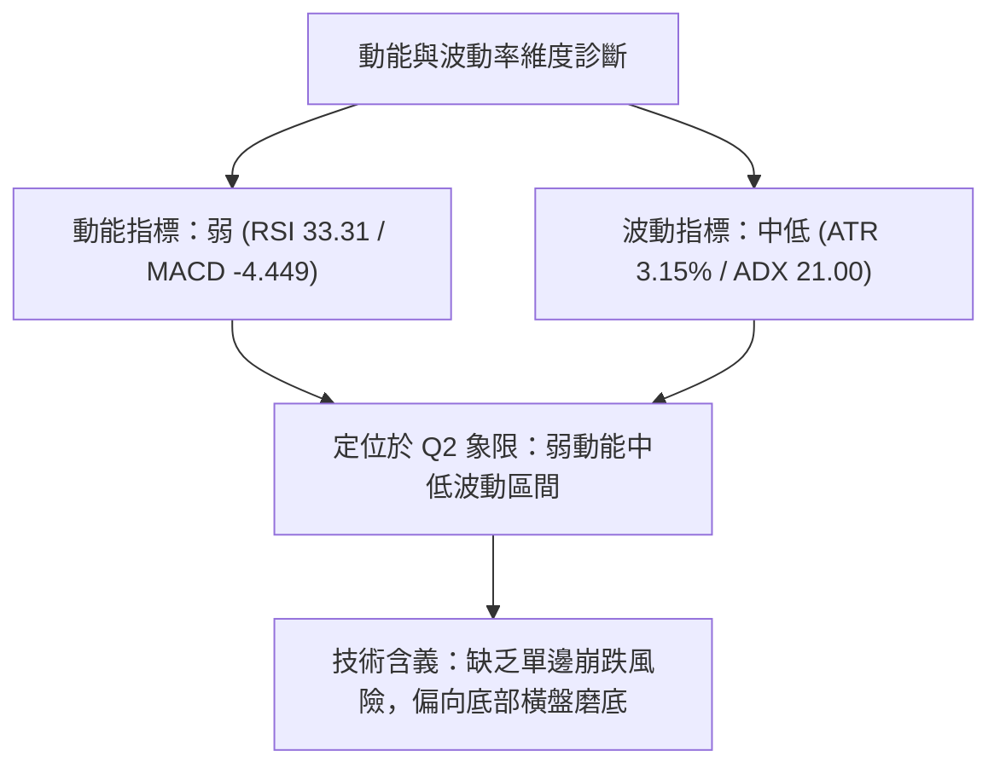

---

### 📊 ATR 波動率分析

*   **ATR(14) 數值**：**$6.37**（佔當前股價之 **3.15%**，Wilder 平滑計算）。
*   **停損與波幅量化意義**：
    *   **日內平均安全緩衝距離**：$1.0 \times \text{ATR} = \mathbf{\$6.37}$。
    *   **波段操作防守停損空間**：建議設定為 $1.5 \times \text{ATR}$ 至 $2.0 \times \text{ATR}$（即 $\$9.55 \sim \$12.74$）。
    *   **下檔支撐驗證**：現價 $202.06 距離強支撐 S2 $194.30 之空間為 $\$7.76$，剛好約等於 $1.22 \times \text{ATR}$，這證明以 S2 作為關鍵多頭停損點完全符合統計波動雜訊過濾需求。

---

### 📐 Beta 與市場相關性

*   **Beta 係數**：**2.247**
*   **市場系統性風險分析**：NVDA 的 Beta 高達 2.247，意味著該股具備極高的市場彈性與進攻性。當標普 500 指數或納斯達克 100 指數變動 1% 時，NVDA 理論上將產生 2.25% 左右的同向波動。在高 Beta 驅動下，一旦大盤在科技股財報或利率預期推動下回暖，NVDA 於下軌支撐區的反彈爆發力將顯著優於大盤。

---

## 7. 多時框架總結

### 📋 時框架評分表

依據前文詳細指標計算，三大時框架之綜合技術表現評估如下：

| 時框架 | 趨勢方向 | 核心動能指標 | 均線排列特徵 | 圖表形態特徵 | 綜合評分 | 操作指導建議 |
|:------:|:--------:|:------------:|:------------:|:------------:|:--------:|:------------:|
| **月線 (長期)** | 🟢 多頭趨勢 | 長線多頭維持 | 位於 MA240 之上 | 24個月大階梯推升中 | **75/100** | 長線多單底倉堅定持有 |
| **週線 (中期)** | 🔴 回調修正 | RSI 33.3 / MACD翻負 | 跌破 20 週線 | 流星線頂部回落 | **38/100** | 暫停追高，等待次級波企穩 |
| **日線 (短期)** | 🟡 盤整磨底 | Stoch超賣 / %B=0.05 | MA5-MA20 空頭排列 | 下影線雙針測試 S1/S2 | **42/100** | 依區間下軌高拋低吸防守 |

---

### 🔲 綜合訊號矩陣

| 技術分析維度 | 短期 (日線) 訊號 | 中期 (週線) 訊號 | 長期 (月線) 訊號 | 多時框一致性解讀 |
|--------------|:----------------:|:----------------:|:----------------:|------------------|
| **均線架構** | 🔴 空頭壓制 | 🟡 中性整理 | 🟢 堅定多頭 | 長多中空，短線尋求長期均線確認 |
| **動能震盪** | 🟢 極度超賣 | 🔴 下行發散 | 🟢 維持中軸上 | 短線隨時醞釀技術性超跌反彈 |
| **量價配合** | 🟡 探底縮量 | 🔴 週線陰量放大 | 🟢 總體沉澱良好 | 籌碼進入最後換手洗盤階段 |
| **形態位置** | 🟢 貼近下軌支撐 | 🟡 回調 50% 處 | 🟢 高位強勢橫盤 | 50% 回調位提供極佳多頭試單賠率 |

---

### ⚖️ 多時框收斂結論

依據本報告**嚴格要求 14（多時框收斂規則）**進行終局定調：
1.  **市場屬性裁定**：日線 ADX(14) = **21.00**（明確定性為 $\text{ADX} < 25$ 之**盤整震盪行情**）。
2.  **交易主軸優先級**：在盤整行情中，單邊趨勢策略失效，**行情收斂至日線布林通道上下軌（$199.98 \sim \$239.25）與關鍵支撐阻力結構（S1 $198.43 至 R1 $214.75）作為主要交易區間**。
3.  **唯一方向性結論**：**中性偏空、區間下軌防守型博弈反彈（Neutral-to-Cautious Long at Extremes）**。短線空方力量雖強但已觸及統計下軌極限，在未跌破 S1/S2 防線前，市場將以區間築底與均值回歸修復為主要演化方向。

---

## 8. 交易策略建議

### 🗺️ 策略決策流程圖

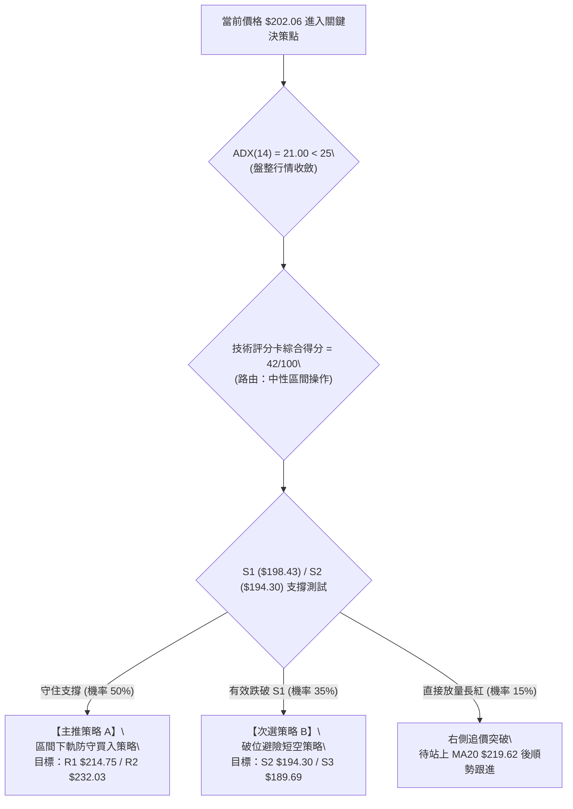

---

### 🧭 策略路由

> **當前主策略方向 = 區間震盪下軌防守型博弈反彈（依評分 42/100，處於 40–60 區間操作路由）**

依據規則 8，綜合評分落在 40–60 區間，禁止單邊兩頭下注。當前價格 $202.06 極度貼近布林下軌（$199.98）與核心支撐 S1（$198.43），核心指導為「**依託下軌強支撐進行高盈虧比多頭博弈，同時以 S1/S2 作為不可逾越之嚴格避險停損**」。

---

### 🎯 價格情境階梯（Price Scenarios）

本階梯所有價位完全引用第 4 章及數據庫計算結果：

| 觸發條件 | 當前狀態 | 第一目標 | 第二目標 | 後續延伸 | 情境技術含義 |
|:--------:|:--------:|:--------:|:--------:|:--------:|--------------|
| **向上突破** | 站穩 $203.63 (50%) | **R1: $214.75** | **R2: $232.03** | **R3: $243.37** | 短線止跌轉強，完成超跌均值回歸修復 |
| **當前現狀** | **收盤價 $202.06** | 布林下軌 $199.98 | 年線 $200.57 | S1: $198.43 | 於 50% 斐波那契回調區進行下軌拉鋸築底 |
| **向下破位** | 跌破 S1: $198.43 | **S2: $194.30** | **S3: $189.69** | 52W低 $163.90 | 中期防線失守，回調深化測試 61.8% 支撐 |

---

### 📊 情境機率分佈

| 情境代號 | 發展情境路徑 | 發生機率 | 主要技術數據支撐依據 |
|:--------:|--------------|:--------:|----------------------|
| **情境 1** | **下軌支撐有守，回升反彈** | **50%** | 布林 %B=0.05 嚴重超賣、Stoch 處於 4.55 極限值、年線 MA240 ($200.57) 與 S1 聚類支撐強勁 |
| **情境 2** | **破位下探，尋求 S2 支撐** | **35%** | MACD 柱狀圖負向擴散 (-1.830)、-DI (34.58) 空方主導、價格失守 MA200 牛熊線 |
| **情境 3** | **強勢 V 型反轉，直衝 R2** | **15%** | 需極端消息面刺激或半導體板塊集體暴拉，技術面目前尚無放量底背離確認 |

---

### 🟢 主策略詳情（方向依評分路由：區間多頭 vs 破位防守）

以下嚴格按照規則 5 與規則 17 定義計算風險報酬比：
*   **風險報酬比公式**：$(\text{目標價 T1} - \text{進場價}) \div (\text{進場價} - \text{止損價})$

| 策略要素項目 | 【主推】策略 A：區間下軌左側防守買入 | 【備用】策略 B：跌破 S1 順勢避險做空 |
|:------------|:--------------------------------------|:--------------------------------------|
| **策略性質** | 左側博弈超跌反彈（區間操作） | 右側破位避險放空（防守操作） |
| **進場條件** | 於現價至布林下軌附近企穩時進場 | 實體日 K 跌破 S1 支撐時確認追空 |
| **進場價格** | **$202.06**（當前現價進場） | **$198.43**（S1 破位進場點） |
| **止損價格** | **$194.30**（強支撐 S2 處止損） | **$203.63**（斐波那契 50% 回調位） |
| **第一目標 (T1)** | **$214.75**（關鍵阻力位 R1） | **$194.30**（強支撐位 S2） |
| **第二目標 (T2)** | **$232.03**（波段阻力位 R2） | **$189.69**（極限支撐位 S3） |
| **風險空間** | $\$202.06 - \$194.30 = \mathbf{\$7.76}$ | $\$203.63 - \$198.43 = \mathbf{\$5.20}$ |
| **獲利空間 (T1)**| $\$214.75 - \$202.06 = \mathbf{\$12.69}$ | $\$198.43 - \$194.30 = \mathbf{\$4.13}$ |
| **獲利空間 (T2)**| $\$232.03 - \$202.06 = \mathbf{\$29.97}$ | $\$198.43 - \$189.69 = \mathbf{\$8.74}$ |
| **風險報酬比** | **1 : 1.64（以 T1 計）**<br>*(12.69 ÷ 7.76)*<br>*(若以 T2 計則為 1 : 3.86)* | **1 : 0.79（以 T1 計）**<br>*(4.13 ÷ 5.20)*<br>*(若以 T2 計則為 1 : 1.68)* |
| **預估勝率** | **55%**（受超賣保護） | **40%**（面臨下軌強支撐干擾） |
| **建議配置倉位** | **15% – 20%**（輕倉分批佈局） | **5% – 10%**（嚴格避險短線倉） |

---

### 🔴 反向風險觸發點（對沖提示）

若主推之多頭策略 A 遭遇以下技術異動，必須立即觸發停損或反手對沖：
1.  **關鍵破位點**：若任何日線收盤價**實體跌破 $198.43 (S1)**，即代表布林通道下軌遭到空頭帶量打穿，下軌失守將引發追跌賣壓，需無條件止損多單。
2.  **動能破位點**：若日線 RSI 跌破 30 並持續鈍化至 25 以下，且 -DI 突破 40，表示空頭單邊主跌浪成形，原區間盤整假設失效。

---

### ⭐ 整體訊號強度評星

```
做多訊號強度：★★☆☆☆  (2.5/5星 — 處於超賣邊界，具賠率優勢但缺乏左側右側確認信號)
做空訊號強度：★★☆☆☆  (2.0/5星 — 空方雖控盤，但極度貼近下軌支撐，盈虧比不佳)
整體可信度：  ★★★★☆  (4.0/5星 — 價位聚類與布林通道邊界清晰，具備極高統計參考性)
```

---

## 9. 風險提示與監控

### ✅ 關鍵監控指標 Checklist

```
╔══════════════════════════════════════════════════════════════════╗
║               NVDA 技術面關鍵監控清單 (Checklist)                 ║
╠══════════════════════════════════════════════════════════════════╣
║ [ ] 價位防守：收盤價是否嚴格守穩 S1 ($198.43) 與年線 ($200.57)   ║
║ [ ] 動能修復：RSI(14) 能否自 33.31 重新站回 40.00 之上          ║
║ [ ] 擺動金叉：Stoch %K 是否自 4.55 向上穿越 %D (12.20) 完成金叉  ║
║ [ ] 均線挑戰：反彈能否放量收復 MA200 ($204.17) 牛熊線            ║
║ [ ] 趨勢轉向：MACD 負柱狀圖 (-1.830) 是否出現實質收縮 (拐點出現) ║
║ [ ] 量能驗證：反彈日成交量是否有效超越 20日均量 (1.00億股以上)   ║
╚══════════════════════════════════════════════════════════════════╝
```

---

### ⚠️ 風險場景分析

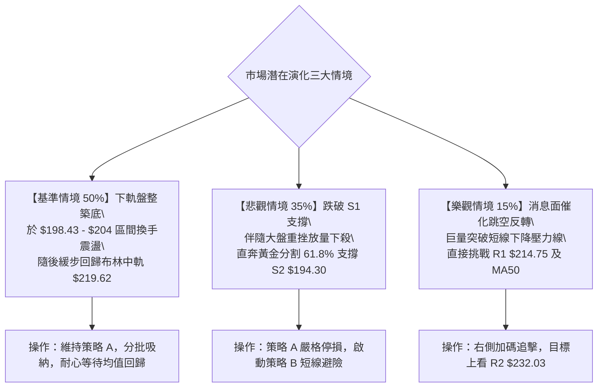

---

### 🛡️ 風險管理重要提醒

1.  **倉位曝險管控原則**：NVDA 的 Beta 值為 **2.247**，ATR 達到 **$6.37**，屬於超高波動科技標的。在 ADX=21.00 的盤整格局下，投資人切忌進行重倉或高槓桿交易。總持倉比例建議嚴格控制在總投資組合資金的 **15% 至 20% 以內**。
2.  **停損執行紀律**：技術交易的本質是概率遊戲。當前價格 $202.06 距離強支撐 S2 $194.30 僅約 $7.76（約 3.84%），此等空間極度適合設定硬性止損。若觸發 S2 停損價位，必須堅決離場，嚴禁抱持「長期投資」心態進行非理性拗單。
3.  **重大事件防範**：需密切留意全球半導體晶片政策變動、雲端巨頭資本支出（Capex）預算指引調整以及美債殖利率波動對高估值高 Beta 科技股之估值修正衝擊。

---

## 📋 報告總結

```
╔══════════════════════════════════════════════════════════════════╗
║                    NVDA 技術分析報告總結                         ║
╠══════════════════════════════════════════════════════════════════╣
║ 報告日期：2026-11-03                                             ║
║ 當前價格：$202.06 USD                                            ║
║ 技術評分：42 / 100                                               ║
║ 分析評級：⚖️ 中性偏空（區間下軌防守震盪，醞釀均值回歸修復）       ║
╠══════════════════════════════════════════════════════════════════╣
║ 關鍵結論：                                                       ║
║ ├─ 長期趨勢：🟢 多頭長青 (年線 MA240 $200.57 仍在上揚支撐)       ║
║ ├─ 中期趨勢：🔴 頂部回撤 (週線自 $243.37 流星線拉回至 50% 處)    ║
║ ├─ 短期趨勢：🟡 弱勢盤整 (ADX=21.00，貼近布林下軌 $199.98 磨底)   ║
║ ├─ 核心支撐：S1: $198.43 ｜ S2: $194.30 (61.8%防守線)           ║
║ ├─ 關鍵阻力：R1: $214.75 ｜ R2: $232.03 ｜ R3: $243.37 (歷史高)  ║
║ └─ 華爾街共識目標價：$328.95 (評級: Strong Buy)                  ║
╠══════════════════════════════════════════════════════════════════╣
║ 最優策略組合導航：                                               ║
║ 1. 🥇 最佳機會（主推策略 A）：現價 $202.06 輕倉博弈下軌反彈，      ║
║    嚴格停損設於 S2 $194.30，第一目標直指 R1 $214.75 (風報比 1:1.64)║
║ 2. 🥈 次選機會（破位策略 B）：若收盤放量跌破 S1 $198.43 順勢避險   ║
║    做空，下看 S2 $194.30 與 S3 $189.69                           ║
║ 3. 🥉 保守選擇：完全空倉觀望，靜待日線 RSI 回升至 40 以上且出現   ║
║    MACD 底背離金叉確認後，再行右側進場。                         ║
╚══════════════════════════════════════════════════════════════════╝
```

---

> ⚠️ **免責聲明**：本報告為依據客觀量化技術指標與圖表形態所生成之技術分析研究，所有數據計算均嚴格基於所提供之歷史價格與量能資訊。本報告**僅供學術研究與投資分析參考**，**不構成任何要約、招攬或具體投資建議**。金融市場瞬息萬變，高 Beta 股票波動劇烈，投資人應獨立評估風險並自行承擔投資盈虧。

---
*報告生成時間：2026-11-03 ｜ 數據來源：Yahoo Finance ｜ 分析框架：多時框技術分析模型*