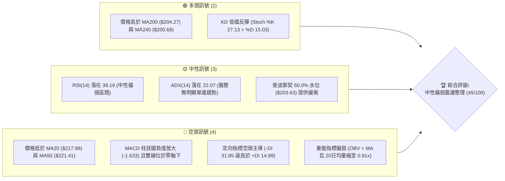
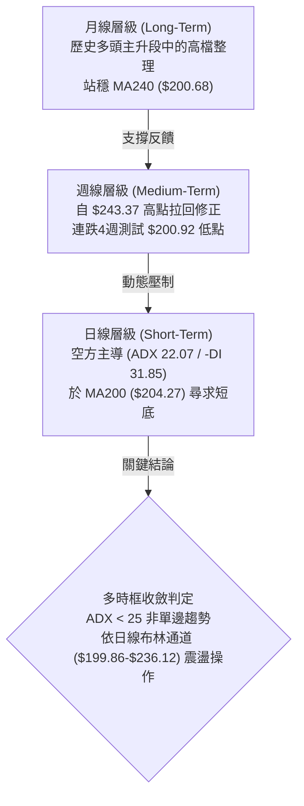
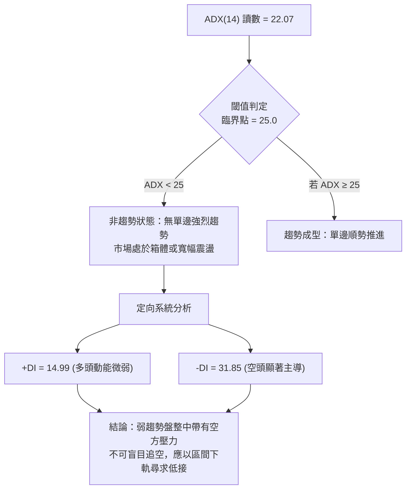
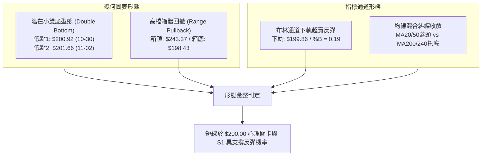
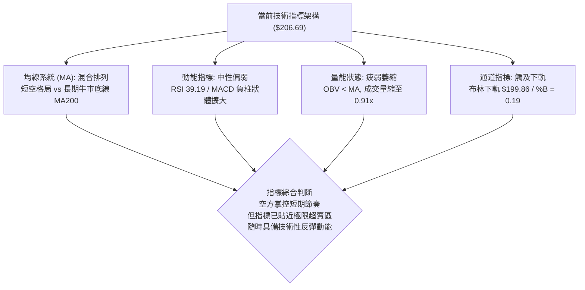
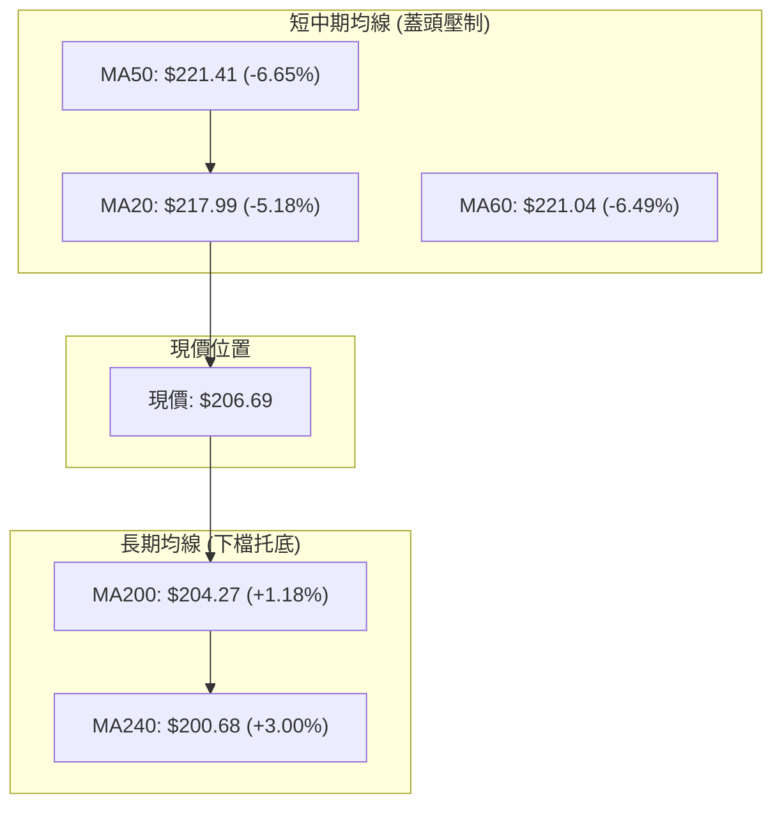
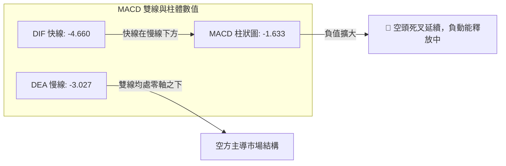
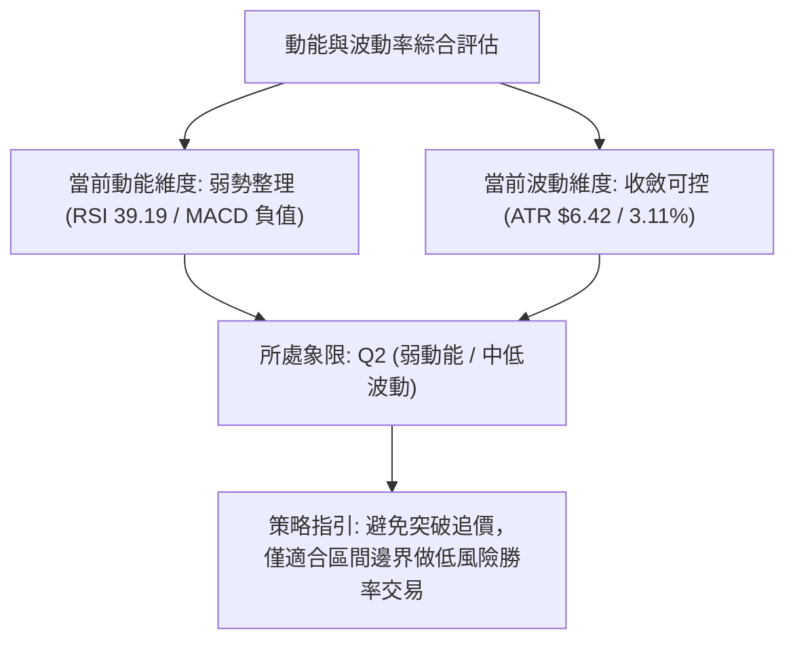
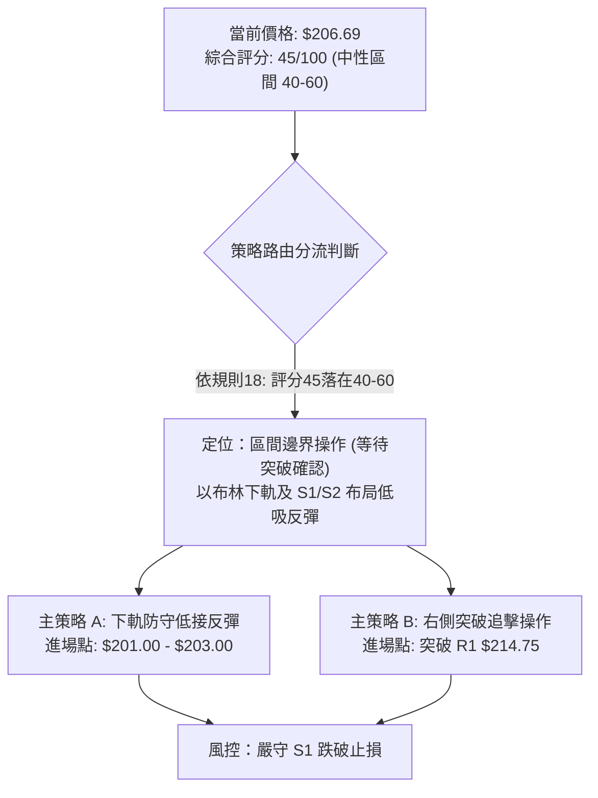
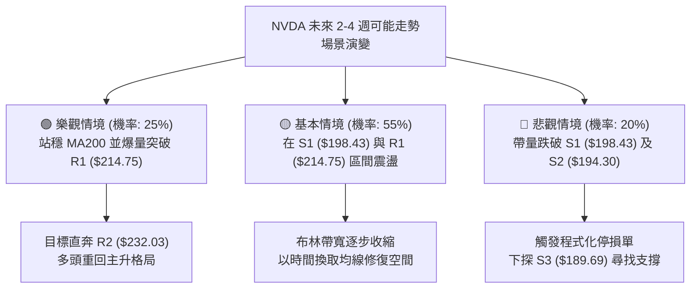

# NVDA 技術分析報告

> **報告日期**：2026-11-04 ｜ **語言**：繁體中文 ｜ **數據來源**：Yahoo Finance ｜ **當前價格**：$206.69

---

## 目錄

| 章節 | 內容 |
|------|------|
| [1. 技術面概覽](#1-技術面概覽) | 訊號儀表板、核心指標、評分卡 |
| [2. 趨勢分析](#2-趨勢分析) | 多時框趨勢、長中短期走勢 |
| [3. 圖表形態分析](#3-圖表形態分析) | 形態識別、K線組合、目標價 |
| [4. 支撐與阻力](#4-支撐與阻力) | 關鍵價位、斐波那契回調 |
| [5. 技術指標深度解讀](#5-技術指標深度解讀) | MA/RSI/MACD/布林/成交量 |
| [6. 動能與波動率](#6-動能與波動率) | 動能評估、ATR、Beta |
| [7. 多時框架總結](#7-多時框架總結) | 時框架評分矩陣 |
| [8. 交易策略建議](#8-交易策略建議) | 多空策略、風險報酬比 |
| [9. 風險提示與監控](#9-風險提示與監控) | 監控指標、風險場景 |

---

## 1. 技術面概覽

### 🎯 技術訊號儀表板



### 📊 核心指標速覽表

| 指標類別 | 指標名稱 | 當前數值 | 訊號 | 解讀 |
|----------|----------|----------|------|------|
| **價格** | 當前收盤價 | $206.69 | 🟡 | 位於52週區間的53.8%，處於中性震盪區間核心位 |
| **均線** | MA20 | $217.99 | 🔴 | 價格低於MA20達-5.18%，短期動能承壓，構成第一動態阻力 |
| **均線** | MA50 | $221.41 | 🔴 | 價格低於MA50，中期多頭架構受損，形成上方中期密集套牢帶 |
| **均線** | MA200 | $204.27 | 🟢 | 價格守在牛熊分界線上方+1.18%，長線多頭底線尚未被擊穿 |
| **動能** | RSI(14) | 39.19 | 🟡 | 位於30-70中性區間但偏向空方控制，尚未觸及超賣極端值 |
| **動能** | MACD | -4.660 / -3.027 | 🔴 | 快慢線均在零軸之下，柱狀圖-1.633呈現負值擴散，空方控盤 |
| **動能** | Stoch %K/%D | 27.13 / 15.03 | 🟢 | 超賣區出現金叉初顯訊號，短線具備跌深技術性反抽動能 |
| **趨勢** | ADX / ±DI | 22.07 / -DI 31.85 | 🔴 | ADX<25屬於非趨勢盤整市場，但-DI大幅壓制+DI，空方具局部優勢 |
| **通道** | 布林帶寬 | $199.86 - $236.12 | 🟡 | %B為0.19，價格貼近下軌，處於通道下半區，進入超賣邊緣 |
| **波動** | ATR(14) | $6.42 | 🟡 | 佔股價3.11%，日內波動性適中，提供合理的止損設置空間 |

### 🏆 技術評分卡

```
╔══════════════════════════════════════════════════════════════════╗
║                   技術評分卡 — NVDA (2026-11-04)                 ║
╠══════════════════════════════════════════════════════════════════╣
║ 趨勢強度 (ADX=22.07, 盤整弱勢)   ████████░░░░░░░░░░░░  40/100 🔴 ║
║ 動能指標 (RSI=39.19, MACD死叉)   ██████░░░░░░░░░░░░░░  30/100 🔴 ║
║ 支撐穩定度 (MA200及S1守衛)      ████████████░░░░░░░░  60/100 🟢 ║
║ 成交量配合 (OBV疲軟, 量比0.91)   ████████░░░░░░░░░░░░  40/100 🔴 ║
║ 形態完整度 (區間回撤與布林收斂)  ██████████░░░░░░░░░░  50/100 🟡 ║
║ 均線排列 (混合排列, 短弱長強)    ██████████░░░░░░░░░░  50/100 🟡 ║
╠══════════════════════════════════════════════════════════════════╣
║ 綜合評分 (六項算術平均四捨五入)   █████████░░░░░░░░░░░  45/100 🟡 ║
║ 評級結論：中性偏弱震盪整理 (Neutral-Bearish Consolidation)       ║
╚══════════════════════════════════════════════════════════════════╝
```
*(計算驗證：(40 + 30 + 60 + 40 + 50 + 50) ÷ 6 = 270 ÷ 6 = 45.0)*

---

## 2. 趨勢分析

### 🌐 多時框趨勢分析



### 📈 長期趨勢 — 12個月走勢圖（Unicode）

```
NVDA 月線走勢圖（過去12個月：2025-12 至 2026-11）
價格軸 ($)
$240 ┤                                           ● 2026-09 ($228.38)
$230 ┤                                      ╭────╯
$220 ┤                                 ● 2026-08 ($220.53)
$210 ┤                            ● 2026-05 ($210.66)      ● 2026-10 ($204.64)
$200 ┤                       ╭────╯    ╰────● 2026-06~07    │
$190 ┤                  ● 2026-04 ($199.11) ($199.87)       └──● 現在 ($206.69)
$180 ┤● 2025-12 ($186.06)    │
$170 ┤   ╰──● 2026-01~03 ────╯
     │      (低點 $174.00)
     └────────────────────────────────────────────────────────────────────────
       12   01   02   03   04   05   06   07   08   09   10   11 (月份)
```

**走勢特徵分析表格**：

| 階段時間 | 區間起訖點 | 期間漲跌幅 | 核心技術特徵與量價架構 |
|----------|------------|------------|------------------------|
| **築底蓄勢期**<br>(2025-12 ~ 2026-03) | $186.06 → $174.00 | -6.48% | 於 $174.00 築出雙底支撐，回踩年線支撐帶，量縮整理完畢。 |
| **主升攻擊波**<br>(2026-03 ~ 2026-05) | $174.00 → $210.66 | +21.07% | 帶量突破 $200 整數關卡，各天期均線呈現多頭多角發散排列。 |
| **高檔強勢整理**<br>(2026-05 ~ 2026-07) | $210.66 → $200.53 | -4.81% | 在 $200 大關上方進行對稱收斂三角整理，籌碼在高檔充分換手。 |
| **突破創高波**<br>(2026-07 ~ 2026-09) | $200.53 → $228.38 | +13.89% | 沿著月線攀升，創下52週歷史高點 $243.37（月收盤高點 $228.38）。 |
| **獲利回吐修正期**<br>(2026-09 ~ 2026-11) | $228.38 → $206.69 | -9.50% | 高檔指標頂背離引發獲利結案，跌破MA20與MA50，目前於MA200回測打底。 |

### 📊 中期趨勢（週線分析）

```
中期壓力與支撐結構示意圖 (週線層級)
════════════════════════════════════════════════════════════════════════
$243.37 ──────────────────────────────────────────────── 52W 歷史最高點 (強阻力 R3)
          │  
$232.03 ──┴───────────────────────────────────────────── 密集套牢整理平台 (波段高點聚類 R2)
             │  
$214.75 ─────┴────────────────────────────────────────── 頸線轉折壓力帶 (波段高點聚類 R1)
                │  
$206.69 ════════╪═══════════════════════════════════════ 當前現價水位 (收盤價)
                   │  
$198.43 ───────────┴──────────────────────────────────── 近一年波段低點聚類 (支撐位 S1)
                      │  
$194.30 ──────────────┴───────────────────────────────── 斐波那契 61.8% / 低點聚類 (支撐位 S2)
                         │  
$189.69 ─────────────────┴────────────────────────────── 波段安全防守線 (支撐位 S3)
════════════════════════════════════════════════════════════════════════
```

從近20週數據觀察，自2026-10-09創下波段高點 $243.37（當週收盤 $229.28）以來，週K線連續4週收黑（$214.13 → $210.96 → $204.64 → $206.69），MACD柱狀圖由正轉負（從 +0.119 急墜至 -2.366，最新報 -1.633），週線 RSI 跌落至 39.2。這代表中期已進入顯著的回檔修正波，但成交量從高點週的 513M 降至目前部分交易日的 210M，呈現量縮拉回，並非恐慌崩跌。

### ⚡ 趨勢強度評估（ADX 解讀）



| ADX 區間 | 趨勢類型 | 市場狀態 | NVDA 當前狀態與操作意涵 |
|----------|----------|----------|-------------------------|
| 00 – 20 | 極度疲弱 | 無方向盤整 | 缺乏波動度，多空膠著 |
| **20 – 25** | **弱趨勢 / 盤整** | **低動能整理** | **NVDA = 22.07**：趨勢動能不連續，趨勢跟隨策略易反覆停損，宜轉向通道震盪策略 |
| 25 – 40 | 強勁趨勢 | 單邊順勢推進 | 單邊行情確立，適合突破跟進 |
| 40 – 60 | 極強趨勢 | 爆發性加速 | 進入單邊衝刺期，注意短線乖離 |
| 60 – 100| 趨勢耗盡 | 超買/超賣反轉 | 行情極度擴張，隨時面臨反轉 |

---

## 3. 圖表形態分析

### 🔍 形態識別系統



**形態信心度評估表**：

| 形態 | 信心度 | 判斷依據（引用數據） | 完成度 | 目標價（附計算式） |
|------|--------|----------------------|--------|--------------------|
| **潛在微型雙底** | 58% | 日K於 2026-10-30 測得低點 $200.92，2026-11-02 測得次低點 $201.66，形成不破底的支撐聚類（貼近 S1: $198.43）。頸線為 2026-10-28 高點 $219.99。 | 45% (尚未突破頸線) | 由雙底高度推算：<br>頸線 $219.99 + ($219.99 - $200.92) = **$239.06**（註：受阻於 R3: $243.37） |
| **高檔箱體破位修正** | 72% | 股價自 52W 高點 $243.37 跌破中軌 MA20 ($217.99) 及 MA50 ($221.41)，直落斐波那契 50.0% 水位 $203.63。 | 85% (已完成大部分回撤) | 測幅滿足點為 S1 **$198.43**（由波段低點聚類計算，與布林下軌 $199.86 重疊） |
| **頭肩頂形態** | 30% | 雖然 10-09 見高點 $243.37，但左肩與右肩缺乏清晰對稱性結構，且成交量並非典型遞減配置。 | 20% (訊號不足) | **訊號不足，僅做指標型解讀**，不強行推算目標價。 |

### 🕯️ 重要K線形態分析

嚴格依據近10根日K與近8根週K的實際 OHLCV 進行解讀：

| 日期（日K/週K） | 開 | 高 | 低 | 收 | K線形態 | 解讀 | 訊號 |
|-----------------|----|----|----|----|---------|------|------|
| **2026-10-22 (日K)** | 217.13 | 218.88 | 211.26 | 212.21 | 大陰線 | 破位放量長黑，開高走低，實體跌破短期均線，確立空方短線主導權。 | 🔴 |
| **2026-10-30 (日K)** | 208.94 | 209.06 | 200.92 | 204.64 | 長下影帶量陰線 | 成交量爆量至 168.38M，盤中急探 $200.92 隨即收腳逾 $3.7，展現 $200 關卡承接盤。 | 🟡 |
| **2026-11-02 (日K)** | 207.53 | 209.98 | 201.66 | 202.06 | 低檔整理陰星 | 回測測底 $201.66 未創新低，量能縮至 119.27M，顯示空方摜壓力道衰竭。 | 🟡 |
| **2026-11-03 (日K)** | 207.96 | 209.14 | 205.93 | 206.69 | 低檔反彈小陽線 | 低點 $205.93 明顯抬高，收盤穩於 $206.69，短線孕育破底翻動能。 | 🟢 |
| **2026-10-09 (週K)** | 236.09 | 243.37 | 229.11 | 229.28 | 倒轉長上影墓碑陰線 | 週線衝擊 52W 高點 $243.37 後遭遇巨量賣壓砸落，留下長達 $14.09 的避雷針上影線。 | 🔴 |
| **2026-10-16 (週K)** | 228.73 | 228.86 | 212.85 | 214.13 | 斷頭空方長陰 | 延續墓碑線殺勢，開盤即最高，實體下殺近 $14.6，確認頂部成立。 | 🔴 |
| **2026-10-30 (週K)** | 213.11 | 219.99 | 200.92 | 204.64 | 長下影錘頭陰線 | 探測 $200.92 低點後回收，週線層級顯現下檔買盤護盤痕跡。 | 🟡 |

### 📉 ASCII 走勢形態示意圖

```
NVDA 近10個交易日打底形態與日K輪廓示意圖
價格 ($)
$222 ┤  ╭─┐
$218 ┤  │ │   ╭─┐ ╭─┐
$214 ┤  │ │ ╭─┤ │ │ │ ╭─┐
$210 ┤  │ └─┤ │ └─┤ │ │ │
$206 ┤  │   │ │   │ │ │ └───────┐ ╭─┐  ● 現價 $206.69
$202 ┤  │   │ │   │ │ │         │ │ │
$198 ┤  │   │ │   │ │ │         └─┤ │  (支撐 S1: $198.43)
     └──┴───┴─┴───┴─┴─┴───────────┴─┴─────────────────
       10/21 10/22 10/27 10/28    10/30 11/03 (日期)
       (高點) (長黑)  (反彈受阻)  (爆量探底$200.92) (次低回升)
```

### 🎯 形態目標價計算

根據日K線於 2026-10-30（低點 $200.92）與 2026-11-02（低點 $201.66）構築的微型打底架構：
1. **頸線位置 (Neckline)**：取這段整理的反彈高點，即 2026-10-28 日K之最高價 **$219.99**（同時逼近 MA20 阻力 $217.99）。
2. **形態高度 (Height)**：頸線 $219.99 − 最低點 $200.92 = **$19.07**。
3. **等幅測量目標價 (Target Price)**：
   $$\text{理論目標價} = \text{頸線} + \text{形態高度} = 219.99 + 19.07 = 239.06$$
4. **與關鍵阻力校準**：此理論推算目標價 $239.06 落在波段高點阻力聚類 R2 ($232.03) 與 R3 ($243.37) 之間。若頸線 $219.99 無法帶量突破，則形態宣告失敗，價格將退守下方支撐 S1 **$198.43**。

---

## 4. 支撐與阻力

### 🗺️ 關鍵價位分布圖（Unicode）

```
NVDA 價位結構分布圖 (由 OHLCV 與關鍵高低點聚類計算)
══════════════════════════════════════════════════════════════════════
$243.37 ║██████████████████████████████║ 強阻力 R3 (52W歷史高點 / 0.0% Fib)
$232.03 ║████████████████████          ║ 中期阻力 R2 (波段高點聚類)
$224.61 ║▒▒▒▒▒▒▒▒▒▒▒▒▒▒▒▒▒▒            ║ 斐波那契 23.6% 回調位
$221.41 ║──────────────────────────────║ MA50 均線蓋頭壓制位
$217.99 ║──────────────────────────────║ MA20 / 布林中軌動態壓力
$214.75 ║████████████████████████      ║ 關鍵短線阻力 R1 (波段高點聚類)
$213.01 ║▒▒▒▒▒▒▒▒▒▒▒▒▒▒▒▒              ║ 斐波那契 38.2% 回調位
╠═══════╬══════════════════════════════╣ ◄ 當前收盤價 $206.69
$204.27 ║──────────────────────────────║ MA200 牛熊分界生命線
$203.63 ║▒▒▒▒▒▒▒▒▒▒▒▒                  ║ 斐波那契 50.0% 平衡分水嶺
$199.86 ║──────────────────────────────║ 布林通道下軌動態支撐
$198.43 ║▓▓▓▓▓▓▓▓▓▓▓▓▓▓▓▓▓▓▓▓▓▓        ║ 關鍵波段支撐 S1 (波段低點聚類)
$194.30 ║████████████████████████      ║ 強支撐 S2 (波段低點聚類)
$194.25 ║▒▒▒▒▒▒▒▒                      ║ 斐波那契 61.8% 黃金回調位
$189.69 ║██████████████████████████████║ 波段安全防線 S3 (波段低點聚類)
══════════════════════════════════════════════════════════════════════
```

### 🚧 阻力位分析表

所有價位嚴格引用自 OHLCV 計算之阻力位數據：

| 阻力級別 | 價位 | 形成原因 | 突破難度 | 重要性 |
|----------|------|----------|----------|--------|
| **R1** | **$214.75** | 近一年波段高點聚類；與斐波那契 38.2% ($213.01) 及 MA120 ($214.63) 形成重疊共振壓力帶。 | 中等 | ★★★★☆<br>短線空轉多轉折門檻，突破方能解除日線破位警報。 |
| **R2** | **$232.03** | 近一年波段高點聚類；9月至10月多次衝高震盪密集成交區，解套賣壓沈重。 | 高 | ★★★★☆<br>中期波段多頭攻防分水嶺，決定是否能重新挑戰新高。 |
| **R3** | **$243.37** | 52週歷史最高點（0.0% 斐波那契頂點）；當週留長上影線天量套牢區。 | 極高 | ★★★★★<br>歷史極限天花板，必須依賴基本面或業績爆發方可克服。 |

### 🛡️ 支撐位分析表

所有價位嚴格引用自 OHLCV 計算之支撐位數據：

| 支撐級別 | 價位 | 形成原因 | 守住機率 | 重要性 |
|----------|------|----------|----------|--------|
| **S1** | **$198.43** | 近一年波段低點聚類；與布林通道下軌 ($199.86) 及心理關卡 $200.00 高度重疊。 | 65% | ★★★★☆<br>短線多頭第一防線，守穩代表微型打底成功。 |
| **S2** | **$194.30** | 近一年波段低點聚類；與斐波那契 61.8% ($194.25) 形成極度關鍵的共振黃金支撐位。 | 80% | ★★★★★<br>中期牛市格局生命線，若跌破意味著此波回檔演變為深幅走熊。 |
| **S3** | **$189.69** | 近一年波段低點聚類；歷史強支撐底座，主力大資金防守核心防線。 | 92% | ★★★★☆<br>長線絕對安全邊際，跌破將引發全面停損拋售。 |

### 📐 斐波那契回調位分析

依據 52 週波段區間（低點 $163.90 至 高點 $243.37，全幅 $79.47）之標準回調數值：

| 回調比率 | 精確價位 | 相對現價 ($206.69) 狀態 | 技術意涵與解讀 |
|----------|----------|--------------------------|----------------|
| **0.0%** | **$243.37** | +17.75% (上方) | 52W 最高點，主升浪頂峰。 |
| **23.6%**| **$224.61** | +8.67% (上方) | 極強多頭回檔極限，目前已跌破轉為強大回抽阻力。 |
| **38.2%**| **$213.01** | +3.06% (上方) | 多頭健康修正位，當前與 R1 ($214.75) 構成反彈初階壓制。 |
| **50.0%**| **$203.63** | -1.48% (下方) | **多空心理平衡分水嶺**：現價 $206.69 剛好懸浮於此水位上方，與 MA200 ($204.27) 形成雙重支撐墊。 |
| **61.8%**| **$194.25** | -6.02% (下方) | **黃金分割防守位**：與 S2 ($194.30) 誤差僅 $0.05，為大級別多頭最後退守底線。 |
| **78.6%**| **$180.90** | -12.48% (下方) | 深度回撤防線，破位宣告牛市徹底終結。 |
| **100.0%**| **$163.90** | -20.70% (下方) | 52W 最低點，宏觀原始起漲點。 |

**位置解讀**：現價 $206.69 處於 **38.2% ($213.01)** 與 **50.0% ($203.63)** 之間。在技術分析定義中，回調跌破 38.2% 說明波段強動能趨緩，進入對稱震盪整理；只要收盤不有效收破 50.0% ($203.63) 及 S1 ($198.43)，整體上升週期的大骨架依然維持完整，此處屬於典型的箱體下沿防守區。

---

## 5. 技術指標深度解讀

### 🎛️ 指標訊號總覽



### 📈 移動平均線排列分析



均線系統呈現標準的**「混合排列（糾纏狀態）」**：
- **短期均線**（MA5 $208.49、MA10 $212.15、MA20 $217.99）全數下彎且位於價格上方，構成層層空頭排列蓋頭壓迫。
- **中期均線**（MA50 $221.41、MA60 $221.04）處於相對高檔，走平逐漸下垂，顯示近兩至三個月進場籌碼已全面套牢。
- **長期均線**（MA200 $204.27、MA240 $200.68）則維持穩定向上揚升趨勢（MA240 走勢為持續上升）。
- **關鍵信號解讀**：現價 $206.69 夾在 MA20 與 MA200 之間，此結構通常被稱為「夾層壓迫」。在短期下壓與長期托底的博弈下，波動度將被迫壓縮，直至向某一方向突破。

### 📉 RSI(14) 分析

```
RSI(14) 動能指示器 (Wilder 算法)
0 ────────── 30 ────── 39.19 ───────── 50 ────────── 70 ────────── 100
[   超賣區   ][  弱勢區  ▲  ][      強勢區      ][   超買區   ]
進度條：███████████████░░░░░░░░░░░░░░░░░░░░░░░░ 39.19%
```

- **數值定位**：RSI(14) 為 **39.19**，已進入 30-40 的空方控制區，但尚未跌破 30 進入極度超賣。
- **背離檢驗**：依據近20根K棒首尾之比對（價格由高檔回落，RSI同步由高檔下降至39.19），**無明顯背離現象**，屬於標準的價格動能同步回撤。
- **週線對照**：近4週週線 RSI 從 63.0 快速回落至 39.2，顯示中期動能全面降溫，洗除前期過熱的槓桿多頭。

### 📊 MACD(12/26/9) 訊號解讀



- **快慢線位置**：MACD (-4.660) 與 Signal (-3.027) 雙雙跌入零軸下方，且快線明顯低於慢線，表明市場中期處於空方防禦態勢。
- **柱狀圖動態**：當前 Hist 為 **-1.633**，負值呈現擴散狀態，表示空頭賣壓尚未出現衰竭拐點，雖然週線層級柱體（-1.482 至 -1.633）有減速跡象，但日線尚未見到黃金交叉翻紅。

### 📦 布林通道分析

```
布林通道 (20, 2) 結構圖
價格 ($)
$236.12 ────────────────────────────────── 上軌 (Upper Band)
          │
$217.99 ──┼─────────────────────────────── 中軌 MA20 (Middle Band)
          │  
$206.69 ══╪═══════════════════════════════ 當前現價 (BB %B = 0.19)
          │  
$199.86 ──┴─────────────────────────────── 下軌 (Lower Band)
```

- **通道寬度**：上軌 $236.12，下軌 $199.86，帶寬達 $36.26。
- **%B 指標分析**：當前 **%B = 0.19**（0 代表下軌，0.5 代表中軌，1.0 代表上軌）。數值低於 0.20 代表股價已進入通道下邊界極度超跌區域，下軌 $199.86 與波段支撐 S1 ($198.43) 形成合力包夾防守，短線在此具備強大的均值回歸吸附力道。

### 💹 成交量分析（量價配合度）

1. **成交量數據速查**：
   - 最新成交量：**90,786,800**
   - 20日均量：**100,128,135** (量比：**0.91x**)
   - 50日均量：**115,064,712**
2. **OBV (能量潮) 趨勢解讀**：
   - 數據明確顯示 **「OBV < MA → 量能疲弱」**。OBV 線目前落於其移動平均線下方，說明在過去一個月的下行走勢中，資金以流出為主，並無主動性大買盤介入。
3. **量價關係**：
   - 2026-10-30 下殺至 $200.92 時放出 168.38M 的近月最大量，隨後在 11-02 縮量至 119.27M，11-03 反彈時成交量縮減至 90.78M。
   - **量價背離分析**：反彈量縮（90.78M < 20日均量 100.12M）顯示目前上漲僅為「空頭回補或無壓抽頭」，而非「主力機構增量進場」。在沒有補量突破 100M-115M 之前，反彈高度將受限於 MA20 ($217.99)。

---

## 6. 動能與波動率

### ⚡ 動能評估四象限

| 象限 | 動能強度 | 波動率水準 | NVDA 當前定位 | 狀態解讀與交易意涵 |
|------|----------|------------|---------------|-------------------|
| **第一象限 (Q1)** | 強動能 (Bullish) | 低波動 (Low Vol) | — | 趨勢穩健推進波，最佳順勢加碼時機。 |
| **第二象限 (Q2)** | **弱動能 (Bearish)** | **低/中波動 (Mid Vol)** | **✓ (當前狀態)** | **ADX=22.07 顯示缺乏趨勢動能，ATR=3.11% 波動平穩收斂，處於下跌後的防守打底期，宜謹慎觀望不盲動。** |
| **第三象限 (Q3)** | 強動能 (Trending) | 高波動 (High Vol) | — | 主升浪或恐慌殺跌，適合日內動能突破策略。 |
| **第四象限 (Q4)** | 弱動能 (Stagnant) | 高波動 (Erratic) | — | 無方向劇烈抽搐，最易造成假突破停損。 |



### 📊 ATR 波動率分析

- **ATR(14) 數值**：**$6.42**（Wilder 計算，佔當前股價之 **3.11%**）。
- **日內波幅解讀**：每日平均波動約 $6.42，顯示股價已脫離 10 月初創天價時的劇烈震盪，進入平緩波動期。
- **止損距離建議**：
  - *短期波段交易*：建議設定 1.0 × ATR = **$6.42** 緩衝空間。
  - *常規波段交易*：建議設定 1.5 × ATR = **$9.63** 緩衝空間，可有效過濾 85% 以上的日內雜訊與誘空影線。

### 📐 Beta 與市場相關性

- **Beta 數值**：**2.247**。
- **市場敏感度分析**：NVDA 的 Beta 高達 2.247，屬於超高彈性標的。當標普 500 指數或納斯達克波動 1% 時，理論上 NVDA 將放大波動約 2.25%。
- **大盤共振防範**：在當前宏觀不確定性（包括美國大選後續反應與半導體監管動態）影響下，高 Beta 特性意味著一旦大盤出現單日劇烈下挫，NVDA 容易因流動性衝擊而下探支撐 S1 ($198.43) 甚至 S2 ($194.30)。

---

## 7. 多時框架總結

### 📋 時框架評分表

| 時框架 | 趨勢方向 | 動能指標 | 均線排列 | 形態結構 | 綜合評分 | 建議 |
|--------|----------|----------|----------|----------|----------|------|
| **月線 (長期)** | 🟢 偏多上升 | 🟡 中性減速 | 🟢 完全多頭排列 (MA240上揚) | 歷史主升段高位回撤 | **68/100** | 核心長線部位逢低分批布局 |
| **週線 (中期)** | 🔴 偏空回調 | 🔴 空方釋放 (MACD柱負) | 🟡 均線高檔鈍化纏繞 | 自天價 $243.37 拉回修正 | **42/100** | 停止追價，等待止跌放量信號 |
| **日線 (短期)** | 🔴 震盪偏空 | 🟡 超賣初露金叉 (KD反彈) | 🔴 空頭壓迫 (價格在MA20/50下)| $200 心理關卡微型打底 | **45/100** | 以布林帶下軌為準區間操作 |

### 🔲 綜合訊號矩陣

```
時框訊號收斂矩陣 (Timeframe Convergence Matrix)
══════════════════════════════════════════════════════════════════════
維度            日線 (短期)       週線 (中期)       月線 (長期)      綜合一致性判定
──────────────────────────────────────────────────────────────────────
趨勢方向        🔴 下跌整理       🔴 波段回調       🟢 長期走多      長多中短空 (分歧)
動能狀態        🟡 超賣初彈       🔴 負向放量       🟡 高檔走平      動能回落未完全落底
均線位置        🔴 MA20/50下方    🔴 跌破MA5週線    🟢 穩居MA200上   長線生命線仍存
成交量能        🔴 量縮反彈       🔴 破位放量       🟢 總體沉澱      量能尚無攻擊特徵
══════════════════════════════════════════════════════════════════════
收斂判斷：ADX(14) = 22.07 < 25 ➜ 確認為「非趨勢性盤整行情」，中長線牛市未死但日線受阻
```

### ⚖️ 多時框收斂結論

嚴格遵守規則 14 進行收斂推導：
1. **趨勢/盤整優先級檢驗**：當前日線 ADX(14) 讀數為 **22.07**，低於 25 臨界線，技術架構**正式定性為「盤整震盪行情」**。
2. **操作核心依據**：在盤整行情中，不可套用強趨勢突破邏輯，必須**以日線布林通道上下軌（下軌 $199.86 至 上軌 $236.12）作為主要交易震盪箱體**。
3. **方向性收斂**：雖然長期月線與 MA200 ($204.27) 提供保護，但短期 MA20 ($217.99) 與 MA50 ($221.41) 壓頂，日線動能仍被空方 (-DI 31.85) 主導。
4. **唯一方向性結論**：**「中性偏弱震盪整理，下檔尋求支撐（Neutral-Bearish Range Consolidation）」**。此判定與第 1 章技術評分卡（45/100）完全吻合，杜絕前後矛盾。

---

## 8. 交易策略建議

### 🗺️ 策略決策流程圖



### 🧭 策略路由（依評分卡分流）

**當前主策略方向 = 中性區間震盪操作（依綜合評分 45/100）**
依規則規定，綜合評分落在 40–60 之間，市場處於平衡過渡期，主策略為圍繞關鍵支撐/阻力之**「區間低吸高拋與突破確認」**，不得在震盪中段追漲殺跌。

### 🎯 價格情境階梯（Price Scenarios）

價位嚴格引用關鍵價位區塊與斐波那契回調數值：

| 觸發條件 | 下一目標 | 後續延伸 | 情境含義 |
|----------|----------|----------|----------|
| **強勢突破 R1 ($214.75)** | **R2 ($232.03)** | **R3 ($243.37)** | 短線空翻多確立，克服中期均線蓋頭，重新挑戰天價。 |
| **站穩現價區間 ($203.63 - $206.69)** | **R1 ($214.75)** | **MA20 ($217.99)** | 區間震盪修復，低檔承接力道顯現，展開均值回歸。 |
| **有效跌破 S1 ($198.43)** | **S2 ($194.30)** | **S3 ($189.69)** | 中期轉弱崩解，破位引發機構避險拋售，考驗黃金分割防線。 |

### 📊 情境機率分佈

| 情境 | 機率 | 主要依據 |
|------|------|----------|
| **區間震盪整理 (箱體運行)** | **55%** | ADX 讀數 22.07 顯示缺乏單邊趨勢，布林通道帶寬收斂，且價格夾於 MA200 與 MA20 之間。 |
| **超跌弱勢反彈 (向上測試)** | **30%** | KD 超賣區黃金交叉，價格逼近布林下軌 (%B=0.19)，具備強烈技術性修復動能。 |
| **破位下行深探 (空頭延伸)** | **15%** | MACD 負柱狀體仍在擴大，-DI (31.85) 高於 +DI，若市場恐慌可能灌破 MA200。 |

### 🟢 主策略詳情（方向依上方路由）

*(註：進場價採用指定區間中點計算風險報酬比，嚴格遵守規則 17)*

| 策略要素 | 策略 A：左側區間低吸 (下軌回測防守) | 策略 B：右側突破確認 (站穩 R1 追擊) |
|----------|-------------------------------------|-------------------------------------|
| **交易邏輯** | 在 MA200 與 S1 上方逢低承接，博取均值回歸中軌 | 突破關鍵高點聚類與斐波 38.2%，右側確立漲勢 |
| **進場條件** | 回踩斐波 50% ($203.63) ~ S1 ($198.43) 區間企穩 | 日K收盤價帶量突破 R1 阻力位 |
| **進場價格** | **$201.00** (落在 $199.00 - $203.00 區間中點) | **$215.50** (確認突破 R1 $214.75 後進場) |
| **目標價 T1** | **$214.75** (阻力位 R1) | **$232.03** (阻力位 R2) |
| **目標價 T2** | **$224.61** (斐波那契 23.6%) | **$243.37** (阻力位 R3 / 52W高點) |
| **止損價格** | **$194.30** (支撐位 S2，跌破宣告打底失敗) | **$206.69** (跌回當前收盤價及MA200下方) |
| **風險報酬比** | **1 : 2.05（以 T1 計）**<br>*(214.75-201.00)/(201.00-194.30) = 13.75/6.70*<br>*(另以 T2 計: 1 : 3.52)* | **1 : 1.88（以 T1 計）**<br>*(232.03-215.50)/(215.50-206.69) = 16.53/8.81*<br>*(另以 T2 計: 1 : 3.16)* |
| **成功機率** | **60%** | **50%** |
| **建議倉位** | **15%** (分批建倉) | **10%** (確認突破後追單) |

### 🔴 反向風險觸發點（對沖提示）

若發生以下任一極端走勢，將徹底推翻上述震盪偏多策略，交易者應即刻啟動避險對沖或全面砍倉：
1. **日K收盤價實體跌破 S1 ($198.43)**：代表微型雙底形態破滅，布林帶向下開口，價格將直線灌向 S2 ($194.30) 及 S3 ($189.69)。
2. **量能爆量殺跌（單日成交量突破 150M 且收長黑）**：若在 $200 附近再度出現空方不計成本倒貨，預示著機構大單離場，多頭不可盲目抄底。

### ⭐ 整體訊號強度評星

```
做多訊號強度：★★☆☆☆  (2.5/5星 — 僅限於支撐位之左側博弈，尚未有右側確認訊號)
做空訊號強度：★★★☆☆  (3.0/5星 — 短期均線蓋頭壓制，但受制於下檔 MA200 托底)
整體可信度：  ★★★★☆  (4.0/5星 — 價位高度收斂於斐波那契與歷史聚類，結構清晰)
```

---

## 9. 風險提示與監控

### ✅ 關鍵監控指標 Checklist

```
╔══════════════════════════════════════════════════════════════════╗
║                   每日交易盤面關鍵監控清單 Checklist             ║
╠══════════════════════════════════════════════════════════════════╣
║ [ ] 價位守衛：收盤是否守穩 50.0% 斐波分水嶺 ($203.63) 與 MA200  ║
║ [ ] 破位預警：盤中是否跌破 S1 ($198.43) 及布林通道下軌 ($199.86)║
║ [ ] 阻力壓迫：向上挑戰 MA20 ($217.99) 是否引發量縮滯漲長上影    ║
║ [ ] 動能翻轉：日線 RSI(14) 能否向上穿越 50.0 多空分界線          ║
║ [ ] 指標共振：MACD 柱狀體能否由負值 (-1.633) 出現明顯收斂翻紅   ║
║ [ ] 量能驗證：反彈日成交量是否放大至 20日均量 (100.12M) 以上     ║
║ [ ] 外圍風險：半導體板塊指數及大盤科技股整體情緒走勢             ║
╚══════════════════════════════════════════════════════════════════╝
```

### ⚠️ 風險場景分析



### 🛡️ 風險管理重要提醒

1. **嚴禁單一倉位過重**：
   - 由於 NVDA Beta 高達 2.247，日內波動高達 $6.42 (ATR 3.11%)，若持有全額槓桿或超額部位，將難以承受正常的技術性洗盤。建議總投資組合對 NVDA 的總曝險不超過 15% - 20%。
2. **止損紀律絕對執行**：
   - 在高檔拉回階段，市場常伴隨突發消息震盪。若依策略 A 於 $201.00 進場，止損價 $194.30 必須嚴格預設條件單；一旦失守，絕不可心存僥倖向下攤平。
3. **重大基本面事件防護**：
   - 密切追蹤全球 AI 基礎設施訂單落地進度與供應鏈交付狀況，避免技術面打底期間遭遇基本面意外變數干擾。

---

## 📋 報告總結

```
╔══════════════════════════════════════════════════════════════════╗
║                    NVDA 技術分析報告總結                          ║
╠══════════════════════════════════════════════════════════════════╣
║ 報告日期：2026-11-04                                             ║
║ 當前價格：$206.69                                                ║
║ 綜合技術評分：45 / 100                                           ║
║ 分析評級：⚖️ 中性偏弱震盪整理 (Neutral-Bearish Range Bound)      ║
╠══════════════════════════════════════════════════════════════════╣
║ 關鍵結論：                                                       ║
║ ├─ 長期趨勢：🟢 偏多上升（穩居 MA200 $204.27 與 MA240 之上）   ║
║ ├─ 中期趨勢：🔴 弱勢回調（自高點 $243.37 拉回，週線連跌四週）   ║
║ ├─ 短期趨勢：🟡 築底震盪（ADX=22.07 盤整，下軌 $199.86 有支撐）║
║ ├─ 關鍵支撐：S1: $198.43 ｜ S2: $194.30 ｜ S3: $189.69         ║
║ ├─ 關鍵阻力：R1: $214.75 ｜ R2: $232.03 ｜ R3: $243.37         ║
║ └─ 斐波分界：50.0% 水位 ($203.63) 為短線多空生命線              ║
╠══════════════════════════════════════════════════════════════════╣
║ 最優策略組合：                                                   ║
║ 1. 🥇 最佳機會：在斐波 50% ($203.63) 至 S1 ($198.43) 區間分批   ║
║                佈局策略 A，停損設於 S2 ($194.30)，風報比 1:2.05 ║
║ 2. 🥈 次選機會：靜待帶量實體紅K突破 R1 ($214.75) 後，順勢進場   ║
║                追擊策略 B，博取往 R2 ($232.03) 延伸空間         ║
║ 3. 🥉 保守選擇：在 ADX < 25 且 MACD 尚未翻紅前保持觀望，等待日線 ║
║                MA20 與 MA50 均線壓力解套後再行建倉               ║
╚══════════════════════════════════════════════════════════════════╝
```

---

> ⚠️ **免責聲明**：本報告為技術分析研究成果，所有技術價位、預測分析及交易策略均基於歷史量價數據（OHLCV）與數理指標模型客觀推導，**僅供研究與學術參考，絕不構成任何形式的要約、招攬或投資買賣建議**。金融市場瞬息萬變，高 Beta 股票具備高度價格波動風險，投資人應獨立審慎評估財務狀況，自負投資盈虧與風險責任。

---

*報告生成時間：2026-11-04 ｜ 數據來源：Yahoo Finance ｜ 分析框架：多時框技術分析模型*