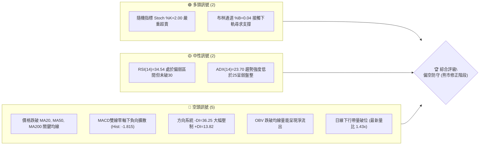
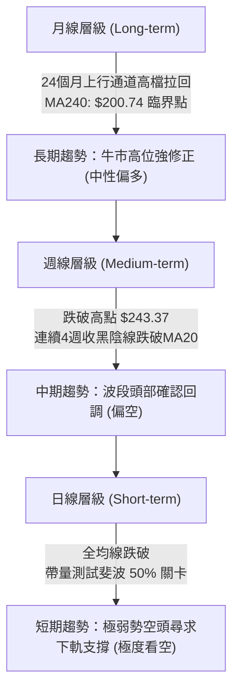
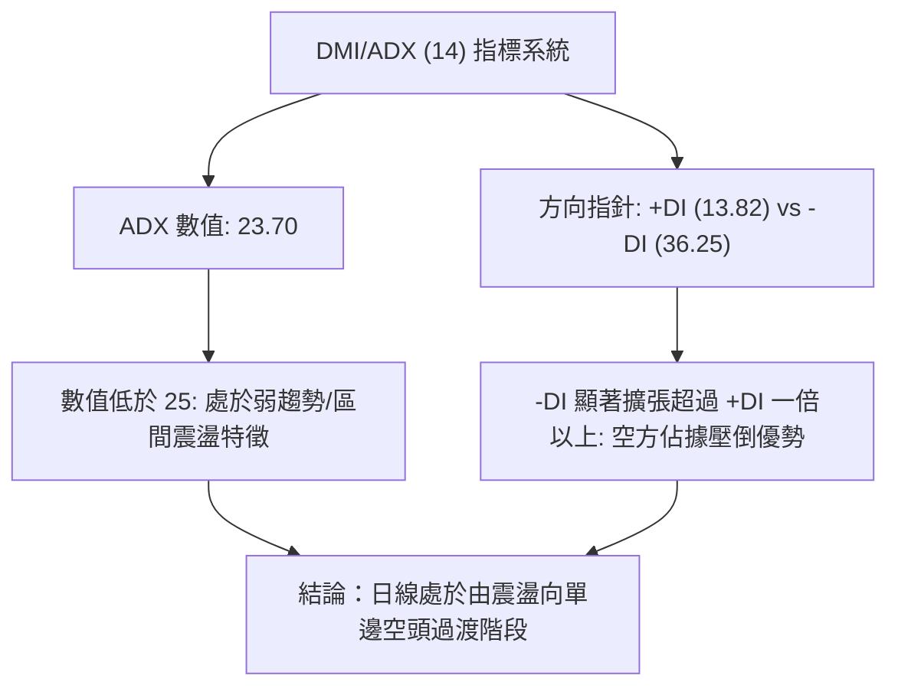
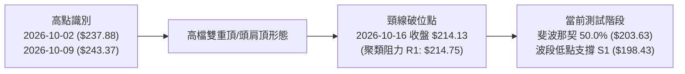
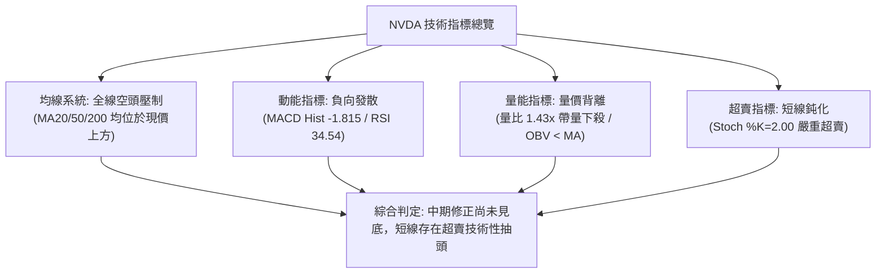
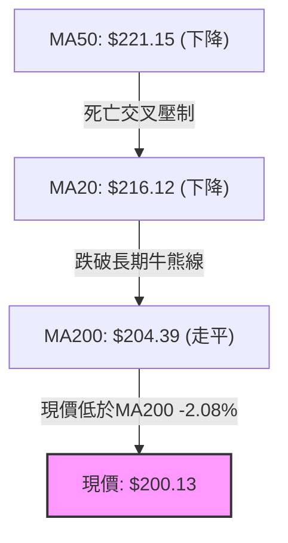
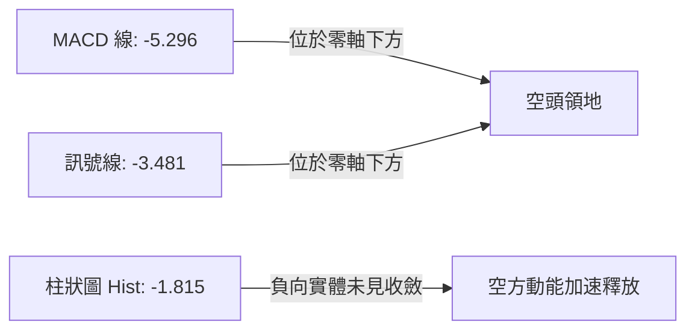
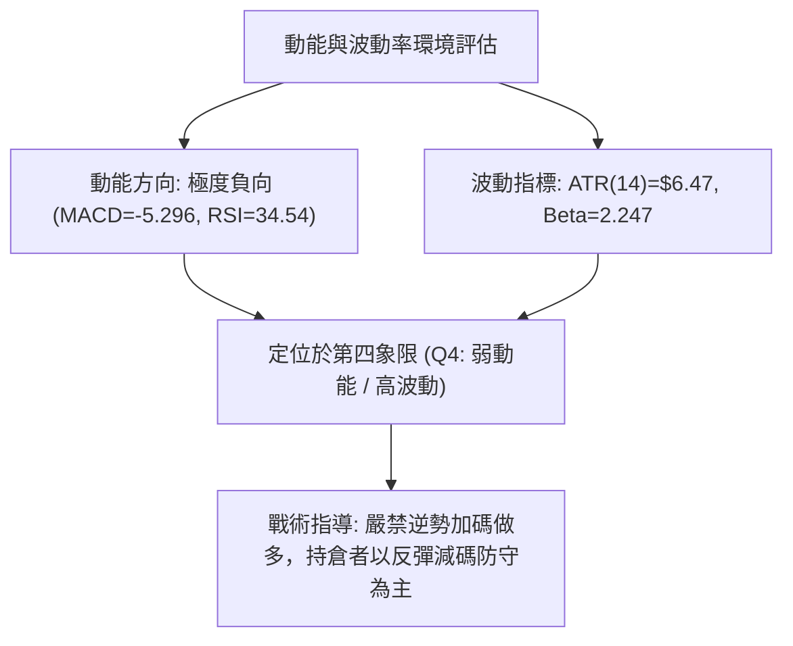
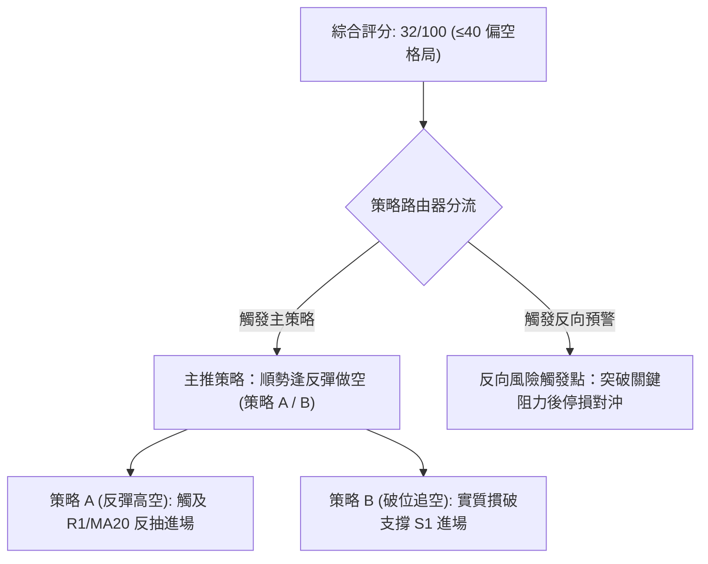
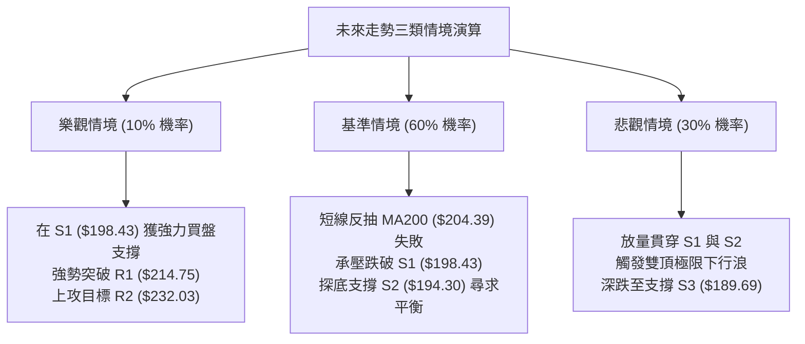

# NVDA 技術分析報告

> **報告日期**：2026-11-05 ｜ **語言**：繁體中文 ｜ **數據來源**：Yahoo Finance ｜ **當前價格**：$200.13

---

## 目錄

| 章節 | 內容 |
|------|------|
| [1. 技術面概覽](#1-技術面概覽) | 訊號儀表板、核心指標、評分卡 |
| [2. 趨勢分析](#2-趨勢分析) | 多時框趨勢、長中短期走勢 |
| [3. 圖表形態分析](#3-圖表形態分析) | 形態識別、K線組合、目標價 |
| [4. 支撐與阻力](#4-支撐與阻力) | 關鍵價位、斐波那契回調 |
| [5. 技術指標深度解讀](#5-技術指標深度解讀) | MA/RSI/MACD/布林/成交量 |
| [6. 動能與波動率](#6-動能與波動率) | 動能評估、ATR、Beta |
| [7. 多時框架總結](#7-多時框架總結) | 時框架評分矩陣 |
| [8. 交易策略建議](#8-交易策略建議) | 多空策略、風險報酬比 |
| [9. 風險提示與監控](#9-風險提示與監控) | 監控指標、風險場景 |

---

## 1. 技術面概覽

### 🎯 技術訊號儀表板



### 📊 核心指標速覽表

| 指標類別 | 指標名稱 | 當前數值 | 訊號 | 解讀 |
|----------|----------|----------|------|------|
| **價格** | 當前價格 | $200.13 | 🔴 | 位於52週高點 $243.37 回落 17.77%，處於52W區間 45.6% |
| **均線** | MA20 | $216.12 | 🔴 | 現價低於短期均線 -7.40%，均線下行形成強大動態壓力 |
| **均線** | MA50 | $221.15 | 🔴 | 現價低於中期生命線 -9.50%，中期多頭架構遭到破壞 |
| **均線** | MA200 | $204.39 | 🔴 | 現價跌破長期牛熊分界線 -2.08%，長期上升趨勢遭受嚴峻考驗 |
| **動能** | RSI(14) | 34.54 | 🟡 | 進入弱勢中性區間，尚未出現典型低於30的極端超賣 |
| **動能** | MACD | -5.296 / -3.481 | 🔴 | 快慢線雙雙在零軸下方運行，柱狀圖 -1.815 顯示空方動能充沛 |
| **動能** | Stoch %K/%D | 2.00 / 11.22 | 🟢 | 極度超賣狀態，短線存在跌深技術性抽頭反彈之技術需求 |
| **趨勢** | ADX / DMI | 23.70 (-DI: 36.25) | 🔴 | ADX<25 屬弱趨勢震盪，但 -DI 壓倒性主導，空方掌握控制權 |
| **通道** | 布林通道 | 下軌 $198.77 (%B 0.04) | 🟡 | 現價緊貼下軌邊界運行，面臨軌道向外擴張之破位邊緣 |
| **量能** | 成交量 / OBV | 148,337,800 (1.43x) | 🔴 | 帶量下跌陰線，OBV 低於均線，機構資金階段性減碼顯著 |
| **波動** | ATR(14) | $6.47 (3.23%) | 🟡 | 波動率處於中等偏高水準，每日波幅提供明確短線風控依據 |

### 🏆 技術評分卡

```
技術評分卡 — NVDA (2026-11-05)
════════════════════════════════════════════════════
趨勢強度      ██████░░░░░░░░░░░░░░  30/100  🔴 空頭佔優 (-DI壓制)
動能指標      ██████░░░░░░░░░░░░░░  30/100  🔴 MACD負向/Stoch超賣
支撐穩定度    ████████░░░░░░░░░░░░  40/100  🟡 臨近S1與布林下軌
成交量配合    ██████░░░░░░░░░░░░░░  30/100  🔴 帶量下殺/量價背離
形態完整度    ████████░░░░░░░░░░░░  40/100  🟡 高檔複合頂部回落
均線排列      ████░░░░░░░░░░░░░░░░  20/100  🔴 全線失守混亂偏空
════════════════════════════════════════════════════
綜合評分      ██████░░░░░░░░░░░░░░  32/100  🔴 空頭修正防守階段
════════════════════════════════════════════════════
（註：綜合評分由六項子指標算術平均得 (30+30+40+30+40+20)/6 = 31.67，四捨五入為 32/100）
```

---

## 2. 趨勢分析

### 🌐 多時框趨勢分析



### 📈 長期趨勢 — 12個月走勢圖（Unicode）

```
NVDA 月線走勢圖（過去12個月：2025-12 至 2026-11）
價格軸 ($)
$230 ┤                                                ● (2026-09 $228.38)
$220 ┤                                        ● (08)
$210 ┤                            ● (05)
$200 ┤                                                ● (10) ─● (現價 $200.13)
$190 ┤● (2025-12 $186.06) ─● (01)         ● (04)  ● (06)  ● (07)
$180 ┤
$170 ┤                 ● (02)  ● (03 $174.00)
     └──────────────────────────────────────────────────────────────────
       12   01   02   03   04   05   06   07   08   09   10   11 (當前)
```

**走勢特徵分析表格**：

| 時間區間 | 起始收盤 | 結束收盤 | 區間漲跌幅 | 主要走勢特徵與結構 |
|----------|----------|----------|------------|--------------------|
| **2025-12 ~ 2026-03** | $186.06 | $174.00 | -6.48% | 震盪探底階段，觸及波段低點 $174.00 後築底企穩 |
| **2026-03 ~ 2026-05** | $174.00 | $210.66 | +21.07% | 強勢主升浪啟動，長陽突破 $200.00 心理大關 |
| **2026-05 ~ 2026-07** | $210.66 | $200.53 | -4.81% | 高檔橫盤蓄勢，在 $200.00 整數關卡反覆確認支撐有效性 |
| **2026-07 ~ 2026-09** | $200.53 | $228.38 | +13.89% | 二次強勢推升浪，刷新歷史新高並於次月觸及 $243.37 頂峰 |
| **2026-09 ~ 2026-11** | $228.38 | $200.13 | -12.37% | 高階獲利了結盤湧現，形成下行反轉，吞噬近三個月漲幅 |

### 📊 中期趨勢（週線分析）

中期走勢圖展示近期形成的頭部阻力帶與當前尋求防守之關鍵位置：

```
中期阻力與支撐分布示意圖
價格 ($)
245 ┤ ── 52W High / R3 ($243.37)  [10-09 當週高點] ──
235 ┤               ●────● 複合雙頂型態頸線阻力區間
232 ┤ ── 阻力位 R2 ($232.03) ──────────────────────
220 ┤                     ▼ 中軌 MA20 ($216.12) / R1 ($214.75)
213 ┤ ── 斐波那契 38.2% ($213.01) ─────────────────
204 ┤ ── MA200 ($204.39) / 斐波 50.0% ($203.63) ────
200 ┤ ◄─────────────【當前收盤價 $200.13】─────────
198 ┤ ── 支撐位 S1 ($198.43) / 布林下軌 ($198.77) ──
194 ┤ ── 支撐位 S2 ($194.30) / 斐波 61.8% ($194.25) ──
189 ┤ ── 支撐位 S3 ($189.69) ──────────────────────
```

週線層級已連收 4 根長黑陰線，自 2026-10-09 當週高點 $243.37 展開急跌，週 RSI 由 63.0 大幅衰退至 34.5，週 MACD 柱狀圖由正轉負（由 +0.119 驟降至 -1.815），確認中期波段見頂回調。

### ⚡ 趨勢強度評估（ADX 解讀）



**ADX 趨勢強度量化對照表**：

| ADX 數值區間 | 趨勢特徵定義 | NVDA 當前狀態 | 交易策略導向 |
|--------------|--------------|---------------|--------------|
| **0 ~ 20** | 弱勢無趨勢 / 泥沼盤整 | 否 | 觀望或高出低進極短線波段 |
| **20 ~ 25** | **趨勢初生 / 弱趨勢轉換期** | **現值 23.70 (符合)** | **警惕空方單邊加速，嚴禁盲目摸底** |
| **25 ~ 50** | 強勁單邊趨勢行情 | 否 | 順勢操作，指標背離前不逆勢 |
| **50 ~ 100** | 極強趨勢 / 超買超賣加速 | 否 | 尋求趨勢衰竭點或反轉訊號 |

---

## 3. 圖表形態分析

### 🔍 形態識別系統



**圖表形態識別與信心度評估表**：

| 形態識別 | 信心度 | 判斷依據（引用數據） | 完成度 | 目標價（附計算式） |
|----------|--------|----------------------|--------|--------------------|
| **高檔雙頂破位 (Double Top)** | **75%** | 兩次波段頂部分別為 2026-10-02 高點 $237.88 與 2026-10-09 高點 $243.37，頸線跌破點為 2026-10-16 週低點 $212.85（收盤 $214.13 確立跌破 R1 $214.75 區域）。 | 85% | 跌破頸線 $214.75 後，量度下行跌幅 = 頸線 $214.75 − (最高點 $243.37 − 頸線 $214.75) = $214.75 − $28.62 = **$186.13**（接近月線歷史支撐密集區）。 |
| **日線下降通道 (Descending Channel)** | **80%** | 近 10 日高點持續下移（$219.99 → $215.33 → $209.98 → $206.79），低點同步下挫（$210.18 → $200.92 → $199.68）。 | 90% | 通道下軌測算對齊支撐位 S2 **$194.30**。 |
| **底部反轉形態 (底背離/雙底)** | **15%** | 訊號不足，僅做指標型解讀。RSI(14)=34.54 無底背離，均線全面空頭壓制，嚴禁主觀臆測雙底。 | 0% | 形態未成立，無量度目標價。 |

### 🕯️ 重要K線形態分析

根據近 10 根日 K 線與近 8 根週 K 線之實際歷史數據（嚴格引用 OHLCV），關鍵 K 線解讀如下：

| 日期（週期） | 開盤價 | 最高價 | 最低價 | 收盤價 | K線形態名稱 | 技術解讀與意涵 | 訊號評級 |
|--------------|--------|--------|--------|--------|-------------|----------------|----------|
| **2026-10-09 (週K)** | $236.09 | $243.37 | $229.11 | $229.28 | **高檔流星長上影陰線** | 創 52 週新高 $243.37 後多頭動能耗盡，長上影線達 $14.09，多空逆轉之起點。 | 🔴 強烈看空 |
| **2026-10-16 (週K)** | $228.73 | $228.86 | $212.85 | $214.13 | **大陰線貫穿破位** | 長陰貫穿跌破 5 週與 10 週均線，吞噬前期平台，週 MACD 柱大幅轉負 (-2.366)。 | 🔴 空頭確認 |
| **2026-10-27 (日K)** | $218.31 | $219.19 | $215.53 | $217.94 | **弱勢反彈小黑紡錘線** | 測試 MA20 ($216.12) 與 R1 ($214.75) 均線壓力，反彈乏力，留下影弱勢整理。 | 🟡 弱勢中性 |
| **2026-10-28 (日K)** | $219.92 | $219.99 | $214.47 | $215.38 | **高檔受阻倒錘頭陰線** | 上攻高點 $219.99 失敗，受阻於阻力區，空方重新奪回主導權。 | 🔴 轉弱回落 |
| **2026-10-30 (日K)** | $208.94 | $209.06 | $200.92 | $204.64 | **帶量跳空大長黑K** | 成交量急劇放大至 168.38M，跌破 $205 支撐，正式摜破 MA200 ($204.39)。 | 🔴 恐慌拋售 |
| **2026-11-03 (日K)** | $207.96 | $209.14 | $205.93 | $206.69 | **窄幅弱勢反抽十字假陽** | 低成交量 (91.94M) 反抽，無法越過前日陰線實體，屬於典型下跌中繼。 | 🟡 誘多中繼 |
| **2026-11-04 (日K)** | $203.50 | $206.79 | $199.68 | $200.13 | **長下影破底陰線** | 盤中摜破 $200 整數關卡下探 $199.68，尾盤收在 $200.13，放量至 148.33M。 | 🔴 探底未止 |

### 📉 ASCII 走勢形態示意圖

```
NVDA 近期日K頭部頸線跌破示意圖
價格 ($)
245 ┤                     ▲ 歷史高點 $243.37 (2026-10-09)
235 ┤               ╭─●─╮      ╭─●─╮ (複合雙頂結構)
225 ┤              ╱     ╲    ╱     ╲
215 ┤ ────────────┼───────●──┼───────●───── 頸線/聚類阻力 R1 ($214.75)
205 ┤             │        ╲╱        │      ▼ 破線大長黑 (10-30)
204 ┤ ────────────┼──────────────────┼───── 長期牛熊線 MA200 ($204.39)
200 ┤             │                  │      ◄ 最新收盤 $200.13 (11-04)
198 ┤ ────────────┴──────────────────┴───── 波段低點支撐 S1 ($198.43)
```

### 🎯 形態目標價計算

根據高檔雙頂形態量度下跌原理：
- **形態高點 ($H$)**：取 2026-10-09 形成之 52 週高點 **$243.37**。
- **頸線支撐 ($N$)**：取波段高點聚類阻力轉換位 **$214.75**（與 10-16 破位週收盤 $214.13 相符）。
- **形態高度 ($\Delta H$)**：$H - N = \$243.37 - \$214.75 = \$28.62$。
- **第一形態目標價 ($T_{D1}$)**：$N - \Delta H = \$214.75 - \$28.62 =$ **$186.13**。
  - 此數值完全符合支撐位 S3 ($189.69) 與 2025-12 月線收盤 ($186.06) 之長期結構密集區。
- **短期通道下軌目標價 ($T_{D0}$)**：直接對齊數據中精確支撐位 S2 **$194.30**（與斐波那契 61.8% 回調位 $194.25 重疊）。

---

## 4. 支撐與阻力

### 🗺️ 關鍵價位分布圖（Unicode）

```
NVDA 價位結構分布圖
═══════════════════════════════════════════════════════════════
$243.37 ║████████████████████████████████████████║ 強阻力 R3 (52W High / 形態頂部)
$232.03 ║██████████████████████████████          ║ 強阻力 R2 (反彈高點聚類)
$221.15 ║████████████████████                    ║ 中期生命線 MA50 壓力位
$214.75 ║████████████████████████████████        ║ 關鍵阻力 R1 (頸線 / 斐波 38.2%)
$204.39 ║██████████████                          ║ 牛熊分界 MA200 / 斐波 50.0%
$200.13 ╠════════════════════════════════════════╣ ◄ 現價收盤 ($200.13)
$198.43 ║▓▓▓▓▓▓▓▓▓▓▓▓▓▓▓▓▓▓▓▓▓▓▓▓▓▓▓▓            ║ 近期支撐 S1 (布林下軌 $198.77)
$194.30 ║████████████████████████████████████    ║ 強支撐 S2 (斐波 61.8% $194.25)
$189.69 ║████████████████████████                ║ 波段防守 S3 (雙頂極限目標)
═══════════════════════════════════════════════════════════════
```

### 🚧 阻力位分析表

所有阻力數值均嚴格引自數據中「關鍵價位（由 OHLCV 計算）」區塊：

| 阻力級別 | 精確價位 | 距現價空間 | 形成技術原因與結構背景 | 突破難度 | 戰略重要性 |
|----------|----------|------------|------------------------|----------|------------|
| **R1** | **$214.75** | +7.30% | 近一年波段高點聚類處、雙頂形態破位頸線、斐波那契 38.2% ($213.01) 密集重疊帶。 | ⭐️⭐️⭐️⭐️ (極高) | 短線強弱分水嶺，未收復前任何反彈均屬弱勢誘多。 |
| **R2** | **$232.03** | +15.94% | 2026-10-02 高點回落後的次高反彈平台、布林通道上軌 ($233.48) 壓制帶。 | ⭐️⭐️⭐️⭐️⭐️ (極難) | 中期多頭反轉確認線，唯有站上方能化解中期修正。 |
| **R3** | **$243.37** | +21.61% | 歷史最高紀錄 (52W High，2026-10-09 形成)，高檔天量套牢密集峰。 | ⭐️⭐️⭐️⭐️⭐️ (天塹) | 長期多頭終極目標位，面臨解套盤壓制。 |

### 🛡️ 支撐位分析表

所有支撐數值均嚴格引自數據中「關鍵價位（由 OHLCV 計算）」區塊：

| 支撐級別 | 精確價位 | 距現價空間 | 形成技術原因與結構背景 | 守住機率 | 戰略重要性 |
|----------|----------|------------|------------------------|----------|------------|
| **S1** | **$198.43** | -0.85% | 近一年波段低點聚類、布林下軌 ($198.77) 及 11-04 日內低點 ($199.68) 共振。 | 45% (偏脆弱) | 短期最後一道防線，失守將引發加速下墜。 |
| **S2** | **$194.30** | -2.92% | 黃金分割 61.8% ($194.25) 關鍵共振點、前期 7 月回調波段低點平台。 | 70% (強支撐) | 中期多頭絕不可失守的生命底線，回調黃金買點。 |
| **S3** | **$189.69** | -5.22% | 近一年次級波段低點聚類，對齊高檔雙頂量度跌幅延伸區間 ($186.13~$189.69)。 | 85% (極強固) | 極度悲觀情境下的波段終極支撐，長線價值買點。 |

### 📐 斐波那契回調位分析

依據 52 週波段低點 $163.90 至 52 週高點 $243.37 測算之黃金分割階梯：

```
斐波那契回調位階梯 (52W Low: $163.90 → 52W High: $243.37)
 0.0%  ── $243.37 (52W 最高點)
 23.6% ── $224.61 (強勢回調支撐轉阻力)
 38.2% ── $213.01 (波段弱勢分水嶺，貼合 R1: $214.75)
 50.0% ── $203.63 (多空均衡中軸，貼合 MA200: $204.39)
────────────────────────────── ◄【當前價格 $200.13】（介於 50.0% 與 61.8% 之間）
 61.8% ── $194.25 (黃金分割極限回調位，高度重合 S2: $194.30)
 78.6% ── $180.90 (深幅回調防線)
100.0% ── $163.90 (52W 最低點)
```

**深層解讀**：
當前收盤價 **$200.13** 已跌破斐波那契 50.0% 回調位 ($203.63)，處於 50.0% 至 61.8% ($194.25) 的弱勢回撤區間。技術分析法則指出，跌破 50% 意味著先前的上漲浪潮遭到超過半數的空方吞噬，走勢不再屬於強勢回調；空方的重力加速度將直接將價格牽引向黃金分割的最終防線 **61.8% ($194.25)** 與 **S2 ($194.30)**。

---

## 5. 技術指標深度解讀

### 🎛️ 指標訊號總覽



### 📈 移動平均線排列分析



**移動平均線完整矩陣**：

| 週期均線 | 當前數值 | 現價差距 ($) | 現價偏離率 (%) | 均線斜率與走勢特徵 |
|----------|----------|--------------|----------------|--------------------|
| **MA5** | $205.44 | -$5.31 | -2.58% | 短線極陡峭下行，形成日線第一道壓制 |
| **MA10** | $209.97 | -$9.84 | -4.69% | 持續向下發散，壓制短期反彈反抽空間 |
| **MA20** | $216.12 | -$15.99 | -7.40% | 短期生命線，作為布林中軌快速下墜中 |
| **MA60** | $220.75 | -$20.62 | -9.34% | 中期趨勢走平轉跌，確立波段頭部壓制 |
| **MA120** | $214.34 | -$14.21 | -6.63% | 半年線失守，長期多頭籌碼轉為套牢 |
| **MA200** | $204.39 | -$4.26 | -2.08% | **長期牛熊分水嶺被跌破，發出長線預警** |
| **MA240** | $200.74 | -$0.61 | -0.30% | 歷史年線支撐，現價正於此線爆發殊死戰 |

當前均線系統呈現空頭主導之混合排列，短期均線由上而下貫穿長期均線，空頭排列特徵鮮明。

### 📉 RSI(14) 分析

```
RSI(14) 當前位置標定
0        20       30  34.54        50               70       80      100
├────────┼────────┼───●────────────┼────────────────┼────────┼────────┤
  極度超賣   超賣區      弱勢區             中軸平衡            超買區   極度超買
[▓▓▓▓▓▓▓▓▓▓▓▓▓░░░░░░░░░░░░░░░░░░░░░░░░░░░░░░░░░░░░░░░░░░░░░░░] 34.54%
```

- **當前數值**：34.54（Wilder 算法計算）。
- **區間評估**：處於 30 至 50 之間的弱勢運行區間。未跌破 30 代表市場尚未陷入全面的恐慌性拋售（Capitulation），顯示賣盤力量仍有進一步釋放的空間。
- **背離分析**：**無明顯背離**。比對近 20 根 K 棒的首尾表現，價格自 2026-10-09 高點持續創出新低，RSI 線亦步亦趨同步刷新低點，兩者同向下行，確認為健康之下跌趨勢，未偵測到任何底背離築底特徵。

### 📊 MACD(12/26/9) 訊號解讀



- **MACD 快線**：-5.296
- **信號線 (Signal)**：-3.481
- **柱狀圖 (Histogram)**：-1.815
- **走勢診斷**：快慢線雙雙在零軸下方運行，且快線與慢線之間負向差離值擴大（Hist: -1.815），顯示空方主導力量未有絲毫衰退跡象。柱狀圖尚未出現縮腳收斂，暗示當前拋壓依然強烈，過早摸底將面臨左側交易之極大下行風險。

### 📦 布林通道分析

```
布林通道 (20, 2) 結構分布示意圖
價格 ($)
$233.48 ┤ ───────────────────────────────────── BB 上軌
$224.80 ┤
$216.12 ┤ ═════════════════════════════════════ BB 中軌 (MA20)
$207.45 ┤
$200.13 ┤ ◄──────── 現價 ($200.13) [靠近下軌邊緣]
$198.77 ┤ ───────────────────────────────────── BB 下軌 (%B = 0.04)
```

- **布林上軌**：$233.48
- **布林中軌 (MA20)**：$216.12
- **布林下軌**：$198.77
- **通道指標 %B**：**0.04**（0 代表下軌，0.5 代表中軌，1 代表上軌）
- **形態特徵**：%B 值僅 0.04，價格緊貼布林下軌滑落，屬於典型的「下軌推動跌勢」（Walking the lower band）。若成交量持續放大且價格跌破下軌 $198.77，將引發布林通道向外張口之波動率擴張破位。

### 💹 成交量分析（量價配合度）

- **最新成交量**：148,337,800
- **20 日均量**：103,514,235（**量比：1.43x**，顯著放量）
- **50 日均量**：115,608,420
- **量價形態**：2026-11-04 在創波段新低 $199.68 的過程中，成交量放量至 1.48 億股，呈現典型的「放量下殺」空頭量增特徵。
- **OBV 趨勢**：數據明確標示「OBV < MA → 量能疲弱」，能量潮指標持續低於其移動平均線，資金外流痕跡清晰，驗證了此輪回調具有機構層級的減碼特徵，非單純的散戶浮額清洗。

---

## 6. 動能與波動率

### ⚡ 動能評估四象限

| 象限代號 | 動能維度 (Momentum) | 波動率維度 (Volatility) | 當前 NVDA 狀態 | 操作環境與風險評估 |
|----------|---------------------|--------------------------|----------------|--------------------|
| **Q1** | 強動能 (Bullish) | 低波動 (Low Vol) | — | 穩定單邊牛市，持股續抱主升浪 |
| **Q2** | 弱動能 (Bearish) | 低波動 (Low Vol) | — | 陰跌橫盤沉悶期，資金效率低下 |
| **Q3** | 強動能 (Bullish) | 高波動 (High Vol) | — | 劇烈震盪多頭，高風險高收益波段 |
| **Q4** | **弱動能 (Bearish)** | **高波動 (High Vol)** | **✓ (當前狀態)** | **空方高波動釋放區，多頭應嚴格防守觀望** |



### 📊 ATR 波動率分析

- **ATR(14) 數值**：**$6.47**
- **價格百分比**：**3.23%**（基於收盤價 $200.13）
- **動態交易波幅指引**：
  - 日常日內正常波動區間為：現價 $\pm$ 1.0 $\times$ ATR = **$193.66 ~ $206.60**。
  - **多頭止損緩衝距離**：在波段低點下預留 1.0 至 1.5 $\times$ ATR（約 $6.47 ~ $9.70），避免被日內噪音洗盤。
  - **空頭止損安全界限**：在進場價上方預留 1.0 $\times$ ATR 之安全邊界。

### 📐 Beta 與市場相關性

- **Beta 係數**：**2.247**（超高波動性股票）
- **大盤敏感度**：NVDA 的價格波動幅度為標普 500 指數的 **2.25 倍**。在當前美國大選後宏觀政經與科技股獲利了結氛圍下，大盤若回撤 1%，NVDA 技術面預期將面臨 2.25% 左右的拋售壓力，具備高度順週期下殺特徵。

---

## 7. 多時框架總結

### 📋 時框架評分表

| 時框架 | 趨勢方向 | 動能狀態 | 均線排列 | 形態特徵 | 綜合評分 | 戰術建議 |
|--------|----------|----------|----------|----------|----------|----------|
| **月線 (長期)** | 🟢 偏多修正 | 🟡 中性回落 | 🟢 MA240上揚 | 歷史高檔長線大箱體震盪 | 60/100 | 長線逢低關注，切忌盲目追高 |
| **週線 (中期)** | 🔴 明顯偏空 | 🔴 柱狀負向擴大 | 🔴 跌破MA20均線 | 複合雙頂頸線跌破 ($214.75) | 35/100 | 波段減碼，等待週線出現縮腳 |
| **日線 (短期)** | 🔴 極度看空 | 🔴 MACD擴散/超賣 | 🔴 空頭排列下挫 | 下降通道下軌推動 | 25/100 | 短線順勢做空，多頭僅限超短線摸底 |

### 🔲 綜合訊號矩陣

```
時框架訊號收斂一致性檢驗
────────────────────────────────────────────────────────────────
時框        均線系統    動能系統    成交量能    形態學      綜合指向
長期 (月)     🟢 多       🟡 中       🟡 中       🟢 多       🟢 偏多
中期 (週)     🔴 空       🔴 空       🔴 空       🔴 空       🔴 偏空
短期 (日)     🔴 空       🔴 空       🔴 空       🔴 空       🔴 偏空
────────────────────────────────────────────────────────────────
一致性結論：中短期完全收斂於「空頭共振」狀態，長期多頭結構正受壓迫。
```

### ⚖️ 多時框收斂結論

依據多時框收斂規則（嚴格要求 14）：
1. **行情屬性判定**：當前日線 ADX(14) 數值為 **23.70 (<25)**，屬於**弱趨勢/區間震盪向單邊過渡之行情**。
2. **主導時框判定**：在 ADX<25 條件下，日內交易應以**日線布林通道上下軌（$198.77 ~ $233.48）**為主要交易區間；然而，中期週線已經明確破位（連收 4 週黑 K 棒），且 -DI=36.25 具壓倒性優勢，因此中長期空方力量強烈制約日線。
3. **唯一方向性結論**：**中短期偏空防守（綜合評分 32/100）**。此結論與第 1 章技術評分卡（32分）及第 8 章之**主推空頭策略（順勢反彈做空）**完全一致。在未帶量收復 R1 ($214.75) 之前，嚴禁建立任何中長期多頭槓桿倉位。

---

## 8. 交易策略建議

### 🗺️ 策略決策流程圖



### 🧭 策略路由（依評分卡分流）

**當前主策略方向 = 主推空頭策略（依技術評分 32/100，偏空防守）**

### 🎯 價格情境階梯（Price Scenarios）

所有價位均嚴格引自第 4 章及數據核心區塊，拒絕臆造數值：

| 觸發條件 | 下一目標 | 後續延伸 | 情境技術含義與市場行為解讀 |
|----------|----------|----------|----------------------------|
| **強勢向上突破 R1 $214.75** | R2 **$232.03** | R3 **$243.37** | **短線強力反轉**：多頭收復雙頂頸線與布林中軌，空頭停損引發軋空。 |
| **維持於現價區間震盪** | S1 **$198.43** | R1 **$214.75** | **布林下軌拉鋸**：Stoch 極度超賣引發超跌反抽，在 $200 關卡窄幅換手。 |
| **放量實質跌破 S1 $198.43** | S2 **$194.30** | S3 **$189.69** | **波段加速破位**：布林下軌向下開口，空方直取黃金分割 61.8% ($194.25)。 |

### 📊 情境機率分佈

| 運行情境 | 發生機率 | 主要技術指標支持依據 |
|----------|----------|----------------------|
| **反彈受阻後回落 / 再探底** | **60%** | MACD 零軸下負向發散、-DI 高達 36.25 主導、OBV 跌破均線量能匱乏。 |
| **區間超賣震盪 (S1~MA200)** | **30%** | ADX=23.70 (<25) 顯示趨勢動能有限、Stoch %K=2.00 處於嚴重極端超賣。 |
| **強勢反轉直接上行破 R1** | **10%** | 均線全線反壓，上方套牢籌碼沉重，缺乏實質資金面利多背書。 |

### 🟢 主策略詳情（空頭主推策略）

嚴格遵守規則 17 計算風險報酬比：**做空風險報酬比 = (進場價 − 目標價 T1) ÷ (止損價 − 進場價)**。

| 策略要素 | 策略 A（反彈高空 — 逢反抽減碼做空） | 策略 B（破位追空 — 跌破 S1 順勢加空） |
|----------|-------------------------------------|---------------------------------------|
| **進場條件** | 股價弱勢反抽至 R1 頸線與 MA20 下方受阻回落 | 股價放量跌穿近期波段支撐位 S1 ($198.43) |
| **進場價格** | **$214.75**（精確對齊阻力 R1） | **$198.43**（精確對齊支撐 S1） |
| **目標價 T1** | **$198.43**（對齊支撐 S1） | **$194.30**（對齊支撐 S2） |
| **目標價 T2** | **$194.30**（對齊支撐 S2 / 斐波 61.8%） | **$189.69**（對齊支撐 S3 / 雙頂延伸目標） |
| **止損價格** | **$221.15**（嚴格對齊 MA50 壓力位） | **$200.13**（對齊最新收盤價，跌破轉阻力） |
| **風險報酬比** | **1 : 2.55（以 T1 計）**<br>計算式：$(214.75 - 198.43) \div (221.15 - 214.75) = 16.32 \div 6.40 = 2.55$ | **1 : 2.43（以 T1 計）**<br>計算式：$(198.43 - 194.30) \div (200.13 - 198.43) = 4.13 \div 1.70 = 2.43$ |
| **成功機率** | **65%** | **60%** |
| **建議倉位** | **總資金之 15%** | **總資金之 10%** |

*附註：策略 A 至 T2 之風險報酬比為 $(214.75 - 194.30) \div 6.40 = 20.45 \div 6.40 =$ **1 : 3.20（以 T2 計）**；策略 B 至 T2 之風險報酬比為 $(198.43 - 189.69) \div 1.70 = 8.74 \div 1.70 =$ **1 : 5.14（以 T2 計）**。*

### 🔴 反向風險觸發點（對沖提示）

- **全面停損警戒線**：日 K 線收盤價**實質站上 R1 ($214.75)**。
- **對沖處置手段**：若股價放量貫穿 R1，意味著雙頂破位被證偽，轉為假跌破真洗盤，所有空頭頭寸必須無條件清倉，並可反向建立 5%~10% 之輕倉多頭，博弈向 R2 ($232.03) 之均值回歸修復。

### ⭐ 整體訊號強度評星

```
做多訊號強度：★★☆☆☆  (2/5星 - 僅有Stoch超賣與布林下軌支撐)
做空訊號強度：★★★★☆  (4/5星 - 均線破位、MACD向下、量價背離)
整體可信度：  ★★★★☆  (4/5星 - 多時框中短期共振，趨勢訊號明晰)
```

---

## 9. 風險提示與監控

### ✅ 關鍵監控指標 Checklist

```
╔══════════════════════════════════════════════════════════════╗
║               NVDA 交易風控核心監控清單 (Checklist)            ║
╠══════════════════════════════════════════════════════════════╣
║ [ ] 關鍵支撐防守：收盤價是否跌破支撐 S1 ($198.43)             ║
║ [ ] 動態阻力壓制：反彈是否受制於阻力 R1 ($214.75) 與 MA20     ║
║ [ ] 動能收斂訊號：MACD 柱狀圖是否縮腳至 -1.000 之上          ║
║ [ ] 跌深反抽確認：Stoch %K 是否自 2.00 向上金叉 %D (11.22)   ║
║ [ ] 通道破位監控：布林通道 %B 是否持續小於 0.00 (軌道擴張)    ║
║ [ ] 量能異動跟蹤：成交量是否異常超越 1.6 億股並引發吞噬線   ║
╚══════════════════════════════════════════════════════════════╝
```

### ⚠️ 風險場景分析



### 🛡️ 風險管理重要提醒

1. **Beta 槓桿放大效應風險**：
   NVDA 的 Beta 高達 **2.247**，其波動幅度為市場平均水準的兩倍以上。任何宏觀指數（Nasdaq 100 或 S&P 500）的微小回撤均可能引發個股層級的劇烈下殺，必須嚴格控管保證金與槓桿比率。

2. **左側摸底之致命陷阱**：
   雖然 Stoch %K 出現 2.00 的極度超賣，但在空頭主導（-DI=36.25 遠大於 +DI=13.82）的背景下，超賣指標容易在布林下軌發生「指標鈍化」。過早進行左側無保護猜底，容易遭受持續性陰跌衝擊。

3. **資金管理與止損紀律**：
   單筆交易的總虧損金額絕對不可超過總投資組合淨值的 **1.0% ~ 1.5%**。若執行策略 B 追空，止損價必須嚴格鎖定於 **$200.13**，觸發立即離場，杜絕任何主觀僥倖。

---

## 📋 報告總結

```
NVDA 技術分析報告總結
════════════════════════════════════════════════════════════════
報告日期：2026-11-05
當前價格：$200.13
分析評級：🔴 偏空防守（綜合評分：32/100，處於空頭回調波段）

關鍵結論：
├─ 長期趨勢：🟢 偏多修正（年線 MA240: $200.74 臨界面臨嚴峻測試）
├─ 中期趨勢：🔴 明顯看空（連收 4 週黑K，高檔雙頂頸線跌破）
├─ 短期趨勢：🔴 極度看空（跌破 MA200 牛熊線，布林下軌開口）
├─ 關鍵支撐：S1: $198.43 ｜ S2: $194.30 ｜ S3: $189.69
├─ 關鍵阻力：R1: $214.75 ｜ R2: $232.03 ｜ R3: $243.37
└─ 分析師目標：共識均價 $327.14（機構長線樂觀但短線與技術面背離）

最優策略組合：
1. 🥇 最佳機會：策略 A — 逢反抽至 R1 ($214.75) 建立空單，停損 MA50 ($221.15)，
              目標看至 S1 ($198.43) 與 S2 ($194.30)，風報比 1:2.55。
2. 🥈 次選機會：策略 B — 若直接實質摜破 S1 ($198.43) 順勢追空，停損設於
              $200.13，目標下看 S2 ($194.30)，風報比 1:2.43。
3. 🥉 保守選擇：完全空倉觀望，耐心等待價格在 S2 ($194.30 / 斐波 61.8%) 
              出現右側長下影放量築底信號後，再行評估多頭進場時機。
════════════════════════════════════════════════════════════════
```

---

> ⚠️ **免責聲明**：本報告為技術分析研究，所有數據及估算均基於歷史價格資訊與嚴謹之技術指標公式。本報告**僅供研究與學術參考**，**不構成任何形式的投資要約或決策建議**。金融市場瞬息萬變，投資具有高度本金虧損風險，入市需獨立審慎評估。

---

*報告生成時間：2026-11-05 ｜ 數據來源：Yahoo Finance ｜ 分析框架：多時框技術分析體系*