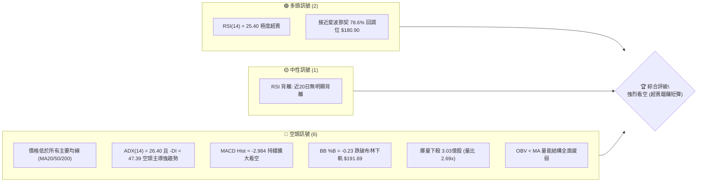
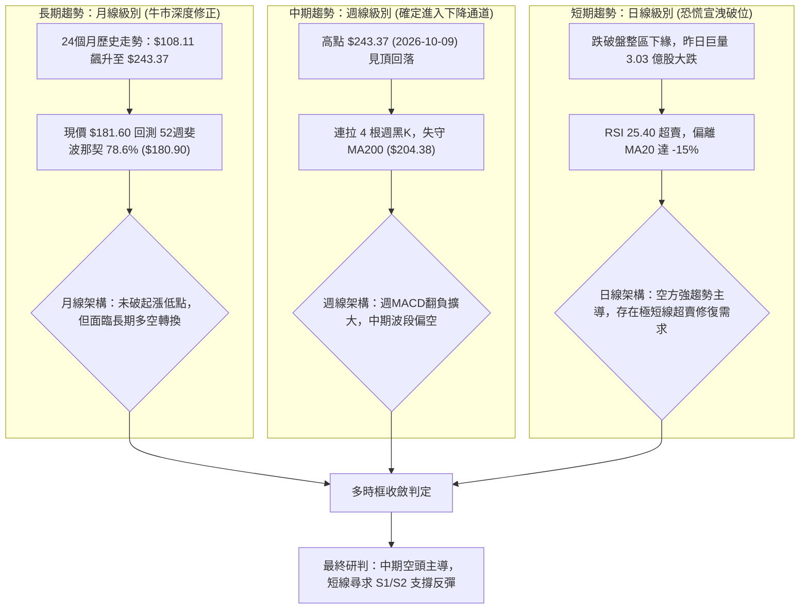
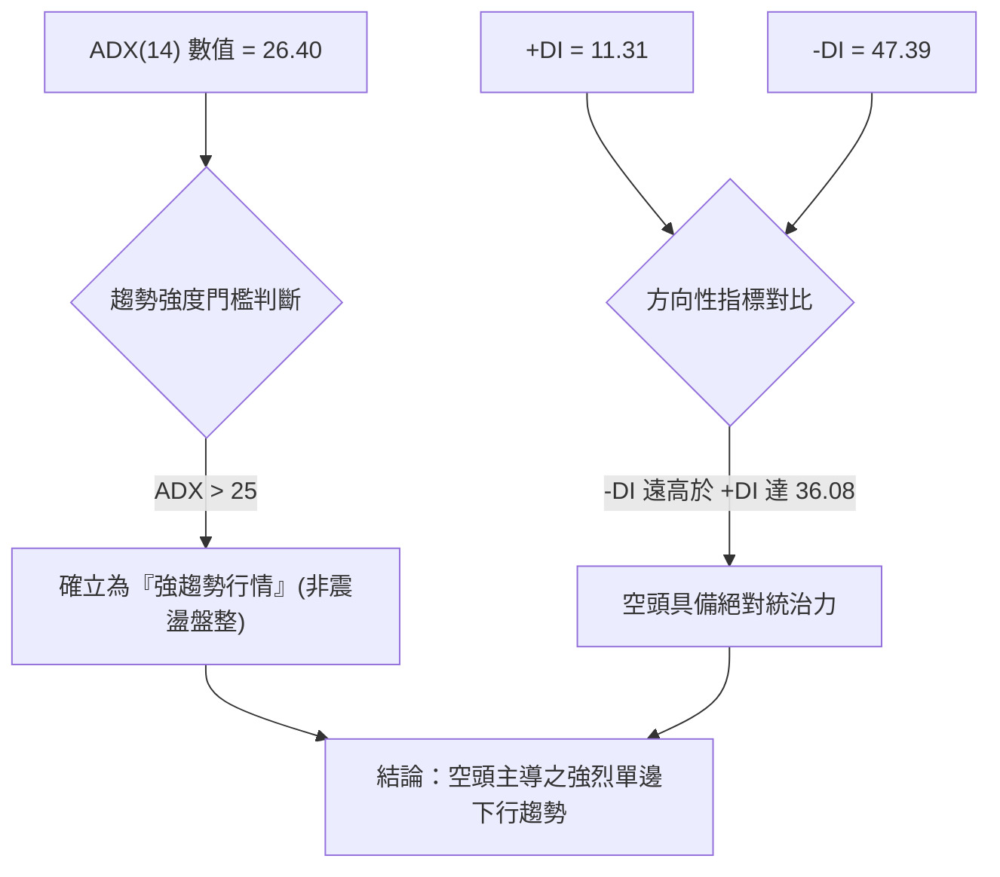
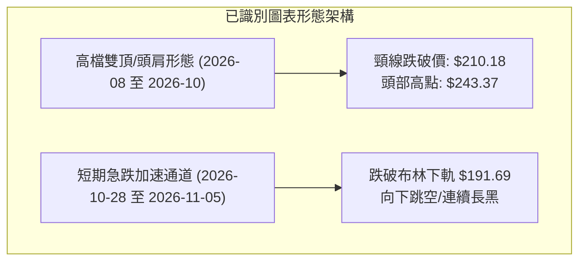
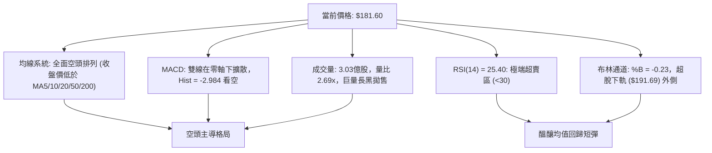
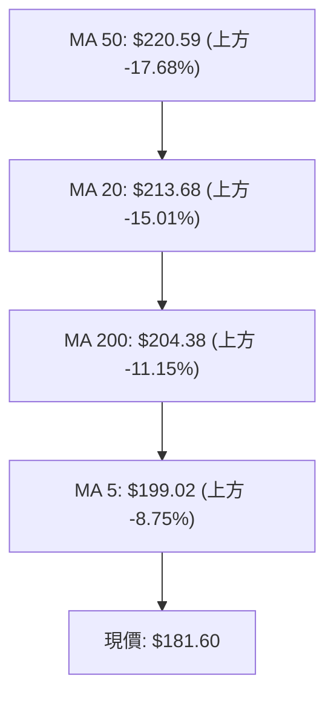
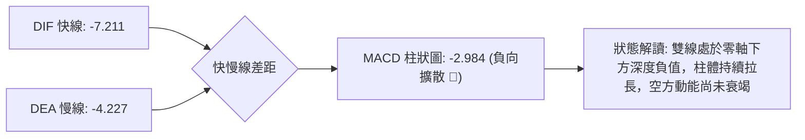
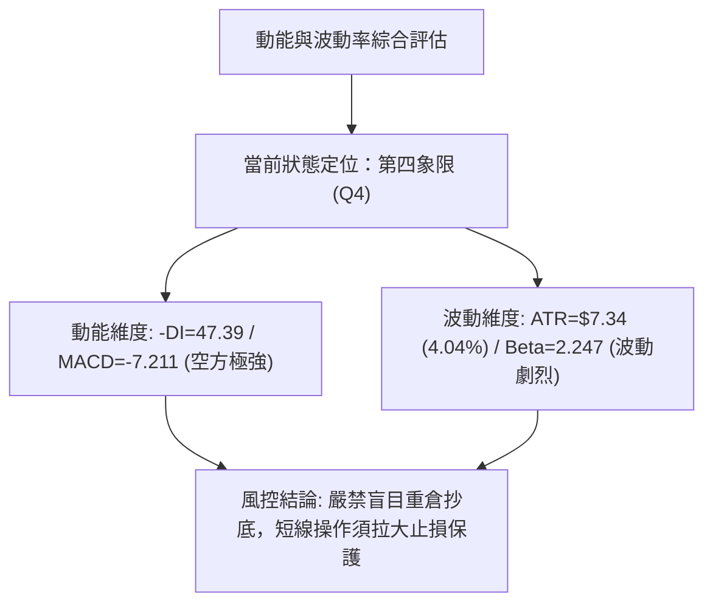
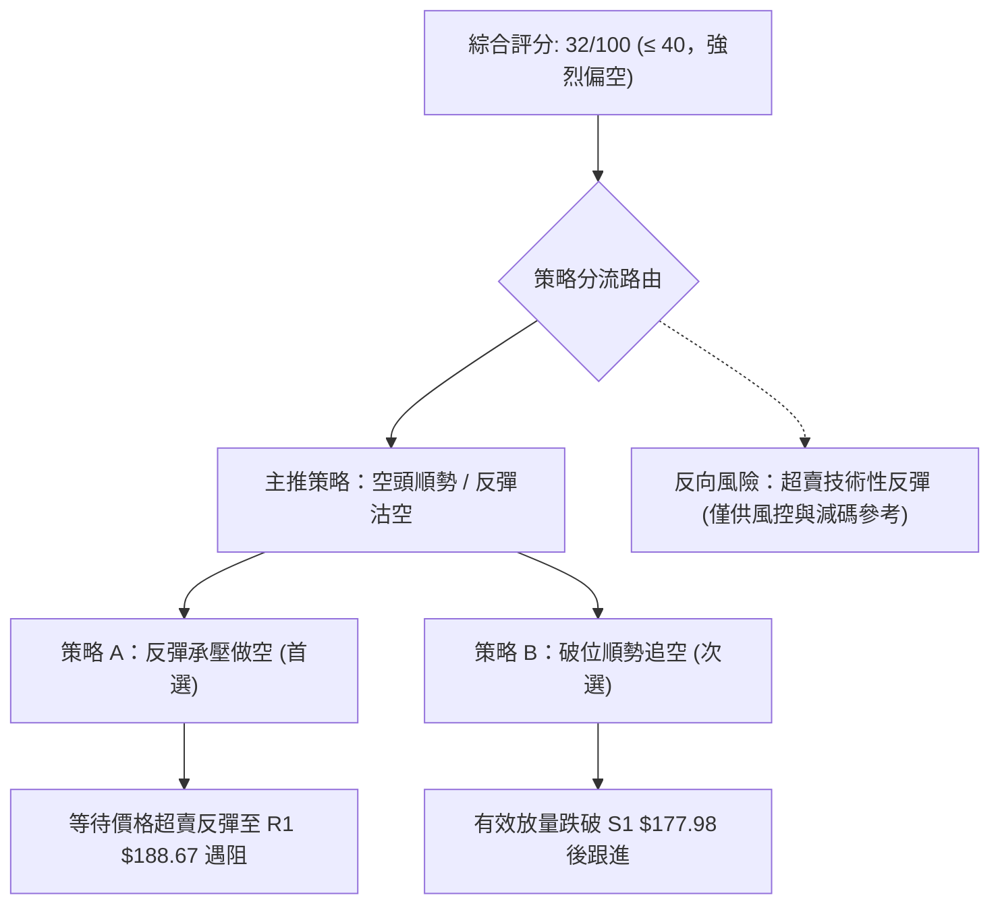
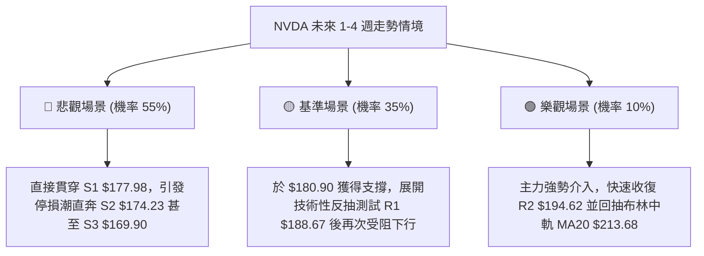

# NVDA 技術分析報告

> **報告日期**：2026-11-06 ｜ **語言**：繁體中文 ｜ **數據來源**：Yahoo Finance ｜ **當前價格**：$181.60

---

## 目錄

| 章節 | 內容 |
|------|------|
| [1. 技術面概覽](#1-技術面概覽) | 訊號儀表板、核心指標、評分卡 |
| [2. 趨勢分析](#2-趨勢分析) | 多時框趨勢、長中短期走勢 |
| [3. 圖表形態分析](#3-圖表形態分析) | 形態識別、K線組合、目標價 |
| [4. 支撐與阻力](#4-支撐與阻力) | 關鍵價位、斐波那契回調 |
| [5. 技術指標深度解讀](#5-技術指標深度解讀) | MA/RSI/MACD/布林/成交量 |
| [6. 動能與波動率](#6-動能與波動率) | 動能評估、ATR、Beta |
| [7. 多時框架總結](#7-多時框架總結) | 時框架評分矩陣 |
| [8. 交易策略建議](#8-交易策略建議) | 多空策略、風險報酬比 |
| [9. 風險提示與監控](#9-風險提示與監控) | 監控指標、風險場景 |

---

## 1. 技術面概覽

### 🎯 技術訊號儀表板



### 📊 核心指標速覽表

| 指標類別 | 指標名稱 | 當前數值 | 訊號 | 解讀 |
|----------|----------|----------|:----:|------|
| **價格** | 當前收盤價 | $181.60 | 🔴 | 位於52週區間 22.3% 低檔，短線遭遇重挫 |
| **均線** | MA20 | $213.68 | 🔴 | 價格低於 MA20 達 -15.01%，短線嚴重負乖離 |
| **均線** | MA50 | $220.59 | 🔴 | 價格低於 MA50 達 -17.68%，中期趨勢已全面轉空 |
| **均線** | MA200 | $204.38 | 🔴 | 價格跌破年線 $204.38 達 -11.15%，長期多頭防線失守 |
| **動能** | RSI(14) | 25.40 | 🟢 | 進入 <30 極端超賣區，具技術性反彈動能但未見底背離 |
| **動能** | MACD (12,26,9) | 柱狀 -2.984 | 🔴 | MACD (-7.211) 遠低於訊號線 (-4.227)，空頭動能擴散 |
| **隨機指標**| Stoch %K / %D | 0.34 / 9.82 | 🟢 | 雙線嚴重超賣 (<10)，短線賣壓宣洩接近極限 |
| **趨勢** | ADX / ±DI | ADX: 26.40 | 🔴 | ADX > 25 且 -DI (47.39) 碾壓 +DI (11.31)，空頭趨勢強勁 |
| **通道** | 布林通道 | %B: -0.23 | 🔴 | 跌破下軌 ($191.69)，呈現極端通道外擴張帶量下殺 |
| **成交量** | 最新成交量 | 303,158,900 | 🔴 | 較 20 日均量放大 2.69 倍，伴隨長陰線確認恐慌性拋售 |
| **波動** | ATR(14) | $7.34 | 🔴 | 佔股價 4.04%，單日震幅劇烈擴大，市場恐慌度高 |

### 🏆 技術評分卡

```
╔══════════════════════════════════════════════════════════════╗
║                技術評分卡 — NVDA (2026-11-06)                 ║
╠══════════════════════════════════════════════════════════════╣
║ 趨勢強度 (Trend)      ████████░░░░░░░░░░░░  40/100  🔴 空頭強勢║
║ 動能指標 (Momentum)    ██████░░░░░░░░░░░░░░  30/100  🔴 動能潰散║
║ 支撐穩定度 (Support)  ████████░░░░░░░░░░░░  40/100  🟡 考驗S1S2║
║ 成交量配合 (Volume)   ██████░░░░░░░░░░░░░░  30/100  🔴 恐慌拋售║
║ 形態完整度 (Pattern)  ██████░░░░░░░░░░░░░░  30/100  🔴 頭部成形║
║ 均線排列 (Moving Avg) ████░░░░░░░░░░░░░░░░  20/100  🔴 均線反壓║
╠══════════════════════════════════════════════════════════════╣
║ 綜合評分 (Overall)    ██████░░░░░░░░░░░░░░  32/100  🔴 強烈偏空║
╚══════════════════════════════════════════════════════════════╝
```
*註：綜合評分由六項子評分算術平均得出：(40 + 30 + 40 + 30 + 30 + 20) ÷ 6 = 31.67，四捨五入為 32/100。*

---

## 2. 趨勢分析

### 🌐 多時框趨勢分析



### 📈 長期趨勢 — 12個月走勢圖（Unicode）

```
NVDA 月線走勢圖（過去12個月：2025-12 至 2026-11）
價格軸 ($)
$245 ┤                                                 
$230 ┤                                      ● (09月 $228.38)
$220 ┤                             ● (08月 $220.53)     
$210 ┤                    ● (05月 $210.66)              
$200 ┤           ● (04月 $199.11)          ● (10月 $204.64)
$190 ┤  ● (01月 $190.68)                                
$185 ┤● (12月 $186.06)                                 ● (11月現價 $181.60)
$175 ┤        ● (02月 $176.78)                          
$170 ┤             ● (03月 $174.00)                     
     └─────────────────────────────────────────────────────────────
       12   01   02   03   04   05   06   07   08   09   10   11 (月份)
      2025 ──────────────────────── 2026 ──────────────────────────
```

#### 走勢特徵分析表格

| 階段 | 時間區間 | 起始價 → 結束價 | 漲跌幅 | 價量特徵與形態解讀 |
|------|----------|-----------------|--------|--------------------|
| 第一階段：年初始探底 | 2025-12 → 2026-03 | $186.06 → $174.00 | -6.48% | 震盪回測支撐，於 2026-03 建立穩固波段低點 $174.00 |
| 第二階段：主升浪爆發 | 2026-03 → 2026-05 | $174.00 → $210.66 | +21.07%| 突破盤整突破頸線，多頭強勢上攻突破 200 大關 |
| 第三階段：高檔震盪蓄勢 | 2026-05 → 2026-07 | $210.66 → $200.53 | -4.81% | 於 $200 關卡進行洗盤整理，成交量溫和萎縮 |
| 第四階段：末升衝頂高點 | 2026-07 → 2026-09 | $200.53 → $228.38 | +13.89%| 形成歷史天價區，並於 2026-10-09 盤中創 52W 高點 $243.37 |
| 第五階段：全面破位下殺 | 2026-09 → 2026-11 | $228.38 → $181.60 | -20.48%| 跌破季線與年線，月黑K吞噬前期漲幅，回吐近7個月漲幅 |

### 📊 中期趨勢（週線分析）

```
中期週線架構與關鍵多空分水嶺
══════════════════════════════════════════════════════════════════════════
 阻力位 R3: $214.75 ════════════════════════════════ 週線下降通道上軌反壓
 阻力位 R2: $194.62 ──────────────────────────────── 斐波那契 61.8% 反彈頸線
 阻力位 R1: $188.67 -------------------------------- 短期反彈首道重壓區
 現  價:   $181.60 ◄───[當前位置：位於下軌外側，尋求 78.6% 回調支撐]
 支撐位 S1: $177.98 -------------------------------- 近期波段前低防線
 支撐位 S2: $174.23 ──────────────────────────────── 2026年3月起漲雙底頸線支撐
 支撐位 S3: $169.90 ════════════════════════════════ 52W 區間最後關鍵防線
══════════════════════════════════════════════════════════════════════════
```

### ⚡ 趨勢強度評估（ADX 解讀）



#### ADX 趨勢強度對照解讀

| 指標名稱 | 當前數值 | 參考區間 | 趨勢判斷 | 實質技術含義 |
|----------|----------|----------|:--------:|--------------|
| **ADX(14)** | 26.40 | > 25 (強趨勢) | 🔴 空方趨勢確立 | 市場脫離無方向盤整，單邊下行趨勢已經成形，切忌盲目逆勢抄底 |
| **+DI** | 11.31 | < 20 (多頭衰竭) | 🔴 多方動能潰散 | 買盤極度匱乏，多方完全喪失主動進攻能力 |
| **-DI** | 47.39 | > 40 (極度強勢) | 🔴 空方高度控盤 | 賣壓以恐慌性方式釋放，下行慣性強大 |
| **方向差距** | 36.08 | > 25 (極端差距) | 🔴 動能單向傾斜 | 屬於典型的「空頭趨勢加速段」，反彈多為技術面修正而非反轉 |

---

## 3. 圖表形態分析

### 🔍 形態識別系統



#### 形態識別與信心度評估表

| 形態名稱 | 信心度 | 判斷依據（引用數據） | 完成度 | 目標價（附計算式） |
|----------|:------:|----------------------|:------:|--------------------|
| **高檔頭部破位 (M頭)** | 85% | 雙峰高點分別為 2026-08 週線高點 $224.91 及 2026-10-09 之 52W 高點 $243.37，並於 2026-10-30 跌破頸線 $210.18（10-23 低點） | 100% | 頸線 $210.18 − 形態高度 ($243.37 − $210.18 = $33.19) = **$176.99**（接近支撐 S1 $177.98） |
| **布林通道破下軌超賣** | 90% | 價格 $181.60 嚴重貫穿布林下軌 $191.69，%B 為 -0.23，伴隨 ATR 飆至 $7.34 | 100% | 指標型均值回歸目標價：BB 中軌 (MA20) = **$213.68**；第一短壓 = **$188.67** (R1) |
| **底部反轉形態** | 20% | 訊號不足，僅做指標型解讀（目前無雙底或頭肩底結構，僅有 RSI 超賣） | 10% | 數據中未偵測到底部幾何形態，不得預設反轉目標價 |

### 🕯️ 重要K線形態分析

根據近 10 根日 K 與近 8 根週 K 之實際 OHLCV 數據分析：

| 日期（日K/週K） | 開 | 高 | 低 | 收 | K線形態 | 解讀 | 訊號 |
|------------------|:---:|:---:|:---:|:---:|---------|------|:----:|
| **2026-10-09 (週K)** | 236.09 | 243.37 | 229.11 | 229.28 | 長上影流星陰線 | 創 52W 新高 $243.37 後遭遇巨量拋壓回落收低，確認見頂訊號 | 🔴 |
| **2026-10-16 (週K)** | 228.73 | 228.86 | 212.85 | 214.13 | 實體大黑K棒 | 跌破前週低點，確立中期頂部反轉成立，空頭主導 | 🔴 |
| **2026-10-28 (日K)** | 219.92 | 219.99 | 214.47 | 215.38 | 上影小陰線 | 多次上衝 $220 反壓失敗，受制於 MA50 ($220.59) 重壓 | 🔴 |
| **2026-10-30 (日K)** | 208.94 | 209.06 | 200.92 | 204.64 | 跳空破位大黑K | 放量至 1.68 億股，實體陰線摜破 $210.18 頸線與 MA200 | 🔴 |
| **2026-11-04 (日K)** | 203.50 | 206.79 | 199.68 | 200.13 | 破底實體陰K | 收盤失守 $200 整數心理防線，成交量增至 1.49 億股 | 🔴 |
| **2026-11-05 (日K)** | 196.07 | 196.25 | 181.46 | 181.60 | 恐慌巨量光腳黑K | 爆出 3.03 億天量（量比 2.69x），幾近光腳收在最低點，空方肆虐 | 🔴 |

### 📉 ASCII 走勢形態示意圖

```
高檔 M 頭形態與頸線跌破圖解
價格 ($)
$243.37 ┤            高點2 (2026-10-09)
         │             /\
$230.00 ┤  高點1      /  \
         │   /\       /    \
$220.00 ┤  /  \     /      \
         │ /    \   /        \
$210.18 ┼───────\─/──────────\────── 頸線關鍵位 (2026-10-23 低點)
         │        V           \
$200.00 ┤     反彈波           \   ← 10-30 跳空跌破頸線
         │                      \
$181.60 ┤                       ● 爆量摜破 (現價，接近目標價 $176.99)
         └───────────────────────────────────────
```

### 🎯 形態目標價計算

1. **頭部形態理論跌幅滿足點**：
   - 形態最高點（52W High）：$243.37
   - 形態頸線跌破點（2026-10-23 日K低點）：$210.18
   - 形態垂直高度 $H = \$243.37 - \$210.18 = \$33.19$
   - 跌破頸線後理論量度跌幅目標 $Target = \$210.18 - \$33.19 = \mathbf{\$176.99}$
   - **比對驗證**：該目標價 $176.99 與數據中關鍵支撐位 **S1 ($177.98)** 僅差 $0.99，顯示股價已極度逼近第一階段量度跌幅滿足區。

---

## 4. 支撐與阻力

### 🗺️ 關鍵價位分布圖（Unicode）

```
NVDA 價位結構分布圖 (由實際 OHLCV 與斐波那契計算)
═══════════════════════════════════════════════════════════════
$214.75 ║████████████████████████║ 強阻力 R3 (波段高點/週線反壓)
$203.63 ║▓▓▓▓▓▓▓▓▓▓▓▓▓▓▓▓▓▓      ║ 斐波那契 50.0% 回調位
$194.62 ║████████████████████    ║ 阻力 R2 (波段密集套牢區/61.8%)
$188.67 ║████████████████████████║ 關鍵阻力 R1 (波段跌破反抽點)
════════╠════════════════════════╣ ◄ 當前收盤價 $181.60
$180.90 ║░░░░░░░░░░░░░░░░░░░░░░░░║ 斐波那契 78.6% 回調位 (多頭防線)
$177.98 ║▓▓▓▓▓▓▓▓▓▓▓▓▓▓▓▓        ║ 近期支撐 S1 (波段低點/形態滿足)
$174.23 ║████████████████████████║ 強支撐 S2 (2026年3月波段底部)
$169.90 ║████████████████████████║ 極限支撐 S3 (年內強支撐聚類)
$163.90 ║████████████████████████║ 52週最低價 (52W Low, 100.0%)
═══════════════════════════════════════════════════════════════
```

### 🚧 阻力位分析表

*註：價位完全引用自數據「關鍵價位」區塊。*

| 阻力級別 | 價位 | 形成原因 | 突破難度 | 重要性 |
|:--------:|:----:|----------|:--------:|:------:|
| **R1** | **$188.67** | 近一年波段高點聚類、短線跌破前之微型整理平台，距離現價 +3.89% | 中等 | 🔴 極高（短線超賣反彈的首要考驗關卡） |
| **R2** | **$194.62** | 近一年波段高點聚類、斐波那契 61.8% 重合位 ($194.25)，距離現價 +7.17% | 高 | 🔴 極高（中期強弱分水嶺，未收復前皆屬弱勢反彈） |
| **R3** | **$214.75** | 近一年波段高點聚類、緊鄰 MA20 ($213.68) 及前期破位頸線，距離現價 +18.25% | 極高 | 🔴 核心天花板（中期波段反轉的決定性阻力） |

### 🛡️ 支撐位分析表

*註：價位完全引用自數據「關鍵價位」區塊。*

| 支撐級別 | 價位 | 形成原因 | 守住機率 | 重要性 |
|:--------:|:----:|----------|:--------:|:------:|
| **S1** | **$177.98** | 近一年波段低點聚類，與頭部量度滿足點 $176.99 重疊，距離現價 -1.99% | 60% | 🟢 高（短線空頭回補與超賣搶彈的第一陣地） |
| **S2** | **$174.23** | 近一年波段低點聚類、2026-03 歷史起漲底部 ($174.00)，距離現價 -4.06% | 75% | 🟢 極高（中期多頭結構的底線，防守價值極高） |
| **S3** | **$169.90** | 近一年波段低點聚類，逼近 52W 最低點防護圈，距離現價 -6.44% | 85% | 🟢 戰略級（多方最後的恐慌停損匯聚帶） |

### 📐 斐波那契回調位分析

*以 52 週波動區間 $163.90 (0.0%起點) → $243.37 (100.0%高點) 進行回調測量（引用數據）：*

| 斐波那契層級 | 精確價位 | 相對現價位置 | 技術意義與多空攻防解讀 |
|:------------:|:--------:|:------------:|------------------------|
| **0.0% (52W High)** | $243.37 | +34.01% | 2026-10-09 形成之歷史極值高點，中期強阻力頂峰 |
| **23.6%** | $224.61 | +23.68% | 初次回檔支撐，已於 10 月中旬被長黑放量跌破 |
| **38.2%** | $213.01 | +17.30% | 弱勢回調防線，重合布林中軌 MA20 ($213.68)，現轉為重壓 |
| **50.0%** | $203.63 | +12.13% | 多空平衡分水嶺，跌破該位代表自 $163.90 起之多頭漲勢遭腰斬 |
| **61.8%** | $194.25 | +6.97% | 黃金分割防守位，緊鄰阻力位 R2 ($194.62)，反彈核心阻力 |
| **78.6%** | **$180.90** | **-0.39%** | **現價 ($181.60) 緊貼此位！** 深幅回調最後防線，短線強烈支撐 |
| **100.0% (52W Low)**| $163.90 | -9.75% | 52週最低點，此位若遭跌破將宣示進入熊市深淵 |

*現價解讀：當前價格 $181.60 精確坐落於 **78.6% 回調位 ($180.90)** 與 **支撐 S1 ($177.98)** 之間。在技術分析上，78.6% 回調往往是極端動能衰竭時最後的多頭伏擊點，配合日線超賣，隨時可能觸發短線空頭回補。*

---

## 5. 技術指標深度解讀

### 🎛️ 指標訊號總覽



### 📈 移動平均線排列分析



#### 均線數據明細表

| 均線名稱 | 當前價格 | 距現價價差 | 乖離率 (%) | 趨勢斜率 | 多空研判 |
|:--------:|:--------:|:----------:|:----------:|:--------:|:--------:|
| **MA 5** | $199.02 | -$17.42 | -8.75% | 陡峭向下 ▁ | 🔴 極短期空頭壓制 |
| **MA 10** | $206.91 | -$25.31 | -12.23% | 陡峭向下 ▁ | 🔴 短期空頭加速 |
| **MA 20** | $213.68 | -$32.08 | -15.01% | 拐頭向下 ▁ | 🔴 月線級別反壓重 |
| **MA 50** | $220.59 | -$38.99 | -17.68% | 下彎 ▇ | 🔴 中期多頭瓦解 |
| **MA 60** | $220.05 | -$38.45 | -17.47% | 走平轉下 ▇ | 🔴 季線反壓 |
| **MA 120**| $213.98 | -$32.38 | -15.13% | 走平轉下 ▇ | 🔴 半年線失守 |
| **MA 200**| $204.38 | -$22.78 | -11.15% | 拐頭向下 | 🔴 年線失守（長線警訊） |
| **MA 240**| $200.74 | -$19.14 | -9.54% | 走平 █ | 🔴 兩年線亦告失守 |

*分析結論：均線呈現罕見的「全面向下覆蓋」狀態，現價低於所有均線。價格與 MA20 負乖離高達 **-15.01%**，歷史上該數值已達短期極端乖離邊界，通常預示賣壓將在數日內收斂。*

### 📉 RSI(14) 分析

```
RSI(14) 當前水平：25.40 
0 ───────[25.40]──── 30 ──────────────────────────── 70 ────────── 100
[  極端超賣區 🟢  ]   [        常態波動區間        ]   [ 超買區 🔴 ]
進度條：█████░░░░░░░░░░░░░░░ 25.4%
```

- **超買超賣判定**：RSI(14) 讀數為 **25.40**，跌破 30 門檻進入「極度超賣區」。週線 RSI 亦同步回落至 **25.4**（11-05 週），表明日線與週線動能同時觸及年度極限低位。
- **背離判斷**：依據日線近 20 根 K 棒的首尾分析（2026-10-23 收盤 $210.96，RSI 38.1 → 2026-11-05 收盤 $181.60，RSI 25.40），價格創波段新低，RSI 同步創低，**無明顯底背離**。這說明下行並非虛跌，而是有實質動能支撐的空頭摜壓，短期難以出現 V 型反轉，較大機率以弱勢震盪打底呈現。

### 📊 MACD(12,26,9) 訊號解讀



- MACD 線 (-7.211) 遠遠落後於訊號線 (-4.227)，柱狀圖讀數為 **-2.984**。
- 回顧近 4 週柱狀圖變化：-2.366 (10-16) → -2.159 (10-23) → -1.482 (10-30) → -2.984 (11-05)，原本於 10 月底一度收斂的負柱體再次暴力擴大，確認展開新一輪「空頭擴散加速浪」。

### 📦 布林通道分析

```
布林通道 (20, 2) 結構圖
價格軸 ($)
$235.67 ┤ ═══════════════════════════════════════ 布林上軌
         │
$213.68 ┤ ─────────────────────────────────────── 布林中軌 (MA20)
         │
$191.69 ┤ ═══════════════════════════════════════ 布林下軌
         │
$181.60 ┤   ● [現價: %B = -0.23，嚴重超脫下軌外側]
         └───────────────────────────────────────
```

- **布林寬度與通道破位**：上軌 $235.67，中軌 $213.68，下軌 $191.69。
- **%B 指標讀數**：**-0.23**（小於 0 代表完全跌破下軌）。股價跌破下軌超過 $10 美元，顯示行情處於「極端拋售狀態」。根據統計概率，股價運行於布林帶外的時間通常少於 5%，未來 1–3 個交易日內價格極易產生向通道內部的修復反抽（目標回抽下軌 $191.69 附近）。

### 💹 成交量分析（量價配合度）

```
近期成交量走勢對比 (萬股)
2026-10-29  7,756 █
2026-10-30 16,838 ███
2026-11-02 11,927 ██
2026-11-03  9,194 █
2026-11-04 14,903 ███
2026-11-05 30,316 ██████ (爆量 3.03 億股，量比 2.69x)
```

- **量價關係解讀**：
  - 最新交易日（2026-11-05）暴跌至 $181.60，單日湧出 **303,158,900 股**，對比 20 日均量 (112,772,085 股) **量比高達 2.69 倍**。
  - **價跌量劇增**：屬於典型的恐慌盤湧出（Panic Selling）與多頭停損斷頭潮。
  - **OBV 趨勢**：數據明確指出「**OBV < MA → 量能疲弱**」，OBV 能量潮持續運行於均線之下，證明中長期資金呈現持續淨流出，當前並無機構主力大規模建倉吸籌的量能跡象，該巨量應視為「被動拋售」而非「主動進場」。

---

## 6. 動能與波動率

### ⚡ 動能評估四象限

| 象限 | 動能維度 (Momentum) | 波動率維度 (Volatility) | NVDA 當前狀態 | 交易策略意涵 |
|:---:|:---:|:---:|:---:|:---|
| **Q1** | 強 (多頭) | 低 (穩定) | — | 最佳波段做多機會（牛市主升） |
| **Q2** | 弱 (低迷) | 低 (壓縮) | — | 狹幅盤整觀望，等待突破方向 |
| **Q3** | 強 (多頭) | 高 (劇烈) | — | 高風險高收益，末升段爆發行情 |
| **Q4** | **弱 (極空)** | **高 (劇烈)** | **✓ (NVDA 目前落點)** | **極高風險區，順勢空頭主導，僅宜超短線快進快出搶反彈** |



### 📊 ATR 波動率分析

- **ATR(14) 數值**：**$7.34**（採用 Wilder 平滑算法）。
- **相對股價佔比**：高達 **4.04%**，意味著 NVDA 平均單日正常波動區間即超過 7 美元。
- **止損距離建議**：
  - 在高 ATR 環境下，常規的 1%~2% 緊密止損極易被市場雜訊無情洗出場。
  - **多頭反彈止損空間**：應設定為至少 1.5 倍 ATR，即 $1.5 \times \$7.34 = \mathbf{\$11.01}$；或緊盯關鍵支撐 S1 ($177.98) 與 S2 ($174.23) 的技術結構破位。
  - **空頭順勢止損空間**：建議以突破 R1 ($188.67) 作為結構失效依據，距離現價約 $7.07（約 1.0 倍 ATR）。

### 📐 Beta 與市場相關性

- **Beta 係數**：**2.247**。
- **市場特徵分析**：
  - NVDA 具有極高的高彈性 Beta 特徵，其價格波動幅度約為標普 500 指數的 2.25 倍。
  - 在大盤（如新聞提及 Nasdaq 大跌 5.5%）處於系統性修正期時，NVDA 將首當其衝承受放大的流動性賣壓；反之，若科技股大盤止跌修復，其超賣反彈的彈性亦將顯著超越整體市場。

---

## 7. 多時框架總結

### 📋 時框架評分表

| 時框架 | 趨勢方向 | 動能狀態 | 均線排列 | 圖表形態 | 綜合評分 | 建議策略 |
|:------:|:--------:|:--------:|:--------:|:--------:|:--------:|:---------|
| **長期 (月線)** | 🟡 中性偏多 | 轉弱回檔 | 位於 MA240 之上 | 52週高檔拉回修正 | 55/100 | 定期定額長線關注，現價接近 78.6% 回調 |
| **中期 (週線)** | 🔴 明確看空 | 空頭加速擴散 | 跌破 MA200 年線 | 雙頂 M 頭跌破確認 | 28/100 | 逢反彈減碼多單，順勢偏空操作 |
| **短期 (日線)** | 🔴 極端看空 | 嚴重超賣區間 | 空頭排列/負乖離大 | 爆量長黑光腳摜破 | 25/100 | 嚴禁追空，等待超賣修復後逢高放空 |

### 🔲 綜合訊號矩陣

```
時框與維度收斂矩陣
════════════════════════════════════════════════════════════════════════
維度項目        短期 (日線)          中期 (週線)          長期 (月線)
────────────────────────────────────────────────────────────────────────
趨勢 (ADX/MA)   🔴 空頭強勢 (26.40)  🔴 空頭主導 (破年線) 🟡 多頭拉回修正
動能 (RSI/MACD) 🟢 極度超賣 (25.40)  🔴 空方擴散 (柱負值) 🟡 動能高檔衰退
量價 (Volume)   🔴 恐慌爆量 (2.69x)  🔴 週K量增價跌      🟡 漲多獲利了結
支撐阻力        🟢 貼近S1 ($177.98)  🔴 跌破頸線 $210     🟢 78.6% 回調位
════════════════════════════════════════════════════════════════════════
結論評級：中期與短期趨勢高度共振偏空，惟短期動能出現嚴重超賣鈍化。
```

### ⚖️ 多時框收斂結論

依據多時框收斂規則（規則 14）：
1. **行情性質判定**：當前 ADX(14) 讀數為 **26.40 (> 25)**，且 -DI (47.39) 遠高於 +DI (11.31)，**明確判定當前為「空頭強趨勢行情」，絕非區間盤整行情**。
2. **時框優先級收斂**：在趨勢行情下，交易邏輯**必須以中長期（週線破位、均線全面反壓）的下行方向為絕對主導**；短期日線之極度超賣（RSI 25.40、布林 %B -0.23）**僅能用來尋找反彈出場點或高風險超短線博弈點，不可視為趨勢反轉**。
3. **唯一方向性結論**：**【強烈偏空】**。操作主軸鎖定「順應週線空頭趨勢，逢反彈至阻力位建立空單；或待跌破關鍵支撐後順勢跟進」。

---

## 8. 交易策略建議

### 🗺️ 策略決策流程圖



### 🧭 策略路由

**當前主策略方向 = 【主推空頭策略】（依第 1 章技術評分卡綜合評分 32/100 ≤ 40 嚴格執行分流）**
*依據規則，綜合評分偏空時全力制定空頭操作路徑，多頭操作僅列為反轉風險提示與對沖預案，不作主推，堅決杜絕兩頭下注。*

### 🎯 價格情境階梯（Price Scenarios）

*價位完全引用第 4 章／關鍵價位區塊之真實數據：*

| 觸發條件 | 下一目標 | 後續延伸 | 情境含義 |
|----------|:--------:|:--------:|----------|
| **突破 R1 $188.67** | R2 $194.62 | R3 $214.75 | 超賣反抽加劇，回測 61.8% 反壓，空頭波段防線經受考驗 |
| **站穩現價區間 ($180.90~$181.60)** | R1 $188.67 | — | 於斐波那契 78.6% 回調位展開技術性弱勢築底震盪 |
| **跌破 S1 $177.98** | S2 $174.23 | S3 $169.90 | 空頭摜破頭部形態滿足點，下行空間全面打開直指 $174 |

### 📊 情境機率分佈

| 情境劇本 | 機率 | 主要技術依據（引用指標狀態） |
|----------|:----:|------------------------------|
| **情境一：回落 / 再探底（破位下行）** | **55%** | ADX = 26.40 強趨勢主導、-DI = 47.39 極度強勢、MACD 柱狀 -2.984 持續向下擴大、爆量 3.03 億長黑破位 |
| **情境二：弱勢反抽（超賣修復）** | **35%** | RSI(14) = 25.40 極端超賣、布林 %B = -0.23 偏離下軌過大、現價緊貼 78.6% 回調位 $180.90 |
| **情境三：區間橫盤震盪** | **10%** | 多空力量極端失衡，巨量換手後市場波動率 (ATR $7.34) 過高，難以維持窄幅橫盤 |

### 🟢 主策略詳情（方向：空頭主導策略）

*進場價、止損價、目標價嚴格採用第 4 章關鍵價位區塊已存在數值：*

| 策略要素 | 策略 A：反彈承壓做空 (逢高沽空) | 策略 B：支撐失守順勢做空 (破位跟進) |
|----------|----------------------------------|--------------------------------------|
| **交易邏輯** | 利用 RSI 超賣反抽接近 R1 阻力位時順勢放空 | 跌破波段低點聚類 S1 後追隨空頭動能進場 |
| **進場條件** | 價格反彈至 R1 遇阻收上影線或黑K確認 | 收盤價或小時線實體跌破 S1 支撐位 |
| **進場價格** | **$188.67** (精確引用 R1) | **$177.98** (精確引用 S1) |
| **目標價 T1** | **$177.98** (精確引用 S1) | **$174.23** (精確引用 S2) |
| **目標價 T2** | **$174.23** (精確引用 S2) | **$169.90** (精確引用 S3) |
| **止損價格** | **$194.62** (精確引用 R2) | **$181.60** (精確引用當前收盤價) |
| **風險報酬比** | **1 : 1.80**（以 T1 計）<br>*計算式：($188.67 − $177.98) ÷ ($194.62 − $188.67) = $10.69 ÷ $5.95 = 1.7966* | **1 : 1.04**（以 T1 計）<br>*計算式：($177.98 − $174.23) ÷ ($181.60 − $177.98) = $3.75 ÷ $3.62 = 1.0359*<br>*另列至 T2：1 : 2.23（以 T2 計，($177.98 − $169.90) ÷ $3.62 = $8.08 ÷ $3.62 = 2.232）* |
| **成功機率** | 65% | 55% |
| **建議倉位** | 15% 總資金 | 10% 總資金 |

### 🔴 反向風險觸發點（對沖與停損提示）

若出現以下訊號，主推之空頭策略必須立即終止或進行對沖：
1. **價位警訊**：日線收盤價強勢突破並站穩 **R2 ($194.62)**，代表空頭結構遭遇嚴重破壞，回補潮將推升股價挑戰 MA200 ($204.38)。
2. **指標轉向**：RSI(14) 重新站回 45 以上，且日線 MACD 柱狀圖由負轉正出現實體翻紅。
3. **量能異動**：股價於 $180 附近再度爆出 3 億股以上巨量收出「長下影線紅K（Pin Bar）」，呈現主力機構進場承接特徵。

### ⭐ 整體訊號強度評星

```
做多訊號強度：★☆☆☆☆  (1/5星 — 僅有超賣指標，無形態確認)
做空訊號強度：★★★★☆  (4/5星 — 均線/趨勢/形態/量能全面共振看空)
整體可信度：  ★★★★☆  (4/5星 — 數據完整，趨勢極其明朗)
```

---

## 9. 風險提示與監控

### ✅ 關鍵監控指標 Checklist

```
╔══════════════════════════════════════════════════════════════════╗
║                    每日盤面關鍵監控清單                          ║
╠══════════════════════════════════════════════════════════════════╣
║ [ ] 價格是否跌破斐波那契 78.6% 防線 $180.90                      ║
║ [ ] RSI(14) 是否由超賣區 (<30) 向上勾頭突破 30 形成反彈訊號      ║
║ [ ] 單日成交量是否自 3.03 億巨量萎縮至 20日均量 (1.12億) 水平   ║
║ [ ] MACD 負柱狀圖 (-2.984) 是否出現連續兩日收斂                 ║
║ [ ] 價格能否回抽收復布林通道下軌 $191.69                         ║
║ [ ] 大盤 Nasdaq 指數是否持續破位下殺造成 Beta (2.247) 槓桿乘數效應║
╚══════════════════════════════════════════════════════════════════╝
```

### ⚠️ 風險場景分析



### 🛡️ 風險管理重要提醒

1. **極端 ATR 環境下的風控法則**：
   - 目前單日 ATR 高達 **$7.34**（單日波動率 4.04%），單一持倉風險暴增。
   - **嚴格限制單筆損失**：任何操作單筆最大虧損金額不得超過總帳戶權益的 **1.0%**。若採用策略 A 之止損距離 $5.95，單筆開倉股數應嚴格控制為：`帳戶資金 × 1% ÷ $5.95`。
2. **基本面與消息面黑天鵝**：
   - 新聞提及「Nvidia 晶片堆積香港因進口審批受阻」與「Nasdaq 單日重挫 5.5%」，基本面短期雜音正與技術面共振，切勿以「基本面 Forward P/E 僅 11.4 倍」為由盲目硬抗技術破位下殺。
3. **流動性陷阱**：
   - 3.03 億股的恐慌爆量代表市場流動性由承接轉為踩踏，在盤面未出現「量縮築底」前，任何反彈極可能是誘多的「死貓跳（Dead Cat Bounce）」。

---

## 📋 報告總結

```
╔════════════════════════════════════════════════════════════════╗
║                   NVDA 技術分析報告總結                        ║
╠════════════════════════════════════════════════════════════════╣
║ 報告日期：2026-11-06                                           ║
║ 當前價格：$181.60                                              ║
║ 分析評級：🔴 強烈偏空（綜合評分 32/100，技術破位下行階段）     ║
║                                                                ║
║ 關鍵結論：                                                     ║
║ ├─ 長期趨勢：🟡 月線面臨 52週 78.6% 回調關鍵考驗               ║
║ ├─ 中期趨勢：🔴 週線跌破 MA200 ($204.38)，下降趨勢確立         ║
║ ├─ 短期趨勢：🔴 跌破布林下軌放量恐慌下殺，RSI 25.40 極度超賣   ║
║ ├─ 關鍵支撐：S1 $177.98 ｜ S2 $174.23 ｜ S3 $169.90            ║
║ ├─ 關鍵阻力：R1 $188.67 ｜ R2 $194.62 ｜ R3 $214.75            ║
║ └─ 分析師目標：均價 $327.14（機構共識強烈買入，但技術面顯著脫節）║
║                                                                ║
║ 最優策略組合：                                                 ║
║ 1. 🥇 最佳機會：策略 A — 反彈至 R1 $188.67 阻力承壓時順勢做空   ║
║ 2. 🥈 次選機會：策略 B — 實體放量摜破 S1 $177.98 後順勢追空至 S2 ║
║ 3. 🥉 保守選擇：完全空倉觀望，耐心等待價格於 S2 $174.23 縮量打底║
╚════════════════════════════════════════════════════════════════╝
```

---

> ⚠️ **免責聲明**：本報告為 AI 自動生成之技術分析，所有數據及估算均基於提供的歷史價格資訊。本報告**僅供研究與學術參考**，**不構成任何投資建議**。投資有風險，入市需謹慎。

---

*報告生成時間：2026-11-06 ｜ 數據來源：Yahoo Finance ｜ 分析框架：多時框技術分析*