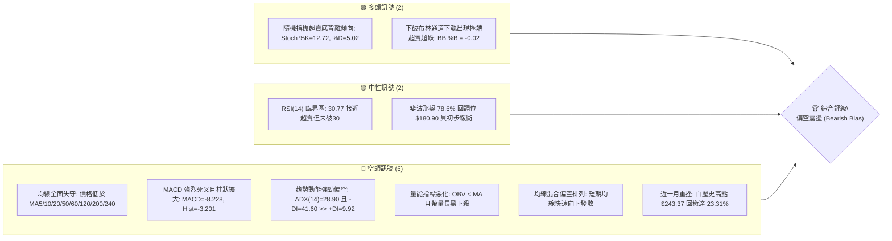
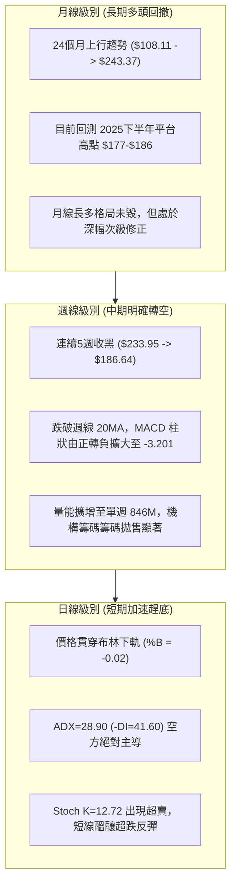
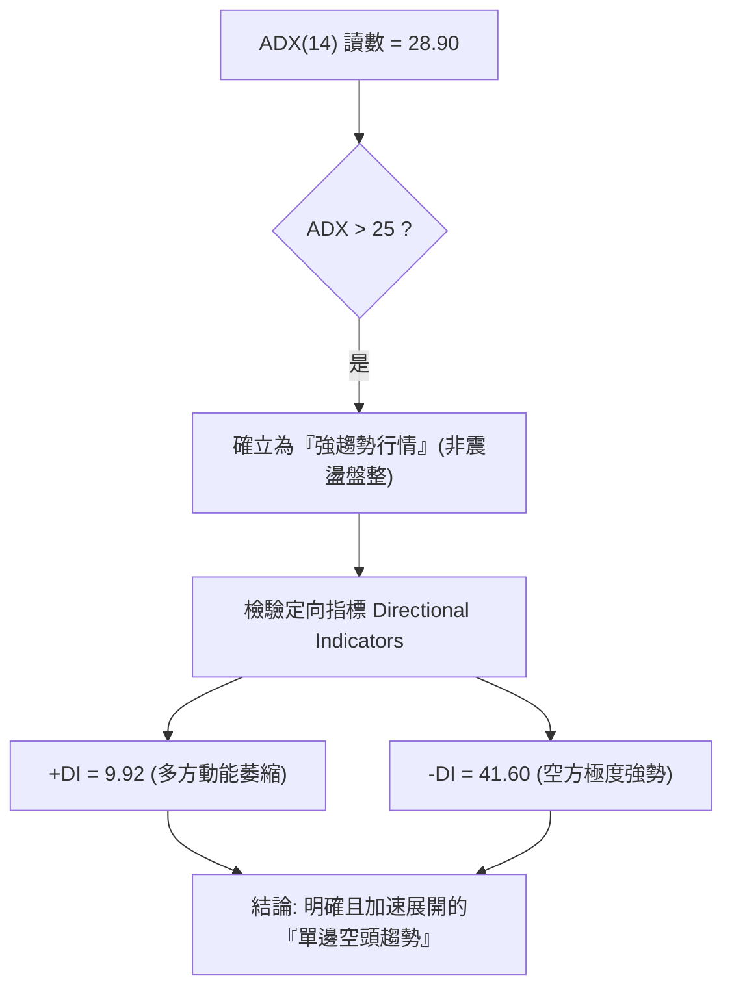
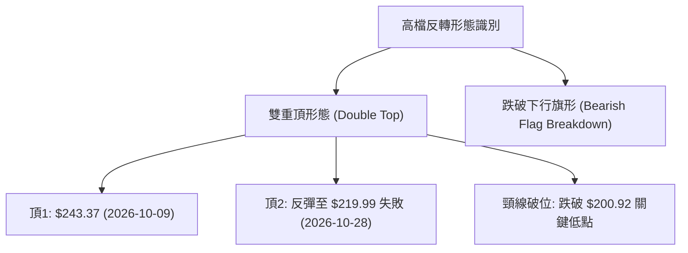
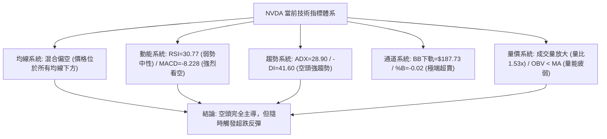
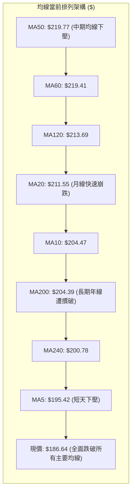
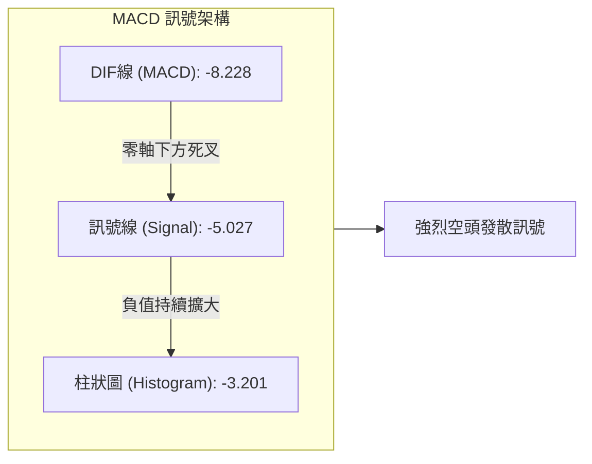
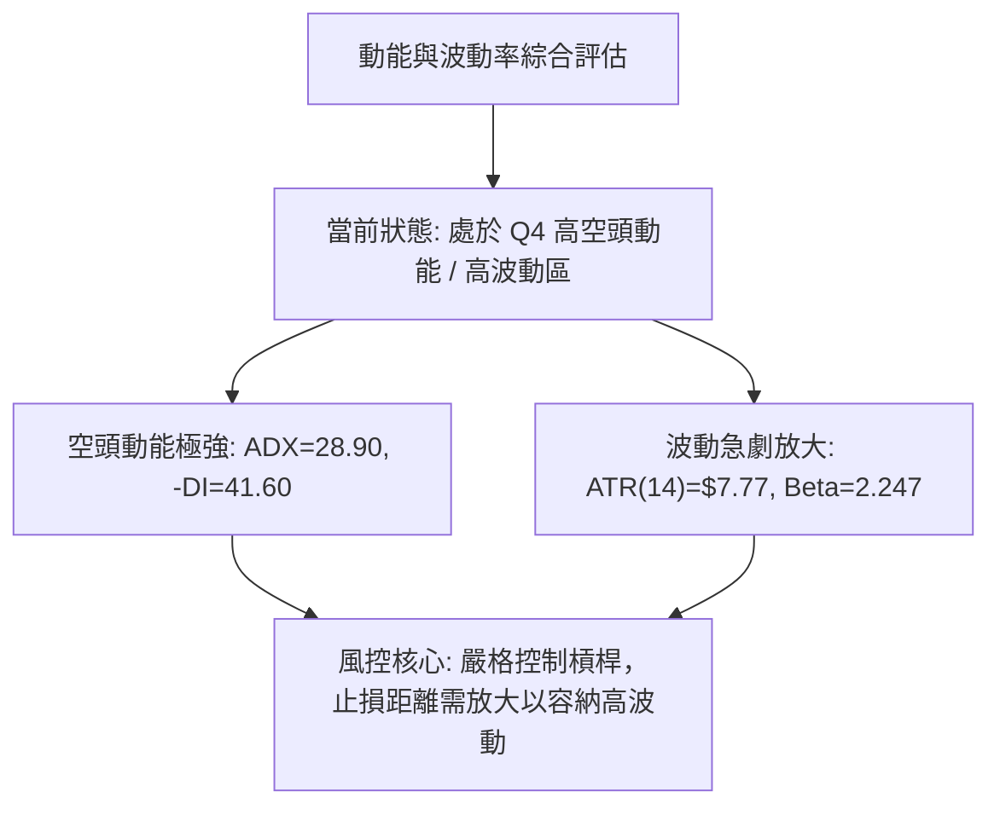
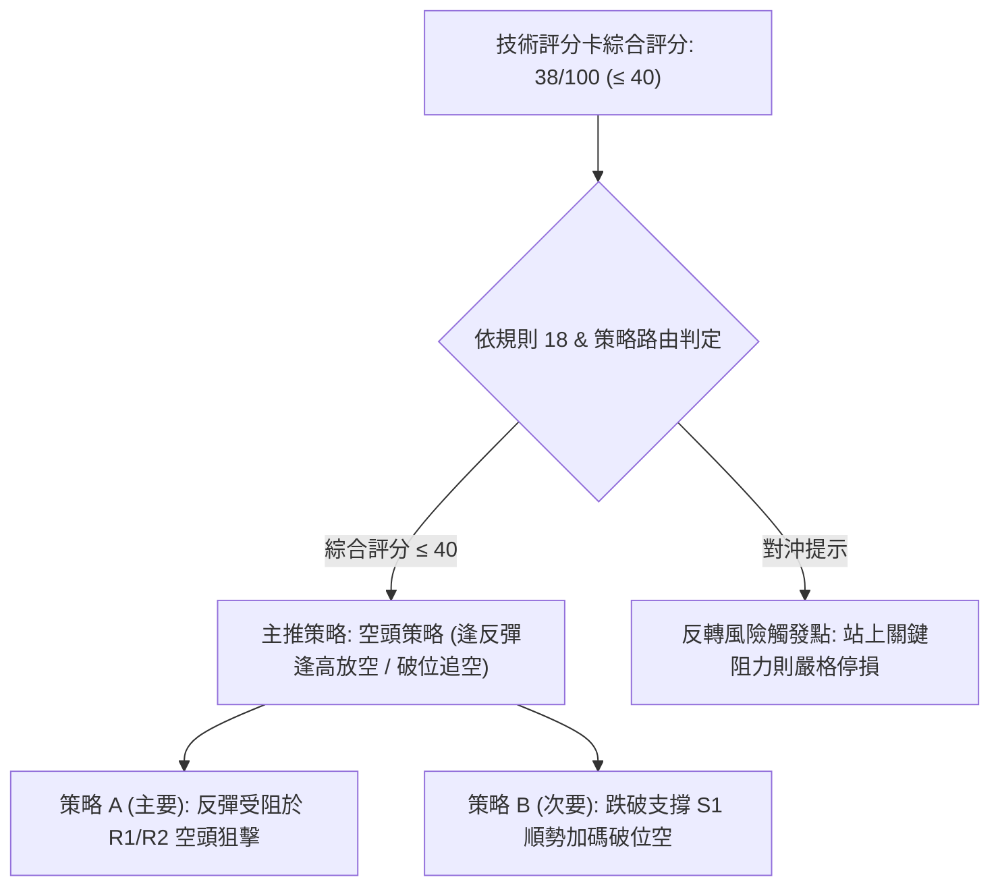
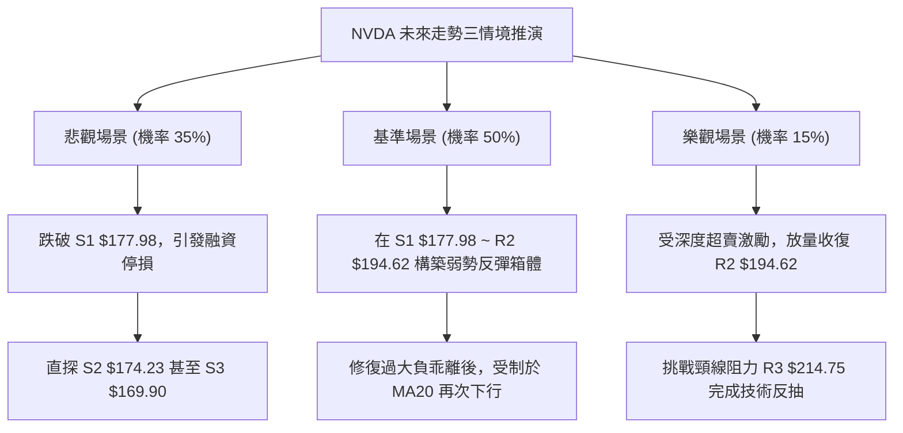

# NVDA 技術分析報告

> **報告日期**：2026-11-08 ｜ **語言**：繁體中文 ｜ **數據來源**：Yahoo Finance ｜ **當前價格**：$186.64

---

## 目錄

| 章節 | 內容 |
|------|------|
| [1. 技術面概覽](#1-技術面概覽) | 訊號儀表板、核心指標、評分卡 |
| [2. 趨勢分析](#2-趨勢分析) | 多時框趨勢、長中短期走勢 |
| [3. 圖表形態分析](#3-圖表形態分析) | 形態識別、K線組合、目標價 |
| [4. 支撐與阻力](#4-支撐與阻力) | 關鍵價位、斐波那契回調 |
| [5. 技術指標深度解讀](#5-技術指標深度解讀) | MA/RSI/MACD/布林/成交量 |
| [6. 動能與波動率](#6-動能與波動率) | 動能評估、ATR、Beta |
| [7. 多時框架總結](#7-多時框架總結) | 時框架評分矩陣 |
| [8. 交易策略建議](#8-交易策略建議) | 多空策略、風險報酬比 |
| [9. 風險提示與監控](#9-風險提示與監控) | 監控指標、風險場景 |

---

## 1. 技術面概覽

### 🎯 技術訊號儀表板



### 📊 核心指標速覽表

| 指標類別 | 指標名稱 | 當前數值 | 訊號 | 解讀 |
|----------|----------|----------|------|------|
| **價格** | 當前收盤價 | $186.64 | 🔴 | 位於52週區間下緣28.6%處，短期動能嚴重受挫 |
| **均線** | MA20 (短月線) | $211.55 | 🔴 | 價格低於MA20達 -11.77%，短中期空頭主導 |
| **均線** | MA50 (中期季線) | $219.77 | 🔴 | 價格低於MA50達 -15.08%，中期上升結構被破壞 |
| **均線** | MA200 (長期年線) | $204.39 | 🔴 | 跌破長線牛熊分水嶺 -8.68%，長線買盤防線失守 |
| **動能** | RSI(14) | 30.77 | 🟡 | 位於中性與超賣臨界值(30)，未出現底背離，下行動能仍強 |
| **動能** | MACD (12,26,9) | -8.228 / Hist -3.201 | 🔴 | 雙線位於零軸下方快速下墜，柱狀體負值擴大，強烈看空 |
| **動能** | Stoch %K / %D | 12.72 / 5.02 | 🟢 | 進入深度超賣區間 (<20)，短線具備技術性抽頭反彈條件 |
| **趨勢** | ADX(14) / ±DI | ADX 28.90 (-DI 41.60) | 🔴 | ADX>25確立強趨勢，-DI遠高於+DI(9.92)，為空頭趨勢行情 |
| **通道** | Bollinger Bands | $187.73 (下軌) / %B -0.02 | 🟡 | 價格跌穿布林下軌，短線進入嚴重負偏離狀態，隨時引發均值回歸 |
| **量能** | 當日量 / 20日均量 | 179.72M / 117.67M (1.53x) | 🔴 | 帶量下殺破位，量能未確認見底，OBV持續低於均線 |
| **波動** | ATR(14) | $7.77 (4.16%) | 🔴 | 每日震幅達 4.16%，市場情緒極度恐慌，波動率顯著放大 |

### 🏆 技術評分卡

```
╔══════════════════════════════════════════════════════════════╗
║              技術評分卡 — NVDA (2026-11-08)                  ║
╠══════════════════════════════════════════════════════════════╣
║ 趨勢強度      ██████████████░░░░░░  70/100  🔴 (空頭強趨勢)  ║
║ 動能指標      ██████░░░░░░░░░░░░░░  30/100  🔴 (空頭加速中)  ║
║ 支撐穩定度    ████████░░░░░░░░░░░░  40/100  🟡 (逼近S1考驗)  ║
║ 成交量配合    ██████░░░░░░░░░░░░░░  30/100  🔴 (放量下殺局)  ║
║ 形態完整度    ████████░░░░░░░░░░░░  40/100  🟡 (雙頂破頸線)  ║
║ 均線排列      ████░░░░░░░░░░░░░░░░  20/100  🔴 (均線全跌破)  ║
╠══════════════════════════════════════════════════════════════╣
║ 綜合評分      ████████░░░░░░░░░░░░  38/100  🔴 強烈偏空      ║
║ 評級結論      依規則18算術平均：(70+30+40+30+40+20)/6 = 38.3 ║
╚══════════════════════════════════════════════════════════════╝
```

---

## 2. 趨勢分析

### 🌐 多時框趨勢分析



### 📈 長期趨勢 — 12個月走勢圖（Unicode）

```
NVDA 月線走勢圖（過去12個月：2025-12 至 2026-11）
價格軸 ($)
$240 ┤                                         ● $228.38 (高點)
$220 ┤                                   ●     │
$200 ┤                     ●       ●     │     ● $204.64
$180 ┤ ● $186.06   ●       │       │     │     │
$160 ┤ │     ●     │       │       │     │     ● $186.64 (現價)
$140 ┤ │     │     │       │       │     │     │
     └─┬─────┬─────┬───────┬───────┬─────┬─────┬────────────
     25-12 26-02 26-04   26-06   26-08 26-09 26-11
```

**走勢特徵分析表格**：

| 週期區間 | 起始收盤價 | 結束收盤價 | 區間漲跌幅 | 主要走勢特徵與結構意涵 |
|----------|------------|------------|------------|------------------------|
| **2025-12 ~ 2026-03** | $186.06 | $174.00 | -6.48% | 第一階段築底打底，回測 $174 支撐構築雙底底部。 |
| **2026-03 ~ 2026-05** | $174.00 | $210.66 | +21.07% | 強勢爆發波段，突破 $200 整數關卡，建立多頭主升段。 |
| **2026-05 ~ 2026-07** | $210.66 | $200.53 | -4.81% | 高檔橫盤洗盤，回測 $200 支撐維持強勢整理。 |
| **2026-07 ~ 2026-09** | $200.53 | $228.38 | +13.89% | 第二波推升，創出波段收盤新高，市場情緒達到極致高亢。 |
| **2026-09 ~ 2026-11** | $228.38 | $186.64 | -18.28% | 高檔雙頂崩跌，連跌兩個月失守所有均線，回吐下半年漲幅。 |

### 📊 中期趨勢（週線分析）

中期技術面於 2026-10-09 創下 52 週盤中歷史高點 $243.37 後迅速反轉。週線圖形展示了極具破壞性的空頭下殺：
- **頂部結構**：在 $230–$243 區間形成顯著的高檔派發形態，隨後連續跌破關鍵頸線。
- **均線支撐破位**：週線級別價格直接跌破 20 週均線（對應日線 MA120 $213.69），進一步摜破 MA200（$204.39）。
- **成交量異動**：2026-11-06 該週成交量放大至 846,099,100 股，創下近兩個月最大單週成交量，顯示籌碼出現恐慌性拋售（Capitulation）或大資金換手。

```
週線中期壓力與支撐示意圖
$243.37 ─────────────────────────────── (52W歷史天花板)
          ▲ (高點反轉)
$214.75 ──┼─────────── R3 強阻力 (前期頸線破位點)
          │
$194.62 ──┼─────────── R2 阻力 (61.8% 斐波那契回調位)
          │
$188.67 ──┼─────────── R1 阻力 (短線反彈首道防線)
  ▲       │
[$186.64] ┼ <─ 當前價格
  ▼       │
$177.98 ──┴─────────── S1 近期波段關鍵支撐 (近一年低點聚類)
$174.23 ─────────────── S2 強支撐 (2026年3月波段起漲點)
```

### ⚡ 趨勢強度評估（ADX 解讀）



**ADX 趨勢強度對照解讀**：
- **ADX 數值 28.90**：大於臨界值 25，表明市場處於強趨勢狀態。這意味著震盪指標（如超賣的 RSI、Stoch）可能會出現鈍化，不能單憑超賣信號即盲目抄底。
- **定向指標差值 (-DI 41.60 vs +DI 9.92)**：差值高達 31.68，空方全面掌控盤面結構，多方毫無防守反撲力量。短期任何反彈均應優先視為空頭趨勢中的技術性修正。

---

## 3. 圖表形態分析

### 🔍 形態識別系統



**圖表形態信心度表格**（嚴格依據數據識別）：

| 形態名稱 | 信心度 | 判斷依據（引用數據） | 完成度 | 目標價（附計算式） |
|----------|--------|----------------------|--------|--------------------|
| **雙重頂 (Double Top)** | 85% | 左頂 $243.37 (10-09週高)，反彈右頂 $219.99 (10-28日高)，帶量跌破中間谷底頸線 $200.92 (10-30/11-04低點)。 | 100% (已跌破頸線) | 由形態高度推算：頸線 $200.92 − (形態高點 $219.99 − 頸線 $200.92) = **$181.85**（已於11-05低點 $181.46 基本達成最低測幅） |
| **下行趨勢通道加速** | 75% | 連續跌破 MA20 ($211.55) 與 MA200 ($204.39)，K線沿布林下軌發散。 | 90% | 由通道幅度推算：下軌支撐延伸對應數據支撐位 **S1 $177.98** |

### 🕯️ 重要K線形態分析

依規則 19，完全依據數據中「近10根日K」與「近8根週K」之真實開高低收進行精確解讀：

| 日期（週期） | 開盤價 | 最高價 | 最低價 | 收盤價 | K線形態 | 解讀 | 訊號 |
|--------------|--------|--------|--------|--------|---------|------|------|
| **10-28 (日K)** | $219.92 | $219.99 | $214.47 | $215.38 | 墓碑十字帶上影 | 多頭測試 $220 壓力受挫，收於當日低檔，見頂訊號。 | 🔴 |
| **10-30 (日K)** | $208.94 | $209.06 | $200.92 | $204.64 | 長黑破位K線 | 跳空下殺，放量 168.38M 摜破 $205，正式確認轉弱。 | 🔴 |
| **11-03 (日K)** | $207.96 | $209.14 | $205.93 | $206.69 | 弱勢小實體陽線 | 成交量萎縮至 91.94M，多方無力反撲，典型的下跌中繼。 | 🟡 |
| **11-05 (日K)** | $196.07 | $196.25 | $181.46 | $181.60 | 恐慌巨量大長黑 | 成交量爆衝至 306.12M，收於全天最低點，恐慌盤湧出。 | 🔴 |
| **11-06 (日K)** | $191.10 | $194.90 | $185.22 | $186.64 | 下跌中長下影小黑 | 成交量 179.72M，低檔出現承接買盤，但收盤仍受制開盤價。 | 🟡 |
| **10-09 (週K)** | $236.09 | $243.37 | $229.11 | $229.28 | 高檔長上影倒轉錘 | 創下歷史新高後遭遇劇烈拋壓，週線級別重要逃頂訊號。 | 🔴 |
| **10-16 (週K)** | $228.73 | $228.86 | $212.85 | $214.13 | 光頭大黑K | 吞噬前週實體，週線頭部確立。 | 🔴 |
| **11-06 (週K)** | $207.53 | $209.98 | $181.46 | $186.64 | 恐慌放量長黑紡錘 | 單週重挫 -8.80%，帶下影線，單週爆量 846M 股換手。 | 🟡 |

### 📉 ASCII 走勢形態示意圖

```
NVDA 近期雙重頂破位與加速趕底形態
價格 ($)
$243.37 ┬               [頂1: 10-09]
        │                /\
$230.00 ┤               /  \        [頂2: 10-28 $219.99]
        │              /    \          /\
$220.00 ┤             /      \        /  \
        │            /        \      /    \
$205.00 ┤           /          \____/      \
        │          /         [谷底頸線 $200.92]
$200.00 ┼─────────/──────────────┴───────────\────── (破頸線確認崩跌)
        │                                     \
$186.64 ┤ <─── 現價 ($186.64)                  \___ [11-06]
        │                                          \
$181.46 ┴───────────────────────────────────────────\ [11-05 低點]
```

### 🎯 形態目標價計算

1. **雙重頂測幅滿足點**：
   - 右頂高點 = $219.99（2026-10-28 高點）
   - 頸線位置 = $200.92（2026-10-30 低點）
   - 形態高度 = $219.99 − $200.92 = $19.07
   - 最小測幅目標價 = 頸線 $200.92 − 形態高度 $19.07 = **$181.85**
   - *驗證*：2026-11-05 最低價達到 $181.46，代表形態等幅測量目標已精準達成，短線滿足了形態學上的初級下行波段。
2. **次級延伸下行測幅**：
   - 若短線反彈無法收復 R1（$188.67），空頭將尋求測試長期大波段支撐 **S1 $177.98** 及 **S2 $174.23**。

---

## 4. 支撐與阻力

### 🗺️ 關鍵價位分布圖（Unicode）

```
NVDA 價位結構分布圖 (由 OHLCV 聚類計算)
═══════════════════════════════════════════════════
$214.75 ║████████████████████████║ 強阻力 R3 (前期高檔盤整底部)
$194.62 ║████████████████        ║ 阻力 R2 (反彈關鍵阻力 / 61.8%回調)
$188.67 ║████████████            ║ 關鍵短線阻力 R1 (短線均線壓力密集區)
$186.64 ╠════════════════════════╣ ◄ 當前收盤價
$177.98 ║▓▓▓▓▓▓▓▓▓▓▓▓▓▓▓▓        ║ 近期波段關鍵支撐 S1
$174.23 ║██████████████████      ║ 強支撐 S2 (2026年3月波段底部)
$169.90 ║████████████████████████║ 核心防守支撐 S3
═══════════════════════════════════════════════════
```

### 🚧 阻力位分析表

所有價位嚴格引用自數據之「關鍵價位」與「波段聚類」：

| 阻力級別 | 精確價位 | 形成原因與技術意涵 | 突破難度 | 重要性評級 |
|----------|----------|--------------------|----------|------------|
| **R1** | **$188.67** | 近期波段下跌後的反抽密集成交區（距現價 +1.09%），與日線跳空缺口下沿重合。 | 🟡 中等 | ★★★☆☆ (短線多空分水嶺) |
| **R2** | **$194.62** | 近一年波段高點聚類位，精確對應 52 週回調 61.8% 斐波那契點（$194.25），日線 MA5（$195.42）下壓處。 | 🔴 困難 | ★★★★☆ (反彈強阻力) |
| **R3** | **$214.75** | 前期平台破位頸線、MA120（$213.69）與 MA20（$211.55）匯聚之強阻力帶（距現價 +15.06%）。 | 🔴 極難 | ★★★★★ (中期牛熊轉折點) |

### 🛡️ 支撐位分析表

所有價位嚴格引用自數據之「關鍵價位」與「波段聚類」：

| 支撐級別 | 精確價位 | 形成原因與技術意涵 | 守住機率 | 重要性評級 |
|----------|----------|--------------------|----------|------------|
| **S1** | **$177.98** | 近一年波段低點聚類位（距現價 -4.64%），接近 78.6% 斐波那契回調位（$180.90）下沿，具實質買盤支撐。 | 60% | ★★★★☆ (多方第一道防線) |
| **S2** | **$174.23** | 2026年3月波段實體收盤低點（$174.00 聚類處），中期關鍵箱體底部（距現價 -6.65%）。 | 75% | ★★★★★ (中期生命線) |
| **S3** | **$169.90** | 52週低點前最後一道防線聚類（距現價 -8.97%），破位將直指 52週低點 $163.90。 | 85% | ★★★★☆ (長線最後防守底線) |

### 📐 斐波那契回調位分析

依據 52 週區間波段：最低點 **$163.90** → 最高點 **$243.37**，計算之回調位如下：

| 斐波那契比例 | 價位 | 當前相對位置與市場技術意涵 |
|--------------|------|----------------------------|
| **0.0% (高點)** | **$243.37** | 52 週最高點，強烈派發天花板。 |
| **23.6%** | **$224.61** | 已被跌破，轉為長期沉重套牢壓力區。 |
| **38.2%** | **$213.01** | 對應 MA120 與 MA20 區域，前期重要震盪中樞。 |
| **50.0%** | **$203.63** | 心理整數大關，跌破後引發恐慌性停損盤。 |
| **61.8% (黃金分割)** | **$194.25** | 關鍵黃金分割回調位，現已成為反彈的關鍵天花板（緊鄰 R2 $194.62）。 |
| **78.6% (深幅回調)** | **$180.90** | **現價 ($186.64) 處於 61.8% ($194.25) 與 78.6% ($180.90) 之間**。 |
| **100.0% (低點)** | **$163.90** | 52 週最低點，終極長期多頭結構底線。 |

**深度解讀**：現價跌穿黃金分割位 61.8%（$194.25），顯示本輪下跌並非一般的牛市健康回踩，而是轉向深度修正。78.6% 回調位 **$180.90** 與 11-05 創下的低點 **$181.46** 及支撐 **S1 $177.98** 形成密集共振支撐區。若此防線再度失守，盤勢將完全回吐全年度漲幅。

---

## 5. 技術指標深度解讀

### 🎛️ 指標訊號總覽



### 📈 移動平均線排列分析



**移動平均線狀態深度解讀**：
- **短中期均線全面倒頭**：MA5（$195.42）、MA10（$204.47）、MA20（$211.55）呈現空頭排列向下發散。
- **失守年線 MA200**：收盤價 $186.64 遠低於 MA200（$204.39），且 MA200 亦被 MA10 向下摜穿，長線多頭架構遭到實質破壞。
- **均線負乖離過大**：當前價格與 MA20 的負乖離率高達 **-11.77%**，與 MA50 負乖離達 **-15.08%**。歷史數據表明，當 NVDA 對 MA20 負乖離超過 -10% 時，技術性均值回歸反抽的機率大幅提升。

### 📉 RSI(14) 分析

- **當前數值**：**30.77**（Wilder 計算法）
- **指標進度條**：
  ```
  超賣區 (0-30)        中性區 (30-70)                   超買區 (70-100)
  [███████████████] 30.77 ░░░░░░░░░░░░░░░░░░░░░░░░░░░░░░░░░░░░░░░░░░░░░░░░
  ```
- **區間評估**：位於 30 邊緣，尚未跌破 30 形成絕對超賣，但已處於恐慌警戒區。
- **背離判斷**：
  - **結論：無明顯背離**。
  - **佐證**：比較近 20 根 K 棒（自 10-09 週至 11-06 週），價格自高點 $243.37 跌至 $181.46/$186.64，RSI 自 63.0 同步滑落至 30.77。價格創波段新低，RSI 同步走低，不存在牛市底背離，表明當前下跌為真跌破，非假摔洗盤。

### 📊 MACD(12/26/9) 訊號解讀



- **數值分析**：DIF (-8.228) 位於 Signal (-5.027) 下方，且雙線均深陷零軸負值區。
- **柱狀體變化**：MACD Hist 為 **-3.201**，相較前一週的 -1.482，負值顯著擴大，顯示空方動能處於主跌浪加速階段，尚未觀察到動能衰竭收斂的跡象。

### 📦 布林通道分析

```
布林通道現狀示意圖 (日線級別)
$235.36 ┬────────────────────────────────────────── BB 上軌
        │
$211.55 ┼────────────────────────────────────────── BB 中軌 (MA20)
        │
$187.73 ┼────────────────────────────────────────── BB 下軌
        │  ▲
$186.64 ┴──┼─────────────────────────────────────── 當前收盤價 (%B = -0.02)
           └─ 實體跌破下軌，處於極限擴軌下行態勢
```

- **通道寬度與狀態**：布林通道帶寬顯著擴張，下軌被強勢摜穿，%B 值為 **-0.02**。
- **統計學意涵**：%B < 0 屬於統計學上的罕見極端事件（價格超出 2 個標準差之外），意味著短期賣壓釋放過猛。隨時可能引發向通道內部（回抽下軌 $187.73 或朝中軌 $211.55 反彈）的修復行情。

### 💹 成交量分析（量價配合度）

- **量能數據**：
  - 最新日成交量：**179,722,400 股**
  - 20日均量：**117,674,370 股**（量比高達 **1.53x**）
  - 近週週成交量：**846,099,100 股**（相較前週 514M 放量 64.4%）
- **量價配合診斷**：
  - 在 11-05 出現 306M 股的極致拋售巨量，隨後 11-06 縮量至 179M 股但仍為均量的 1.53 倍。
  - **量價背離分析**：目前 **OBV < MA**，且 OBV 線持續向下，量能指標完全站在空方，確認了價格跌破的有效性，機構資金淨流出跡象明確。

---

## 6. 動能與波動率

### ⚡ 動能評估四象限

| 象限 | 動能強度 | 波動率水準 | 股票當前狀態 | 策略應對評估 |
|------|----------|------------|--------------|--------------|
| **Q1** | 強 (多頭) | 低波動 | — | 穩健多頭持倉 |
| **Q2** | 弱 (空頭) | 低波動 | — | 盤整等待突破 |
| **Q3** | 強 (多頭) | 高波動 | — | 激進突破進場 |
| **Q4** | **強 (空頭動能)** | **高波動** | **✓ (NVDA 當前處於此象限)** | **順勢做空，防範超跌反彈** |



### 📊 ATR 波動率分析

- **ATR(14) 讀數**：**$7.77**（佔當前價格比例高達 **4.16%**）。
- **日內震盪幅度意涵**：這意味著 NVDA 平均單日波動區間接近 $8 美元，屬於極高波動性標的。
- **止損距離建議**：
  - 日內或超短線交易：止損需至少設定在 **1.5 × ATR = $11.65** 之外，以避免被正常市場雜訊洗出場。
  - 波段交易：止損需設定在 **2.0 × ATR = $15.54** 之外。

### 📐 Beta 與市場相關性

- **Beta 數值**：**2.247**
- **市場敏感度解讀**：NVDA 的波動彈性為大盤（S&P 500）的 2.25 倍。在近期市場大盤承壓（如新聞提及 Dow Jones Futures 破位、科技股分化）的背景下，NVDA 遭遇了加倍的拋售壓力；同理，若大盤短線出現反彈，NVDA 的技術性反彈彈性亦將顯著高於一般權值股。

---

## 7. 多時框架總結

### 📋 時框架評分表

| 時框架 | 趨勢方向 | 動能狀態 | 均線排列 | 圖表形態 | 綜合評分 | 戰略建議 |
|--------|----------|----------|----------|----------|----------|----------|
| **月線 (長期)** | 🟡 中性回撤 | 減弱中 | 仍處於長期均線上方 | 大箱體回踩整理 | 55/100 | 長期投資者靜待落底企穩 |
| **週線 (中期)** | 🔴 明確走空 | 強烈負動能 | 跌破 20 週線 | 雙重頂破頸線 | 30/100 | 中期波段應順勢偏空反彈減倉 |
| **日線 (短期)** | 🔴 趕底加速 | 嚴重超賣 | 空頭發散排列 | 跌破布林下軌極端超跌 | 30/100 | 短線禁止追空，博反彈需快進快出 |

### 🔲 綜合訊號矩陣

| 技術維度 | 短期 (日線) | 中期 (週線) | 長期 (月線) | 多時框一致性分析 |
|----------|-------------|-------------|-------------|------------------|
| **趨勢 (Trend)** | 🔴 強烈看跌 | 🔴 破位看跌 | 🟢 多頭趨勢回撤 | 中短期共振走空，壓制長期格局 |
| **動能 (Momentum)** | 🟡 超賣鈍化 | 🔴 負向加速 | 🟡 動能萎縮 | 下行動能集中於中短期釋放 |
| **均線 (MA)** | 🔴 全線失守 | 🔴 跌破關鍵週均 | 🟢 維持年線上方 | 均線系統已受到中級破壞 |
| **量價 (Volume)** | 🔴 放量下殺 | 🔴 拋售增量 | 🟢 歷史沉澱穩定 | 機構資金近一個月集中離場 |

### ⚖️ 多時框收斂結論

**嚴格依據規則 14 執行多時框收斂收斂判定**：
1. **行情性質判定**：當前日線 ADX(14) 為 **28.90 > 25**，依規定判定為**「趨勢行情」（Trend Market）**，而非盤整震盪行情。
2. **優先級收斂原則**：在趨勢行情下，交易邏輯**必須以中長期（週線/MA50、MA200）方向為主導**，日線指標僅用作捕捉短線進場時機與價格邊界。
3. **收斂唯一方向**：週線跌破關鍵頸線，MA200 失守，-DI (41.60) 佔據壓倒性優勢，**最終收斂結論為：唯一方向偏空（Bearish Bias）**。日線布林通道下軌超賣（%B = -0.02）與 Stoch 超賣僅能視為空頭趨勢中的技術性反彈契機，不得推翻中長期偏空的戰略方向。

---

## 8. 交易策略建議

### 🗺️ 策略決策流程圖



### 🧭 策略路由（依評分卡分流，不得兩頭下注）

> **當前主策略方向 = 強烈偏空（主推空頭策略，依技術評分卡綜合評分 38/100 嚴格判定）**

由於綜合評分僅為 38/100（≤ 40 區間），依規則本報告**主推空頭交易策略**。多頭僅列為反轉風險對沖與風控提示，杜絕兩頭下注。

### 🎯 價格情境階梯（Price Scenarios）

價位嚴格引用自「關鍵價位」數據之真實數值：

| 觸發條件 | 下一目標 | 後續延伸 | 情境含義 |
|----------|----------|----------|----------|
| **向上反彈突破 R1 $188.67** | **R2 $194.62** | **R3 $214.75** | 短線超跌反抽，測試 61.8% 斐波那契壓力（高空進場點） |
| **現價 $186.64 附近承壓** | **S1 $177.98** | **S2 $174.23** | 空頭延續下行趨勢，考驗近一年波段低點支撐 |
| **有效摜破 S1 $177.98** | **S2 $174.23** | **S3 $169.90** | 中期結構崩壞，下探 2026 年 3 月歷史雙底起漲點 |

### 📊 情境機率分佈

| 情境劇本 | 發生機率 | 主要依據與指標佐證 |
|----------|----------|--------------------|
| **情境一：弱勢反彈後延續破位下行** | **55%** | ADX=28.90 空頭趨勢確立，MACD柱狀擴大至 -3.201，反抽缺乏成交量支持（OBV低迷），逢高放空勝率最高。 |
| **情境二：直接跌破 S1 探底尋求支撐** | **30%** | 空方 -DI=41.60 壓倒性主導，若大盤續弱，恐慌賣壓將直接打穿 S1 $177.98 直奔 S2 $174.23。 |
| **情境三：強勢 V 型反轉收復 R2/R3** | **15%** | 僅憑 Stoch %K=12.72 超賣，缺乏底部背離確認，在均線重重壓制下，直接 V 轉機率極低。 |

### 🟢 主策略詳情（空頭主推策略）

依規則 17 嚴格定義做空風險報酬比：**做空風險報酬比 = (進場價 − 目標價 T1) ÷ (止損價 − 進場價)**，以「1 : X.XX（以 T1 計）」呈現：

| 策略要素 | 策略 A（反彈高空 — 逢阻力放空） | 策略 B（破位追空 — 順勢跌破放空） |
|----------|---------------------------------|-----------------------------------|
| **策略類型** | 順應中線空頭，等待短線超跌反彈受阻進場 | 跌破波段平台確認後的動能追空 |
| **進場條件** | 股價反彈至 R1 遇阻回落，或觸及 R2 假突破 | 帶量有效跌破 S1 支撐位（收盤確認） |
| **進場價格** | **$194.62**（R2 阻力位） | **$177.98**（S1 破位點） |
| **目標價 T1** | **$177.98**（S1 支撐位） | **$169.90**（S3 支撐位） |
| **目標價 T2** | **$174.23**（S2 強支撐位） | **$163.90**（52W 最低點） |
| **止損價格** | **$203.63**（50.0% 斐波那契心理關卡） | **$186.64**（當前收盤阻力點） |
| **風險報酬比** | **1 : 1.85**（以 T1 計）<br>*(計算式: (194.62 - 177.98) ÷ (203.63 - 194.62) = 16.64 ÷ 9.01 = 1.8468 ≈ 1.85)*<br>*註: 若以 T2 計則為 1 : 2.26* | **1 : 0.93**（以 T1 計）<br>*(計算式: (177.98 - 169.90) ÷ (186.64 - 177.98) = 8.08 ÷ 8.66 = 0.933 ≈ 0.93)*<br>*註: 若以 T2 計則為 1 : 1.63* |
| **成功機率** | **65%** | **55%** |
| **建議倉位** | **總資金 15%** | **總資金 10%** |

### 🔴 反向風險觸發點（對沖與止損提示）

若市場出現以下極端反轉訊號，主推之空頭策略必須**無條件停損出場或反手對沖**：
1. **價位突破信號**：日線收盤價帶量強勢突破並站穩 **R2 $194.62**（61.8% 斐波那契回調位），宣告超跌反彈升級為中期震盪。
2. **指標轉強信號**：日線 MACD 柱狀體快速收斂由負轉正，且 RSI(14) 強勢站回 50 中性水準上方。
3. **長線牛熊分水嶺**：若價格重新站回 MA200（$204.39），則空頭形態徹底瓦解，必須全面轉向中性觀望。

### ⭐ 整體訊號強度評星

```
做多訊號強度：★☆☆☆☆  (1/5星 - 僅有極短線超賣技術修復預期)
做空訊號強度：★★★★☆  (4/5星 - 趨勢、均線、動能高度共振偏空)
整體可信度：  ★★★★☆  (4/5星 - 數據完整，價位嚴格聚類確認)
```

---

## 9. 風險提示與監控

### ✅ 關鍵監控指標 Checklist

```
╔══════════════════════════════════════════════════════════════╗
║               交易員關鍵監控指標 Checklist                  ║
╠══════════════════════════════════════════════════════════════╣
║ [ ] 監控 R1 $188.67 與 R2 $194.62 反彈受阻力道是否衰竭       ║
║ [ ] 監控 S1 $177.98 是否出現放量破位或長下影企穩訊號         ║
║ [ ] 密切追蹤 日線 RSI(14) 能否維持在 30 以上形成微幅底背離   ║
║ [ ] 觀察日成交量是否自 179M 萎縮至 110M 以下（拋壓枯竭跡象） ║
║ [ ] 警惕 ADX(14) 讀數是否進一步衝破 35（恐慌下殺進入極值）   ║
║ [ ] 留意盤面 Beta 效應：大盤科技股財報與半導體板塊聯動風險  ║
╚══════════════════════════════════════════════════════════════╝
```

### ⚠️ 風險場景分析



### 🛡️ 風險管理重要提醒

1. **極度波動性風險**：當前 NVDA 之 ATR 高達 **$7.77**，日內震幅常態化超過 4%。做空交易絕不可在低檔超賣區盲目使用市價單追空，必須嚴格採用限價單於關鍵阻力（如 R1/R2）分批佈局。
2. **空頭踩踏與軋空風險**：Stoch %K=12.72 與布林通道 %B=-0.02 揭示了極端超賣狀態。市場若出現突發行業利多，可能引發空頭急促回補（Short Squeeze）。
3. **倉位管理防線**：任何單一做空策略最大曝險部位不得超過總資產的 15%，總體停損額度必須嚴格控制在總資金的 1.5%–2.0% 之內。

---

## 📋 報告總結

```
╔══════════════════════════════════════════════════════════════╗
║                 NVDA 技術分析報告總結                        ║
╠══════════════════════════════════════════════════════════════╣
║ 報告日期：2026-11-08                                         ║
║ 當前價格：$186.64                                            ║
║ 分析評級：🔴 強烈偏空（技術評分卡綜合評分：38/100）           ║
╠══════════════════════════════════════════════════════════════╣
║ 關鍵結論：                                                   ║
║ ├─ 長期趨勢：🟡 中性回撤（高檔回吐，測試長期上升通道防線）   ║
║ ├─ 中期趨勢：🔴 明確走空（週線雙頂跌破頸線，失守 MA200 年線）║
║ ├─ 短期趨勢：🔴 趕底加速（日線沿布林下軌發散，超賣但未背離） ║
║ ├─ 關鍵支撐：S1 $177.98 ｜ S2 $174.23 ｜ S3 $169.90          ║
║ ├─ 關鍵阻力：R1 $188.67 ｜ R2 $194.62 ｜ R3 $214.75          ║
║ └─ 分析師目標：華爾街均價 $327.14 (區間 $180.00 ~ $515.00)   ║
╠══════════════════════════════════════════════════════════════╣
║ 最優策略組合：                                               ║
║ 1. 🥇 最佳機會：策略 A (反彈至 R2 $194.62 逢高建立空單，      ║
║                  停損 $203.63，目標 S1 $177.98，風報比 1:1.85)║
║ 2. 🥈 次選機會：策略 B (帶量跌破 S1 $177.98 順勢輕倉追空，    ║
║                  停損 $186.64，目標 S3 $169.90，風報比 1:0.93)║
║ 3. 🥉 保守選擇：完全空倉觀望，耐心等待價格於 S1/S2 區間築底   ║
║                  完成並出現 RSI 日線底背離後再行研判多空。   ║
╚══════════════════════════════════════════════════════════════╝
```

---

> ⚠️ **免責聲明**：本報告為 AI 自動生成之技術分析，所有數據及估算均基於提供的歷史價格資訊。本報告**僅供研究與學術參考**，**不構成任何投資建議**。投資有風險，入市需謹慎。

---

*報告生成時間：2026-11-08 ｜ 數據來源：Yahoo Finance ｜ 分析框架：多時框技術分析*