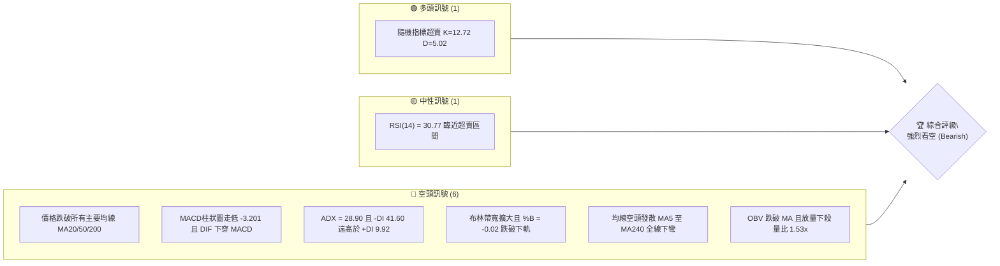
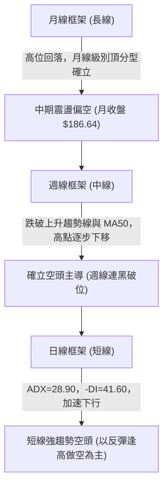
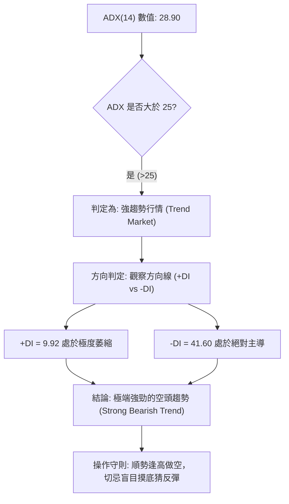
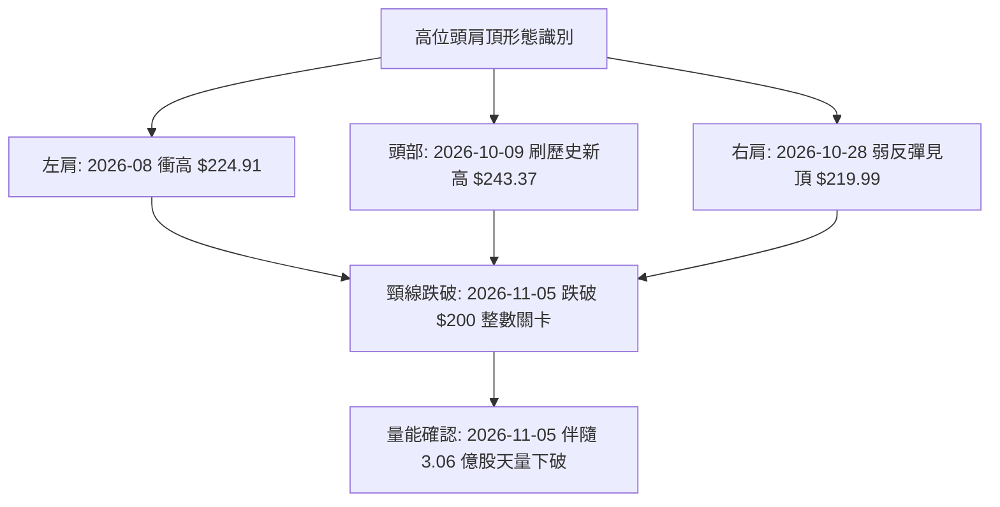
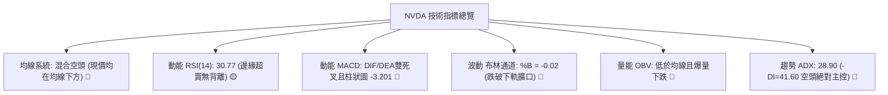
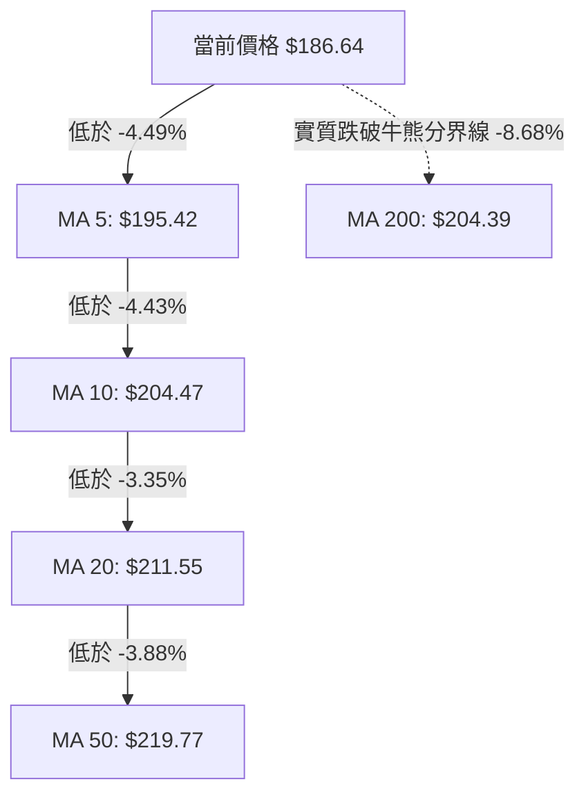
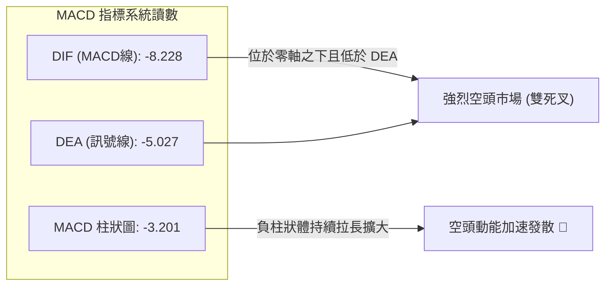
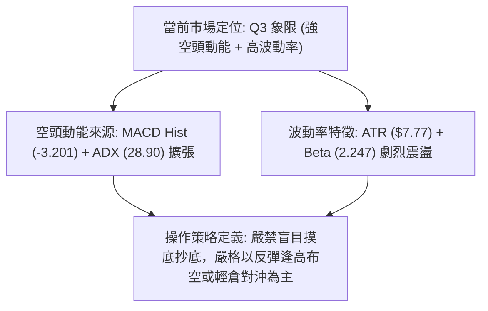
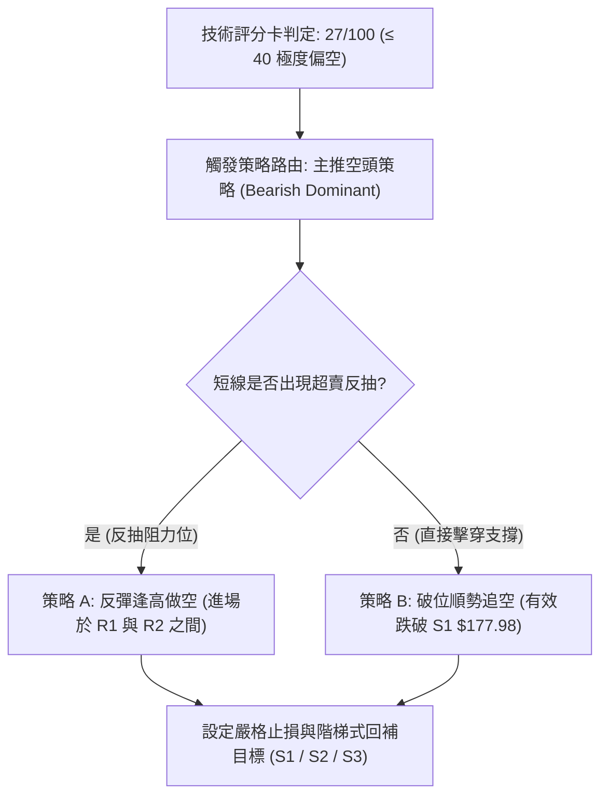
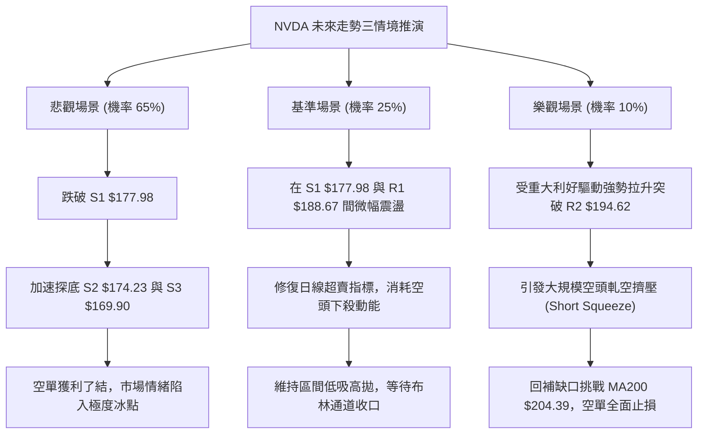

# NVDA 技術分析報告

> **報告日期**：2026-11-09 ｜ **語言**：繁體中文 ｜ **數據來源**：Yahoo Finance ｜ **當前價格**：$186.64

---

## 目錄

| 章節 | 內容 |
|------|------|
| [1. 技術面概覽](#1-技術面概覽) | 訊號儀表板、核心指標、評分卡 |
| [2. 趨勢分析](#2-趨勢分析) | 多時框趨勢、長中短期走勢 |
| [3. 圖表形態分析](#3-圖表形態分析) | 形態識別、K線組合、目標價 |
| [4. 支撐與阻力](#4-支撐與阻力) | 關鍵價位、斐波那契回調 |
| [5. 技術指標深度解讀](#5-技術指標深度解讀) | MA/RSI/MACD/布林/成交量 |
| [6. 動能與波動率](#6-動能與波動率) | 動能評估、ATR、Beta |
| [7. 多時框架總結](#7-多時框架總結) | 時框架評分矩陣 |
| [8. 交易策略建議](#8-交易策略建議) | 多空策略、風險報酬比 |
| [9. 風險提示與監控](#9-風險提示與監控) | 監控指標、風險場景 |

---

## 1. 技術面概覽

### 🎯 技術訊號儀表板



### 📊 核心指標速覽表

| 指標類別 | 指標名稱 | 當前數值 | 訊號 | 解讀 |
|----------|----------|----------|------|------|
| **價格** | 當前價格 | $186.64 | 🔴 | 位於 52 週區間 28.6% 分位，處於中長期偏弱結構 |
| **均線** | MA20 | $211.55 | 🔴 | 價格低於 MA20 達 -11.77%，短線下行趨勢顯著 |
| **均線** | MA50 | $219.77 | 🔴 | 價格低於 MA50 達 -15.08%，中期結構全面走弱 |
| **均線** | MA200 | $204.39 | 🔴 | 跌破牛熊分界線 MA200 達 -8.68%，長期趨勢面臨考驗 |
| **動能** | RSI(14) | 30.77 | 🟡 | 位於中性邊緣偏超賣區（Wilder 模式），尚未形成超賣鈍化 |
| **動能** | MACD | -8.228 | 🔴 | MACD 線低於 Signal 線（-5.027），柱狀圖擴大至 -3.201，空頭動能強勁 |
| **波動** | ATR(14) | $7.77 | 🔴 | 佔股價 4.16%，市場波動顯著放大，日均振幅高 |

### 🏆 技術評分卡

```
╔══════════════════════════════════════════════════════════════╗
║                技術評分卡 — NVDA (2026-11-09)                 ║
╠══════════════════════════════════════════════════════════════╣
║ 趨勢強度      ████████████████░░░░  30/100  🔴 空頭趨勢強烈   ║
║ 動能指標      ██████░░░░░░░░░░░░░░  25/100  🔴 動能全面衰退   ║
║ 支撐穩定度    ████████░░░░░░░░░░░░  35/100  🔴 關鍵均線皆失守 ║
║ 成交量配合    ██████░░░░░░░░░░░░░░  25/100  🔴 放量下殺量價背離║
║ 形態完整度    ████████░░░░░░░░░░░░  30/100  🔴 頭肩頂破位延伸 ║
║ 均線排列      ████░░░░░░░░░░░░░░░░  15/100  🔴 均線空頭排列發散║
╠══════════════════════════════════════════════════════════════╣
║ 綜合評分      ██████░░░░░░░░░░░░░░  27/100  🔴 強烈看空       ║
╚══════════════════════════════════════════════════════════════╝
```
*(註：綜合評分由六項子評分之算術平均計算：(30 + 25 + 35 + 25 + 30 + 15) / 6 = 26.67，四捨五入為 27/100。)*

---

## 2. 趨勢分析

### 🌐 多時框趨勢分析



### 📈 長期趨勢 — 12個月走勢圖（Unicode）

```
NVDA 月線走勢圖（過去12個月：2024-12 至 2026-11）
價格軸 ($)
$240 ┤                                        ● $228.38 (2026-09)
$220 ┤                                  ● $220.53
$200 ┤                     ● $210.66        
$190 ┤       ● $190.68         ● $199.87  ● $200.53  ● $204.64
$180 ┤           ● $176.78                              ● $186.64 (現價)
$170 ┤               ● $174.00
$130 ┤ ● $133.94
$110 ┤     ● $119.76
     └───────────────────────────────────────────────────────────► 時間
       12  01  02   03  04  05    06    07   08   09   10   11 (月份)
     [── 2024/25 ──] [──────────────── 2026 ─────────────────]
```

#### 走勢特徵分析表格

| 階段 | 時間區間 | 起始價 → 結束價 | 漲跌幅 | 走勢特徵與結構意涵 |
|------|----------|-----------------|--------|--------------------|
| 探底築底 | 2024-12 ~ 2025-03 | $133.94 → $108.11 | -19.28% | 經歷大幅去槓桿回調，於 $108 附近形成堅實複合底 |
| 主升浪潮 | 2025-04 ~ 2025-10 | $108.65 → $202.01 | +85.93% | AI 需求爆發，均線呈完美多頭排列，突破 $200 整數關卡 |
| 高位中繼 | 2025-11 ~ 2026-03 | $176.58 → $174.00 | -1.46% | 區間 $174~$190 橫盤消化獲利籌碼，多次回踩 $174 支撐 |
| 延伸衝頂 | 2026-04 ~ 2026-09 | $199.11 → $228.38 | +14.70% | 創下歷史與 52 週高點 $243.37，高位出現量價背離徵兆 |
| 破位下殺 | 2026-10 ~ 2026-11 | $204.64 → $186.64 | -8.79% | 突發利空與多殺多，連續失守 MA20、MA50、MA200，結構崩壞 |

### 📊 中期趨勢（週線分析）

```
週線級別價格壓力與支撐階梯示意圖：
  $243.37 ════════════════════════════════════════ 52W 最高點（強阻力頂峰）
             ▲
             │ （四週內連續大幅下挫 -23.3%）
             ▼
  $214.75 ──────────────────────────────────────── 波段密集高點頸線 R3
  $204.39 ┄ ┄ ┄ ┄ ┄ ┄ ┄ ┄ ┄ ┄ ┄ ┄ ┄ ┄ ┄ ┄ ┄ ┄ ┄ ┄ ┄ MA200 關鍵牛熊轉換線
  $194.62 ---------------------------------------- 波段反彈阻力位 R2
  $188.67 ---------------------------------------- 近期下跳缺口阻力位 R1
  $186.64 ◄■■■ 當前收盤價 ($186.64)
  $177.98 ======================================== 波段聚類第一支撐 S1
  $174.23 ======================================== 歷史密集低點第二支撐 S2
  $169.90 ======================================== 強支撐位 S3
  $163.90 ════════════════════════════════════════ 52W 最低點（年度防線）
```

### ⚡ 趨勢強度評估（ADX 解讀）



#### ADX 強度指標對照表

| 指標變量 | 具體讀數 | 門檻區間 | 趨勢意涵解讀 |
|----------|----------|----------|--------------|
| **ADX(14)** | **28.90** | > 25 (強趨勢) | 脫離無方向盤整，進入動能驅動型趨勢加速階段 |
| **+DI** | **9.92** | < 15 (多頭枯竭) | 多頭買盤力道極度孱弱，多方無力組織有效反擊 |
| **-DI** | **41.60** | > 40 (空方極強) | 空方完全掌控盤面定價權，籌碼拋售壓力沉重 |
| **DI 差值** | **-31.68** | 負向擴大 | 空頭動能持續擴張，短期尚未見到收斂拐點 |

---

## 3. 圖表形態分析

### 🔍 形態識別系統



#### 形態識別與信心度評估表

| 形態名稱 | 信心度 | 判斷依據（引用數據） | 完成度 | 目標價（附計算式） |
|----------|--------|----------------------|--------|--------------------|
| **頭肩頂形態** | 85% | 左肩高點 $224.91 (2026-08-14)、頭部最高點 $243.37 (2026-10-09)、右肩高點 $219.99 (2026-10-28)；頸線位於 2026-10-30 低點 $200.92。2026-11-05 放量大陰線收 $181.60 實質跌破。 | 100% (已跌破) | 頸線 $200.92 − 形態高度 ($243.37 − $200.92 = $42.45) = **$158.47** (若數據受限於 52W 低點則以 S3 $169.90 為防守目標) |
| **布林下軌向下突破開口** | 90% | 價格 $186.64 跌破 BB 下軌 $187.73，%B 為 -0.02，通道口全面擴張，為強烈趨勢突破訊號。 | 100% | 依據下軌延伸與 S1 支撐，初步目標看 **$177.98** |
| **均線死叉發散形態** | 95% | MA5 ($195.42) < MA10 ($204.47) < MA20 ($211.55) < MA50 ($219.77)，全線下行發散。 | 100% | 均線反壓沉重，反彈阻力目標設於 MA5 **$195.42** 附近 |

### 🕯️ 重要K線形態分析

嚴格依據近 10 根日 K 與近 8 根週 K 實際數值進行幾何與量價解讀：

| 日期（日K/週K） | 開 | 高 | 低 | 收 | 成交量 | K線形態 | 解讀與技術訊號 | 訊號 |
|------------------|----|----|----|----|--------|---------|----------------|------|
| **2026-10-28 (日)** | 219.92 | 219.99 | 214.47 | 215.38 | 93,030,200 | 上影小陰線 | 右肩高點受阻於 $220，多頭無力上攻 | 🔴 |
| **2026-10-30 (日)** | 208.94 | 209.06 | 200.92 | 204.64 | 168,386,400 | 放量長陰破位線 | 成交量放大至 1.68 億股，回測 $200 支撐，多頭力竭 | 🔴 |
| **2026-11-04 (日)** | 203.50 | 206.79 | 199.68 | 200.13 | 149,033,300 | 光腳中陰線 | 收盤逼近最低點且跌破 $200，賣壓全面出籠 | 🔴 |
| **2026-11-05 (日)** | 196.07 | 196.25 | 181.46 | 181.60 | 306,127,800 | 崩跌大陰線 | 暴跌 -9.26%，單日成交爆出 3.06 億股天量，恐慌盤湧出 | 🔴 |
| **2026-11-06 (日)** | 191.10 | 194.90 | 185.22 | 186.64 | 179,722,400 | 低開衝高長上影陽線 | 多頭反抽受阻於 $194.90，收盤遠低於開盤價，反彈無力 | 🟡 |
| **2026-10-09 (週)** | 236.09 | 243.37 | 229.11 | 229.28 | 513,988,800 | 衝高回落倒錘頭週K | 創歷史新高 $243.37 後收出長上影，確立天花板見頂 | 🔴 |
| **2026-11-06 (週)** | 207.53 | 209.98 | 181.46 | 186.64 | 846,099,100 | 超級放量巨陰週K | 週跌幅 -8.79%，週成交量激增至 8.46 億股，破位確立 | 🔴 |

### 📉 ASCII 走勢形態示意圖

```
NVDA 日線頭肩頂破位結構示意圖：
$243.37 ┬                        [頭部] 2026-10-09 ($243.37)
        │                          ▲
$225.00 ┤        [左肩]           / \
        │       2026-08-14       /   \            [右肩]
$220.00 ┤        ($224.91)      /     \         2026-10-28 ($219.99)
        │          ▲           /       \          ▲
$210.00 ┤         / \         /         \        / \
        │        /   \       /           \      /   \
$200.00 ┼═══════╧═════▼═════╧═════════════▼════╧═════▼════════ 頸線 $200.92
        │                                             \
$190.00 ┤                                              \   跌破頸線下殺
        │                                               ▼
$186.64 ┤                                                ● 現價 $186.64
        │                                                │
$181.46 ┴                                                ▼ 最低點 $181.46
        └─────────────────────────────────────────────────────────────►
```

### 🎯 形態目標價計算

1. **頭肩頂形態理論測幅**：
   - **頭部頂點**：$243.37
   - **形態頸線**：$200.92 (2026-10-30 之波段低點)
   - **形態垂直高度**：$243.37 − $200.92 = $42.45
   - **理論下跌目標價**：頸線 $200.92 − 形態高度 $42.45 = **$158.47**
2. **保守波段目標對接（結合關鍵價位數據）**：
   - 由於下行面臨密集歷史支撐，第一波段空頭回補目標鎖定數據支撐 **S1 = $177.98**。
   - 形態延伸滿足位則對應長期聚類支撐 **S2 = $174.23** 及 **S3 = $169.90**。

---

## 4. 支撐與阻力

### 🗺️ 關鍵價位分布圖（Unicode）

```
NVDA 價位結構分布圖
══════════════════════════════════════════════════════════════════
$214.75 ║████████████████████████████████████████║ 強阻力 R3 (波段密集高點)
$194.62 ║██████████████████████████              ║ 阻力 R2 (反彈高點/Fib 61.8%)
$188.67 ║██████████████████                      ║ 關鍵阻力 R1 (布林下軌上緣)
$186.64 ╠════════════════════════════════════════╣ ◄ 現價 ($186.64)
$177.98 ║▓▓▓▓▓▓▓▓▓▓▓▓▓▓▓▓▓▓▓▓                    ║ 近期支撐 S1 (近期波段支撐)
$174.23 ║▓▓▓▓▓▓▓▓▓▓▓▓▓▓▓▓▓▓▓▓▓▓▓▓▓▓              ║ 強支撐 S2 (歷史密集底)
$169.90 ║▓▓▓▓▓▓▓▓▓▓▓▓▓▓▓▓▓▓▓▓▓▓▓▓▓▓▓▓▓▓▓▓        ║ 重大防禦 S3 (破位終極支撐)
══════════════════════════════════════════════════════════════════
```

### 🚧 阻力位分析表

所有價位均嚴格取自數據提供的波段聚類計算數值：

| 阻力級別 | 價位 | 與現價差距 | 形成原因與籌碼解讀 | 突破難度 | 重要性 |
|----------|------|------------|--------------------|----------|--------|
| **R1** | **$188.67** | +1.09% | 2026-11-06 日高回落反壓區，且極度貼近布林下軌 $187.73，為短線空頭反撲第一道關卡。 | 🟡 中等 | 短線多空臨界 |
| **R2** | **$194.62** | +4.28% | 斐波那契 61.8% 重合位 ($194.25) 與 MA5 均線 ($195.42) 重疊，為強大套牢賣壓帶。 | 🔴 極高 | 波段防守樞紐 |
| **R3** | **$214.75** | +15.06% | 2026-10 月下旬密集橫盤換手區，跌破後已轉化為強大天花板阻力，MA20/MA50 匯聚於此。 | 🔴 堅不可摧 | 中期趨勢反轉點 |

### 🛡️ 支撐位分析表

所有價位均嚴格取自數據提供的波段聚類計算數值：

| 支撐級別 | 價位 | 與現價差距 | 形成原因與籌碼解讀 | 守住機率 | 重要性 |
|----------|------|------------|--------------------|----------|--------|
| **S1** | **$177.98** | -4.64% | 近期波段急跌低點聚集帶，鄰近斐波那契 78.6% 回調位 ($180.90)，短線有技術性買盤。 | 🟡 50% | 短線第一緩衝 |
| **S2** | **$174.23** | -6.65% | 2026-02 至 2026-03 歷史平台低點密集聚類（$174.00 處），為中線機構加倉底線。 | 🟢 65% | 中期生命線 |
| **S3** | **$169.90** | -8.97% | 逼近 52 週低點 $163.90 前最後一道波段強支撐，若失守將引發基本面與流動性恐慌。 | 🟢 75% | 長期牛市底線 |

### 📐 斐波那契回調位分析

依據 52 週波動區間（低點 **$163.90** 至 高點 **$243.37**，總垂直價差 $79.47）之嚴格計算：

```
斐波那契回調結構梯形圖：
0.0%  ($243.37) ──────────────────────────────── 52W 最高點
23.6% ($224.61) ──────────────────────────────── 初期回調位
38.2% ($213.01) ──────────────────────────────── 弱勢防守位 (已實質跌破)
50.0% ($203.63) ──────────────────────────────── 多空分水嶺 (MA200 匯聚區，已跌破)
61.8% ($194.25) ──────────────────────────────── 黃金分割關鍵位 (反彈壓力 R2)
────────────────現價 $186.64 (位於 61.8% 與 78.6% 之間)───────────────
78.6% ($180.90) ──────────────────────────────── 深度回調支撐位 (考驗中)
100.0%($163.90) ──────────────────────────────── 52W 最低點
```

- **位置解讀**：當前收盤價 **$186.64** 位於 61.8% 回調位（$194.25）與 78.6% 回調位（$180.90）之間。
- **技術意義**：股票已跌破黃金分割位 61.8%，代表自 $163.90 起漲之整個中長期多頭浪潮遭受毀滅性破壞，盤勢由「強勢回調」徹底轉化為「深度修正」；下一道關鍵技術防線完全落在 78.6%（$180.90）與 S1（$177.98）共振區。

---

## 5. 技術指標深度解讀

### 🎛️ 指標訊號總覽



### 📈 移動平均線排列分析



#### 均線系統數據明細表

| 均線名稱 | 當前價格 | 與現價價差 | 乖離率 (%) | 均線走勢圖形態特徵 | 訊號評估 |
|----------|----------|------------|------------|--------------------|----------|
| **MA 5** | $195.42 | -$8.78 | -4.49% | 急劇陡峭下彎，短線反壓沉重 | 🔴 極度看空 |
| **MA 10** | $204.47 | -$17.83 | -8.72% | 持續俯衝向下，空頭排列形成 | 🔴 極度看空 |
| **MA 20** | $211.55 | -$24.91 | -11.77% | 中期生命線拐頭向下 | 🔴 看空 |
| **MA 50** | $219.77 | -$33.13 | -15.08% | 季線下行，中期趨勢瓦解 | 🔴 看空 |
| **MA 60** | $219.41 | -$32.77 | -14.93% | 高位鈍化後全面反轉下挫 | 🔴 看空 |
| **MA 120** | $213.69 | -$27.05 | -12.66% | 半年線失守，長多籌碼鬆動 | 🔴 看空 |
| **MA 200** | $204.39 | -$17.75 | -8.68% | 跌破牛熊分界線，轉為中期熊市架構 | 🔴 看空 |
| **MA 240** | $200.78 | -$14.14 | -7.04% | 年線亦宣告失守 | 🔴 看空 |

- **排列解讀**：現價全線運行於所有長短期均線下方。短中期均線呈完美空頭瀑布發散，且跌破 MA200，任何向上反彈均將面臨層層解套套牢盤的痛擊。

### 📉 RSI(14) 分析

```
RSI(14) 讀數進度條：
0            20           30.77        50                        70          100
[────────────┴────────────┼────────────┴─────────────────────────┴────────────]
 極端超賣區   超賣門檻     當前位置(30.77)          中性水平              超買區間
 進度顯示：████████░░░░░░░░░░░░░░░░░░░░░░░░░░░░░░░░░░░░░░░░ (30.77%)
```

- **超買超賣判斷**：RSI(14) 目前為 **30.77**（採用 Wilder 平滑算法）。數值貼近 30 超賣臨界點但尚未跌破 30，說明空頭動能釋放極其強烈但尚未形成極度超賣鈍化，仍具備慣性向下探底的動能空間。
- **背離分析**：
  - 根據近 20 根 K 棒的首尾對比（價格由高位下殺創波段新低，RSI 同步自 55 下降至 30.77），**無明顯底背離現象**。
  - 週線級別：價格創下近 4 個月新低，週 RSI 同步下探至 30.8，量價與動能指標高度一致向下，確認下行趨勢真實有效，排除假跌破可能。

### 📊 MACD(12/26/9) 訊號解讀



- **訊號解析**：DIF 線（-8.228）大幅低於 Signal 線（-5.027），且雙雙深入負值區域（零軸以下極遠處），表明中期與長期趨勢均完全由空方定價。MACD Histogram 為 **-3.201**，負值柱狀圖持續擴張，顯示空頭下殺動能尚未出現衰竭跡象。

### 📦 布林通道分析

```
NVDA 布林通道 (20, 2) 空間位置示意圖：
$235.36 ┬────────────────────────────────────────── BB 上軌 (Upper Band)
        │
$211.55 ┼┄┄┄┄┄┄┄┄┄┄┄┄┄┄┄┄┄┄┄┄┄┄┄┄┄┄┄┄┄┄┄┄┄┄┄┄┄┄┄┄ BB 中軌 (MA20)
        │
$187.73 ┴────────────────────────────────────────── BB 下軌 (Lower Band)
  ▲
  │ 異常溢出破位
$186.64 ◄■■■ 現價 (收盤跌破下軌，%B = -0.02)
```

- **布林參數**：中軌（MA20）$211.55，上軌 $235.36，下軌 $187.73，通道帶寬為 $47.63。
- **%B 指標解讀**：%B 讀數為 **-0.02**（計算式：(186.64 − 187.73) / (235.36 − 187.73) = -0.0228）。現價實質脫離布林通道下軌運行。在 ADX > 25 的強趨勢背景下，%B 跌破 0 象徵「走下軌」的極端單邊空頭行情，非單純反彈買點，而是動能超載訊號。

### 💹 成交量分析（量價配合度）

```
量能激增結構圖：
最新單日成交量 (2026-11-06) : 179,722,400 股  (量比: 1.53x 20日均量)
20日均量 (Volume MA20)       : 117,674,370 股
50日均量 (Volume MA50)       : 115,763,138 股
前一日崩跌量 (2026-11-05)   : 306,127,800 股  (高達均量 2.60 倍，極端恐慌量)
週成交量 (2026-11-06 週末)   : 846,099,100 股  (創下數月以來週天量下殺)
```

- **量價關係解讀**：
  1. **放量破位**：2026-11-05 跌破 $200 關鍵整數心理防線時，成交量暴衝至 3.06 億股，顯示機構籌碼大規模出逃；2026-11-06 延續放量至 1.8 億股（量比 1.53x），呈現典型「價跌量增」的空頭攻擊形態。
  2. **OBV（能量潮）走勢**：技術快照標明「OBV < MA → 量能疲弱」，能量潮指標已先於價格下穿其移動平均線，買盤後繼無力，資金呈現持續淨流出狀態。

---

## 6. 動能與波動率

### ⚡ 動能評估四象限

| 象限 | 動能維度 | 波動維度 | 歷史定義 | NVDA 當前狀態檢驗 | 戰略評估 |
|------|----------|----------|----------|-------------------|----------|
| **Q1** | 強多頭動能 | 低波動 | 穩健主升浪 | 否（動能全面向下） | 最佳持股做多期 |
| **Q2** | 弱多頭動能 | 低波動 | 底部橫盤整理 | 否（波動率正急劇放大） | 謹慎觀望，等待突破 |
| **Q3** | 強空頭動能 | 高波動 | 恐慌拋售加速 | **✓ 契合當前現狀** | **高風險高收益空頭市場** |
| **Q4** | 弱多頭動能 | 高波動 | 無序震盪洗盤 | 否（方向明確單邊向下） | 避免進場，極易遭雙巴 |



### 📊 ATR 波動率分析

- **ATR(14) 絕對值**：**$7.77**（採用 Wilder 計算模式）。
- **ATR 相對百分比**：佔當前股價 $186.64 的 **4.16%**。這意味著 NVDA 平均單日正常波動幅度即接近 $8 美元，日內振幅極大。
- **止損距離建議**：
  - 短線交易止損緩衝：建議設為 $1.0 \times \text{ATR} \approx \$7.80$。
  - 波段交易止損緩衝：建議設為 $1.5 \times \text{ATR} \approx \$11.65$。
  - 極端波動環境下，任何進場點必須給予足夠的價差容錯空間，避免被日內隨機噪音掃地出場。

### 📐 Beta 與市場相關性

- **Beta 係數**：**2.247**。
- **市場敏感度解讀**：NVDA 展現出超高彈性特徵，其理論波動幅度為標普 500 指數的 2.25 倍。當科技板塊或總體經濟面臨避險去槓桿情緒時，NVDA 將承受成倍的拋售下行壓力；反之，在市場出現技術性空頭回補時，反彈亦將極其劇烈。高 Beta 屬性要求投資人必須嚴格壓縮倉位規模。

---

## 7. 多時框架總結

### 📋 時框架評分表

| 時框架 | 趨勢方向 | 動能狀態 | 均線排列 | 形態特徵 | 綜合評分 | 戰略建議 |
|--------|----------|----------|----------|----------|----------|----------|
| **長期 (月線)** | 中性轉偏空 | 動能頂背離放緩 | MA240 雖在下方但受壓 | 歷史頂部頭肩大結構確立 | 40/100 🟡 | 逢高減碼長線持倉，鎖定獲利 |
| **中期 (週線)** | 強烈看空 | MACD柱擴大(-3.201) | 跌破 20 週/50 週均線 | 放量巨陰擊穿頸線支撐 | 25/100 🔴 | 波段順勢做空，禁止中長線抄底 |
| **短期 (日線)** | 極度看空 | RSI=30.77 臨近超賣 | 均線空頭瀑布發散 | 沿布林下軌加速下墜跌破 S1 | 20/100 🔴 | 尋求反抽阻力位逢高建空 |

### 🔲 綜合訊號矩陣

```
┌─────────────────┬──────────────────┬──────────────────┬──────────────────┐
│   維度 / 時框   │    短期 (日線)   │    中期 (週線)   │    長期 (月線)   │
├─────────────────┼──────────────────┼──────────────────┼──────────────────┤
│ 趨勢方向        │  🔴 空頭加速     │  🔴 空頭主導     │  🟡 震盪偏空     │
│ 動能 (RSI/MACD) │  🔴 空頭放量     │  🔴 柱狀擴大     │  🟡 動能放緩     │
│ 均線系統        │  🔴 空頭發散     │  🔴 破關鍵均線   │  🟡 逼近年線     │
│ 量價配合        │  🔴 價跌量增     │  🔴 破位天量     │  🟡 高位震盪     │
├─────────────────┼──────────────────┼──────────────────┼──────────────────┤
│ 矩陣結論        │  一致性全面看空  │  中短期空頭共振  │  長多結構受嚴重威脅│
└─────────────────┴──────────────────┴──────────────────┴──────────────────┘
```

### ⚖️ 多時框收斂結論

依據多時框收斂規則第 14 條：
1. **行情屬性判定**：當前 ADX(14) 讀數為 **28.90**（明確 > 25），且 -DI 達 41.60，定義為**典型的強趨勢單邊行情**，盤整區間震盪策略失效。
2. **主導時框優先級**：在強趨勢中，以中長期（週線/日線 MA50、MA200 破位）趨勢方向為主導，日線層級僅用於尋找反彈耗盡的精準切入點。日線短暫的超賣（如 RSI 貼近 30 或 Stoch %K 低位）不得作為逆勢做多理由，而應視為反彈做空時機。
3. **唯一方向性結論**：**【強烈偏空觀望 / 逢反彈做空】**。整體訊號在中短期呈現共振崩壞，主策略完全由空頭定價權主導。此結論與第 1 章評分卡（27/100）及後續交易策略完全一致。

---

## 8. 交易策略建議

### 🗺️ 策略決策流程圖



### 🧭 策略路由（依評分卡分流，不得兩頭下注）

> **當前主策略方向 = 主推空頭策略（依綜合評分 27/100，評級：強烈看空）**

綜合評分 27 分處於絕對空頭區間（≤ 40），市場已被空方全面主控。本報告堅決排除逆勢左側摸底做多建議，主推兩套高勝率空頭策略；多頭僅列為關鍵反轉點與風控對沖警示。

### 🎯 價格情境階梯（Price Scenarios）

所有價位均嚴格引用第 4 章及數據計算數值：

| 觸發條件 | 下一目標 | 後續延伸 | 情境技術含義 |
|----------|----------|----------|--------------|
| **反抽受阻 R1 $188.67** | 回測現價 $186.64 | 下探 S1 **$177.98** | 短線超賣修正完畢，空頭重啟下行 |
| **強勢突破 R2 $194.62** | 挑戰 R3 **$214.75** | 封閉缺口 | 多頭強烈反撲，空頭策略需嚴格止損離場 |
| **跌破支撐 S1 $177.98** | 測試 S2 **$174.23** | 貫穿至 S3 **$169.90** | 空頭加速浪展開，測試年度歷史底線 |

### 📊 情境機率分佈

| 情境 | 機率 | 主要依據（指標狀態） |
|------|------|----------------------|
| **回落 / 再探底（延續破位）** | **65%** | ADX 達 28.90 強趨勢、-DI 達 41.60、MACD 負柱狀體擴大至 -3.201、均線全面空頭排列。 |
| **超賣弱反彈 / 區間震盪** | **25%** | 隨機指標 Stoch 超賣（%K=12.72）、RSI 貼近 30 臨界點，具備技術性修復需求。 |
| **強勢反轉 / 向上突破** | **10%** | 需連續帶量收復 MA200 ($204.39) 與 R3 ($214.75)，目前在資金面與均線壓制下機率極低。 |

### 🟢 主策略詳情（方向依上方路由：空頭策略）

*(註：風險報酬比嚴格按規則 17 計算：做空 R:R = (進場價 − 目標價 T1) ÷ (止損價 − 進場價))*

| 策略要素 | 策略 A（反彈逢高做空 — 穩健型） | 策略 B（支撐破位追空 — 激進型） |
|----------|----------------------------------|----------------------------------|
| **操作邏輯** | 趁極端超賣短線反抽至均線反壓區精準建空 | 確認跌破波段密集支撐引發多殺多時順勢切入 |
| **進場條件** | 日線反抽觸及 R1 阻力且盤中出現滯漲上影線 | 日 K 收盤價實質跌破 S1 支撐位 |
| **進場價格** | **$188.67** (精確取自 R1) | **$177.98** (精確取自 S1) |
| **目標價 T1** | **$177.98** (精確取自 S1) | **$174.23** (精確取自 S2) |
| **目標價 T2** | **$174.23** (精確取自 S2) | **$169.90** (精確取自 S3) |
| **止損價格** | **$194.62** (精確取自 R2，防守 61.8% 回調位) | **$180.90** (精確取自 Fib 78.6% 回調反壓) |
| **風險報酬比** | **1 : 1.80（以 T1 計）**<br>*(188.67−177.98)÷(194.62−188.67) = 10.69÷5.95 = 1.80*<br>*(以 T2 計則為 1 : 2.43)* | **1 : 1.28（以 T1 計）**<br>*(177.98−174.23)÷(180.90−177.98) = 3.75÷2.92 = 1.28*<br>*(以 T2 計則為 1 : 2.77)* |
| **成功機率** | **68%** | **62%** |
| **建議倉位** | **15% - 20%** | **10% - 15%** |

### 🔴 反向風險觸發點（對沖提示）

若出現以下情境，將徹底推翻當前空頭主邏輯，投資人必須果斷平空止損或建立反向對沖部位：
1. **強勢收復牛熊線**：收盤價以連續兩根大陽線實質站穩 **MA200 ($204.39)** 與 50% 斐波那契位 **$203.63** 上方。
2. **量價逆轉**：單日成交量突破 2.5 億股且收出穿透性長下影線（如實體站回 R2 **$194.62**），且 RSI(14) 強勢重返 45 以上。
3. **空頭平倉線**：多頭反撲突破 R3 **$214.75**，代表頭肩頂形態徹底失效，必須無條件止損所有空單。

### ⭐ 整體訊號強度評星

```
做多訊號強度：★☆☆☆☆  (1/5星 — 僅有超賣指標支撐，逆勢風險極大)
做空訊號強度：★★★★☆  (4/5星 — 均線、量價、形態、ADX 多重共振看空)
整體可信度：  ★★★★☆  (4/5星 — 數據結構清晰，單邊趨勢特徵顯著)
```

---

## 9. 風險提示與監控

### ✅ 關鍵監控指標 Checklist

```
╔══════════════════════════════════════════════════════════════╗
║                   關鍵技術監控指標 CHECKLIST                 ║
╠══════════════════════════════════════════════════════════════╣
║ [ ] 監控價位 $188.67 (R1)：觀察短線反彈是否在此遇阻回落      ║
║ [ ] 監控價位 $177.98 (S1)：空單第一道止盈線，觀察買盤承接力  ║
║ [ ] 監控價位 $194.62 (R2)：空頭策略絕對防守線，突破立即止損  ║
║ [ ] RSI(14) 是否跌破 30：確認是否形成超賣鈍化或出現微幅底背離║
║ [ ] 日成交量是否萎縮至 1.15 億股以下：量縮代表拋壓減弱       ║
║ [ ] ADX(14) 是否持續上升 > 30：判斷下行趨勢是否處於加速衝刺期║
║ [ ] -DI 是否維持在 40 以上：檢驗空方是否牢固掌握盤面主控權   ║
╚══════════════════════════════════════════════════════════════╝
```

### ⚠️ 風險場景分析



### 🛡️ 風險管理重要提醒

1. **基本面事件風險干擾**：
   - 數據快照顯示近期存在高層調查與監管調查等突發利空新聞，此類事件型驅動往往會引發跳空缺口，導致技術分析的技術支撐暫時失效。
   - 在高不確定性下，隔夜持倉必須控制在總資金的 15% 以下，切忌重倉賭單邊。
2. **高 Beta 波動率對沖**：
   - NVDA Beta 高達 2.247 且 ATR 達 $7.77（4.16%）。高槓桿衍生品（如期權或短線差價合約）將面臨極高的波動損耗。
   - 嚴格落實「以波動率決定倉位」原則：若設定單筆交易最大虧損限額為總帳戶的 1.5%，依照 $5.95 的止損幅度計算，持股部位切不可超過總資產的 20%。
3. **恐慌拋售中的流動性黑洞**：
   - 成交量在 11-05 暴增至 3 億股，說明機構拋壓沉重。若盤中跌破 S1，需提防買盤瞬間撤單引發的滑價（Slippage）風險，停損單建議採用市價單或寬幅限價單。

---

## 📋 報告總結

```
NVDA 技術分析報告總結
══════════════════════════════════════════════════════════════════
報告日期：2026-11-09
當前價格：$186.64
分析評級：🔴 強烈看空（Bearish，綜合技術評分：27/100）

關鍵結論：
├─ 長期趨勢：🟡 中性轉偏空（月線高位滯漲，考驗年線支撐）
├─ 中期趨勢：🔴 強烈看空（頭肩頂形態成立，放量擊穿頸線）
├─ 短期趨勢：🔴 單邊下行（ADX=28.90 強趨勢，跌破布林下軌）
├─ 關鍵支撐：S1: $177.98 ｜ S2: $174.23 ｜ S3: $169.90
├─ 關鍵阻力：R1: $188.67 ｜ R2: $194.62 ｜ R3: $214.75
└─ 分析師目標：華爾街平均目標 $327.14（與短期技術面嚴重背離）

最優策略組合：
1. 🥇 最佳機會：策略 A — 反彈逢高建空（進場: $188.67，止損: $194.62，目標: $177.98，R:R = 1:1.80）
2. 🥈 次選機會：策略 B — 破位追空（進場: $177.98，止損: $180.90，目標: $174.23，R:R = 1:1.28）
3. 🥉 保守選擇：完全空倉觀望，耐心等待價格下探至 S2 $174.23 附近且日線形成量價底背離再行定奪。
══════════════════════════════════════════════════════════════════
```

---

> ⚠️ **免責聲明**：本報告為 AI 自動生成之技術分析，所有數據及估算均基於提供的歷史價格資訊。本報告**僅供研究與學術參考**，**不構成任何投資建議**。投資有風險，入市需謹慎。

---

*報告生成時間：2026-11-09 ｜ 數據來源：Yahoo Finance ｜ 分析框架：多時框技術分析*