# NVDA 技術分析報告

> **報告日期**：2026-11-10 ｜ **語言**：繁體中文 ｜ **數據來源**：Yahoo Finance ｜ **當前價格**：$178.67

---

## 目錄

| 章節 | 內容 |
|------|------|
| [1. 技術面概覽](#1-技術面概覽) | 訊號儀表板、核心指標、評分卡 |
| [2. 趨勢分析](#2-趨勢分析) | 多時框趨勢、長中短期走勢 |
| [3. 圖表形態分析](#3-圖表形態分析) | 形態識別、K線組合、目標價 |
| [4. 支撐與阻力](#4-支撐與阻力) | 關鍵價位、斐波那契回調 |
| [5. 技術指標深度解讀](#5-技術指標深度解讀) | MA/RSI/MACD/布林/成交量 |
| [6. 動能與波動率](#6-動能與波動率) | 動能評估、ATR、Beta |
| [7. 多時框架總結](#7-多時框架總結) | 時框架評分矩陣 |
| [8. 交易策略建議](#8-交易策略建議) | 多空策略、風險報酬比 |
| [9. 風險提示與監控](#9-風險提示與監控) | 監控指標、風險場景 |

---

## 1. 技術面概覽

### 🎯 技術訊號儀表板

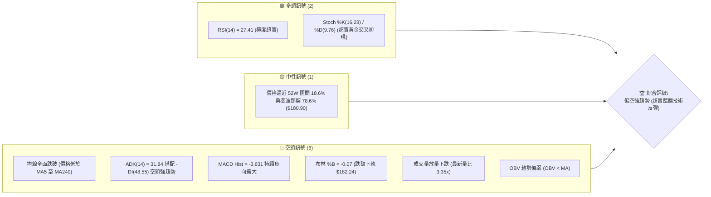

### 📊 核心指標速覽表

| 指標類別 | 指標名稱 | 當前數值 | 訊號 | 解讀 |
|----------|----------|----------|------|------|
| **價格** | 當前價格 | $178.67 | 🔴 | 位於 52 週低點區間 18.6%，連續重挫尋底中 |
| **均線** | MA20 | $209.16 | 🔴 | 價格低於 MA20 達 -14.58%，短中期空頭排列發散 |
| **均線** | MA50 | $219.00 | 🔴 | 中期關鍵趨勢線失守，形成中期巨大反壓 |
| **均線** | MA200 | $204.35 | 🔴 | 跌破牛熊分界線 MA200（-12.57%），長期結構受損 |
| **動能** | RSI(14) | 27.41 | 🟢 | 進入極度超賣區（<30），隨時具備技術性跌深反彈動能 |
| **動能** | MACD(12/26/9) | -9.567 / -5.935 (柱 -3.631) | 🔴 | 雙線位於零軸下方且負向柱狀體持續擴大，空頭主導 |
| **動能** | Stoch %K / %D | 16.23 / 9.76 | 🟢 | 雙雙處於 20 以下超賣鈍化區，%K 上穿 %D 醞釀金叉 |
| **趨勢** | ADX(14) | 31.84 (+DI: 8.54 / -DI: 48.55) | 🔴 | ADX > 25 且 -DI 具絕對統治力，確認為標準空頭單邊趨勢 |
| **通道** | 布林帶 %B | -0.07 (下軌 $182.24) | 🔴 | 跌破布林下軌，呈現沿下軌極端向下擴散形態 |
| **量能** | 當日成交量 | 459,116,500 (20日均量 1.37億) | 🔴 | 量比達 3.35 倍，恐慌性放量殺跌，量能顯著異常 |
| **波動** | ATR(14) | $8.38 (4.69%) | 🔴 | 單日平均真實波動劇烈擴大，短線進出場滑點與風險激增 |

### 🏆 技術評分卡

```
技術評分卡 — NVDA (2026-11-10)
════════════════════════════════════════════════════
趨勢強度      ████████████████░░░░  20/100  🔴 空頭強趨勢主導
動能指標      ████████░░░░░░░░░░░░  35/100  🔴 動能極弱但超賣鈍化
支撐穩定度    ████████░░░░░░░░░░░░  30/100  🔴 多重支撐遭貫穿
成交量配合    ██████░░░░░░░░░░░░░░  20/100  🔴 巨量長黑殺跌
形態完整度    ████████░░░░░░░░░░░░  25/100  🔴 頂部頸線跌破形態
均線排列      ████░░░░░░░░░░░░░░░░  10/100  🔴 空頭發散且全線失守
════════════════════════════════════════════════════
綜合評分      ██████░░░░░░░░░░░░░░  23/100  🔴 極度偏空 (Strong Bearish)
════════════════════════════════════════════════════
計算說明：(20 + 35 + 30 + 20 + 25 + 10) ÷ 6 = 140 ÷ 6 = 23.33 → 四捨五入至整數 23/100
```

---

## 2. 趨勢分析

### 🌐 多時框趨勢分析

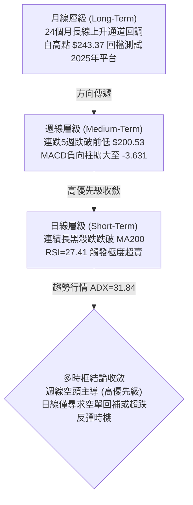

### 📈 長期趨勢 — 12個月走勢圖（Unicode）

```
NVDA 月線走勢圖（過去12個月：2025-12 至 2026-11）
價格軸 ($)
$230 ┤                                      ● (2026-09 $228.38)
$220 ┤                                ●
$210 ┤                    ●     ●
$200 ┤        ●           │     │           ● (2026-10 $204.64)
$190 ┤  ●           ●     │     │
$180 ┤  │     │     │     │     │                 ●←現價 ($178.67)
$170 ┤  │  ●  │  ●  │     │     │
     └─────────────────────────────────────────────────────────────
       12  01 02 03 04    05    06 07 08 09 10   11 (當前月份)
      (2025)                (2026)
```

**12個月走勢特徵分析表格**：

| 階段區間 | 起始-結束價格 | 區間漲跌幅 | 走勢特徵與量價架構 |
|----------|--------------|------------|--------------------|
| 2025-12 ~ 2026-03 | $186.06 → $174.00 | -6.48% | 大區間箱形沉澱，於 $174.00 築出第一重關鍵底部 |
| 2026-04 ~ 2026-06 | $199.11 → $199.87 | +0.38% | 突破 $200.00 整數關卡，於 $210.66 見波段高點後整固 |
| 2026-07 ~ 2026-09 | $200.53 → $228.38 | +13.89% | 主升浪推進，月線連續創歷史新高，見頂於 $243.37 (52W高點) |
| 2026-10 ~ 2026-11 | $204.64 → $178.67 | -12.69% | 高檔雙頂快速瓦解，單月長黑貫穿半年線與年線，技術面崩跌 |

### 📊 中期趨勢（週線分析）

從近20週數據觀察，NVDA 於 2026-10-09 當週創下 52 週高點 $243.37（收盤 $229.28）後，動能驟然衰竭。週線連續 5 週收黑，週成交量自 10 月中旬的 5.2 億股持續放大至 11 月第一週的 8.46 億股，呈現典型的「放量破位」格局。

```
週線關鍵壓力與支撐階梯架構
阻力階梯 3: $214.75 ═══════════════════════════ (10月中旬跌破之關鍵頸線)
阻力階梯 2: $194.62 ═══════════════════════════ (斐波那契 61.8% 密集反壓)
阻力階梯 1: $188.67 ═══════════════════════════ (11-06 週K收盤反壓區)
────────────────── 當前現價: $178.67 ──────────────────
支撐階梯 1: $177.98 ┄┄┄┄┄┄┄┄┄┄┄┄┄┄┄┄┄┄┄┄┄┄┄┄┄ (S1 密集成交區邊緣)
支撐階梯 2: $174.23 ═══════════════════════════ (S2 2026年3月波段前低)
支撐階梯 3: $169.90 ═══════════════════════════ (S3 強力支撐防線)
終極防線  : $163.90 ═══════════════════════════ (52週最低點 100% 斐波那契)
```

### ⚡ 趨勢強度評估（ADX 解讀）

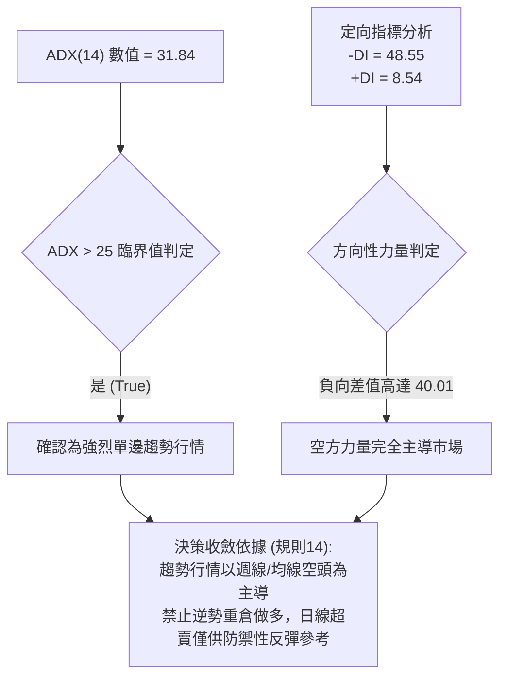

**ADX 趨勢強度對照表**：

| ADX 區間 | 當前數值狀態 | 趨勢性質 | 交易方針 |
|----------|--------------|----------|----------|
| 0 - 20 | — | 無趨勢 / 盤整 | 區間震盪操作（網格、高拋低吸） |
| 20 - 25 | — | 趨勢萌芽 / 微弱 | 觀望突破確認 |
| 25 - 40 | **31.84 (當前位置)** | **強趨勢 (Strong Trend)** | **順勢操作，當前空頭強烈主導，反彈皆為空點** |
| 40 - 60 | — | 極強趨勢 | 趨勢末端加速，嚴格跟蹤止損 |

---

## 3. 圖表形態分析

### 🔍 形態識別系統

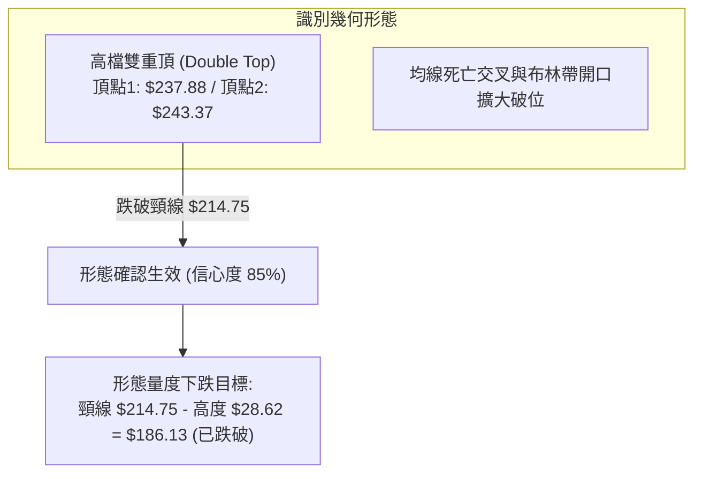

**形態信心度評估表**：

| 形態 | 信心度 | 判斷依據（引用數據） | 完成度 | 目標價（附計算式） |
|------|--------|----------------------|--------|--------------------|
| 高檔雙頂 (M頭) | 85% | 2026-10-02 當週高點 $237.88 與 2026-10-09 高點 $243.37 形成雙頂；跌破波段低點頸線 R3 $214.75 | 100% (已完全跌破並達成第1目標) | 頸線 $214.75 − 形態高度 ($243.37 − $214.75 = $28.62) = $186.13（已被貫穿） |
| 下降旗形 (Bear Flag) 破位 | 75% | 11-02 至 11-04 於 $200.13 ~ $209.98 弱勢整理後，11-05 放量大陰線跌破旗面下軌 | 100% | 旗桿高 $219.19 − 旗面 $199.68 = $19.51；突破點 $196.07 − $19.51 = $176.56 |
| 頭肩頂潛在形態 | 40% (訊號不足) | 數據不足以確認完整右肩對稱結構，僅做指標型解讀（均線空頭排列與布林帶向下破位） | — | 訊號不足，依規則 15 不予計算量度目標 |

### 🕯️ 重要K線形態分析

嚴格依據數據中「近10根日K」與「近8根週K」之開、高、低、收數據解讀：

| 日期（日K/週K） | 開 | 高 | 低 | 收 | K線形態 | 解讀 | 訊號 |
|------|----|----|----|----|---------|------|------|
| 日K 2026-10-30 | 208.94 | 209.06 | 200.92 | 204.64 | 放量中長黑破位 | 帶量跌破 MA200，多頭防線全面失守 | 🔴 |
| 日K 2026-11-03 | 207.96 | 209.14 | 205.93 | 206.69 | 弱勢小陽孕線 | 跌深微幅反彈，未越前日高點，量能萎縮 | 🟡 |
| 日K 2026-11-05 | 196.07 | 196.25 | 181.46 | 181.60 | 禿頭大黑棒 (光頭長黑) | 開盤即最高，爆出 3.06 億股巨量下殺，恐慌賣壓全面出籠 | 🔴 |
| 日K 2026-11-06 | 191.10 | 194.90 | 185.22 | 186.64 | 帶上下影短實體陰線 | 嘗試反彈受制於跳空缺口，量能遞減，反彈乏力 | 🔴 |
| 日K 2026-11-09 | 173.07 | 179.92 | 170.24 | 178.67 | 爆量長下影紅K (槌頭特徵) | 低開 $173.07 殺至 $170.24 後拉回 $178.67，4.59 億股巨量換手 | 🟢 |
| 週K 2026-10-09 | 236.09 | 243.37 | 229.11 | 229.28 | 長上影倒轉十字星 | 創 52 週新高 $243.37 後遭主力空頭阻擊，多空轉折信號 | 🔴 |
| 週K 2026-11-06 | 207.53 | 209.98 | 181.46 | 186.64 | 實體長黑貫穿K線 | 週跌幅逾 8.8%，放量 8.46 億股跌穿斐波那契 61.8% | 🔴 |
| 週K 2026-11-09 | 173.07 | 179.92 | 170.24 | 178.67 | 探底長下影K線 | 測試 $170.24 支撐後回升，顯現初步低檔承接盤 | 🟡 |

### 📉 ASCII 走勢形態示意圖

```
NVDA 近期日K極端下殺與下影線示意圖
價格 ($)
$215 ┤  [10-28 陰棒]
$210 ┤      │
$205 ┤      ├──[10-30 放量貫穿 MA200]
$200 ┤      │       └──[11-04 弱反彈中繼]
$195 ┤      │
$190 ┤      │            [11-05 跳空放量長黑]
$185 ┤      │                 │
$180 ┤      │                 │   [11-09 當前K棒: 爆量探底長下影]
$175 ┤      │                 │         ┌──┐ $179.92
$170 ┤      │                 │         │  │ 收 $178.67
$165 ┴──────┴─────────────────┴─────────┼──┼────────────────────
                                        │  │ 開 $173.07
                                        └──┘
                                          │  最低 $170.24 (近S3 $169.90)
```

### 🎯 形態目標價計算

1. **高檔雙頂量度目標**：
   - 頂部第一峰（2026-10-02 週高）：$237.88；第二峰（2026-10-09 週高）：$243.37
   - 頸線位置：R3 = $214.75
   - 形態高度 = 最高價 $243.37 − 頸線 $214.75 = $28.62
   - 理論下跌目標價 = 頸線 $214.75 − 形態高度 $28.62 = **$186.13**（該目標位已於 11-05 跌破）。
2. **下降旗形跌破延伸量度目標**：
   - 旗桿起點（10-27 高點）：$219.19，旗桿底（11-04 低點）：$199.68，旗桿垂直長度 = $19.51
   - 跌破點（11-05 開盤）：$196.07
   - 延伸量度目標 = $196.07 − $19.51 = **$176.56**（與當前現價 $178.67 及 S1 $177.98 極度接近，顯示形態量度跌幅已基本滿足）。

---

## 4. 支撐與阻力

### 🗺️ 關鍵價位分布圖（Unicode）

```
NVDA 價位結構分布圖 (OHLCV 精確計算)
═════════════════════════════════════════════════════════════════
$214.75 ║████████████████████████████████████████║ 強阻力 R3 (雙頂頸線/MA60)
$194.62 ║████████████████████████████          ║ 阻力 R2 (斐波 61.8% 密集區)
$188.67 ║████████████████████                  ║ 關鍵阻力 R1 (反彈第1道關卡)
$182.24 ║──────────────────────────────────────║ 布林通道下軌動態反壓
$180.90 ║┄┄┄┄┄┄┄┄┄┄┄┄┄┄┄┄┄┄┄┄┄┄┄┄┄┄┄┄┄┄┄┄┄┄║ 斐波那契 78.6% 回調線
$178.67 ╠══════════════════════════════════════╣ ◄ 現價 (Current Price)
$177.98 ║▓▓▓▓▓▓▓▓▓▓▓▓▓▓▓▓▓▓▓▓▓▓▓▓              ║ 近期支撐 S1 (波段低點聚類)
$174.23 ║████████████████████████████          ║ 強支撐 S2 (2026年3月波段前低)
$169.90 ║████████████████████████████████████  ║ 強力支撐 S3 (日內探底低點防線)
$163.90 ║████████████████████████████████████████║ 終極支撐 52W Low (100% 回調)
═════════════════════════════════════════════════════════════════
```

### 🚧 阻力位分析表

依據數據「關鍵價位」區塊嚴格引用，絕無憑空編造：

| 阻力級別 | 價位 | 形成原因 | 突破難度 | 重要性 |
|----------|------|----------|----------|--------|
| **R1** | **$188.67** | 近一年波段高點聚類；距現價 +5.60%，緊鄰 11-06 週K收盤價 $186.64 | 🟡 中等偏高 | 極高（短線超跌反彈第一道天花板） |
| **R2** | **$194.62** | 近一年波段高點聚類；距現價 +8.93%，與斐波那契 61.8% ($194.25) 共振 | 🔴 困難 | 極高（中期趨勢強弱分水嶺） |
| **R3** | **$214.75** | 近一年波段高點聚類；距現價 +20.19%，雙頂頸線與 MA120 ($213.34) 重疊 | 🔴 極度困難 | 戰略級（多頭若要逆轉趨勢必須收復之防線） |

### 🛡️ 支撐位分析表

依據數據「關鍵價位」區塊嚴格引用：

| 支撐級別 | 價位 | 形成原因 | 守住機率 | 重要性 |
|----------|------|----------|----------|--------|
| **S1** | **$177.98** | 近一年波段低點聚類；距現價僅 -0.39%，現價多空交戰核心臨界點 | 🟡 50% | 高（短線多頭第一防線） |
| **S2** | **$174.23** | 近一年波段低點聚類；距現價 -2.48%，契合 2026-03 月線收盤低點 $174.00 | 🟢 65% | 極高（強支撐，11-09 盤中打出低點後快速彈升） |
| **S3** | **$169.90** | 近一年波段低點聚類；距現價 -4.91%，守衛 52 週最低點前的最後一道壕溝 | 🟢 80% | 戰略級（一旦跌破將直測 52W 低點 $163.90） |

### 📐 斐波那契回調位分析

依據數據「斐波那契回調（52週區間 $163.90 → $243.37）」直接引用：

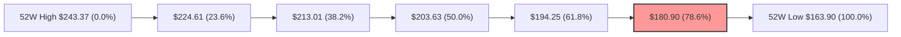

- **當前位置定位**：現價 **$178.67** 落於 **78.6% 回調位 ($180.90)** 與 **100.0% 回調位 ($163.90)** 之間。
- **技術意義解讀**：
  - 價格已經跌破被視為「多頭黃金分割最後防禦線」的 61.8% ($194.25) 以及深度回調線 78.6% ($180.90)。
  - 目前現價低於 78.6% 回調位約 1.23%，表明多頭在牛市回檔框架中已喪失結構優勢，技術結構轉變為空頭單邊主導下的極端超賣尋底。
  - 由於 78.6% ($180.90) 遭跌破，上方 $180.90 ~ $182.24（布林下軌）轉化為即期強烈反壓，下方空間直接開放測試 100.0% 52W 低點 $163.90。

---

## 5. 技術指標深度解讀

### 🎛️ 指標訊號總覽

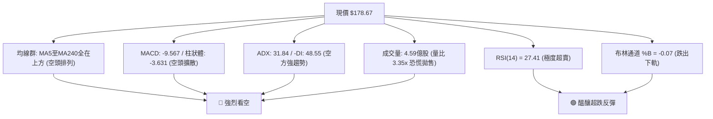

### 📈 移動平均線排列分析

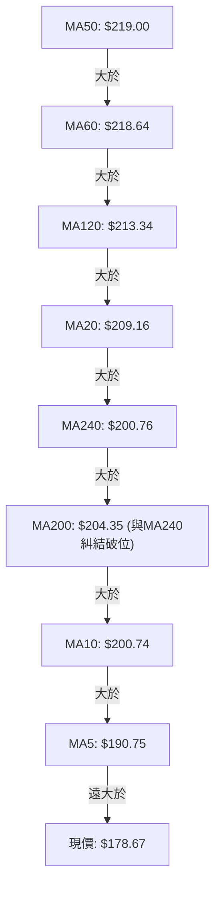

**移動平均線狀態詳解表**：

| 均線名稱 | 當前價格 | 與現價乖離率 | 走勢狀態 | 結構解讀 |
|----------|----------|--------------|----------|----------|
| MA5 | $190.75 | -6.33% | 急劇陡峭下行 | 短線直接動態反壓，反彈若不碰 MA5 均屬弱勢假反彈 |
| MA10 | $200.74 | -10.99% | 陡峭向下 | 兩週平均成本區，空頭第二道防線 |
| MA20 | $209.16 | -14.58% | 加速下傾 | 布林中軌所在，月線級別生命線徹底失守 |
| MA50 | $219.00 | -18.28% | 拐頭向下 | 中期趨勢線，空頭排列形成 |
| MA200 | $204.35 | -12.57% | 走平後遭跌破 | 牛熊分界線被實體巨陰貫穿，年線支撐轉為強阻力 |

### 📉 RSI(14) 分析

- **當前數值**：**27.41**（Wilder 計算法）。
- **進度條展示**：
  ```
  超賣區 (0-30)        中性區 (30-70)        超買區 (70-100)
  [████████░░░░░░░░░░░░░░░░░░░░░░░░░░░░░░░░░░░░░░░░] 27.41%
  ```
- **區間評估**：RSI 跌破 30 進入「極度超賣區」，反映市場經歷連續 5 個交易日的崩跌後，空頭動能已釋放至極端水平。
- **背離分析判斷**：
  - 依據數據「RSI 背離：無明顯背離（僅比較近20根K棒首尾的價格與RSI方向）」。
  - 結合近20週數據觀察：2026-10-09 週K價格 $229.28 處 RSI 為 53.0；至 2026-11-09 價格跌至 $178.67，RSI 同步滑落至 27.4。價格創波段新低，RSI 同步創波段新低。
  - **結論**：**無底背離，無頂背離**。此為指標跟隨價格下行的「標準趨勢性釋放」，指標超賣並不代表趨勢反轉，僅提示具備均值回歸的超跌反彈修復需求。

### 📊 MACD(12/26/9) 訊號解讀


- **數值表現**：MACD 快線（-9.567）大幅低於訊號線（-5.935），柱狀體數值為 **-3.631**。
- **形態特徵**：柱狀體連續 4 週為負值且絕對值持續擴大（-1.482 → -3.201 → -3.631），代表中期空頭加速下墜，動能尚未見到任何收斂或鈍化拐點。
- **交叉判斷**：雙線深陷零軸下方呈發散狀態，尚未形成黃金交叉預兆，空頭牢牢控制盤面。

### 📦 布林通道分析

```
布林通道架構與現價位置示意圖
$236.09 ┬────────────────────────────────────────── 布林上軌 (Upper Band)
        │
$209.16 ┼────────────────────────────────────────── 布林中軌 (MA20 Band)
        │
$182.24 ┴────────────────────────────────────────── 布林下軌 (Lower Band)
   ▲
$178.67 ● ◄ 現價位於下軌外側 (BB %B = -0.07)
```

- **帶寬與位置**：通道上軌 $236.09，中軌 $209.16，下軌 $182.24。
- **極值解讀**：**BB %B 為 -0.07**，價格已跌破布林下軌（小於 0）。在極度弱勢的下行單邊市中，價格沿下軌向下「爆軌」運行，屬於強烈空頭超賣訊號；若次日價格無法迅速收回下軌 $182.24 之上，將延續下軌開口擴張的單邊陰跌模式。

### 💹 成交量分析（量價配合度）

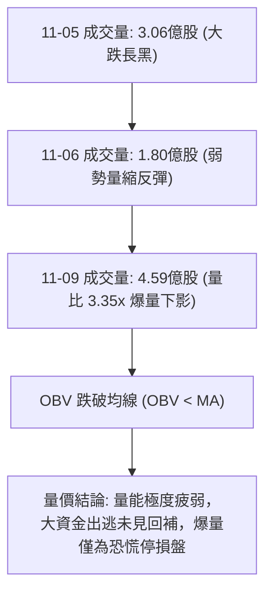

- **量比與均量比較**：最新單日成交量 **459,116,500** 股，相較於 20 日均量（137,120,175 股），**量比高達 3.35 倍**；相較於 50 日均量（121,052,938 股）高達 3.79 倍。
- **量價關係**：
  1. 11-05 殺跌放量（3.06 億股），11-06 反彈縮量（1.80 億股），呈現標準的「量增價跌、量縮價漲」空頭量價特徵。
  2. 11-09 爆出 4.59 億股巨量，收出探底長下影，顯示在 $170.24 ~ $174.23 (S2) 區間有大量融資追繳或恐慌停損單被被動承接，但 OBV 指標依然處於 MA 均線下方，證明整體量能結構仍屬疲弱流出狀態。

---

## 6. 動能與波動率

### ⚡ 動能評估四象限

| 象限 | 動能維度 (Momentum) | 波動維度 (Volatility) | 當前狀態 | 戰略評估 |
|------|--------------------|----------------------|----------|----------|
| **Q1** | 強 (Bullish) | 低 (Low Vol) | — | 穩定單邊上行（最佳波段持股機會） |
| **Q2** | 弱 (Bearish) | 低 (Low Vol) | — | 陰跌盤整或中繼築底（觀望） |
| **Q3** | 強 (Bullish) | 高 (High Vol) | — | 頂部狂熱或劇烈震盪（高風險高收益） |
| **Q4** | **弱 (Bearish/負向極強)** | **高 (High Vol: ATR 4.69%)** | **✓ (NVDA當前落點)** | **恐慌殺跌與高波震盪區（嚴禁追高，切忌盲目摸底）** |

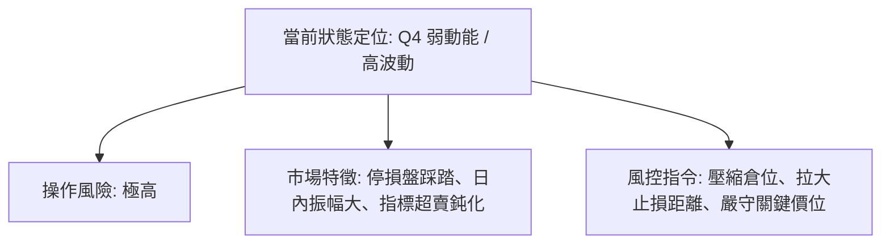

### 📊 ATR 波動率分析

- **當前數值**：**ATR(14) = $8.38**（依據 Wilder 計算法，佔股價比例達 **4.69%**）。
- **日內波動幅度**：近 10 日內，如 11-05 日高低點差距達 $14.79，11-09 單日振幅達 $9.68（高 $179.92 / 低 $170.24），完全匹配 ATR 高波動環境。
- **止損距離動態建議**：
  - **超短線交易（反彈波）**：建議使用 **1.0 × ATR ($8.38)** 作為緊密止損緩衝。
  - **波段操作（順勢放空或左側建倉）**：必須預留 **1.5 ~ 2.0 × ATR ($12.57 ~ $16.76)** 的安全邊際，否則極易在日內高達 5% 的劇烈洗盤中被掃出場。

### 📐 Beta 與市場相關性

- **Beta 數值**：**2.247**。
- **市場敏感度分析**：
  - 高達 2.25 的 Beta 值代表 NVDA 的系統性波動為 S&P 500 大盤的 2.25 倍。當科技板塊或半導體指數回調 1% 時，NVDA 理論下跌幅度高達 2.25%。
  - 當前市場整體情緒承壓，高 Beta 特性導致 NVDA 遭遇拋售時跌勢被顯著放大；同理，若大盤出現強力共振反彈，其超跌修復彈性亦將高於市場平均水平。

---

## 7. 多時框架總結

### 📋 時框架評分表

| 時框架 | 趨勢方向 | 動能狀態 | 均線排列 | 形態特徵 | 綜合評分 | 戰術建議 |
|--------|----------|----------|----------|----------|----------|----------|
| **月線 (長期)** | 🟡 轉向中性震盪 | RSI 自高位回落，多頭動能減退 | 跌破 12 個月均線密集區 | 高檔滯漲回檔測試 2026年平台 | 45/100 | 長期投資者暫停定投加碼，耐心等待回踩企穩 |
| **週線 (中期)** | 🔴 強烈看空 | MACD柱持續負擴大 (-3.631) | 跌穿 MA50 與週線布林中軌 | 雙頂確認，連5週長黑破位 | 20/100 | 中期波段策略逢反彈堅決減倉或建立空頭對沖 |
| **日線 (短期)** | 🔴 極度偏空 | RSI(14)=27.41 觸發極度超賣 | 全線空頭發散 (MA5至MA240全在上方) | 爆量長下影槌頭線，測試S2/S3 | 25/100 | 空單禁止追空；激進者可依S2支撐輕倉博弈短彈 |

### 🔲 綜合訊號矩陣

```
時框訊號一致性評估矩陣
─────────────────────────────────────────────────────────────
時框層級       趨勢維度   動能維度   量能維度   均線維度   收斂判定
長期 (月線)      🟡 中性    🟡 中性    🔴 轉弱    🟡 中性    觀望調整
中期 (週線)      🔴 極空    🔴 極空    🔴 破位    🔴 偏空    空頭主導 ★
短期 (日線)      🔴 偏空    🟢 超賣    🔴 恐慌    🔴 空頭    超跌震盪
─────────────────────────────────────────────────────────────
訊號矛盾點：日線指標進入超賣（RSI 27.41），但中期週線與均線系統處於絕對空頭擴散。
```

### ⚖️ 多時框收斂結論

依據【嚴格要求 14：多時框收斂規則】：
1. **行情屬性判定**：當前 ADX(14) 讀數為 **31.84**（明確大於 25 臨界值），且 -DI 高達 48.55，**確認當前處於強烈單邊空頭「趨勢行情」，而非箱體「盤整行情」**。
2. **時框優先級權重**：在此行情下，必須以**中長期方向（週線大結構跌破與 MA50、MA200 跌破）為主導方向**，日線層級的 RSI 超賣與 Stoch 低檔鈍化**嚴禁視為趨勢反轉信號，僅能定義為空頭趨勢內部的技術性乖離修復（尋找優質空頭進場點）**。
3. **唯一方向性結論**：**極度偏空（Strong Bearish）**。整體操作以「逢高反彈做空」為主基調，所有多頭操作均嚴格限制為「高風險超跌反彈短線博弈」，倉位不得超過標準配置的 1/3。

---

## 8. 交易策略建議

### 🗺️ 策略決策流程圖

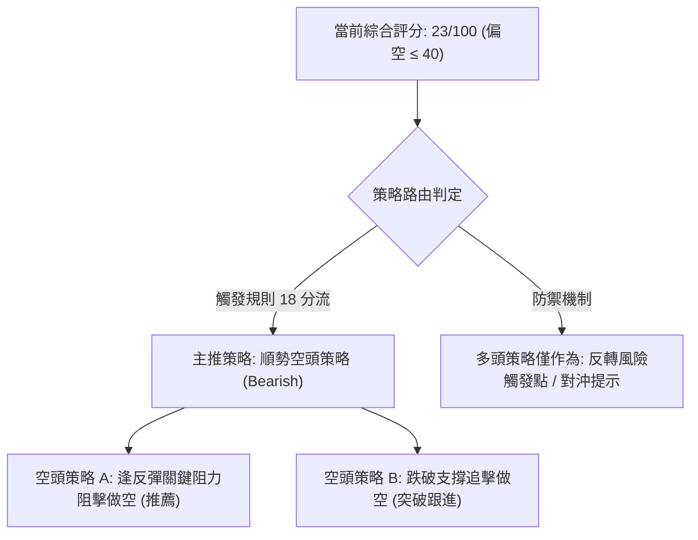

### 🧭 策略路由（依評分卡分流）

> **當前主策略方向 = 強烈偏空（依評分卡綜合評分 23/100，觸發 ≤ 40 偏空主路由）**

依據規則要求，本報告主推兩套**空頭策略**；多頭反彈僅列為高風險輔助與風控對沖提示。

### 🎯 價格情境階梯（Price Scenarios）

價位嚴格引用下方數據「關鍵價位」區塊，精準計算：

| 觸發條件 | 下一目標 | 後續延伸 | 情境含義 |
|----------|----------|----------|----------|
| **反彈受阻 R1 $188.67** | 回測現價 $178.67 | 下探 S1 $177.98 | 短線反彈遇阻，順勢做空確立 |
| **向上突破 R1 $188.67** | 上攻 R2 $194.62 | 衝擊 R3 $214.75 | 展開級別較大的超跌反彈修復 |
| **跌破現價與 S1 $177.98** | 下探 S2 $174.23 | 直測 S3 $169.90 | 空頭加速下挫，考驗底部承接力 |
| **失守 S3 $169.90** | 考驗 52W 低點 $163.90 | 開啟新一輪破底 | 空頭全面主導，長期支撐徹底潰敗 |

### 📊 情境機率分佈

| 情境 | 機率 | 主要依據 |
|------|------|----------|
| **弱勢反彈後延續回落 (主情境)** | **55%** | ADX=31.84 空頭主導，均線呈現完全空頭排列，OBV 疲軟，反彈遭遇 MA5 ($190.75) 與 R1 ($188.67) 強大解套賣壓 |
| **區間震盪築底 (次情境)** | **30%** | RSI(14)=27.41 極度超賣，11-09 爆出 4.59 億股巨量探底長下影，S2 ($174.23) 與 S3 ($169.90) 浮現承接力道 |
| **直接強勢連續反彈 (極端情境)** | **15%** | 僅能在半導體板塊爆發極端重大利好下發生，目前上方遭遇均線密集反壓與布林下軌壓制，概率極低 |

### 🟢 主策略詳情（空頭主推）

所有數值均嚴格依據關鍵價位計算，風險報酬比嚴格依照規則 17 格式呈現：

| 策略要素 | 策略 A（反彈高空 — 核心主推） | 策略 B（破位追空 — 順勢突破） |
|----------|--------------------------------|--------------------------------|
| **進場條件** | 價格反彈至 R1 關鍵阻力附近受阻滯漲 | 實體跌破近期支撐 S1，確認反彈夭折 |
| **進場價格** | **$188.67** (精確引用 R1) | **$177.98** (精確引用 S1) |
| **目標價 T1** | **$174.23** (精確引用 S2) | **$169.90** (精確引用 S3) |
| **目標價 T2** | **$163.90** (精確引用 52W Low) | **$163.90** (精確引用 52W Low) |
| **止損價格** | **$194.62** (精確引用 R2) | **$182.24** (精確引用 布林下軌反壓) |
| **風險報酬比** | **1 : 2.43（以 T1 計）**<br/>*(以 T2 計為 1 : 4.16)* | **1 : 1.90（以 T1 計）**<br/>*(以 T2 計為 1 : 3.31)* |
| **成功機率** | **65%** | **55%** |
| **建議倉位** | **20%** (標準空頭倉位) | **10%** (右側加碼或輕倉試單) |

*精確計算校驗（規則 17）：*
- *策略 A（以 T1 計）：(進場 $188.67 − T1 $174.23) ÷ (止損 $194.62 − 進場 $188.67) = $14.44 ÷ $5.95 = 2.4268 → 1 : 2.43*
- *策略 A（以 T2 計）：(進場 $188.67 − T2 $163.90) ÷ (止損 $194.62 − 進場 $188.67) = $24.77 ÷ $5.95 = 4.1630 → 1 : 4.16*
- *策略 B（以 T1 計）：(進場 $177.98 − T1 $169.90) ÷ (止損 $182.24 − 進場 $177.98) = $8.08 ÷ $4.26 = 1.8967 → 1 : 1.90*
- *策略 B（以 T2 計）：(進場 $177.98 − T2 $163.90) ÷ (止損 $182.24 − 進場 $177.98) = $14.08 ÷ $4.26 = 3.3051 → 1 : 3.31*

### 🔴 反向風險觸發點（對沖提示）

- **全面停損／平空觸發價位**：**$194.62 (R2)**。若日K收盤價強勢站上 R2，代表斐波那契 61.8% 成功收復，空頭雙頂跌破結構被破壞，此時所有波段空單必須無條件止損離場。
- **左側超跌博弈多單（極高風險）**：
  - 僅限極激進投資者在現價至 S1 區間（$177.98 ~ $178.67）建立不超過 **5% 倉位**的超短線博弈多單。
  - **嚴格止損價**：**$174.23 (S2)**。
  - **第一目標價**：**$188.67 (R1)**。
  - 若跌破 S2，多頭假反彈確認破滅，立即嚴格止損。

### ⭐ 整體訊號強度評星

```
做多訊號強度：★☆☆☆☆  (1/5星 - 僅有極度超賣支撐，順應趨勢不可做多)
做空訊號強度：★★★★☆  (4/5星 - 均線空頭排列，量能破位，ADX確認強趨勢)
整體可信度：  ★★★★☆  (4/5星 - 多指標共振共識度高，方向明確)
```

---

## 9. 風險提示與監控

### ✅ 關鍵監控指標 Checklist

```
╔══════════════════════════════════════════════════════════════╗
║                   NVDA 風險監控清單 (Checklist)              ║
╠══════════════════════════════════════════════════════════════╣
║ [ ] 監控點 1: 日線收盤是否跌破支撐 S1 ($177.98)               ║
║ [ ] 監控點 2: 盤中是否測試並跌破強支撐 S2 ($174.23)          ║
║ [ ] 監控點 3: 反彈是否在阻力 R1 ($188.67) 遇阻收長上影線     ║
║ [ ] 監控點 4: RSI(14) 能否自 27.41 向上突破 30 脫離鈍化區    ║
║ [ ] 監控點 5: 單日成交量是否回落至 20日均量 (1.37億股) 以下  ║
║ [ ] 監控點 6: MACD 負向柱狀體是否出現首根縮小 (>-3.631)       ║
╚══════════════════════════════════════════════════════════════╝
```

### ⚠️ 風險場景分析

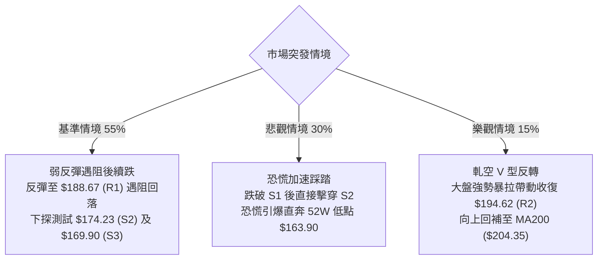

### 🛡️ 風險管理重要提醒

1. **ATR 劇烈波動下的倉位控制**：目前 ATR 高達 **$8.38**，單日波動率接近 5%。在進行任何建倉操作時，單筆交易名義本金不可超過總投資組合的 **15% ~ 20%**，以防隔夜跳空風險。
2. **禁止追空保護原則**：雖然趨勢強烈看空，但 RSI 處於 **27.41** 極端超賣區，且布林 %B 低於 0。歷史經驗顯示，在此位置盲目追空極易遭遇兇悍的日內軋空反抽。**嚴格恪守「不反彈至阻力位不開空」的紀律**。
3. **跳空缺口回補監控**：關注 11-04 至 11-05 留下的跳空低開缺口（$196.07 ~ $199.68），此區域是多頭難以逾越的中期鋼鐵阻力壁壘。

---

## 📋 報告總結

```
NVDA 技術分析報告總結
════════════════════════════════════════════════════════
報告日期：2026-11-10
當前價格：$178.67
分析評級：🔴 強烈偏空 / 空頭強趨勢 (綜合技術評分: 23/100)

關鍵結論：
├─ 長期趨勢：🟡 中性回調 (月線自高點 $243.37 下跌，回測2026年平台)
├─ 中期趨勢：🔴 極度看空 (週線連5陰破位，高檔雙頂量度跌幅延伸)
├─ 短期趨勢：🔴 單邊下墜但超賣 (日線均線全線失守，RSI=27.41 醞釀弱彈)
├─ 關鍵支撐：S1 $177.98 ｜ S2 $174.23 ｜ S3 $169.90 ｜ 52W Low $163.90
├─ 關鍵阻力：R1 $188.67 ｜ R2 $194.62 ｜ R3 $214.75 ｜ MA200 $204.35
└─ 分析師目標：均價 $326.92 ｜ 最低 $180.00 ｜ 最高 $515.00

最優策略組合：
1. 🥇 最佳機會：空頭策略 A — 待超跌反彈至 R1 $188.67 阻擊做空 (風報比 1:2.43)
2. 🥈 次選機會：空頭策略 B — 跌破 S1 $177.98 順勢輕倉追空下看 S3 (風報比 1:1.90)
3. 🥉 保守選擇：空手徹底觀望，等待日線級別底背離或重新站上 MA20 再行介入
════════════════════════════════════════════════════════
```

---

> ⚠️ **免責聲明**：本報告為技術分析研究，所有數據、圖表及估算均嚴格基於所提供之歷史價格與量化技術指標計算生成。本報告**僅供研究與學術參考**，**不構成任何形式的投資建議、買賣邀約或操作背書**。金融市場瞬息萬變，高波動標的投資風險極高，投資人應獨立評估自身風險承受能力，入市需極度謹慎。

---

*報告生成時間：2026-11-10 ｜ 數據來源：Yahoo Finance ｜ 分析框架：資深多時框技術分析架構*