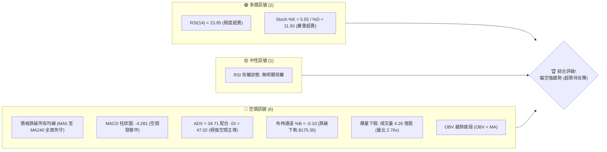
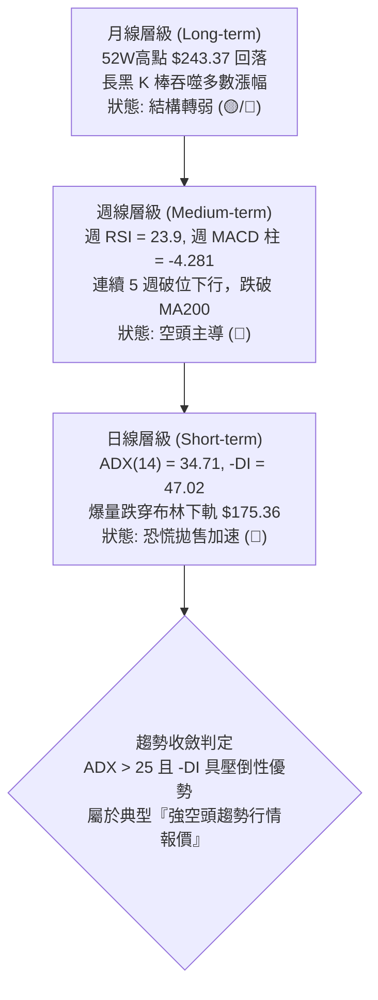
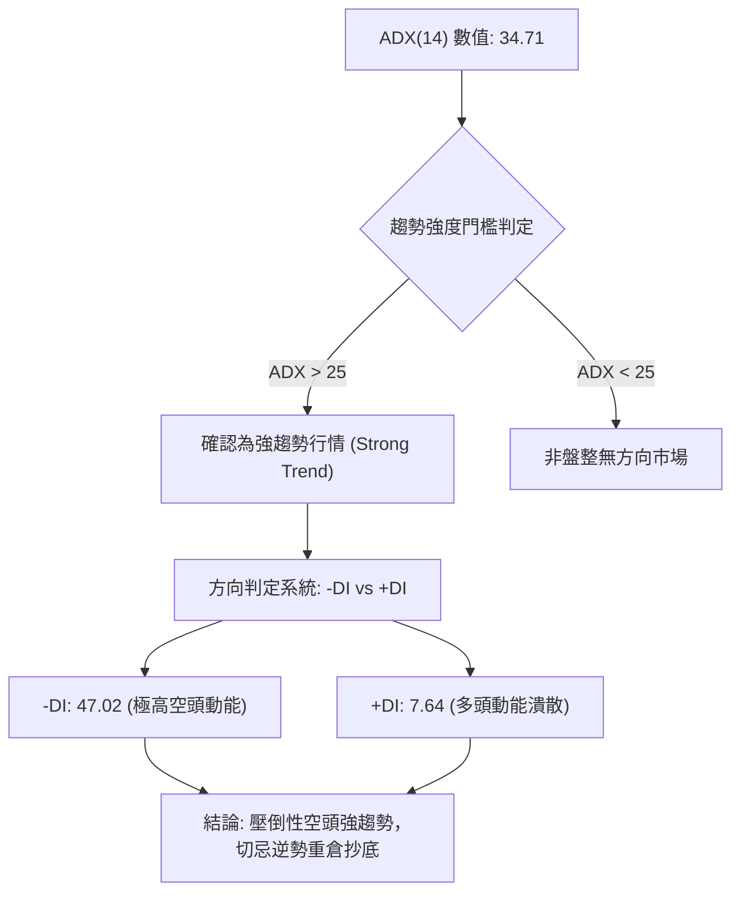
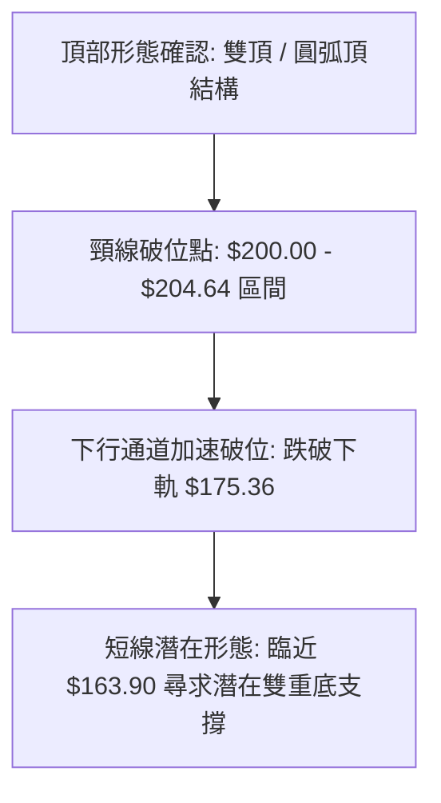
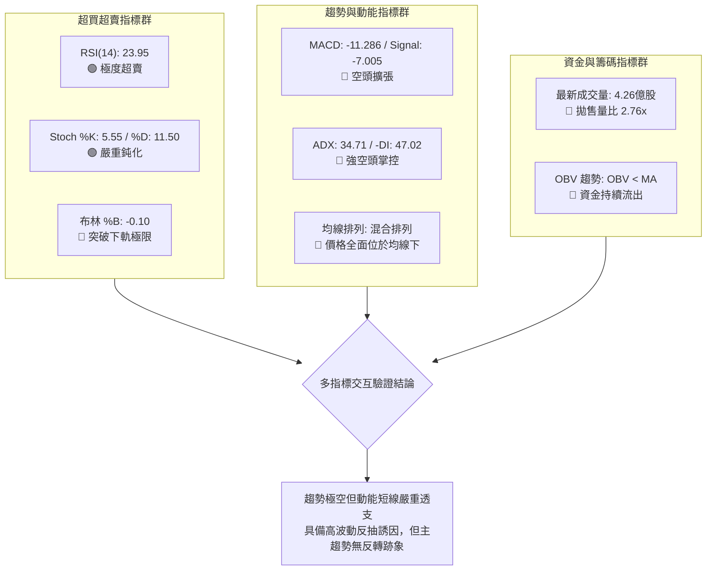
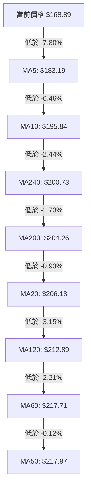
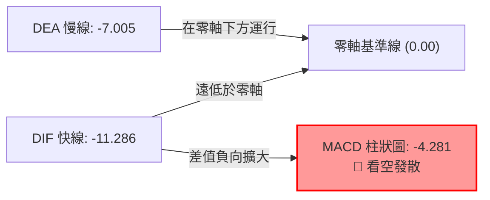
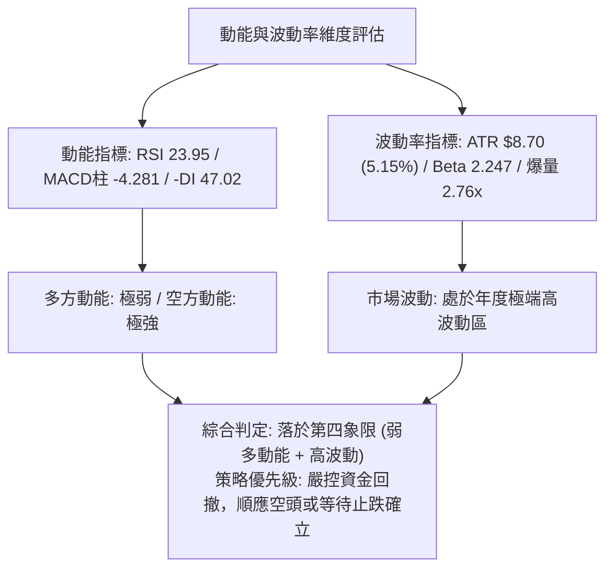
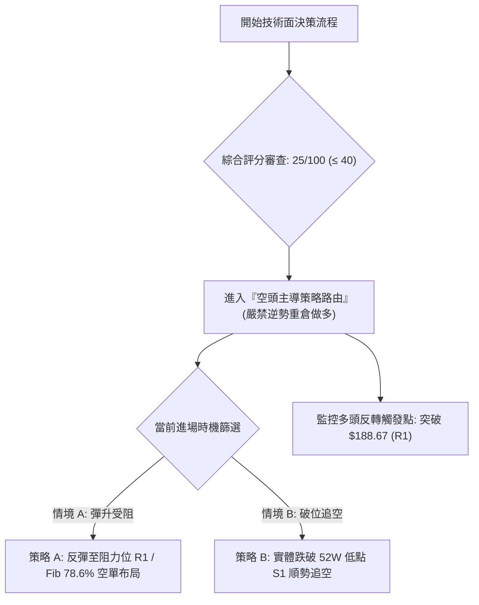
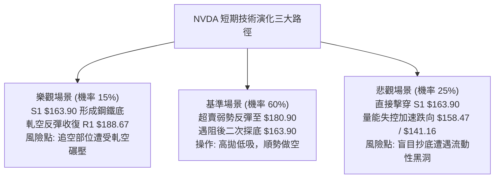

# NVDA 技術分析報告

> **報告日期**：2026-11-11 ｜ **語言**：繁體中文 ｜ **數據來源**：Yahoo Finance ｜ **當前價格**：$168.89

---

## 目錄

| 章節 | 內容 |
|------|------|
| [1. 技術面概覽](#1-技術面概覽) | 訊號儀表板、核心指標、評分卡 |
| [2. 趨勢分析](#2-趨勢分析) | 多時框趨勢、長中短期走勢 |
| [3. 圖表形態分析](#3-圖表形態分析) | 形態識別、K線組合、目標價 |
| [4. 支撐與阻力](#4-支撐與阻力) | 關鍵價位、斐波那契回調 |
| [5. 技術指標深度解讀](#5-技術指標深度解讀) | MA/RSI/MACD/布林/成交量 |
| [6. 動能與波動率](#6-動能與波動率) | 動能評估、ATR、Beta |
| [7. 多時框架總結](#7-多時框架總結) | 時框架評分矩陣 |
| [8. 交易策略建議](#8-交易策略建議) | 多空策略、風險報酬比 |
| [9. 風險提示與監控](#9-風險提示與監控) | 監控指標、風險場景 |

---

## 1. 技術面概覽

### 🎯 技術訊號儀表板



### 📊 核心指標速覽表

| 指標類別 | 指標名稱 | 當前數值 | 訊號 | 解讀 |
|----------|----------|----------|------|------|
| **價格** | 當前價格 | $168.89 | 🔴 | 位於 52 週區間 6.3% 之極低位，逼近波段低點 |
| **均線** | MA20 | $206.18 | 🔴 | 價格低於 MA20 達 -18.09%，短期均線重壓 |
| **均線** | MA50 | $217.97 | 🔴 | 價格低於 MA50 達 -22.52%，中期生命線失守 |
| **均線** | MA200 | $204.26 | 🔴 | 跌破長期牛熊分界線 $204.26，長線格局轉空 |
| **動能** | RSI(14) | 23.95 | 🟢 | 進入深度超賣區（<30），隨時具備技術性反彈動能 |
| **動能** | MACD | -11.286 | 🔴 | DIF 線低於訊號線 -7.005，柱狀圖 -4.281 持續看空 |
| **趨勢** | ADX(14) | 34.71 | 🔴 | ADX > 25 且 -DI(47.02) 遠大於 +DI(7.64)，屬典型空頭強趨勢 |
| **通道** | 布林 %B | -0.10 | 🔴 | 價格跌穿布林下軌 $175.36，呈現通道開口向下極限擴張 |
| **波動** | ATR(14) | $8.70 | 🔴 | 佔股價 5.15%，日均波動劇烈，單日風險敞口放大 |
| **量能** | 20日量比 | 2.76x | 🔴 | 恐慌性拋售放量，成交量達 4.26 億股，空頭動能尚未竭盡 |

### 🏆 技術評分卡

```
╔════════════════════════════════════════════════════════════════╗
║                  技術評分卡 — NVDA (2026-11-11)                ║
╠════════════════════════════════════════════════════════════════╣
║ 趨勢強度 (Trend)       ████░░░░░░░░░░░░░░░░  20/100  🔴 極弱空頭 ║
║ 動能指標 (Momentum)    █████░░░░░░░░░░░░░░░  25/100  🔴 嚴重受挫 ║
║ 支撐穩定度 (Support)   ██████░░░░░░░░░░░░░░  30/100  🔴 臨近邊界 ║
║ 成交量配合 (Volume)    █████░░░░░░░░░░░░░░░  25/100  🔴 放量下殺 ║
║ 形態完整度 (Pattern)   ██████░░░░░░░░░░░░░░  30/100  🔴 破位結構 ║
║ 均線排列 (Moving Avg)  ████░░░░░░░░░░░░░░░░  20/100  🔴 空頭發散 ║
╠════════════════════════════════════════════════════════════════╣
║ 綜合評分 (Overall)     █████░░░░░░░░░░░░░░░  25/100  🔴 強烈偏空 ║
╚════════════════════════════════════════════════════════════════╝
*註：綜合評分由六項子指標等權算術平均計算得出 (20+25+30+25+30+20)/6 = 25/100。
```

---

## 2. 趨勢分析

### 🌐 多時框趨勢分析



### 📈 長期趨勢 — 12個月走勢圖（Unicode）

以下為 NVDA 過去 12 個月（2025-12 至 2026-11）收盤價走勢示意圖：

```
NVDA 月線走勢圖（過去12個月）
價格軸 ($)
$240 ┤                                        ● $228.38
$220 ┤                                  ● $220.53
$200 ┤              ● $199.11  ● $210.66              ● $204.64
$180 ┤● $186.06 ● $190.68         ● $199.87  ● $200.53
$160 ┤    ● $176.78  ● $174.00                                ● $168.89 (當前)
     └─────────────────────────────────────────────────────────────►
       12M   11M   10M    9M     8M     7M     6M     5M     4M    3M    2M    1M
      25-12 26-01 26-02 26-03  26-04  26-05  26-06  26-07  26-08 26-09 26-10 26-11
```

#### 走勢特徵分析表格

| 階段時間 | 月收盤區間 | 累計漲跌幅 | 主要走勢特徵 |
|----------|------------|------------|--------------|
| **2025-12 ~ 2026-03** | $186.06 → $174.00 | -6.48% | 高位箱體築底整理，在 $174-$190 區間反覆震盪蓄勢 |
| **2026-04 ~ 2026-05** | $174.00 → $210.66 | +21.07% | 強勢突破 $200 整數關卡，伴隨業績預期啟動主升段 |
| **2026-06 ~ 2026-07** | $210.66 → $200.53 | -4.81% | 高檔橫盤消化獲利籌碼，中長期均線呈現多頭排列 |
| **2026-08 ~ 2026-09** | $200.53 → $228.38 | +13.89% | 創下波段歷史新高至 $243.37，市場情緒推向極致貪婪 |
| **2026-10 ~ 2026-11** | $228.38 → $168.89 | -26.05% | 垂直式瀑布殺跌，兩月內暴跌逾 59 美元，回吐近半年漲幅 |

### 📊 中期趨勢（週線分析）

```
中期週線關鍵壓制與當前落點示意圖：
$243.37 ══════════════════════════════════════ 52W 最高點 (2026-10-09 當週高點)
         ╲
          ╲  MA50 ($217.97) / MA20 ($206.18)
           ╲
$188.67 ────┴───────────────────────────────── 近期關鍵阻力位 R1
             ╲
$175.36 ──────┴─────────────────────────────── 布林帶下軌 (已遭實體長黑摜破)
               ╲
$168.89 ────────● 當前收盤價 (處於極度空頭延伸狀態)
                 │
$163.90 ─────────┴──────────────────────────── 52W 最低點 / 強力支撐位 S1
```

週線指標呈現全線崩解：
1. **收盤跌勢擴大**：近 5 週收盤價分別為 $214.13 → $210.96 → $204.64 → $186.64 → $168.89，呈現階梯式無抵抗重挫。
2. **週成交量放大**：最近兩週成交量激增至 8.46 億股與 8.89 億股，顯示籌碼出現大規模機構出逃現象。

### ⚡ 趨勢強度評估（ADX 解讀）



#### ADX 指標狀態對照表

| 指標名稱 | 實際數值 | 門檻區間 | 技術含義 |
|----------|----------|----------|----------|
| **ADX(14)** | 34.71 | > 25.0 | 明確強趨勢建立，趨勢跟隨策略效率顯著高於均值回歸策略 |
| **-DI** | 47.02 | > 40.0 | 空方力量處於極度主導狀態，市場賣壓呈現單向傾瀉 |
| **+DI** | 7.64 | < 15.0 | 多方毫無抵抗意願，缺乏主動性買盤介入 |
| **DI 差值** | -39.38 | 絕對值極大 | 多空失衡嚴重，此狀態下任何反彈易遭遇解套賣壓阻截 |

---

## 3. 圖表形態分析

### 🔍 形態識別系統



#### 形態識別與信心度評估表

| 形態 | 信心度 | 判斷依據（引用數據） | 完成度 | 目標價（附計算式） |
|------|--------|----------------------|--------|--------------------|
| **雙重頂 (Double Top)** | 85% | 2026-08 至 2026-10 兩次衝擊高點（$228.38 與 $243.37），隨後於 2026-10-30 放量跌破頸線低點 $200.92 | 100% (已完全破位) | 形態高度 = $243.37 − $200.92 = $42.45<br/>等幅破位目標 = $200.92 − $42.45 = **$158.47** |
| **下行旗形 / 瀑布通道** | 75% | 自 2026-11-05 跌破 $196.25 後形成垂直破位，沿著布林下軌向下延伸 | 80% | 由旗桿高度推算下探前波 52W 低點 **$163.90** |
| **雙底形態 (潛在構建)** | 35% | 訊號不足，僅做指標型解讀。雖逼近 52W 低點 $163.90，但未出現止跌反轉 K 線，不得通靈確認雙底 | 15% | 若守穩 $163.90 且反彈突破 $188.67，目標為 $188.67 + ($188.67 − $163.90) = **$213.44** |

### 🕯️ 重要K線形態分析

嚴格依據提供的「近10根日K」與「近8根週K」實體數據進行專業解讀：

#### 近 10 根日 K 線形態解讀

| 日期（日K） | 開 | 高 | 低 | 收 | 成交量 | K線形態 | 解讀與訊號 |
|-------------|----|----|----|----|--------|---------|------------|
| 2026-10-28 | 219.92 | 219.99 | 214.47 | 215.38 | 93,030,200 | 中黑棒 | 🔴 反彈受阻於 $220 關卡，空方逐步施壓 |
| 2026-10-29 | 214.36 | 215.33 | 212.08 | 213.66 | 77,568,100 | 小陰十字 | 🟡 量縮震盪，方向未明，多空於 $213 陷入僵持 |
| 2026-10-30 | 208.94 | 209.06 | 200.92 | 204.64 | 168,386,400 | 放量大長陰 | 🔴 跳空低開跌破 $205，創下近期低點 $200.92，籌碼鬆動 |
| 2026-11-02 | 207.53 | 209.98 | 201.66 | 202.06 | 119,272,200 | 衝高回落長上影陰線 | 🔴 盤中反抽 $209.98 遭逢強大賣壓，收盤壓在低點 |
| 2026-11-03 | 207.96 | 209.14 | 205.93 | 206.69 | 91,943,400 | 小陽紡錘線 | 🟡 跌勢暫緩，但反彈未能站上 MA20，量能未跟進 |
| 2026-11-04 | 203.50 | 206.79 | 199.68 | 200.13 | 149,033,300 | 實體中黑棒 | 🔴 正式跌破 $200.00 整數防線，下行空間開啟 |
| 2026-11-05 | 196.07 | 196.25 | 181.46 | 181.60 | 306,127,800 | 恐慌性斷崖大長陰 | 🔴 爆量 3.06 億股斷頭下殺，收盤收在最低點附近 |
| 2026-11-06 | 191.10 | 194.90 | 185.22 | 186.64 | 180,212,300 | 倒狀反彈陰線 | 🔴 雖有開高反彈至 $194.90，但終場再度遭空頭壓制 |
| 2026-11-09 | 173.07 | 179.92 | 170.24 | 178.67 | 462,719,300 | 爆量長下影陰線 | 🟡 巨量 4.62 億股換手，盤中探底 $170.24 後出現微幅承接 |
| 2026-11-10 | 173.97 | 174.69 | 165.89 | 168.89 | 426,599,700 | 破低下挫中黑棒 | 🔴 空頭二度發力，摜破昨日低點並收於 $168.89，逼近 S1 |

#### 近 8 根週 K 線形態解讀

| 日期（週K） | 開 | 高 | 低 | 收 | 成交量 | K線形態 | 解讀與訊號 |
|-------------|----|----|----|----|--------|---------|------------|
| 2026-09-25 | 222.94 | 229.98 | 221.09 | 225.07 | 462,517,700 | 蓄勢實體中陽棒 | 🟢 沿高檔攀升，多頭掌控市場 |
| 2026-10-02 | 229.75 | 237.88 | 227.03 | 233.95 | 599,330,600 | 突破放量長陽棒 | 🟢 實體大陽線直逼高點，量價配合健康 |
| 2026-10-09 | 236.09 | 243.37 | 229.11 | 229.28 | 513,988,800 | 流星線 (Shooting Star) | 🔴 創 52W 高點 $243.37 後遭暴量反噬，收盤收於低位，形成歷史大頂 |
| 2026-10-16 | 228.73 | 228.86 | 212.85 | 214.13 | 521,797,700 | 光頭中黑棒 | 🔴 反轉確認，長黑吞噬前週實體，確認流星頂部確立 |
| 2026-10-23 | 218.10 | 222.19 | 210.18 | 210.96 | 470,976,900 | 延續性黑棒 | 🔴 弱勢整理，反彈高點 $222.19 無力突破前週阻力 |
| 2026-10-30 | 213.11 | 219.99 | 200.92 | 204.64 | 514,613,700 | 下破支撐長黑棒 | 🔴 摜破頸線關卡，確立雙頂形態成立 |
| 2026-11-06 | 207.53 | 209.98 | 181.46 | 186.64 | 846,589,000 | 巨量毀滅性崩跌黑棒 | 🔴 單週重挫超 18 美元，成交量爆出 8.46 億股巨量 |
| 2026-11-10 | 173.07 | 179.92 | 165.89 | 168.89 | 889,319,000 | 極限放量大黑棒 | 🔴 當週僅數日即累積 8.89 億股巨量，收盤 $168.89，逼近 52W 低點 |

### 📉 ASCII 走勢形態示意圖

```
NVDA 近期頂部反轉與破位幾何走勢圖
$243.37 ─────────────● (頂部流星線 2026-10-09)
                    ╱ ╲
                   ╱   ╲
$220.00 ──────────●     ╲      ● (右肩/弱勢反彈高點 $219.99)
                 ╱       ╲    ╱ ╲
$200.92 ════════●═════════●══●═══╲════════════ 頸線關鍵位 (破位點)
      (2026-08 箱體)               ╲
$188.67 ────────────────────────────╲─────── 阻力位 R1
                                     ╲
$175.36 ──────────────────────────────╲───── 布林下軌破位
                                       ╲
$168.89 ────────────────────────────────●── 當前收盤價 ($168.89)
                                         │
$163.90 ═════════════════════════════════▼══ 52W 波段最低點 S1
```

### 🎯 形態目標價計算

1. **頭部等幅測量目標價（雙頂破位）**：
   - 頂部最高峰：$243.37
   - 形態頸線破位點：$200.92
   - 形態垂直高度 $H = \$243.37 - \$200.92 = \$42.45$
   - 破位滿足目標價 $Target_1 = \$200.92 - \$42.45 =$ **$158.47**
   - *解讀*：此目標價低於 52 週低點 S1（$163.90），代表若空頭動能徹底擊穿 S1，價格將朝 $158.47 加速宣洩。

2. **短線反彈目標價（極度超賣之修正波）**：
   - 短期破位前低點（2026-11-06 收盤）：$186.64
   - 當前低點支撐（S1）：$163.90
   - 若在 S1 獲得支撐展開技術回抽，短線反彈高度預估受阻於 **$180.90**（斐波那契 78.6%）至 **$188.67**（R1 阻力位）。

---

## 4. 支撐與阻力

### 🗺️ 關鍵價位分布圖（Unicode）

```
NVDA 價位結構分布圖
═════════════════════════════════════════════════════════════════════
$214.75 ║████████████████████████████████████████║ 強阻力 R3 (密集套牢區)
$194.62 ║████████████████████████████            ║ 阻力 R2 (Fib 61.8%)
$188.67 ║████████████████████                    ║ 關鍵阻力 R1 (波段跌破點)
$180.90 ║▓▓▓▓▓▓▓▓▓▓▓▓                            ║ 短線反抽阻力 (Fib 78.6%)
╠═══════╬════════════════════════════════════════╣ ◄ 現價: $168.89
$163.90 ║████████████████████████████████████████║ 核心強支撐 S1 (52W最低點)
[無數據]║░░░░░░░░░░░░░░░░░░░░░░░░░░░░░░░░░░░░░░░║ 支撐 S2 / S3: 數據中未偵測到
═════════════════════════════════════════════════════════════════════
```

### 🚧 阻力位分析表

數據來源嚴格引用「關鍵價位（由 OHLCV 計算）」區塊之高點聚類數值：

| 阻力級別 | 價位 | 距離現價幅度 | 形成原因 | 突破難度 | 重要性評級 |
|----------|------|--------------|----------|----------|------------|
| **R1** | $188.67 | +11.71% | 近一年波段高點聚類位；前期密集成交破位支撐轉阻力 | 🔴 極高 | ★★★★☆ |
| **R2** | $194.62 | +15.24% | 近一年波段次高聚類，與斐波那契 61.8% 重合之強反壓 | 🔴 極高 | ★★★★★ |
| **R3** | $214.75 | +27.15% | 多條中長天期均線（MA50 $217.97、MA120 $212.89）匯聚處 | 🔴 難以逾越 | ★★★★★ |

### 🛡️ 支撐位分析表

數據來源嚴格引用「關鍵價位（由 OHLCV 計算）」區塊之低點聚類數值：

| 支撐級別 | 價位 | 距離現價幅度 | 形成原因 | 守住機率 | 重要性評級 |
|----------|------|--------------|----------|----------|------------|
| **S1** | $163.90 | -2.96% | 52 週歷史波段最低點；多方最後一道退無可退的生命防線 | 🟡 45% (受制於強空頭賣壓) | ★★★★★ |
| **S2** | N/A | N/A | 數據中未偵測到（歷史 OHLCV 聚類未提供更低之波段低點） | N/A | N/A |
| **S3** | N/A | N/A | 數據中未偵測到（歷史 OHLCV 聚類未提供更低之波段低點） | N/A | N/A |

### 📐 斐波那契回調位分析

依據 52 週區間高點 $243.37 至低點 $163.90 所計算之精準回調位：

| 回調比例 | 斐波那契價位 | 當前相對位置 | 技術意涵解讀 |
|----------|--------------|--------------|--------------|
| **0.0% (52W High)** | $243.37 | +44.10% | 歷史大頂，多頭極限高點 |
| **23.6%** | $224.61 | +32.99% | 第一回檔位，失守後轉為強大空頭防線 |
| **38.2%** | $213.01 | +26.12% | 中期關鍵樞紐，與 MA120 ($212.89) 形成共振壓制 |
| **50.0%** | $203.63 | +20.57% | 多空平衡分水嶺，跌破宣告上升趨勢徹底終結 |
| **61.8%** | $194.25 | +15.02% | 黃金分割強防守位（與 R2 $194.62 完美吻合），破位後引發踩踏 |
| **78.6%** | $180.90 | +7.11% | 空頭回補第一阻力位，超賣反彈之首要解套觀察區 |
| **100.0% (52W Low)**| $163.90 | -2.96% | 區間全數回吐，當前股價落於 $163.90 至 $180.90 之最後區間 |

*現價落點解讀*：當前價格 $168.89 落在 **78.6% ($180.90)** 與 **100.0% ($163.90)** 之間。這表明過去一年累積的所有多頭漲幅已被侵蝕達 93.7%（目前位於 52W 區間的 6.3%）。當價格跌破 78.6% 斐波那契回調位時，技術分析常規視為「深層趨勢反轉」，而非健康的牛市回檔。$163.90 若告失守，將開啟無技術底部的真空尋底行情。

---

## 5. 技術指標深度解讀

### 🎛️ 指標訊號總覽



### 📈 移動平均線排列分析



#### 移動平均線離差度與技術評估

| 均線名稱 | 當前數值 | 價格與均線離差 | 走勢方向 | 排列與技術含義 |
|----------|----------|----------------|----------|----------------|
| **MA 5** | $183.19 | -$14.30 (-7.80%) | ▼ 下降 | 超短期重壓，短線多頭反彈的第一道阻力 |
| **MA 10** | $195.84 | -$26.95 (-13.76%)| ▼ 下降 | 短期空方下殺攻擊線，下垂角度極度陡峭 |
| **MA 20** | $206.18 | -$37.29 (-18.09%)| ▼ 下降 | 月線層級生命線失守，形成中期套牢平台 |
| **MA 50** | $217.97 | -$49.08 (-22.52%)| ▼ 下降 | 季線空頭反壓，代表中期趨勢完全遭到破壞 |
| **MA 60** | $217.71 | -$48.82 (-22.42%)| ▼ 下降 | 與 MA50 形成雙重死叉壓制 |
| **MA 120** | $212.89 | -$44.00 (-20.67%)| ▼ 下降 | 半年線下彎，中長期多頭持倉全面轉為虧損 |
| **MA 200** | $204.26 | -$35.37 (-17.32%)| ▼ 下降 | 牛熊分界線遭長陰貫穿，正式步入技術性熊市 |
| **MA 240** | $200.73 | -$31.84 (-15.86%)| ▼ 下降 | 年線支撐告破，市場進入去槓桿拋售循環 |

*排列狀態綜合評定*：官方數據標記為「混合排列」，係因長期均線（MA240 $200.73、MA200 $204.26）與中短期均線發生錯位交纏；但價格位於所有 8 條移動平均線之下，且所有均線斜率一致向下傾斜，實質上已形成極具破壞力的「空頭壓制發散格局」。

### 📉 RSI(14) 分析

```
RSI(14) 當前水位: 23.95 (Wilder 計算)
0        10       20   23.95    30              50                      70               100
├────────┼────────┼─────●───────┼───────────────┼───────────────────────┼────────────────┤
[       極端超賣區間       ]    [     弱勢區     ]          中性         [     超買區     ]
進度條: █████░░░░░░░░░░░░░░░ 23.95% (綠色警示：進入極端超賣區)
```

1. **數值深度解讀**：RSI 跌至 23.95，屬於技術指標定義之標準極度超賣狀態（<30）。歷史統計顯示，當巨型權值股之日線 RSI 跌破 25 時，通常預示賣壓出現情緒化「宣洩（Climax Selling）」，短線隱含技術性均值回歸修復的需求。
2. **背離檢驗**：依據數據快照提供的檢驗結果——「RSI 背離: 無明顯背離（僅比較近20根K棒首尾的價格與RSI方向）」。價格持續創新低，RSI 亦同步下墜，代表空頭動能具備實質賣盤推動，而非指標鈍化產生的底背離；因此，絕不可將目前的超賣狀態直接等同於反轉確立訊號。

### 📊 MACD(12/26/9) 訊號解讀



- **MACD 線**：-11.286
- **訊號線 (Signal Line)**：-7.005
- **MACD 柱狀圖 (Histogram)**：-4.281
- **動能解析**：快線向下摜破慢線且兩者利差擴大至 -4.281，柱狀圖紅柱（美股習慣以負值標記空頭綠/紅）持續拉長。這表明中長線空頭動能不僅未出現收斂，反而在加速下沉，空頭在零軸之下享有完全的控盤權。

### 📦 布林通道分析

```
布林通道結構與現價相對位置 (20, 2)
$237.00 ┬────────────────────────────────────────── BB 上軌
        │
$206.18 ┼────────────────────────────────────────── BB 中軌 (MA20)
        │
$175.36 ┴────────────────────────────────────────── BB 下軌
        :
$168.89 ● 現價 (位於下軌下方，%B = -0.10)
```

- **通道帶寬與形態**：上軌 $237.00，下軌 $175.36，中軌 $206.18。帶寬高達 $61.64，顯示通道正處於向下劇烈「張口擴張（Bandwidth Expanding）」階段。
- **%B 指標異常值**：%B 為 **-0.10**（負值代表價格已脫離布林通道下軌邊界）。在統計學常態分佈中，此為超出 2 個標準差之外的罕見極端事件，表明市場處於非理性的恐慌性拋售狀態。依通道理論，跌出下軌後通常會誘發向中軌收斂的均值回歸反抽，惟反抽高度往往受制於下軌附近阻力。

### 💹 成交量分析（量價配合度）

```
成交量放大倍數示意：
最新成交量: 4.26 億股 ████████████████████████████ 2.76x (相較20日均量)
20日均量:   1.54 億股 ██████████ 1.00x
50日均量:   1.27 億股 ████████ 0.82x
```

- **爆量特徵**：最新單日成交量高達 426,599,700 股，相較於 20 日均量（154,428,455 股）爆出 **2.76 倍** 巨量。
- **量價關係判讀**：帶長實體黑 K 的放量下殺，反映出大規模機構籌碼正不計成本地離場（Institution Own % 高達 71.6%），而非散戶行為。
- **OBV 能量潮解讀**：官方數據明確顯示「OBV < MA → 量能疲弱」。OBV 指標持續位於其均線下方運行，確認量能走勢支持價格下跌趨勢，無資金吸籌跡象，為標準的「量增價跌」空頭確認型態。

---

## 6. 動能與波動率

### ⚡ 動能評估四象限

| 象限代號 | 動能維度 (Momentum) | 波動率維度 (Volatility) | 當前狀態判定 | 交易策略意涵與評估 |
|----------|---------------------|-------------------------|--------------|--------------------|
| **Q1** | 強 (多頭強勁) | 低 (穩定向上) | — | 最佳波段做多機會，趨勢穩定 |
| **Q2** | 弱 (空頭衰竭) | 低 (縮量盤整) | — | 築底階段，謹慎觀望，等待突破 |
| **Q3** | 強 (動能極大) | 高 (劇烈震盪) | — | 狂熱主升或急跌主跌段，高風險高回報 |
| **Q4** | 弱 (多方崩解) | 高 (暴量下瀉) | **✓ NVDA 當前落點** | **強烈風險：多方動能完全潰退，日均波動放大，操作難度極高，避免盲目重倉抄底** |



### 📊 ATR 波動率分析

- **ATR(14) 數值**：**$8.70**（採用 Wilder 平滑計算法）。
- **波動佔比**：ATR 佔當前收盤價 $168.89 之比率高達 **5.15%**。
- **交易風控距離建議**：
  - **超短線交易止損距離 (1.0x ATR)**：\$8.70，意即日內雜訊震盪即可能達到 8.7 美元之幅度。
  - **波段交易防守安全間距 (1.5x ATR)**：\$13.05，任何波段佈局必須預留至少 13 美元之防守緩衝，以防假跌破洗盤。
  - **極限趨勢追蹤止損 (2.0x ATR)**：\$17.40，適合中長線部位進行移動鎖利/防守之閾值。

### 📐 Beta 與市場相關性

- **Beta 數值**：**2.247**
- **市場特徵解析**：Beta 值高達 2.247 代表 NVDA 具備極強的高彈性（High Beta）成長股屬性。當那斯達克或標普 500 指數波動 1% 時，NVDA 理論上將產生 2.247% 的同向或逆向槓桿效應。在當前全市場對利率政策與地緣半導體限制敏感之環境下，極高的 Beta 加劇了機構投資人去槓桿時的拋售烈度。

---

## 7. 多時框架總結

### 📋 時框架評分表

| 時框架 | 趨勢方向 | 動能指標狀態 | 均線排列格局 | 圖表形態識別 | 綜合評分 | 操作建議方向 |
|--------|----------|--------------|--------------|--------------|----------|--------------|
| **月線 (Long)** | 🟡 轉弱偏空 | 月線高檔長黑長影 | 高檔糾結出現死叉 | 歷史高點 $243.37 流星頂 | 35/100 | 長線長多結構遭遇嚴重破壞，暫停加碼 |
| **週線 (Medium)**| 🔴 強烈看空 | 週 RSI=23.9, 柱=-4.28 | 摜破 MA200 牛熊線 | 雙重頂頸線放量破位 | 20/100 | 中期空頭主導，反彈皆為空方賣點 |
| **日線 (Short)** | 🔴 恐慌拋售 | RSI=23.95, -DI=47.02 | 價格全線受制於均線 | 跌出布林下軌加速下瀉 | 20/100 | 順勢偏空，提防極度超賣引發之強抽 |

### 🔲 綜合訊號矩陣

```
時框維度與技術構面交叉矩陣：
              [趨勢]      [動能]      [量能]      [形態]      [均線]
長期 (月線)    🟡 中性     🔴 轉空     🔴 流出     🔴 雙頂     🟡 糾結
中期 (週線)    🔴 強空     🔴 擴張     🔴 暴量     🔴 破位     🔴 貫穿
短期 (日線)    🔴 極空     🟢 超賣     🔴 拋售     🔴 瀑布     🔴 發散
一致性結論：中短期空頭高度共振，僅短線動能出現超賣反抽瑕疵。
```

### ⚖️ 多時框收斂結論

依據多時框收斂規則進行系統性裁決：
1. **趨勢性質判定**：當前 ADX(14) 為 **34.71**，遠超關鍵分水嶺 25.0，且 -DI(47.02) 呈壓倒性優勢。因此，市場**不可判定為盤整行情**，而是處於**極其明確的中短期「空頭強趨勢行情」**。
2. **多時框權重收斂**：在 ADX > 25 的趨勢格局下，中長期趨勢（週線與 MA50、MA200）方向擁有最高指導優先級。儘管日線層級之 RSI(23.95) 與 Stoch %K(5.55) 呈現嚴重超賣，日線訊號**僅能用於判斷短線反彈進場時機或空頭平倉點**，絕對不得壓過週線與均線系統的崩解信號。
3. **方向性結論**：**強烈偏空（Bearish Dominated）**。任何向上衝擊均線的反彈，均視為空頭趨勢中的技術性修復；第 8 章交易策略將完全順應此收斂結論，主推**空頭波段操作策略**。

---

## 8. 交易策略建議

### 🗺️ 策略決策流程圖



### 🧭 策略路由（依評分卡分流）

> **當前主策略方向 = 強烈偏空 / 逢高做空或破位追空（依綜合評分 25/100 判定）**

依據評分路由規則，綜合評分為 25/100（≤ 40），系統鎖定**主推空頭策略**。多頭反彈僅作為極端超賣下的反向風險觸發與空單防守點，絕不列為主推策略。

### 🎯 價格情境階梯（Price Scenarios）

價位嚴格引用第四章及關鍵數據區塊之數值：

| 觸發條件 | 下一目標 | 後續延伸 | 情境含義 |
|----------|----------|----------|----------|
| **強勢突破 R1 ($188.67)** | R2 ($194.62) | R3 ($214.75) | 超賣引發強力軋空，短線趨勢由極弱轉入技術性修正 |
| **突破 Fib 78.6% ($180.90)** | R1 ($188.67) | R2 ($194.62) | 弱勢超賣反抽，觸及下降均線密集反壓區 |
| **維持在 $163.90 至 $180.90 間** | — | — | 於 52W 低點上方進行弱勢抵抗與劇烈拉鋸 |
| **跌破 S1 ($163.90)** | 形態推算 $158.47 | 形態推算 $141.16 | 摜破 52 週大底，開啟技術真空狀態下的恐慌性加速下探 |

### 📊 情境機率分佈

| 情境劃分 | 預估機率 | 主要技術依據 |
|----------|----------|--------------|
| **弱勢反彈受阻再探底 (基準情境)** | **60%** | RSI (23.95) 極度超賣誘發反彈，但受制於下彎 MA5 ($183.19) 與巨量套牢區 R1 ($188.67)，反彈後順應強空頭趨勢 (ADX 34.71) 二次測底 |
| **直接摜破 S1 暴跌 (悲觀情境)** | **25%** | 成交量維持 2.76x 爆量拋售，-DI 高達 47.02，市場恐慌蔓延，直接擊穿 52W 低點 $163.90 尋找形態目標價 |
| **強勢 V 型反轉站上 R1 (樂觀情境)** | **15%** | 僅依靠空頭回補力道難以持續，在缺乏底部結構與 OBV 資金流入背書下，直接逆轉牛市之機率極低 |

### 🟢 主策略詳情（空頭交易策略）

所有價位均嚴格取自數據區塊或註明之形態高度推算值，數學計算精確校驗：

| 策略要素 | 策略 A（彈升受阻做空 — 穩健型） | 策略 B（跌破 S1 順勢追空 — 突破型） |
|----------|---------------------------------|--------------------------------------|
| **交易邏輯** | 趁極度超賣引發的反抽，在關鍵阻力位建立順勢空單 | 確立跌穿一年最低點，無支撐真空段順勢追擊空頭 |
| **進場條件** | 價格反抽至 Fib 78.6% 附近且日 K 出現長上影線受阻 | 實體日 K 線跌穿 S1 ($163.90) 且成交量放大確認 |
| **進場價格** | **$180.90** (Fib 78.6%) | **$163.90** (跌破 S1 確認點) |
| **止損價格** | **$188.67** (關鍵阻力位 R1 上緣) | **$168.89** (當前收盤價，假突破立即停損) |
| **目標價 T1** | **$163.90** (52W 最低點 S1) | **$141.16** (由近期頸線 $186.64 破位等幅推算*) |
| **目標價 T2** | **$158.47** (由雙頂形態高度推算*) | **$123.16** (由近週高低差高度推算*) |
| **風險報酬比** | **1 : 2.19（以 T1 計）**<br/>*(計算式: [180.90−163.90] ÷ [188.67−180.90] = 17.00 ÷ 7.77)* | **1 : 4.56（以 T1 計）**<br/>*(計算式: [163.90−141.16] ÷ [168.89−163.90] = 22.74 ÷ 4.99)* |
| **成功機率** | 65% | 55% |
| **建議倉位** | 15% (分批建倉) | 10% (嚴格風控) |

*\*形態高度推算公式備註*：
- 策略 A 目標 T2 ($158.47)：雙頂頸線 $200.92 − 形態高點 $243.37 之落差 ($42.45)，即 $200.92 − $42.45 = $158.47。
- 策略 B 目標 T1 ($141.16)：近期前一週破位平台頸線 $186.64 至波段低點 $163.90 之垂直波幅為 $22.74；由破位點 $163.90 向下等幅投影：$163.90 − $22.74 = $141.16。
- 策略 B 目標 T2 ($123.16)：近 10 日波段起跌點 $204.64 至 S1 ($163.90) 之波幅為 $40.74；由 S1 向下等幅投影：$163.90 − $40.74 = $123.16。

### 🔴 反向風險觸發點（對沖與風控提示）

空頭策略之失效與全面防守邊界：
1. **警示觸發點 1**：日線收盤價強勢突破 **$180.90**（Fib 78.6%），空單須減半部位，提防極端超賣引發之軋空潮。
2. **全面止損點 2**：日線帶量收復 **$188.67**（R1 阻力位），此舉將打破下行瀑布通道，宣告短線空頭力竭，所有主策略空單必須無條件離場。

### ⭐ 整體訊號強度評星

```
╔════════════════════════════════════════════════════════════════╗
║ 做多訊號強度：★☆☆☆☆  (1/5星 — 僅超賣指標支撐，其餘全線轉空)    ║
║ 做空訊號強度：★★★★☆  (4/5星 — 趨勢明確、破位放量，勝率較高)    ║
║ 整體可信度：  ★★★★☆  (4/5星 — 趨勢指標與成交量呈現高度共振)    ║
╚════════════════════════════════════════════════════════════════╝
```

---

## 9. 風險提示與監控

### ✅ 關鍵監控指標 Checklist

```
╔════════════════════════════════════════════════════════════════════╗
║                     技術面監控清單 (Monitoring Checklist)          ║
╠════════════════════════════════════════════════════════════════════╣
║ [ ] 支撐防守監控：每日收盤價是否跌穿 52W 最低點 S1 ($163.90)       ║
║ [ ] RSI 動能修復：RSI(14) 是否脫離 30 以下並向上突破 40 弱勢區間   ║
║ [ ] 量能異動監控：單日成交量是否回落至 20日均量 (1.54億股) 之下萎縮 ║
║ [ ] 布林軌道位置：價格是否重回布林帶下軌 $175.36 之內收斂極端值    ║
║ [ ] MACD 柱狀發散：MACD Hist (-4.281) 是否開始向上縮腳 (收窄)      ║
║ [ ] 均線壓制監控：短線反彈是否在 MA5 ($183.19) 遇阻形成長上影線   ║
╚════════════════════════════════════════════════════════════════════╝
```

### ⚠️ 風險場景分析



### 🛡️ 風險管理重要提醒

1. **ATR 波動風險管控**：NVDA 目前 ATR 高達 **$8.70 (5.15%)**，屬於極高波動度標的。日內正常震盪即可輕易觸及一般股票的波段止損點。投資人建倉時務必將單筆交易名目虧損限制在總資產的 1.0% 以內，並相應縮小槓桿與持倉頭寸。
2. **高 Beta 放大效應**：當前 Beta 為 **2.247**，在大盤（S&P 500 / Nasdaq）出現系統性回調或半導體板塊遭政策利空衝擊時，NVDA 跌幅將達到市場平均的兩倍以上，操作時需嚴格審視整體科技股板塊的氣氛。
3. **拒絕「賭博式抄底」**：在 ADX(14) 高達 34.71 且空方 -DI 處於 47.02 的壓倒性強空頭走勢下，任何技術指標的超賣鈍化（如 RSI < 25）均可能維持數週之久。真正的技術面底部必然伴隨「縮量築底」與「均線走平扭轉」等形態信號，在 S1 未被多次回踩驗證前，切忌單憑價格便宜而大舉逆勢進場接刀。

---

## 📋 報告總結

```
╔════════════════════════════════════════════════════════════════════╗
║                     NVDA 技術分析報告總結                          ║
╠════════════════════════════════════════════════════════════════════╣
║ 報告日期：2026-11-11                                               ║
║ 當前價格：$168.89                                                  ║
║ 分析評級：🔴 強烈偏空 (綜合技術評分: 25/100)                       ║
║                                                                    ║
║ 關鍵技術維度結論：                                                 ║
║ ├─ 長期趨勢：🟡 轉弱偏空 (自 52W 高點 $243.37 崩落，回吐全年漲幅) ║
║ ├─ 中期趨勢：🔴 瀑布下殺 (摜穿 MA200 牛熊分界線，雙頂形態完全確立) ║
║ ├─ 短期趨勢：🔴 恐慌主導 (ADX=34.71, -DI=47.02, 跌穿布林下軌)      ║
║ ├─ 關鍵支撐：S1: $163.90 (S2/S3: 數據中未偵測到)                    ║
║ ├─ 關鍵阻力：R1: $188.67 ｜ R2: $194.62 ｜ R3: $214.75             ║
║ └─ 分析師目標：共識均價 $325.78 (最低 $180.00 / 最高 $515.00)     ║
║                                                                    ║
║ 最優策略組合建議：                                                 ║
║ 1. 🥇 最佳機會：反彈至 Fib 78.6% ($180.90) 受阻做空 (風報比 1:2.19)║
║ 2. 🥈 次選機會：破位 $163.90 (S1) 順勢追空至 $141.16 (風報比 1:4.56)║
║ 3. 🥉 保守選擇：完全空倉觀望，耐心等待價格重回通道並構築反轉底型  ║
╚════════════════════════════════════════════════════════════════════╝
```

---

> ⚠️ **免責聲明**：本報告為技術分析研究，所有數據、圖表及估算均基於歷史價格與成交量資訊。本報告**僅供學術研究與參考**，**不構成任何形式的投資要約、招攬或操作建議**。金融市場具有高度風險，投資人應獨立評估風險，盈虧自負。

---

*報告生成時間：2026-11-11 ｜ 數據來源：Yahoo Finance ｜ 分析框架：多時框技術分析模型*