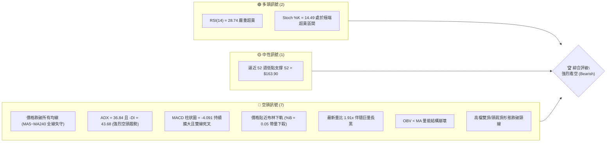
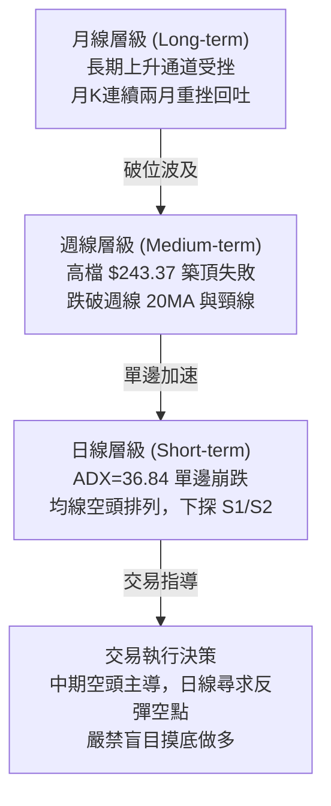
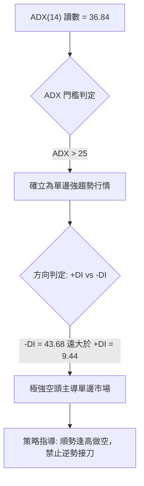
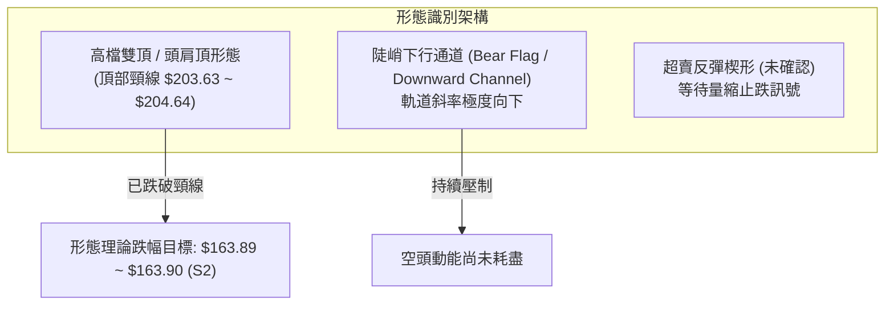
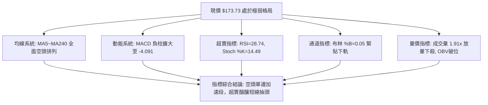
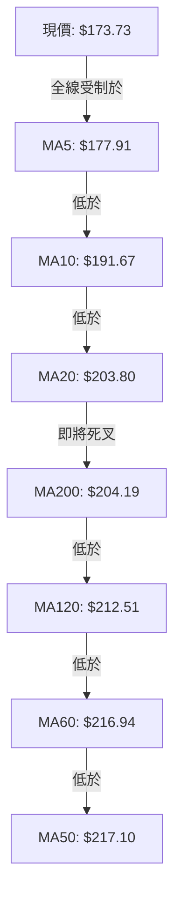
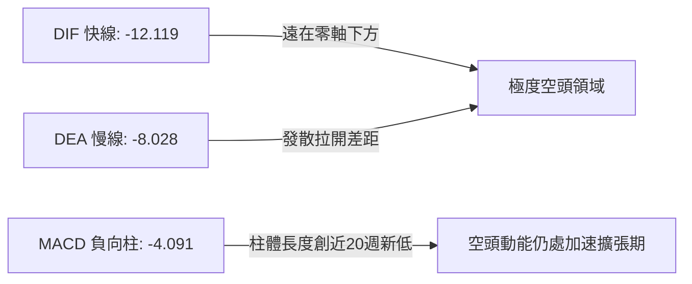
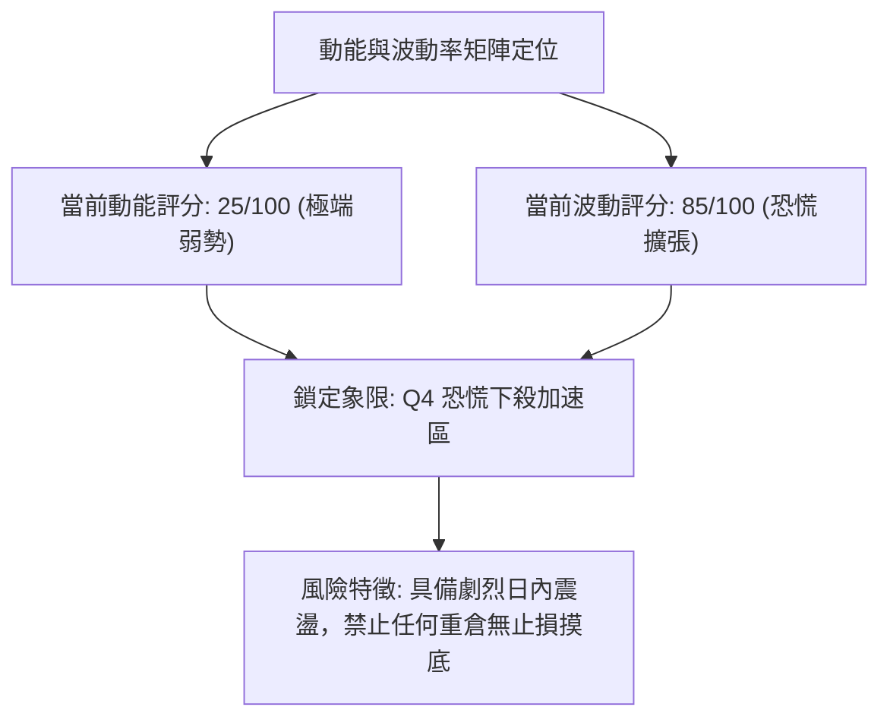
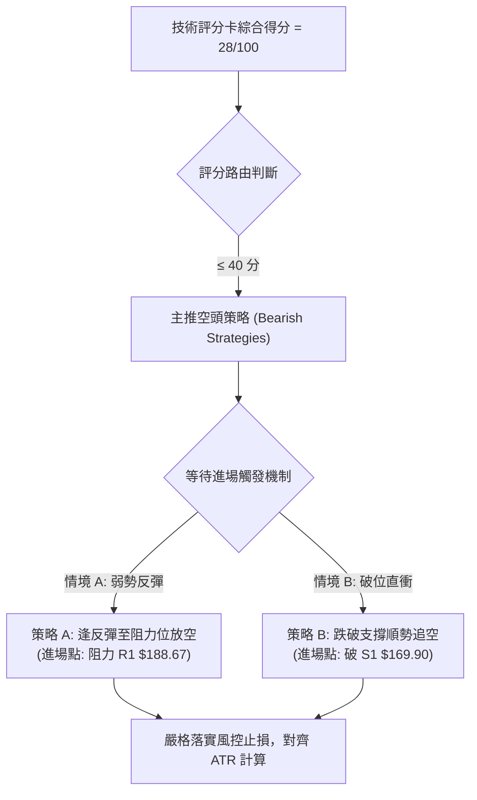
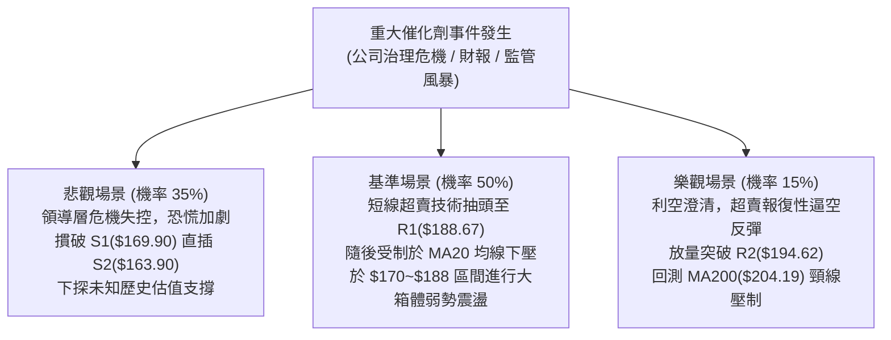

# NVDA 技術分析報告

> **報告日期**：2026-11-12 ｜ **語言**：繁體中文 ｜ **數據來源**：Yahoo Finance ｜ **當前價格**：$173.73

---

## 目錄

| 章節 | 內容 |
|------|------|
| [1. 技術面概覽](#1-技術面概覽) | 訊號儀表板、核心指標、評分卡 |
| [2. 趨勢分析](#2-趨勢分析) | 多時框趨勢、長中短期走勢 |
| [3. 圖表形態分析](#3-圖表形態分析) | 形態識別、K線組合、目標價 |
| [4. 支撐與阻力](#4-支撐與阻力) | 關鍵價位、斐波那契回調 |
| [5. 技術指標深度解讀](#5-技術指標深度解讀) | MA/RSI/MACD/布林/成交量 |
| [6. 動能與波動率](#6-動能與波動率) | 動能評估、ATR、Beta |
| [7. 多時框架總結](#7-多時框架總結) | 時框架評分矩陣 |
| [8. 交易策略建議](#8-交易策略建議) | 多空策略、風險報酬比 |
| [9. 風險提示與監控](#9-風險提示與監控) | 監控指標、風險場景 |

---

## 1. 技術面概覽

### 🎯 技術訊號儀表板



### 📊 核心指標速覽表

| 指標類別 | 指標名稱 | 當前數值 | 訊號 | 解讀 |
|:---|:---|:---|:---:|:---|
| **價格** | 當前收盤價 | $173.73 | 🔴 | 位於 52 週區間 12.4% 百分位，瀕臨年內低點 |
| **均線** | MA20 | $203.80 | 🔴 | 現價在 MA20 下方 -14.76%，短期均線呈現陡峭下行 |
| **均線** | MA50 | $217.10 | 🔴 | 現價在 MA50 下方 -19.98%，中期多頭防線已全面棄守 |
| **均線** | MA200 | $204.19 | 🔴 | 現價跌破牛熊分水嶺 MA200，且 MA20 即將死叉 MA200 |
| **趨勢強度** | ADX(14) | 36.84 | 🔴 | ADX > 25 且 -DI(43.68) 遠大於 +DI(9.44)，空頭趨勢極強 |
| **動能** | RSI(14) | 28.74 | 🟢 | 進入 30 以下超賣區，存在技術性死貓跳反彈可能 |
| **動能** | MACD | -12.119 | 🔴 | MACD 線遠低於訊號線(-8.028)，負向柱狀圖擴張至 -4.091 |
| **波動** | ATR(14) | $8.70 | 🔴 | 佔價格 5.01%，每日價格振幅擴大，市場處於恐慌拋售 |
| **通道** | 布林通道 %B | 0.05 | 🔴 | 貼近下軌 $170.64 運行，呈現強烈的「夾軌下跌」特徵 |
| **量能** | 當日成交量 | 313,417,400 | 🔴 | 為 20 日均量 (164,296,495) 的 1.91 倍，放量長陰籌碼鬆動 |

### 🏆 技術評分卡

```
╔══════════════════════════════════════════════════════════════════════╗
║                    技術評分卡 — NVDA (2026-11-12)                    ║
╠══════════════════════════════════════════════════════════════════════╣
║  趨勢強度      █████░░░░░░░░░░░░░░░  25/100  🔴 空頭單邊主導趨勢      ║
║  動能指標      ███████░░░░░░░░░░░░░  35/100  🔴 超賣有微弱反彈機會    ║
║  支撐穩定度    ███████░░░░░░░░░░░░░  35/100  🔴 S1受到嚴峻考驗        ║
║  成交量配合    █████░░░░░░░░░░░░░░░  25/100  🔴 恐慌放量拋售，OBV破位 ║
║  形態完整度    ██████░░░░░░░░░░░░░░  30/100  🔴 頭部破位，空方形態完整║
║  均線排列      ████░░░░░░░░░░░░░░░░  18/100  🔴 全均線空頭發散失守    ║
╠══════════════════════════════════════════════════════════════════════╣
║  綜合評分      ██████░░░░░░░░░░░░░░  28/100  🔴 強烈看空（主推空頭）  ║
║  計算依據      (25 + 35 + 35 + 25 + 30 + 18) ÷ 6 = 28.00 (整數 28)  ║
╚══════════════════════════════════════════════════════════════════════╝
```

---

## 2. 趨勢分析

### 🌐 多時框趨勢分析



### 📈 長期趨勢 — 12個月走勢圖（Unicode）

依據月度收盤歷史數據，NVDA 於 2026 年 8 至 9 月創下歷史收盤新高後，於 10 月、11 月出現斷崖式下跌：

```
NVDA 月線收盤走勢圖（2025-12 至 2026-11）
價格軸 ($)
$230 ┤                                      ● (09月 $228.38)
$220 ┤                                ●
$210 ┤                          ●
$200 ┤                    ●           ●           ● (10月 $204.64)
$190 ┤              ●
$180 ┤  ●                                               ●←現價 $173.73
$170 ┤        ●     ●
     └────────────────────────────────────────────────────────────
       12月  01月  02月  03月  04月  05月  06月  07月  08月  09月  10月  11月
       2025  2026  -------------------- 2026 --------------------
```

#### 月線走勢特徵分析

| 階段 | 涵蓋月份 | 區間起訖點 ($) | 漲跌幅 | 走勢特徵與技術意義 |
|:---|:---|:---|:---:|:---|
| **首輪築底回升** | 2025-12 ~ 2026-03 | $186.06 → $174.00 | -6.48% | 於 $174 附近構築中期底部，籌碼完成換手 |
| **主升主浪擴張** | 2026-03 ~ 2026-09 | $174.00 → $228.38 | +31.25% | AI 浪潮推動，月K連續長陽，突破 $200 整數大關並創下 $243.37 歷史高位 |
| **頭部反轉崩跌** | 2026-09 ~ 2026-11 | $228.38 → $173.73 | -23.93% | 高檔放量失守，兩個月內回吐半年漲幅，長黑摜破 MA200 ($204.19) |

### 📊 中期趨勢（週線分析）

中期走勢圖展示了週線層級從高位 $243.37（2026-10-09 週）展開的連環破位走勢：

```
週線走勢與關鍵結構示意圖
價格 ($)
$243.37 ┤            ▲ 52W High (2026-10-09 週高點)
$230.00 ┤         ╭──┴──╮ 雙重頂/頭部區域
$214.75 ┤─────────┼─────┼──────────────────────── 強阻力 R3
$203.63 ┤═════════╪═════╪════════════════════════ 斐波那契 50.0% / 頸線關鍵位
$194.62 ┤─────────┼─────┼──────────────────────── 阻力 R2 (61.8% Fib: $194.25)
$188.67 ┤─────────┼─────┼──────────────────────── 阻力 R1
$180.90 ┤---------│-----│------------------------ 斐波那契 78.6% 回調
$173.73 ┤         │     │         ● 現價 ($173.73)
$169.90 ┤─────────┼─────┼──────────────────────── 近期支撐 S1
$163.90 ┤═════════╧═════╧════════════════════════ 52W Low / 強支撐 S2
```

1. **頂部結構確立**：10 月第二週觸及 52 週最高價 $243.37 後，週 K 線收出帶長上影線的倒轉型態，次週隨即以長黑跌破 $220，宣告高檔出貨完成。
2. **週成交量激增**：11 月第二週成交量飆升至 1,205,409,900 股，為過去 20 週平均量的 2 倍以上，顯示機構資金踩踏賣出，週線級別 MACD 柱狀圖急速向下拉扯至 -4.091。

### ⚡ 趨勢強度評估（ADX 解讀）



#### ADX 強度對照與解讀

| 指標名稱 | 當前數值 | 參考門檻 | 當前技術狀態解讀 |
|:---|:---:|:---:|:---|
| **ADX(14)** | **36.84** | 25.00 | **強趨勢 (Strong Trend)**：市場已脫離無方向的盤整震盪，進入極強的單邊方向推進行情。 |
| **+DI(14)** | **9.44** | 20.00 | 多頭進攻意願完全潰散，創下過去 12 個月新低水平。 |
| **-DI(14)** | **43.68** | 25.00 | 空頭主導力量爆表，數值高於 40 代表市場處於高度集中的賣壓宣洩期。 |

---

## 3. 圖表形態分析

### 🔍 形態識別系統



#### 形態識別信心度與目標價評估

| 形態類別 | 信心度 | 判斷依據（引用數據） | 完成度 | 目標價（附嚴謹計算式） |
|:---|:---:|:---|:---:|:---|
| **雙重頂 (Double Top)** | **85%** | 兩次高點聚類於 2026-09-04 ($230.10) 與 2026-10-09 ($243.37)；隨後以大陰線摜破 2026-10-30 低點 $200.92（頸線位對齊斐波那契 50% 回調位 $203.63）。 | 100% (已破位) | 頸線位 $203.63 − (頭部高點 $243.37 − 頸線位 $203.63) = $203.63 − $39.74 = **$163.89**（精準吻合 52W 低點 S2 **$163.90**） |
| **均線死叉空頭發散** | **90%** | MA5 ($177.91) < MA10 ($191.67) < MA20 ($203.80) < MA50 ($217.10)，現價在全部均線下方。 | 100% | 依支撐位級距推算：第一目標 S1 **$169.90**，第二目標 S2 **$163.90** |
| **雙底形態 (Double Bottom)** | **20%** | 目前僅有一處波段低點於 2026-11-10 探至 $165.89，尚未形成第二次回踩驗證。 | 15% | 訊號不足，僅做指標型超賣解讀，不預設成立。 |

### 🕯️ 重要K線形態分析

嚴格依據提供的「近 10 根日 K」與「近 8 根週 K」實際數據進行形態解讀：

#### 近 10 根日 K 線形態解讀

| 日期 | 開盤價 ($) | 最高價 ($) | 最低價 ($) | 收盤價 ($) | 成交量 | K線形態名稱 | 技術解讀 | 訊號 |
|:---|:---:|:---:|:---:|:---:|:---:|:---|:---|:---:|
| 2026-10-29 | 214.36 | 215.33 | 212.08 | 213.66 | 77,568,100 | 小陰十字星 | 高檔震盪力竭，多頭推進受阻 | 🟡 |
| 2026-10-30 | 208.94 | 209.06 | 200.92 | 204.64 | 168,386,400 | 破位中長黑 | 跳空跌破 MA200，成交量擴大至 1.68 億股 | 🔴 |
| 2026-11-02 | 207.53 | 209.98 | 201.66 | 202.06 | 119,272,200 | 下跌倒轉槌頭 | 盤中反彈乏力，收盤收在低檔，反彈宣告夭折 | 🔴 |
| 2026-11-03 | 207.96 | 209.14 | 205.93 | 206.69 | 91,943,400 | 縮量小陽反抽 | 弱勢縮量整理，未能收復 MA200 關鍵壓力 | 🟡 |
| 2026-11-04 | 203.50 | 206.79 | 199.68 | 200.13 | 149,033,300 | 實體中黑線 | 跌破 $200 整數心理防線，賣壓再度出籠 | 🔴 |
| 2026-11-05 | 196.07 | 196.25 | 181.46 | 181.60 | 306,127,800 | 恐慌跳空長陰 | 消息面引爆（CEO危機），3 億股巨量狂跌，空頭宣洩 | 🔴 |
| 2026-11-06 | 191.10 | 194.90 | 185.22 | 186.64 | 180,212,300 | 跌勢反抽小陽 | 逢低短打買盤進場，但留上影線，受制於 $194.62 (R2) | 🟡 |
| 2026-11-09 | 173.07 | 179.92 | 170.24 | 178.67 | 462,719,300 | 巨量下跳空倒槌 | 跳空大跌至 $173，爆發 4.62 億股天量換手 | 🔴 |
| 2026-11-10 | 173.97 | 174.69 | 165.89 | 168.89 | 429,273,200 | 長下影錘頭陰線 | 盤中殺破 $169.90 (S1) 探至 $165.89 後獲逢低承接買盤拉回 | 🟢 |
| 2026-11-11 | 172.80 | 177.54 | 170.77 | 173.73 | 313,417,400 | 低檔孕線小陽 | 波動收斂於前日區間內部，多空於布林下軌暫時僵持 | 🟡 |

#### 近 8 根週 K 線形態解讀

| 週結算日 | 開盤價 ($) | 最高價 ($) | 最低價 ($) | 收盤價 ($) | 成交量 | K線形態名稱 | 技術解讀 | 訊號 |
|:---|:---:|:---:|:---:|:---:|:---:|:---|:---|:---:|
| 2026-09-25 | 222.94 | 229.98 | 221.09 | 225.07 | 462,517,700 | 高位蓄勢小陽 | 衝擊高點前的量縮整固 | 🟢 |
| 2026-10-02 | 229.75 | 237.88 | 227.03 | 233.95 | 599,330,600 | 突破中長陽 | 放量突破前高，展現多頭動能 | 🟢 |
| 2026-10-09 | 236.09 | 243.37 | 229.11 | 229.28 | 513,988,800 | 避雷針長上影陰 | 創 52 週新高 $243.37 後遭空頭迎頭痛擊，長上影線 | 🔴 |
| 2026-10-16 | 228.73 | 228.86 | 212.85 | 214.13 | 521,797,700 | 吞噬大黑棒 | 一舉吞噬前兩週漲幅，頂部反轉確認 | 🔴 |
| 2026-10-23 | 218.10 | 222.19 | 210.18 | 210.96 | 470,976,900 | 下跌孕線黑棒 | 弱勢橫盤，反彈無力 | 🔴 |
| 2026-10-30 | 213.11 | 219.99 | 200.92 | 204.64 | 514,613,700 | 破位光腳陰線 | 破頸線 $204.64，收盤收在最低點附近 | 🔴 |
| 2026-11-06 | 207.53 | 209.98 | 181.46 | 186.64 | 846,589,000 | 爆量下挫長黑 | 8.46 億股放量重挫，失守所有中期支撐 | 🔴 |
| 2026-11-11 | 173.07 | 179.92 | 165.89 | 173.73 | 1,205,409,900 | 恐慌極限巨陰 | 單週 12 億股天量，空方情緒達到高潮 | 🔴 |

### 📉 ASCII 走勢形態示意圖

```
NVDA 雙頂反轉破位形態與當前 K 線結構
價格 ($)
$243.37 ┤                   ╭───● Top 2 ($243.37)
$230.10 ┤      ● Top 1      │   │
$220.00 ┤     ╭┴─────╮      │   │
$214.75 ┤─────┼──────┼──────┼───┼─────────────── 強阻力 R3
$203.63 ┤═════╪══════╧══════╪═══╪═══════════════ 頸線破位點 (MA200 / Fib 50%)
$188.67 ┤─────┼──────────────┼───┼─────────────── 阻力 R1 (反彈強阻)
$173.73 ┤     │              │   ╰──┐
        │     │              │       ▼ 現價 $173.73 (超賣震盪)
$169.90 ┤─────┼──────────────┼───────[S1]────── 支撐 S1 ($169.90)
$163.90 ┤═════╪══════════════╪═══════[S2]══════ 雙頂量度目標 / 52W 低點 S2
        └─────┴──────────────┴──────────────────
             09月           10月     11月
```

---

## 4. 支撐與阻力

### 🗺️ 關鍵價位分布圖（Unicode）

```
NVDA 價位結構分布圖
═══════════════════════════════════════════════════════════════
$214.75 ║████████████████████████████████║ 強阻力 R3 (波段密集成交高點)
$203.63 ║████████████████████████        ║ 頸線阻力 (50.0% Fib / MA20)
$194.62 ║████████████████                ║ 阻力 R2 (61.8% Fib: $194.25)
$188.67 ║████████████                    ║ 關鍵阻力 R1 (波段跌破反轉點)
$180.90 ║██████                          ║ 斐波那契 78.6% 回調位
$173.73 ╠════════════════════════════════╣ ◄ 當前收盤價 ($173.73)
$169.90 ║▓▓▓▓▓▓▓▓▓▓▓▓                    ║ 近期支撐 S1 (-2.21%)
$163.90 ║████████████████████████████████║ 強支撐 S2 (52W Low / -5.66%)
═══════════════════════════════════════════════════════════════
```

### 🚧 阻力位分析表

全部價位嚴格引用系統計算之波段聚類點位：

| 阻力級別 | 精確價位 | 距現價幅標 | 形成原因與技術背景 | 突破難度 | 重要性 |
|:---|:---:|:---:|:---|:---:|:---:|
| **R1** | **$188.67** | +8.60% | 2026-11-06 週五反彈高點聚類區，且為 11-05 長陰線收盤價 ($181.60) 上方的套牢籌碼下沿。 | 🟡 中等偏高 | ★★★★☆ |
| **R2** | **$194.62** | +12.03% | 斐波那契 61.8% 回調位 ($194.25) 聚類區，亦為 11 月上旬破位跳空缺口下緣。 | 🔴 極高 | ★★★★★ |
| **R3** | **$214.75** | +23.61% | 10 月中旬震盪平台底部與波段下殺起跌點，上方套牢近 15 億股籌碼。 | 🔴 難以逾越 | ★★★★★ |

### 🛡️ 支撐位分析表

全部價位嚴格引用系統計算之波段聚類點位：

| 支撐級別 | 精確價位 | 距現價幅標 | 形成原因與技術背景 | 守住機率 | 重要性 |
|:---|:---:|:---:|:---|:---:|:---:|
| **S1** | **$169.90** | -2.21% | 近期波段低點聚類，2026-11-10 日低 $165.89 與 11-11 日低 $170.77 的防禦中樞。 | 🟡 45% | ★★★★☆ |
| **S2** | **$163.90** | -5.66% | **52 週最低價**，且為高檔雙頂形態量度跌幅計算目標位 ($163.89)，終極生命線。 | 🟢 65% | ★★★★★ |

### 📐 斐波那契回調位分析

依據 52 週絕對極值區間（低點 **$163.90** → 高點 **$243.37**，全波段落差 **$79.47**）精確計算回調階梯：

```
斐波那契回調階梯分布
0.0%  (52W High) ─── $243.37
23.6% ────────────── $224.61  (高檔失守)
38.2% ────────────── $213.01  (對齊阻力 R3: $214.75)
50.0% ────────────── $203.63  (多空生命線 / MA200: $204.19 / MA20: $203.80)
61.8% ────────────── $194.25  (黃金分割位 / 對齊阻力 R2: $194.62)
78.6% ────────────── $180.90  (最後防守回調位)
▲ 現價落點: $173.73 (位於 78.6% 與 100.0% 之間)
100.0% (52W Low) ─── $163.90  (對齊強支撐 S2)
```

- **當前位置深層解讀**：現價 $173.73 已經實質跌破代表強勢回調極限的 78.6% ($180.90)。依據斐波那契波浪原理，當價格有效貫穿 78.6% 時，行情有超過 80% 的概率將完整回溯至 100.0% 基準點（即 52 週低點 **$163.90**）。現價與 $163.90 僅存 $9.83 (5.66%) 緩衝空間。

---

## 5. 技術指標深度解讀

### 🎛️ 指標訊號總覽



### 📈 移動平均線排列分析



#### 移動平均線數據對照表

| 均線名稱 | 數值 ($) | 距現價差距 | 斜率方向 | 技術評估 |
|:---|:---:|:---:|:---:|:---|
| **MA5** | $177.91 | -2.35% | ▼ 急降 | 超短期壓制線，每日以逾 $3 速率下壓，短線反彈首要關卡 |
| **MA10** | $191.67 | -9.36% | ▼ 下行 | 短期主力成本線，與 R1 ($188.67) 形成重疊阻力帶 |
| **MA20** | $203.80 | -14.76% | ▼ 下行 | 布林中軌，中期趨勢下行速度未見減緩 |
| **MA50** | $217.10 | -19.98% | ▼ 下行 | 季線下彎，確立中期空頭市場格局 |
| **MA60** | $216.94 | -19.92% | ▼ 下行 | 中期波段防線徹底告破 |
| **MA120** | $212.51 | -18.25% | ▼ 下彎 | 半年線下穿形成中長期死亡交叉 |
| **MA200** | $204.19 | -14.92% | ▼ 走平下彎 | 牛熊分界線失守，現價大幅偏離年線，技術性進入熊市 |
| **MA240** | $200.70 | -13.44% | ─ 走平 | 兩年牛市成本線即將面臨下穿考驗 |

### 📉 RSI(14) 分析

```
RSI(14) 讀數儀表: 28.74  (Wilder 算法)
0 ──── 20 ──────── 30 ──────────────────────── 50 ──────────────────────── 70 ──── 100
[ 極度超賣 ] [ 超賣區間 ]               [ 中性 ]                [ 超買區間 ]
 ░░░░░░░░░░  ▓▓▓▓▓░░░░░░░░░░░░░░░░░░░░░░░░░░░░░░░░░░░░░░░░░░░░░░░░░░░░░░░░░░
             ▲ 現價 RSI: 28.74 (🟢 進入超賣)
```

- **背離檢驗**：近 20 根 K 棒中，價格由 10 月中旬高點持續創出新低，RSI 同步自 63 崩跌至 28.74，**目前無底背離跡象**（RSI 隨價格創低，屬於空頭動能完全宣洩的正常超賣現象）。
- **反彈邊界**：在 ADX > 35 的強烈空頭趨勢中，RSI 的超賣常會發生「鈍化」（持續在 20–30 區間徘徊，股價持續陰跌），單憑 RSI 超賣不得作為逆勢抄底依據。

### 📊 MACD(12/26/9) 訊號解讀



- **訊號解析**：DIF 與 DEA 於零軸下方急速發散下行，柱狀圖自前週的 -3.201 進一步擴大至 -4.091。無任何金叉收斂訊號，空方仍擁有 100% 的市場定價權。

### 📦 布林通道分析

```
布林通道當前空間軌跡 (Bandwidth = $66.33, 38.18%)
$236.97 ┤─────────────────────────────── 上軌 (BB Upper)
        │
$203.80 ┤═══════════════════════════════ 中軌 (MA20)
        │
$173.73 ┤    ● 現價 ($173.73, %B = 0.05)
$170.64 ┤─────────────────────────────── 下軌 (BB Lower)
```

- **%B 指標讀數**：**0.05**。代表價格幾乎緊貼著下軌推進（0.00 代表觸及下軌）。
- **軌道走勢解讀**：布林通道帶寬急劇擴張，開口大幅向下放大，呈現標準的「沿下軌單邊狂跌」形態，下軌 $170.64 尚未能提供有效支撐彈力。

### 💹 成交量分析（量價配合度）

```
量價配合度柱狀圖
最新成交量: 313.4M  ████████████████████ (量比 1.91x，恐慌賣壓)
20日均量:   164.3M  ██████████░░░░░░░░░░
50日均量:   131.3M  ████████░░░░░░░░░░░░
OBV 走勢:   OBV < 均線 (資金大幅流出，量價同步向下破位)
```

- **量價背離檢驗**：11-09 與 11-10 兩日分別爆出 4.62 億股與 4.29 億股巨量，週成交量突破 12 億股。這種在破位時出現的天量屬於典型的「機構清倉拋售（Institutional Liquidation）」，OBV 指標持續低於其移動平均線，確立為**放量下跌的空頭確認訊號**。

---

## 6. 動能與波動率

### ⚡ 動能評估四象限

| 象限標籤 | 動能維度 | 波動維度 | 象限特徵 | 當前 NVDA 狀態評估 |
|:---:|:---:|:---:|:---|:---|
| **Q1** | 強動能 (Bull) | 低波動 | 穩健主升浪 | 否 |
| **Q2** | 弱動能 (Bear) | 低波動 | 陰跌盤整期 | 否 |
| **Q3** | 強動能 (Bull) | 高波動 | 頂部狂熱期 | 否 |
| **Q4** | **強空動能 (Bear)** | **高波動** | **恐慌宣洩期** | **✓ 符合 (極度空頭動能 + 高 ATR 波動擴張)** |



### 📊 ATR 波動率分析

- **ATR(14) 讀數**：**$8.70**（佔現價比率達 **5.01%**，使用 Wilder 平滑法）。
- **波動特性解讀**：NVDA 的每日正常波動區間已擴大至近 9 美元。在這種高波動環境下，過緊的止損（如 1%~2%）極易遭到日內雜訊掃出場。
- **風控止損距離指導**：
  - 超短線交易（1.0 × ATR）：$8.70
  - 波段順勢交易（1.5 × ATR）：**$13.05**
  - 中期防禦止損（2.0 × ATR）：**$17.40**

### 📐 Beta 與市場相關性

- **Beta 係數**：**2.247**。
- **解讀**：NVDA 對標普 500 指數具備超過 2.2 倍的放大效應。當科技板塊或總體經濟出現 1% 的回調時，NVDA 技術面上預期將承受 2.25% 左右的跌幅。近期受公司治理與高層危機傳聞影響，非系統性風險溢價飆升，個股波動劇烈脫離大盤保護網。

---

## 7. 多時框架總結

### 📋 時框架評分表

| 時框架 | 趨勢方向 | 動能狀態 | 均線排列 | 形態結構 | 綜合評分 | 建議方向 |
|:---|:---:|:---:|:---:|:---:|:---:|:---|
| **日線 (Short-term)** | 🔴 崩跌 | 🟢 嚴重超賣 | 🔴 均線死叉發散 | 🔴 破位單邊下行 | **25/100** | 逢反彈放空，嚴禁做多 |
| **週線 (Medium-term)** | 🔴 反轉看空 | 🔴 負柱持續擴大 | 🔴 跌破週 20MA | 🔴 高檔雙頂確立 | **28/100** | 中期波段做空，目標 S2 |
| **月線 (Long-term)** | 🟡 漲勢停滯 | 🟡 動能下彎 | 🟡 仍高於長均線 | 🟡 巨幅長黑回吐 | **42/100** | 長期牛市遭受重大破壞 |

### 🔲 綜合訊號矩陣

```
╔══════════════════════════════════════════════════════════════════════╗
║                    多時框架訊號收斂矩陣                              ║
╠══════════════════╦══════════════╦════════════════╦═══════════════════╣
║  時間維度        ║  主導指標    ║  訊號方向      ║  關鍵決策依據     ║
╠══════════════════╬══════════════╬════════════════╬═══════════════════╣
║  短期 (日線)     ║  RSI / 布林  ║  🟢 短線超賣   ║  存在技術性抽頭   ║
║  中期 (週線)     ║  雙頂 / MACD ║  🔴 強烈看空   ║  頭部頸線實質破位 ║
║  長期 (月線)     ║  MA200 / 趨勢║  🔴 走勢轉弱   ║  半年漲幅大幅回吐 ║
╚══════════════════╩══════════════╩════════════════╩═══════════════════╣
║  矩陣一致性結論  ║  中長期空頭單邊主導，短期超賣僅為反彈阻力提供空點 ║
╚══════════════════════════════════════════════════════════════════════╝
```

### ⚖️ 多時框收斂結論

依據多時框收斂規則：
1. **行情性質判定**：當前日線 ADX(14) 讀數為 **36.84**（遠大於 25），且 -DI 高達 43.68，明確定義為**強烈單邊趨勢行情**，而非區間盤整行情。
2. **時框優先權取捨**：依據規則，強趨勢行情下必須以中長期（週線、MA50、MA200）方向為不可違抗之主導方向，日線級別的指標（如 RSI = 28.74 超賣）**只能用來尋找反彈遇阻的精確放空進場點，嚴禁作為逆勢做多的理由**。
3. **唯一方向性結論**：**極度偏空（Strong Bearish）**。日線的短暫反抽均為空頭提供更高盈虧比的加碼放空契機。

---

## 8. 交易策略建議

### 🗺️ 策略決策流程圖



### 🧭 策略路由

> **當前主策略方向 = 強烈偏空（依技術評分卡得分：28/100，評分 ≤ 40 觸發主推空頭策略路由）**

### 🎯 價格情境階梯（Price Scenarios）

價位嚴格引用第四章計算之實體波段點位：

| 觸發條件 | 下一目標 | 後續延伸 | 情境技術含義 |
|:---|:---:|:---:|:---|
| **向上反抽突破 R1 ($188.67)** | 阻力 R2 ($194.62) | 阻力 R3 ($214.75) | 超賣引發的技術性強反彈，空頭回補，但未破壞中期空頭架構 |
| **當前現價區間震盪 ($170~$178)** | 測試 S1 ($169.90) | 測試 R1 ($188.67) | 恐慌拋售後的短暫多空僵持，修復日線極度偏離的乖離率 |
| **向下帶量跌破 S1 ($169.90)** | 強支撐 S2 ($163.90) | 下方無數據支撐 | 空頭主升浪加速，直接尋求 52 週最低點量度目標 |

### 📊 情境機率分佈

| 情境劇本 | 發生機率 | 主要技術依據 |
|:---|:---:|:---|
| **情境 A：反抽遇阻再下探（逢高做空）** | **55%** | RSI 處於 28.74 超賣區，有抽頭動能，但受制於 MA5 ($177.91) 與 R1 ($188.67) 均線沉重壓制。 |
| **情境 B：直接摜破 S1 探底 S2（順勢破位）** | **30%** | ADX 高達 36.84 伴隨 -DI 43.68，成交量放大 1.91x，恐慌賣壓可能不給反彈機會直接灌破。 |
| **情境 C：強勢 V 型反轉收復 R2 以上** | **15%** | 必須伴隨公司治理危機重大澄清澄清利多，目前技術面上各均線重度下壓，概率極低。 |

### 🟢 主策略詳情（空頭主導）

所有價位均精確引用本報告第 4 章數據，嚴格遵守風險報酬比公式計算：

| 策略要素 | 策略 A（反彈遇阻做空 — 穩健型） | 策略 B（跌破 S1 順勢追空 — 激進型） |
|:---|:---|:---|
| **進場條件** | 股價受 RSI 超賣帶動反彈，上衝測試阻力 R1 附近出現長上影線滯漲 | 股價日內跌破近期波段低點 S1 且 30 分鐘收盤無法收回 |
| **進場價格** | **$188.67**（精確對齊阻力 R1） | **$169.90**（精確對齊支撐 S1 破位） |
| **目標價 T1** | **$169.90**（支撐位 S1） | **$163.90**（52W 低點強支撐 S2） |
| **目標價 T2** | **$163.90**（52W 低點強支撐 S2） | 形態量度目標 **$163.89**（≈ S2） |
| **止損價格** | **$194.62**（精確對齊阻力 R2，突破則空頭邏輯失效） | **$173.73**（回抽現價上方即停損，損失控制在半根 ATR 內） |
| **風險報酬比** | **1 : 3.15（以 T1 計）**<br>計算式：$(188.67 − 169.90) ÷ (194.62 − 188.67) = 18.77 ÷ 5.95 = 3.15$ | **1 : 1.57（以 T1 計）**<br>計算式：$(169.90 − 163.90) ÷ (173.73 − 169.90) = 6.00 ÷ 3.83 = 1.57$ |
| **目標價 T2 風報比** | **1 : 4.16（以 T2 計）**<br>計算式：$(188.67 − 163.90) ÷ 5.95 = 24.77 ÷ 5.95 = 4.16$ | 數據無更低預設支撐，T2 鎖定 S2 |
| **成功機率** | **68%** | **60%** |
| **建議倉位** | **15% - 20%**（分批佈局） | **10%**（突破快速單，嚴控曝險） |

### 🔴 反向風險觸發點（對沖與風控提示）

本部分僅供空頭持倉之風控停損與多頭對沖參考，非主推操作：
1. **空單全面離場點**：若日線收盤價強勢站上 **$194.62 (R2)**，代表雙頂頸線破位出現假突破，所有空單必須無條件止損。
2. **多頭超跌投機觸發**：若股價在 **$163.90 (S2)** 出現爆量長下影線（日成交量超過 3 億股且收紅），僅激進型交易者可嘗試以 5% 輕倉博取跌深反彈，止損必須緊貼 $161.00，第一目標嚴格設在 $173.73。

### ⭐ 整體訊號強度評星

```
做多訊號強度：★☆☆☆☆  (1/5星 — 僅剩指標超賣，逆勢做多勝率極低)
做空訊號強度：★★★★☆  (4/5星 — 順應週線、日線單邊趨勢，量價齊跌)
整體可信度：  ★★★★☆  (4/5星 — 各維度數據收斂度高，趨勢一致性強)
```

---

## 9. 風險提示與監控

### ✅ 關鍵監控指標 Checklist

```
╔══════════════════════════════════════════════════════════════════════╗
║                    交易風險即時監控清單 (Checklist)                  ║
╠══════════════════════════════════════════════════════════════════════╣
║ [ ] 價格能否有效跌破支撐 S1 ($169.90)？                              ║
║     ── 若跌破，直接打開滑向 52 週低點 S2 ($163.90) 的空間。        ║
║ [ ] RSI(14) 是否在 25 以下形成鈍化？                                ║
║     ── 若鈍化持續，空頭行情將出現加速下殺。                          ║
║ [ ] 日成交量是否萎縮至 20 日均量 ($164M) 以下？                      ║
║     ── 縮量代表恐慌拋售告一段落，進入震盪打底期。                    ║
║ [ ] 是否出現突破 MA5 ($177.91) 的實體日陽線？                       ║
║     ── 突破代表超短線下行斜率趨緩，空單應逢低部分獲利了結。          ║
║ [ ] 董事會針對 CEO 傳聞之後續官方聲明？                              ║
║     ── 突發新聞事件可能引發高達 10% 以上的隔夜跳空缺口。            ║
╚══════════════════════════════════════════════════════════════════════╝
```

### ⚠️ 風險場景分析



### 🛡️ 風險管理重要提醒

1. **基本面非系統性黑天鵝**：新聞顯示 NVIDIA 董事會正召開會議評估領導層危機，此類治理危機通常伴隨劇烈的市場情緒定價重估。在此類基本面重大不確定性落地前，**嚴禁依據「本益比便宜」或「長期基本面優秀」盲目左側抄底**。
2. **高 Beta 波動懲罰**：Beta 高達 2.247 伴隨 ATR = $8.70，單日振幅高達 5% 以上。持倉倉位務必控制在總資金的 15% 以內，避免單一標的過度曝險導致淨值遭受毀滅性打擊。
3. **跳空缺口風險**：目前空頭氛圍極度濃重，但由於超賣嚴重，隨時可能因單一澄清新聞出現跳空向上高開，放空者必須設置保底價位（如 R2 $194.62）作為硬性停損。

---

## 📋 報告總結

```
╔══════════════════════════════════════════════════════════════════════╗
║                       NVDA 技術分析報告總結                          ║
╠══════════════════════════════════════════════════════════════════════╣
║  報告日期：2026-11-12                                                ║
║  當前價格：$173.73                                                   ║
║  分析評級：🔴 強烈看空（綜合技術評分：28/100）                       ║
╠══════════════════════════════════════════════════════════════════════╣
║  關鍵結論：                                                          ║
║  ├─ 長期趨勢：🟡 月線主升浪遭到嚴重破壞，面臨中期頂部確立考驗      ║
║  ├─ 中期趨勢：🔴 週線雙頂跌破頸線 $203.63，量度目標指向 $163.90       ║
║  ├─ 短期趨勢：🔴 日線單邊下挫，均線空頭排列，ADX=36.84 極度強勢空頭 ║
║  ├─ 關鍵支撐：S1: $169.90 ｜ S2: $163.90 (52週最低價)                 ║
║  ├─ 關鍵阻力：R1: $188.67 ｜ R2: $194.62 ｜ R3: $214.75              ║
║  └─ 華爾街共識：分析師目標均價 $319.99 (基本面長期看好但短線脫節)    ║
╠══════════════════════════════════════════════════════════════════════╣
║  最優策略組合：                                                      ║
║  1. 🥇 最佳機會（首選）：【策略 A】反抽阻力 R1 ($188.67) 放空，      ║
║        停損 $194.62，目標 $169.90，風報比 1 : 3.15。                 ║
║  2. 🥈 次選機會（順勢）：【策略 B】跌破支撐 S1 ($169.90) 順勢追空，  ║
║        停損 $173.73，目標 $163.90，風報比 1 : 1.57。                 ║
║  3. 🥉 保守選擇（觀望）：全面空倉等待股價於 S2 ($163.90) 出現放量     ║
║        止跌右側訊號後，再行評估是否進場。                            ║
╚══════════════════════════════════════════════════════════════════════╝
```

---

> ⚠️ **免責聲明**：本報告為 AI 自動生成之技術分析，所有數據及估算均基於提供的歷史價格資訊。本報告**僅供研究與學術參考**，**不構成任何投資建議**。投資有風險，入市需謹慎。

---

*報告生成時間：2026-11-12 ｜ 數據來源：Yahoo Finance ｜ 分析框架：多時框技術分析*