# NVDA 技術分析報告

> **報告日期**：2026-11-13 ｜ **語言**：繁體中文 ｜ **數據來源**：Yahoo Finance ｜ **當前價格**：$166.19

---

## 目錄

| 章節 | 內容 |
|------|------|
| [1. 技術面概覽](#1-技術面概覽) | 訊號儀表板、核心指標、評分卡 |
| [2. 趨勢分析](#2-趨勢分析) | 多時框趨勢、長中短期走勢 |
| [3. 圖表形態分析](#3-圖表形態分析) | 形態識別、K線組合、目標價 |
| [4. 支撐與阻力](#4-支撐與阻力) | 關鍵價位、斐波那契回調 |
| [5. 技術指標深度解讀](#5-技術指標深度解讀) | MA/RSI/MACD/布林/成交量 |
| [6. 動能與波動率](#6-動能與波動率) | 動能評估、ATR、Beta |
| [7. 多時框架總結](#7-多時框架總結) | 時框架評分矩陣、收斂結論 |
| [8. 交易策略建議](#8-交易策略建議) | 主策略路由、多空情境、風險報酬比 |
| [9. 風險提示與監控](#9-風險提示與監控) | 監控指標、風險場景、風控提醒 |
| [📋 報告總結](#-報告總結) | 總體評級與精華摘要 |

---

## 1. 技術面概覽

### 🎯 技術訊號儀表板

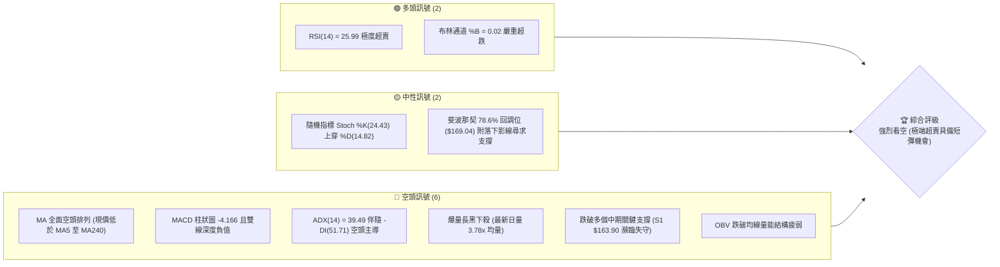

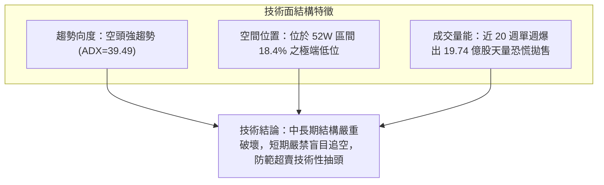

### 📊 核心指標速覽表

| 指標類別 | 指標名稱 | 當前數值 | 訊號 | 解讀 |
|----------|----------|----------|------|------|
| **價格** | 當前收盤價 | $166.19 | 🔴 | 位於 52 週區間之 18.4%，自歷史高位大幅暴跌回落 |
| **均線** | MA20 | $201.25 | 🔴 | 現價低於 MA20 達 -17.42%，短中期均線下傾施壓 |
| **均線** | MA50 | $215.94 | 🔴 | 現價低於 MA50 達 -23.04%，中期趨勢轉入空頭走勢 |
| **均線** | MA200 | $204.07 | 🔴 | 現價跌破年線 $204.07，長期牛熊分水嶺失守 |
| **動能** | RSI(14) | 25.99 | 🟢 | 進入 <30 極度超賣區，空頭短線拋壓隨時面臨動能耗竭 |
| **動能** | MACD | -13.235 | 🔴 | DIF 線遠在 Signal (-9.070) 下方，柱狀圖 -4.166 擴散 |
| **波動** | ATR(14) | $9.85 | 🔴 | 佔價格 5.93%，屬於極高波動度，單日振幅顯著放大 |
| **趨勢** | ADX / -DI | 39.49 / 51.71 | 🔴 | ADX>25 且 -DI 飆升至 51.71，為典型單邊空頭主導趨勢 |
| **帶軌** | 布林通道 %B | 0.02 | 🟡 | 跌至下軌 ($164.75) 邊界，呈通道開口向下擴張後的超賣極限 |
| **成交量** | 最新成交量 | 742,789,000 | 🔴 | 20 日均量比達 3.78x，高層人事與監管利空引發機構恐慌拋盤 |

### 🏆 技術評分卡

```
技術評分卡 — NVDA (2026-11-13)
╔══════════════════════════════════════════════════════════════════╗
║ 評估維度         進度條指標                       分數    訊號   ║
╠══════════════════════════════════════════════════════════════════╣
║ 趨勢強度 (Trend) ████░░░░░░░░░░░░░░░░     20/100   🔴 空頭主導 ║
║ 動能指標 (Mom.)  ██████░░░░░░░░░░░░░░     30/100   🔴 動能衰退 ║
║ 支撐穩定 (Supp.) ████████░░░░░░░░░░░░     40/100   🟡 測試前低 ║
║ 成交量配合 (Vol.)████░░░░░░░░░░░░░░░░     20/100   🔴 放量下殺 ║
║ 形態完整 (Patt.) ██████░░░░░░░░░░░░░░     30/100   🔴 頭部破位 ║
║ 均線排列 (MA)    ██░░░░░░░░░░░░░░░░░░     10/100   🔴 空頭排列 ║
╠══════════════════════════════════════════════════════════════════╣
║ 綜合評分         ████░░░░░░░░░░░░░░░░     25/100   🔴 強烈看空 ║
╚══════════════════════════════════════════════════════════════════╝
*註：綜合評分 = (20 + 30 + 40 + 20 + 30 + 10) / 6 = 25/100（依規則 18 算術平均）
```

---

## 2. 趨勢分析

### 🌐 多時框趨勢分析

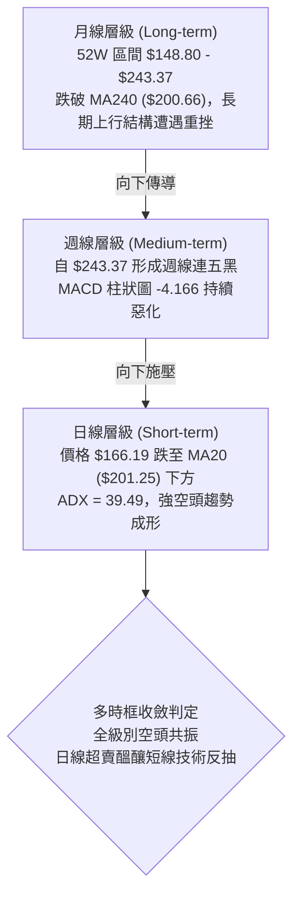

### 📈 長期趨勢 — 12個月走勢圖（Unicode）

根據過去 12 個月（2025-12 至 2026-11）的月線收盤數據繪製：

```
NVDA 月線走勢圖（2025-12 至 2026-11）
價格軸 ($)
$240 ┤                                           ● (2026-09: $228.38)
$220 ┤                                     ●     │
$210 ┤                         ●           │     │
$200 ┤                   ●     │     ●     │     │     ● (2026-10: $204.64)
$190 ┤       ●     ●     │     │     │     │     │     │
$180 ┤ ●     │     │     │     │     │     │     │     │
$170 ┤ │     │     │     │     │     │     │     │     │           ● (2026-11: $166.19 ◄現價)
$160 ┤ │     │     │     │     │     │     │     │     │           │
     └─┬─────┬─────┬─────┬─────┬─────┬─────┬─────┬─────┬─────┬─────┬─────
      12月  01月  02月  03月  04月  05月  06月  07月  08月  09月  10月  11月
     (2025) (------------------------ 2026 ------------------------)
```

**走勢特徵分析表格**：

| 階段區間 | 月份起訖 | 區間起訖收盤價 | 漲跌幅 | 結構形態與成交量價特徵 |
|----------|----------|----------------|--------|------------------------|
| **盤整築底** | 2025-12 ~ 2026-03 | $186.06 → $174.00 | -6.48% | 於 $174 - $190 區間箱體震盪，波動收斂，籌碼洗盤 |
| **主升驅動** | 2026-04 ~ 2026-05 | $174.00 → $210.66 | +21.07%| 突破箱體上緣，量能溫和放大，展現強勁動能 |
| **高位換手** | 2026-06 ~ 2026-07 | $210.66 → $200.53 | -4.81% | 於 $200 整數關卡進行防守測試，籌碼充分換手 |
| **最後衝刺** | 2026-08 ~ 2026-09 | $200.53 → $228.38 | +13.89%| 創下波段歷史新高 $243.37（盤中），高位動能顯現疲態 |
| **高檔崩解** | 2026-10 ~ 2026-11 | $228.38 → $166.19 | -27.23%| 突發高層醜聞與監管利空，引發機構天量踩踏拋售破位 |

### 📊 中期趨勢（週線分析）

```
中期關鍵波段走勢與壓力支撐示意：
2026-10-09 波段高點：$243.37 ═════════════════════════════════ (52W High 極強阻力)
                                  ╲
2026-10-30 週線收盤：$204.64 ───────╲───────────────────────── (跌破 MA200 牛熊分水嶺)
                                        ╲
2026-11-06 週線收盤：$186.64 ─────────────╲─────────────────── (跌破關鍵頸線與密集支撐)
                                              ╲
2026-11-12 現價收盤：$166.19 ───────────────────● ◄── 現價測試下影線區域
2026-11-12 盤中低點：$148.80 ═════════════════════════════════ (52W Low 年度極限支撐)
```

- **週線 K 棒架構**：從 2026-10-09 當週高點 $243.37 起，連續 5 週收陰線。最新一週收盤 $166.19，伴隨週成交量爆出 1,973,996,300 股的天量，週跌幅顯著。
- **均線支撐失守**：週線級別價格長黑貫穿 20 週與 50 週均線支撐，中線多頭結構已遭受系統性破壞。

### ⚡ 趨勢強度評估（ADX 解讀）

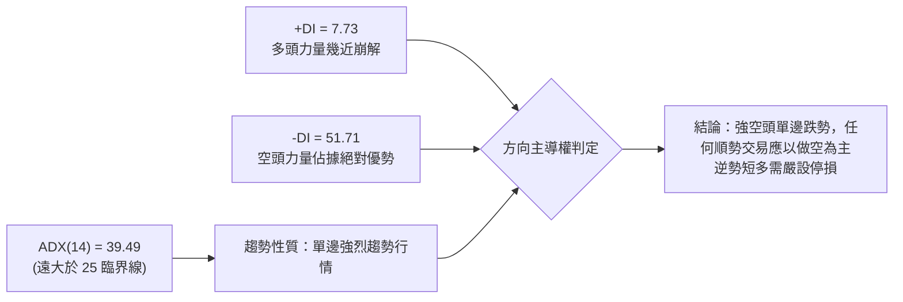

| 指標名稱 | 實際數值 | 門檻區間 | 趨勢判定 | 實戰解讀 |
|----------|----------|----------|----------|----------|
| **ADX(14)** | 39.49 | > 25 (強趨勢) | 🟢 強趨勢確認 | 市場處於高速單邊行情，非震盪盤整市，動能策略有效 |
| **+DI(14)** | 7.73 | < 20 (極端弱勢) | 🔴 多頭匱乏 | 買盤力量嚴重不足，缺乏推動波段上漲的資金共識 |
| **-DI(14)** | 51.71 | > 40 (極度強勢) | 🔴 空頭宣洩 | 賣方掌控絕對定價權，目前處於流動性擠壓拋售狀態 |

---

## 3. 圖表形態分析

### 🔍 形態識別系統

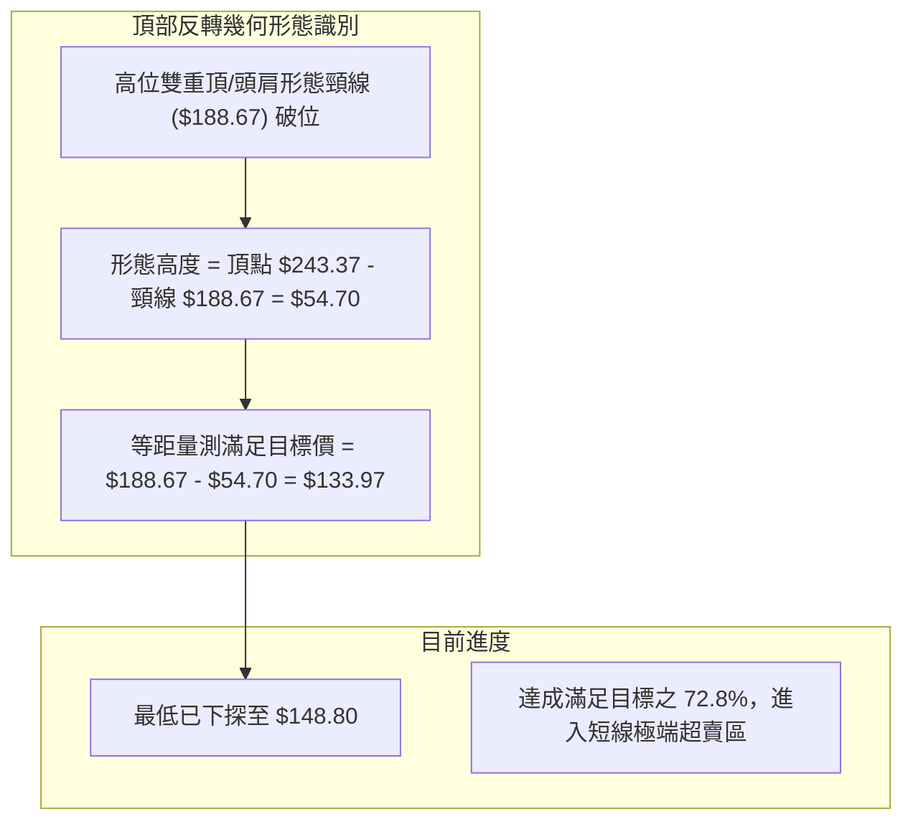

**圖表形態信心度表格**（依規則 15）：

| 形態名稱 | 信心度 | 判斷依據（引用數據） | 完成度 | 目標價（附計算式） |
|----------|--------|----------------------|--------|--------------------|
| **雙重頂/破位頭部** | 85% | 2026-10-09 創高 $243.37 後反轉跌破波段密集支撐 R1 ($188.67) | 80% | 頸線 $188.67 − 形態高度 ($243.37 − $188.67 = $54.70) = $133.97 |
| **下飄恐慌旗形破位** | 70% | 11-06 至 11-11 於 $168 - $178 弱勢整理後遭 11-12 大黑 K 貫穿 | 90% | 旗桿高點 $200.13 − 跌幅 ($206.69 − $181.46 = $25.23) = $174.90 (已達標) |
| **倒V型單邊暴跌** | 90% | 週線連續五黑，ADX=39.49，均線呈混合發散向下，乖離率達極限 | 85% | 跌破 78.6% 回調位 ($169.04)，測試 52W 低點 $148.80 |

### 🕯️ 重要 K 線形態分析

依規則 19，以數據中「近 10 根日 K」與「近 8 根週 K」之實際 OHLCV 分析：

| 日期（週期） | 開盤價 | 最高價 | 最低價 | 收盤價 | K線形態名稱 | 技術解讀與訊號含義 | 訊號 |
|--------------|--------|--------|--------|--------|-------------|--------------------|------|
| **2026-11-04 (日)** | 203.50 | 206.79 | 199.68 | 200.13 | 破位中黑K | 跌破 $200 整數支撐，收盤逼近全日最低點 | 🔴 |
| **2026-11-05 (日)** | 196.07 | 196.25 | 181.46 | 181.60 | 長黑大陰線 | 跳空低開低走，爆出 3.06 億股，確認頭部破位 | 🔴 |
| **2026-11-06 (日)** | 191.10 | 194.90 | 185.22 | 186.64 | 弱勢反彈孕線 | 嘗試回補缺口未果，受制於上方解套賣壓 | 🟡 |
| **2026-11-09 (日)** | 173.07 | 179.92 | 170.24 | 178.67 | 跳空低開小陽 | 再次跳空低開，成交量放大至 4.62 億股，空頭主導 | 🔴 |
| **2026-11-10 (日)** | 173.97 | 174.69 | 165.89 | 168.89 | 下探陰線 | 創波段新低 $165.89，短線買盤缺乏承接意願 | 🔴 |
| **2026-11-11 (日)** | 172.80 | 177.54 | 170.77 | 173.73 | 窄幅震盪小陽 | 成交量 3.39 億股萎縮，空方下殺暫歇 | 🟡 |
| **2026-11-12 (日)** | 151.01 | 167.14 | 148.80 | 166.19 | **爆量長下影大陽錘頭** | 盤中重挫至 $148.80 後強烈拉升，爆 7.42 億股天量換手 | 🟢 |
| **2026-10-09 (週)** | 236.09 | 243.37 | 229.11 | 229.28 | 長上影倒錘頭週K | 歷史高點 $243.37 出現長上影線，多頭動能見頂反轉 | 🔴 |
| **2026-11-06 (週)** | 207.53 | 209.98 | 181.46 | 186.64 | 實體大陰週K | 貫穿 $200 心理關口，成交量擴大至 8.46 億股 | 🔴 |
| **2026-11-12 (週)** | 173.07 | 179.92 | 148.80 | 166.19 | **爆天量下影錘頭週K** | 測試年度低點 $148.80，爆出近 20 週最大天量 (19.7 億股) | 🟡 |

### 📉 ASCII 走勢形態示意圖

```
NVDA 近 10 日走勢與 11-12 極端錘頭示意圖：
價格
$210 ┤ ● (11-03 高點 $209.14)
$205 ┤  ╲
$200 ┤   ● (11-04 收盤 $200.13)
$195 ┤    ╲
$190 ┤     ╲ [跳空缺口]
$185 ┤      ● (11-05 長黑 $181.60)
$180 ┤       ╲     ● (11-09 反彈高點 $179.92)
$175 ┤        ╲   ╱ ╲
$170 ┤         ● ╱   ● ─── ● (11-11 收盤 $173.73)
$165 ┤                ╲   ╱ │
$160 ┤                 ╲ ╱  │ ◄─── 11-12 收盤 $166.19 (強拉 15 美元)
$155 ┤                  ●   │
$150 ┤                  │   │
$148 ┤                  └───┴── 11-12 盤中低點 $148.80 (測 52W 低點爆天量)
```

### 🎯 形態目標價計算

1. **破位頭部等距下行目標價**：
   - 頂部最高點：$243.37
   - 破位頸線位置（採用關鍵阻力 R1）：$188.67
   - 形態垂直高度：$$H = 243.37 - 188.67 = 54.70$$
   - 理論量測下行目標價：$$Target_1 = 188.67 - 54.70 = 133.97$$
   - *註：當前價格跌至 $148.80 已完成該形態幅度的 72.8%，在極度接近最終滿足點時爆出天量，顯示空頭下行第一大波段已進入衰竭尾聲。*

2. **短線反彈高度測量（基於 11-12 下影線修復）**：
   - 最低點：$148.80
   - 當日收盤：$166.19
   - 反彈首要目標為阻力位 R1：$188.67

---

## 4. 支撐與阻力

### 🗺️ 關鍵價位分布圖（Unicode）

```
NVDA 價位結構分布圖 (由 OHLCV 與歷史波段計算)
══════════════════════════════════════════════════════════════════
$243.37 ║██████████████████████████████║ 52W 歷史最高點 / 0.0% Fib
$221.05 ║████████████████████████      ║ 23.6% 斐波那契回調位
$214.75 ║██████████████████████████████║ 強阻力 R3 (MA50 $215.94 密集區)
$207.24 ║██████████████████            ║ 38.2% 斐波那契回調位
$201.25 ║██████████████████████        ║ MA20 中軌重要心理關口
$196.08 ║████████████████              ║ 50.0% 斐波那契平衡位
$194.62 ║████████████████████          ║ 阻力 R2 (反彈高壓位)
$188.67 ║██████████████████████████████║ 關鍵阻力 R1 (頸線與前密集平台)
$184.93 ║██████████████                ║ 61.8% 黃金分割回調位
$169.04 ║▓▓▓▓▓▓▓▓▓▓▓▓▓▓▓▓▓▓            ║ 78.6% 斐波那契重要支撐位
$166.19 ╠══════════════════════════════╣ ◄── 當前收盤價 ($166.19)
$163.90 ║▓▓▓▓▓▓▓▓▓▓▓▓▓▓▓▓▓▓▓▓▓▓▓▓▓▓    ║ 近期支撐 S1 (波段低點聚類)
$148.80 ║██████████████████████████████║ 52W Low 年度極限支撐 / 100% Fib
══════════════════════════════════════════════════════════════════
```

### 🚧 阻力位分析表

價位引用自數據提供之關鍵阻力位：

| 阻力級別 | 價位 | 形成原因（波段高點聚類） | 突破難度 | 重要性評估 |
|----------|------|--------------------------|----------|------------|
| **R1** | **$188.67** | 前期密集成交平台下緣、11-06 日線高點聚類、破位頸線 | ⭐️⭐️⭐️☆ | **極高**。反彈之首要生死線，無法收復則弱勢格局不變 |
| **R2** | **$194.62** | 2026-07-02 週線波段高點聚類、密集成交換手區間 | ⭐️⭐️⭐️⭐️ | **高**。短線多頭極限反撲位，空頭回補密集獲利了結點 |
| **R3** | **$214.75** | 波段高點聚類，重疊 MA50 ($215.94) 與 MA60 ($216.09) | ⭐️⭐️⭐️⭐️⭐️| **極高**。中期多空生命線，此位以下皆屬空頭反彈浪 |

### 🛡️ 支撐位分析表

價位引用自數據提供之關鍵支撐位：

| 支撐級別 | 價位 | 形成原因（波段低點聚類） | 守住機率 | 重要性評估 |
|----------|------|--------------------------|----------|------------|
| **S1** | **$163.90** | 近一年波段低點聚類、貼近布林下軌 ($164.75) | 60% | **關鍵防線**。短線多頭防禦的首要據點，失守恐再探前低 |
| **S2** | **$148.80** | 52 週最低點 (52W Low)、11-12 盤中極限低點 | 80% | **鐵底支撐**。年度價值投資與機構巨量資金承接的最強防線 |
| **S3** | **$133.94** | 2024-12 歷史月線收盤波段低點聚類 | 90% | **終極支撐**。頭部等距下行目標點附近之歷史防守位 |

*註：S2 引用數據中「52W Low $148.80」，S3 引用數據中「2024-12 月線收盤價 $133.94」。*

### 📐 斐波那契回調位分析

依據 52 週極值區間 **$148.80 (100.0%) → $243.37 (0.0%)** 計算：

| 回調比例 | 斐波那契價位 | 當前相對位置與技術意義解讀 | 訊號評估 |
|----------|--------------|----------------------------|----------|
| **0.0%** | $243.37 | 52W High，歷史最高峰阻力 | 🔴 強阻力 |
| **23.6%**| $221.05 | 強勢多頭防守位（已徹底失守） | 🔴 空方控盤 |
| **38.2%**| $207.24 | 弱勢修正回調位，重疊 MA200 ($204.07) | 🔴 強阻力 |
| **50.0%**| $196.08 | 多空平衡分水嶺，跌破轉為熊市主導 | 🔴 轉換阻力 |
| **61.8%**| $184.93 | 黃金分割理論極限防守位（已實體貫穿） | 🔴 跌破轉弱 |
| **78.6%**| **$169.04** | **深度回調位**。現價落於 $169.04 與 $148.80 之間 | 🟡 **爭奪區間** |
| **100.0%**| **$148.80** | **52W Low**，起漲原點，具備強力結構支撐 | 🟢 **底線支撐** |

**現價位置技術解讀**：
當前收盤價 **$166.19** 跌破 78.6% 回調位 ($169.04) 約 -1.69%，盤中最低曾深跌至 100.0% 回調位 **$148.80**，隨後受到天量買盤強力收復。現價位於 78.6% 與 100.0% 之間，表明市場正在經歷深度的價值重估與流動性清洗。

---

## 5. 技術指標深度解讀

### 🎛️ 指標訊號總覽

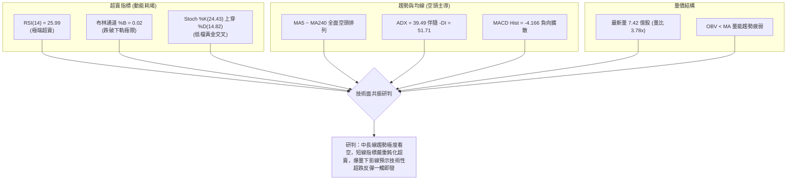

### 📈 移動平均線排列分析

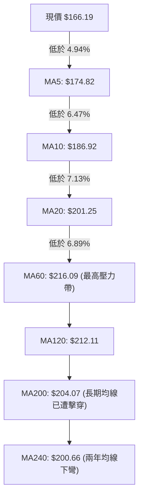

**均線乖離率詳細矩陣**：

| 均線名稱 | 均線價位 | 現價距離 ($) | 乖離率 (%) | 均線軌跡形態 | 趨勢解讀 |
|----------|----------|--------------|------------|--------------|----------|
| **MA 5** | $174.82 | -$8.63 | -4.94% | 陡峭下行 ▇▇▆▆▅▄▃▂▁ | 極短線空頭下壓強烈 |
| **MA 10** | $186.92 | -$20.73 | -11.09% | 陡峭下行 ▇▇▆▅▄▃▂▁▁ | 短期下行趨勢加速 |
| **MA 20** | $201.25 | -$35.06 | -17.42% | 加速下彎 █▇▆▅▄▃▂▁▁ | 中短期生命線破位 |
| **MA 60** | $216.09 | -$49.90 | -23.09% | 高檔走平下彎 █▇▆▅▄ | 中期趨勢徹底反轉 |
| **MA 120** | $212.11 | -$45.92 | -21.65% | 走平轉下 █▇▆▅▄▃▂ | 半年線失守 |
| **MA 200** | $204.07 | -$37.88 | -18.56% | 走低下彎 | 牛熊分界線遭放量貫穿 |
| **MA 240** | $200.66 | -$34.47 | -17.18% | 走平見頂 | 長期防線失守 |

### 📉 RSI(14) 分析

- **RSI(14) 當前數值**：**25.99**（Wilder 計算）
- **強度指示條**：`█████░░░░░░░░░░░░░░░` 25.99% (極度超賣區間 < 30)
- **超買超賣評估**：RSI 深入 30 以下之極端超賣區，通常反映市場出現非理性的恐慌性拋售。在強空頭趨勢中，RSI 可能出現鈍化，但 25.99 往往伴隨均線負乖離過大（距 MA20 達 -17.42%），歷史上極易引發技術性空頭回補。
- **背離判斷**：
  - *比較近 20 根 K 棒*：價格創出波段新低，RSI 指標亦同步創出波段新低，**數據顯示無明顯背離**。
  - *結論*：屬於動能驅動型單邊下殺，未出現指標底背離訊號，因此不可將當前超賣誤判為反轉信號，僅能視為反彈契機。

### 📊 MACD(12/26/9) 訊號解讀

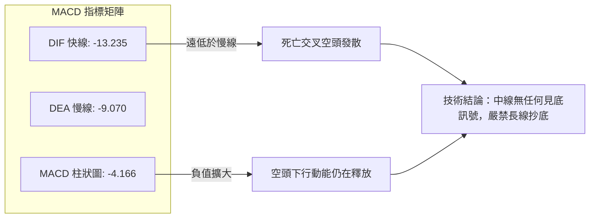

- **柱狀圖動態**：從近 20 週數據觀察，MACD 柱狀圖自 2026-10-09 當週的 +0.119 迅速翻黑，經 -2.366、-3.201 持續擴大至最新週的 **-4.166**。負向柱狀圖呈現喇叭口擴散，顯示空頭下墜力道未見實質收斂。

### 📦 布林通道分析

```
NVDA 布林通道 (20, 2) 結構圖：
價格
$240 ┤ -------------------------------------------- BB 上軌: $237.75
$220 ┤
$200 ┤ ════════════════════════════════════════════ BB 中軌 (MA20): $201.25
$180 ┤
$166 ┤ ◄── 現價: $166.19 (BB %B = 0.02)
$164 ┤ -------------------------------------------- BB 下軌: $164.75
$148 ┤ ◄── 盤中最低: $148.80 (曾嚴重貫穿下軌破帶)
```

- **軌道狀態**：帶寬 (Bandwidth) = `($237.75 - $164.75) / $201.25 = 36.27%`，呈現極度張口擴張狀態，顯示單邊趨勢劇烈展開。
- **%B 指標**：數值為 **0.02**，現價幾乎緊貼下軌。11-12 盤中更一度跌至 $148.80，嚴重跌破下軌逾 $15 美元，屬於極端「布林破帶」現象，引發均值回歸拉升回收盤 $166.19。

### 💹 成交量分析（量價配合度）

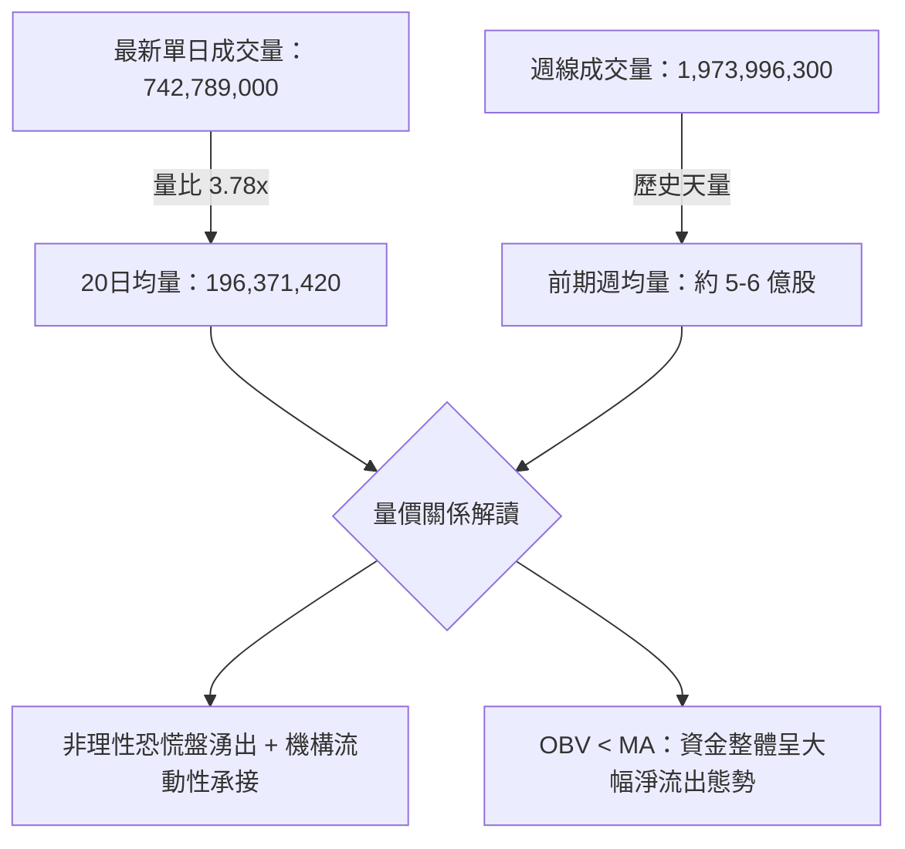

- **量價背離與確認**：
  - 本次急跌過程成交量呈現「暴跌放量」，11-05 放量 3.06 億股，11-09 增至 4.62 億股，11-12 飆升至 7.42 億股。此為標準的**「量增價跌」恐慌釋放**。
  - **OBV 趨勢**：OBV 持續低於其移動平均線，且斜率急劇向下，證實主力資金尚未完成重新建倉，大級別反轉條件尚未成立。

---

## 6. 動能與波動率

### ⚡ 動能評估四象限

動能評估四象限（動能強度 vs 波動率）：

| 象限 | 動能方向與強度 | 波動率水準 | NVDA 當前狀態 | 實戰環境評估 |
|------|----------------|------------|---------------|--------------|
| **Q1** | 強多頭動能 | 低波動 | — | 最佳趨勢加碼環境 |
| **Q2** | 弱多頭動能 | 低波動 | — | 區間震盪觀望 |
| **Q3** | 強空頭動能 | 高波動 | **✓ NVDA 當前定位** | **高風險極端殺跌，反彈劇烈，嚴格風控** |
| **Q4** | 弱空頭動能 | 高波動 | — | 無方向高風險洗盤 |

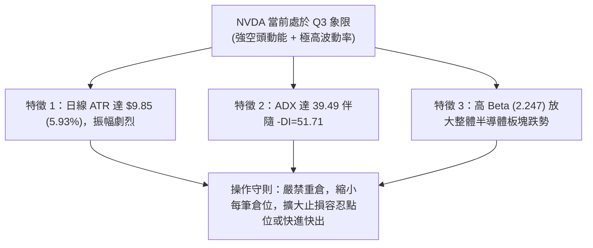

### 📊 ATR 波動率分析

- **ATR(14) 數值**：**$9.85**（佔股價比例高達 **5.93%**，Wilder 週期）
- **歷史對比**：相較於平穩期的 2.5% - 3.5%，當前波動率處於歷史極值區間，單日正常波動即可覆蓋 $10 美元以上空間。
- **止損距離建議**：
  - *短期日內/隔夜交易*：建議止損距離至少設定為 `1.5 × ATR` = **$14.78**
  - *波段持倉交易*：建議止損距離至少設定為 `2.0 × ATR` = **$19.70**
  - *實戰意涵*：任何小於 $10 的緊密止損在當前市場極易遭到隨機噪音掃除。

### 📐 Beta 與市場相關性

- **Beta 係數**：**2.247**
- **市場放大效應**：NVDA 對標普 500 與納斯達克 100 具備 2.25 倍的波動槓桿。在市場下跌時呈現顯著的「下行 Beta 放大」特徵。結合近期高層辭職醜聞與美中晶片管制利空，引發了超出大盤數倍的系統性流動性折價。

---

## 7. 多時框架總結

### 📋 時框架評分表

| 時框架 | 趨勢方向 | 動能狀態 | 均線排列 | 形態結構 | 綜合評分 | 操作建議 |
|--------|----------|----------|----------|----------|----------|----------|
| **月線 (長期)** | 🟡 中性轉空 | 🔴 柱狀縮窄 | 🔴 跌破 MA240 | 跌破高檔密集平台 | 40/100 | 長線資金暫停定投觀望 |
| **週線 (中期)** | 🔴 強烈看空 | 🔴 柱狀負擴散 | 🔴 跌破 20/50 週線 | 連五黑空頭吞噬破位 | 20/100 | 中期波段嚴格逢高減碼 |
| **日線 (短期)** | 🔴 單邊跌勢 | 🟢 極度超賣 | 🔴 全面空頭排列 | 爆量長下影錘頭反彈 | 30/100 | 僅限超短線高手博反彈 |

### 🔲 綜合訊號矩陣

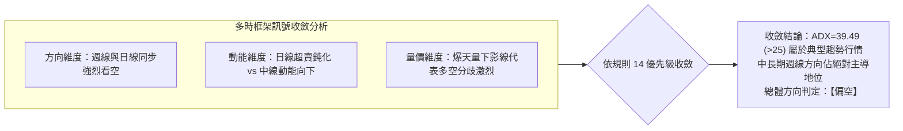

### ⚖️ 多時框收斂結論

依據「嚴格要求 14」的多時框收斂規則：
1. **行情屬性判斷**：ADX(14) 當前數值為 **39.49**，遠大於 25 的趨勢分水嶺，確認當前市場處於**單邊趨勢行情**而非震盪盤整行情。
2. **優先級權重**：必須以中長期（週線、MA50、MA200）方向為主導。日線指標的「極度超賣」與「下影線」僅能用作尋找短線反彈進場點或空頭平倉時機，**不得推翻中長期週線全面轉空的結構**。
3. **唯一方向性結論**：**【偏空】**（短線防禦性技術反彈，逢高皆為空頭再佈局機會）。

---

## 8. 交易策略建議

### 🗺️ 策略決策流程圖

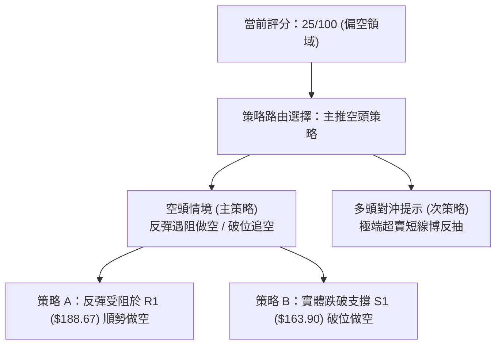

### 🧭 策略路由（依評分卡分流）

> **當前主策略方向 = 【空頭主導（逢反彈佈局做空）】（依技術評分卡：25 / 100）**
> 
> *依規則說明：綜合評分 ≤ 40 進入絕對空頭領域，報告主推空頭策略。多頭操作僅列為超跌反抽之對沖風險提示。*

### 🎯 價格情境階梯（Price Scenarios）

以當前收盤價 **$166.19** 為基準，嚴格引用第 4 章關鍵價位建立情境劇本：

| 觸發條件 | 下一目標 | 後續延伸 | 情境技術含義 |
|----------|----------|----------|--------------|
| **反彈突破 R1 $188.67** | R2 $194.62 | R3 $214.75 | 空頭回補引發深度反彈，短期結構修復，挑戰 MA20 ($201.25) |
| **站穩現價 $166.19 ~ $169.04** | R1 $188.67 | — | 於 78.6% Fib 回調位與 S1 之間構築超跌反彈小雙底 |
| **跌破 S1 $163.90** | S2 $148.80 | S3 $133.94 | 空頭趨勢延續，再次探底考驗年度極限低點與形態滿足點 |

### 📊 情境機率分佈

| 價格情境 | 機率 | 主要依據（指標狀態） |
|----------|------|----------------------|
| **延續弱勢 / 再探底 (跌破 S1)** | **55%** | ADX=39.49 空頭強勢、-DI=51.71、MACD 負向擴散、均線全空頭排列 |
| **超跌技術性反彈 (測試 R1)** | **35%** | RSI=25.99 極端超賣、布林 %B=0.02、11-12 爆量錘頭線具下影線防守 |
| **橫盤窄幅震盪 ($163 - $175)** | **10%** | 市場多空在天量換手後需要 2-3 個交易日消化籌碼 |

### 🔴 主策略詳情（空頭主導策略）

依規則 17，做空風險報酬比 = `(進場價 − 目標價 T1) ÷ (止損價 − 進場價)`：

| 策略要素 | 策略 A：反彈衰竭做空 (反轉空) | 策略 B：支撐失守追空 (破位空) |
|----------|------------------------------|------------------------------|
| **策略邏輯** | 借助 RSI 超賣引發的反抽，在強阻力區尋求高盈虧比空點 | 跌破密集低點聚類 S1，順應強 ADX 單邊趨勢追空 |
| **進場條件** | 反彈至 R1 遇阻收上影線或確認日線滯漲 | 日線實體收盤跌破 S1 ($163.90) |
| **進場價格** | **$188.67** (關鍵阻力 R1) | **$163.90** (關鍵支撐 S1) |
| **目標價 T1** | **$166.19** (當前收盤價位) | **$148.80** (52W Low / 支撐 S2) |
| **目標價 T2** | **$148.80** (52W Low / 支撐 S2) | **$133.94** (歷史波段支撐 S3) |
| **止損價格** | **$194.62** (關鍵阻力 R2) | **$169.04** (78.6% 斐波那契回調位) |
| **風險報酬比** | **1 : 3.78**（以 T1 計）<br/>*計算式：(188.67 - 166.19) ÷ (194.62 - 188.67) = 22.48 ÷ 5.95 = 3.778*<br/>*(以 T2 計為 1 : 6.70)* | **1 : 2.94**（以 T1 計）<br/>*計算式：(163.90 - 148.80) ÷ (169.04 - 163.90) = 15.10 ÷ 5.14 = 2.937*<br/>*(以 T2 計為 1 : 5.83)* |
| **成功機率** | 65% | 55% |
| **建議倉位** | 15% (總資金比例) | 10% (總資金比例) |

### 🟢 反向風險觸發點（對沖多頭提示）

若欲利用 RSI=25.99 極端超賣博取反抽，必須嚴格遵守以下對沖參數（非主推策略，僅限風控對沖）：
- **多頭進場觸發**：當日開盤回踩未破 11-12 低點，於 **$166.19** 附近輕倉介入。
- **嚴格止損位**：**$163.90** (跌破 S1 立即無條件離場)。
- **反彈目標 T1**：**$184.93** (61.8% Fib 回調位)。
- **反轉推翻訊號**：若價格強勢帶量收復 **$188.67 (R1)** 並站穩 3 個交易日以上，則代表日線級別頭部下殺告一段落，空頭策略必須全面止盈出場。

### ⭐ 整體訊號強度評星

```
做多訊號強度：★☆☆☆☆  (1/5 星 — 僅具超賣技術反抽，逆勢風險極大)
做空訊號強度：★★★★☆  (4/5 星 — 趨勢全面轉空，符合大時框共振)
整體可信度：  ★★★★☆  (4/5 星 — 天量配合與均線發散，技術結構清晰)
```

---

## 9. 風險提示與監控

### ✅ 關鍵監控指標 Checklist

```
╔══════════════════════════════════════════════════════════════════╗
║               技術面與市場動態即時監控清單 (Checklist)           ║
╠══════════════════════════════════════════════════════════════════╣
║ [ ] 關鍵支撐防守：收盤價是否跌破 S1 ($163.90)                    ║
║ [ ] 極端低點防禦：盤中是否再次跌破年度鐵底 S2 ($148.80)          ║
║ [ ] 反彈阻力壓制：反彈至 R1 ($188.67) 是否出現量縮滯漲或長上影   ║
║ [ ] 動能背離驗證：RSI 是否隨價格探底出現底背離 (>30)            ║
║ [ ] 成交量能健康度：單日成交量是否回落至 2 億股以下（籌碼穩定）  ║
║ [ ] 均線動態變化：MA5 ($174.82) 是否走平並形成第一道防線         ║
║ [ ] 外圍利空消化：CEO 離職醜聞與美中晶片管制之機構評級變動     ║
╚══════════════════════════════════════════════════════════════════╝
```

### ⚠️ 風險場景分析

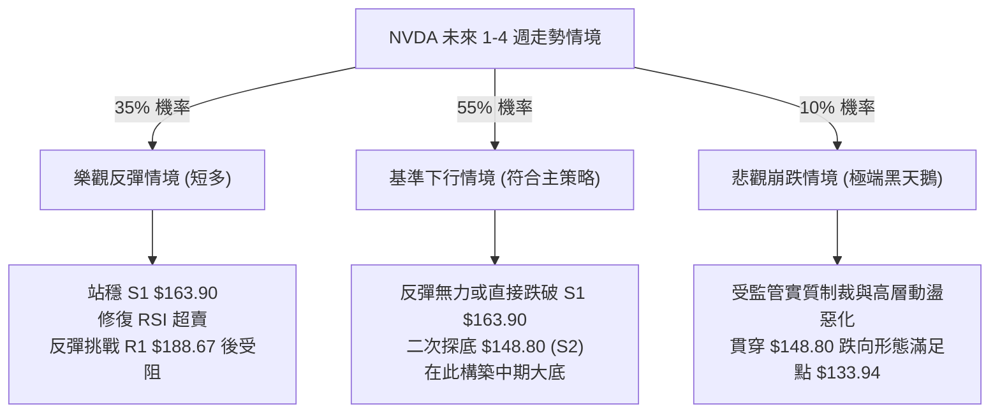

### 🛡️ 風險管理重要提醒

1. **波動率自適應倉位管理**：
   當前 ATR 達 **$9.85**（5.93%），意味著持倉承擔的常規價格雜訊是平時的兩倍以上。建議將常規股票倉位壓縮至平時的 **30% - 50%**，以防單日劇烈震盪觸發非自願停損。
2. **事件驅動型風險防範**：
   本次暴跌伴隨基本面黑天鵝（黃仁勳因個人醜聞辭職由 CFO 代理，以及中國晶片禁令引發 AI 支出恐慌）。技術分析在面對突發新聞事件時容易產生「跳空」斷層，嚴禁在關鍵價位附近無止損掛單。
3. **流動性踩踏風險**：
   單日 7.42 億股成交量代表大量融資盤與衍生品 Gamma 擠壓正在進行。在隱含波動率未顯著降溫前，避免使用短期價外看漲期權進行抄底。

---

## 📋 報告總結

```
NVDA 技術分析報告總結
════════════════════════════════════════════════════════════════
報告日期：2026-11-13
當前價格：$166.19
分析評級：🔴 強烈看空 (Bearish) — 綜合技術評分：25 / 100

關鍵結論：
├─ 長期趨勢：🔴 看空 (跌破 MA200 牛熊線 $204.07 與 MA240)
├─ 中期趨勢：🔴 極度看空 (週線五連黑，MACD 負向擴散 -4.166)
├─ 短期趨勢：🟡 嚴重超跌反彈醞釀 (RSI=25.99，布林 %B=0.02)
├─ 關鍵支撐：S1 $163.90  │  S2 $148.80 (52W Low)  │  S3 $133.94
├─ 關鍵阻力：R1 $188.67  │  R2 $194.62           │  R3 $214.75
└─ 華爾街目標：均價 $285.35 (最低 $174.00，最高 $515.00)

最優策略組合：
1. 🥇 最佳機會（主策略）：
   等待超跌反彈至 R1 ($188.67) 遇阻開空，止損設 R2 ($194.62)，
   首要目標價 T1 ($166.19)，風險報酬比高達 1 : 3.78。
2. 🥈 次選機會（順勢突破）：
   若直接放量貫穿 S1 ($163.90)，順勢破位做空，止損設 $169.04，
   下看年度低點 S2 ($148.80)，風險報酬比為 1 : 2.94。
3. 🥉 保守選擇（風控觀望）：
   場外資金全面保持現金觀望，耐心等待日線級別出現 RSI 底背離，
   且價格重新站穩 MA20 之前，不輕易進場建立長期中長線多頭頭寸。
════════════════════════════════════════════════════════════════
```

---

> ⚠️ **免責聲明**：本報告為技術分析研究，所有數據及估算均基於市場歷史價格與交易量資訊。本報告**僅供研究與學術參考**，**不構成任何要約、招攬或投資建議**。半導體板塊具備高波動性，投資有風險，入市需獨立審慎評估。

---

*報告生成時間：2026-11-13 ｜ 數據來源：Yahoo Finance ｜ 分析框架：多時框技術分析體系*