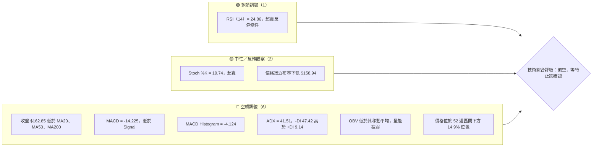
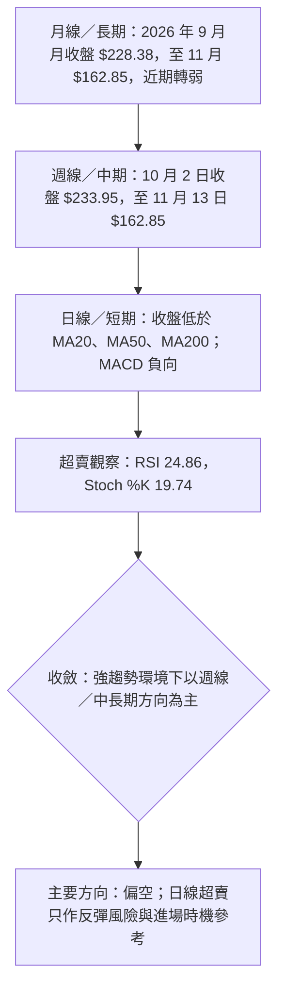
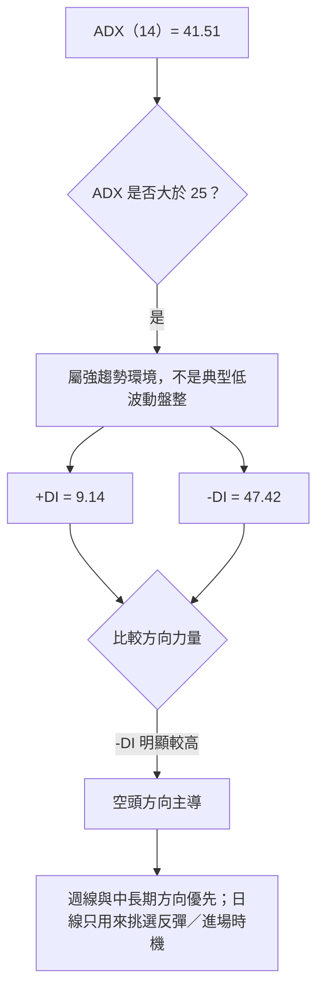
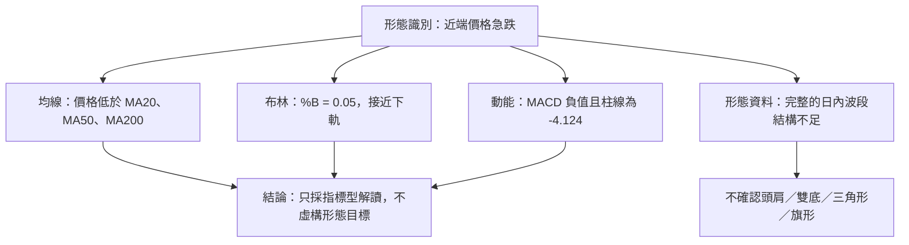
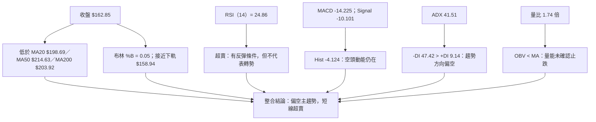
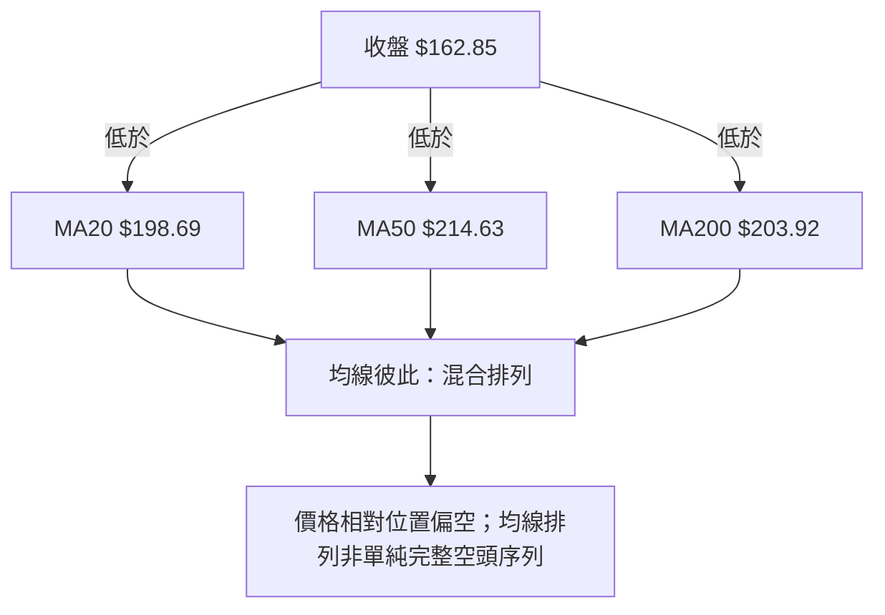
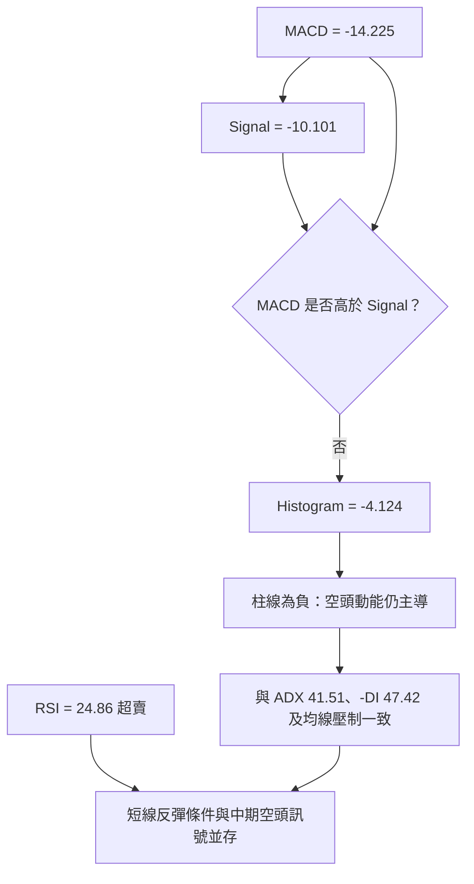
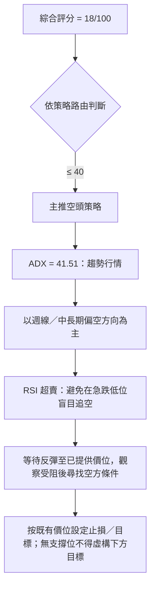
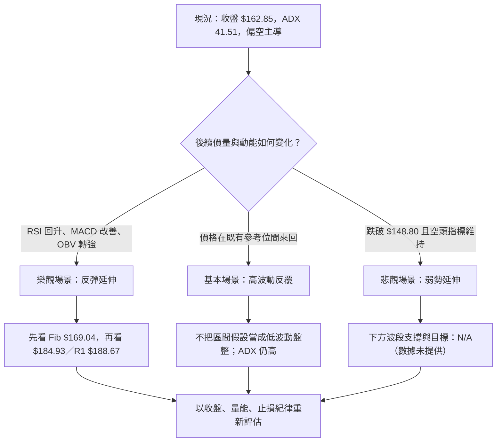

# NVDA 技術分析報告

> **報告日期**：2026-11-14 ｜ **語言**：繁體中文 ｜ **數據來源**：題示 Yahoo Finance 技術數據 ｜ **當前價格**：**$162.85**（2026-11-13 收盤）

---

## 目錄

| 章節 | 內容 |
|------|------|
| [1. 技術面概覽](#1-技術面概覽) | 訊號儀表板、核心指標、評分卡 |
| [2. 趨勢分析](#2-趨勢分析) | 多時框趨勢、12 個月走勢、ADX |
| [3. 圖表形態分析](#3-圖表形態分析) | 形態識別、K 線、形態目標 |
| [4. 支撐與阻力](#4-支撐與阻力) | 關鍵價位、斐波那契 |
| [5. 技術指標深度解讀](#5-技術指標深度解讀) | 均線、RSI、MACD、布林、量能 |
| [6. 動能與波動率](#6-動能與波動率) | 動能、ATR、Beta |
| [7. 多時框架總結](#7-多時框架總結) | 時框架評分矩陣與收斂 |
| [8. 交易策略建議](#8-交易策略建議) | 依評分路由的主策略與風控 |
| [9. 風險提示與監控](#9-風險提示與監控) | 監控清單、風險場景 |

---

## 1. 技術面概覽

### 🎯 技術訊號儀表板

目前可量化的訊號顯示：**趨勢、均線、MACD、DI 與 OBV 偏空；RSI、隨機指標進入超賣區，代表短線有反彈條件，但尚未形成趨勢反轉確認。**



**判讀重點：**超賣是「跌勢可能放緩或反彈」的條件，不等於趨勢已反轉。ADX 高於 25，且 -DI 顯著高於 +DI，依本報告的多時框收斂規則，趨勢方向以中長期偏空訊號為主，日線超賣僅用於觀察進場時機。

### 📊 核心指標速覽表

| 指標類別 | 指標名稱 | 當前數值 | 訊號 | 解讀 |
|----------|----------|----------:|:----:|------|
| 價格 | 收盤價 | $162.85 | 🔴 | 報告使用的當前價格；為 2026-11-13 收盤 |
| 價格區間 | 52 週高／低 | $243.37／$148.80 | 🔴 | 收盤價位於 52 週區間下方 14.9% 位置 |
| 均線 | MA20 | $198.69 | 🔴 | 收盤低於 MA20，短中期均線壓力仍在 |
| 均線 | MA50 | $214.63 | 🔴 | 收盤低於 MA50，波段趨勢偏弱 |
| 均線 | MA200 | $203.92 | 🔴 | 收盤低於 MA200，長期價格動能轉弱 |
| 動能 | RSI（14） | 24.86 | 🟡 | 超賣；不是單獨的買入確認 |
| 動能 | MACD／Signal | -14.225／-10.101 | 🔴 | MACD 低於 Signal，負柱線 -4.124 |
| 趨勢 | ADX（14） | 41.51 | 🔴 | 強趨勢；-DI 47.42 主導，方向向下 |
| 波動 | ATR（14） | $9.98 | 🔴 | 約為收盤價 6.13%，單日波動幅度偏高 |
| 波動 | 布林 %B | 0.05 | 🟡 | 接近下軌，超賣／弱勢延伸並存 |
| 成交量 | 最新量／20 日均量 | 363,819,700／208,745,710 | 🔴 | 量比 1.74 倍，跌勢伴隨放量 |
| 量價 | OBV | OBV < MA | 🔴 | 量能尚未確認價格止跌 |

### 🏆 技術評分卡

以下六項子評分採相同權重，綜合評分為六項算術平均，四捨五入至整數。

```text
╔════════════════════════════════════════════════════════════╗
║             技術評分卡 — NVDA（2026-11-14）                ║
╠════════════════════════════════════════════════════════════╣
║ 趨勢強度      ▓▓▓░░░░░░░░░░░░░░░░░  15/100   🔴          ║
║ 動能指標      ▓▓▓▓░░░░░░░░░░░░░░░░  20/100   🔴          ║
║ 支撐穩定度    ▓▓░░░░░░░░░░░░░░░░░░  10/100   🔴          ║
║ 成交量配合    ▓▓▓▓░░░░░░░░░░░░░░░░  20/100   🔴          ║
║ 形態完整度    ▓▓▓▓▓░░░░░░░░░░░░░░░  25/100   🔴          ║
║ 均線排列      ▓▓▓░░░░░░░░░░░░░░░░░  15/100   🔴          ║
╠════════════════════════════════════════════════════════════╣
║ 綜合評分      ▓▓▓▓░░░░░░░░░░░░░░░░  18/100   🔴 偏空      ║
╚════════════════════════════════════════════════════════════╝
```

- **算術平均：**（15 + 20 + 10 + 20 + 25 + 15）÷ 6 = 17.5，四捨五入為 **18/100**。
- **趨勢強度 15：**ADX 41.51 顯示趨勢強，但 -DI 47.42 遠高於 +DI 9.14，方向為強勢下行。
- **動能指標 20：**RSI、Stoch 超賣，存在反彈條件；但 MACD 及柱線均偏空，因此未給予較高分數。
- **支撐穩定度 10：**系統沒有偵測到低於現價的波段低點支撐；$148.80 是 52 週低點參考，不等同已確認的多次測試支撐。
- **成交量配合 20：**最新日成交量高於 20 日均量，但 OBV 低於其均線，尚未確認買盤累積。
- **形態完整度 25：**目前可確認的是指標與價格弱勢，不足以支持高信心的反轉或幾何形態。
- **均線排列 15：**價格低於 MA20、MA50、MA200，短、中、長期價格位置均弱；均線彼此排列則為混合。

---

## 2. 趨勢分析

### 🌐 多時框趨勢分析



| 時框 | 可用資料 | 趨勢判讀 | 訊號強度 |
|------|----------|----------|----------|
| 月線 | 24 個月月收盤；本節觀察最近 12 個月 | 9 月高位後，10 月及 11 月連續走低；長週期上行結構近期明顯受壓 | 🔴 |
| 週線 | 近 20 週收盤、RSI、MACD 柱及週量；近 8 週 OHLC | 10 月初後收盤逐週走弱，11 月 13 日週收盤跌至 $162.85 | 🔴 |
| 日線 | 近 10 根日 K、當前均線及動能指標 | 價格低於 MA20／50／200；RSI 超賣，但 MACD、DI 與 OBV 未翻多 | 🔴，反彈條件 🟡 |

### 📈 長期趨勢 — 12 個月走勢圖（Unicode）

以下圖以題示 2025 年 12 月至 2026 年 11 月的月收盤資料繪製。圖形用於呈現相對走勢，不代表未提供的月內高低點。

```text
NVDA 月線收盤走勢圖（2025-12 至 2026-11）

價格（美元）
230 ┤                                      ● 2026-09 $228.38
220 ┤                                      ╲
210 ┤                                ●─────╯
200 ┤                     ●────────╯       ╲       ● 2026-10 $204.64
190 ┤● 2025-12 $186.06      ╲        ● 2026-05 $210.66 ╲
180 ┤  ╲              ● 2026-02 $176.78 ╲              ╲
170 ┤   ● 2026-01 $190.68                  ● 2026-06 $199.87
160 ┤                                              ╲          ● 2026-11 $162.85
150 ┤                                               ╲
    └────────────────────────────────────────────────────────────
      Dec   Jan   Feb   Mar   Apr   May   Jun   Jul   Aug   Sep   Oct   Nov
      2025                         2026
```

> ASCII 折線僅為視覺化示意，月份收盤價以表格為準；2026 年 3 月收盤 $174.00、4 月收盤 $199.11、7 月收盤 $200.53、8 月收盤 $220.53，亦列於下表。

| 月份 | 收盤價 | 月度走勢特徵 |
|------|-------:|--------------|
| 2025-12 | $186.06 | 本段起始參考價 |
| 2026-01 | $190.68 | 月收盤上升 |
| 2026-02 | $176.78 | 回落 |
| 2026-03 | $174.00 | 延續回落 |
| 2026-04 | $199.11 | 月收盤反彈 |
| 2026-05 | $210.66 | 延續上升 |
| 2026-06 | $199.87 | 回檔 |
| 2026-07 | $200.53 | 收盤近乎持平略升 |
| 2026-08 | $220.53 | 上升 |
| 2026-09 | $228.38 | 本段月收盤高點 |
| 2026-10 | $204.64 | 明顯回落 |
| 2026-11 | $162.85 | 再度大幅走低；月資料截至 11 月 13 日 |

- 2025 年 12 月收盤 $186.06 至 2026 年 11 月收盤 $162.85，區間變化約 **-12.47%**。
- 2026 年 9 月月收盤 $228.38 至 11 月收盤 $162.85，變化約 **-28.69%**。
- 52 週高點 $243.37 至現價 $162.85，現價較高點低約 **33.08%**。
- 11 月尚非完整月資料，因此月線變化應視為截至 11 月 13 日的期間讀數，不應直接當成完整月收盤確認。

### 📊 中期趨勢（週線分析）

週線收盤呈現明確的近端下行序列：2026-10-02 收盤 $233.95，其後 10-09 為 $229.28、10-16 為 $214.13、10-23 為 $210.96、10-30 為 $204.64、11-06 為 $186.64，至 11-13 降至 $162.85。從 10 月 2 日至 11 月 13 日，收盤價變化約 **-30.39%**。

```text
週線近期價格與既有參考位（美元；僅標示數據已提供價位）

$243.37 ───────────────────────────── 52 週高／斐波那契 0.0%
$221.05 ───────────────────────────── 斐波那契 23.6%
$214.75 ───────────────────────────── 波段阻力 R3
$207.24 ───────────────────────────── 斐波那契 38.2%
$198.69 ───────────────────────────── 布林中軌／MA20
$196.08 ───────────────────────────── 斐波那契 50.0%
$194.62 ───────────────────────────── 波段阻力 R2
$188.67 ───────────────────────────── 波段阻力 R1
$184.93 ───────────────────────────── 斐波那契 61.8%
$169.04 ───────────────────────────── 斐波那契 78.6%
$162.85 ────────────────●──────────── 2026-11-13 收盤
$158.94 ───────────────────────────── 布林下軌（動態指標值）
$148.80 ───────────────────────────── 52 週低點／斐波那契 100%
```

以上是參考價位層級示意，不代表每個價位都已構成經市場多次驗證的支撐或阻力。週線價格由高位快速下滑，較重要的是觀察是否能在既有低點參考位上止跌，以及反彈時能否重新收復斐波那契與均線阻力。

### ⚡ 趨勢強度評估（ADX 解讀）



| ADX 區間參考 | 常見解讀 | NVDA 目前讀數 | 判讀 |
|--------------|----------|---------------|------|
| 低於 20 | 趨勢弱，易盤整 | 不適用 | 目前 ADX 41.51 |
| 20–25 | 趨勢形成觀察區 | 不適用 | 已高於此區 |
| 高於 25 | 趨勢較明確 | 41.51 | 強趨勢環境 |
| 方向判讀 | +DI／-DI 比較 | +DI 9.14／-DI 47.42 | 🔴 空頭方向主導 |

ADX 衡量趨勢強度，不單獨決定多空方向；此處方向由 -DI 高於 +DI、價格位於主要均線下方及 MACD 負值共同確認。故本報告將目前判定為**強勢下行趨勢，而非一般區間盤整**。

---

## 3. 圖表形態分析

### 🔍 形態識別系統

提供的資料足以確認價格急跌、均線壓制、布林下軌附近運行及動能偏空；但不足以可靠確認頭肩、雙底、三角形、旗形等需要完整幾何結構的圖表形態。



| 形態／訊號 | 信心度 | 判斷依據（引用數據） | 完成度 | 目標價 |
|------|:------:|------|:------:|------|
| 頭肩頂／底 | 低於 50% | 未提供足以確認左右肩、頭部與頸線的完整結構 | N/A | 訊號不足，僅做指標型解讀 |
| 雙頂／雙底 | 低於 50% | 未提供可確認兩個相近波峰／波谷及中間頸線的可靠結構 | N/A | 訊號不足，僅做指標型解讀 |
| 三角形／旗形 | 低於 50% | 近端資料顯示快速下跌，但無完整收斂趨勢線或旗面確認資料 | N/A | 訊號不足，僅做指標型解讀 |
| 布林下軌附近弱勢 | 75% | %B = 0.05；收盤 $162.85，布林下軌 $158.94 | 觀察中 | 不以形態高度外推 |
| 均線下方弱勢 | 90% | 收盤低於 MA20 $198.69、MA50 $214.63、MA200 $203.92 | 已確認 | 不以幾何形態外推 |

> 信心度是本報告對「訊號是否符合描述」的分析判斷，不是統計回測成功率。

### 🕯️ 重要 K 線形態分析

以下只使用題示「近 10 根日 K」與「近 8 根週 K」的 OHLC。形態判讀不外推到表格以外日期。個別 K 棒名稱以開高低收的實際關係判斷；單根 K 棒不等同趨勢反轉。

| 日期（日 K／週 K） | 開 | 高 | 低 | 收 | K 線形態 | 解讀 | 訊號 |
|------|------:|------:|------:|------:|------|------|:----:|
| 2026-11-05（日） | $196.07 | $196.25 | $181.46 | $181.60 | 長黑實體、上影極短 | 開盤後大幅下跌，收近低位，賣壓強 | 🔴 |
| 2026-11-09（日） | $173.07 | $179.92 | $170.24 | $178.67 | 陽線 | 收盤高於開盤，當日有反彈，但未單獨形成反轉確認 | 🟡 |
| 2026-11-10（日） | $173.97 | $174.69 | $165.89 | $168.89 | 長黑實體 | 收盤低於開盤，賣壓重新主導 | 🔴 |
| 2026-11-11（日） | $172.80 | $177.54 | $170.77 | $173.73 | 小陽線 | 當日收高於開盤；幅度有限，需觀察後續確認 | 🟡 |
| 2026-11-12（日） | $151.01 | $167.14 | $148.80 | $166.19 | 長陽線、下影較短 | 由低位回升並收高，呈現單日買盤反應；不等於週期反轉 | 🟡 |
| 2026-11-13（日） | $169.91 | $170.00 | $158.39 | $162.85 | 陰線，低位有下影 | 開盤至收盤走弱，但收盤高於當日低點；反彈承接未能改變日線弱勢 | 🔴 |
| 2026-10-09（週） | $236.09 | $243.37 | $229.11 | $229.28 | 陰線，上影較明顯 | 該週曾觸及 52 週高點，收盤遠低於高點，顯示高位賣壓 | 🔴 |
| 2026-10-16（週） | $228.73 | $228.86 | $212.85 | $214.13 | 長陰線，上影短 | 週內賣壓明顯，收盤接近區間低端 | 🔴 |
| 2026-11-06（週） | $207.53 | $209.98 | $181.46 | $186.64 | 長陰線，下影有限 | 下跌週延續，收盤接近週低位 | 🔴 |
| 2026-11-13（週） | $173.07 | $179.92 | $148.80 | $162.85 | 大波幅陰線、長下影 | 曾下探 52 週低點後回升，但仍以陰線收盤；表示有低位承接，尚非明確反轉 | 🔴／🟡 |

**K 線與指標整合：**

- 11 月 12 日日線呈現由低位回升的長陽，但 11 月 13 日再度收陰，故單日反彈未得到連續收高確認。
- 11 月 13 日週 K 有長下影，顯示低位曾出現承接；然而週收盤仍低於週開盤，且 MACD 柱為 -4.124、-DI 為 47.42，週線訊號整體仍偏空。
- 近端日 K 中的下影反應與 RSI 超賣方向一致，但 OBV 低於其均線，尚無量能累積確認。

### 📉 ASCII 走勢形態示意圖

```text
近期週收盤示意（依近 20 週收盤資料；非幾何形態預測）

$243.37  52 週高點（週 K 高點）
$233.95  ● 2026-10-02
          ╲
$229.28    ● 2026-10-09
            ╲
$214.13      ● 2026-10-16
              ╲
$210.96        ● 2026-10-23
                ╲
$204.64          ● 2026-10-30
                   ╲
$186.64             ● 2026-11-06
                      ╲
$162.85                ● 2026-11-13
                         │
$148.80                  └─ 52 週低點／斐波那契 100%
```

圖示突出的是連續走低的週收盤序列，不代表已確認旗形或下降三角形。沒有提供足夠資料計算幾何形態高度，因此**不設定形態推算目標價**。

### 🎯 形態目標價計算

- 頭肩、雙頂／雙底及三角形：**訊號不足，無可靠頸線／形態高度，故不計算目標價。**
- 布林下軌 $158.94 是題示布林指標讀數，不能當作形態目標或保證支撐。
- 52 週低點 $148.80 是既有資料中的低點參考，也是題示斐波那契 100% 位；它不是從圖形高度推算出的下跌目標。
- 技術形態目標價：**數據中未偵測到可採用的幾何形態目標。**

---

## 4. 支撐與阻力

### 🗺️ 關鍵價位分布圖（Unicode）

圖中 R1–R3 與斐波那契價位均直接採用題示數據。**低於現價的波段支撐，數據中未偵測到。**$148.80 另外標示為 52 週低點／斐波那契 100% 參考，不代表波段支撐聚類已確認。

```text
NVDA 價位結構分布圖（美元）

$243.37 ║████████████████████████║ 52 週高點／Fib 0.0%
$221.05 ║████████████████████    ║ Fib 23.6%
$214.75 ║████████████████████████║ 阻力 R3
$207.24 ║████████████████        ║ Fib 38.2%
$203.92 ║████████████████████    ║ MA200（動態均線）
$198.69 ║████████████████████    ║ MA20／布林中軌
$196.08 ║████████████████        ║ Fib 50.0%
$194.62 ║████████████████████    ║ 阻力 R2
$188.67 ║████████████████████    ║ 阻力 R1
$184.93 ║████████████████        ║ Fib 61.8%
$169.04 ║██████████████          ║ Fib 78.6%
$162.85 ╠════════●═══════════════╣ 現價（2026-11-13 收盤）
$158.94 ║▓▓▓▓▓▓▓▓▓▓▓▓▓▓          ║ 布林下軌（動態指標值）
$148.80 ║████████████████████████║ 52 週低／Fib 100%
         ↑ 下方沒有已偵測的波段低點支撐聚類
```

### 🚧 阻力位分析表

| 阻力級別 | 價位 | 形成原因 | 突破難度 | 重要性 |
|----------|------:|----------|----------|--------|
| R1 | $188.67 | 題示近一年波段高點聚類計算值 | 中高 | 第一個已列示的波段阻力參考；現價至該位約 +15.85% |
| R2 | $194.62 | 題示近一年波段高點聚類計算值 | 高 | 上方另有 Fib 50.0% $196.08，附近阻力因素重疊，但兩個數值不可互相替代 |
| R3 | $214.75 | 題示近一年波段高點聚類計算值 | 高 | 價格須先克服多個中間層級及均線壓力才可能測試 |

上述價位是系統提供的聚類價，不代表價位必然有效。收復阻力仍須配合收盤確認及量能／動能改善。

### 🛡️ 支撐位分析表

| 支撐級別 | 價位 | 形成原因 | 守住機率 | 重要性 |
|----------|------:|----------|----------|--------|
| S1 | N/A（數據未提供） | 關鍵價位區塊明確指出現價下方未偵測到波段低點支撐 | N/A（數據未提供） | 不建立虛構的支撐聚類 |
| S2 | N/A（數據未提供） | 未提供第二層波段支撐 | N/A（數據未提供） | 不建立虛構的支撐聚類 |
| S3 | N/A（數據未提供） | 未提供第三層波段支撐 | N/A（數據未提供） | 不建立虛構的支撐聚類 |
| 低點參考 | $148.80 | 52 週低點，亦為題示 Fib 100% | 不作機率估算 | 可觀察的歷史低點參考；不等同波段支撐聚類 |

**支撐層級的紀律：**本報告不把布林下軌、均線或 Fib 回調位重新命名為波段支撐。它們可以作為動態指標或價格參考，但「波段低點聚類支撐」仍為數據未偵測到。

### 📐 斐波那契回調位分析

斐波那契數值直接引用題示 52 週區間 $148.80 → $243.37：

| 回調位 | 價位 | 相對現價位置 | 技術觀察 |
|--------|------:|--------------|----------|
| 0.0%（52 週高） | $243.37 | 高於現價 | 52 週高點參考 |
| 23.6% | $221.05 | 高於現價 | 上方回調參考 |
| 38.2% | $207.24 | 高於現價 | 上方回調參考 |
| 50.0% | $196.08 | 高於現價 | 位於 R2 $194.62 附近的另一個獨立價位 |
| 61.8% | $184.93 | 高於現價 | 重要回調參考；亦可作為交易計畫中的價位條件 |
| 78.6% | $169.04 | 高於現價 | 現價上方最近的題示 Fib 位 |
| 100.0%（52 週低） | $148.80 | 低於現價 | 52 週低點參考 |

**現價 $162.85 位於 Fib 78.6% $169.04 與 Fib 100.0% $148.80 之間。**這表示價格已回吐 52 週高低區間的大部分升幅；既有區間內可識別的低點參考為 $148.80。由於其下沒有題示波段低點支撐，不應假設跌破後有其他已確認價位。

---

## 5. 技術指標深度解讀

### 🎛️ 指標訊號總覽



### 📈 移動平均線排列分析



| 均線 | 數值 | 收盤價相對位置 | 解讀 |
|------|------:|----------------|------|
| MA5 | $170.07 | 收盤低於 | 日線短期價格動能偏弱 |
| MA10 | $182.75 | 收盤低於 | 短期反彈仍需收復的動態參考 |
| MA20 | $198.69 | 收盤低於 | 近期價格趨勢受壓 |
| MA50 | $214.63 | 收盤低於 | 中期價格位置偏弱 |
| MA200 | $203.92 | 收盤低於 | 長期價格位置偏弱 |
| MA60 | $215.19 | 收盤低於 | 題示均線走勢顯示下降 |
| MA120 | $211.68 | 收盤低於 | 題示均線走勢顯示下降 |
| MA240 | $200.59 | 收盤低於 | 題示均線走勢顯示下降 |

均線必須區分「價格在均線哪一側」與「均線彼此排列」。價格在所有列示均線下方，是明確偏空訊號；但 MA20 $198.69、MA50 $214.63、MA200 $203.92 的數值次序並非完全由短至長遞增或遞減，因此原始資料標示為混合排列是合理的。

### 📉 RSI（14）分析

```text
RSI（0–100）位置示意

0     10    20    30    40    50    60    70    80    90   100
|------|-----|-----|-----|-----|-----|-----|-----|-----|-----|
               ● RSI 24.86
               █████░░░░░░░░░░░░░░░░░░░░░░░░░░  24.86%
                    ↑
               超賣參考區低於 30
```

- **RSI 數值：24.86**，低於常用的 30 超賣參考線。
- **訊號意義：**近期跌勢已造成短線超賣，反彈或賣壓暫歇的機率上升；但 RSI 可以在強勢下跌行情中長時間停留在低位。
- **與 ADX、DI 配合：**ADX 41.51 且 -DI 47.42 高於 +DI 9.14，顯示不是單純的低波幅盤整；因此不能只因 RSI 超賣就判定底部。
- **背離判斷：**題示資料明確提供「RSI 背離：無明顯背離」，因此結論為**未見明顯底背離，也未見明顯頂背離**。這項判斷僅依資料的近 20 根 K 首尾方向比較，不能擴大解讀成所有局部波段均無背離。

### 📊 MACD（12／26／9）訊號解讀



- MACD 為 **-14.225**，低於 Signal **-10.101**。
- Histogram 為 **-4.124**，負值表示 MACD 線低於訊號線。
- 近 20 週資料中，2026-11-13 週 MACD 柱為 -4.124，低於 2026-11-06 的 -3.201；題示數列支持負向動能延續，但不能單憑兩筆數值推斷後續必然加速。
- **背離判斷：**未提供 MACD 背離判斷或完整 MACD 歷史序列，故寫為 **N/A（數據未提供）**。不得以 RSI 背離欄位替代 MACD 背離結論。
- 綜合 RSI 超賣與 MACD 負向：短線可能反彈，但反彈尚未得到 MACD 確認。

### 📦 布林通道分析

```text
布林通道示意（美元；現價位置依題示讀數）

上軌 $238.44  ───────────────────────────────
                    通道上半部
中軌 $198.69  ─────────────────────────────── MA20
                    ↓ 現價低於中軌
現價 $162.85  ──────────────●───────────────
下軌 $158.94  ───────────────────────────────
                    現價距下軌 $3.91
```

- 上軌 **$238.44**、中軌 **$198.69**、下軌 **$158.94**；布林 %B **0.05**。
- 現價在中軌下方，接近下軌；距離下軌的價差為 **$3.91**。此處價差是兩個已提供數值的直接差值，不是新增支撐位。
- **下軌觸及不等於反轉。**在 ADX 強勢且 -DI 主導的行情中，價格可能沿下軌運行。
- 未提供前期布林帶寬度序列，故布林帶寬擴張／收縮的歷史比較為 **N/A（數據未提供）**。不能由單一快照宣稱帶寬正在擴張或收縮。

### 💹 成交量分析（量價配合度）

| 量價項目 | 數值 | 解讀 |
|----------|------:|------|
| 最新日成交量 | 363,819,700 | 高於 20 日均量 |
| 20 日均量 | 208,745,710 | 最新量比為 1.74 倍 |
| 50 日均量 | 148,200,396 | 最新量亦高於 50 日均量 |
| 最新週成交量 | 2,342,734,600 | 高於近 20 週中前期多數週量 |
| OBV 趨勢 | OBV < MA | 量能趨勢被判定疲弱 |

- 日線最新量約為 20 日均量的 **1.74 倍**，同時 11 月 13 日週成交量達 **2,342,734,600**，配合週收盤下跌，顯示下跌期間成交活躍。
- 高成交量本身不必然代表拋售；但在價格下跌、MACD 負值、-DI 主導且 OBV 低於均線的組合下，當前成交量較像是**下跌期間的高參與度**，而非已確認的吸籌。
- **量價確認結論：**成交量確認「波動與交易活躍」，未確認「止跌或買盤反轉」。要轉為中性，仍需觀察價格止跌與 OBV 改善能否同步。

---

## 6. 動能與波動率

### ⚡ 動能評估四象限

| 象限 | 動能 | 波動 | 典型狀態 | NVDA 判讀 |
|------|------|------|----------|-----------|
| Q1 | 強 | 低 | 趨勢穩定、波動收斂 | — |
| Q2 | 弱 | 低 | 盤整、方向性不足 | — |
| Q3 | 強 | 高 | 高趨勢強度、高風險高收益 | 強趨勢部分符合，但方向是空頭而非多頭 |
| Q4 | 弱／負向 | 高 | 弱勢延伸、劇烈波動 | **目前最接近**：MACD 負向、RSI 超賣，ATR 比例 6.13% |

```text
動能 × 波動定位

                     波動較低                 波動較高
動能偏強          Q1：趨勢平穩             Q3：趨勢強、風險高
                                               ADX 41.51
                                               但方向偏空
動能偏弱          Q2：盤整觀望             Q4：弱勢且波動高
                                               MACD -14.225
                                               ATR $9.98（6.13%）
                                               ← 現況最接近此區
```

RSI 低位是可能反彈的條件，但趨勢方向與動能仍由 ADX／DI、MACD 及均線位置偏向空方。故此處的「弱動能」是指**多頭動能不足、空頭方向動能佔優**，不是說價格完全沒有趨勢。

### 📊 ATR 波動率分析

| 參數 | 數值 | 解讀 |
|------|------:|------|
| ATR（14） | $9.98 | 題示 Wilder ATR |
| ATR／收盤價 | 6.13% | 單日波動參考比例偏高 |
| 收盤價 | $162.85 | 計算比例的現價基準 |
| 1 ATR 參考距離 | $9.98 | 僅為波動幅度尺度，不是自動支撐或止損價 |

- ATR 反映近期平均真實波幅，不表示股價每日必然移動 $9.98，也不表示下一交易日的方向。
- 以現價作參考，1 ATR 的比例為 **6.13%**，代表過窄的止損容易被正常波動觸發。
- 交易計畫的止損仍應依據明確價位與風險額度設定；ATR 可用於評估止損是否過緊，但依本報告價位紀律，不以 ATR 倍數另造精確支撐／阻力價。
- 高 ATR 與高 Beta 的組合代表倉位應較保守；尤其是追逐反彈或在低位放空時，隔夜跳空可能使實際成交價偏離預設止損。

### 📐 Beta 與市場相關性

- **Beta：2.247。**資料顯示股票對市場系統性波動的敏感度較高；Beta 不是相關係數，不能據此推導 NVDA 與大盤的實際相關係數。
- Beta 不說明短期走勢必然與大盤同方向，也不提供獨立市場指數走勢資料，因此本報告不推算大盤相關性數值。
- 風險含義是：若市場整體波動擴大，NVDA 的股價波動可能更顯著；個股風險還須與公司、半導體產業及市場風險分開管理。
- 實際相關係數、對市場指數的近期敏感度估計及 beta 的計算期間：**N/A（數據未提供）**。

---

## 7. 多時框架總結

### 📋 時框架評分表

評分以 0–100 表示技術狀態，不等同預測漲跌機率；各時框架可用資料不同，短線超賣不會覆蓋強趨勢中的中長期方向。

| 時框架 | 趨勢方向 | 動能 | 均線排列／價格位置 | 形態 | 綜合評分 | 建議 |
|--------|----------|------|--------------------|------|----------:|------|
| 日線 | 🔴 偏空 | 🔴 MACD 偏空；RSI 超賣 | 🔴 收盤低於 MA20／50／200 | 指標弱勢，幾何形態未確認 | 20/100 | 不因超賣單獨追多；等待止跌訊號 |
| 週線 | 🔴 偏空 | 🔴 週 MACD 柱為 -4.124，週 RSI 24.9 | 近端週收盤連續下滑 | 近端高位回落，未確認底部形態 | 15/100 | 以偏空方向為主，管理波動及反彈風險 |
| 月線 | 🔴 近期轉弱 | 🔴 10、11 月月收盤下滑 | 月度價格由 9 月高位下行 | 僅能確認近期弱勢，無足夠月 K OHLC 判形態 | 20/100 | 中長期須觀察是否止跌並收復上方價位 |
| 整體 | 🔴 偏空 | 🔴 負向動能占優，短線超賣 | 🔴 價格位於主要均線下 | 形態資料不足 | **18/100** | 主策略偏空；只把超賣作為追空風險提示 |

### 🔲 綜合訊號矩陣

| 訊號類別 | 日線 | 週線 | 月線／較長周期 | 一致性 |
|----------|------|------|----------------|--------|
| 價格方向 | 🔴 弱 | 🔴 弱 | 🔴 近期轉弱 | 大致一致偏空 |
| RSI／超賣 | 🟡 24.86 | 🟡 週 RSI 24.9 | N/A（數據未提供月 RSI） | 短線存在反彈條件 |
| MACD | 🔴 負值且低於 Signal | 🔴 週柱 -4.124 | N/A（數據未提供月 MACD） | 日、週偏空 |
| 均線／價格位置 | 🔴 低於 MA20／50／200 | 🔴 週收盤走低 | 🔴 月收盤由 9 月高位回落 | 價格方向一致偏弱 |
| 成交量／OBV | 🔴 量比 1.74，OBV < MA | 🔴 最新週量高、收盤下跌 | N/A（數據未提供月 OBV） | 成交活躍但未確認止跌 |
| 波動 | 🔴 ATR／價格 6.13% | 🔴 週振幅大 | N/A（數據未提供月 ATR） | 高波動風險突出 |

### ⚖️ 多時框收斂結論

1. **市場狀態：**ADX（14）= 41.51，大於 25，判定為**趨勢行情**，不是以布林上下軌為核心的低趨勢盤整。
2. **主導時框：**依規則以週線／中長期方向為主。週線收盤連續走低、週 MACD 柱為負、日線價格低於 MA20／MA50／MA200，三者互相確認偏空。
3. **日線角色：**RSI 24.86 與 Stoch 超賣提示短線反彈或急跌後震盪風險，不能推翻週線空頭主導。
4. **唯一方向性結論：****偏空**。需注意「偏空」不代表短線不會反彈，而是多時框主方向及評分路由均以空方控風險為先。
5. **評分一致性：**本章整體評分引用第 1 章的 **18/100**，不另行修改。

---

## 8. 交易策略建議

### 🗺️ 策略決策流程圖



> **當前主策略方向 = 偏空（依評分 18/100）。**  
> 以下為條件式技術計畫，不是對必然成交或成功的保證。兩個策略都屬空頭方向，不是同時推薦多空兩套。

### 🧭 策略路由與交易紀律

- 綜合評分 **18/100**，低於 40，依指定規則主推空頭策略。
- ADX 高於 25，採趨勢行情規則：中長期方向主導，日線用於擇時。
- RSI 超賣、價格靠近布林下軌，代表現價附近追空的風險／報酬比不佳；本報告採**反彈至既有 Fib 價位、觀察受阻**的條件式空頭規劃。
- 價格不觸及條件價位，或訊號未確認時，策略為等待，不以市價強行追單。
- 目標價只採用題示阻力／斐波那契／52 週低點值；不因支撐資料缺漏而自行創造跌破目標。

### 🎯 價格情境階梯（Price Scenarios）

| 觸發條件 | 下一目標／參考 | 後續延伸 | 情境含義 |
|----------|----------------|----------|----------|
| 收復並站穩 Fib 78.6% $169.04 | Fib 61.8% $184.93 | R1 $188.67 | 短線反彈延伸；若再收復 R1，空方短線優勢減弱，但仍須觀察 MA20 |
| 反彈至 Fib 61.8% $184.93 | R1 $188.67 | R2 $194.62 | 進入回調阻力區；若受阻，符合反彈空策略觀察條件 |
| 站在現價與布林下軌區域附近 | 布林下軌 $158.94 為動態指標參考 | 52 週低 $148.80 為下方歷史參考 | 不是已確認支撐帶；低波動區間假設不成立，因 ADX 高 |
| 跌破 52 週低／Fib 100% $148.80 | N/A（數據未提供） | N/A（數據未提供） | 轉弱延伸情境；因下方未偵測到波段支撐，不設定虛構價格目標 |

### 📊 情境機率分佈

以下是依當前技術狀態所作的**分析情境估計**，不是歷史回測勝率或統計模型輸出；三種情境合計 100%。

| 情境 | 機率估計 | 主要依據 |
|------|---------:|----------|
| 繼續下行／再探低點 | 65% | ADX 41.51、-DI 47.42 高於 +DI 9.14、MACD Hist -4.124、價格低於主要均線、OBV < MA |
| 反彈 | 20% | RSI 24.86、Stoch 超賣、布林 %B 0.05、11 月 13 日週 K 有長下影；但尚無趨勢反轉確認 |
| 高波動震盪 | 15% | 超賣可能引發快速反彈與回落；但 ADX 高於 25，因此不把一般區間盤整視為基準情境 |
| **合計** | **100%** | — |

### 🟢 主策略詳情（空頭方向）

**進場區間均以單一已提供價位作條件價位，因此無區間中點計算。**風險報酬比按空頭公式計算：  
**風險報酬比 =（進場價 − 目標價）÷（止損價 − 進場價）**。

| 策略要素 | 策略 A：較近反彈受阻 | 策略 B：較深反彈受阻 |
|----------|----------------------|----------------------|
| 進場條件 | 反彈至 Fib 78.6% 後受阻，價格行為轉弱；未受阻則不進場 | 反彈至 Fib 61.8% 後受阻；須留意該位上方的 R1 阻力 |
| 進場價格 | **$169.04** | **$184.93** |
| 止損價格 | **$184.93** | **$196.08** |
| 目標價 T1 | **$162.85** | **$169.04** |
| 目標價 T2 | **$148.80** | **$162.85** |
| 風險報酬比 | **1 : 0.39（以 T1 計）**；1 : 1.27（以 T2 計） | **1 : 1.43（以 T1 計）**；1 : 1.98（以 T2 計） |
| 成功機率 | 估計 55%；非回測勝率 | 估計 50%；非回測勝率 |
| 建議倉位 | 2% 名目資金上限，採小倉位試單 | 1% 名目資金上限，較深反彈但價格波動風險仍高 |

**風險報酬比核算：**

- 策略 A 風險：$184.93 − $169.04 = **$15.89**。
- 策略 A T1 報酬：$169.04 − $162.85 = **$6.19**；$6.19 ÷ $15.89 = **0.39**，故為 1 : 0.39。
- 策略 A T2 報酬：$169.04 − $148.80 = **$20.24**；$20.24 ÷ $15.89 = **1.27**，故為 1 : 1.27。
- 策略 B 風險：$196.08 − $184.93 = **$11.15**。
- 策略 B T1 報酬：$184.93 − $169.04 = **$15.89**；$15.89 ÷ $11.15 = **1.43**，故為 1 : 1.43。
- 策略 B T2 報酬：$184.93 − $162.85 = **$22.08**；$22.08 ÷ $11.15 = **1.98**，故為 1 : 1.98。

**執行注意：**

- 策略 A 以現價上方第一個題示 Fib 參考價 $169.04 作為條件價，止損設於下一個 Fib 參考價 $184.93；其 T1 風險報酬比較低，適合將其視為小倉位、較早獲利了結的計畫，不宜忽略風險。
- 策略 B 的 T1 使用 Fib 78.6% $169.04；這是回落目標參考，不是對市場必然回到該價的承諾。
- $148.80 是 52 週低點／Fib 100% 參考，而非低於該價後的投射目標。跌破後的下一價格目標為 **N/A（數據未提供）**。
- 倉位百分比為風險控制示例，並非由投資人資產、風險承受度或帳戶資料推算。實際名目倉位應受單筆最大可承受損失限制。

### 🔴 反向風險觸發點（對沖提示）

以下情形會削弱空頭主策略，不構成完整反向做多建議：

1. 收盤價重新站上 **$169.04**，且後續未迅速跌回其下：空方短線壓力可能減輕。
2. 價格收復 **$184.93** 並能延續：策略 A 的空頭條件已遭破壞；應依交易計畫處理止損，不宜任意放寬。
3. 價格進一步站上 **R1 $188.67**、再站上 **R2 $194.62**：反彈強度提升，空頭延伸風險上升。
4. RSI 由超賣區回升、MACD 柱線收斂、OBV 同步改善：若三者同時出現，對單純偏空判斷構成較強反證。
5. 若價格跌破 **$148.80**，因下方沒有已提供的波段支撐與目標資料，不能憑空推定下一目標；需重新使用新增市場資料評估。

### ⭐ 整體訊號強度評星

```text
做多訊號強度：★☆☆☆☆  （1/5 星）
做空訊號強度：★★★★☆  （4/5 星）
整體可信度：  ★★★☆☆  （3/5 星）
```

- 做多星等偏低：超賣提供反彈條件，但趨勢反轉、量能及 MACD 尚未確認。
- 做空星等較高：週線方向、ADX／DI、均線位置及 MACD 大致一致；但超賣與高波動降低追空的執行品質。
- 整體可信度不取滿星：下方支撐聚類未偵測到，幾何形態不足，且市場價格可能受非技術事件影響。

---

## 9. 風險提示與監控

### ✅ 關鍵監控指標 Checklist

```text
╔══════════════════════════════════════════════════════════════╗
║                    NVDA 技術監控清單                         ║
╠══════════════════════════════════════════════════════════════╣
║ □ 收盤是否仍低於 MA20 $198.69？              目前：是 🔴   ║
║ □ 收盤是否仍低於 MA50 $214.63？              目前：是 🔴   ║
║ □ 收盤是否仍低於 MA200 $203.92？             目前：是 🔴   ║
║ □ MACD 是否仍低於 Signal？                   目前：是 🔴   ║
║ □ -DI 是否仍高於 +DI？                       目前：是 🔴   ║
║ □ RSI 是否自 24.86 超賣區回升？              觀察：待確認  ║
║ □ OBV 是否重新站回其移動平均？               目前：否 🔴   ║
║ □ 價格是否在 $148.80 歷史低點參考附近止跌？   觀察：未確認  ║
║ □ 價格是否收復 Fib $169.04？                 目前：否 🔴   ║
║ □ 最新成交量上升時，收盤方向是否轉強？        觀察：待確認  ║
╚══════════════════════════════════════════════════════════════╝
```

建議每次更新資料時同時檢查價格、成交量、MACD、DI 與 OBV，而不是只看 RSI 或單一價格線。當多項訊號同方向確認，趨勢判斷的可靠性才較高。

### ⚠️ 風險場景分析



| 場景 | 觸發條件 | 技術含義 | 風險應對 |
|------|----------|----------|----------|
| 樂觀：超賣反彈延伸 | RSI 回升、MACD 負柱收斂，且價格收復 Fib $169.04；若進一步突破 $184.93、R1 $188.67，反彈確認度提高 | 可能由短線均值回歸，逐步轉為較完整反彈；但在收復主要均線之前仍不等同中長期反轉 | 空頭計畫以既定止損管理；不因一根反彈 K 棒即確認趨勢翻多 |
| 基本：高波動反覆 | 價格在已提供的 Fib、布林及阻力參考間震盪，動能訊號未同步轉向 | ADX 高，盤中或日間波動仍可能較大，假突破風險上升 | 降低倉位，等待收盤確認；不要將布林下軌直接當作保證支撐 |
| 悲觀：下行延伸 | 收盤跌破 52 週低點／Fib 100% $148.80，且 -DI、MACD、OBV 維持弱勢 | 低於既有 52 週低點後，資料沒有提供波段支撐聚類或下方目標 | 不自行填入下方目標價；重新取得 OHLCV 資料再評估風險 |

### 🛡️ 風險管理重要提醒

1. **趨勢與超賣要分開處理。**RSI 24.86 是短線超賣讀數；ADX 41.51、-DI 47.42 與負向 MACD 指向較強空頭趨勢。超賣不會自動抵消趨勢。
2. **下方價格資料有限。**系統未偵測到現價下方波段低點支撐。$148.80 僅是題示 52 週低點與 Fib 100% 位，跌破後不可用想像的支撐或目標代替數據。
3. **避免低位追空。**現價接近布林下軌，RSI 處於超賣區；若價格快速反彈，追空交易可能遭遇不利回撤。報告的空頭計畫採反彈至既有價位再觀察的條件方式。
4. **控制單筆風險。**倉位應依「止損距離 × 股數」計算，並先訂出帳戶可承受的最大損失。ATR $9.98 及 Beta 2.247 均提示價格波動不低。
5. **止損不得任意外移。**策略價位是條件式規劃；若到達止損條件，應依預先訂定的交易規則處理，而不是因看好公司基本面就放寬技術止損。
6. **價格跳空風險。**止損單不保證按止損價成交，尤其在高波動或重大消息期間，實際成交價格可能與觸發價不同。
7. **成交量要看方向。**量比 1.74 表示成交活躍，並不單獨代表機構買入；需觀察上漲日是否伴隨有效買盤、OBV 是否改善。
8. **多時框訊號須維持一致。**若日線反彈但週線仍弱，依 ADX 強趨勢規則仍以中長期方向優先；若週線、日線及量價訊號同步改善，再重新評估方向。
9. **報告資料的時間限制。**價格與指標反映題示截至 2026-11-13 的收盤資訊；新交易日資料可能快速改變波動、均線、ADX、RSI 及成交量判讀。

---

## 📋 報告總結

```text
╔══════════════════════════════════════════════════════════════╗
║                NVDA 技術分析報告總結                        ║
╠══════════════════════════════════════════════════════════════╣
║ 報告日期：2026-11-14                                        ║
║ 當前價格：$162.85（2026-11-13 收盤）                        ║
║ 綜合評分：18/100                                             ║
║ 分析評級：🔴 偏空；高趨勢強度、短線超賣                    ║
╠══════════════════════════════════════════════════════════════╣
║ 長期趨勢：🔴 2026 年 9 月月收盤後連續走弱                   ║
║ 中期趨勢：🔴 週收盤由 10 月初高位下滑                       ║
║ 短期趨勢：🔴 均線與 MACD 偏空；RSI 24.86 超賣               ║
║ 關鍵支撐：N/A（現價下方波段低點支撐未偵測到）              ║
║ 低點參考：$148.80（52 週低點／Fib 100%，非支撐聚類確認）   ║
║ 關鍵阻力：R1 $188.67；R2 $194.62；R3 $214.75              ║
║ 分析師共識目標：$283.31（基本資料中的分析師平均目標；      ║
║                     非本報告技術目標價）                    ║
╠══════════════════════════════════════════════════════════════╣
║ 最優策略組合：                                               ║
║ 1. 🥇 優先觀察：反彈至 Fib $169.04 後，等待受阻訊號         ║
║ 2. 🥈 次選計畫：較深反彈至 Fib $184.93 後觀察受阻           ║
║ 3. 🥉 保守選擇：不符合條件時觀望；跌破 $148.80 不虛構目標   ║
╚══════════════════════════════════════════════════════════════╝
```

**最終收斂：**技術評分為 **18/100**，ADX **41.51** 顯示趨勢行情，週線／中長期方向偏空。RSI 與 Stoch 的超賣狀態構成短線反彈風險，但 MACD、DI、均線與 OBV 尚未共同確認止跌。依多時框優先級，唯一方向性結論為 **偏空**；交易上以等待反彈受阻、嚴格設定止損及控制倉位為主，而不是在低位無條件追空。

---

> ⚠️ **免責聲明**：本報告為 AI 根據題示技術數據產生的分析，僅供研究與學術參考，不構成投資建議、交易邀約或報酬保證。技術分析存在不確定性，價格可能跳空或快速變動；請依自身風險承受能力與完整市場資料作出判斷。

*報告生成時間：2026-11-14 ｜ 數據來源：題示 Yahoo Finance 資料 ｜ 分析框架：多時框技術分析*