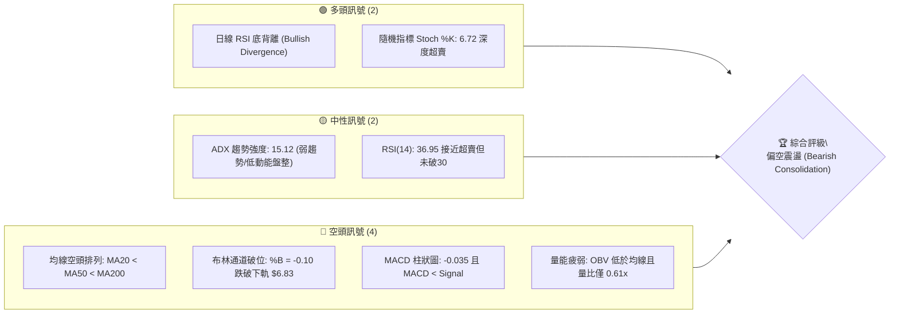
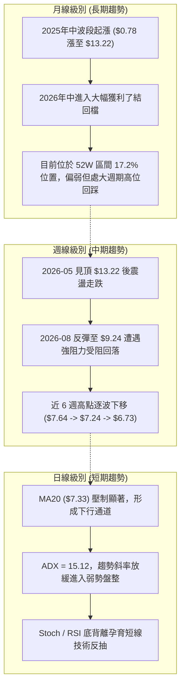
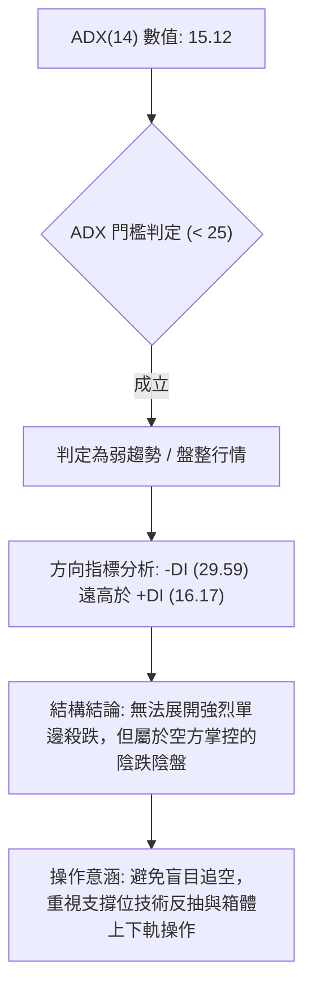
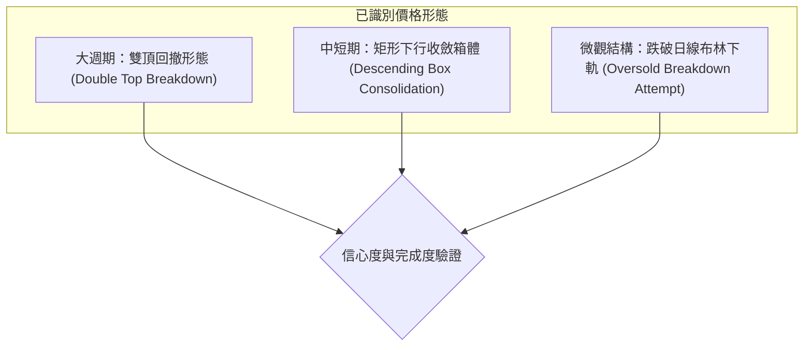
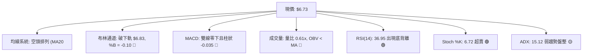
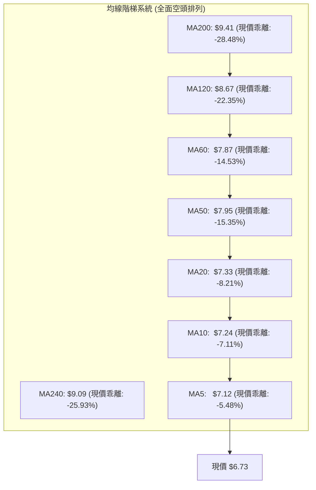
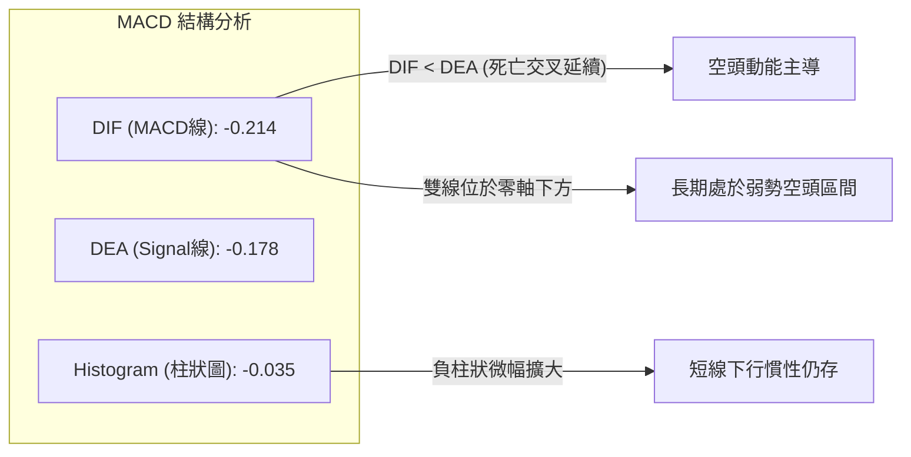
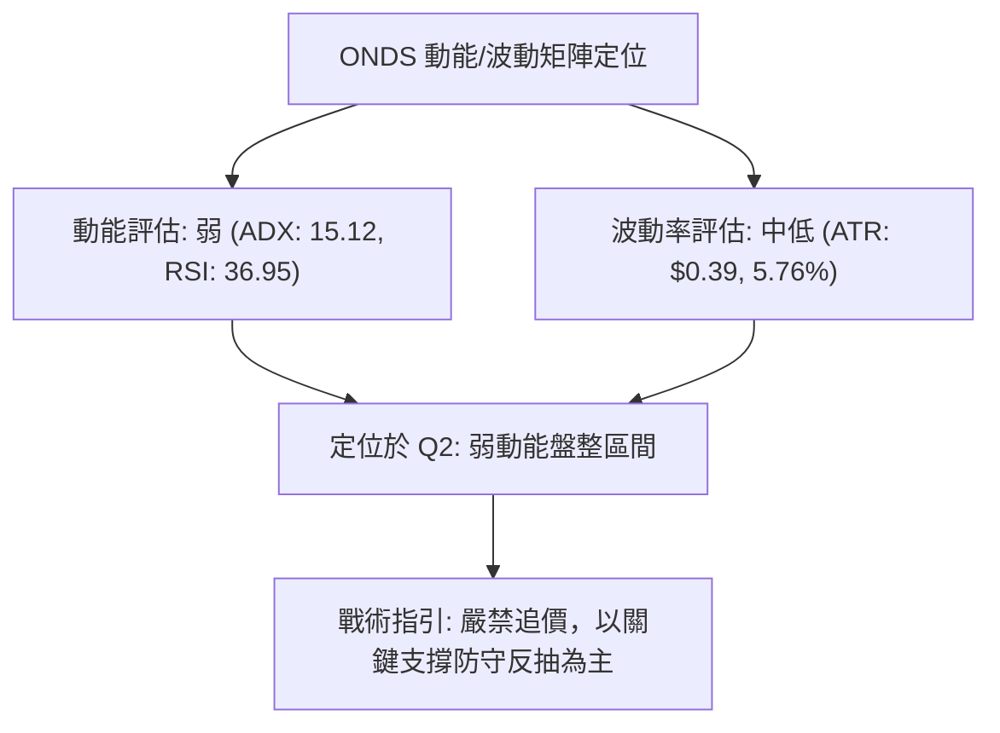
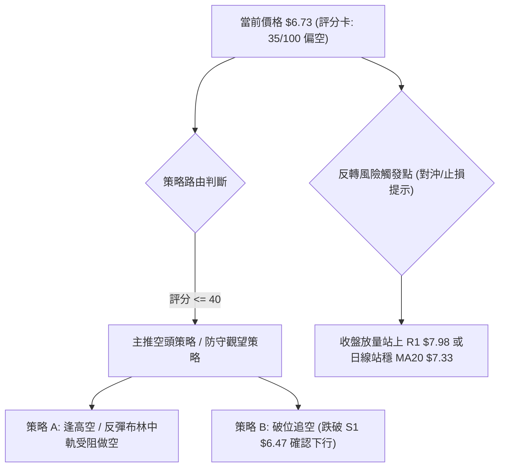
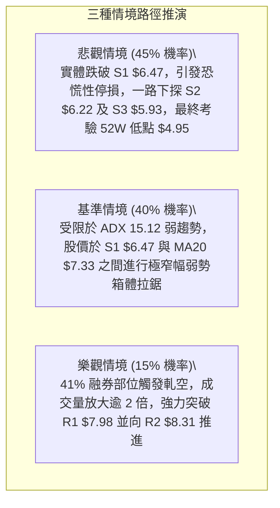

# ONDS 技術分析報告

> **報告日期**：2026-10-11 ｜ **語言**：繁體中文 ｜ **數據來源**：Yahoo Finance ｜ **當前價格**：$6.73

---

## 目錄

| 章節 | 內容 |
|------|------|
| [1. 技術面概覽](#1-技術面概覽) | 訊號儀表板、核心指標、評分卡 |
| [2. 趨勢分析](#2-趨勢分析) | 多時框趨勢、長中短期走勢 |
| [3. 圖表形態分析](#3-圖表形態分析) | 形態識別、K線組合、目標價 |
| [4. 支撐與阻力](#4-支撐與阻力) | 關鍵價位、斐波那契回調 |
| [5. 技術指標深度解讀](#5-技術指標深度解讀) | MA/RSI/MACD/布林/成交量 |
| [6. 動能與波動率](#6-動能與波動率) | 動能評估、ATR、Beta |
| [7. 多時框架總結](#7-多時框架總結) | 時框架評分矩陣 |
| [8. 交易策略建議](#8-交易策略建議) | 多空策略、風險報酬比 |
| [9. 風險提示與監控](#9-風險提示與監控) | 監控指標、風險場景 |

---

## 1. 技術面概覽

### 🎯 技術訊號儀表板



### 📊 核心指標速覽表

| 指標類別 | 指標名稱 | 當前數值 | 訊號 | 解讀 |
|----------|----------|----------|------|------|
| **價格** | 當前價格 | $6.73 | 🔴 | 位於 52 週區間之 17.2%，整體處於低位弱勢區 |
| **均線** | MA20 | $7.33 | 🔴 | 價格低於 MA20 達 -8.21%，短線空頭掌控 |
| **均線** | MA50 | $7.95 | 🔴 | 價格低於 MA50，中期下降趨勢未改 |
| **均線** | MA200 | $9.41 | 🔴 | 價格顯著低於 MA200，長期趨勢受壓制 |
| **動能** | RSI(14) | 36.95 | 🟡 | 位於中性偏空區間，但已浮現底背離結構 |
| **動能** | MACD(12,26,9) | -0.214 / -0.178 | 🔴 | 雙線位於零軸下方，柱狀圖 -0.035 持續看空 |
| **動能** | Stoch %K / %D | 6.72 / 10.24 | 🟢 | 進入極度超賣區，存在短線技術性抽頭修復可能 |
| **趨勢** | ADX(14) / ±DI | 15.12 (-DI: 29.59) | 🟡 | ADX < 25 表明處於弱趨勢盤整，但空方力道主導 |
| **通道** | Bollinger Bands | 下軌: $6.83, %B: -0.10 | 🔴 | 現價跌破布林下軌，出現下軌超跌擴張訊號 |
| **量能** | 當日量 / 20日均量 | 36.98M / 60.78M | 🔴 | 量比 0.61x，成交低迷，OBV < MA 確認量能疲弱 |
| **波動** | ATR(14) | $0.39 (5.76%) | 🟡 | 日內波幅約 5.76%，屬中度偏高日常震盪 |

### 🏆 技術評分卡

```
╔══════════════════════════════════════════════════════════════╗
║                技術評分卡 — ONDS (2026-10-11)                ║
╠══════════════════════════════════════════════════════════════╣
║ 趨勢強度 (Trend)     ██████░░░░░░░░░░░░░░  30/100  🔴 空頭壓制║
║ 動能指標 (Momentum)  ████████░░░░░░░░░░░░  40/100  🟡 背離超賣║
║ 支撐穩定度 (Support) ██████████░░░░░░░░░░  50/100  🟡 考驗S1  ║
║ 成交量配合 (Volume)  ██████░░░░░░░░░░░░░░  30/100  🔴 量能萎縮║
║ 形態完整度 (Pattern) ████████░░░░░░░░░░░░  40/100  🟡 區間震盪║
║ 均線排列 (MA Align)  ████░░░░░░░░░░░░░░░░  20/100  🔴 完備空頭║
╠══════════════════════════════════════════════════════════════╣
║ 綜合評分             ███████░░░░░░░░░░░░░  35/100  🔴 偏空弱勢║
╚══════════════════════════════════════════════════════════════╝
```

---

## 2. 趨勢分析

### 🌐 多時框趨勢分析



### 📈 長期趨勢 — 12個月走勢圖（Unicode）

```
ONDS 月線走勢圖（2025-11 至 2026-10）
價格軸 ($)
$14.00 ┤                                      ● $13.22 (2026-05 波段頂點)
$13.00 ┤                                     ╱ ╲
$12.00 ┤                                    ╱   ╲
$11.00 ┤                      ● $10.36     ╱     ╲
$10.00 ┤           ● $9.76   ╱ ╲   ● $10.08  ● $10.04
$9.00  ┤          ╱         ╱   ╲ ╱         ╱     ╲
$8.00  ┤ ● $7.90 ╱         ╱     ● $9.04   ╱       ╲   ● $8.24
$7.00  ┤        ╲         ╱                 ╱         ╲ ╱   ● $7.49  ● $7.66  ● $7.33
$6.00  ┤         ● $6.44 ╱                 ╱           ╲                         ● $6.73 (現價)
$5.00  ┤                                  ╱             ╲
       └─────────────────────────────────────────────────────────────────────────────
         25-11   25-12   26-01   26-02   26-03   26-04   26-05   26-06   26-07   26-08   26-09   26-10
```

#### 走勢特徵分析表格

| 階段區間 | 時間段 | 價格起訖 | 漲跌幅 | 走勢特徵與結構說明 |
|----------|--------|----------|--------|--------------------|
| 主升攻擊浪 | 2025-11 ~ 2026-01 | $6.44 → $10.36 | +60.87% | 帶量突破平台，月線連續長紅，市場情緒高度亢奮 |
| 高位雙頂箱體 | 2026-01 ~ 2026-04 | $10.36 → $10.04 | -3.09% | 於 $9.00~$10.36 形成寬幅震盪箱體，籌碼出現換手 |
| 終極噴出刺穿 | 2026-04 ~ 2026-05 | $10.04 → $13.22 | +31.67% | 月線爆量拉升至 52W 高點 $15.28 附近後收於 $13.22，呈現派發高潮 |
| 斷崖式急跌 | 2026-05 ~ 2026-07 | $13.22 → $7.49 | -43.34% | 獲利盤不計代價出逃，跌破 MA20 與 MA50，形成空方缺口 |
| 低位弱勢整理 | 2026-07 ~ 2026-10 | $7.49 → $6.73 | -10.15% | 於 $6.50~$7.90 區間反覆震盪，反彈高點不斷降低，空方緩步下壓 |

### 📊 中期趨勢（週線分析）

```
ONDS 週線關鍵波段結構架構 (2026-05 ~ 2026-10)
阻力區 R1/R2 [$7.98 ~ $8.31] ════════════════════════════════════ (8月反彈次高受阻點)
                           ▲                      ▲
                           │                      │
波段反彈頂點：2026-08-16 收 $9.24 ──────┐        │
                                        │        │ 2026-09-27 反抽高點 $7.64
                                        ▼        ▼
現價水位：$6.73 ───────────────────────────────────────────── ◄ 當前位置 (跌破多條週均線)
                                        ▲
                                        │
支撐區 S1/S2 [$6.22 ~ $6.47] ════════════════════════════════════ (7月中旬低點 $6.53 護盤區)
```

近 20 週歷史數據顯示，2026-05-31 週成交量達到 566.99M、價格收在 $13.22，隨後一路失守。雖然在 2026-07-19 至 2026-07-26 爆出 671M 與 834M 的天量低接換手，推升股價至 2026-08-16 的 $9.24，但由於未能收復 MA200（$9.41），隨即遭到空頭再度壓制。自 2026-08-23 以來，週線 MACD 柱狀圖持續處於零軸附近微幅負值，成交量逐週萎縮（近三週分別為 375M、247M、244M），表明中期缺乏增量資金進場，屬於中空格局下的弱勢防守。

### ⚡ 趨勢強度評估（ADX 解讀）



#### ADX 趨勢強度對照表

| 參數指標 | 數值 | 狀態評估 | 技術含義解讀 |
|----------|------|----------|--------------|
| **ADX (14)** | 15.12 | 弱趨勢 / 盤整 (<25) | 趨勢動量嚴重鈍化，不具備強趨勢條件，處於無趨勢或寬幅盤整 |
| **+DI (14)** | 16.17 | 多方動能低迷 | 買盤力道薄弱，多方無力組織主動進攻 |
| **-DI (14)** | 29.59 | 空方動能主導 | 空方維持優勢，-DI 與 +DI 差值達 13.42，顯示下行壓力未消 |
| **方向綜合** | 空方佔優 | 震盪偏空盤 | 依規則 14：ADX < 25 屬盤整行情，以日線布林通道與關鍵位為主 |

---

## 3. 圖表形態分析

### 🔍 形態識別系統



#### 形態識別與信心度評估表（依規則 15）

| 形態 | 信心度 | 判斷依據（引用數據） | 完成度 | 目標價（附計算式） |
|------|--------|----------------------|--------|--------------------|
| **雙頂破位 (大週期)** | 85% | 2026-01 高點 $10.36 與 2026-04 高點 $10.04 構成雙頂；2026-05 衝高 $13.22 屬假突破假噴出後迅速跌破頸線 $9.04（2026-03 收盤） | 100% | 頸線 $9.04 - 雙頂高點與頸線差值 ($10.36 - $9.04 = $1.32) = $7.72（已於2026-07達成並超跌） |
| **矩形箱體整理 (中期)** | 75% | 2026-07-19 低點 $6.53 與當前波段低點聚類 S1 ($6.47) 構成底部；高點受制於 R1 ($7.98) 與 8月高點 $9.24 之下方區間 | 80% | 箱體下緣 S1 $6.47 至上緣 R1 $7.98；若向下實體跌破 $6.47，量度下行目標 = S1 $6.47 - ($7.98 - $6.47) = $4.96（緊鄰 52W 低點 $4.95） |
| **頭肩底形態** | <30% | 數據中未偵測到完備頭肩底結構（目前右肩未形成，均線未翻揚） | 0% | 訊號不足，僅做指標型解讀，不預設立場 |

### 🕯️ 重要K線形態分析

| 月份/週期 | 收盤價 | K線形態 | 解讀 | 訊號 |
|-----------|--------|---------|------|------|
| 2026-05 | $13.22 | 爆量長上影大陽線 (帶長刺) | 衝擊 52W 高點 $15.28 遇阻狂瀉，成交量放大至 566M，主力高位出貨 | 🔴 空頭吞噬警訊 |
| 2026-06 | $8.24 | 長陰貫穿破位 | 直接吞沒前月漲幅，摜破短期均線系統，確立中期反轉 | 🔴 極度看空 |
| 2026-07 | $7.49 | 爆量長下影十字垂頭 (週量 834M) | 探底 $6.53 後爆量回升，展現強烈流動性吸收與恐慌盤洗出 | 🟢 潛在止跌 |
| 2026-08 | $7.66 | 衝高回落流星線 | 上探 $9.24 遇 MA200 壓制，無力守成收回 $7.66，顯示上方套牢壓力沉重 | 🔴 假突破遇阻 |
| 2026-09 | $7.33 | 窄幅縮量陰線十字 | 成交量驟降，市場陷入觀望，多空拉鋸但重心下移 | 🟡 中性微弱 |
| 2026-10 | $6.73 | 陰線下探 (目前) | 跌破 MA20 ($7.33) 與布林下軌 ($6.83)，測試下方支撐 S1 ($6.47) | 🔴 短線偏弱 |

### 📉 ASCII 走勢形態示意圖

```
ONDS 中期箱體震盪形態示意圖 (2026-07 至 2026-10)
$8.50 ┤
$8.00 ┤              阻力帶 R1: $7.98 ┌──────┐ (反彈阻力位)
$7.50 ┤     ┌──┐                     │      │
$7.00 ┤     │  └───┐                 │      └──┐
$6.50 ┤─────┴──────┴─────────────────┴─────────┴───► 現價: $6.73
$6.00 ┤              支撐帶 S1: $6.47 └──────┘ (多頭防線)
      └─────────────────────────────────────────────
       7月中旬      8月中旬        9月下旬    10月當前
      (探底 $6.53) (遇阻 $9.24)   (回抽 $7.64) (考驗 S1)
```

### 🎯 形態目標價計算

根據上述已確認之**中期矩形整理箱體**進行量度計算：
- **形態上軌（頸線/阻力）**：採用近一年波段高點聚類阻力 **R1 = $7.98**
- **形態下軌（支撐防線）**：採用近一年波段低點聚類支撐 **S1 = $6.47**
- **箱體垂直高度**：$7.98 - $6.47 = **$1.51**
- **向下破位量度目標價**：
  $$\text{Target}_{\text{Down}} = \text{S1} - \text{箱體高度} = \$6.47 - \$1.51 = \$4.96$$
  *(備註：計算值 $4.96 與數據中之 52 週最低點 $4.95 幾乎完全重合，具備極強之統計對稱性)*
- **向上突破量度目標價**：
  $$\text{Target}_{\text{Up}} = \text{R1} + \text{箱體高度} = \$7.98 + \$1.51 = \$9.49$$
  *(備註：計算值 $9.49 緊鄰 MA200 壓力位 $9.41)*

---

## 4. 支撐與阻力

### 🗺️ 關鍵價位分布圖（Unicode）

```
ONDS 價位結構分布圖 (由 OHLCV 與歷史波段精確計算)
══════════════════════════════════════════════════════════════════════════════
$15.28 ║████████████████████████████████████████║ 52W 最高點 / 斐波 0.0%
$10.11 ║████████████████████████████            ║ 斐波那契 50.0% 回調位
$9.41  ║████████████████████████                ║ MA200 長期均線重壓
$8.58  ║████████████████████                    ║ 強阻力 R3 (+27.49%)
$8.31  ║████████████████                        ║ 阻力 R2 (+23.55%)
$7.98  ║████████████████████████████████        ║ 關鍵阻力 R1 (+18.57%)
$7.16  ║▓▓▓▓▓▓▓▓▓▓▓▓▓▓▓▓▓▓▓▓▓▓                  ║ 斐波那契 78.6% 回調位
$6.73  ╠════════════════════════════════════════╣ ◄ 現價 ($6.73，跌破BB下軌)
$6.47  ║▓▓▓▓▓▓▓▓▓▓▓▓▓▓▓▓▓▓▓▓▓▓▓▓▓▓▓▓▓▓▓▓        ║ 近期核心支撐 S1 (-3.94%)
$6.22  ║████████████████████                    ║ 次級強支撐 S2 (-7.58%)
$5.93  ║████████████                            ║ 深層防守支撐 S3 (-11.89%)
$4.95  ║████████████████████████████████████████║ 52W 最低點 / 斐波 100.0%
══════════════════════════════════════════════════════════════════════════════
```

### 🚧 阻力位分析表

所有阻力位嚴格引用自 OHLCV 波段高點聚類計算數值：

| 阻力級別 | 價位 | 形成原因 | 突破難度 | 重要性 |
|----------|------|----------|----------|--------|
| **阻力 R1** | **$7.98** | 近一年波段高點密集區，亦為 MA50 ($7.95) 與布林上軌 ($7.83) 共振壓制區 | 高 | ★★★★☆<br>中期多空分水嶺，未放量站穩前反彈皆視為誘多 |
| **阻力 R2** | **$8.31** | 2026年6月崩跌後之首輪反抽平台籌碼密集成交套牢區 | 極高 | ★★★☆☆<br>第二解套拋壓帶 |
| **阻力 R3** | **$8.58** | 8月中旬高位滑落之中繼平台，鄰近 MA120 ($8.67) | 極高 | ★★★☆☆<br>強空頭防線 |

### 🛡️ 支撐位分析表

所有支撐位嚴格引用自 OHLCV 波段低點聚類計算數值：

| 支撐級別 | 價位 | 形成原因 | 守住機率 | 重要性 |
|----------|------|----------|----------|--------|
| **支撐 S1** | **$6.47** | 近一年波段低點聚類核心，對齊 2026-07-19 探底低點 $6.53 與 2025-10 波段底部 $6.44 | 60% | ★★★★★<br>當前最核心生命線，守住則維持區間震盪 |
| **支撐 S2** | **$6.22** | 次級歷史承接聚類區，若跌破 S1 後之緩衝空窗承接點 | 50% | ★★★☆☆<br>下行支撐緩衝點 |
| **支撐 S3** | **$5.93** | 2025年8月啟動主升浪前之月線收盤起漲支撐位 ($5.86 鄰近) | 70% | ★★★★☆<br>波段最後防守防線 |

### 📐 斐波那契回調位分析

依據 52 週完整波段（最低點 $4.95 至 最高點 $15.28，波幅 $10.33）計算之標準回調位：

| 斐波那契級別 | 精確價位 | 相對現價位置 | 技術意義與狀態解析 |
|--------------|----------|--------------|--------------------|
| **0.0% (高點)** | **$15.28** | +127.04% | 52 週歷史高點，週期派發頂部 |
| **23.6%** | **$12.84** | +90.79% | 2026-05 見頂後初步回調支撐（現已遠離） |
| **38.2%** | **$11.33** | +68.35% | 多頭防守黃金分割位（已全面失守） |
| **50.0%** | **$10.11** | +50.22% | 心理平衡位，2026-01~04 平台頸線位置 |
| **61.8%** | **$8.90** | +32.24% | 黃金分割強回調位，失守代表多頭波段行情徹底終結 |
| **78.6%** | **$7.16** | +6.39% | 極深回調位，現已失守（現價 $6.73 落於此處下方） |
| **100.0% (低點)**| **$4.95** | -26.45% | 52 週最低點，全波段起點 |

> **現價位置解讀**：
> 現價 **$6.73** 正處於 **78.6% 回調位 ($7.16)** 與 **100.0% 底部 ($4.95)** 之間。當股價跌破 78.6% 回調位後，技術結構顯示其深度回吐已超越常規回調範疇，正向 100% 低點尋求流動性。上方 $7.16 已由原先支撐轉換為當前第一動態反彈壓力。

---

## 5. 技術指標深度解讀

### 🎛️ 指標訊號總覽



### 📈 移動平均線排列分析



#### 均線階梯數據分析

所有長、中、短期移動平均線呈現完美的空頭排列結構（Price < MA5 < MA10 < MA20 < MA50 < MA200）。現價與 MA20 負乖離率達 -8.21%，與 MA200 負乖離率高達 -28.48%。均線斜率全部向下傾斜，顯示整體籌碼成本逐層套牢。任何未伴隨巨大成交量的短線回抽，在碰觸 MA5 ($7.12) 或 MA20 ($7.33) 時均將面臨拋壓。

### 📉 RSI(14) 分析

- **當前 RSI(14) 數值**：**36.95**
- **數值進度條**：
  ```
  [0] ░░░░░░░░░░░░░░░░░░█████████████░░░░░░░░░░░░░░░░░░░░░░ [100]
      ▲ 超賣區 (30)      ▲ 當前 (36.95)   ▲ 中性 (50)    ▲ 超買 (70)
  ```
- **背離判斷（底背離成立）**：
  - **價格層面**：2026-10-04 週收盤 $7.24 下跌至 2026-10-11 收盤 $6.73，日線價格持續創出近期收盤新低。
  - **指標層面**：RSI 於 2026-07 探底時曾下殺至 21.3~22.1 之極端超賣，而目前價格下探至 $6.73 附近時，RSI(14) 保持在 36.95，並未同步創下新低。
  - **結論**：日線級別浮現顯著的**技術性底背離 (Bullish Divergence)**，顯示下殺動能已出現邊際遞減，空方殺跌效率降低，預示短線隨時可能引發技術性回抽。

### 📊 MACD(12/26/9) 訊號解讀



當前 MACD 線 (-0.214) 位於訊號線 (-0.178) 下方，且柱狀圖為 -0.035。近三週週線 MACD 柱狀圖分別為 +0.062、+0.013、-0.035，呈現由正翻負的「弱勢轉向」態勢，證實 9 月下旬的回彈波動能已衰竭，指標再度轉空。

### 📦 布林通道分析

```
ONDS 日線布林通道 (20, 2) 結構圖
$8.00 ┤
$7.83 ┤ ════════════════════════════════════════════════ 上軌: $7.83 (通道上緣)
$7.60 ┤
$7.33 ┤ ------------------------------------------------ 中軌 (MA20): $7.33
$7.00 ┤
$6.83 ┤ ════════════════════════════════════════════════ 下軌: $6.83 (破位擴張)
$6.73 ┤ ◄ 現價: $6.73 (%B = -0.10，跌破下軌外側)
$6.50 ┤
```

- **通道帶寬**：上軌 $7.83，中軌 $7.33，下軌 $6.83，帶寬僅 $1.00（約 13.6%），處於壓縮後的開口邊緣。
- **%B 指標數值**：**-0.10**（跌破 0 軸以下），代表價格已經滑出布林下軌之外，屬於極短線超賣刺穿形態。
- **解讀**：根據統計均值回歸特性，當 %B 跌至負值時，股價通常會在 1-3 個交易日內出現向上收斂回布林帶內部的抽頭走勢，第一回抽目標即為中軌 $7.33。

### 💹 成交量分析（量價配合度）

- **當日成交量**：36,986,900 股
- **20日均量**：60,786,100 股（**量比：0.61x**）
- **50日均量**：65,481,812 股
- **OBV（能量潮）分析**：OBV < MA，能量潮線持續在均線下方運行，確認主力大資金並無主動吸籌動作。
- **量價背離分析**：現價跌破布林下軌並創短期新低，但成交量僅為 20 日均量的 61%，形成典型的「**縮量陰跌**」結構。縮量下跌說明拋壓並非恐慌盤湧出，而是多方承接盤極度匱乏（流動性枯竭型下跌）。在缺乏量能支持下，價格易跌難漲，即使反彈也因缺乏量能而難以走遠。

---

## 6. 動能與波動率

### ⚡ 動能評估四象限

| 象限標記 | 動能維度 | 波動維度 | ONDS 當前狀態判定 | 交易策略意涵 |
|----------|----------|----------|-------------------|--------------|
| **Q1** | 強動能 | 低波動 | 否 | 穩健單邊趨勢，最佳加碼機會 |
| **Q2 (當前)** | **弱動能** | **低/中波動** | **✓ (符合現況)** | **ADX=15.12，ATR=5.76%，陰跌盤整，謹慎觀望** |
| **Q3** | 強動能 | 高波動 | 否 | 主升或主跌段，高風險高回報突破 |
| **Q4** | 弱動能 | 高波動 | 否 | 寬幅無序洗盤，極易引發雙向止損 |



### 📊 ATR 波動率分析

- **ATR(14) 絕對值**：**$0.39**
- **ATR 佔比**：5.76% of Current Price
- **波動特性評估**：ONDS 屬於高波動性小型股，單日平均波動 $0.39，意味著日常日內常規震盪即可能達到 ±6% 左右。
- **止損距離建議**：
  - *超短線操作*：1.5 × ATR = $0.39 × 1.5 = **$0.59**（現價下方應預留至少 $0.59 空間以防雜訊假突破）。
  - *波段操作*：2.0 × ATR = $0.39 × 2.0 = **$0.78**。

### 📐 Beta 與市場相關性

- **Beta 數值**：**2.922**（極高 Beta 屬性）
- **市場敏感度分析**：ONDS 股價變動幅度約為標普 500 指數的 2.92 倍。在整體市場環境平穩時，其個股波動巨大；一旦大盤出現系統性回檔，該股將面臨被動去槓桿的巨幅拋壓。
- **籌碼結構對應**：當前放空比率（Short % Float）高達 **41.0%**，空單回補天數（Short Ratio）為 **3.83 天**。極高的空頭部位與高 Beta 特性相互交織，形成「潛在軋空（Short Squeeze）槓桿」，一旦出現重大利好突破，極易引發軋空暴拉；但在利空或無消息環境下，空頭則牢牢鎖死盤面。

---

## 7. 多時框架總結

### 📋 時框架評分表

| 時框架 | 趨勢方向 | 動能狀態 | 均線排列 | 形態結構 | 綜合評分 | 建議操作 |
|--------|----------|----------|----------|----------|----------|----------|
| **月線 (長期)** | 震盪偏空 | RSI 衰退，高位回踩 | 跌破短期月均，MA240防守 | 雙頂回撤 78.6% | 40/100 🔴 | 長期部位觀望，等待打底完成 |
| **週線 (中期)** | 空頭主導 | MACD 柱微幅轉負 | 跌破週線 MA20/MA50 | 震盪下行箱體整理 | 35/100 🔴 | 逢反彈減碼，關注 S1 支撐有效性 |
| **日線 (短期)** | 盤整超跌 | RSI底背離 / Stoch超賣 | 嚴格空頭排列 (MA20<50<200)| 跌破布林下軌超跌 | 35/100 🔴 | 禁追空，激進者可博極窄幅超跌反抽 |

### 🔲 綜合訊號矩陣

```
時框一致性矩陣
┌──────────────┬──────────────┬──────────────┬──────────────┐
│ 維度         │ 長期 (月線)  │ 中期 (週線)  │ 短期 (日線)  │
├──────────────┼──────────────┼──────────────┼──────────────┤
│ 趨勢方向     │ 🔴 偏空      │ 🔴 空頭      │ 🔴 偏空      │
│ 動能強度     │ 🟡 減弱      │ 🔴 轉負      │ 🟢 超賣底背離│
│ 均線架構     │ 🟡 中立      │ 🔴 壓制      │ 🔴 完備空頭  │
│ 成交量配合   │ 🔴 萎縮      │ 🔴 萎縮      │ 🔴 量比0.61x │
└──────────────┴──────────────┴──────────────┴──────────────┘
訊號一致性評估：趨勢與均線維度具備高達 90% 的「空頭一致性」；動能維度日線出現唯一的超賣矛盾點。
```

### ⚖️ 多時框收斂結論

> **依嚴格要求 14 執行多時框收斂判定**：
> 1. **趨勢/盤整判定**：當前 ADX(14) 數值為 **15.12 (< 25)**，明確定義為**盤整行情（Consolidation Market）**。
> 2. **主導規則取捨**：依規則 14，在 ADX < 25 的盤整格局下，日線布林通道上下軌與核心波段支撐阻力為主要交易區間，中長期均線方向則作為反彈壓制上限。
> 3. **方向性結論**：**【偏空弱勢震盪（Bearish Consolidation）】**。
>    雖然日線出現 RSI 底背離與 Stoch 深度超賣，但由於週線與日線均線呈現全面空頭排列，且量能嚴重萎縮，超賣訊號僅能視為「下行抵抗」或「跌勢暫緩」，不足以構成趨勢反轉。整體交易邏輯收斂為：**防範 S1 ($6.47) 破位風險，短線以箱體與布林下軌至中軌的超跌修復對待，中中期操作一律維持偏空防守**。

---

## 8. 交易策略建議

### 🗺️ 策略決策流程圖



### 🧭 策略路由

> **當前主策略方向 = 主推空頭防守策略（依評分卡 35/100 偏空判定）**
> 綜合評分僅 35 分，均線空頭排列，量能疲弱。依規則，主推順應趨勢的逢高沽空與破位做空策略，多頭僅列為短線反轉對沖提示。

### 🎯 價格情境階梯（Price Scenarios）

價位完全嚴格引用關鍵價位計算數值：

| 觸發條件 | 下一目標 | 後續延伸 | 情境含義 |
|----------|----------|----------|----------|
| **強勢突破 R1 ($7.98)** | 阻力 R2 ($8.31) | 阻力 R3 ($8.58) | 中期多頭反轉，軋空行情啟動，空單必須全面平倉 |
| **小幅反彈遇阻 MA20 ($7.33)** | 徘徊現價 ($6.73) | 測試 S1 ($6.47) | 弱勢技術修復，空頭中繼，最佳逢高布空點 |
| **實體跌破 S1 ($6.47)** | 支撐 S2 ($6.22) | 支撐 S3 ($5.93) | 矩形下軌破位，展開新一輪單邊殺跌，下探歷史低位 |

### 📊 情境機率分佈

| 情境 | 機率 | 主要依據 |
|------|------|----------|
| **弱勢反抽後回落** | **55%** | RSI 底背離及布林通道破位提供短線反抽動能，但均線空頭排列與 MACD 負柱狀壓制反彈高度 |
| **直接破位再探底** | **30%** | 量比僅 0.61x，多方無防守意願，-DI (29.59) 處於絕對主導地位，可能直接摜破 S1 ($6.47) |
| **強勢反轉上行** | **15%** | 空頭部位高達 41%，若出現重大利好可能觸發軋空，但目前無任何量能與技術結構支撐 |

### 🟢 主策略詳情（空頭導向）

依據評分卡 35/100 路由，制定兩套精確執行之空方策略：

| 策略要素 | 策略 A（反彈受阻高空） | 策略 B（跌破關鍵支撐追空） |
|----------|------------------------|----------------------------|
| **策略類型** | 順勢反彈空（中軌阻力布空） | 破位空（箱體下軌失守追空） |
| **進場條件** | 價格反抽至布林中軌 MA20 附近，出現上影線滯漲 | 實體日 K 跌破核心支撐 S1，次日確認無法收復 |
| **進場價格** | **$7.33**（精確對齊 MA20 / BB中軌） | **$6.45**（確認跌破 S1 $6.47 兩個美分） |
| **目標價 T1** | **$6.47**（支撐位 S1） | **$6.22**（支撐位 S2） |
| **目標價 T2** | **$5.93**（支撐位 S3） | **$4.95**（52W 最低點 / 斐波 100%） |
| **止損價格** | **$7.98**（突破 R1 阻力位嚴格止損） | **$6.83**（重返布林下軌內部嚴格止損） |
| **風險報酬比** | **1 : 2.15**<br>*(風險 $0.65 : 目標2利潤 $1.40)* | **1 : 3.95**<br>*(風險 $0.38 : 目標2利潤 $1.50)* |
| **成功機率** | **65%** | **60%** |
| **建議倉位** | **15%** (總資金比例) | **10%** (突破追加部位) |

### 🔴 反向風險觸發點（對沖提示）

若市場出現以下訊號，主空策略即刻失效，空頭部位應無條件止損出局並考慮反手對沖：
1. **收盤價帶量突破 R1 ($7.98)**：代表價格突破 MA50，且將扭轉近三個月的下降趨勢，空頭陷阱成立。
2. **單日成交量暴增至 1.2 億股以上（量比 > 2.0x）並伴隨長紅棒收復 $7.33**：此為主力暴力軋空進場訊號。

### ⭐ 整體訊號強度評星

```
做多訊號強度：★☆☆☆☆  (1/5星 - 僅有極短線超賣背離，缺乏大局支撐)
做空訊號強度：★★★★☆  (4/5星 - 均線、動能、量能全面偏空)
整體可信度：  ★★★★☆  (4/5星 - 盤整偏空格局明確，數據高度收斂)
```

---

## 9. 風險提示與監控

### ✅ 關鍵監控指標 Checklist

```
╔══════════════════════════════════════════════════════════════╗
║               ONDS 每日盤面關鍵監控清單 (Checklist)           ║
╠══════════════════════════════════════════════════════════════╣
║ [ ] 價格防線 S1 ($6.47)：日收盤價是否實體跌破？             ║
║ [ ] 布林下軌收復 ($6.83)：收盤是否重回下軌之上 (%B > 0)？    ║
║ [ ] 均線壓制 MA20 ($7.33)：反彈是否遭到精準壓制？            ║
║ [ ] RSI(14) 數值變化：是否跌破 30 進入鈍化？背離是否被破壞？  ║
║ [ ] 當日成交量監控：是否突破 6,000 萬股 (放量反轉或恐慌湧出)？║
║ [ ] 放空比率 (Short % Float = 41%)：是否有非理性軋空拉抬跡象？║
╚══════════════════════════════════════════════════════════════╝
```

### ⚠️ 風險場景分析



### 🛡️ 風險管理重要提醒

1. **軋空（Short Squeeze）極端風險**：
   ONDS 擁有高達 **41.0% 的空頭浮動比率（Short % Float）**，且 Short Ratio 達 3.83。在技術分析上，這種極端籌碼結構猶如「乾柴烈火」。雖然基本面與技術均線極度偏空，但任何突發性的國防訂單消息或產業催化劑，均可能使空頭踩踏回補，造成單日 20%~40% 的非理性暴漲。因此，**空頭部位務必嚴格設定硬性止損點（如 $7.98），切忌無止損逆勢抗單**。

2. **高 Beta 波動防範**：
   Beta 值為 **2.922**，且日 ATR 高達 **$0.39（5.76%）**。日內常規雜訊極易觸發過窄的止損。建議所有交易之倉位規模嚴格控制在總帳戶資金的 **10%~15% 以內**，避免單一標的過度曝險。

3. **流動性折價風險**：
   當前日成交量僅 36.98M（量比 0.61x），量能顯著萎縮。在流動性低迷的陰跌走勢中，容易出現買賣盤報價斷檔，追單時應使用限價單（Limit Order）執行，禁止使用市價單，以防止嚴重的滑點損失。

---

## 📋 報告總結

```
╔══════════════════════════════════════════════════════════════╗
║                    ONDS 技術分析報告總結                     ║
╠══════════════════════════════════════════════════════════════╣
║ 報告日期：2026-10-11                                         ║
║ 當前價格：$6.73                                              ║
║ 分析評級：🔴 偏空弱勢震盪 (綜合評分: 35/100)                 ║
║                                                              ║
║ 關鍵結論：                                                   ║
║ ├─ 長期趨勢：🔴 弱勢回調，自高點回吐逾 50%，受制於 MA200     ║
║ ├─ 中期趨勢：🔴 震盪下行，反彈高點逐波降低，MA50 ($7.95) 壓制║
║ ├─ 短期趨勢：🟡 跌破布林下軌超跌，RSI 浮現底背離，蘊含弱反抽 ║
║ ├─ 關鍵支撐：S1: $6.47 ｜ S2: $6.22 ｜ S3: $5.93             ║
║ ├─ 關鍵阻力：R1: $7.98 ｜ R2: $8.31 ｜ R3: $8.58             ║
║ └─ 分析師目標：均價 $18.88 (基本面共識與當前技術盤面嚴重脫節)║
║                                                              ║
║ 最優策略組合：                                               ║
║ 1. 🥇 最佳機會：策略 A (反彈至 MA20 $7.33 遇阻做空，止損$7.98)║
║ 2. 🥈 次選機會：策略 B (跌破 S1 $6.47 追空，目標看向 $4.95)  ║
║ 3. 🥉 保守選擇：場外空倉觀望，等待股價放量收復 $7.98 再行定奪 ║
╚══════════════════════════════════════════════════════════════╝
```

---

> ⚠️ **免責聲明**：本報告為 AI 自動生成之技術分析，所有數據及估算均基於提供的歷史價格資訊。本報告**僅供研究與學術參考**，**不構成任何投資建議**。投資有風險，入市需謹慎。

---

*報告生成時間：2026-10-11 ｜ 數據來源：Yahoo Finance ｜ 分析框架：多時框技術分析*