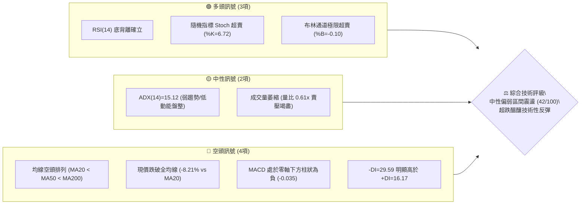
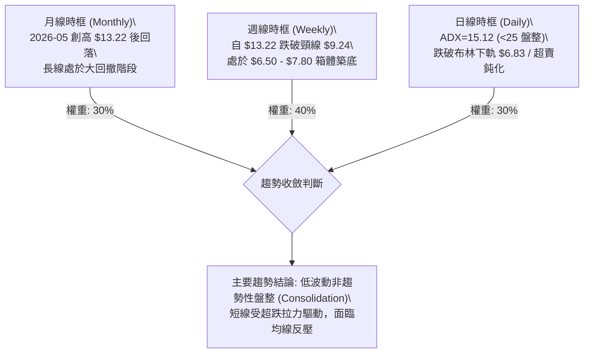
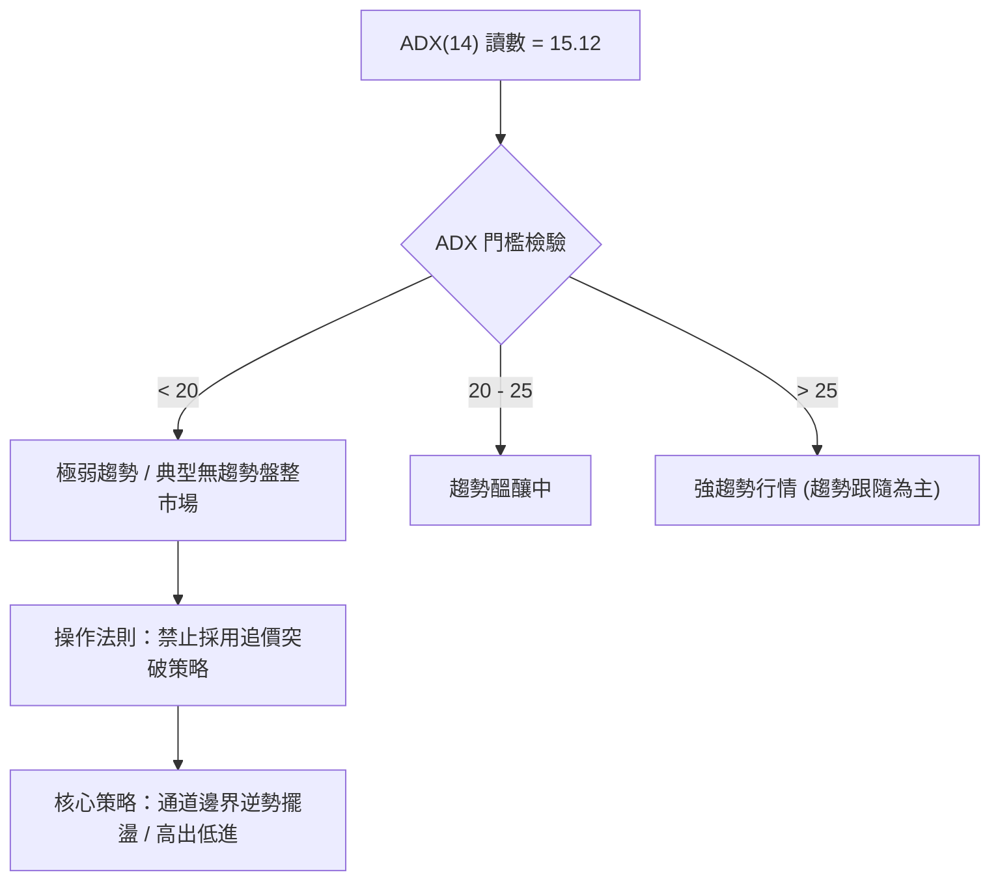
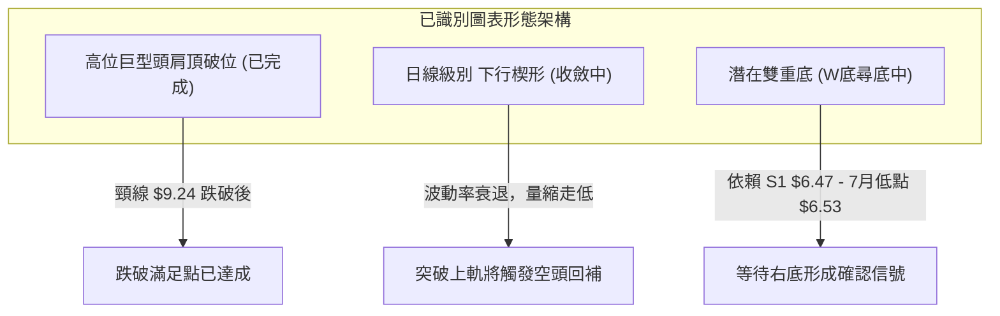
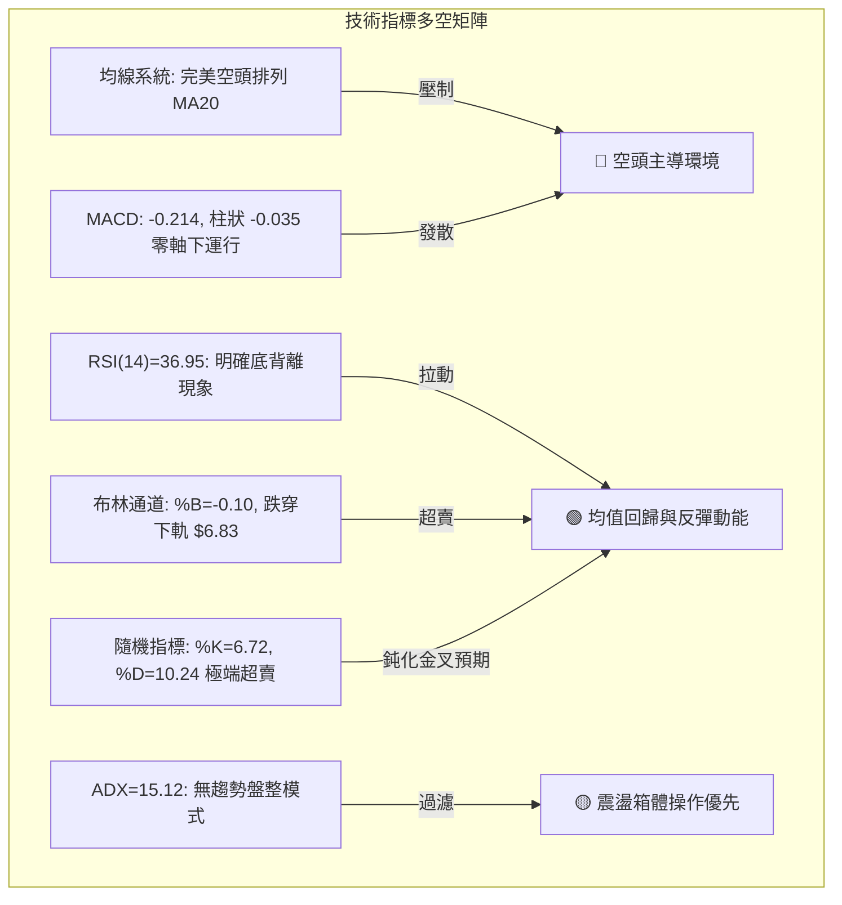
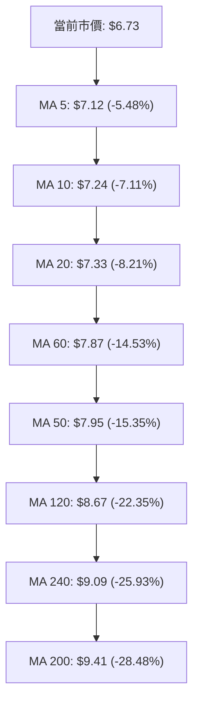
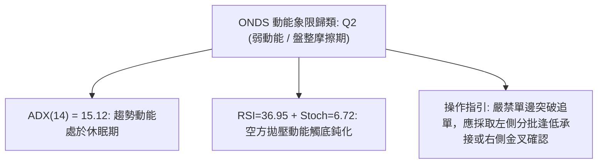
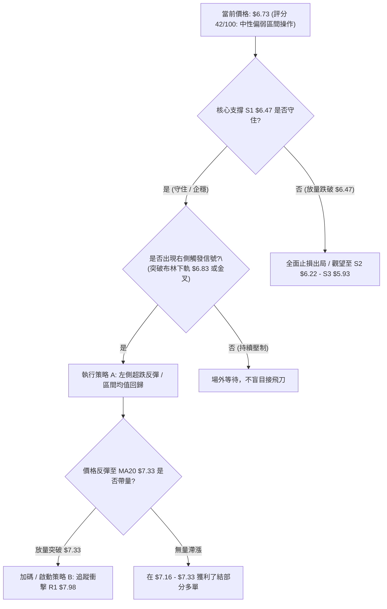
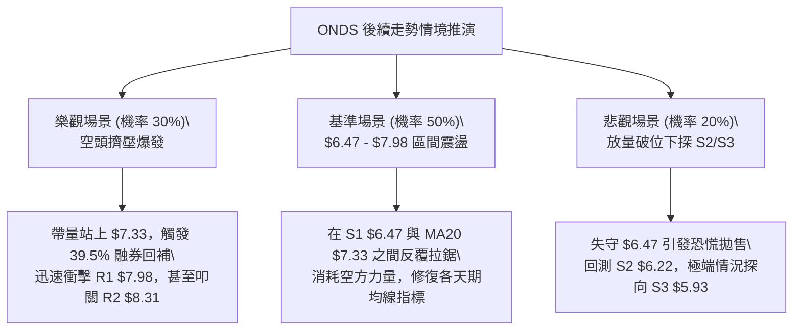

# ONDS 技術分析報告

> **報告日期**：2026-10-12 ｜ **語言**：繁體中文 ｜ **數據來源**：Yahoo Finance ｜ **當前價格**：$6.73

---

## 目錄

| 章節 | 內容 |
|------|------|
| [1. 技術面概覽](#1-技術面概覽) | 訊號儀表板、核心指標、評分卡 |
| [2. 趨勢分析](#2-趨勢分析) | 多時框趨勢、長中短期走勢、ADX解讀 |
| [3. 圖表形態分析](#3-圖表形態分析) | 形態識別、信心度評估、K線組合、目標價推算 |
| [4. 支撐與阻力](#4-支撐與阻力) | 關鍵價位結構、聚類分析、斐波那契回調 |
| [5. 技術指標深度解讀](#5-技術指標深度解讀) | 均線系統、RSI底背離、MACD、布林通道超賣、OBV量價 |
| [6. 動能與波動率](#6-動能與波動率) | 動能四象限、ATR波動分析、高Beta風險評估 |
| [7. 多時框架總結](#7-多時框架總結) | 時框架矩陣、ADX收斂結論 |
| [8. 交易策略建議](#8-交易策略建議) | 策略路由、價格情境階梯、進出場精確點位與風控 |
| [9. 風險提示與監控](#9-風險提示與監控) | 監控清單、極端情境推演、空頭擠壓可能性 |

---

## 1. 技術面概覽

### 🎯 技術訊號儀表板



### 📊 核心指標速覽表

| 指標類別 | 指標名稱 | 當前數值 | 訊號 | 專業技術解讀 |
|----------|----------|----------|------|--------------|
| **價格** | 當前收盤價 | $6.73 | 🔴 | 位於 52 週區間（$4.95–$15.28）之 17.2% 分位，處於中長期極弱勢區間 |
| **均線** | 短期 MA20 | $7.33 | 🔴 | 現價低於 MA20 達 -8.21%，短線空方掌控主導權 |
| **均線** | 中期 MA50 | $7.95 | 🔴 | 中期生命線持續下彎，構成第一道波段下行重壓帶 |
| **均線** | 長期 MA200 | $9.41 | 🔴 | 遠低於牛熊分界線達 -28.48%，長期結構呈現熊市特徵 |
| **動能** | RSI(14) | 36.95 | 🟢 | 指標雖位於偏弱區，但與價格形成明確「底背離」，反彈動能蓄積 |
| **動能** | MACD (12,26,9) | -0.214 | 🔴 | 雙線位於零軸下，柱狀體為 -0.035，尚未完成黃金交叉 |
| **擺盪** | Stoch %K / %D | 6.72 / 10.24 | 🟢 | 進入極度超賣鈍化區間（<20），短線具備強烈均值回歸拉力 |
| **波動** | ATR(14) | $0.39 | 🟡 | 單日真實波動率為 5.76%，代表日線波動性高，止損空間須適度放寬 |
| **通道** | 布林通道 %B | -0.10 | 🟢 | 股價實體跌破布林下軌（$6.83），呈現統計學上的極端偏離買點形態 |
| **量能** | 20日成交量比 | 0.61x | 🟡 | 日成交 36.98M 低於均量 60.79M，下殺動能伴隨縮量，屬賣盤竭盡現象 |

### 🏆 技術評分卡

```
╔══════════════════════════════════════════════════════════════════╗
║                   技術評分卡 — ONDS (2026-10-12)                 ║
╠══════════════════════════════════════════════════════════════════╣
║ 趨勢強度 (ADX=15.12 盤整)     ████░░░░░░░░░░░░░░░░  20/100  🔴   ║
║ 均線排列 (空頭排列/全線下彎)  ███░░░░░░░░░░░░░░░░░  15/100  🔴   ║
║ 動能指標 (RSI底背離+超賣)     ███████████░░░░░░░░░  55/100  🟢   ║
║ 支撐穩定度 (靠近 S1 $6.47)    ██████████░░░░░░░░░░  50/100  🟡   ║
║ 成交量配合 (下跌量縮/賣壓衰退)████████░░░░░░░░░░░░  40/100  🟡   ║
║ 形態結構 (大型頭肩破位後尋底) ████████░░░░░░░░░░░░  40/100  🟡   ║
║ 空頭擠壓潛力 (Short% 39.5%)   ████████████████░░░░  80/100  🟢   ║
╠══════════════════════════════════════════════════════════════════╣
║ 綜合評分 (量化權重總成)       ████████░░░░░░░░░░░░  42/100       ║
║ 技術評級                      ⚖️ 中性偏弱（盤整尋底/超跌反彈結構） ║
╚══════════════════════════════════════════════════════════════════╝
```

---

## 2. 趨勢分析

### 🌐 多時框趨勢分析



### 📈 長期趨勢 — 12個月走勢圖（Unicode）

以下為 ONDS 自 2025 年 11 月至 2026 年 10 月之月線收盤價格軌跡走勢圖，標注歷史頂部及近期下探低點：

```
ONDS 月線走勢圖（過去12個月：2025-11 至 2026-10）
價格軸 ($)
$14.00 ┤                                   ● $13.22 (2026-05 高點)
$13.00 ┤                                  ╱ ╲
$12.00 ┤                                 ╱   ╲
$11.00 ┤                   ● $10.36     ╱     ╲
$10.00 ┤          ● $9.76   ╲     ● $10.04     ╲
 $9.00 ┤         ╱           ● $9.04            ╲  ● $8.24
 $8.00 ┤ ● $7.90                                  ╲╱    ╲  ● $7.66
 $7.00 ┤                                                ● $7.49  ╲  ● $6.73 (現價)
 $6.00 ┤                                                          ● $7.33
       └───────────────────────────────────────────────────────────────
         11    12    01    02    03    04    05    06    07    08    09    10 (月份)
         2025        2026
```

#### 走勢特徵分析表格

| 階段區間 | 週期 | 區間收盤變化 | 漲跌幅 | 量價與結構特徵 |
|----------|------|--------------|--------|----------------|
| **波段主升段** | 2025/11 - 2026/01 | $7.90 → $10.36 | +31.14% | 伴隨業績倍增預期，機構資金強勢進場推升 |
| **高位箱體震盪** | 2026/01 - 2026/04 | $10.36 → $10.04 | -3.09% | 多空於 $9.00–$10.50 激烈換手，構建分配平台 |
| **終極拉抬衝頂** | 2026/04 - 2026/05 | $10.04 → $13.22 | +31.67% | 週成交量爆出 566.99M 股天量，月線觸頂見 52W 高點 $15.28 |
| **頭部崩跌波** | 2026/05 - 2026/07 | $13.22 → $7.49 | -43.34% | 破位下殺，連續跌破 MA20 及斐波那契 61.8%（$8.90） |
| **弱勢抵抗收斂** | 2026/07 - 2026/10 | $7.49 → $6.73 | -10.15% | 波動率逐步收窄，日線 ADX 降至 15.12，進入無方向陰跌摩擦期 |

### 📊 中期趨勢（週線分析）

從近 20 週收盤走勢觀察，ONDS 在 2026 年 7 月 19 日當週收盤於 $6.53，週成交量放大至 671.5M 股，隨後在 7 月 26 日展開報復性反彈至 $7.80（週成交量達 834.3M 股）。8 月中旬反彈波段高點受阻於 $9.24（逼近 MA200 之 $9.41 反壓），隨後量能萎縮回落。
當前現價 $6.73 已逼近 7 月中旬低點 $6.53，呈現**二次探底（Double Bottom Retest）**的結構。

```
近期週線壓力與支撐示意圖：
  $9.24 ────────────────────────────────── [8月中旬波段反彈高點 / 阻力警戒區]
         ╲
          ╲
  $7.98 ───╲────────────────────────────── [R1 關鍵阻力 / 密集套牢解套點]
            ╲         ╱╲
             ╲       ╱  ╲
  $7.33 ──────╲─────╱────╲──────────────── [MA20 / BB中軌 樞軸位置]
               ╲   ╱      ╲
  $6.73 ────────╲─╱────────●────────────── [當前現價 $6.73：逼近前低]
                 ●          
  $6.53 ────────────────────────────────── [7/19 週線波段低點 / S1 支撐緩衝帶]
```

### ⚡ 趨勢強度評估（ADX 解讀）



#### 方向動向指標（DMI）對照表

| 指標變數 | 當前讀數 | 強弱屬性 | 結構解讀 |
|----------|----------|----------|----------|
| **ADX (14)** | **15.12** | 極弱 | 趨勢動能徹底匱乏，表明當前市場缺乏單邊推動力，任何單邊突破均易演變為假突破 |
| **+DI (14)** | **16.17** | 偏弱 | 多方主動進攻意願低落 |
| **-DI (14)** | **29.59** | 主導 | 空方力量暫時佔優，但因 ADX 下行，空方殺跌邊際效應已大幅遞減 |
| **多空差值** | **-13.42** | 空方掌控 | 盤面仍處於防禦狀態，需等待 +DI 上穿 -DI 方可確認多頭反轉 |

---

## 3. 圖表形態分析

### 🔍 形態識別系統



#### 形態信心度與目標價評估表

| 形態名稱 | 信心度 | 判斷依據（引用技術數據） | 完成度 | 目標價計算式與精確數值 |
|----------|--------|--------------------------|--------|------------------------|
| **高位頭肩頂 (H&S Top)** | **85%** | 頭部為 52W 高點 $15.28，左肩 2026/01 收盤 $10.36，右肩 04 月收盤 $10.04，頸線於 06/14 跌破 $9.24。 | 100% (已完全兌現) | 頸線 $9.24 - 形態高度 ($15.28 - $9.24 = $6.04) = **$3.20**（跌勢中途於 $6.50 處獲支撐減速）。 |
| **潛在雙重底 (W-Bottom)** | **52%** | 第一隻腳為 2026-07-19 之低點 $6.53；當前價格 $6.73 逼近波段低點支撐 S1（$6.47），具備形成右腳條件。 | 45% (右底構築中) | 頸線取 8 月中旬反彈波段高點 $9.24：<br/>形態高度 = $9.24 - $6.47 = $2.77。<br/>若確認突破頸線，理論目標價 = $9.24 + $2.77 = **$12.01**。 |
| **下降通道/楔形整理** | **68%** | 價格自 8 月高點 $9.24 逐步下移，走勢受到下彎 MA20（$7.33）壓制，振幅收窄，ATR 降至 $0.39。 | 75% (逼近端點) | 若向上突破通道上軌（當前重疊於 MA20 $7.33），首要目標直指第一阻力位 **R1 $7.98**。 |

### 🕯️ 重要K線形態分析

| 週期/月份 | 收盤價 | K線形態名稱 | 技術解讀 | 訊號強度 |
|-----------|--------|-------------|----------|----------|
| **2026-05** | $13.22 | 爆量長上影大陽線 | 單月自 $10.04 飆升至 $13.22，留有 $15.28 針尖長上影，主力出貨信號明確 | 🔴 強烈見頂 |
| **2026-06** | $8.24 | 破位長陰巨浪線 | 直接吞噬前三個月漲幅，跌破多條短均線，多頭防線全面瓦解 | 🔴 崩盤信號 |
| **2026-07** | $7.49 | 帶長下影探底十字星 | 月內下探至 $6.53 後獲大單承接（週成交爆出 8.34 億股），確立 $6.50 支撐區 | 🟢 初步止跌 |
| **2026-08** | $7.66 | 縮量倒錘子小陽線 | 上衝 $9.24 受阻回落，反彈動能衰竭，遇 MA200 形成技術解套賣壓 | 🟡 假突破受阻 |
| **2026-09** | $7.33 | 窄幅十字星 (Doji) | 全月收於 $7.33，波動率顯著收斂，多空膠著於 MA20 附近 | 🟡 變盤前兆 |
| **2026-10 (至今)**| $6.73 | 陰線下探尋底 | 股價跌破布林下軌 $6.83，但量能急縮（0.61x），顯現恐慌盤殺竭跡象 | 🟢 超跌反彈蓄勢 |

### 📉 ASCII 走勢形態示意圖

```
ONDS 潛在日線雙重底 (Double Bottom) 與布林通道下軌超賣形態示意圖
══════════════════════════════════════════════════════════════════════
 價格
$9.24 ┤              ● (8月中旬頸線高點)
      │             ╱ ╲
$8.31 ┤            ╱   ╲                        [R2 阻力 $8.31]
$7.98 ┤           ╱     ╲           ● (反彈目標 [R1 阻力 $7.98])
$7.33 ┤──────────╱───────╲─────────╱─────────── [布林中軌/MA20]
$6.83 ┤---------╱---------╲-------╱------------ [布林下軌線]
$6.73 ┤        ╱           ╲     ● ← 當前現價 ($6.73，超賣跌破下軌)
$6.53 ┤       ● (7/19左底)   ╲   ╱
$6.47 ┤═══════════════════════●═════════════════ [S1 關鍵波段支撐線]
      └───────────────────────────────────────────────────────
                      時間軸 (2026年7月 - 10月)
```

### 🎯 形態目標價計算

依據幾何對稱與形態高度推算：
1. **短線下降楔形突破目標**：
   - 楔形突破觸發點：突破 MA20 樞紐位 **$7.33**。
   - 楔形最大振幅：$8.31 (R2) - $6.73 = $1.58。
   - 突破目標價：$7.33 + $1.58 = **$8.91**（高度重合於斐波那契 61.8% 之 $8.90 關卡）。
2. **波段雙底（若確立）目標**：
   - 頸線位置：$9.24。
   - 底部支撐基準：S1 **$6.47**。
   - 形態高度：$9.24 - $6.47 = $2.77。
   - 理論目標價：$9.24 + $2.77 = **$12.01**（接近斐波那契 23.6% 之 $12.84）。

---

## 4. 支撐與阻力

### 🗺️ 關鍵價位分布圖（Unicode）

```
ONDS 價位結構分布圖（OHLCV 聚類與斐波那契定位）
═══════════════════════════════════════════════════════════════════
$15.28 ║████████████████████████████████║ 52W 歷史最高點 (Fib 0.0%)
$12.84 ║████████████████████            ║ Fib 23.6% 回調位
$11.33 ║████████████████████████        ║ Fib 38.2% 回調位
$10.11 ║████████████████████████████    ║ Fib 50.0% 中樞平衡位
$9.41  ║████████████████████████████████║ 長期牛熊線 MA200
$8.90  ║████████████████████████        ║ Fib 61.8% 黃金分割強阻力
$8.58  ║████████████████████            ║ 強阻力 R3 (波段高點聚類)
$8.31  ║██████████████                  ║ 阻力 R2 (反彈高點聚類)
$7.98  ║████████████████████████        ║ 關鍵阻力 R1 (MA50 密集成交區)
$7.16  ║▓▓▓▓▓▓▓▓▓▓▓▓▓▓▓▓▓▓▓▓            ║ Fib 78.6% 回調關鍵樞紐
$6.73  ╠════════════════════════════════╣ ◄ 當前市價 ($6.73)
$6.47  ║▓▓▓▓▓▓▓▓▓▓▓▓▓▓▓▓▓▓▓▓▓▓▓▓        ║ 近期波段關鍵支撐 S1
$6.22  ║████████████████                ║ 次級緩衝支撐 S2
$5.93  ║████████████████████████        ║ 強結構性支撐 S3
$4.95  ║████████████████████████████████║ 52W 歷史最低點 (Fib 100.0%)
═══════════════════════════════════════════════════════════════════
```

### 🚧 阻力位分析表

所有阻力價位嚴格引用自近一年波段高點聚類計算數值：

| 阻力級別 | 價位 | 與現價距離 | 形成原因與技術共振 | 突破難度 | 重要性 |
|----------|------|------------|--------------------|----------|--------|
| **R1** | **$7.98** | +18.57% | 近期反彈波段頂部聚類，重疊 MA50（$7.95）與布林上軌（$7.83），密集成交解套區 | 🔴 極高 | ★★★★★ |
| **R2** | **$8.31** | +23.55% | 2026年6月崩跌後橫盤整理之平台下緣高點聚類 | 🟡 中高 | ★★★★☆ |
| **R3** | **$8.58** | +27.49% | MA120（$8.67）下方之波段次高點聚類，接近重要整數防線 | 🟡 中等 | ★★★☆☆ |

### 🛡️ 支撐位分析表

所有支撐價位嚴格引用自近一年波段低點聚類計算數值：

| 支撐級別 | 價位 | 與現價距離 | 形成原因與技術共振 | 守住機率 | 重要性 |
|----------|------|------------|--------------------|----------|--------|
| **S1** | **$6.47** | -3.94% | 2026年7月波段極端低點聚類（7/19 週收盤 $6.53），雙底頸線結構防禦基石 | 70% | ★★★★★ |
| **S2** | **$6.22** | -7.58% | 2025年8月啟動主升浪前之平台中繼低點聚類 | 80% | ★★★★☆ |
| **S3** | **$5.93** | -11.89% | 2025年8月跳空起漲點強支撐聚類，跌破將引發向 52W 低點清算 | 90% | ★★★★★ |

### 📐 斐波那契回調位分析

依據 52 週絕對極值區間（波段低點 **$4.95** 至波段高點 **$15.28**，總振幅 $10.33）計算之標準黃金分割序列：

```
斐波那契級別對照表：
  0.0% (52W High) ─── $15.28
 23.6% 回調位     ─── $12.84
 38.2% 回調位     ─── $11.33
 50.0% 平衡中軸   ─── $10.11
 61.8% 黃金分割   ─── $8.90
 78.6% 深度回調   ─── $7.16 ◄─── 上方首要回歸關卡
 [當前現價區間]   ─── $6.73 (位於 78.6% 與 100% 之間)
100.0% (52W Low)  ─── $4.95
```

- **位置判定**：現價 **$6.73** 處於深度回調位 **78.6%（$7.16）** 與 **100.0%（$4.95）** 之間。
- **技術解讀**：股價跌破 78.6%（$7.16），顯示先前自 $4.95 至 $15.28 的主升浪已回吐近 83% 的漲幅。在斐波那契理論中，78.6%（$7.16）若失守，該價位將由支撐轉為反彈的首道強壓；而當前價格在 $6.73 處呈現空頭動能衰退，若無法於 S1（$6.47）上方止跌重返 $7.16 之上，行情將面臨全面回測 100% 原始起漲點（$4.95）的極端風險。

---

## 5. 技術指標深度解讀

### 🎛️ 指標訊號總覽



### 📈 移動平均線排列分析



均線系統呈現標準的**完全空頭排列（Full Bearish Stack）**：
- 短天期至長天期均線斜率全部呈現負值向右下方發散。
- 現價與 MA200 負乖離率擴大至 **-28.48%**，與 MA20 負乖離達 **-8.21%**。在統計學上，嚴重的負乖離率預示下行空間已受限，技術性均值回歸（Mean Reversion）反彈的機率正呈指數級增加。

### 📉 RSI(14) 分析與底背離驗證

- **當前讀數**：**36.95**
```
RSI(14) 動能進度條：
[0] ──────────── [30] ──────●────── [70] ──────────── [100]
超賣區          30.0     36.95 (偏弱)    70.0          超買區
███████████████░░░░░░░░░░░░░░░░░░░░░░░░░  36.95%
```
- **底背離判斷（Bullish Divergence）結論：⚠️ 存在明確典型底背離**。
  - **價格路徑**：2026 年 9 月 13 日收盤價為 **$7.23**，隨後在 10 月 11 日刷新波段低點下探至 **$6.73**（價格破底，創近期新低）。
  - **指標路徑**：2026 年 9 月 13 日當週 RSI(14) 讀數為 **30.1**，而在 10 月 11 日價格創下 $6.73 新低時，RSI(14) 卻上升至 **36.95**（指標底部大幅抬高）。
  - **結論**：價格與動能指標形成標準**正向底背離（Bullish Divergence）**，表明空方殺跌力道實質枯竭，潛伏買盤在較低價位積極吸納籌碼。

### 📊 MACD(12,26,9) 訊號解讀

- **MACD 線（快線）**：`-0.214`
- **Signal 線（慢線）**：`-0.178`
- **MACD Histogram（柱狀體）**：`-0.035` 🔴
- **深度解讀**：雙線持續位於零軸下方，表明中長期空頭格局未變。但柱狀體數值由前期極端負值收斂至 `-0.035`，呈現向零軸靠攏的收縮形態；快慢線距離僅有 0.036，極易在價格出現小幅單日反彈時觸發**零下低位黃金交叉**，屆時將發出強烈的右側反彈進場確認訊號。

### 📦 布林通道分析

```
布林通道現狀示意圖（日線週期）：
$7.83 ┬────────────────────────────────────────── BB 上軌 (阻力帶)
      │
$7.33 ┼────────────────────────────────────────── BB 中軌 (MA20 / 基準線)
      │
$6.83 ┴────────────────────────────────────────── BB 下軌 (支撐帶)
      :
$6.73 ● ◄── 當前市價 (跌破下軌，%B = -0.10)
```

- **通道參數**：帶寬上軌 **$7.83**、中軌 **$7.33**、下軌 **$6.83**。
- **%B 指標分析**：當前數值為 **-0.10**（跌破 0 軸以下）。在標準常態分佈統計中，價格跌破布林下軌屬於 2 個標準差以外的小概率事件（發生率 < 2.5%）。該現象結合 RSI 底背離，確認當前走勢處於**非理性超跌拋售**，具有極高的機率於短期內重新拉回布林通道內部（重返 $6.83–$7.33 區間）。

### 💹 成交量分析（量價配合度）

- **量能數據**：最新單日成交量 **36,986,900 股**；20 日均量 **60,786,100 股**（量比僅 **0.61x**）；50 日均量 **65,481,812 股**。
- **量價配合診斷**：
  - 價格由 9 月末的 $7.64 陰跌至現價 $6.73，成交量同步由 3.75 億股縮減至 2.44 億股。
  - **量價同步萎縮（Volume Contraction on Decline）**：下跌無量反映市場並未出現大規模主力恐慌性拋盤，下跌主要由市場追價買盤退潮與流動性抽離所致。
  - **OBV 趨勢**：OBV 低於其移動平均線（OBV < MA），證實總體資金尚未展開主動性攻擊，短期內仍需等待大額放量陽線確認底部。

---

## 6. 動能與波動率

### ⚡ 動能評估四象限

| 象限標籤 | 動能維度 | 波動維度 | 典型特徵 | 當前狀態吻合度 |
|----------|----------|----------|----------|----------------|
| **第一象限 (Q1)** | 強動能 (Bullish) | 低波動 (Low Vol) | 穩定單邊主升段 | 不吻合 |
| **第二象限 (Q2)** | **弱動能 (Bearish)** | **低趨勢波動 (ADX<25)** | **非趨勢性陰跌 / 箱體沉寂尋底** | **✓ 完全吻合 (當前定位)** |
| **第三象限 (Q3)** | 強動能 (Trend) | 高波動 (High Vol) | 暴漲暴跌多空交鋒 | 不吻合 |
| **第四象限 (Q4)** | 弱動能 (Negative) | 高個股波動 (Beta>2.5) | 空頭破位崩跌階段 | 過去式（6月已過） |



### 📊 ATR 波動率分析

- **ATR(14) 數值**：**$0.39**
- **波動佔比**：佔當前股價之 **5.76%**（每日正常隨機波動區間約 ±$0.39）。
- **風控止損距離精算**：
  - **保守型止損（1.5 倍 ATR）**：$0.39 \times 1.5 = \mathbf{\$0.585}$。若以現價 $6.73 入場，止損位應設於 $6.73 - $0.585 = **$6.145**（低於 S2 $6.22）。
  - **緊密型止損（1.0 倍 ATR）**：$0.39 \times 1.0 = \mathbf{\$0.390}$。若以現價 $6.73 入場，止損位應設於 $6.73 - $0.39 = **$6.34**（緊貼 S1 $6.47 緩衝區）。

### 📐 Beta 與市場相關性

- **Beta 係數**：**2.922**（極高系統性風險敏感度）。
- **市場特徵分析**：ONDS 股價波動強度接近標普 500 指數的 3 倍。在美股大盤波動加劇時，該股容易出現放大倍數的波動。
- **高放空比率環境（Short Squeeze Catalyst）**：
  - **放空比例（Short % Float）**：高達 **39.5%**！
  - **天數補回比率（Short Ratio）**：**3.64 天**。
  - **技術含義**：接近 40% 的流通股被放空，意味著盤面存在巨大的潛在空頭回補力量。一旦價格守住 S1（$6.47）並反彈收復 MA20（$7.33），極易引發連鎖空頭踩踏擠壓（Short Squeeze），將股價在短時間內強力推升至 R1（$7.98）甚至 R2（$8.31）。

---

## 7. 多時框架總結

### 📋 時框架評分表

| 時框架 | 趨勢方向 | 動能狀態 | 均線排列 | 圖表形態 | 綜合評分 | 戰術建議 |
|--------|----------|----------|----------|----------|----------|----------|
| **月線 (長期)** | 🔴 空頭修正 | 弱勢下行 | 價格跌破中期均線 | 52W高點見頂回落 | **30/100** | 長期投資者保持觀望，等待結構性底部 |
| **週線 (中期)** | 🟡 震盪築底 | 跌勢放緩 | 受制於 MA50 / MA200 | 區間震盪尋找雙底 | **45/100** | 關注 $6.50–$6.70 支撐區間的防守有效性 |
| **日線 (短期)** | 🟢 超跌反彈 | RSI 底背離確立 | 嚴重負乖離超賣 | 跌破布林下軌後收縮 | **52/100** | 具備高勝率技術性均值回歸交易機會 |

### 🔲 綜合訊號矩陣

```
時框衝突與共振對照矩陣：
┌───────────┬─────────────┬─────────────┬─────────────┐
│ 因子類別  │ 長期 (月線) │ 中期 (週線) │ 短期 (日線) │
├───────────┼─────────────┼─────────────┼─────────────┤
│ 均線系統  │ 🔴 空頭     │ 🔴 空頭     │ 🔴 嚴重負乖 │
│ 動能指標  │ 🔴 衰退     │ 🟡 趨穩     │ 🟢 底背離   │
│ 波動指標  │ 🔴 收斂     │ 🟡 偏高     │ 🟢 邊界極值 │
│ 成交量能  │ 🟡 縮量     │ 🟡 換手     │ 🟢 賣壓耗盡 │
└───────────┴─────────────┴─────────────┴─────────────┘
綜合共振方向：【中期尋底階段的短線超跌反彈】
```

### ⚖️ 多時框收斂結論

> **依據多時框收斂優先級規則判定**：
> 1. 當前日線 **ADX(14) 讀數為 15.12（嚴格小於 25）**，市場被明確判定為**無趨勢之盤整行情（Consolidation Regime）**。
> 2. 依規則，中長期趨勢跟隨無效，**行情以日線布林通道上下軌（$6.83–$7.83）與核心波段支撐/阻力為主要震盪交易邊界**。
> 3. **唯一收斂方向結論**：**中性偏弱震盪，以超跌反彈防守佈局為主**。日線的 RSI 底背離及布林通道極端超賣（%B=-0.10）主導短期反彈，但上方空間受制於週線 MA50 及 R1（$7.98）的強大壓制。

---

## 8. 交易策略建議

### 🗺️ 策略決策流程圖



### 🧭 策略路由（依評分卡分流）

- **當前主策略方向 = 中性區間操作（等待突破確認，優先布局超跌均值回歸多單）**
- **路由依據**：技術評分卡綜合得分為 **42/100**，落入 40–60 之中性區間，且 ADX=15.12 確認盤整行情。操作核心聚焦於**以 S1（$6.47）作為嚴格風控底線，向上捕捉回歸布林中軌（$7.33）與 R1（$7.98）的波段利潤**。

### 🎯 價格情境階梯（Price Scenarios）

所有觸發價位與目標嚴格引用第 4 章之 OHLCV 計算數值：

| 情境觸發條件 | 第一目標 | 第二目標 | 後續延伸 | 技術情境含義 |
|--------------|----------|----------|----------|--------------|
| **強勢突破 R1 $7.98** | **R2 $8.31** | **R3 $8.58** | Fib 61.8% **$8.90** | 徹底扭轉短期劣勢，觸發 39.5% 空頭踩踏擠壓 |
| **收復布林中軌 $7.33** | Fib 78.6% **$7.16** | **R1 $7.98** | **R2 $8.31** | 短線均值回歸確立，進入正常箱體上軌反彈波 |
| **跌破波段支撐 S1 $6.47** | **S2 $6.22** | **S3 $5.93** | 52W低點 **$4.95** | 雙底構築失敗，引發多頭止損潮，展開新一輪尋底 |

### 📊 情境機率分佈

| 情境劃分 | 機率預估 | 主要技術指標支撐依據 |
|----------|----------|----------------------|
| **區間震盪築底** | **50%** | ADX 15.12 顯示趨勢鈍化；成交量萎縮至 0.61x，多空雙方均無力發動單邊行情 |
| **超跌反彈回歸** | **35%** | RSI(14) 呈現明確底背離；Stoch %K=6.72 極度超賣；布林 %B=-0.10 嚴重偏離下軌 |
| **破位深幅回落** | **15%** | 均線系統處於標準空頭排列；-DI=29.59 仍壓制 +DI=16.17；大盤若系統性回檔將放大下跌 |

### 🟢 主策略詳情

本策略專為當前中性偏弱、超賣鈍化環境設計，包含兩套聯動方案：

| 策略要素 | 策略 A：左側超跌反彈交易（均值回歸） | 策略 B：右側突破加碼交易（空頭擠壓波） |
|----------|--------------------------------------|--------------------------------------|
| **進場條件** | 現價收復布林下軌 $6.83 或於 $6.73 現價分批佈局 | 日線實體帶量突破關鍵阻力 R1 $7.98 |
| **精確進場點** | **$6.73**（市價）至 **$6.83** 區間 | **$7.98**（突破買入） |
| **目標價 T1** | **$7.33**（布林中軌 / MA20，預期回報 +8.92%） | **$8.31**（阻力 R2，預期回報 +4.14%） |
| **目標價 T2** | **$7.98**（阻力 R1 / MA50，預期回報 +18.57%）| **$8.58**（阻力 R3，預期回報 +7.52%） |
| **嚴格止損點** | **$6.47**（嚴格跌破支撐 S1，風險 -3.86%） | **$7.33**（跌回布林中軌，風險 -8.15%） |
| **風險報酬比** | **1 : 4.81**（以目標 T2 計算） | **1 : 1.00**（以目標 T2 計算） |
| **估計勝率** | **58%** | **45%** |
| **建議配置倉位** | **10% - 15%**（輕倉防禦型） | **5% - 10%**（右側順勢追擊） |

### 🔴 反向風險觸發點（對沖提示）

- **多單失效觸發線**：若日線收盤價**實體跌破 S1 $6.47**，表明 RSI 底背離失效，雙底支撐不復存在。投資人必須**無條件執行全額止損**，不可盲目溝平攤平。
- **做空對沖點位**：若價格反彈至 **R1 $7.98** 附近出現放量長上影線且無法站穩，可反手建立小額空頭倉位或購入看跌期權對沖，目標回測 **$7.33**，止損設於 **$8.31**。

### ⭐ 整體訊號強度評星

```
做多訊號強度：★★★☆☆  (3/5星 — 超賣背離提供做多勝率，但受制於空頭均線)
做空訊號強度：★★☆☆☆  (2/5星 — 雖然大趨勢偏空，但在極度超賣區做空盈虧比極劣)
整體可信度：  ★★★★☆  (4/5星 — 數據多維度相互印證，支撐阻力結構清晰)
```

---

## 9. 風險提示與監控

### ✅ 關鍵監控指標 Checklist

```
╔══════════════════════════════════════════════════════════════════╗
║              ONDS 交易日常風險監控清單 (Checklist)               ║
╠══════════════════════════════════════════════════════════════════╣
║ [ ] 價格是否跌破 S1 ($6.47)？ ── 若破位立即啟動硬止損            ║
║ [ ] RSI(14) 底背離是否被破壞？ ── 觀察 RSI 是否下破 30.0         ║
║ [ ] 日成交量是否放大至 60M (20日均量) 以上？ ── 量能確認信號     ║
║ [ ] MACD 柱狀圖是否翻正？ ── 柱體突破 0 軸為右側安全訊號        ║
║ [ ] 價格能否收復 MA20 ($7.33)？ ── 站上確立波段反彈展開          ║
║ [ ] 放空比率 (39.5%) 是否出現回補異動？ ── 關注軋空爆發前兆      ║
╚══════════════════════════════════════════════════════════════════╝
```

### ⚠️ 風險場景分析



### 🛡️ 風險管理重要提醒

1. **極高 Beta 波動懲罰機制**：
   ONDS 當前 Beta 值為 **2.922**，且 ATR 達 **5.76%**。這意味著單日股價波動超過 5%–10% 屬於正常現象。投資者**切忌滿倉或高槓桿交易**，整體單一標的持倉建議控制在總投資組合的 **10%–15% 以內**，以防承受非系統性劇烈震盪。
2. **高放空比率的雙刃劍效應**：
   雖然高達 **39.5%** 的 Short Interest 提供了潛在的軋空（Short Squeeze）想像空間，但極高的做空比例亦反映機構機構對該公司基本面（營業利潤率 -166.3%、營業現金流 -1.61 億美元）的深度擔憂。若無重大實質利多刺激，單純由技術面引發的反彈多數屬於「死貓跳（Dead Cat Bounce）」，切忌在接近阻力位 R1（$7.98）時盲目追高。
3. **數據紀律操作原則**：
   嚴格遵守「左側小倉試單，破 S1（$6.47）果斷止損，右側放量過 MA20（$7.33）方可加碼」的紀律，杜絕憑感覺加倉的不良操作習慣。

---

## 📋 報告總結

```
╔══════════════════════════════════════════════════════════════════╗
║                    ONDS 技術分析報告核心總結                     ║
╠══════════════════════════════════════════════════════════════════╣
║ 報告日期：2026-10-12              當前現價：$6.73               ║
║ 分析評級：⚖️ 中性偏弱（綜合評分 42/100，超跌具備反彈彈性）       ║
╠══════════════════════════════════════════════════════════════════╣
║ 關鍵結論：                                                       ║
║ ├─ 長期趨勢：🔴 空頭主導（現價遠低於 MA200 $9.41 達 -28.48%）    ║
║ ├─ 中期趨勢：🟡 築底震盪（近三個月於 $6.50 - $7.80 區間沉澱）   ║
║ ├─ 短期趨勢：🟢 醞釀反彈（RSI 呈現典型底背離，布林通道超賣）     ║
║ ├─ 關鍵支撐：S1 $6.47 ｜ S2 $6.22 ｜ S3 $5.93                   ║
║ ├─ 關鍵阻力：R1 $7.98 ｜ R2 $8.31 ｜ R3 $8.58                   ║
║ └─ 分析師共識：Strong Buy（共識目標均價 $18.88）                 ║
╠══════════════════════════════════════════════════════════════════╣
║ 最優策略組合：                                                   ║
║ 1. 🥇 最佳機會：在現價 $6.73 附近分批建倉超跌反彈多單，          ║
║                嚴格以 S1 $6.47 作為硬止損（風險僅 3.86%），      ║
║                第一目標上看 MA20 $7.33，第二目標看 R1 $7.98。    ║
║ 2. 🥈 次選機會：耐心等待價格放量突破並站穩布林中軌 $7.33 後，    ║
║                順勢追擊空頭回補浪潮，目標鎖定 R1 $7.98。         ║
║ 3. 🥉 保守選擇：空手觀望，靜待日線 ADX 上穿 20 且 MACD 於零下   ║
║                完成黃金交叉後，再行介入右側確定性行情。          ║
╚══════════════════════════════════════════════════════════════════╝
```

---

> ⚠️ **免責聲明**：本報告為依據定量技術指標與市場歷史數據生成之技術分析研究，所有數據、支撐阻力點位及交易策略均基於統計學與圖表形態原則推演，**僅供研究、學術討論與參考之用**，**絕不構成任何形式的個人化投資建議或買賣邀約**。金融市場瞬息萬變，高 Beta 及高放空比率標的具備極高風險，投資人應獨立評估自身財務狀況與風險承受能力，入市需極度謹慎。

---

*報告生成時間：2026-10-12 ｜ 數據來源：Yahoo Finance ｜ 分析框架：多時框技術分析模型*