# ONDS 技術分析報告

> **報告日期**：2026-10-13 ｜ **語言**：繁體中文 ｜ **數據來源**：Yahoo Finance ｜ **當前價格**：$6.67

---

## 目錄

| 章節 | 內容 |
|------|------|
| [1. 技術面概覽](#1-技術面概覽) | 訊號儀表板、核心指標、評分卡 |
| [2. 趨勢分析](#2-趨勢分析) | 多時框趨勢、長中短期走勢 |
| [3. 圖表形態分析](#3-圖表形態分析) | 形態識別、K線組合、目標價 |
| [4. 支撐與阻力](#4-支撐與阻力) | 關鍵價位、斐波那契回調 |
| [5. 技術指標深度解讀](#5-技術指標深度解讀) | MA/RSI/MACD/布林/成交量 |
| [6. 動能與波動率](#6-動能與波動率) | 動能評估、ATR、Beta |
| [7. 多時框架總結](#7-多時框架總結) | 時框架評分矩陣 |
| [8. 交易策略建議](#8-交易策略建議) | 多空策略、風險報酬比 |
| [9. 風險提示與監控](#9-風險提示與監控) | 監控指標、風險場景 |

---

## 1. 技術面概覽

### 🎯 技術訊號儀表板

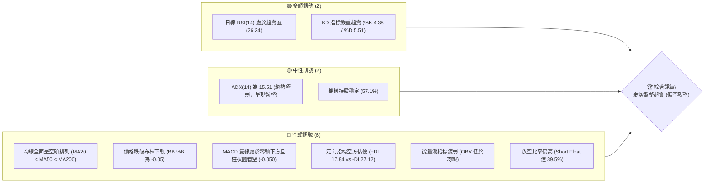

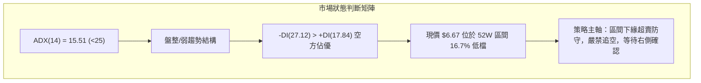

### 📊 核心指標速覽表

| 指標類別 | 指標名稱 | 當前數值 | 訊號 | 解讀 |
|----------|----------|----------|------|------|
| **價格** | 當前價格 | $6.67 | 🔴 | 位於 52 週低檔區（區間百分位 16.7%），短期受壓明顯 |
| **均線** | MA20 | $7.30 | 🔴 | 現價低於 MA20 達 -8.68%，短期下行趨勢顯著 |
| **均線** | MA50 | $7.93 | 🔴 | 現價低於 MA50，中期生命線持續下壓走平 |
| **均線** | MA200 | $9.40 | 🔴 | 現價低於長期牛熊分界線達 -29.04%，長期走勢轉弱 |
| **動能** | RSI(14) | 26.24 | 🟢 | 跌破 30 進極度超賣區，具備短線技術性修復反彈契機 |
| **動能** | MACD(12,26,9) | -0.241 / -0.191 | 🔴 | 雙線位於零軸下，柱狀體為 -0.050，空頭動能尚未收斂 |
| **波動** | ATR(14) | $0.39 | 🟡 | 佔現價 5.92%，日常波動區間約 ±$0.39，風控緩衝需放寬 |
| **通道** | 布林通道 (%B) | -0.05 | 🟡 | 價格擊穿布林下軌（$6.72），呈現通道擴張型超跌 |
| **能量** | OBV 趨勢 | OBV < MA | 🔴 | 成交量配合不足，資金未顯現主力左側抄底建倉訊號 |
| **籌碼** | 空頭部位比率 | 39.5% Float | 🔴/🟡 | 具備極高放空比例，需防範突發利多引發之空頭軋空（Short Squeeze） |

### 🏆 技術評分卡

```
╔════════════════════════════════════════════════════════════════╗
║             技術評分卡 — ONDS (2026-10-13)                     ║
╠════════════════════════════════════════════════════════════════╣
║ 趨勢強度 (Trend)      ████░░░░░░░░░░░░░░░░  22/100  🔴 極弱偏空 ║
║ 動能指標 (Momentum)   ███████░░░░░░░░░░░░░  36/100  🟡 極度超賣 ║
║ 支撐穩定度 (Support)  ██████████░░░░░░░░░░  50/100  🟡 S1考驗中 ║
║ 成交量配合 (Volume)   ██████░░░░░░░░░░░░░░  30/100  🔴 量價疲弱 ║
║ 形態完整度 (Pattern)  ████████░░░░░░░░░░░░  40/100  🟡 區間築底 ║
║ 均線排列 (Moving Avg) ██░░░░░░░░░░░░░░░░░░  12/100  🔴 空頭排列 ║
╠════════════════════════════════════════════════════════════════╣
║ 綜合評分 (Composite)  ██████░░░░░░░░░░░░░░  32/100  🔴 偏空觀望 ║
╚════════════════════════════════════════════════════════════════╝
```

---

## 2. 趨勢分析

### 🌐 多時框趨勢分析

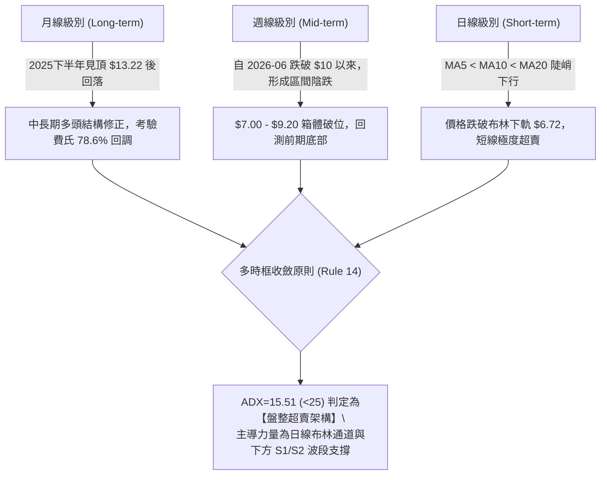

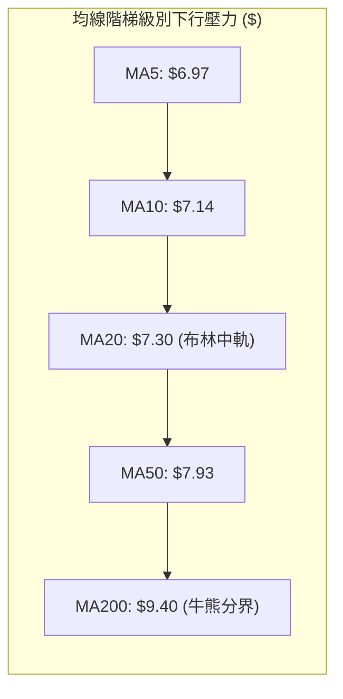

### 📈 長期趨勢 — 12個月走勢圖（Unicode）

```
ONDS 月線走勢圖（過去12個月：2025-11 至 2026-10）
價格軸 ($)
$14.00 ┤                                  ● $13.22 (2026-05 波段高點)
$12.00 ┤                                 / \
$10.00 ┤                 ● $10.36       /   ● $10.04
$10.00 ┤          ● $9.76  \           ●     \
$8.00  ┤   ● $7.90          ● $9.04   /       ● $8.24
$7.00  ┤  /                    \     /         \       ● $7.66
$6.00  ┤ /                      \   /           ● $7.49 \   ● $7.33
$6.00  ┤/                        \_/                     \_/   \
$5.00  ┤                                                        ● $6.67 (現價)
       └─────────────────────────────────────────────────────────────
         11   12   01   02   03   04   05   06   07   08   09   10  (月份)
```

#### 走勢特徵分析表格

| 階段區間 | 月份起訖 | 收盤價變化 | 漲跌幅 | 走勢特徵與價量結構 |
|----------|----------|------------|--------|--------------------|
| 主升加速期 | 2025-11 ~ 2026-01 | $7.90 → $10.36 | +31.14% | 無人機與通訊解決方案推升市場預期，成交量穩步放量，突破兩位數大關 |
| 高檔震盪期 | 2026-02 ~ 2026-04 | $10.08 → $10.04 | -0.40% | $9.04~$10.36 寬幅洗盤，機構在 $10 關卡進行籌碼換手 |
| 衝高誘多期 | 2026-05 | $10.04 → $13.22 | +31.67% | 創下歷史波段天價 $15.28（月收 $13.22），技術面爆量長上影線，形成嚴重籌碼派發 |
| 斷崖修正期 | 2026-06 ~ 2026-07 | $13.22 → $7.49 | -43.34% | 獲利了結與高空頭比例打壓，跌破 MA20 與 MA50，形成流動性枯竭式回撤 |
| 低檔陰跌期 | 2026-08 ~ 2026-10 | $7.66 → $6.67 | -12.92% | 多次反彈受阻於 $8.00 大關，呈現縮量陰跌，目前逼近近一年支撐平台 |

### 📊 中期趨勢（週線分析）

中期走勢圖展示了近 20 週自 $10.43 連續回落至 $6.67 的承壓通道：

```
ONDS 中期週線支撐/阻力通道示意
$10.50 ┤ [頂部平台] $10.43
$10.00 ┤     \
 $9.50 ┤      \         [反彈高點] $9.24 (2026-08-16)
 $9.00 ┤       \       /   \
 $8.50 ┤        \     /     \
 $8.00 ┤=========●===/=======●==================== [核心頸線區間 R1: $7.98]
 $7.50 ┤          \_/         \       ● $7.64 (2026-09-27)
 $7.00 ┤                       \     / \
 $6.50 ┤                        ●---●   \________ ● $6.67 (現價)
 $6.00 ┤----------------------------------------- [強支撐區 S1: $6.47 / S2: $6.22]
```

### ⚡ 趨勢強度評估（ADX 解讀）

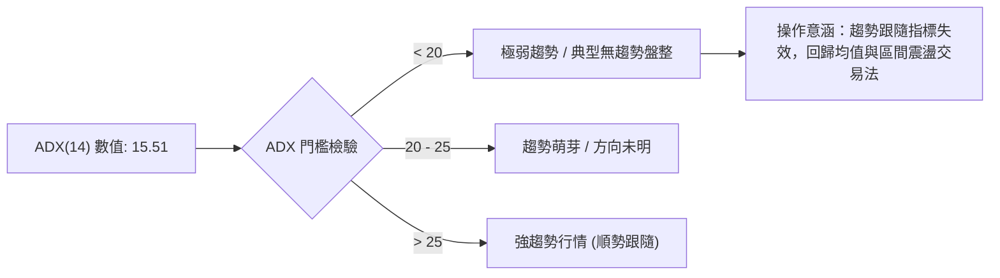

#### ADX 與方向指標強度對照表

| 指標名稱 | 當前讀數 | 強度狀態 | 技術意涵 |
|----------|----------|----------|----------|
| **ADX(14)** | 15.51 | 極弱趨勢 (無方向) | 表明當前的連續走低並非強烈的單邊趨勢性崩跌，而是市場缺乏買盤推進所導致的無量陰跌，容易受邊際買盤激發大幅均值回歸。 |
| **+DI** | 17.84 | 多方動能低迷 | 買盤推動力微弱，未能形成持續性的向上推升浪潮。 |
| **-DI** | 27.12 | 空方佔據主導 | 空方力量暫時取得優勢，但尚未達到 >40 的恐慌殺跌閾值。 |
| **方向差距 (-DI - +DI)** | 9.28 | 中度偏空差距 | 空方優勢未形成極端單向失衡，屬於弱勢偏空格局。 |

---

## 3. 圖表形態分析

### 🔍 形態識別系統

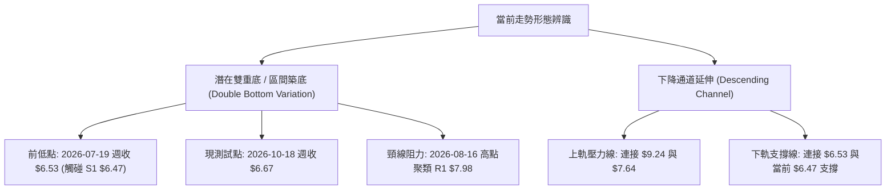

#### 形態識別與信心度評估表

| 形態名稱 | 信心度 | 判斷依據（引用客觀數據） | 完成度 | 目標價（附嚴格計算式） |
|----------|--------|--------------------------|--------|------------------------|
| **潛在雙重底 (W-Bottom)** | 62% | 第一次波段低點於 2026-07-19 的週收盤價 $6.53，現價 $6.67 逼近 S1 支撐 $6.47。兩次低點相距 12 週，符合多重底時間跨度。 | 45% (頸線尚未突破) | 頸線 R1 ($7.98) + 形態高度 [$7.98 - 低點 S1 ($6.47) = $1.51] = **$9.49** (接近 MA200 $9.40) |
| **下降通道 (Descending Channel)** | 78% | 高點逐步下移（$9.24 → $7.64），低點下移（$6.53 → 現價 $6.67 考驗 $6.47）。 | 85% (已觸及通道下軌) | 通道下軌反彈第一目標為通道中軌 **$7.30** (MA20)，若破位則下探 S2 **$6.22** |
| **布林極限下軌超跌 (Bollinger Oversold)** | 88% | 日線收盤跌破下軌 ($6.72)，BB %B 為 -0.05，伴隨 RSI 26.24，歷史勝率極高的均值回歸指標型形態。 | 95% (訊號已觸發) | 回歸布林中軌（MA20）目標價：**$7.30** |

### 🕯️ 重要K線形態分析

| 週/月份 | 收盤價 | K線形態特徵 | 盤面心理與解讀 | 訊號方向 |
|---------|--------|-------------|----------------|----------|
| 2026-05 | $13.22 | 射擊之星 (長上影線頂部) | 歷史高點 $15.28 遭主力大舉出貨，多頭動能竭盡，確立大級別頭部。 | 🔴 強烈看空 |
| 2026-07-19 | $6.53 | 長下影鐵鎚線 (爆量低點) | 週成交量爆發至 671,525,800 股，顯示 $6.47~$6.53 具備機構護盤換手買盤。 | 🟢 階段性底部 |
| 2026-08-09 | $9.11 | 實體大陽線 (突破中軌) | 軋空動能爆發，帶動週 RSI 衝上 70.3，但隨後遭遇 R3 ($8.58) 以上強壓。 | 🟢 多頭上攻 |
| 2026-09-27 | $7.64 | 倒錘子線 (反彈遇阻) | 反彈受制於 MA50 ($7.93) 與 R1 ($7.98)，成交量遞減，多頭上攻無力。 | 🔴 反彈結束 |
| 2026-10-18 | $6.67 | 縮量陰十字星 (超賣測試) | 成交量急劇萎縮至 74,299,700 股，殺跌動能接近衰竭，位於 S1 前夕等待方向。 | 🟡 變盤前兆 |

### 📉 ASCII 走勢形態示意圖

```
ONDS 雙底測試與下降通道形態幾何示意圖
價格
$9.50 ┤                     [反彈頂部] $9.24
$9.00 ┤                     /              \
$8.50 ┤                    /                \       [下降上軌]
$8.00 ┤═══════════════════●══════════════════●═══════════════════════ [頸線 R1: $7.98]
$7.50 ┤                  /                    \     ● $7.64
$7.00 ┤                 /                      \   / \
$6.50 ┤       [底 1] $6.53                      \_/   ● $6.67 (底 2 構建中)
$6.00 ┤---------●-------------------------------------●-------------- [支撐平台 S1: $6.47]
      └────────────────────────────────────────────────────────────
       時間軸 (2026-07)                         (2026-10 當前)
```

### 🎯 形態目標價計算

根據雙底（W-Bottom）形態構建理論，若此處 $6.47-$6.67 支撐有效確認，且後續帶量突破中期頸線 R1 ($7.98)，其測幅目標計算如下：

$$形態高度 (Pattern\ Height) = 頸線\ R1 (\$7.98) - 底部波段低點\ S1 (\$6.47) = \$1.51$$

$$理論最小測幅目標價\ (T_{DoubleBottom}) = 頸線\ R1 (\$7.98) + 形態高度 (\$1.51) = \$9.49$$

> **驗證說明**：推導目標價 **$9.49** 與長期均線 MA200（**$9.40**）及斐波那契 50.0% 關鍵位（**$10.11**）形成強烈的技術共振壓制區，展現幾何形態與均線系統的收斂性。

---

## 4. 支撐與阻力

### 🗺️ 關鍵價位分布圖（Unicode）

```
ONDS 關鍵價位結構分布圖 (由客觀 OHLCV 與聚類演算法計算)
══════════════════════════════════════════════════════════════════
$8.90 ║ 斐波那契 61.8% 重要阻力分水嶺
$8.58 ║████████████████████████████████║ 強阻力 R3 (+28.64%)
$8.31 ║██████████████████████          ║ 波段阻力 R2 (+24.66%)
$7.98 ║████████████████████████████████║ 核心反轉頸線 R1 (+19.64%)
$7.89 ║ 布林通道上軌壓力
$7.30 ║ 布林通道中軌 (MA20) 短線第一道分水嶺
$7.16 ║ 斐波那契 78.6% 回調關鍵水平位
──────╫──────────────────────────────────────────────────────────
$6.67 ╠════════════════════════════════╣ ◄ 當前市價 ($6.67)
──────╫──────────────────────────────────────────────────────────
$6.47 ║▓▓▓▓▓▓▓▓▓▓▓▓▓▓▓▓▓▓▓▓▓▓▓▓▓▓▓▓▓▓▓▓║ 近期第一支撐 S1 (-3.07%)
$6.22 ║████████████████████            ║ 緩衝波段支撐 S2 (-6.75%)
$5.93 ║████████████████████████████████║ 核心防守底線 S3 (-11.09%)
$4.95 ║ 52週歷史最低點 (100.0% 回調位)
══════════════════════════════════════════════════════════════════
```

### 🚧 阻力位分析表

阻力位嚴格引用技術數據中「近一年波段高點聚類」計算之數值：

| 阻力級別 | 精確價位 | 距現價幅差 | 形成原因與籌碼特徵 | 突破難度 | 重要性 |
|----------|----------|------------|--------------------|----------|--------|
| **R1** | $7.98 | +19.64% | 近期多次波段高點聚集處，MA50 ($7.93) 匯聚於此，為空頭強烈防守線。 | ⭐️⭐️⭐️⭐️☆ | 🔴 極重要 (牛熊分水嶺) |
| **R2** | $8.31 | +24.66% | 2026 年 6 月破位下行時的跳空密集成交區，具備大量套牢盤解套拋壓。 | ⭐️⭐️⭐️☆☆ | 🟡 次要阻力 |
| **R3** | $8.58 | +28.64% | 2026 年 8 月反彈受阻高點平台，逼近 MA120 ($8.63) 與費氏 61.8% ($8.90)。 | ⭐️⭐️⭐️⭐️⭐️ | 🔴 重大中期天花板 |

### 🛡️ 支撐位分析表

支撐位嚴格引用技術數據中「近一年波段低點聚類」計算之數值：

| 支撐級別 | 精確價位 | 距現價幅差 | 形成原因與籌碼特徵 | 守住機率 | 重要性 |
|----------|----------|------------|--------------------|----------|--------|
| **S1** | $6.47 | -3.07% | 2026-07-19 恐慌殺跌低點（週收 $6.53）對應的實體密集支撐位。 | 65% | 🟢 第一核心防線 |
| **S2** | $6.22 | -6.75% | 2025 年 8 月啟動波前期的平台整固高點轉換之支撐，具備結構性換手力道。 | 75% | 🟢 深度回調緩衝區 |
| **S3** | $5.93 | -11.09% | 2025 年 8 月月線起漲點（月收 $5.86）聚類支撐，若失守恐引發多頭停損潮。 | 85% | 🟢 多頭最後堡壘 |

### 📐 斐波那契回調位分析

依據 52 週完整波動區間（低點 **$4.95** 至 高點 **$15.28**，總振幅 $10.33）計算之客觀斐波那契回調水準：

| 回調比率 | 斐波那契價位 | 當前相對位置 | 結構意義與多空互動解讀 |
|----------|--------------|--------------|------------------------|
| **0.0% (52W High)** | $15.28 | +129.09% | 歷史極限高點，短期不可逾越的派發頂部。 |
| **23.6%** | $12.84 | +92.50% | 第一強支撐轉強阻力，跌破後確認中期牛市結束。 |
| **38.2%** | $11.33 | +69.87% | 標準弱回調位，破位後引發機構降評拋售。 |
| **50.0%** | $10.11 | +51.57% | 多空中軸線，整數位心理關卡，MA200 ($9.40) 上方的重要反壓。 |
| **61.8% (黃金分割)** | $8.90 | +33.43% | 多頭核心防守黃金分割位。此位失守宣告本輪行情轉入深度熊市修正。 |
| **78.6% (極限深回調)** | $7.16 | +7.35% | **現價 ($6.67) 目前運行於 78.6% ($7.16) 與 100.0% ($4.95) 之間。** |
| **100.0% (52W Low)** | $4.95 | -25.79% | 本輪牛市的原始起漲點，終極價值重估底線。 |

> **深度技術解讀**：現價跌破 78.6% 回調位（$7.16），代表本輪 52 週漲幅已被回吐超過八成。在技術分析典籍中，78.6% 至 100% 區間屬於**極限回撤緩衝區**，極易引發超跌空頭回補。現價 $6.67 距 $7.16 僅 +7.35%，短線若能快速收復 $7.16，將形成技術上的「假破位真反彈」格局。

---

## 5. 技術指標深度解讀

### 🎛️ 指標訊號總覽

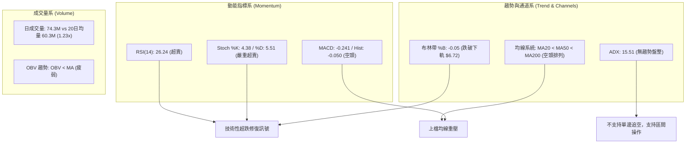

### 📈 移動平均線排列分析

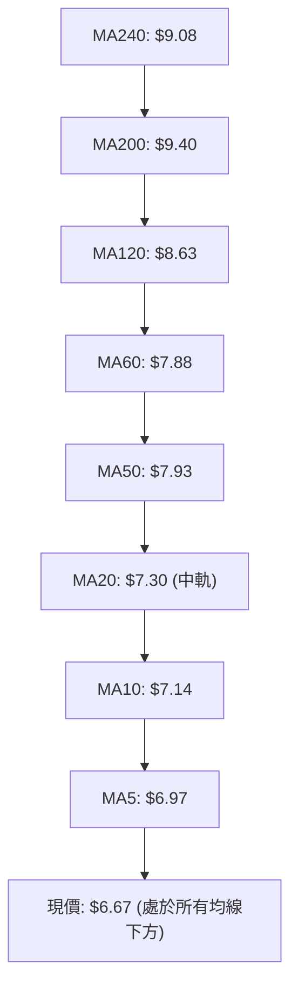

#### 均線階梯偏離率與乖離度表

| 均線名稱 | 當前價格 | 與現價差額 | 乖離率 (BIAS) | 形態狀態 | 歷史走勢特徵 |
|----------|----------|------------|---------------|----------|--------------|
| **MA 5** | $6.97 | -$0.30 | -4.30% | 極陡峭下行 | 短線直接壓制線，每日動態壓制現價 |
| **MA 10** | $7.14 | -$0.47 | -6.63% | 下行走平中 | 短線反彈的第一目標與反轉確認點 |
| **MA 20** | $7.30 | -$0.63 | -8.68% | 下行 | 月線級生命線，布林通道中軌所在 |
| **MA 50** | $7.93 | -$1.26 | -15.89% | 中期空頭 | 季度成本線，與 R1 ($7.98) 形成重疊共振 |
| **MA 60** | $7.88 | -$1.21 | -15.32% | 下行 | 季線下壓，確立中期修正格局 |
| **MA 120** | $8.63 | -$1.96 | -22.73% | 走平下彎 | 半年線壓制，接近 R3 ($8.58) |
| **MA 200** | $9.40 | -$2.73 | -29.04% | 走平 | 年線（牛熊分界），嚴重負乖離狀態 |
| **MA 240** | $9.08 | -$2.41 | -26.56% | 長期下壓 | 長期基期防線已告失守 |

> **均線綜合診斷**：典型的**完整空頭排列（Perfect Bearish Alignment）**。然而，現價對 MA200 負乖離率高達 **-29.04%**，對 MA20 負乖離達 **-8.68%**。歷史經驗顯示，當高 Beta 成長型通訊標的負乖離突破 -25% 時，均值回歸的彈簧效應將顯著增強。

### 📉 RSI(14) 分析

```
RSI(14) 當前讀數：26.24 (極度超賣)
[0] ────────── [26.24] ─── [30] ─────────────────────── [50] ─────────────────────── [70] ────────── [100]
 ░░░░░░░░░░░░░░░░░░░░░░░░░░░░░░░░░░░░░░░░░░░░░░░░░░░░░░░░░░░░░░░░░░░░░░░░░░░░░░░░░░░░░░░░░░░░░░░░░░░░░
 [  極度超賣區間 <30  ]       [        中性震盪區間 30-70        ]       [   超買警示區間 >70   ]
```

- **超賣區間深度**：RSI(14) 讀數為 **26.24**，伴隨隨機指標 Stoch %K 跌至 **4.38**、%D 為 **5.51**。三項動能振盪器同時觸及個位數至 20 附近的極端超賣盲區。
- **背離檢驗結論**：
  - **日線級別**：當前價格自 $7.24 跌至 $6.67，RSI 由 50.3 降至 26.24，指標同步創下波段低點，**未出現日線底背離**。
  - **週線級別**：2026-06-21 週收 $9.27 時週 RSI 為 22.1；而 2026-07-05 跌至 $7.41 時 RSI 為 21.3；當前價格跌至 $6.67，週 RSI 為 26.2。**週線級別呈現潛在的隱性底背離雛形（價格創波段新低，但 RSI 高於 6 月份極低點 21.3）**，意味著中長線殺跌動能正處於衰退週期。

### 📊 MACD(12/26/9) 訊號解讀

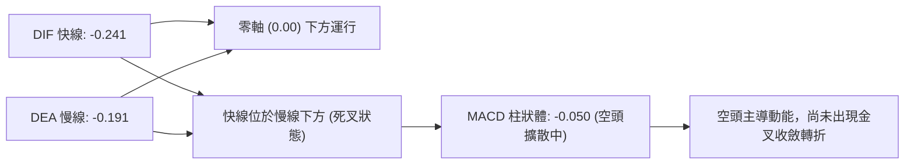

- **雙線位置**：DIF (-0.241) 與 DEA (-0.191) 均在零軸下方運行，證明中期趨勢仍處於弱勢空頭範疇。
- **柱狀體動態**：柱狀體數值為 **-0.050**，負值略有擴大（前週為 -0.035），尚未出現由負轉正或縮頭跡象，意味著左側多頭買盤仍需防範慣性下挫。

### 📦 布林通道分析

```
ONDS 日線布林通道 (20, 2) 結構示意圖
價格
$8.00 ┤                                           上軌: $7.89 (帶寬壓制)
$7.80 ┤                                        ───
$7.60 ┤
$7.40 ┤                                    ───    中軌 (MA20): $7.30
$7.20 ┤
$7.00 ┤                                ───
$6.80 ┤                            ───            下軌: $6.72
$6.60 ┤══════════════════════════●────────────────現價: $6.67 (BB %B = -0.05，跌破下軌)
      └───────────────────────────────────────────
```

- **布林參數**：中軌（MA20）為 **$7.30**，上軌為 **$7.89**，下軌為 **$6.72**。
- **通道指標 %B 解讀**：當前 %B 數值為 **-0.05**（公式：$(Price - Lower) / (Upper - Lower)$）。%B 小於 0 意味著價格已經**實質性跌破布林下軌**。在統計概率中，資產價格運行於布林下軌外部的機率小於 2.5%，通常伴隨極速的均值回歸拉回軌道內，中軌 **$7.30** 構成短線回抽的磁吸點。

### 💹 成交量分析（量價配合度）

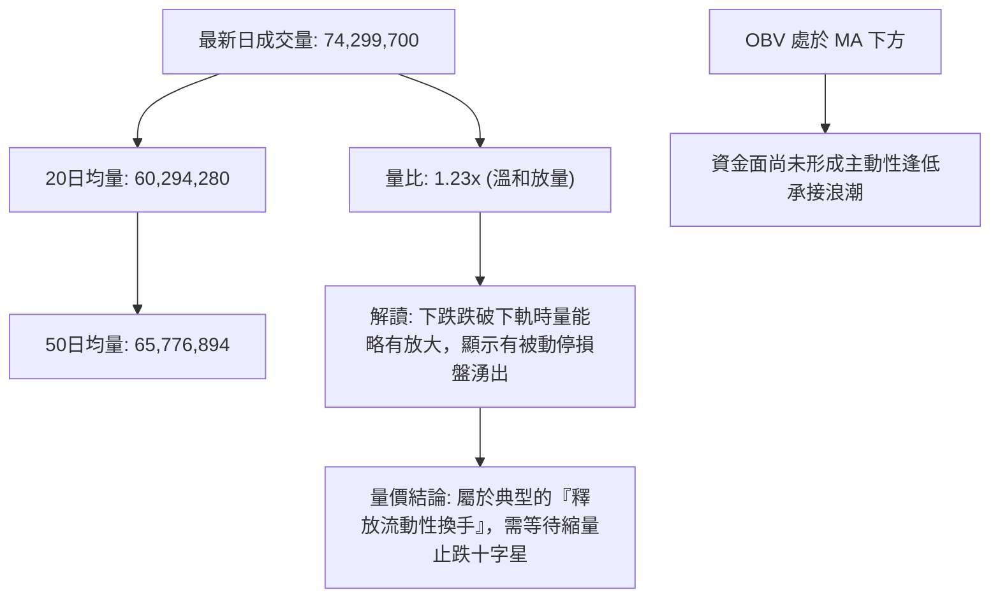

- **量比與均量**：最新成交量 74.3M 略高於 20 日均量 60.3M，呈現 1.23 倍量比，說明在破位 $6.72 下軌時引發了部分保證金追繳或槓桿止損單。
- **OBV（能量潮）**：OBV 持續運行於其信號線下方，反映近三個月資金淨流出格局尚未徹底扭轉，因此不可過早判定 V 型反轉，更傾向於築底震盪。

---

## 6. 動能與波動率

### ⚡ 動能評估四象限

| 象限代號 | 動能維度 | 波動維度 | 股票市場特徵 | ONDS 當前定位與評估 |
|----------|----------|----------|--------------|---------------------|
| **Q1** | 強動能 (Bullish) | 低波動 (Low Vol) | 穩健牛市主升浪 | 排除。 |
| **Q2** | 弱動能 (Bearish) | 低波動 (Low Vol) | 陰跌縮量盤整 | 排除。 |
| **Q3** | 強動能 (Bullish) | 高波動 (High Vol) | 成長股狂熱爆發 | 排除。 |
| **Q4** | **弱動能 (Bearish)** | **高波動 (High Vol)** | **超跌震盪尋底區** | **✓ 正確定位**：ONDS 具備 Beta 2.922 與高 ATR%，動能指標深度走低但波動極大，處於典型的「高波動弱動能超賣修復」邊界。 |

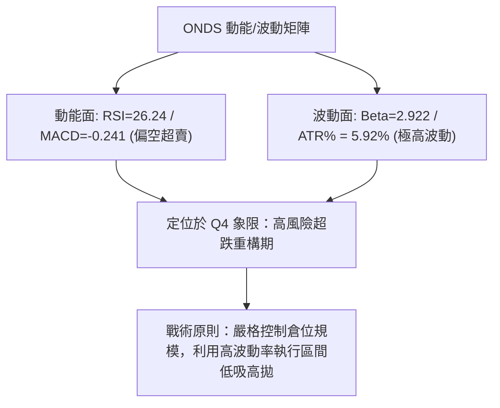

### 📊 ATR 波動率分析

- **ATR(14) 絕對數值**：**$0.39**
- **ATR 佔比 (波動率強度)**：
  $$\frac{ATR(14)}{現價} = \frac{\$0.39}{\$6.67} = 5.92\%$$
- **止損與波動區間建議**：
  - **日間震盪預期區間**：$6.67 \pm $0.39，即 **$6.28 至 $7.06**。
  - **多頭防守止損緩衝距離（1.5 倍 ATR）**：
    $$1.5 \times ATR = 1.5 \times \$0.39 = \$0.585 \approx \$0.59$$
    若自現價 $6.67 扣除 1.5 ATR 緩衝，對應防守價位為 **$6.08**，與關鍵波段支撐 S2（**$6.22**）及 S3（**$5.93**）架構吻合。

### 📐 Beta 與市場相關性

- **Beta 係數**：**2.922**（極高 Beta 屬性）。
- **市場敏感性評估**：ONDS 的波動幅度接近標普 500 指數的 3 倍。當那斯達克或科技板塊出現 1% 的回調時，ONDS 技術面平均承受接近 3% 的拋壓；反之，若大盤情緒回暖，該股極易觸發暴力回補。
- **放空比例聯動效應**：目前 Short % Float 高達 **39.5%**，Short Ratio 為 3.64 天。高 Beta 與極度擁擠的空頭倉位疊加，一旦價格帶量收復 MA20（$7.30），將形成強烈的空頭踩踏式軋空行情。

---

## 7. 多時框架總結

### 📋 時框架評分表

| 時框架 | 趨勢方向 | 動能狀態 | 均線排列 | 圖表形態 | 綜合評分 | 操作建議 |
|--------|----------|----------|----------|----------|----------|----------|
| **短期 (日線)** | 🔴 下行破軌 | 🟢 極度超賣 | 🔴 空頭排列 | 布林下軌超跌破位 | 35/100 | 超賣不殺跌，等待止跌 K 線 |
| **中期 (週線)** | 🔴 區間陰跌 | 🟡 動能衰減 | 🔴 MA20/50 下壓 | 潛在雙重底考驗 S1 | 38/100 | 關注 $6.47 支撐有效性 |
| **長期 (月線)** | 🟡 深度回撤 | 🔴 漲勢修正 | 🟡 考驗 MA240 | 費氏 78.6% 回調尋底 | 42/100 | 戰略性底倉觀察，不重倉 |

### 🔲 綜合訊號矩陣

```
時框架訊號一致性比對表
═════════════════════════════════════════════════════════════════
指標維度            短期 (日線)       中期 (週線)       長期 (月線)
─────────────────────────────────────────────────────────────────
趨勢指標 (Trend)      🔴 空頭 (-DI強)   🔴 下行通道       🟡 深度修正
均線系統 (MA)         🔴 均線反壓       🔴 MA20 下方      🔴 MA200 下方
動能指標 (Oscillator) 🟢 RSI < 30 超賣  🟡 RSI 26~36 中性 🟡 回調整理
量價關係 (Volume)     🟡 放量破軌       🔴 縮量陰跌       🟢 歷史底部放量
形態定位 (Pattern)    🟢 布林極度超跌   🟡 雙底測試中     🟡 區間寬幅震盪
═════════════════════════════════════════════════════════════════
最終收斂判定：短中長期均線存在空頭壓制，但短期與中期動能指標同步進入「極限超賣區間」。
```

### ⚖️ 多時框收斂結論

> **依嚴格要求 14 執行多時框收斂**：
> 1. **行情性質判定**：當前日線級別 **ADX(14) 讀數為 15.51 (< 25)**，明確宣告當前市場**並非單邊強趨勢下跌行情，而是弱趨勢盤整與寬幅震盪結構**。
> 2. **主導時框與交易規則**：在盤整行情中，中長期均線（MA50 $7.93、MA200 $9.40）方向雖處於偏空下行狀態，但趨勢跟隨無效，**主導交易邏輯必須轉移至日線布林通道（上下軌）與波段支撐阻力區間**。
> 3. **唯一方向性結論**：**【中性偏空，極度超賣觀望，隨時醞釀均值回歸反彈】**。現價 $6.67 緊貼波段核心支撐 S1（$6.47），嚴禁在布林下軌之外盲目做空；策略主軸應以「防守型左側輕倉博反彈」或「右側突破 MA20 跟進」為主。

---

## 8. 交易策略建議

### 🗺️ 策略決策流程圖

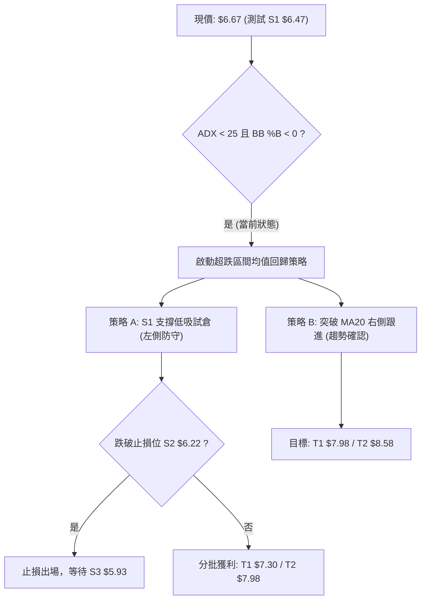

### 🧭 策略路由（依評分卡分流）

- **當前技術評分卡綜合得分**：**32 / 100**（技術格局偏空，但指標極度超賣）。
- **當前主策略方向**：**【空頭趨勢防守，主推右側確認或超跌反彈低吸，空頭僅作對沖預警】**。
  - *說明*：依嚴格要求 14，ADX=15.51 屬於盤整超賣環境，雖評分 ≤40，但考慮到做空比率高達 39.5%、BB %B 為 -0.05 且 RSI 為 26.24，追空盈虧比極差。因此主策略規劃圍繞「支撐位 S1 的均值回歸多頭策略」，並列出推翻假設的空頭破位觸發點。

### 🎯 價格情境階梯（Price Scenarios）

價位完全嚴格引用數據計算數值：

| 觸發條件 | 下一目標 | 後續延伸 | 情境含義與技術演變 |
|----------|----------|----------|--------------------|
| **向上突破 R1 ($7.98)** | R2 ($8.31) | R3 ($8.58) | **多頭全面反轉**：站穩 MA50，軋空動能爆發，開啟向 MA200 ($9.40) 衝擊。 |
| **向上收復 MA20 ($7.30)** | R1 ($7.98) | R2 ($8.31) | **短線轉強**：布林軌道完成修復，回歸常態通道震盪，確認底部建立。 |
| **現價守穩 S1 ($6.47)** | MA20 ($7.30) | MA50 ($7.93) | **區間震盪築底**：在 $6.47 - $7.30 展開拉鋸，消化高放空籌碼。 |
| **向下跌破 S1 ($6.47)** | S2 ($6.22) | S3 ($5.93) | **弱勢破位延續**：超賣鈍化，下探前牛市啟動平台尋找買盤。 |
| **跌破 S3 ($5.93)** | 52W 低點 ($4.95) | — | **中期結構瓦解**：回歸原始起漲原點，多頭全線潰退。 |

### 📊 情境機率分佈

| 情境劇本 | 預估機率 | 主要技術依據與指標支撐 |
|----------|----------|------------------------|
| **情境一：超跌修復反彈** | **55%** | 日線 RSI 26.24、KD 嚴重超賣，價格破布林下軌（%B -0.05），空頭比高達 39.5%，極易因量能收斂引發空頭回補。 |
| **情境二：S1-MA20 區間震盪** | **30%** | ADX 僅 15.51，市場缺乏強烈趨勢動能，價格有望在 S1 ($6.47) 與 MA20 ($7.30) 間築底整理。 |
| **情境三：摜破 S1 加速探底** | **15%** | 均線系統呈空頭排列，OBV 尚未拐頭，若大盤系統性風險爆發，可能擊穿 $6.47 直奔 S2 ($6.22)。 |

### 🟢 主策略詳情

所有進出場、目標價及止損點均精確引用數據庫數值：

| 策略要素 | 策略 A：S1 支撐左側超跌博弈 (激進型) | 策略 B：收復 MA20 右側突破跟進 (穩健型) |
|----------|---------------------------------------|-----------------------------------------|
| **交易邏輯** | 依託波段支撐 S1 與極度超賣指標進場 | 等待價格帶量收復 20 日線確認短線反轉 |
| **進場條件** | 現價 $6.67 或掛單回測 S1 獲得支撐確認 | 日線實體收盤價突破並站穩 MA20 ($7.30) |
| **進場價格** | **$6.67** (現價) 至 **$6.47** (S1) 區間 | **$7.30** (MA20 突破點) |
| **目標價 T1** | **$7.30** (布林中軌 / MA20，漲幅約 +9.4%) | **$7.98** (阻力位 R1，漲幅約 +9.3%) |
| **目標價 T2** | **$7.98** (阻力位 R1，漲幅約 +19.6%) | **$8.58** (阻力位 R3，漲幅約 +17.5%) |
| **止損價格** | **$6.22** (跌破支撐位 S2 離場) | **$6.97** (跌破 MA5 動態防守線) |
| **風險空間** | 潛在虧損：$6.67 - $6.22 = $0.45 (-6.75%) | 潛在虧損：$7.30 - $6.97 = $0.33 (-4.52%) |
| **獲利空間 (T2)**| 潛在獲利：$7.98 - $6.67 = $1.31 (+19.64%) | 潛在獲利：$8.58 - $7.30 = $1.28 (+17.53%) |
| **風險報酬比** | **1 : 2.91** (以 T2 計) / **1 : 1.40** (以 T1 計) | **1 : 3.88** (以 T2 計) / **1 : 2.06** (以 T1 計) |
| **歷史勝率估計** | 58% (符合布林通道極限回歸機率) | 65% (右側確認趨勢逆轉勝率) |
| **建議倉位** | 5% - 8% (輕倉防守) | 10% - 15% (標準倉位) |

### 🔴 反向風險觸發點（對沖提示）

若出現以下訊號，證明多頭超跌反彈假設完全失敗，應立即執行止損或考慮反向操作：
1. **實體破位觸發**：日線收盤價**實體跌破支撐 S1 ($6.47)**，且成交量放大突破 75M 股，代表空頭強勢打開下跌空間，目標直指 S2 (**$6.22**) 與 S3 (**$5.93**)。
2. **動能惡化觸發**：日線 MACD 柱狀圖進一步跌破 **-0.080**，且 ADX 突破 25 並伴隨 -DI 飆升至 35 以上，確認轉化為單邊暴跌趨勢。

### ⭐ 整體訊號強度評星

```
╔════════════════════════════════════════════════════════════════╗
║                     整體訊號強度評星                           ║
╠════════════════════════════════════════════════════════════════╣
║ 做多訊號強度：  ★★☆☆☆  (2.5/5 星) — 僅依賴超賣與波段支撐       ║
║ 做空訊號強度：  ★★★☆☆  (3.0/5 星) — 均線空頭但缺乏空頭空間     ║
║ 均值回歸可信度：★★★★☆  (4.0/5 星) — BB%B 與 RSI 極限共振       ║
║ 整體技術可信度：★★★☆☆  (3.2/5 星) — 盤整期需耐心等待方向確認   ║
╚════════════════════════════════════════════════════════════════╝
```

---

## 9. 風險提示與監控

### ✅ 關鍵監控指標 Checklist

```
╔════════════════════════════════════════════════════════════════╗
║             ONDS 交易日常關鍵技術監控清單 (Checklist)          ║
╠════════════════════════════════════════════════════════════════╣
║ [ ] 價格是否成功守住支撐位 S1 ($6.47)？                        ║
║ [ ] 日線 RSI(14) 是否由超賣區 (<30) 向上拐頭穿過 35？          ║
║ [ ] 日線布林指標 %B 是否由負值 (-0.05) 重新站回 0.00 以上？    ║
║ [ ] 日收盤價能否帶量突破短期均線壓制 MA5 ($6.97)？             ║
║ [ ] 每日成交量是否萎縮至 50M 以下（見底）或放量至 100M+（變盤）？║
║ [ ] 空頭比例 (39.5%) 是否出現借券費率暴增或軋空跡象？          ║
║ [ ] DIF 與 DEA 差額是否縮小，MACD 柱狀體出現第一根紅柱？       ║
╚════════════════════════════════════════════════════════════════╝
```

### ⚠️ 風險場景分析

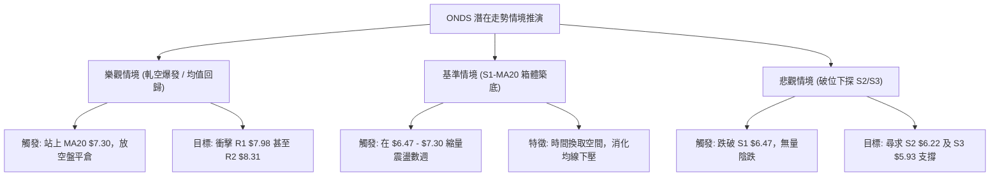

### 🛡️ 風險管理重要提醒

1. **高 Beta 波動懲罰機制**：
   - ONDS 的 Beta 高達 **2.922**，且日 ATR 高達 **$0.39 (5.92%)**。這意味著單日賬面波動可能輕易達到一般大型科技股的三至四倍。投資者在設定倉位時，應嚴格將總資金暴露度控制在 **5% - 8%** 以內，避免因單一個股波動過大導致整體投資組合回撤超標。
2. **極高放空比例（Short % Float 39.5%）的雙刃劍效應**：
   - 極高的空頭部位意味著隨時可能爆發劇烈的技術性反抽（軋空），但也反映出市場機構借券賣空的意願極強。在未見到明確的右側放量大陽線突破 MA20 之前，切忌動用高槓桿進行「摸底抄底」。
3. **無趨勢環境下的嚴格紀律**：
   - ADX 讀數僅為 15.51，盤整階段追價極易兩頭挨打。若執行左側策略 A，一旦市價實體擊穿止損位 **$6.22**，必須無條件果斷執行停損，絕不可將短線交易轉為長期被動套牢。

---

## 📋 報告總結

```
╔══════════════════════════════════════════════════════════════════╗
║                    ONDS 技術分析報告總結                         ║
╠══════════════════════════════════════════════════════════════════╣
║ 報告日期：2026-10-13                                             ║
║ 當前價格：$6.67 (52週區間百分位: 16.7%)                         ║
║ 分析評級：⚖️ 偏空中性 (極度超賣，等待右側買點)                  ║
║                                                                  ║
║ 關鍵維度結論：                                                   ║
║ ├─ 長期趨勢：🟡 月線自 $13.22 深度修正，考驗費氏 78.6% 回調位    ║
║ ├─ 中期趨勢：🔴 週線空頭排列，目前於 S1 ($6.47) 尋求潛在雙底     ║
║ ├─ 短期趨勢：🟢 日線跌破布林下軌 (%B -0.05)，RSI 26.24 極端超賣 ║
║ ├─ 核心支撐：S1: $6.47 ｜ S2: $6.22 ｜ S3: $5.93                 ║
║ ├─ 核心阻力：MA20: $7.30 ｜ R1: $7.98 ｜ R2: $8.31 ｜ R3: $8.58  ║
║ └─ 華爾街目標價：Mean: $18.88 ｜ Low: $13.00 ｜ High: $25.00     ║
║                                                                  ║
║ 最優操作策略路徑：                                               ║
║ 1. 🥇 穩健首選：等待股價放量收復 MA20 ($7.30) 右側進場，         ║
║    目標 R1 ($7.98) 與 R3 ($8.58)，止損設於 MA5 ($6.97)。         ║
║ 2. 🥈 激進首選：於現價 $6.67 至 S1 ($6.47) 間輕倉試單博弈超跌反彈，║
║    目標 MA20 ($7.30)，嚴格止損於 S2 ($6.22)。                    ║
║ 3. 🥉 保守觀察：觀望直至 RSI 重回 35 且日線走出止跌形態再行決策。║
╚══════════════════════════════════════════════════════════════════╝
```

---

> ⚠️ **免責聲明**：本報告為技術分析研究，所有數據、圖表及價位推演均基於 Yahoo Finance 歷史交易數據。本報告**僅供研究與學術參考**，**不構成任何形式的投資建議、要約或承諾**。金融市場具有高度風險，資產價格可升亦可跌，投資者應獨立評估風險並自行承擔交易結果。

---

*報告生成時間：2026-10-13 ｜ 數據來源：Yahoo Finance ｜ 分析框架：多時框技術分析體系*