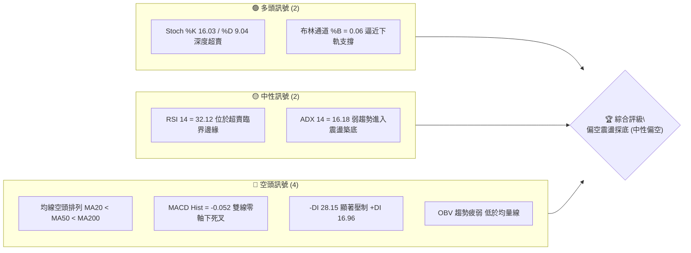
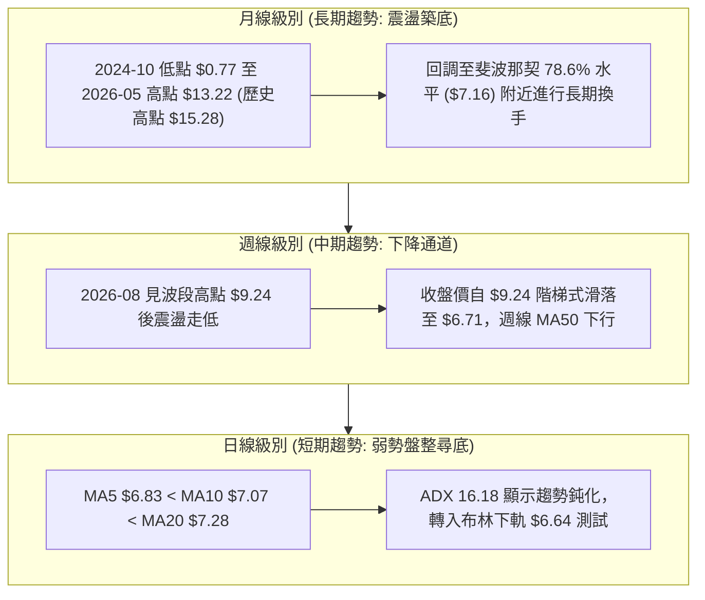
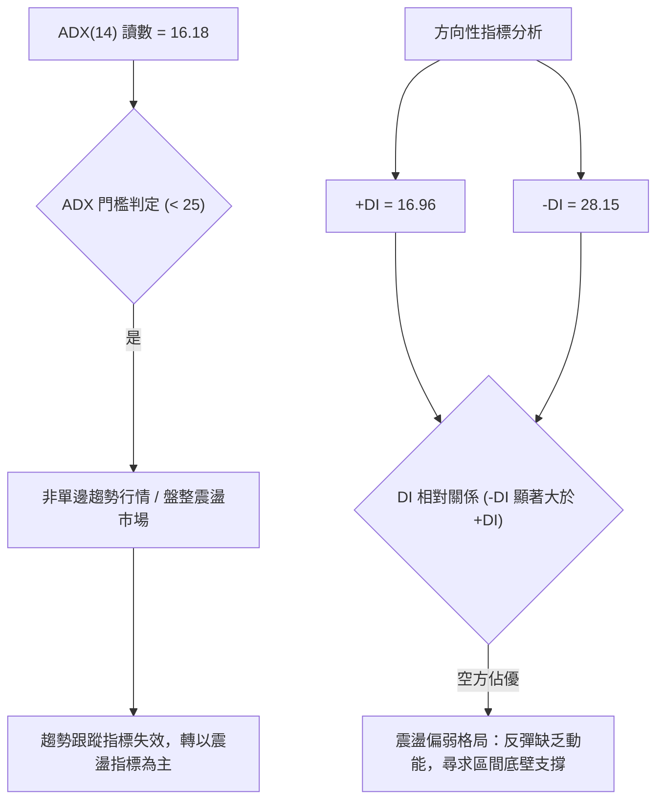
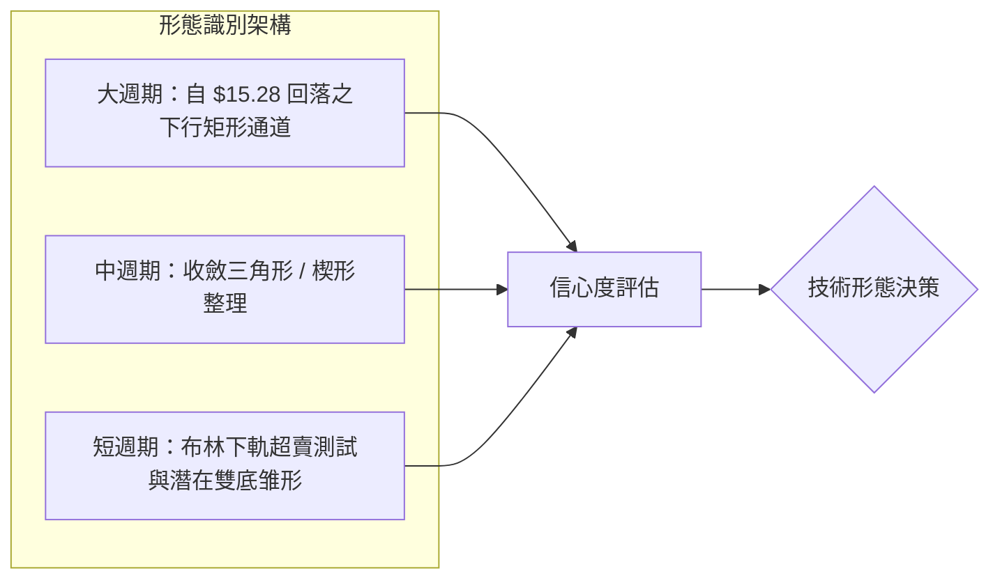
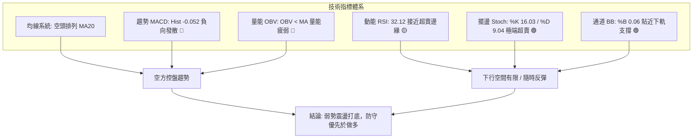
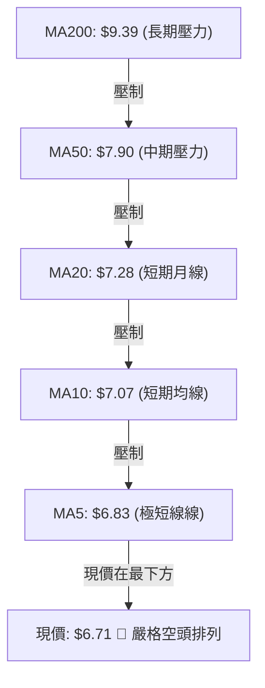
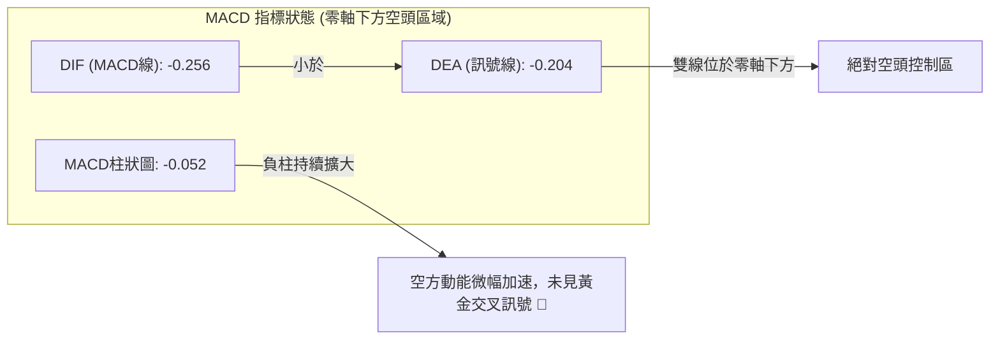
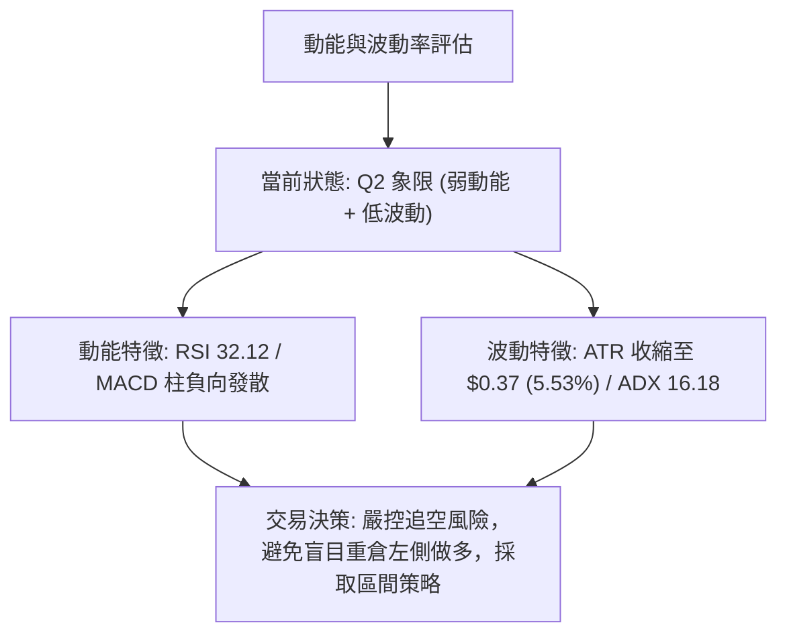
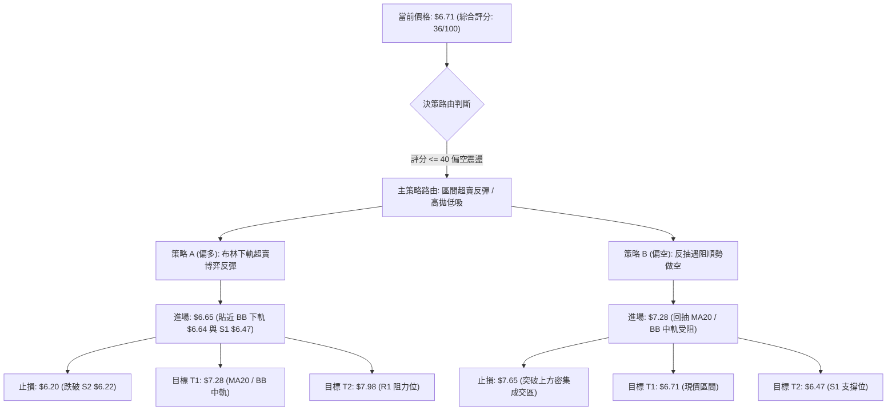
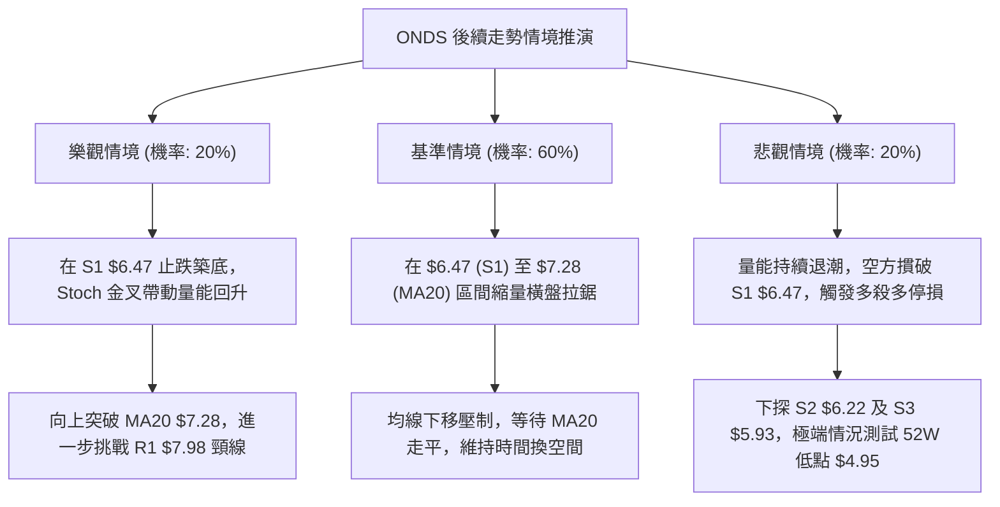

# ONDS 技術分析報告

> **報告日期**：2026-10-14 ｜ **語言**：繁體中文 ｜ **數據來源**：Yahoo Finance ｜ **當前價格**：$6.71

---

## 目錄

| 章節 | 內容 |
|------|------|
| [1. 技術面概覽](#1-技術面概覽) | 訊號儀表板、核心指標、評分卡 |
| [2. 趨勢分析](#2-趨勢分析) | 多時框趨勢、長中短期走勢 |
| [3. 圖表形態分析](#3-圖表形態分析) | 形態識別、K線組合、目標價 |
| [4. 支撐與阻力](#4-支撐與阻力) | 關鍵價位、斐波那契回調 |
| [5. 技術指標深度解讀](#5-技術指標深度解讀) | MA/RSI/MACD/布林/成交量 |
| [6. 動能與波動率](#6-動能與波動率) | 動能評估、ATR、Beta |
| [7. 多時框架總結](#7-多時框架總結) | 時框架評分矩陣 |
| [8. 交易策略建議](#8-交易策略建議) | 多空策略、風險報酬比 |
| [9. 風險提示與監控](#9-風險提示與監控) | 監控指標、風險場景 |

---

## 1. 技術面概覽

### 🎯 技術訊號儀表板



### 📊 核心指標速覽表

| 指標類別 | 指標名稱 | 當前數值 | 訊號 | 解讀 |
|----------|----------|----------|------|------|
| **價格** | 當前價格 | $6.71 | 🔴 | 位於52週區間17.0%低檔，短期承壓 |
| **均線** | MA20 | $7.28 | 🔴 | 價格低於MA20達-7.80%，短線受制於月線阻力 |
| **均線** | MA50 | $7.90 | 🔴 | 價格低於MA50達-15.06%，中期下降通道維持 |
| **均線** | MA200 | $9.39 | 🔴 | 價格低於MA200達-28.54%，長期牛熊分界線失守 |
| **動能** | RSI(14) | 32.12 | 🟡 | 接近30臨界值，空頭動能減速但未見明確反轉背離 |
| **動能** | MACD(12,26,9) | -0.256 / -0.204 | 🔴 | MACD Hist為-0.052，負向柱體發散，空方控盤 |
| **震盪** | Stochastic(14) | %K 16.03 / %D 9.04 | 🟢 | 進入極端超賣區，存在均值回歸與技術性反彈需求 |
| **趨勢** | ADX(14) | 16.18 | 🟡 | 數值低於25，代表當前非單邊趨勢，屬於盤整尋底行情 |
| **通道** | Bollinger Bands | 上$7.92 / 中$7.28 / 下$6.64 | 🟢 | %B為0.06，貼近下軌，短期下行空間受到通道壓縮 |
| **波動** | ATR(14) | $0.37 (5.53%) | 🟡 | 波動率收窄，顯示空方摜壓力道放緩，波幅收斂 |
| **量能** | OBV & 量比 | 70.45M / 1.17x | 🔴 | OBV < MA，成交量雖微幅放大但仍受制於籌碼沉澱期 |

### 🏆 技術評分卡

```
╔══════════════════════════════════════════════════════════════╗
║               技術評分卡 — ONDS (2026-10-14)                  ║
╠══════════════════════════════════════════════════════════════╣
║ 趨勢強度 (Trend)     ████░░░░░░░░░░░░░░░░  22/100 🔴 弱勢空頭 ║
║ 動能指標 (Momentum)  ██████░░░░░░░░░░░░░░  32/100 🔴 空方主導 ║
║ 支撐穩定度 (Support) ████████████░░░░░░░░  60/100 🟡 S1前防守 ║
║ 成交量配合 (Volume)  ████████░░░░░░░░░░░░  40/100 🟡 量能疲弱 ║
║ 形態完整度 (Pattern) ██████████░░░░░░░░░░  50/100 🟡 區間收斂 ║
║ 均線排列 (MAs)       ██░░░░░░░░░░░░░░░░░░  12/100 🔴 嚴格空排 ║
╠══════════════════════════════════════════════════════════════╣
║ 綜合評分 (Overall)   ███████░░░░░░░░░░░░░  36/100 🔴 偏空震盪 ║
╚══════════════════════════════════════════════════════════════╝
```

---

## 2. 趨勢分析

### 🌐 多時框趨勢分析



### 📈 長期趨勢 — 12個月走勢圖（Unicode）

```
ONDS 月線走勢圖（過去12個月：2025-11 至 2026-10）
價格軸 ($)
$14.00 ┤                                      ● ($13.22, 05月)
$13.00 ┤                                     ╱ ╲
$12.00 ┤                                    ╱   ╲
$11.00 ┤                    ● ($10.36)     ╱     ╲
$10.00 ┤         ● ($9.76) ╱ ╲            ╱       ╲
$ 9.00 ┤        ╱         ╱   ● ($9.04)──●($10.04) ╲
$ 8.00 ┤● ($7.90)       ● ($10.08)                  ● ($8.24)
$ 7.00 ┤                                             ╲  ● ($7.66)
$ 6.00 ┤                                              ●───●──● ($6.71)←現價
       └─────────────────────────────────────────────────────────
         11   12   01   02   03   04   05   06   07   08   09   10 (月份)
         2025年 ───►  2026年
```

#### 走勢特徵分析表格

| 階段區間 | 起止月份 | 價格變動 | 漲跌幅 | 結構特徵與技術含義 |
|----------|----------|----------|--------|--------------------|
| 主升擴展段 | 2025-11 → 2026-01 | $7.90 → $10.36 | +31.14% | 連續突破整數關卡，成交量同步放大，奠定中長線多頭基礎 |
| 高檔箱型整理 | 2026-01 → 2026-04 | $10.36 → $10.04 | -3.09% | 於 $9.04 - $10.36 間寬幅震盪，多空籌碼激烈換手 |
| 爆發衝頂段 | 2026-04 → 2026-05 | $10.04 → $13.22 | +31.67% | 月線收盤創下週期新高 $13.22（52W高點達 $15.28），動能耗盡見頂 |
| 快速殺跌段 | 2026-05 → 2026-06 | $13.22 → $8.24 | -37.67% | 單月重挫，摜破多道均線支撐，高檔套牢籌碼沉重 |
| 陰跌築底段 | 2026-06 → 2026-10 | $8.24 → $6.71 | -18.57% | 波動率逐步收窄，價格向 52W 低點 $4.95 與 S1 $6.47 靠攏 |

### 📊 中期趨勢（週線分析）

中期走勢呈現「階梯式走低」特徵。在 2026-08-16 創出反彈次高點 $9.24（對應當時週 RSI 達 60.5、週 MACD 柱狀為 +0.171）後，買盤後繼無力。隨後連續 8 週呈現弱勢回調，週收盤價由 $9.24 依序滑落至 $8.71、$7.90、$7.62、$7.23、$7.39、$7.64、$7.24、$6.73，最終來到當前週線低點 $6.71。

```
中期週線支撐阻力結構圖 (2026-08 至 2026-10)
$9.50 ┤          ● ($9.24, 08-16 波段次高點)
$9.00 ┤         ╱ ╲
$8.50 ┤        ╱   ● ($8.71)
$8.00 ┤       ╱     ╲   ● ($7.90) ─── [阻力 R1: $7.98]
$7.50 ┤      ╱       ╲ ╱ ╲     ● ($7.64)
$7.00 ┤     ╱         ●   ●   ╱ ╲   ● ($6.73)
$6.50 ┤────● ($6.53) ───────────────────● ($6.71) ◄ 現價
$6.00 ┤                                  └─── [支撐 S1: $6.47]
```

### ⚡ 趨勢強度評估（ADX 解讀）



#### ADX 強度對照表

| 指標變數 | 當前數值 | 參考臨界線 | 狀態解讀 |
|----------|----------|------------|----------|
| **ADX(14)** | **16.18** | 25.00 | **弱趨勢 / 盤整**：低於 20 屬於極弱趨勢，單邊空頭下殺動能已鈍化 |
| **+DI** | **16.96** | 20.00 | **多方力道微弱**：買盤動能不足以發動持續性升勢 |
| **-DI** | **28.15** | 25.00 | **空方控盤壓制**：空頭力量依然居於上風，維持價格重心向下壓迫 |
| **DI 差值** | **-11.19** | 0.00 | **空頭掌控權**：淨方向動能仍偏負向，限制反彈幅度 |

---

## 3. 圖表形態分析

### 🔍 形態識別系統



#### 形態信心度評估表

| 形態名稱 | 信心度 | 判斷依據（引用數據） | 完成度 | 目標價（附計算式） |
|----------|--------|----------------------|--------|--------------------|
| **下降收斂通道** | **85%** | 自 2026-05 高點 $13.22 與 52W 高點 $15.28 回落，近期受阻於 R1 $7.98，底部受限於 S1 $6.47 與 52W 低點 $4.95 | 90% | 通道破位/反轉測算：突破 MA20 ($7.28) 則測試通道上軌 R1 $7.98；若失守下軌則測試 S2 $6.22 |
| **潛在雙重底 (W底)** | **45%** | 2026-07-19 低點為 $6.53，當前價格 $6.71 逼近波段支撐 S1 $6.47，兩點形成潛在支撐聚類 | 35% | 頸線為波段反彈高點 R1 $7.98，形態高度 = $7.98 - $6.47 = $1.51。突破頸線目標價 = $7.98 + $1.51 = **$9.49**（信心度不足50%，僅供指標參考） |
| **布林帶下軌壓縮形態** | **80%** | BB %B 達 0.06，收盤價 $6.71 緊貼 BB 下軌 $6.64，帶寬收窄 | 85% | 均值回歸目標價為 BB 中軌（MA20）= **$7.28** |

### 🕯️ 重要K線形態分析

| 週度日期 | 收盤價 | K線形態 | 解讀 | 訊號 |
|----------|--------|---------|------|------|
| **2026-07-19** | $6.53 | 長下影錘子線探底 | 成交量激增至 6.71 億股，創波段低位大換手，探底確認 | 🟢 多頭抵抗 |
| **2026-07-26** | $7.80 | 大陽線實體反包 | 單週成交量爆發至 8.34 億股，RSI 迅速拉升至 49.8，多頭主力介入 | 🟢 強烈買訊 |
| **2026-08-09** | $9.11 | 突破性長陽衝高 | RSI 飆升至 70.3，週 MACD 柱狀擴大至 +0.252，短期動能見頂 | 🟡 衝高滯漲 |
| **2026-08-30** | $7.90 | 陰包陽破位中陰線 | 失守 $8.00 關卡，RSI 驟降至 35.4，MACD 翻負 (-0.117)，轉入空頭防守 | 🔴 空方反撲 |
| **2026-09-27** | $7.64 | 弱勢反彈十字星 | 量能 3.75 億股，遇阻於 MA50 ($7.90) 前哨站，反彈夭折 | 🔴 假反彈 |
| **2026-10-18** | $6.71 | 縮量陰跌尋底K線 | 成交量驟降至 1.45 億股，波幅受限，貼近布林下軌 $6.64 尋求買盤 | 🟡 縮量築底 |

### 📉 ASCII 走勢形態示意圖

```
ONDS 下降通道與潛在雙底結構示意圖
價格 ($)
$9.50 ┤                     [頸線區域 / 前高 $9.24]
$9.00 ┤                     ╭───╮
$8.50 ┤                    ╱     ╲      [阻力 R2: $8.31]
$8.00 ┤      [阻力 R1: $7.98]      ╲   ╭─╮
$7.50 ┤        ╭──╮       ╱         ╲ ╱   ╲
$7.00 ┤       ╱    ╲     ╱           ●     ● ($6.71) ◄ 當前位置
$6.50 ┤──────● ($6.53)───╯───────────────────┴─ [潛在支撐 S1: $6.47]
$6.00 ┤   (第一隻腳: 07-19)              (第二隻腳測試中)
```

### 🎯 形態目標價計算

根據下降通道與潛在雙底幾何推算：
1. **下降通道反彈目標（高信心度 80%）**：
   - 基準支撐：S1 = $6.47
   - 第一反彈目標（BB 中軌 / MA20）：$7.28
   - 第二反彈目標（下降趨勢上軌 / R1）：$7.98
2. **潛在雙重底測量目標（低信心度 45%，指標型解讀）**：
   - 假定雙底有效成立：低點設為 S1 = $6.47，頸線設為 R1 = $7.98
   - 形態高度 $H = \$7.98 - \$6.47 = \$1.51$
   - 突破目標價 $T = \text{頸線} + H = \$7.98 + \$1.51 = \$9.49$（此價位極度接近 MA200 之 $9.39）

---

## 4. 支撐與阻力

### 🗺️ 關鍵價位分布圖（Unicode）

```
ONDS 價位結構分布圖（引用 OHLCV 計算聚類價位）
═══════════════════════════════════════════════════════════════════════
$ 9.39 ║▓▓▓▓▓▓▓▓▓▓▓▓▓▓▓▓▓▓▓▓▓▓▓▓▓▓▓▓▓▓▓▓║ 長期牛熊線 MA200
$ 8.90 ║▒▒▒▒▒▒▒▒▒▒▒▒▒▒▒▒▒▒▒▒▒▒▒▒▒▒▒▒    ║ 斐波那契 61.8% 回調位
$ 8.58 ║████████████████████████████████║ 強阻力 R3 (+27.87%)
$ 8.31 ║████████████████████            ║ 波段阻力 R2 (+23.92%)
$ 7.98 ║████████████████████████████    ║ 關鍵頸線阻力 R1 (+18.93%)
$ 7.28 ║▒▒▒▒▒▒▒▒▒▒▒▒▒▒▒▒                ║ BB 中軌 / MA20 (第一道反彈考驗)
$ 7.16 ║▒▒▒▒▒▒▒▒▒▒▒▒                    ║ 斐波那契 78.6% 回調位
$ 6.71 ╠════════════════════════════════╣ ◄ 當前市價 ($6.71)
$ 6.64 ║░░░░░░░░░░░░                    ║ BB 下軌動態支撐
$ 6.47 ║▓▓▓▓▓▓▓▓▓▓▓▓▓▓▓▓▓▓▓▓▓▓▓▓        ║ 近期核心支撐 S1 (-3.65%)
$ 6.22 ║████████████████████████        ║ 強支撐 S2 (-7.30%)
$ 5.93 ║████████████████████████████████║ 極限防守支撐 S3 (-11.62%)
$ 4.95 ║▓▓▓▓▓▓▓▓▓▓▓▓▓▓▓▓▓▓▓▓▓▓▓▓▓▓▓▓▓▓▓▓║ 52週歷史低點 (100.0% 回調位)
═══════════════════════════════════════════════════════════════════════
```

### 🚧 阻力位分析表

所有價位精確引用自數據模型：

| 阻力級別 | 價位 | 形成原因 | 突破難度 | 重要性 |
|----------|------|----------|----------|--------|
| **R1** | **$7.98** | 近一年波段高點聚類；與 MA50 ($7.90) 及 BB 上軌 ($7.92) 形成強力三重共振壓制帶 | ⭐️⭐️⭐️⭐️☆ (極高) | 🔴 極重要：多空分水嶺，未突破前中期空頭架構不變 |
| **R2** | **$8.31** | 近一年波段密集換手套牢區，2026-06 月線收盤 ($8.24) 之上頸線壓力 | ⭐️⭐️⭐️☆☆ (中高) | 🟡 中度：短線獲利回吐點 |
| **R3** | **$8.58** | 波段反彈高點聚類，緊鄰 MA120 ($8.60)，籌碼解套沉重拋壓區 | ⭐️⭐️⭐️⭐️☆ (高) | 🔴 高度重要：代表中級反轉行情之壓力極限 |

### 🛡️ 支撐位分析表

所有價位精確引用自數據模型：

| 支撐級別 | 價位 | 形成原因 | 守住機率 | 重要性 |
|----------|------|----------|----------|--------|
| **S1** | **$6.47** | 近一年波段低點聚類；與 2026-07-19 週線探底低點 ($6.53) 形成支撐防線 | 65% | 🟢 極重要：短線多頭防守核心，失守將引發停損賣壓 |
| **S2** | **$6.22** | 次級波段低點聚類，前期橫盤整理箱體中軸 | 75% | 🟡 中度：跌破 S1 後之緩衝區間 |
| **S3** | **$5.93** | 近一年強支撐聚類，整數心理關卡 $6.00 下方之最後密集籌碼防線 | 85% | 🟢 強烈支撐：長期多頭最後護城河，破位直指 $4.95 |

### 📐 斐波那契回調位分析

依據 52 週完整波段（低點 $4.95 → 高點 $15.28，波幅 $10.33）計算：

| 斐波那契回調層級 | 價位 | 現價相對位置 | 技術意涵解讀 |
|------------------|------|--------------|--------------|
| **0.0% (52W High)** | **$15.28** | +127.72% | 週期極限頂部，歷史獲利了結天花板 |
| **23.6%** | **$12.84** | +91.36% | 強勢回調防線，已於 2026-06 跌破 |
| **38.2%** | **$11.33** | +68.85% | 景氣回撤位，失守確認上升主浪結束 |
| **50.0%** | **$10.11** | +50.67% | 均衡中樞，多空主控權轉換點 |
| **61.8%** | **$8.90** | +32.64% | 黃金分割防守位，當前已淪為中期沉重阻力 |
| **78.6%** | **$7.16** | +6.71% | **關鍵回調位**：現價落於 78.6% ($7.16) 與 100.0% ($4.95) 之間 |
| **100.0% (52W Low)**| **$4.95** | -26.23% | 週期原點，長期終極支撐平台 |

**解讀**：現價 $6.71 處於 78.6%（$7.16）與 100.0%（$4.95）之區間。跌破 78.6% 代表前波上漲動能遭到深度侵蝕，技術面上屬於「深度回撤」走勢。目前空方已接近獲利了結區，若能於 S1 $6.47 止跌並收復 $7.16，則可確認此波深度洗盤結束。

---

## 5. 技術指標深度解讀

### 🎛️ 指標訊號總覽



### 📈 移動平均線排列分析



#### 均線偏離度分析表

| 均線週期 | 當前價格 | 均線價位 | 乖離距離 ($) | 乖離率 (%) | 均線趨勢斜率 | 技術意涵 |
|----------|----------|----------|--------------|------------|--------------|----------|
| **MA 5** | $6.71 | $6.83 | -$0.12 | -1.76% | ▼ 下行 | 極短線受壓，每日價格重心下移 |
| **MA 10** | $6.71 | $7.07 | -$0.36 | -5.05% | ▼ 下行 | 快速扣高，短期反彈第一壓力帶 |
| **MA 20** | $6.71 | $7.28 | -$0.57 | -7.80% | ▼ 下行 | 月線生命線下行，布林中軌壓制 |
| **MA 60** | $6.71 | $7.87 | -$1.16 | -14.78% | ▼ 下行 | 季線阻力強烈，中期趨勢偏空 |
| **MA 120** | $6.71 | $8.60 | -$1.89 | -21.94% | ▼ 下行 | 半年線持續下壓，大週期套牢沉重 |
| **MA 240** | $6.71 | $9.08 | -$2.37 | -26.12% | ▼ 下行 | 年線壓制，長期多頭結構破壞 |
| **MA 200** | $6.71 | $9.39 | -$2.68 | -28.54% | ▼ 下行 | 牛熊分界線遙遠，回歸牛市需重大催化劑 |

### 📉 RSI(14) 分析

```
RSI(14) 動能強度表：
當前讀數：32.12
[0] ────────── [30] ──────●──── [50] ────────── [70] ────────── [100]
     極端超賣        超賣邊界  現價      多空中樞        超買警戒
進度條：██████░░░░░░░░░░░░░░ 32.12% (接近超賣臨界區)
```

- **背離分析判斷**：
  - **日線級別**：當前 RSI(14) 讀數為 32.12，價格創出近期回調低點 $6.71。對比歷史數據，並**無明顯底背離**現象，亦無頂背離跡象。
  - **週線動能對照**：2026-06-28 至 2026-07-05 期間週線 RSI 曾低達 21.3 - 21.8，隨後帶動強彈至 $9.24。當前週線 RSI 降至 32.1，動能下行動能減速，雖未形成背離，但逼近前次反彈之動能觸底區。

### 📊 MACD(12/26/9) 訊號解讀



- **MACD 解讀**：
  - MACD 線 (-0.256) 與信號線 (-0.204) 均深處於零軸下方，且兩者差距擴大，柱狀圖為 -0.052。
  - 週線 MACD 柱狀由 2026-09-27 之 +0.062 再次轉負至當前之 -0.052，確認中期反彈夭折，重新由空頭主導節奏。操作上不可提早盲目摸底。

### 📦 布林通道分析

```
ONDS 日線布林通道結構示意圖 (帶寬收窄中)
$8.00 ┤─────────────────────────── $7.92  BB 上軌 (空頭反彈強壓)
$7.70 ┤
$7.50 ┤
$7.30 ┤─────────────────────────── $7.28  BB 中軌 (MA20 / 均值回歸線)
$7.00 ┤
$6.70 ┤═══════════════════════════ $6.71  現價 (位於 %B = 0.06 位置)
$6.60 ┤─────────────────────────── $6.64  BB 下軌 (當前動態支撐)
```

- **布林帶數據解讀**：
  - **上軌**：$7.98 聚類下的 $7.92
  - **中軌 (MA20)**：$7.28
  - **下軌**：$6.64
  - **%B 指標**：$\%B = \frac{6.71 - 6.64}{7.92 - 6.64} = \frac{0.07}{1.28} \approx 0.06$
  - **解讀**：%B 讀數 0.06 表明價格已高度貼近下軌。布林通道帶寬目前受到壓縮（帶寬僅 $1.28），在 ADX < 25 的環境下，通常預示下軌具備顯著彈性支撐，跌破下軌往往會引發均值回歸反抽。

### 💹 成交量分析（量價配合度）

```
量能指標進度條：
成交量相對 20日均量 (量比 1.17x)：████████████░░░░░░░░ 117%
OBV 趨勢強度：                    ████░░░░░░░░░░░░░░░░ 25% (疲弱)
```

- **量價關係解讀**：
  - 最新單日成交量為 70,446,800 股，略高於 20 日均量（60,439,765 股，量比 1.17x），但略低於 50 日均量（66,075,094 股）。
  - 週成交量已由 7 月下旬高達 8.34 億股大幅萎縮至本週的 1.45 億股，呈現典型的「價跌量縮」格局。
  - **OBV 判定**：OBV 持續位於其移動平均線下方，顯示主力資金在近兩個月中仍以撤離或消極觀望為主，未見機構主力積極回補跡象。

---

## 6. 動能與波動率

### ⚡ 動能評估四象限

| 象限代號 | 動能維度 | 波動維度 | 典型特徵 | 當前狀態評估 |
|----------|----------|----------|----------|--------------|
| **Q1** | 強動能 (Bullish) | 低波動 (Low Vol) | 穩定單邊主升 | — |
| **Q2** | 弱動能 (Bearish) | 低波動 (Low Vol) | **沉悶陰跌盤整** | **✓ 當前 ONDS 所在位置 (動能疲弱，波幅收縮)** |
| **Q3** | 強動能 (Bullish) | 高波動 (High Vol) | 暴漲主升爆發 | — (曾於 2026-05 衝頂時出現) |
| **Q4** | 弱動能 (Bearish) | 高波動 (High Vol) | 恐慌崩跌踐踏 | — (曾於 2026-06 暴跌時出現) |



### 📊 ATR 波動率分析

- **ATR(14) 數值**：**$0.37**（佔當前股價之 5.53%）。
- **ATR 應用解讀**：
  - 代表該股每日正常雜訊波動幅度約為 $0.37。
  - **技術止損設定**：為避免被常規市場雜訊洗盤出場，合理停損距離應設定為 $1.5 \times \text{ATR}$ 至 $2.0 \times \text{ATR}$。
    - $1.5 \times \text{ATR} = 1.5 \times \$0.37 = \mathbf{\$0.56}$
    - $2.0 \times \text{ATR} = 2.0 \times \$0.37 = \mathbf{\$0.74}$
  - 若以現價 $6.71 進場，下方保護止損應至少拉開至 $6.71 - $0.56 = **$6.15**，恰好落於強支撐 S2 $6.22 下方，具備高度保護有效性。

### 📐 Beta 與市場相關性

- **Beta 數值**：**2.922**（極高 Beta 屬性）。
- **解讀**：ONDS 屬於高彈性、高風險之成長/軍工通訊概念標的。大盤若下跌 1%，該股理論波動將擴大至近 3%。在當前均線空頭排列背景下，高 Beta 特性意味著下行風險放大，任何總體市場震盪皆可能引發個股超跌。然而，一旦市場情緒好轉，高 Beta 亦能賦予其極強的反彈爆發力。

---

## 7. 多時框架總結

### 📋 時框架評分表

| 時框架 | 趨勢方向 | 動能指標 | 均線排列 | 形態結構 | 綜合評分 | 建議方向 |
|--------|----------|----------|----------|----------|----------|----------|
| **月線 (長期)** | 震盪偏多 | RSI 45 偏中性 | 價格於 MA20 附近換手 | 78.6% 回調尋底 | **55/100** 🟡 | 長線逢低分批佈局 |
| **週線 (中期)** | 偏空下行 | MACD 翻負 / RSI 32 | MA50 壓制向下 | 階梯式走低通道 | **32/100** 🔴 | 順應趨勢，反彈減碼 |
| **日線 (短期)** | 盤整築底 | Stoch 超賣 / %B 0.06 | MA 嚴格空排 | 貼近布林下軌震盪 | **38/100** 🔴 | 區間操作，嚴控止損 |

### 🔲 綜合訊號矩陣

```
時框一致性分析：
────────────────────────────────────────────────────────────────
時框        趨勢    動能    均線    支撐/阻力    一致性結論
────────────────────────────────────────────────────────────────
短期 (日線)  🔴 空   🟢 超賣 🔴 空   🟢 S1 附近    多空分歧 (醞釀反彈)
中期 (週線)  🔴 空   🔴 空   🔴 空   🔴 承壓 R1    高度偏空 (通道下行)
長期 (月線)  🟡 震   🟡 中   🟡 中   🟢 78.6% 回調 偏向中性 (大週期築底)
────────────────────────────────────────────────────────────────
整體矩陣結論：中期與短期空頭訊號佔優，但短線出現極端超賣，下殺動能已鈍化。
```

### ⚖️ 多時框收斂結論

依據多時框收斂原則（規則 14）：
1. **行情性質判定**：當前 ADX(14) 讀數為 **16.18**（顯著小於 25），確認當前市場處於**盤整震盪行情**，而非單邊強趨勢行情。
2. **主導時框與交易區間**：在 ADX < 25 的盤整環境下，趨勢指標（均線空排）容易出現鈍化或假突破。此時交易邏輯以**日線布林通道上下軌**（$6.64 - $7.92）與近期波段聚類支撐阻力（S1 $6.47 至 R1 $7.98）作為核心交易箱體。
3. **唯一收斂方向**：**中性偏空，區間超賣築底**。
   - 儘管週線級別趨勢偏空，但日線已觸及布林下軌（%B=0.06）且隨機指標深度超賣（%K=16.03），盲目殺跌追空風險極高。
   - 策略上定調為：**以防守型區間震盪為主，主策略為短線超賣博弈反彈，空頭則等待反抽阻力位後再行介入**。此結論與第 8 章交易路由完全收斂一致。

---

## 8. 交易策略建議

### 🗺️ 策略決策流程圖



### 🧭 策略路由（依評分卡分流）

**當前主策略方向 = 偏空震盪中的區間防守與超賣修復策略（依技術評分卡：36/100）**
- 評分落於偏空區間（≤40），確立中長期格局依然受制於空方；但因 ADX 僅 16.18 且 Stochastic 極端超賣，嚴禁在 $6.71 現價追空。
- 策略分流為：以低吸博弈均值回歸的「策略 A」作為短線反彈主方案，同時設定「策略 B」作為反抽不破 MA20 時的順勢高空方案。

### 🎯 價格情境階梯（Price Scenarios）

以當前價格 $6.71 為核心，精確引用第 4 章關鍵價位建立情境階梯：

| 觸發條件 | 下一目標 | 後續延伸 | 情境含義 |
|----------|----------|----------|----------|
| **強勢突破 R1 $7.98** | R2 **$8.31** | R3 **$8.58** | 突破三重均線壓制，中級反轉確立，扭轉空頭格局 |
| **突破 MA20 $7.28** | R1 **$7.98** | R2 **$8.31** | 短線均值回歸展開，測試下降通道上軌壓力 |
| **維持現價 $6.71 震盪** | BB中軌 **$7.28** | BB下軌 **$6.64** | 籌碼縮量沉澱，等待基本面催化劑或均線走平 |
| **跌破 S1 $6.47** | S2 **$6.22** | S3 **$5.93** | 短線破位下行，引發恐慌性停損，測試最後箱體 |
| **跌破 S3 $5.93** | 52W低點 **$4.95** | — | 長期牛市防線徹底崩潰，進入漫長熊市尋底 |

### 📊 情境機率分佈

| 情境類別 | 機率預估 | 主要技術指標依據 |
|----------|----------|------------------|
| **情境一：區間震盪築底** | **55%** | ADX 16.18 弱趨勢壓制單邊行情；ATR 收窄至 $0.37；價格受限於 BB 下軌 $6.64 至中軌 $7.28 之間 |
| **情境二：超賣反彈向上** | **30%** | Stochastic 深度超賣 (%K 16.03 / %D 9.04)；%B 達 0.06 極限區；分析師評級維持 Strong Buy 具備逢低承接買盤 |
| **情境三：摜破支撐再探底** | **15%** | 均線嚴格空頭排列；-DI (28.15) 壓制 +DI (16.96)；OBV 仍顯疲弱未現主力大單搶籌 |

### 🟢 主策略詳情

所有價位均嚴格基於數據模型中計算得出之價位：

| 策略要素 | 策略 A（短線超賣博弈反彈） | 策略 B（反彈遇阻順勢波段空） |
|----------|----------------------------|------------------------------|
| **進場條件** | 價格下測 BB 下軌 $6.64 獲支撐且出現分時紅K | 價格反彈至 MA20 / BB 中軌 $7.28 遇阻滯漲 |
| **進場價格** | **$6.65** | **$7.28** |
| **目標價 T1** | **$7.28** (MA20 / BB 中軌，漲幅 +9.47%) | **$6.71** (現價水準，跌幅 -7.83%) |
| **目標價 T2** | **$7.98** (阻力位 R1，漲幅 +20.00%) | **$6.47** (支撐位 S1，跌幅 -11.13%) |
| **止損價格** | **$6.20** (跌破強支撐 S2 $6.22，跌幅 -6.77%) | **$7.65** (突破前次反彈高點聚類，漲幅 +5.08%) |
| **風險報酬比** | **1.40 : 1** (T1) / **2.95 : 1** (T2) | **1.54 : 1** (T1) / **2.19 : 1** (T2) |
| **成功機率** | **55%** | **60%** |
| **建議倉位** | **10% - 15%** (輕倉試探) | **15% - 20%** (順勢波段) |

### 🔴 反向風險觸發點（對沖提示）

- **多頭部位之風控警報**：若日線收盤價**實體跌破 $6.47 (S1)**，代表潛在雙底假設完全失效，必須立即執行嚴格止損，防範價格朝 $6.22 (S2) 及 $5.93 (S3) 快速滑落。
- **空頭部位之對沖警報**：若日線帶量（單日成交量突破 80M 股）突破並站穩 **$7.28 (MA20)**，空頭應減碼；若進一步收復 **$7.98 (R1)**，則宣告中期下降通道突破，所有空單必須全數離場並翻多。

### ⭐ 整體訊號強度評星

```
做多訊號強度：★★☆☆☆  (2/5星 - 僅限極端超賣技術性博弈，缺乏趨勢支撐)
做空訊號強度：★★★☆☆  (3/5星 - 順應大中週期趨勢，但受制於低位空間壓縮)
整體可信度：  ★★★★☆  (4/5星 - 價位聚類與布林指標高度契合，區間清晰)
```

---

## 9. 風險提示與監控

### ✅ 關鍵監控指標 Checklist

```
╔══════════════════════════════════════════════════════════════╗
║               每日/每週技術面關鍵監控清單                     ║
╠══════════════════════════════════════════════════════════════╣
║ [ ] 價格能否守住 S1 關鍵支撐 $6.47 (跌破即觸發止損)           ║
║ [ ] RSI(14) 能否自 32.12 向上突破 40.0 擺脫超賣壓制           ║
║ [ ] Stochastic %K 與 %D 是否在超賣區形成向上金叉 (買訊確認)   ║
║ [ ] 成交量是否突破 20日均量 60.4M (補量方能支持向 $7.28 推進) ║
║ [ ] 日線布林下軌 $6.64 是否開口放大 (預防通道向下發散風險)   ║
║ [ ] ADX(14) 是否突破 25 (若突破且 -DI 走高，代表新一波跌勢啟動)║
╚══════════════════════════════════════════════════════════════╝
```

### ⚠️ 風險場景分析



### 🛡️ 風險管理重要提醒

1. **極高 Beta 與槓桿風險**：ONDS 當前 Beta 高達 **2.922**，且空頭部位佔流通股比例（Short % Float）高達 **39.5%**。高空頭佔比意味著股票具備潛在軋空爆發力（Short Squeeze），但同時也代表機構做空力道沉重。任何突發利空將導致劇烈崩跌，嚴禁使用融資槓桿持倉。
2. **基本面與現金流警訊**：雖然營收年增高達 1235.4%，且在手現金達 13.8 億美元，但營運現金流為負 1.61 億美元，營業利益率為 -166.3%，前瞻本益比仍為負值。技術面弱勢本質上反映了市場對其獲利兌現能力的質疑，交易時必須嚴格執行「技術止損」，不可抱持長線鴕鳥心態越跌越買。
3. **倉位管理紀律**：單一交易策略總倉位不應超過投資組合總資金之 **5% - 10%**。止損幅度嚴格限制在總資產損失的 1% 以內（例如持倉 10%，個股跌破 $6.20 止損 6.77%，對應總資金回撤僅約 0.68%）。

---

## 📋 報告總結

```
╔══════════════════════════════════════════════════════════════╗
║                   ONDS 技術分析報告總結                       ║
╠══════════════════════════════════════════════════════════════╣
║ 報告日期：2026-10-14                                         ║
║ 當前價格：$6.71                                              ║
║ 分析評級：🔴 偏空震盪探底 (技術綜合評分: 36/100)             ║
╠══════════════════════════════════════════════════════════════╣
║ 關鍵結論：                                                   ║
║ ├─ 長期趨勢：🟡 月線自頂部回撤至 78.6% 水平 ($7.16)，進入深洗 ║
║ ├─ 中期趨勢：🔴 週線下降通道未破，受阻於 MA50 ($7.90) 之下   ║
║ ├─ 短期趨勢：🟡 ADX 16.18 弱趨勢，貼近布林下軌 $6.64 尋求防守║
║ ├─ 關鍵支撐：S1 $6.47 ｜ S2 $6.22 ｜ S3 $5.93                ║
║ ├─ 關鍵阻力：MA20 $7.28 ｜ R1 $7.98 ｜ R2 $8.31              ║
║ └─ 機構共識：10位分析師一致評級 Strong Buy，平均目標價 $18.88║
╠══════════════════════════════════════════════════════════════╣
║ 最優策略組合：                                               ║
║ 1. 🥇 最佳機會 (區間博弈)：等待 $6.65 附近低吸，停損設 $6.20 ║
║    目標 T1 看 $7.28 (風報比 1.4:1)，T2 看 $7.98 (風報比 2.9:1)║
║ 2. 🥈 次選機會 (順勢做空)：若反彈至 $7.28 遇阻無力突破，可佈局║
║    波段空單，停損設 $7.65，回補目標看 $6.71 及 $6.47         ║
║ 3. 🥉 保守選擇 (空倉觀望)：等待日線突破並站穩 MA20 ($7.28)，  ║
║    且 MACD 出現零軸下金叉確認後，再行右側順勢進場            ║
╚══════════════════════════════════════════════════════════════╝
```

---

> ⚠️ **免責聲明**：本報告為技術分析研究，所有數據、價位計算及估算均基於市場公開歷史資訊。本報告**僅供研究與學術參考**，**不構成任何要約、招攬或投資建議**。高 Beta 與高空頭佔比標的波動劇烈，投資有風險，入市需獨立審慎評估。

---

*報告生成時間：2026-10-14 ｜ 數據來源：Yahoo Finance ｜ 分析框架：多時框技術分析模型*