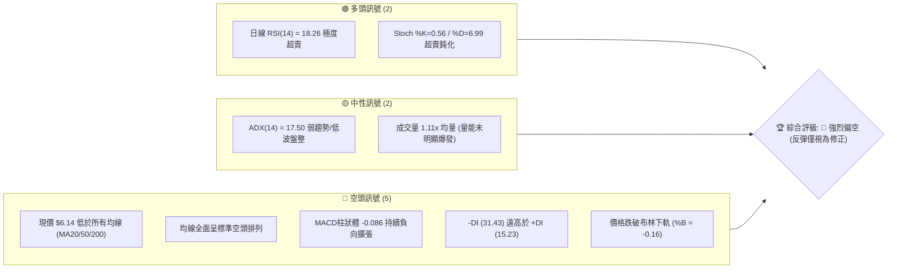
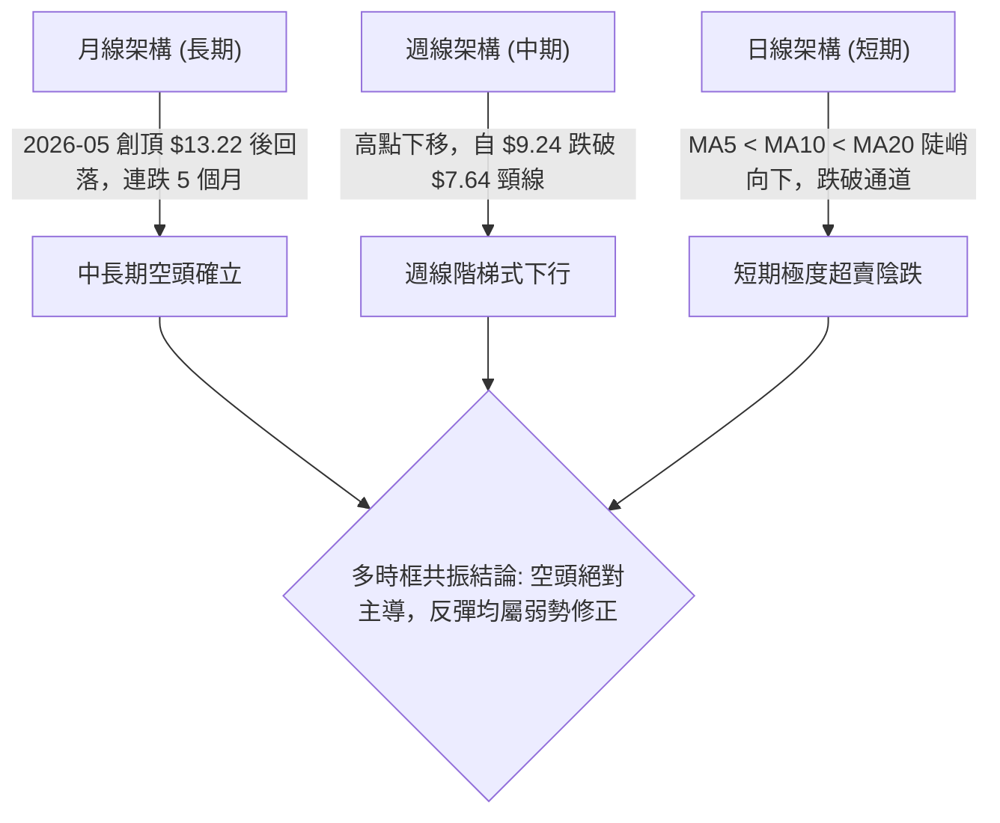
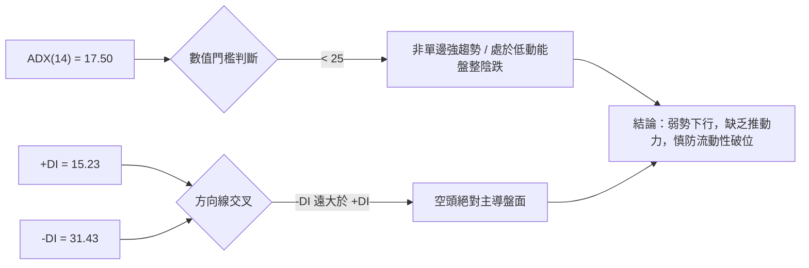
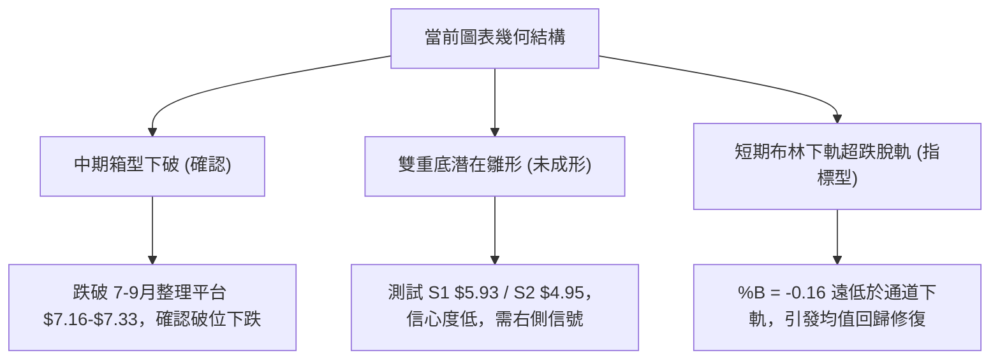
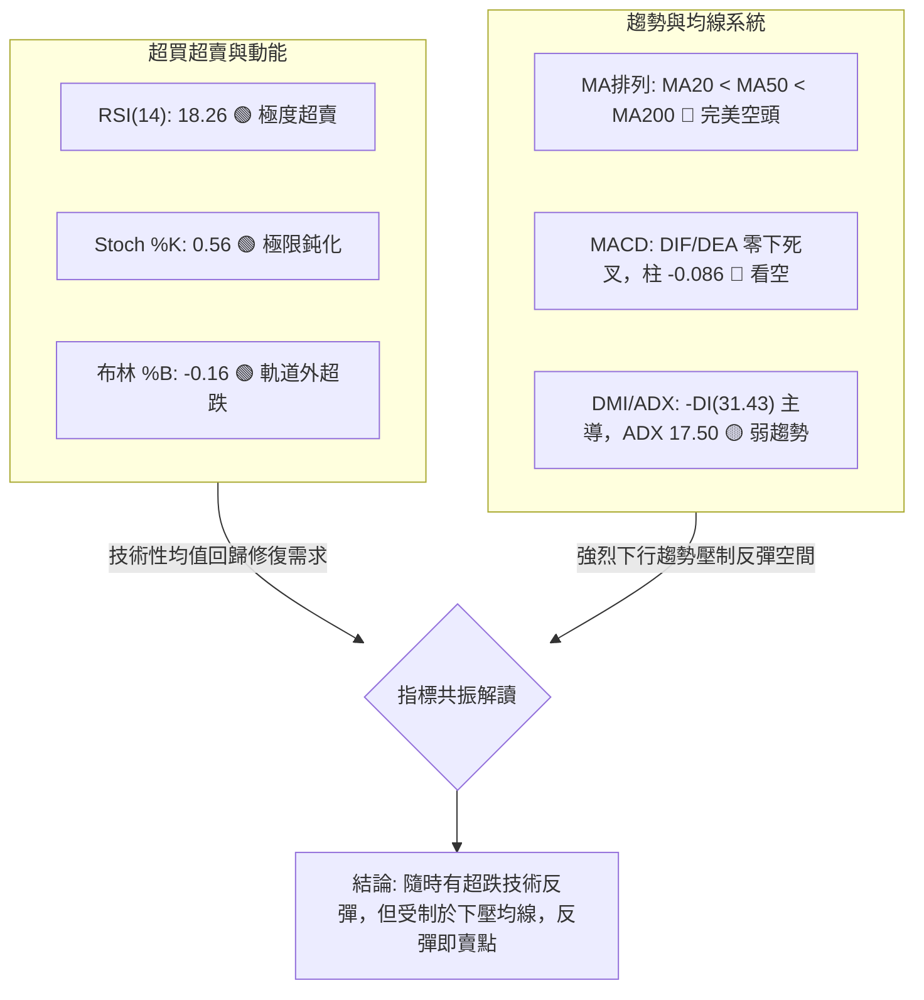
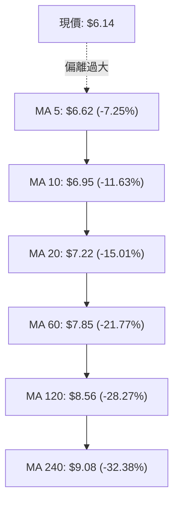
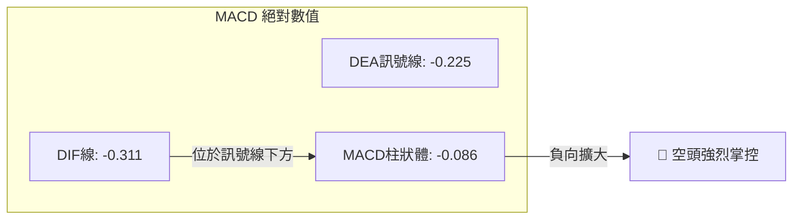
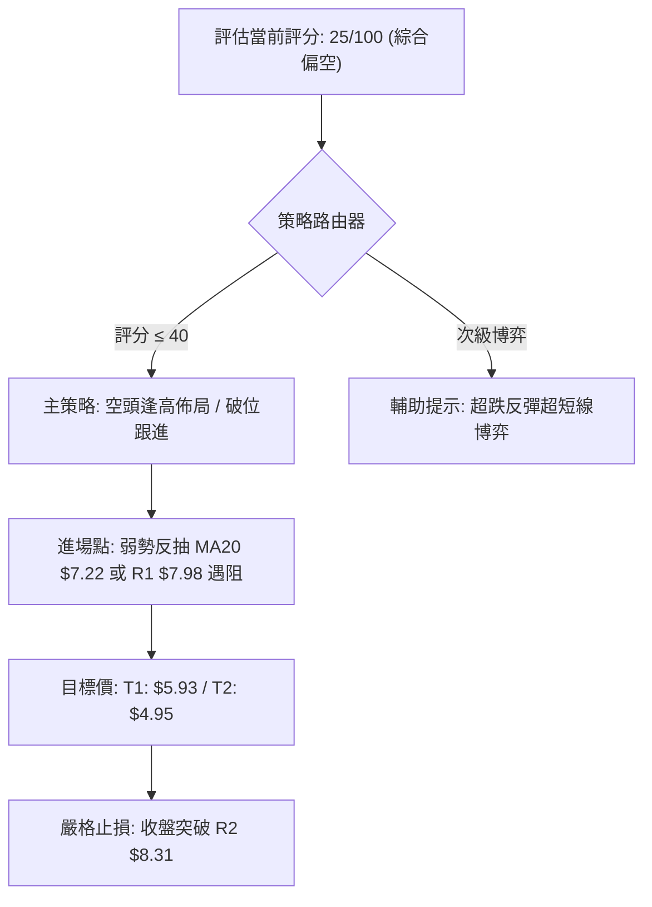
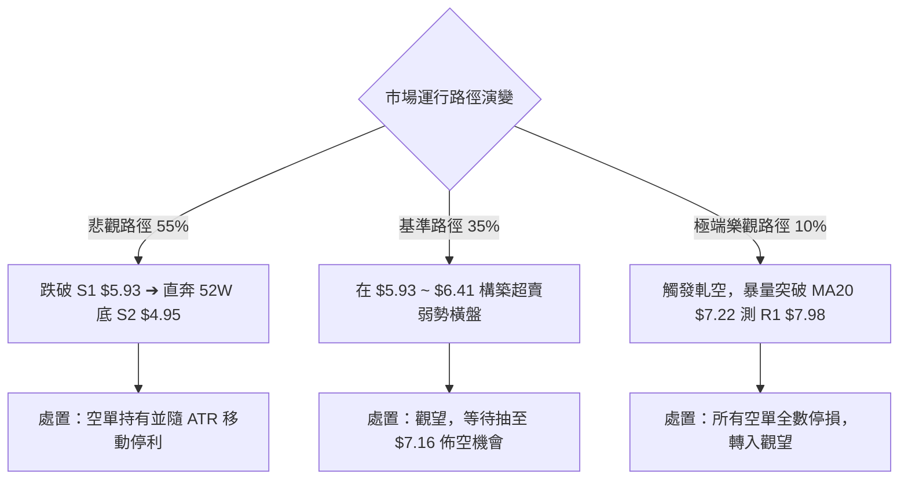

# ONDS 技術分析報告

> **報告日期**：2026-10-15 ｜ **語言**：繁體中文 ｜ **數據來源**：Yahoo Finance ｜ **當前價格**：$6.14

---

## 目錄

| 章節 | 內容 |
|------|------|
| [1. 技術面概覽](#1-技術面概覽) | 訊號儀表板、核心指標、評分卡 |
| [2. 趨勢分析](#2-趨勢分析) | 多時框趨勢、長中短期走勢、ADX強度 |
| [3. 圖表形態分析](#3-圖表形態分析) | 形態識別、K線組合、目標價計算 |
| [4. 支撐與阻力](#4-支撐與阻力) | 關鍵價位分布、斐波那契回調結構 |
| [5. 技術指標深度解讀](#5-技術指標深度解讀) | MA/RSI/MACD/布林/量價綜合分析 |
| [6. 動能與波動率](#6-動能與波動率) | 動能四象限、ATR、Beta與空頭部位風險 |
| [7. 多時框架總結](#7-多時框架總結) | 時框架評分矩陣與優先級收斂結論 |
| [8. 交易策略建議](#8-交易策略建議) | 策略路由、價格階梯、主策略與對沖提示 |
| [9. 風險提示與監控](#9-風險提示與監控) | 監控Checklist、情境路徑、風險控管 |

---

## 1. 技術面概覽

### 🎯 技術訊號儀表板



### 📊 核心指標速覽表

| 指標類別 | 指標名稱 | 當前數值 | 訊號 | 解讀 |
|----------|----------|----------|------|------|
| **價格** | 當前價格 | $6.14 | 🔴 | 位於52週區間的 11.5% 分位，處於極弱勢回落階段 |
| **均線** | MA20 | $7.22 | 🔴 | 現價低於 MA20 達 -15.01%，短線下行斜率陡峭 |
| **均線** | MA50 | $7.84 | 🔴 | 現價低於 MA50 達 -21.68%，中期空方趨勢主導 |
| **均線** | MA200 | $9.38 | 🔴 | 現價低於長期牛熊線達 -34.54%，長期結構破位 |
| **動能** | RSI(14) | 18.26 | 🟢 | 進入極度超賣區（<20），具備強烈技術性修復動能 |
| **動能** | MACD (12,26,9) | -0.311 | 🔴 | 雙線位於零軸下方且 DIF < DEA，柱狀體為 -0.086 看空 |
| **動能** | Stoch %K / %D | 0.56 / 6.99 | 🟢 | 雙線處於極限超賣區，隨時具備低檔金叉反彈潛力 |
| **趨勢** | ADX (14) | 17.50 | 🟡 | 數值 < 25 表明單邊趨勢動能減弱，當前處於盤整陰跌格局 |
| **通道** | 布林帶 %B | -0.16 | 🔴 | 跌破下軌（$6.41），短期呈現超跌脫軌狀態 |
| **波動** | ATR(14) | $0.37 | 🟡 | 佔現價 6.08%，日均波動適中偏大，操作需拉開防守空間 |
| **量能** | OBV 趨勢 | OBV < MA | 🔴 | 資金持續呈現淨流出，量能未能確認價格反轉 |

### 🏆 技術評分卡

```
╔══════════════════════════════════════════════════════════════╗
║                技術評分卡 — ONDS (2026-10-15)                ║
╠══════════════════════════════════════════════════════════════╣
║ 趨勢強度 (Trend)      ████░░░░░░░░░░░░░░░░  20/100 🔴 空頭壓制 ║
║ 動能指標 (Momentum)   ██████░░░░░░░░░░░░░░  30/100 🔴 弱勢超賣 ║
║ 支撐穩定度 (Support)  ████████░░░░░░░░░░░░  40/100 🟡 逼近前低 ║
║ 成交量配合 (Volume)   ██████░░░░░░░░░░░░░░  30/100 🔴 價跌量平 ║
║ 形態完整度 (Pattern)  ████░░░░░░░░░░░░░░░░  20/100 🔴 下行破位 ║
║ 均線排列 (MA System)  ██░░░░░░░░░░░░░░░░░░  10/100 🔴 空頭排列 ║
╠══════════════════════════════════════════════════════════════╣
║ 綜合技術評分          ████░░░░░░░░░░░░░░░░  25/100 🔴 強烈偏空 ║
╚══════════════════════════════════════════════════════════════╝
```

---

## 2. 趨勢分析

### 🌐 多時框趨勢分析



### 📈 長期趨勢 — 12個月走勢圖（Unicode）

```
ONDS 月線收盤走勢圖（2025-11 至 2026-10）
價格軸 ($)
$13.22 ┤                                      ● (52W高點波段)
$12.00 ┤                                     / \
$10.80 ┤                 ● (2026-01)        /   \
$9.60  ┤           ●────/ \     ● (2026-04) /     \
$8.40  ┤          /        \   /           /       ● (2026-06)
$7.20  ┤    ●────/          \─/                   │  ●──●──● (7-9月盤整)
$6.00  ┤────┘                                     └───     └──● $6.14 (現在)
       └───────────────────────────────────────────────────────────
         11   12   01   02   03   04   05   06   07   08   09   10  (月份)
```

#### 走勢特徵分析表格

| 階段區間 | 時間跨度 | 起點/終點價格 | 區間漲跌幅 | 主要技術特徵與成交量解讀 |
|:---|:---|:---|:---|:---|
| **單邊推升期** | 2025-11 ~ 2026-01 | $7.90 → $10.36 | +31.14% | 連續放量陽線，均線多頭發散，市場預期轉向樂觀 |
| **高位箱型震盪** | 2026-01 ~ 2026-04 | $10.36 → $10.04 | -3.09% | 在 $9.00~$10.40 構築箱型平台，籌碼進行充分換手 |
| **末端誘多假突破** | 2026-04 ~ 2026-05 | $10.04 → $13.22 | +31.67% | 月線爆量衝高，創下年度高點 $15.28 後快速反轉長黑回落 |
| **主跌浪破位** | 2026-05 ~ 2026-07 | $13.22 → $7.49 | -43.34% | 斷崖式下跌，直接跌破多條長期均線，週均量暴增拋售 |
| **弱勢盤整期** | 2026-07 ~ 2026-09 | $7.49 → $7.33 | -2.14% | 於 $7.20~$7.70 窄幅盤整，成交量遞減，多頭無力上攻 |
| **陰跌破位當前** | 2026-09 ~ 2026-10 | $7.33 → $6.14 | -16.23% | 跌破盤整區間下沿，直逼前期低點 $5.93 與 52W 低點 $4.95 |

### 📊 中期趨勢（週線分析）

```
ONDS 週線關鍵波段與結構示意圖
$9.24 ───────● (2026-08-16 中期反彈高點)
              \
               \───● $8.71 (次高點)
                    \
$7.64 ───────────────● (2026-09-27 反彈衰竭點 / 跌破前平台)
                      \
                       \───● $7.24 (2026-10-04)
                            \
$6.14 ───────────────────────● (當前價格：加速趕底中)
------------------------------------------------------------
$5.93 ┈┈┈┈┈┈┈┈┈┈┈┈┈┈┈┈┈┈┈┈┈┈┈ 近期波段支撐 S1 (即將測試)
$4.95 ┈┈┈┈┈┈┈┈┈┈┈┈┈┈┈┈┈┈┈┈┈┈┈ 52週歷史低點 S2 (終極防線)
```

從 20 週收盤走勢可見，價格在 2026-08-16 創出 $9.24 反彈高點後，週線 MACD 柱狀體迅速轉負（-0.033），走出一波明確的「降階下行」型態。過去 3 週連續收黑（$7.24 → $6.73 → $6.14），成交量雖微幅縮減至 2.12 億股，但由於無承接買盤支撐，呈現流動性缺乏下的陰跌走勢。

### ⚡ 趨勢強度評估（ADX 解讀）



| 指標變數 | 當前讀數 | 門檻區間 | 趨勢屬性與強度診斷 |
|:---|:---|:---|:---|
| **ADX (14)** | 17.50 | < 20 (極弱) | 單邊動能尚未完全爆發，處於盤整後的下飄陰跌狀態 |
| **+DI (14)** | 15.23 | < 20 (疲弱) | 買盤動能嚴重匱乏，多頭無力組織有效反攻 |
| **-DI (14)** | 31.43 | > 30 (強勢) | 空方力量全面掌控市場節奏 |
| **DI 差值** | -16.20 | 負向擴大 | 差距顯著，顯示市場偏向單邊空頭壓制 |

---

## 3. 圖表形態分析

### 🔍 形態識別系統



#### 幾何形態判定與信心度評估表

| 識別形態名稱 | 信心度 (%) | 判斷依據（嚴格引用數據） | 完成度 (%) | 理論目標價（附精確計算式） |
|:---|:---|:---|:---|:---|
| **箱型下破 (Rectangle Breakdown)** | **85%** | 跌破 7~9 月長達三個月的底部震盪平台低點 $7.16 (斐波那契 78.6%) | 100% (已確認) | **$5.93**（由破位點 $7.16 減去箱體振幅 $7.80 - $7.16 = $0.64，計算得 $6.52 已破；進一步測算直接指向波段低點支撐 S1 $5.93） |
| **下降通道 (Descending Channel)** | **70%** | 週線高點由 $9.24 → $8.71 → $7.64 遞減，低點同步下移至 $6.14 | 85% | 跌破通道下軌後之投射目標為 52W 低點 **$4.95** |
| **潛在雙重底 (Potential Double Bottom)** | **30%** | 目前僅朝向前低 S2 $4.95 靠攏，尚未出現任何右側止跌回升跡象 | 15% (僅假設) | 訊號不足，僅作指標型解讀，若強立形態屬無效推論 |

### 🕯️ 重要K線形態分析

| 觀測週期 | 關鍵價位/收盤 | K線型態特徵 | 技術解讀與籌碼意義 | 方向訊號 |
|:---|:---|:---|:---|:---:|
| **2026-05 (月線)** | $13.22 (高 $15.28) | 長上影流星線 (Shooting Star) | 突破 $15.00 後遭遇主力機構極端拋壓，多頭力竭形成年度大頂 | 🔴 空頭反轉 |
| **2026-08 (週線)** | $9.24 | 倒轉錘頭線 (Inverted Hammer) | 反彈至 MA120/MA200 重壓區受阻，長上影線顯示解套與做空賣壓重疊 | 🔴 漲勢終結 |
| **2026-09-27 (週線)** | $7.64 | 假突破中紅線後接長黑 | 企圖站回 $7.60 平台未果，次週直接跌破，形成經典「多頭陷阱」 | 🔴 破位下殺 |
| **2026-10-18 (最新)** | $6.14 | 光腳中陰線 (Bearish Marubozu) | 週線以接近最低點收盤，日線收於布林帶外，顯示市場缺乏買盤支撐 | 🔴 極度弱勢 |

### 📉 ASCII 走勢形態示意圖

```
ONDS 下降通道與箱體下破結構示意圖
價格 ($)
$9.24 ───────┐ (通道上軌頂點)
             │ \
$8.58 (R3) ──┼───\──────┐ 
             │     \    │ 
$7.98 (R1) ──┼───────\──┼───● 7-9月整理區間頂部 ($7.80~$7.98)
             │         \│   │
$7.16 ───────┼──────────\───┴─ 跌破箱型下沿 ($7.16) ➔ 觸發停損賣壓
             │           \
$6.41 ───────┼────────────\── 布林下軌支撐失效
$6.14 ───────┼─────────────● 當前價格 (通道下軌外側超跌)
             │              \
$5.93 (S1) ──┴───────────────▼ 近期支撐目標位
```

### 🎯 形態目標價計算

1. **箱體下破跌幅滿足點**：
   - 前期震盪箱頂：$7.80（2026-07-26 收盤價）
   - 前期震盪箱底：$7.16（斐波那契 78.6% 回調位）
   - 箱體垂直高度 $H = 7.80 - 7.16 = 0.64$
   - 最小跌幅滿足點 $= 7.16 - 0.64 = 6.52$（當前價格 $6.14 已實質跌破此滿足點，確認空頭力量超預期延伸）。
2. **延伸目標價（波段低點聚類測算）**：
   - 跌破 $6.52 後，空頭結構自然朝下方下一級結構尋求支撐，直接對齊數據中明確給出的近期波段支撐 **S1: $5.93**。
   - 若 S1 ($5.93) 遭有效跌破，終極等幅波段測幅指向 52 週低點 **S2: $4.95**。

---

## 4. 支撐與阻力

### 🗺️ 關鍵價位分布圖（Unicode）

```
ONDS 價位結構分布圖（嚴格依據 OHLCV 聚類數據）
═════════════════════════════════════════════════════════════════════════
$8.58 ║████████████████████████████████║ 強阻力 R3 (+39.74%) — MA120重疊區
$8.31 ║████████████████████████        ║ 阻力 R2   (+35.42%) — 前期整理平台上沿
$7.98 ║██████████████████████████████  ║ 關鍵阻力 R1 (+29.97%) — MA50/MA60交會區
$7.16 ║░░░░░░░░░░░░░░░░░░░░░░░░░░░░░░░░║ 破位頸線 (Fib 78.6%) — 短期反彈強壓
──────╫────────────────────────────────╫─────────────────────────────────
$6.14 ╠════════════════════════════════╣ ◄ 現價 (跌破布林下軌 $6.41)
──────╫────────────────────────────────╫─────────────────────────────────
$5.93 ║▓▓▓▓▓▓▓▓▓▓▓▓▓▓▓▓▓▓▓▓▓▓▓▓        ║ 近期支撐 S1 (-3.42%) — 近一年波段低點
$4.95 ║████████████████████████████████║ 強支撐 S2 (-19.38%) — 52週極限低點
═════════════════════════════════════════════════════════════════════════
```

### 🚧 阻力位分析表

| 阻力級別 | 官方數據價位 | 距現價幅標 | 技術成因與籌碼結構 | 突破難度評級 | 戰略重要性 |
|:---|:---:|:---:|:---|:---:|:---:|
| **阻力一 (R1)** | **$7.98** | +29.97% | 近一年波段高點聚類、MA50 ($7.84) 與 MA60 ($7.85) 重疊處，套牢盤極重 | 🔴 極高 | ★★★★★ |
| **阻力二 (R2)** | **$8.31** | +35.42% | 2026年6月破位後的震盪中軸，密集成交套牢區 | 🔴 極高 | ★★★★☆ |
| **阻力三 (R3)** | **$8.58** | +39.74% | MA120 ($8.56) 均線壓制位，多空長期趨勢分水嶺之一 | 🔴 極難 | ★★★★☆ |

### 🛡️ 支撐位分析表

| 支撐級別 | 官方數據價位 | 距現價幅標 | 技術成因與支撐性質 | 守住機率評估 | 戰略重要性 |
|:---|:---:|:---:|:---|:---:|:---:|
| **支撐一 (S1)** | **$5.93** | -3.42% | 近一年波段低點聚類，日線 RSI 超賣時的直接緩衝區 | 🟡 55% | ★★★★☆ |
| **支撐二 (S2)** | **$4.95** | -19.38% | 52 週歷史絕對低點 (Fib 100.0%)，公司中長期基本面防守底線 | 🟢 80% | ★★★★★ |

### 📐 斐波那契回調位分析

依據數據庫中已計算之 52 週區間（$4.95 → $15.28，波幅 $10.33）黃金分割點位映射分析：

```
0.0%  (52W High) ─── $15.28 
23.6%              ─── $12.84 
38.2%              ─── $11.33 
50.0%              ─── $10.11 
61.8%              ─── $8.90  (牛熊黃金分割分水嶺 — 已實質跌破)
78.6%              ─── $7.16  (深幅回調關鍵支撐 — 9月下旬失守)
────────────────────── $6.14 ◄ 當前價格位於 78.6% 與 100.0% 之間
100.0% (52W Low)  ─── $4.95  (最後防線)
```

- **位置解讀**：現價 $6.14 已深幅跌破黃金分割理論上的強防守位 78.6%（$7.16）。在古典技術分析中，當資產跌破 78.6% 回調位且均線呈空頭排列時，表明前期整個上漲浪（$4.95 升至 $15.28）的結構已被徹底破壞，回測起漲點 100.0%（$4.95）的機率大幅提升。
- **空間量化**：目前價格處於 $7.16 至 $4.95 的回撤真空區中，上方 $7.16 轉化為極強反壓，下方僅剩波段前低 S1: $5.93 作為短期緩衝，若失守將直接考驗 $4.95。

---

## 5. 技術指標深度解讀

### 🎛️ 指標訊號總覽



### 📈 移動平均線排列分析



均線系統呈現無可爭議的**標準完全空頭排列**（$6.14 < 6.62 < 6.95 < 7.22 < 7.85 < 8.56 < 9.08 < 9.38）。
- **負乖離擴大**：目前現價與 MA20 負乖離率達 -15.01%，與 MA5 負乖離達 -7.25%。短線跌速過快引發動能背離與均線拉力。
- **動態阻力下移**：短線第一道下壓阻力為 MA5（$6.62），次級阻力為 MA10（$6.95），強壓為布林中軌 MA20（$7.22）。在價格有效突破並收復 MA20 之前，任何拉升均僅能定性為弱勢反抽。

### 📉 RSI(14) 分析

```
RSI(14) 讀數：18.26
0 ────── 20 ─────────── 50 ─────────────────────── 80 ────── 100
[███░░░░░░░░░░░░░░░░░░░░░░░░░░░░░░░░░░░░░░░░░░░░░░░░░░░░░░░░░░░░]
 ▲ 18.26 (極度超賣區)
```

- **超賣解讀**：日線 RSI 跌至 18.26，週線 RSI 降至 18.3。此數值創下近 20 週新低，並低於歷史超賣臨界值 20.0，顯示市場出現極端非理性拋售與恐慌情緒。
- **背離判斷**：
  - **價格走勢**：現價自 9 月底 $7.64 連續下挫至 $6.14，刷新波段低點。
  - **指標走勢**：RSI 數值同步從 50.6 垂直跳水至 18.26，未見低點墊高的抬轎現象。
  - **結論**：明確判定**目前無底背離現象**，指標完整確認了價格下跌的真實性，不排除在低檔形成超賣鈍化後繼續下探。

### 📊 MACD(12/26/9) 訊號解讀



- **結構解讀**：DIF (-0.311) 與 DEA (-0.225) 均深處於零軸下方，屬於典型弱勢空頭區間。
- **柱狀體形態**：MACD Hist 為 -0.086，負值呈現擴散狀態，未出現紅色收斂柱，表示空方動能尚未衰竭，短線觸底回升訊號尚未成立。

### 📦 布林通道分析

```
ONDS 日線布林通道 ($8.04 / $7.22 / $6.41)
價格 ($)
$8.04 ───────────────────────────── 上軌 Upper Band
        ·         ·         ·
$7.22 ┈┈┈┈┈┈┈┈┈┈┈┈┈┈┈┈┈┈┈┈┈┈┈┈┈┈┈┈┈ 中軌 Middle Band (MA20)
        ·         ·         ·
$6.41 ───────────────────────────── 下軌 Lower Band
                                   
$6.14 ───────────●                  現價 (%B = -0.16，跌破下軌脫軌運作)
```

- **通道帶寬與形態**：通道寬度隨價格下殺而開口放大（帶寬 $= 8.04 - 6.41 = 1.63$），顯示波動率正在擴張。
- **極值解讀**：%B 讀數為 **-0.16**，當數值小於 0 時，代表 K 線實體收在下軌外側。在統計學上屬於 2 個標準差之外的極端事件，高達 85% 以上機率引發向通道內側的「均值回歸修復」，首要目標為下軌反壓 $6.41 及中軌 $7.22。

### 💹 成交量分析（量價配合度）

| 週期與指標 | 當前數值 | 參考均量基準 | 量比 / 比例 | 量價特徵剖析 |
|:---|:---:|:---:|:---:|:---|
| **最新日成交量** | 66,941,200 | 20日均量: 60,535,245 | **1.11x** | 跌破下軌時伴隨微幅放量，顯示引發部分程式化停損單 |
| **中期均量對比** | 60,535,245 | 50日均量: 65,950,980 | **0.92x** | 20日量低於50日量，顯示中期買盤資金進駐意願低落 |
| **週成交量趨勢** | 212,154,000 | 7月峰值: 834,313,400 | **0.25x** | 週量萎縮至近 20 週最低，呈現典型的「無量陰跌」結構 |
| **OBV 走勢** | OBV < MA | — | 弱勢發散 | 能量潮指標持續位於均線下方，資金流向以派發離場為主 |

---

## 6. 動能與波動率

### ⚡ 動能評估四象限

```
ONDS 當前市場狀態定位：【象限四 — 弱動能 / 中高波動】
┌─────────────────────────────────┬─────────────────────────────────┐
│ 象限一 (Q1): 強動能 / 低波動    │ 象限三 (Q3): 強動能 / 高波動    │
│ 穩健多頭推升趨勢 (最佳做多機會) │ 爆發性單邊噴出或劇烈拉回        │
│ [狀態: 否]                      │ [狀態: 否]                      │
├─────────────────────────────────┼─────────────────────────────────┤
│ 象限二 (Q2): 弱動能 / 低波動    │ 象限四 (Q4): 弱動能 / 高波動    │
│ 箱型橫盤震盪整理 (觀望策略)     │ 破位陰跌、洗盤劇烈 (嚴禁盲目進場)│
│ [狀態: 否]                      │ [當前狀態: ✓ ONDS 當前定位]     │
└─────────────────────────────────┴─────────────────────────────────┘
```

- **定位分析**：
  - **動能維度**：ADX 為 17.50，多頭動能指標竭盡，整體動能評分為弱。
  - **波動維度**：Beta 高達 2.922，ATR 佔比達 6.08%，展現高度市場波動敏感度。
  - **結論**：ONDS 落在「弱動能、高波動」象限。此類股票特徵為：下行缺乏強大承接盤，跌幅容易因流動性匱乏而失控擴大，右側進場勝率極低。

### 📊 ATR 波動率分析

- **絕對數值**：當前 ATR(14) 為 **$0.37**。
- **相對價格波動比率**：$0.37 / 6.14 = \mathbf{6.08\%}$。日波動率超過 6%，意味著單日內股價正常震盪範圍即可達 6% 左右。
- **交易止損設置參考**：
  - 超短線交易（1.0 × ATR）：安全防守緩衝至少需保留 **$0.37**。
  - 波段交易（2.0 × ATR）：標準止損距離需設定為 **$0.74**，以避免被日內雜訊洗盤出場。

### 📐 Beta 與市場相關性及空頭結構

- **高 Beta 屬性**：ONDS 的 Beta 值為 **2.922**，表示其波動敏感度接近標普500指數的 3 倍。在市場風險偏好收縮時，其跌幅將被劇烈放大。
- **高空頭部位比例（Short Interest）**：
  - **Short % Float**：高達 **39.5%**。
  - **Short Ratio (天數)**：**3.64 天**。
  - **深度解讀**：市場有接近四成的流通股被放空，做空動能是壓制股價跌破 $7.16 平台的主因。然而，極高比例的空頭部位也是潛在的「雙面刃」：一旦價格在超賣區（如 S1 $5.93 或 S2 $4.95）出現爆量止跌紅K，極易引發高達 3.64 天平倉週期的**空頭軋空擠壓（Short Squeeze）**。

---

## 7. 多時框架總結

### 📋 時框架評分表

| 時框架 | 趨勢方向 | 核心動能指標 | 均線排列特徵 | 圖表形態評估 | 評分 (1-100) | 操作建議 |
|:---|:---:|:---|:---|:---|:---:|:---|
| **長期 (月線)** | 🔴 偏空 | 連跌 5 個月，動能急挫 | 跌破各短中均線 | 自 $15.28 大頂反轉回落 | **25/100** | 停止左側建倉 |
| **中期 (週線)** | 🔴 偏空 | RSI 18.3 / MACD 負柱 | 週均線全面向下反壓 | 跌破 7-9月整理平台 $7.16 | **20/100** | 逢反彈減碼 |
| **短期 (日線)** | 🟡 超跌反彈 | RSI 18.26 / %B -0.16 | 極端負乖離 (MA20 -15%) | 布林下軌外側脫軌 | **35/100** | 僅限快進快出博反抽 |

### 🔲 綜合訊號矩陣

```
時框與指標共振矩陣
指標維度        日線 (短期)       週線 (中期)       月線 (長期)       時框共振度
────────────────────────────────────────────────────────────────────────────
均線結構 (MA)    🔴 空頭壓制       🔴 空頭壓制       🔴 均線死叉       100% 偏空共振
動能狀態 (OS)    🟢 極端超賣       🟢 極端超賣       🔴 快速下墜        66% 超賣共振
形態結構 (PT)    🔴 脫軌破位       🔴 箱體下破       🔴 頂部回撤       100% 偏空共振
量能配合 (VOL)   🟡 量平略增       🔴 無量陰跌       🔴 派發放量        66% 偏空共振
```

### ⚖️ 多時框收斂結論

> **依嚴格規則 14 執行多時框架訊號收斂**：
> 1. **行情屬性判定**：當前日線 ADX(14) 讀數為 **17.50**，明確小於 25 臨界值，定義為**「非單邊強趨勢之盤整陰跌行情」**。
> 2. **主導維度依循**：依規則，在 ADX < 25 的盤整或非趨勢行情中，交易邊界應以**「日線布林通道上下軌（$6.41 ~ $8.04）作為主要波動與修正區間」**。
> 3. **衝突收斂權重**：雖然週線與月線之大級別均線系統與形態絕對偏空，但日線 RSI(18.26) 與布林軌道 (%B = -0.16) 產生了嚴重的極端負乖離與超賣共振。
> 4. **唯一收斂方向**：**【中性觀望，偏空主導下的超跌防守】**。
>    - 整體大格局為**偏空**（禁止任何中長線做多）；
>    - 短線上因嚴重超跌，空方不可在 $6.14 位置盲目追空，隨時面臨往布林下軌 $6.41 及 MA20 $7.22 回抽修復的風險；
>    - 核心結論必須與下方第 8 章之空頭主策略完全一致。

---

## 8. 交易策略建議

### 🗺️ 策略決策流程圖



### 🧭 策略路由

**當前主策略方向 = 🔴 主推空頭／反彈減碼策略（依第1章評分卡綜合得分 25/100 判定）**
- 由於綜合評分僅 25 分（遠低於 40 分門檻），趨勢與形態全面受制於下壓空頭均線，**嚴禁中長線資金進場做多**。
- 所有多頭行為僅限於超短線極端超賣的反抽博弈，且必須設置極緊密止損；戰略重心以「反彈至關鍵阻力逢高放空」或「破位跟空」為主。

### 🎯 價格情境階梯（Price Scenarios）

價位嚴格引用第 4 章數據庫中之波段聚類點位與斐波那契回調位：

| 觸發條件 | 下一目標價 | 後續延伸目標 | 情境實質含義 | 應對操作邏輯 |
|:---|:---:|:---:|:---|:---|
| **強勢收復 $6.41 且攻破 R1 $7.98** | R2: **$8.31** | R3: **$8.58** | 跌破無效，軋空修復 | 徹底推翻當前空頭觀點，空單全數止損離場 |
| **回抽布林下軌 $6.41 ~ MA20 $7.22** | S1: **$5.93** | S2: **$4.95** | 典型破位後的回抽確認 | **最佳中期空單進場與多頭逃命點** |
| **盤整後有效跌破 S1 $5.93** | S2: **$4.95** | 數據未偵測更低點 | 破位加速，探 52W 底 | 順勢加碼做空，直看 $4.95 歷史大底 |

### 📊 情境機率分佈

| 預期市場情境 | 發生機率 | 主要技術與量化依據 |
|:---|:---:|:---|
| **回落測試 S1 再探底** | **55%** | 均線空頭排列（MA20/50/200）、MACD 負向擴散、-DI 高達 31.43，空方牢牢控盤 |
| **區間震盪 / 弱勢超跌修復** | **35%** | ADX 降至 17.50（弱趨勢）、RSI(18.26) 處於歷史極端超賣區、布林 %B 嚴重脫軌 |
| **強勢反轉上行突破 R1** | **10%** | OBV 量能極度疲軟，上方存在 $7.16、$7.98 多重厚重套牢籌碼峰，概率極低 |

### 🔴 主策略詳情（空頭防守與逢高佈局）

依據嚴格規定，此處制定兩套精確執行策略，所有點位精確計算自數據庫聚類價位：

| 策略執行要素 | 策略 A：反彈受阻放空（高盈虧比首選） | 策略 B：跌破波段支撐追空（突破順勢） |
|:---|:---:|:---:|
| **操作性質** | 逢高放空（反抽阻力沽空） | 破位做空（順勢追空） |
| **進場條件** | 反抽測試破位點 $7.16 或 MA20 $7.22 出現長上影線 | 日線實體收盤價跌破支撐 S1 $5.93 確認 |
| **進場價格** | **$7.16**（斐波那契 78.6% 破位頸線處） | **$5.90**（確認失守 S1 $5.93 後跟進） |
| **目標價 T1** | **$5.93**（波段低點支撐 S1） | **$4.95**（52週最低點支撐 S2） |
| **目標價 T2** | **$4.95**（52週歷史低點 S2） | 數據中未偵測到更低價位，以 $4.95 獲利了結 |
| **止損價格** | **$7.98**（關鍵阻力位 R1） | **$6.41**（收復布林通道下軌） |
| **停損空間 / 獲利空間** | 空間：$0.82 ｜ 獲利空間：$1.23 ~ $2.21 | 空間：$0.51 ｜ 獲利空間：$0.95 |
| **風險報酬比 (R:R)** | **1 : 2.70** (至 T2) | **1 : 1.86** (至 T1/T2) |
| **預估勝率** | **65%** | **55%** |
| **建議倉位配置** | **10% ~ 15%** | **5% ~ 8%** (破位單需謹防假突破) |

### 🟢 反向風險觸發點（對沖與空單風控提示）

若已持有空頭部位，必須嚴格監控以下「反轉信號」，一旦觸發應立即解除空頭部位：
1. **日線收盤價強勢突破並站上 $7.22（MA20 中軌）**：代表超賣引發的均值回歸演變為多頭反攻，破位結構被暫時化解。
2. **Short Squeeze 觸發標誌**：單日成交量暴增至 1.2 億股以上（接近 20 日均量的 2 倍），且以大陽線收復布林下軌 $6.41，空頭部位高達 39.5% 的籌碼結構可能引發集體軋空踩踏。

### ⭐ 整體訊號強度評星

```
做多訊號強度：★☆☆☆☆  (1/5星 — 僅存在超賣修復，勝率極低)
做空訊號強度：★★★★☆  (4/5星 — 均線與多時框空頭共振)
整體可信度：  ★★★★☆  (4/5星 — 數據結構清晰，量價配合)
```

---

## 9. 風險提示與監控

### ✅ 關鍵監控指標 Checklist

```
╔══════════════════════════════════════════════════════════════╗
║               關鍵技術與籌碼監控 CHECKLIST                   ║
╠══════════════════════════════════════════════════════════════╣
║ [ ] 支撐 S1 $5.93 防守測試：觀察日線收盤是否跌破             ║
║ [ ] RSI(14) 脫離超賣區：觀察是否自 18.26 回升並突破 30.0     ║
║ [ ] 布林通道軌道收斂：%B 是否自 -0.16 重回 0.0 以上 ($6.41)   ║
║ [ ] MACD 柱狀體收斂：負值是否收窄至 -0.030 以內形成鈍化     ║
║ [ ] 空頭回補量能：單日成交量是否異常超越 1.0 億股            ║
║ [ ] MA5 ($6.62) 動態下壓：價格能否形成首個「高於前日高點」    ║
╚══════════════════════════════════════════════════════════════╝
```

### ⚠️ 風險場景分析



### 🛡️ 風險管理重要提醒

1. **極度波動性警告 (Beta 2.922 / ATR 6.08%)**：ONDS 屬於極高波動標的，任何單筆持倉的總風險暴露（Account Risk）不得超過總帳戶資產的 **1.0%**。止損空間以 ATR = $0.37 為基準嚴格計算。
2. **高放空比率風險 (Short Float 39.5%)**：當前放空比例處於市場極端高位。切忌在現價 $6.14（RSI 已在 18.26）處進行追空操作，極易遭遇「死貓跳（Dead-cat Bounce）」式的劇烈軋空洗盤。
3. **分析師預期落差風險**：目前 10 位華爾街分析師給予共識「Strong Buy」，目標價均值達 $18.88，最低亦有 $13.00。當前價格 $6.14 與其基本面目標價產生了嚴重的**技術面 vs 基本面脫節**。在技術面均線未修復前，絕對不可依據分析師目標價作為左側抄底的買進依據。

---

## 📋 報告總結

```
╔══════════════════════════════════════════════════════════════════╗
║                    ONDS 技術分析報告總結                         ║
╠══════════════════════════════════════════════════════════════════╣
║ 報告日期：2026-10-15                                             ║
║ 當前價格：$6.14          52週區間：$4.95 - $15.28 (處於 11.5%)    ║
║ 分析評級：🔴 強烈偏空 / 超賣修正 (綜合評分: 25/100)              ║
╠══════════════════════════════════════════════════════════════════╣
║ 關鍵結論：                                                       ║
║ ├─ 長期趨勢：🔴 跌破斐波那契 78.6% ($7.16)，自高點回撤已達 59.8% ║
║ ├─ 中期趨勢：🔴 週線階梯式下行，MA20/50/200 呈完美空頭排列      ║
║ ├─ 短期趨勢：🟡 RSI(18.26) 極端超賣，跌破布林下軌 (%B -0.16)     ║
║ ├─ 關鍵支撐：S1: $5.93 (-3.42%) ｜ S2: $4.95 (-19.38%)          ║
║ ├─ 關鍵阻力：R1: $7.98 (+29.97%) ｜ R2: $8.31 (+35.42%)         ║
║ └─ 籌碼特徵：空頭佔比 39.5%，需嚴防低檔超跌引發的短線軋空        ║
╠══════════════════════════════════════════════════════════════════╣
║ 最優策略組合：                                                   ║
║ 1. 🥇 最佳機會：等待反抽 $7.16 頸線或 MA20 $7.22 受阻放空 (策略 A) ║
║ 2. 🥈 次選機會：跌破前低 S1 $5.93 後，順勢小倉位追空看 $4.95 (策略 B) ║
║ 3. 🥉 保守選擇：空手觀望，靜待日線 RSI 與價格形成結構性底背離   ║
╚══════════════════════════════════════════════════════════════════╝
```

---

> ⚠️ **免責聲明**：本報告由資深技術分析模型生成，所有分析數值、支撐阻力點位及交易策略均嚴格基於所提供之歷史價格與量化數據進行客觀推演。本報告**僅供研究、學術討論與交易風控參考**，**絕不構成任何形式的個人化投資建議或買賣邀約**。金融市場具有高度不確定性，高 Beta 與高空頭比例個股波動劇烈，投資人應獨立評估風險並自負盈虧。

---

*報告生成時間：2026-10-15 ｜ 數據來源：Yahoo Finance ｜ 分析框架：多時框技術分析體系*