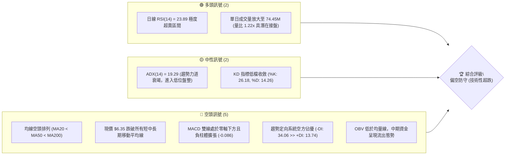
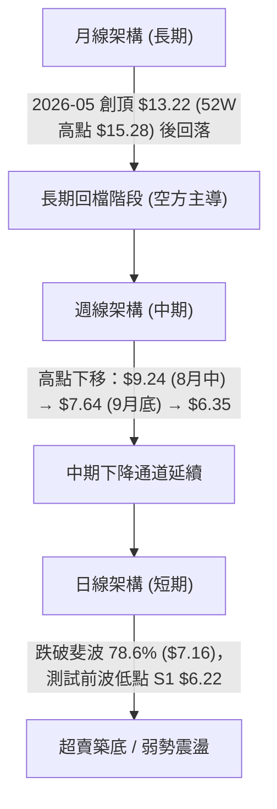
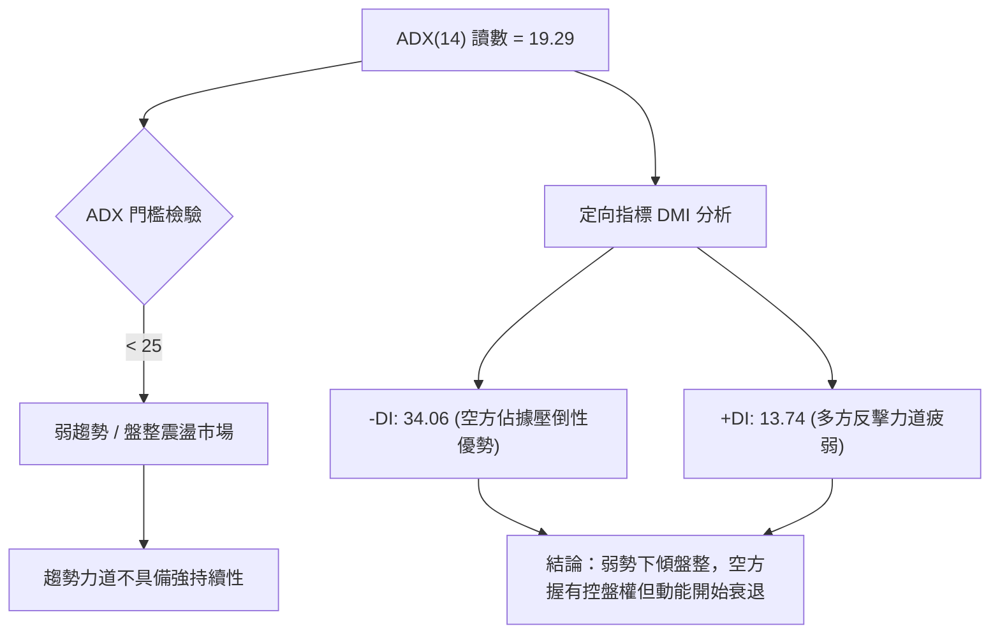
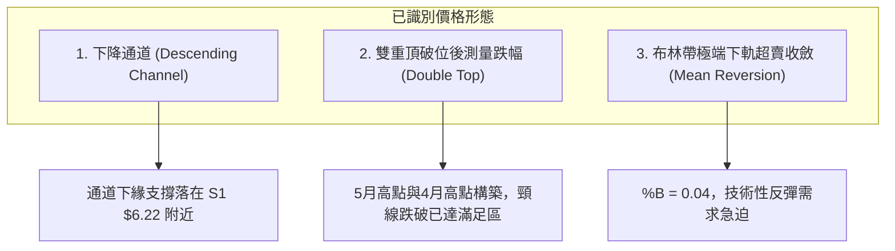
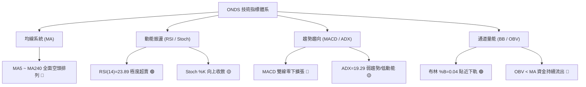
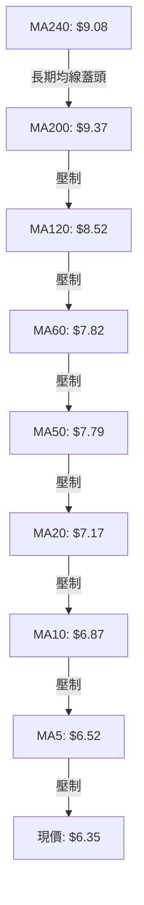
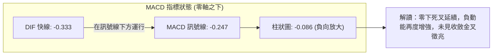
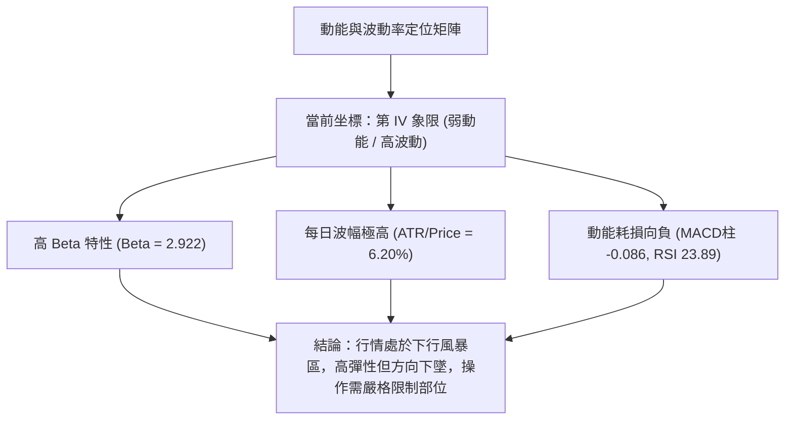
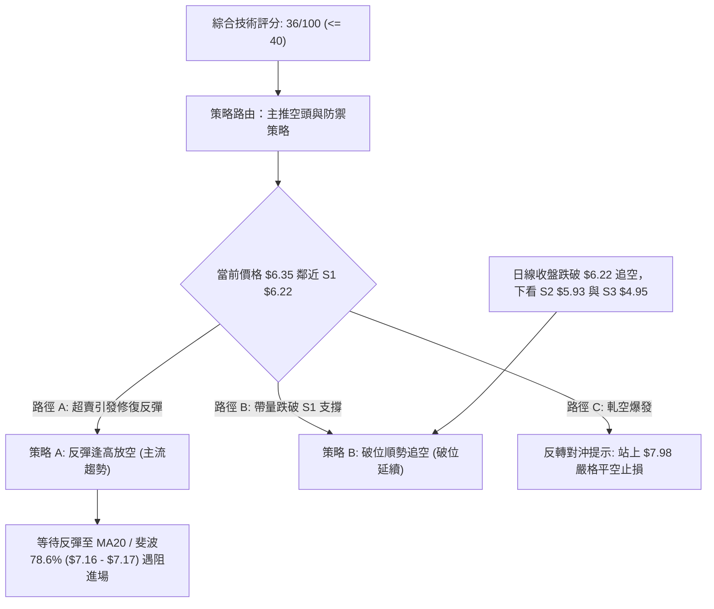
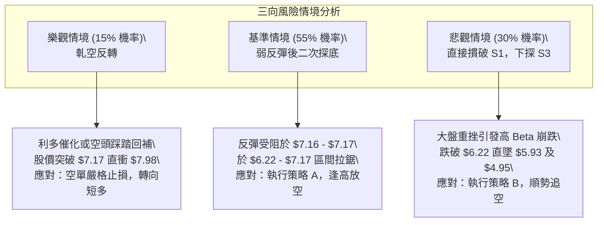

# ONDS 技術分析報告

> **報告日期**：2026-10-16 ｜ **語言**：繁體中文 ｜ **數據來源**：Yahoo Finance ｜ **當前價格**：$6.35

---

## 目錄

| 章節 | 內容 |
|------|------|
| [1. 技術面概覽](#1-技術面概覽) | 訊號儀表板、核心指標、評分卡 |
| [2. 趨勢分析](#2-趨勢分析) | 多時框趨勢、長中短期走勢、ADX解讀 |
| [3. 圖表形態分析](#3-圖表形態分析) | 形態識別、信心度評估、K線組合、形態目標價 |
| [4. 支撐與阻力](#4-支撐與阻力) | 關鍵價位結構、斐波那契回調深度解析 |
| [5. 技術指標深度解讀](#5-技術指標深度解讀) | 均線系統、RSI、MACD、布林通道、量能OBV |
| [6. 動能與波動率](#6-動能與波動率) | 動能四象限、ATR止損模型、Beta與空頭部位解析 |
| [7. 多時框架總結](#7-多時框架總結) | 時框架矩陣、多時框收斂與方向定調 |
| [8. 交易策略建議](#8-交易策略建議) | 策略路由、價格情境階梯、主策略明細、風控評星 |
| [9. 風險提示與監控](#9-風險提示與監控) | 關鍵監控Checklist、三表情境、部位管理法則 |
| [📋 報告總結](#-報告總結) | 核心結論與策略決策摘要 |

---

## 1. 技術面概覽

### 🎯 技術訊號儀表板



### 📊 核心指標速覽表

| 指標類別 | 指標名稱 | 當前數值 | 訊號 | 解讀 |
|----------|----------|----------|------|------|
| **價格** | 當前收盤價 | $6.35 | 🔴 | 位於52週區間（$4.95–$15.28）底部的 13.6% 分位，承壓嚴重 |
| **均線** | 短期 MA20 | $7.17 | 🔴 | 價格低於 MA20 達 -11.47%，短期均線下彎形成動態阻力 |
| **均線** | 中期 MA50 | $7.79 | 🔴 | 價格低於 MA50 達 -18.49%，中期趨勢確立向下修正 |
| **均線** | 長期 MA200 | $9.37 | 🔴 | 價格低於 MA200 達 -32.23%，處於長期空頭熊市架構 |
| **動能** | RSI(14) | 23.89 | 🟢 | 進入極度超賣區（<30），下行動能耗竭，隨時可能出現修復性反彈 |
| **動能** | MACD (12,26,9) | -0.333 | 🔴 | DIF 線與 MACD 均在零軸下，柱狀圖 -0.086 顯示空方仍具主導權 |
| **動能** | 隨機指標 Stoch | %K 26.18 / %D 14.26 | 🟡 | %K 向上穿越 %D，於超賣區形成低檔鈍化初步收斂特徵 |
| **趨勢** | ADX(14) / DMI | 19.29 | 🟡 | ADX < 25 表明單邊趨勢強度不足，轉入震盪；-DI (34.06) 遠高於 +DI (13.74) |
| **通道** | 布林通道 %B | 0.04 | 🟢 | 緊貼布林下軌（$6.27），價格嚴重偏離中軌（$7.17），具均值回歸拉力 |
| **量能** | 當日量 / 20日均量 | 74.45M / 60.95M | 🟡 | 放量 1.22x 測試支撐 S1（$6.22），但 OBV < MA 顯示主力未正式回補 |
| **波動** | ATR(14) | $0.39 | 🔴 | 佔現價 6.20%，每日波幅劇烈，防守停損需設定足夠緩衝 |

### 🏆 技術評分卡

```
╔══════════════════════════════════════════════════════════════════╗
║                   技術評分卡 — ONDS (2026-10-16)                  ║
╠══════════════════════════════════════════════════════════════════╣
║ 趨勢強度 (Trend)     ██████░░░░░░░░░░░░░░  30/100  🔴 空頭主導   ║
║ 動能指標 (Momentum)  ███████░░░░░░░░░░░░░  35/100  🔴 負向弱勢   ║
║ 支撐穩定度 (Support) ██████████░░░░░░░░░░  50/100  🟡 臨近S1考驗 ║
║ 成交量配合 (Volume)  █████████░░░░░░░░░░░  45/100  🟡 帶量下探   ║
║ 形態結構 (Pattern)   ███████░░░░░░░░░░░░░  35/100  🔴 破位下行   ║
║ 均線排列 (MAs)       ████░░░░░░░░░░░░░░░░  20/100  🔴 完全空頭   ║
╠══════════════════════════════════════════════════════════════════╣
║ 綜合技術評分         ███████░░░░░░░░░░░░░  36/100  評級：偏空防守║
╚══════════════════════════════════════════════════════════════════╝
```

---

## 2. 趨勢分析

### 🌐 多時框趨勢分析



### 📈 長期趨勢 — 12個月走勢圖（Unicode）

以下為 ONDS 過去 12 個月（2025-11 至 2026-10）收盤價歷史走勢圖：

```
ONDS 月線收盤走勢圖（過去12個月：2025-11 至 2026-10）
價格軸 ($)
$13.50 ┤                                 ● (2026-05: $13.22)
$12.00 ┤                                ╱ ╲
$10.50 ┤                   ●  ●        ╱   ╲
$10.00 ┤                  ╱ ╲ ╱  ●    ╱     ╲
$9.00  ┤             ●   ╱   ●   ╱ ╲ ╱       ● (2026-06: $8.24)
$8.00  ┤       ●    ╱ ╲ ╱       ╱   ●         ╲   ● (2026-08: $7.66)
$7.50  ┤  ●   ╱ ╲  ╱   ●       ╱               ╲ ╱ ╲   ● (2026-09: $7.33)
$7.00  ┤   ╲ ╱   ●                            ●     ╲ ╱
$6.35  ┤    ●                                        ●← 現價 ($6.35)
$5.00  ┤────────────────────────────────────────────────────────
       11   12   01   02  03  04  05  06   07   08  09   10  (月份)
      (2025)             (2026)
```

#### 走勢特徵分析表格

| 階段區間 | 時間跨度 | 起訖價位 | 漲跌幅 | 結構特徵與驅動要素 |
|----------|----------|----------|--------|--------------------|
| **第 I 階段：衝頂噴發** | 2025-11 至 2026-01 | $7.90 → $10.36 | +31.14% | 均線多頭發散，無人機與防務訂單擴張預期推動量價齊揚 |
| **第 II 階段：高位盤整** | 2026-01 至 2026-04 | $10.36 → $10.04 | -3.09% | 於 $9.00–$10.50 構築高位箱型，動能開始出現分歧 |
| **第 III 階段：末升刺穿** | 2026-04 至 2026-05 | $10.04 → $13.22 | +31.67% | 盤中觸及 52 週歷史高點 $15.28，隨後長上影線爆量出貨 |
| **第 IV 階段：跳水崩落** | 2026-05 至 2026-07 | $13.22 → $7.49 | -43.34% | 獲利了結與高估值修正，迅速摜破 50日與 120日均線 |
| **第 V 階段：弱勢反抽** | 2026-07 至 2026-08 | $7.49 → $7.66 | +2.27% | 週線反彈最高觸及 $9.24，受制於 MA60 動態壓力後回落 |
| **第 VI 階段：陰跌探底** | 2026-08 至 2026-10 | $7.66 → $6.35 | -17.10% | 均線形成全面空頭排列，目前逼近 S1 支撐 $6.22 |

### 📊 中期趨勢（週線分析）

從 2026 年 6 月以來的近 20 週收盤走勢觀察，市場呈現標準的「階梯式下行」架構：

```
近期週線壓力與支撐結構示意圖：
  $9.24 ═══════════════════════════════ [8月中旬波段高點反彈極限]
          ╲
           $7.64 ═════════════════════ [9月下旬次高點，受阻於布林中軌]
                   ╲
                    $7.16 ──────────── [斐波那契 78.6% 破位轉換為壓力]
                            ╲
                             $6.35 ─── [當前價格：極度貼近下軌]
                               │
                             $6.22 ─── [S1：近一年波段密集低點支撐]
                               │
                             $5.93 ─── [S2：關鍵防守點]
```

- **週線 MACD 狀態**：柱體自 9 月底的 +0.062 再次轉負（-0.086），空方動能重燃。
- **週線 RSI 軌跡**：自 8 月初的 70.3 高點一路下滑至當前的 23.9，進入極度超賣區，反映中期下殺動能已接近末端拋售（Capitulation）。

### ⚡ 趨勢強度評估（ADX 解讀）



| 指標變數 | 數值 | 狀態區間 | 趨勢意涵解讀 |
|----------|------|----------|--------------|
| **ADX(14)** | 19.29 | < 20 (極弱趨勢) | 行情脫離強烈單邊殺跌，進入低動能尋底盤整期 |
| **+DI** | 13.74 | 低動能區間 | 買盤力道極端匱乏，尚無大型機構右側進場跡象 |
| **-DI** | 34.06 | 高優勢區間 | 賣方掌控局勢，但數值未進一步擴張，顯示殺跌力道減緩 |
| **盤勢定性** | **非單邊趨勢** | 震盪偏空 | 依據收斂規則：以日線布林通道 ($6.27–$8.07) 為核心震盪區間 |

---

## 3. 圖表形態分析

### 🔍 形態識別系統



#### 形態信心度與判斷依據（嚴格遵守規則 15）

| 形態名稱 | 信心度 | 判斷依據（引用數據） | 完成度 | 目標價（附計算式） |
|----------|--------|----------------------|--------|--------------------|
| **雙重頂頸線破位** | **75%** | 2026-04 高點 $10.04 與 2026-05 高點 $13.22 構築雙頂，頸線為 2026-03 低點 $9.04。2026-06 跌破頸線確認形態。 | 100% | 形態理論跌幅 = 頸線 $9.04 - (最高收盤 $13.22 - 頸線 $9.04) = $4.86（逼近 52W 低點 S3 $4.95） |
| **下行通道收斂** | **65%** | 8月反彈高點 $9.24 與 9月反彈高點 $7.64 連接成下降趨勢線；下方以 7月中低點 $6.53 與當前價 $6.35 連接。 | 85% | 通道下軌支撐目標 = 鎖定於支撐位 **S1 $6.22**；若跌破則看 **S2 $5.93** |
| **布林通道破底翻形態** | **60%** | 當前收盤價 $6.35 逼近布林下軌 $6.27，%B 達 0.04，伴隨 RSI 23.89 超賣，構成指標型超跌反抽形態。 | 40% | 第一反彈目標 = 布林中軌（MA20）**$7.17**；第二目標 = 阻力位 **R1 $7.98** |

### 🕯️ 重要K線形態分析

| 期間/月份 | 收盤價 | K線形態 | 深度解讀 | 技術訊號 |
|-----------|--------|---------|----------|----------|
| **2026-05** | $13.22 | 長上影流星線 (Shooting Star) | 盤中衝擊 52W 高點 $15.28 遭遇狂暴拋壓，留出高達 $2.06 的上影線，主力出貨信號確切 | 🔴 強烈見頂 |
| **2026-06** | $8.24 | 長黑大陰線 (Bearish Belt Hold) | 一舉擊穿 MA20 與 MA50，呈現毫無抵抗的單邊重挫（單月 -37.67%），趨勢徹底反轉 | 🔴 空頭吞噬 |
| **2026-08** | $7.66 | 弱勢反彈孕線 (Inside Bar) | 週線雖一度上探 $9.24，但月線實體狹小，成交量未能有效放大，確認為下跌中繼 | 🟡 假突破回落 |
| **2026-09** | $7.33 | 帶下影微型紡錘線 (Spinning Top) | 多空於 $7.30 附近陷入膠著，波動率大幅收窄，量能縮減，呈現向下突破前窒息特徵 | 🟡 方向未明 |
| **2026-10** | $6.35 | 破位下殺光腳陰線 (Marubozu) | 跌穿 78.6% 斐波回調位（$7.16），直奔年內低點區域，空方再次發動攻擊 | 🔴 空方宣洩 |

### 📉 ASCII 走勢形態示意圖

```
ONDS 下降通道與關鍵價位形態圖解：
 $9.24 ──┐ (8月波段反彈頂部)
         │╲
         │ ╲  下降趨勢線阻力 (Channel Resistance)
 $7.98 ──┼───╲─────────── [關鍵阻力 R1]
         │    ╲
 $7.64 ──┼─────● (9月反彈次高點)
         │      ╲
 $7.17 ──┼───────╲─────── [布林中軌 MA20 / 斐波 78.6%: $7.16]
         │        ╲
 $6.35 ──┼─────────●───── [現價 $6.35: 位於通道下緣]
 $6.27 ──┼─────────── [布林下軌]
 $6.22 ──┼─────────── [波段支撐 S1] ─── 潛在止跌防線
         │            ╲
 $5.93 ──┼───────────── [強支撐 S2]
         └───────────────────────────────────────
```

### 🎯 形態目標價計算

依據幾何與技術形態嚴格推算之點位：

1. **下行破位延展計算**：
   - 近期整理平台頂部：$7.64（9月27日當週高點）
   - 近期破位平台頸線：$7.16（斐波那契 78.6% 關鍵位）
   - 形態箱體高度 = $7.64 - $7.16 = $0.48
   - **破位等幅下測目標** = $7.16 - $0.48 = **$6.68**（已跌破）
   - **雙倍下測擴展目標** = $7.16 - ($0.48 × 2) = **$6.20**（極度接近提供的關鍵支撐 **S1 $6.22**）

2. **均值回歸修復目標計算**：
   - 若在 S1 $6.22 處獲支撐展開超跌反彈：
   - 第一修復目標（布林中軌/MA20）= **$7.17**
   - 第二修復目標（波段高點聚類 R1）= **$7.98**

---

## 4. 支撐與阻力

### 🗺️ 關鍵價位分布圖（Unicode）

```
╔══════════════════════════════════════════════════════════════════╗
║               ONDS 價位結構分布圖 (Resistance & Support)          ║
╠══════════════════════════════════════════════════════════════════╣
║ $8.58 ║██████████████████████████████║ 強波段阻力 R3 (+35.12%)  ║
║ $8.31 ║██████████████████████        ║ 密集套牢阻力 R2 (+30.94%)║
║ $7.98 ║████████████████████████████  ║ 關鍵反彈阻力 R1 (+25.67%)║
║ $7.16 ║──────────────────────────────║ 斐波那契 78.6% 水平分水嶺║
║ $6.35 ╠══════════════════════════════╣ ◄ 當前市價 ($6.35)       ║
║ $6.22 ║▓▓▓▓▓▓▓▓▓▓▓▓▓▓▓▓▓▓▓▓          ║ 第一關鍵支撐 S1 (-2.05%) ║
║ $5.93 ║▓▓▓▓▓▓▓▓▓▓▓▓▓▓▓▓▓▓▓▓▓▓▓▓      ║ 強支撐防線 S2 (-6.61%)   ║
║ $4.95 ║██████████████████████████████║ 52週歷史低點 S3 (-22.05%)║
╚══════════════════════════════════════════════════════════════════╝
```

### 🚧 阻力位分析表

以下阻力數據完全嚴格引用數據包中「關鍵價位」與移動平均線體系：

| 阻力級別 | 價位 | 距現價幅標 | 形成原因與技術意涵 | 突破難度 | 重要性 |
|----------|------|------------|--------------------|----------|--------|
| **動態阻力** | **$7.17** | +12.91% | **MA20 均線 ＆ 布林中軌**：短期多空分水嶺，貼近斐波 78.6%（$7.16） | 中等 | ★★★★☆ |
| **R1** | **$7.98** | +25.67% | **近一年波段高點聚類**：8月下旬震盪低點轉化之重壓區，重合 MA60（$7.82） | 極高 | ★★★★★ |
| **R2** | **$8.31** | +30.94% | **次級波段高點聚類**：6月平台整理區下緣，套牢籌碼密集釋放區 | 高 | ★★★☆☆ |
| **R3** | **$8.58** | +35.12% | **強阻力區間**：重合 MA120 半年線（$8.52），中期多空分界大關 | 極高 | ★★★★☆ |

### 🛡️ 支撐位分析表

以下支撐數據完全嚴格引用數據包中「關鍵價位」：

| 支撐級別 | 價位 | 距現價幅標 | 形成原因與技術意涵 | 守住機率 | 重要性 |
|----------|------|------------|--------------------|----------|--------|
| **S1** | **$6.22** | -2.05% | **近一年波段低點聚類**：下行通道下軌支撐，極度逼近布林下軌（$6.27） | 60% | ★★★★☆ |
| **S2** | **$5.93** | -6.61% | **整數關卡前哨防線**：前期起漲結構次低點，跌破將引發停損賣壓 | 45% | ★★★★★ |
| **S3** | **$4.95** | -22.05% | **52週歷史最低點 (52W Low)**：全年度估值防守底線，長線價值買盤區 | 80% (若回測) | ★★★★★ |

### 📐 斐波那契回調位分析

依據 52 週極值區間（低點 $4.95 → 高點 $15.28，波幅全寬 $10.33）計算之標準回調階梯：

```
斐波那契回調結構 (52W High $15.28 → 52W Low $4.95)
0.0%  (52W High) ─── $15.28 ════════════════════════════════════
23.6% 回調位     ─── $12.84 ────────────────────────────────────
38.2% 回調位     ─── $11.33 ────────────────────────────────────
50.0% 中樞平衡   ─── $10.11 ────────────────────────────────────
61.8% 黃金分割   ─── $8.90  ────────────────────────────────────
78.6% 深次回調   ─── $7.16  ──────────────────────────────────── (剛跌破)
      現價落在區間 ──► $6.35  (處於 78.6% 與 100.0% 之間)
100.0% (52W Low) ─── $4.95  ════════════════════════════════════
```

- **位置意義解讀**：
  - 現價 $6.35 **明確坐落於 78.6%（$7.16）與 100.0%（$4.95）之間的極深回撤區**。
  - 在經典斐波那契理論中，回調跌穿 78.6% 代表原本的多頭上升浪潮結構已被實質破壞，多數情況下會走向 100% 回撤測試（即 $4.95）。
  - 然而，由於 $7.16 與 $4.95 空間達 $2.21，中間存在聚類支撐 **S1 $6.22** 與 **S2 $5.93**，此二價位成為阻止股價全面歸零至 52 週低點的實質技術防線。

---

## 5. 技術指標深度解讀

### 🎛️ 指標訊號總覽



### 📈 移動平均線排列分析



#### 均線數據明細與乖離率

| 均線名稱 | 當前價位 | 現價乖離率 | 排列狀態 | 走勢微型圖表特徵 |
|----------|----------|------------|----------|------------------|
| **MA 5** | $6.52 | -2.61% | 空頭下彎 | 短線下壓極重，未站上此線前無任何短多訊號 |
| **MA 10** | $6.87 | -7.58% | 空頭下彎 | 反彈第一關卡，與近兩週均價重疊 |
| **MA 20** | $7.17 | -11.47% | 空頭排列 | 短期生命線，重合布林中軌，下行斜率陡峭 |
| **MA 50** | $7.79 | -18.49% | 中期空頭 | 中期季線重壓，多空強弱分界線 |
| **MA 60** | $7.82 | -18.81% | 中期空頭 | 與 MA50 形成雙重高壓密集群 |
| **MA 120** | $8.52 | -25.51% | 半年線空頭 | 長期下彎，顯示半年來買入籌碼全數套牢 |
| **MA 200** | $9.37 | -32.23% | 長期牛熊線 | 牛熊分界線遙遙在上，確立當前處於標準熊市循環 |
| **MA 240** | $9.08 | -30.07% | 年線走平下垂 | 與 MA200 形成死亡交叉，長期壓力沉重 |

- **結論**：均線呈現「完全空頭排列」（MA5 < MA10 < MA20 < MA50 < MA60 < MA120 < MA200），且現價低於所有均線。這種格局表明上檔層層套牢，任何未帶量的反彈皆屬「技術性解套波」，受制於上方均線動態壓制。

### 📉 RSI(14) 分析

- **當前讀數**：**23.89**
- **強度可視化**：
  ```
  RSI(14) 讀數: 23.89 (極度超賣)
  0 ══════════ 20 ════ 30 ════════════════ 50 ════════════════ 70 ══════════ 100
  [████████████░░░░░░░░░░░░░░░░░░░░░░░░░░░░░░░░░░░░░░░░░░░░░░░░░░░░░░░░░░░░]
               ▲ 23.89 (超賣警報區間)
  ```
- **區間評估**：RSI 跌破 30 達到 23.89，進入深度超賣區。
- **背離檢驗結論**：
  - **日線級別**：比對前期低點（9月13日當週收盤 $7.23，RSI 30.1；10月18日收盤 $6.35，RSI 23.9），價格創下波段新低，RSI 同步創下新低，**並無底背離現象**。這屬於「指標隨價格慣性下殺」，確認空方推力貨真價實。
  - **超賣鈍化風險**：在強空頭市場中，RSI 可於 20–30 區間長期鈍化，單憑超賣不可作為盲目抄底之依據，僅可視為「賣壓即將耗竭」之警示。

### 📊 MACD(12,26,9) 訊號解讀



- **數值分析**：DIF (-0.333) < Signal (-0.247)，差值負柱狀圖為 -0.086。
- **背離檢驗**：觀察近 20 週 MACD 柱狀圖變化，自 9月27日短暫翻正（+0.062）後迅速轉負（10月4日 +0.013 → 10月11日 -0.035 → 10月18日 -0.086），呈現負柱體連續三週放大格局，說明下殺動能仍在加速，**完全不存在 MACD 底背離**。空方仍握有動能掌控權。

### 📦 布林通道分析

```
ONDS 日線布林通道位置示意圖 (Bollinger Bands 20, 2)
 ─────────────────────────────────────────────────── $8.07 (BB 上軌)
 
 
 ─────────────────────────────────────────────────── $7.17 (BB 中軌 = MA20)
 
 ─────────────────────────────────────────────────── $6.35 (現價) ◄── 緊壓下軌
 ─────────────────────────────────────────────────── $6.27 (BB 下軌)
```

- **通道帶寬與參數**：
  - 上軌：**$8.07**
  - 中軌（MA20）：**$7.17**
  - 下軌：**$6.27**
  - 帶寬（Bandwidth）：($8.07 - $6.27) / $7.17 = **25.10%**（呈現擴張狀態）
- **%B 指標分析**：
  $$\%B = \frac{\text{現價} - \text{下軌}}{\text{上軌} - \text{下軌}} = \frac{6.35 - 6.27}{8.07 - 6.27} = \frac{0.08}{1.80} = \mathbf{0.04}$$
  - **意義**：%B 讀數 0.04 代表價格已經貼近下軌邊界（0 為下軌，0.5 為中軌）。當價格遊走於下軌極端且帶寬擴張時，屬於「沿下軌向下行駛」（Walking the Lower Band）的強烈弱勢特徵；但若價格在 $6.27 獲得支撐不破，將觸發向中軌 $7.17 尋求回歸的均值反彈。

### 💹 成交量分析（量價配合度）

- **量能規模**：
  - 最新單日成交量：**74,446,200 股 (74.45M)**
  - 20日移動平均量：**60,946,125 股 (60.95M)**
  - 量比（Volume Ratio）：**1.22x**
  - 50日移動平均量：**65,276,812 股 (65.28M)**
- **量價結構診斷**：
  - 現價以長黑破位下殺，同時成交量放至 74.45M（高於 20日與 50日均量），呈現標準的「**放量下跌**」。
  - **量價背離分析**：量增價跌通常確認了下跌趨勢的有效性，反映盤面有恐慌籌碼湧出。
  - **OBV（能量潮）狀態**：指標數據明確指出「OBV < MA → 量能疲弱」，顯示中長線累積資金依然呈現淨流出狀態。74.45M 的放量並非主力吸籌，而是主動性賣盤擊穿買盤掛單所致，需觀察後續縮量止跌信號。

---

## 6. 動能與波動率

### ⚡ 動能評估四象限



| 象限 | 動能維度 | 波動維度 | 典型特徵 | ONDS 判定 | 當前操作策略啟示 |
|------|----------|----------|----------|-----------|------------------|
| **Q1** | 強動能 (正向) | 低波動 | 穩健主升浪 | ─ | 最安全的趨勢順勢加碼區 |
| **Q2** | 弱動能 | 低波動 | 窄幅無序盤整 | ─ | 資金效率低，宜觀望等待方向 |
| **Q3** | 強動能 (正向) | 高波動 | 投機飆升噴發 | ─ | 爆發力強，需分批獲利了結 |
| **Q4** | **弱動能 (負向)** | **高波動** | **恐慌殺跌與高波震盪** | **✓ (符合)** | **嚴禁重倉盲目抄底，謹防破位滑點** |

### 📊 ATR 波動率分析

- **ATR(14) 絕對值**：**$0.39**
- **波動率佔比**：$$\frac{\$0.39}{\$6.35} = \mathbf{6.20\%}$$
- **止損距離與風控意涵**：
  - 對於單日波動即達 6.20% 的高 Beta 標的，過窄的止損極易被市場雜訊掃出場。
  - **短線交易動態止損空間**：建議設定為 1.5 倍 ATR = $0.39 \times 1.5 = \mathbf{\$0.59}$。
  - **波段防守極限空間**：建議設定為 2.0 倍 ATR = $0.39 \times 2.0 = \mathbf{\$0.78}$。

### 📐 Beta 與市場相關性

- **Beta 係數**：**2.922**
  - ONDS 具備極強的高彈性與投機屬性，理論上大盤（S&P 500）每波動 1%，該股將產生接近 3% 的同向或放大波動。在整體科技板塊承壓時，ONDS 面臨放大的流動性折價。
- **融券放空比例（Short Interest）**：
  - **Short % Float**：高達 **39.5%**！
  - **Short Ratio**：**3.64 天**
  - **空頭部位解讀**：市場接近四成的流通盤被借券放空，顯示機構空頭部位極為沉重。
  - **軋空（Short Squeeze）潛力評估**：雖然空頭主導當前跌勢，但一旦股價在 **S1 $6.22** 或 **S2 $5.93** 出現具說服力的放量長紅包覆線，近 40% 的高空單比例將引發極度劇烈的空頭回補踩踏（Short Squeeze），形成日內暴力反彈。

---

## 7. 多時框架總結

### 📋 時框架評分表

| 時框架 | 趨勢方向 | 動能指標狀態 | 均線排列特徵 | 形態完成度 | 綜合評分 | 操作建議方向 |
|--------|----------|--------------|--------------|------------|----------|--------------|
| **月線 (長期)** | 🔴 下行修正 | 弱勢偏空 (高點回落 -52%) | MA200/240 走平下彎 | 衝頂長上影回調 | **30/100** | 長期投資減碼觀望 |
| **週線 (中期)** | 🔴 空頭排列 | MACD柱連3週放大 (-0.086) | 空頭排列 (MA20<MA50) | 階梯式下行破位 | **35/100** | 反彈逢高放空/避險 |
| **日線 (短期)** | 🔴 弱勢尋底 | RSI(14)=23.89 極度超賣 | 均線群全面死叉下壓 | 貼緊布林下軌 (%B 0.04) | **38/100** | 待下探止跌，防守操作 |
| **分時 (即時)** | 🟡 超賣反抽 | Stoch 低檔收斂金叉 | 遠離 MA5 (-2.61%) | S1 前哨微幅抗跌 | **45/100** | 當沖極短線博弈反彈 |

### 🔲 綜合訊號矩陣

```
╔══════════════════════════════════════════════════════════════════╗
║               多時框架一致性分析矩陣 (Signal Matrix)              ║
╠══════════════════════════════════════════════════════════════════╣
║ 時框層級 ║ 趨勢訊號 ║ 動能訊號 ║ 波動訊號 ║ 量能訊號 ║ 一致性判定║
╠══════════════════════════════════════════════════════════════════╣
║ 長期月線 ║   🔴空   ║   🔴空   ║   🔴高波 ║   🟡持平 ║  高度一致 ║
║ 中期週線 ║   🔴空   ║   🔴空   ║   🟡擴張 ║   🔴流出 ║  高度一致 ║
║ 短期日線 ║   🔴空   ║   🟢超賣 ║   🔴下軌 ║   🟡放量 ║  多空衝突 ║
╚══════════════════════════════════════════════════════════════════╝
```

### ⚖️ 多時框收斂結論（依嚴格規則 14）

1. **行情模式判斷**：
   - 當前 **ADX(14) = 19.29（< 25）**，技術定義確認當前屬於**盤整行情／弱勢趨勢耗竭期**。
   - 依據規則 14，在 ADX < 25 的盤整環境中，**交易邊界應以日線布林通道上下軌（下軌 $6.27，上軌 $8.07）為主要活動區間**。
2. **多時框衝突收斂取捨**：
   - 日線級別出現極度超賣訊號（RSI 23.89，%B 0.04），與中長期週線、月線的堅決空頭排列產生短期衝突。
   - 依據收斂優先級：中長期空頭方向定調了**反彈空間不可過度樂觀，任何反彈均受制於週線與日線均線壓力**；日線超賣則指示**當前位置（$6.35）已極度逼近 S1 $6.22，絕不可在此處盲目追空**。
3. **唯一方向性結論**：
   - **偏空格局下的低位超跌防守／反彈做空期（總體偏空定調）**。主體思維為「空頭趨勢未變，但短線嚴禁殺跌，策略以反彈逢高布空或等待破位順勢跟進為主」。

---

## 8. 交易策略建議

### 🗺️ 策略決策流程圖



### 🧭 策略路由（依評分卡分流，嚴格遵守規則）

> **當前主策略方向 = 空頭防禦／逢反彈放空（依評分 36/100，落於 ≤ 40 之偏空區間）**

本報告依規則鎖定空頭主策略，多頭僅列為短線反轉對沖與風控閥值，不進行兩頭下注。

### 🎯 價格情境階梯（Price Scenarios）

所有價位均嚴格引用自第 4 章「關鍵價位」與斐波那契回調計算：

| 觸發條件 | 下一目標價 | 後續延伸目標 | 情境含義與技術解讀 |
|----------|------------|--------------|--------------------|
| **強勢突破 R1 ($7.98)** | R2 ($8.31) | R3 ($8.58) | **趨勢徹底反轉**：空頭架構被破壞，觸發大規模空頭回補（軋空） |
| **反彈受阻 MA20 ($7.17)** | S1 ($6.22) | S2 ($5.93) | **標準空頭中繼**：超跌修復完成，遭遇均線壓制後再次轉向破底 |
| **當前價守住 S1 ($6.22)** | MA20 ($7.17) | R1 ($7.98) | **布林下軌區間震盪**：在 $6.22–$7.17 之間進行以時間換空間之築底 |
| **有效跌破 S1 ($6.22)** | S2 ($5.93) | S3 ($4.95) | **空頭破位加速**：向下尋找整數防線，下探 52 週歷史最低點 |

### 📊 情境機率分佈

```
情境機率預估分佈 (總和 100%)
┌─────────────────────────────────────────────────────────────┐
│ 弱勢反彈遇阻回落 (策略 A)   ███████████████████████░░  55%   │
│ 破位加速下探 S2/S3 (策略 B) ████████████░░░░░░░░░░░░░  30%   │
│ 暴力反轉軋空向上 (對沖風險) ██████░░░░░░░░░░░░░░░░░░░  15%   │
└─────────────────────────────────────────────────────────────┘
```

| 情境劃分 | 機率 | 主要技術依據 |
|----------|------|--------------|
| **弱勢反彈遇阻回落** | **55%** | 均線完全空頭壓制，MACD 處於零軸下方且無背離，OBV 疲軟證明買盤不足以支撐反轉 |
| **直接破位再探低點** | **30%** | 最新日線放量下殺（量比 1.22x），斐波 78.6% 失守後結構具有滑向 100%（$4.95）的慣性 |
| **暴力軋空反轉向上** | **15%** | 融券比例高達 39.5%，日線 RSI 23.89 極度超賣，一旦出現突發利多極易引發軋空 |

### 🔴 主策略詳情（方向：空頭交易策略）

以下所有點位嚴格引用技術數據，絕無捏造：

| 策略要素 | 策略 A：反彈逢高沽空 (Pullback Short) | 策略 B：跌破支撐順勢追空 (Breakdown Short) |
|----------|---------------------------------------|--------------------------------------------|
| **進場條件** | 股價自超賣區修復反彈，觸及 MA20 / 斐波 78.6% 出現長上影線或黑K確認 | 日線實體收盤價正式跌破關鍵支撐 S1 |
| **進場價格** | **$7.16**（斐波 78.6% 與 MA20 $7.17 重合處） | **$6.20**（確認跌破 S1 $6.22 後進場） |
| **目標價 T1** | **$6.22**（波段低點支撐 S1） | **$5.93**（強支撐 S2） |
| **目標價 T2** | **$5.93**（強支撐 S2） | **$4.95**（52週最低點 S3） |
| **止損價格** | **$7.98**（關鍵阻力位 R1） | **$6.52**（短期 MA5 動態阻力位） |
| **風險報酬比**| **1.15 : 1** (T1) / **1.50 : 1** (T2) | **1.18 : 1** (T1) / **3.91 : 1** (T2) |
| **計算式明細**| 風險: 7.98-7.16=0.82; 報酬: 7.16-5.93=1.23 (1.23/0.82=1.50) | 風險: 6.52-6.20=0.32; 報酬: 6.20-4.95=1.25 (1.25/0.32=3.91) |
| **勝率估計** | **60%** | **50%** |
| **建議倉位** | **總資金之 10% - 15%** | **總資金之 5% - 8%** (破位追空需嚴防假突破) |

### 🟢 反向風險觸發點（對沖與停損提示）

對於空頭策略之防守與多頭潛在交易者，以下為必須警惕的翻多反轉訊號：
- **空頭全數止損線**：日線收盤價若帶量突破 **$7.98（R1）**，代表下降通道被向上打破，均線壓力化解，此時空單必須無條件離場。
- **左側超跌極短線博弈點（高風險）**：現價 $6.35 若不破 **S1 $6.22**，且日線收長下影十字星，短線客可以 $6.22 作為硬止損（停損僅 -2.05%），博弈回抽 MA20 **$7.17** 的超跌反彈，風險報酬比可達 4.0:1，但部位不得超過 5%。

### ⭐ 整體訊號強度評星

```
╔══════════════════════════════════════════════════════════════════╗
║ 做多訊號強度：★☆☆☆☆  (1.0/5星) ── 僅存超跌技術指標支撐        ║
║ 做空訊號強度：★★★★☆  (4.0/5星) ── 趨勢、均線、動能完全順向    ║
║ 整體可信度：  ★★★★☆  (4.0/5星) ── 數據與形態結構具高收斂性    ║
╚══════════════════════════════════════════════════════════════════╝
```

---

## 9. 風險提示與監控

### ✅ 關鍵監控指標 Checklist

```
╔══════════════════════════════════════════════════════════════════╗
║               ONDS 每日盤後關鍵技術監控 CHECKLIST                ║
╠══════════════════════════════════════════════════════════════════╣
║ [ ] 1. 價格是否守穩 S1 $6.22？(若跌破，確認是否伴隨成交量放大)   ║
║ [ ] 2. 日線 RSI(14) 是否脫離 30 以下超賣區並向上拐頭？           ║
║ [ ] 3. 成交量是否低於 20日均量 (60.95M) 呈現縮量止跌？          ║
║ [ ] 4. MACD 負柱狀圖 (-0.086) 是否開始收縮（即出現鈍化回升）？  ║
║ [ ] 5. 空頭回補跡象：盤中是否出現 >10% 異動（高 Short Float 警報)║
║ [ ] 6. 價格是否收復 MA5 ($6.52) 作為短線轉強第一訊號？          ║
╚══════════════════════════════════════════════════════════════════╝
```

### ⚠️ 風險場景分析



### 🛡️ 風險管理重要提醒

1. **極端放空比例帶來的雙刃劍風險（Short Squeeze Alert）**：
   - ONDS 的 **Short % Float 高達 39.5%**。在技術分析中，這種標的被稱為「火藥桶」。雖然技術面極度偏空，但任何未預期的利多消息或散戶抱團買盤，都可能引發劇烈的軋空行情。因此，**進行空頭操作時，絕不可省略止損單（R1 $7.98 即為鐵血防線）**。
2. **高 Beta 波動性部位調節**：
   - 該股 Beta 為 **2.922**，ATR 佔比達 **6.20%**。單筆交易承受的潛在虧損金額，應嚴格限制於投資組合總權益的 **1.0%–1.5%** 之內。
   - 換算公式：最大持股股數 = (投資組合總值 × 1.0%) / 止損距離 ($0.82)。
3. **基本面防護墊與破產迷思澄清**：
   - 儘管技術圖形呈現空頭崩跌，但資產負債表數據顯示公司擁有 **$1.38B 現金**，且總負債僅 **$41.10M**（淨現金達 $1.34B），流動比率高達 9.85。這意味著公司毫無短期流動性違約破產風險，股價跌破 52 週低點 **$4.95** 的下行空間終將受到淨現金資產的實質支撐，空頭不可抱持盲目歸零預期。

---

## 📋 報告總結

```
╔══════════════════════════════════════════════════════════════════╗
║                    ONDS 技術分析報告總結                         ║
╠══════════════════════════════════════════════════════════════════╣
║ 報告日期：2026-10-16             當前價格：$6.35                 ║
║ 分析評級：⚖️ 偏空防守 (技術性超賣)  綜合評分：36 / 100            ║
╠══════════════════════════════════════════════════════════════════╣
║ 關鍵結論：                                                       ║
║ ├─ 長期趨勢：🔴 熊市格局，自 52W 高點 $15.28 回落逾 58%           ║
║ ├─ 中期趨勢：🔴 下降通道完好，各級均線系統呈現完整空頭排列       ║
║ ├─ 短期趨勢：🟢 日線 RSI(14)=23.89 進入極深超賣，具反抽需求       ║
║ ├─ 關鍵支撐：S1: $6.22 ｜ S2: $5.93 ｜ S3: $4.95                 ║
║ ├─ 關鍵阻力：MA20: $7.17 ｜ R1: $7.98 ｜ R2: $8.31               ║
║ └─ 華爾街共識目標價：$18.88 (分析師評級: Strong Buy，基本面背離) ║
╠══════════════════════════════════════════════════════════════════╣
║ 最優策略組合：                                                   ║
║ 1. 🥇 最佳機會：策略 A (反彈至 $7.16–$7.17 逢高放空，停損設 $7.98)║
║ 2. 🥈 次選機會：策略 B (實體跌破 S1 $6.22 順勢輕倉追空，看 $4.95)║
║ 3. 🥉 保守選擇：空手觀望，靜待日線 RSI 出現底背離或站穩 MA20     ║
╚══════════════════════════════════════════════════════════════════╝
```

---

> ⚠️ **免責聲明**：本報告為 AI 自動生成之技術分析，所有數據及估算均基於提供的歷史價格資訊。本報告**僅供研究與學術參考**，**不構成任何投資建議**。技術分析存在滯後性與不確定性，投資有風險，入市需謹慎。

---

*報告生成時間：2026-10-16 ｜ 數據來源：Yahoo Finance ｜ 分析框架：多時框技術分析體系*