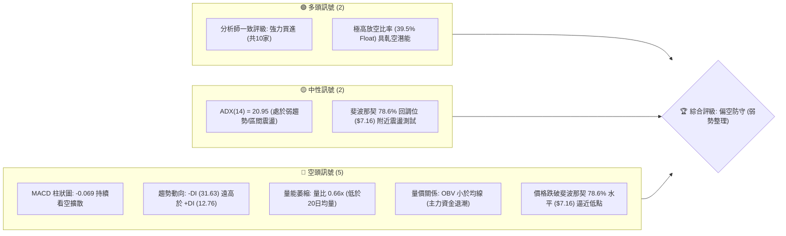
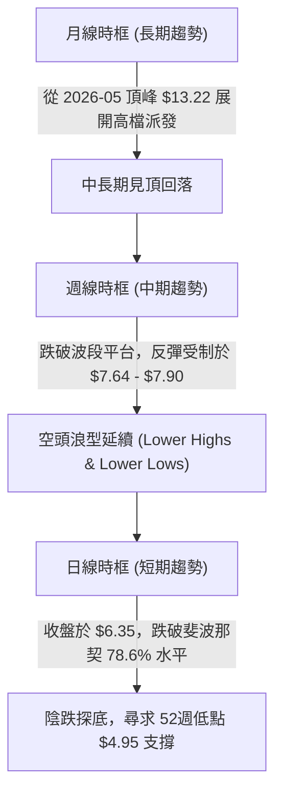
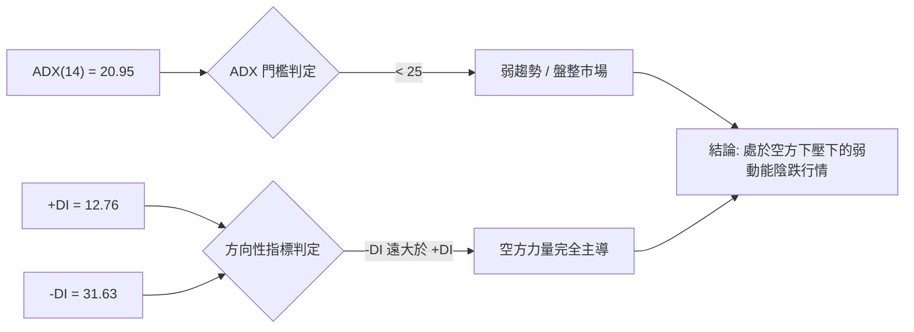
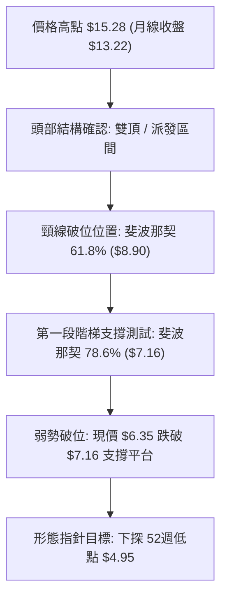
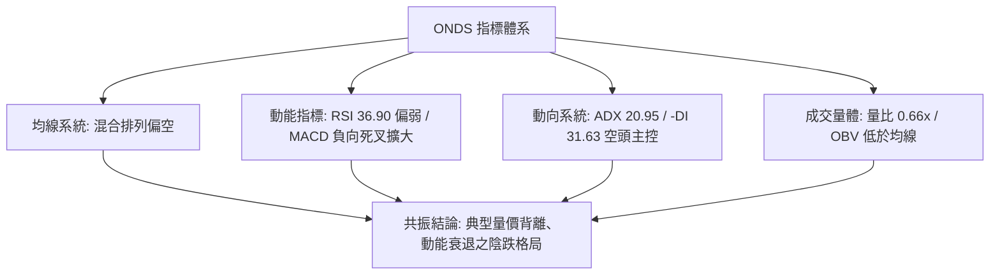
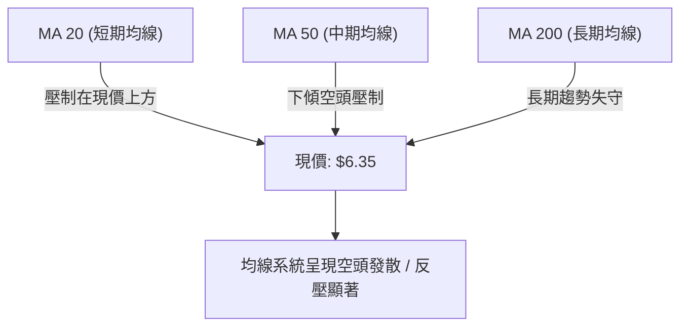
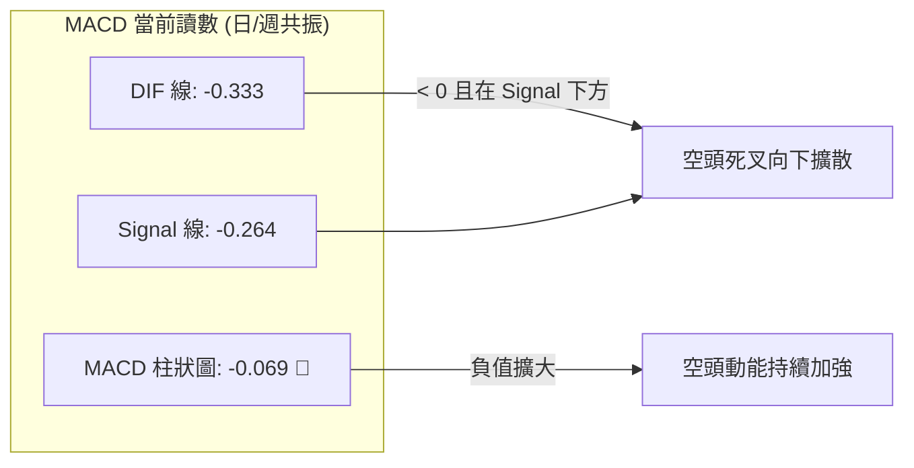
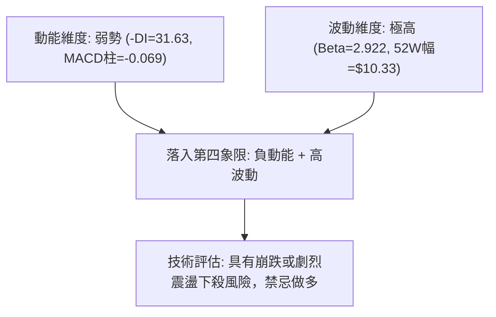
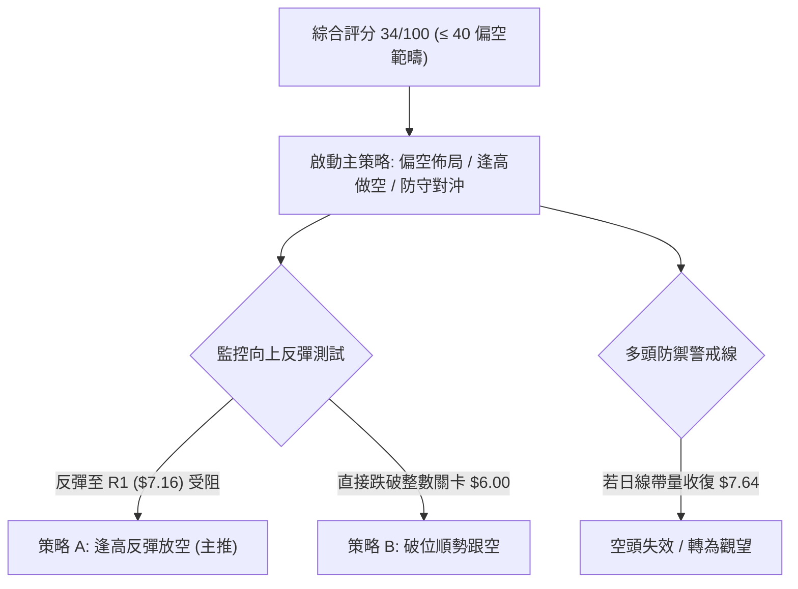
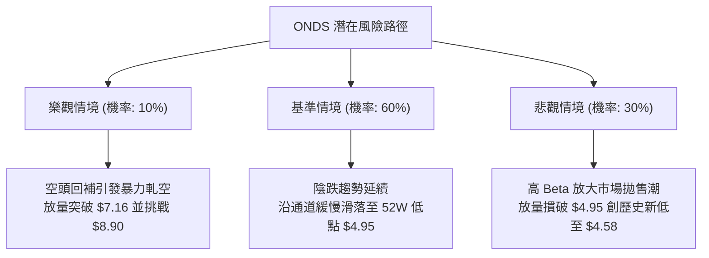

# ONDS 技術分析報告

> **報告日期**：2026-10-17 ｜ **語言**：繁體中文 ｜ **數據來源**：Yahoo Finance ｜ **當前價格**：$6.35

---

## 目錄

| 章節 | 內容 |
|------|------|
| [1. 技術面概覽](#1-技術面概覽) | 訊號儀表板、核心指標、評分卡 |
| [2. 趨勢分析](#2-趨勢分析) | 多時框趨勢、長中短期走勢 |
| [3. 圖表形態分析](#3-圖表形態分析) | 形態識別、K線組合、目標價 |
| [4. 支撐與阻力](#4-支撐與阻力) | 關鍵價位、斐波那契回調 |
| [5. 技術指標深度解讀](#5-技術指標深度解讀) | MA/RSI/MACD/布林/成交量 |
| [6. 動能與波動率](#6-動能與波動率) | 動能評估、ATR、Beta |
| [7. 多時框架總結](#7-多時框架總結) | 時框架評分矩陣 |
| [8. 交易策略建議](#8-交易策略建議) | 多空策略、風險報酬比 |
| [9. 風險提示與監控](#9-風險提示與監控) | 監控指標、風險場景 |
| [10. 報告總結](#10-報告總結) | 核心結論與最佳策略組合 |

---

## 1. 技術面概覽

### 🎯 技術訊號儀表板



### 📊 核心指標速覽表

| 指標類別 | 指標名稱 | 當前數值 | 訊號 | 解讀 |
|----------|----------|----------|------|------|
| **價格** | 當前收盤價 | $6.35 | 🔴 | 位於52週高低區間（$4.95 - $15.28）的低檔區（約 13.55% 分位） |
| **均線** | 短中長期均線 | 混合排列 | 🔴 | 價格處於短中均線下方，長期均線支撐力道遞減，空頭佔據主導 |
| **動能** | RSI(14) (週線趨勢) | 36.90 | 🟡 | 跌入 30-40 偏弱中性格局，無超賣底背離訊號，動能衰退 |
| **動能** | MACD (12,26,9) | -0.333 | 🔴 | DIF (-0.333) 低於 DEA (-0.264)，MACD柱狀圖 -0.069 呈現空頭擴張 |
| **動向** | ADX / DMI | ADX: 20.95 | 🔴 | ADX < 25 屬低動能弱趨勢，但 -DI(31.63) 壓制 +DI(12.76)，空方掌控盤面 |
| **量能** | 當日量 / 20日均量 | 39.28M / 59.72M | 🔴 | 量比僅 0.66x，量能不濟，買盤追價意願極度匱乏 |
| **籌碼** | OBV 指標 | OBV < MA | 🔴 | 能量潮跌破均線，代表持股信心不足，籌碼持續處於派發流出狀態 |
| **波動** | Beta 係數 | 2.922 | 🔴 | 超高波動率屬性，大盤微幅回調將引發個股劇烈下挫 |

### 🏆 技術評分卡

```
╔══════════════════════════════════════════════════════════════════╗
║              技術評分卡 — ONDS (2026-10-17)                      ║
╠══════════════════════════════════════════════════════════════════╣
║ 趨勢強度 (Trend)     ██████░░░░░░░░░░░░░░  30/100  🔴 空頭控盤   ║
║ 動能指標 (Momentum)  ██████░░░░░░░░░░░░░░  32/100  🔴 動能疲弱   ║
║ 支撐穩定度 (Support) ████████░░░░░░░░░░░░  40/100  🟡 考驗低位   ║
║ 成交量配合 (Volume)  ██████░░░░░░░░░░░░░░  30/100  🔴 量能退潮   ║
║ 形態完整度 (Pattern) ████████░░░░░░░░░░░░  40/100  🟡 破位整理   ║
║ 均線系統 (Moving Avg)████░░░░░░░░░░░░░░░░  22/100  🔴 均線反壓   ║
╠══════════════════════════════════════════════════════════════════╣
║ 綜合技術評分         ███████░░░░░░░░░░░░░  34/100  🔴 評級：弱勢 ║
╚══════════════════════════════════════════════════════════════════╝
```

---

## 2. 趨勢分析

### 🌐 多時框趨勢分析



### 📈 長期趨勢 — 12個月走勢圖（Unicode）

以下為 ONDS 過去 12 個月（2025-11 至 2026-10）之月線收盤價走勢圖，標記歷史轉折與頂部形成：

```
ONDS 月線走勢圖（過去12個月）
價格軸 ($)
$14.00 ┤                                      ● ($13.22 頂峰)
$12.00 ┤                                     ╱ ╲
$10.00 ┤               ●──────● ($10.36)   ●   ╲
 $8.00 ┤ ● ($7.90)   ╱                    ╱     ╲  ● ($8.24)
 $6.00 ┤  ╲         ╱                    ╱       ╲─●──● ($7.33)
 $4.00 ┤   ● ($9.76)                    ╱              ╲
 $2.00 ┤                                                ● ($6.35 現價)
       └─────────────────────────────────────────────────────────────
         11   12   01   02   03   04   05   06   07   08   09   10  (月份)
        (2025)                      (2026)
```

**走勢特徵分析表格**：

| 階段區間 | 時間跨度 | 起訖價位 | 漲跌幅 | 階段技術特徵 |
|----------|----------|----------|--------|--------------|
| **第 I 階段：衝高蓄勢** | 2025-11 ～ 2026-01 | $7.90 → $10.36 | +31.14% | 連續放量陽線推升，主升浪初顯，確立多頭結構 |
| **第 II 階段：高檔震盪** | 2026-02 ～ 2026-04 | $10.08 → $10.04 | -0.40% | 多空在 $9.00 - $10.00 形成高檔換手，動能減緩 |
| **第 III 階段：終極誘多** | 2026-04 ～ 2026-05 | $10.04 → $13.22 | +31.67% | 月線爆出天量拉升至最高點 $15.28，見頂形成長上影線 |
| **第 IV 階段：深度回調** | 2026-05 ～ 2026-07 | $13.22 → $7.49 | -43.34% | 獲利了結與主力減倉，直接砸穿 $10.11 中樞支撐 |
| **第 V 階段：陰跌盤整** | 2026-08 ～ 2026-10 | $7.66 → $6.35 | -17.10% | 反彈波段受阻於 $9.24 後轉為無量陰跌，跌破 $7.16 |

### 📊 中期趨勢（週線分析）

從近 20 週收盤走勢可精確觀測中期結構之演變：
1. **中期頂部下移**：2026-06-07 收盤 $10.43，隨後跌至 2026-07-19 的 $6.53；雖在 2026-08-16 迎來強勁反彈至 $9.24，但未能挑戰整數關卡 $10.00，確立了中期更低的高點（Lower High）。
2. **近期重心持續下挫**：自 2026-08-16 的 $9.24 以來，週線呈現持續回調階梯：$8.71 → $7.90 → $7.62 → $7.23 → $7.39 → $7.64 → $7.24 → $6.73 → $6.35。
3. **支撐線破位**：7 月中旬低點 $6.53 原為多頭防守底線，最新一週（2026-10-18 收盤）直接下探至 $6.35，實質宣告 8 月以來的反彈結構完全瓦解。

### ⚡ 趨勢強度評估（ADX 解讀）



**ADX 與 DMI 數值對照與解讀**：

| 指標項目 | 數值 | 正常參考基準 | 狀態評估 | 實質意義 |
|----------|------|--------------|----------|----------|
| **ADX(14)** | 20.95 | > 25 (強趨勢) / < 25 (弱趨勢) | 弱動能盤整 | 股價目前並非單邊急速暴跌，而是處於空方壓迫下的陰跌滑落 |
| **+DI(14)** | 12.76 | > 20 代表多頭具主動性 | 極度羸弱 | 多頭買盤力道衰退至冰點，欠缺向上發動攻擊的能力 |
| **-DI(14)** | 31.63 | > 25 代表空頭強勢主導 | 空頭控盤 | 賣壓雖未引發全面恐慌崩盤，但空方佔據絕對壓制優勢 |
| **DI差值** | -18.87 | 差值擴大方向為空 | 擴大中 | 空方優勢持續放大，短線無反轉跡象 |

---

## 3. 圖表形態分析

### 🔍 形態識別系統



**形態信心度評估表**：

| 形態類別 | 信心度 | 判斷依據（引用數據） | 完成度 | 目標價（附計算式） |
|----------|--------|----------------------|--------|--------------------|
| **高檔雙頂/複合頂部** | 75% | 2026-01 高點 $10.36 與 2026-05 頂峰 $13.22（高點 $15.28），頸線約在 $8.90 | 100% (已跌破) | 頸線 $8.90 - 形態落差 ($13.22 - $8.90 = $4.32) = **$4.58**（對應 52W 低點 $4.95 緩衝區） |
| **下降通道（通道盤跌）**| 80% | 頂部連線（$9.24 → $7.64）與底部連線（$6.53 → $6.35）構成標準下降旗形/通道 | 85% | 沿通道下軌推進，短線通道下緣支撐指向 **$5.80 - $6.00**，終極測幅為 **$4.95** |
| **雙底形態（潛在構建）**| 25% | 前波波段低點 2026-07-19 收盤 $6.53，現價 $6.35 試圖測試前期低位 | 15% (訊號不足) | 條件不成立。因現價 $6.35 已實質跌破 $6.53，無止跌陽線確認，僅做指標型解讀 |

### 🕯️ 重要K線形態分析

| 月份/週別 | 收盤價 | K線形態 | 解讀 | 訊號 |
|-----------|--------|---------|------|------|
| **2026-05** | $13.22 | 射擊之星 / 倒錘天量頂 | 衝高 $15.28 後大幅收窄，長上影線預示主力高階獲利了結 | 🔴 強烈看空 |
| **2026-07-19 週** | $6.53 | 長下影錘子線 (成交量 671M) | 巨量恐慌盤湧出，短線打出 $6.53 階段底部，多頭進場護盤 | 🟢 短線反彈 |
| **2026-08-09 週** | $9.11 | 中陽突破線 (RSI 達 70.3) | 強勁反彈收復中短期均線，但觸及 $9.24 後動能衰竭 | 🟡 假突破誘多 |
| **2026-09-27 週** | $7.64 | 弱勢小陽星線 | 反彈高點逐波降低（$7.64 < $9.24），屬於典型的反彈無力格局 | 🔴 弱勢確認 |
| **2026-10-18 週** | $6.35 | 破位光腳中陰線 | 跌破前低 $6.53 與斐波 78.6% 水平 ($7.16)，賣壓沉重無下影線 | 🔴 空頭破位 |

### 📉 ASCII 走勢形態示意圖

```
ONDS 下降通道與破位結構示意圖
價格軸 ($)
$10.00 ┤        ┌───● ($9.24 8月中旬次高點)
 $9.00 ┤       ╱     ╲
 $8.00 ┤  ●───┘       ╲     ┌───● ($7.64 9月下旬反彈高點)
 $7.16 ┼─(斐波78.6%反壓)╲───┼───┼─────── 阻力 R1 ($7.16)
 $7.00 ┤                  ╲ ╱     ╲
 $6.53 ┼───────────────────●───────╲───── 前波支撐線破位 ($6.53)
 $6.35 ┤  現價位置 ───────────────● ($6.35 最新週收盤)
 $5.50 ┤                            ╲
 $4.95 ┴─────────────────────────────●── 52週低點 / 終極目標 ($4.95)
```

### 🎯 形態目標價計算

1. **下降通道測幅規則**：
   - 通道上軌近期壓制高點：$7.64（2026-09-27）
   - 前期低點下軌支撐：$6.53（2026-07-19）
   - 通道振幅高度 $H = $7.64 - $6.53 = $1.11
   - 跌破 $6.53 後之第一目標價 = $6.53 - $1.11 = **$5.42**
2. **斐波那契回調衍生目標**：
   - 依據 52 週完整波段（$4.95 至 $15.28）測算：
   - 若失守 78.6% 水平（$7.16），價格必然尋求 100.0% 完全回撤位，即 **$4.95**。

---

## 4. 支撐與阻力

### 🗺️ 關鍵價位分布圖（Unicode）

```
╔══════════════════════════════════════════════════════════════════╗
║                    ONDS 價位結構分布圖                           ║
╠══════════════════════════════════════════════════════════════════╣
║ $15.28 ║████████████████████████║ 極強歷史阻力 R4 (52W High / 0.0%)║
║ $11.33 ║████████████████████    ║ 重大波段阻力 R3 (Fib 38.2%)      ║
║ $8.90  ║████████████████████████║ 核心頸線阻力 R2 (Fib 61.8%)      ║
║ $7.16  ║████████████████        ║ 即期反壓阻力 R1 (Fib 78.6%)      ║
║        ╠════════════════════════╣ ◄ 現價: $6.35                  ║
║ $4.95  ║▓▓▓▓▓▓▓▓▓▓▓▓▓▓▓▓▓▓▓▓▓▓▓▓║ 終極防守支撐 S1 (52W Low / 100%)║
╚══════════════════════════════════════════════════════════════════╝
```

### 🚧 阻力位分析表

> **數據紀律說明**：根據提供的 OHLCV 檢測數據，當前價格 $6.35 上方並無演算法波段聚類高點（no swing-high resistance detected above current price），所有關鍵阻力位均嚴格引用**斐波那契精確回調位**與**近期明確週線收盤高點**。

| 阻力級別 | 價位 | 形成依據 / 來源 | 突破難度 | 重要性評級 |
|----------|------|-----------------|----------|------------|
| **阻力 R1** | **$7.16** | 斐波那契 78.6% 回調位（破位後轉為強反壓） | 🔴 高 | ★★★★☆ 短線多空分水嶺 |
| **阻力 R2** | **$8.90** | 斐波那契 61.8% 黃金分割線 / 8月破位前中樞 | 🔴 極高 | ★★★★★ 中期牛熊反轉線 |
| **阻力 R3** | **$10.11**| 斐波那契 50.0% 平衡回調位 | 🔴 極高 | ★★★★☆ 中期多頭目標位 |
| **阻力 R4** | **$11.33**| 斐波那契 38.2% 回調位 | 🔴 極難 | ★★★☆☆ 強阻力帶 |
| **阻力 R5** | **$15.28**| 52 週歷史高點（0.0% Fib） | 🔴 壁壘 | ★★★★★ 歷史極值天花板 |

### 🛡️ 支撐位分析表

> **數據紀律說明**：OHLCV 數據顯示當前價格 $6.35 下方未偵測到近一年演算法波段低點聚類（no swing-low support detected below current price），支撐價位嚴格鎖定於 52 週最低點及形態測幅位。

| 支撐級別 | 價位 | 形成依據 / 來源 | 守住機率 | 重要性評級 |
|----------|------|-----------------|----------|------------|
| **支撐 S1** | **$4.95** | 52週歷史低點 / 斐波那契 100.0% 回調位 | 🟡 50% | ★★★★★ 終極多頭生命線 |
| **支撐 S2** | **$4.58** | 頂部形態理論高度推算值 ($8.90 - $4.32) | 🟡 40% | ★★★☆☆ 極端恐慌超賣區 |

### 📐 斐波那契回調位分析

依據 52 週完整波動區間（低點 $4.95 → 高點 $15.28，波幅共計 $10.33）進行精確測算：

| 回調比率 (%) | 精確價位 ($) | 距現價 ($6.35) 差距 | 當前技術意涵解讀 |
|--------------|--------------|---------------------|------------------|
| **0.0% (52W High)** | $15.28 | +140.63% | 歷史峰值，超買派發終點 |
| **23.6%** | $12.84 | +102.20% | 早期回調支撐（已被砸穿） |
| **38.2%** | $11.33 | +78.43% | 多空強弱分割區間 |
| **50.0%** | $10.11 | +59.21% | 心理整數關卡與價值中樞 |
| **61.8%** | $8.90 | +40.16% | 黃金分割防守位，8月跌破後確認中期空頭 |
| **78.6%** | $7.16 | +12.76% | **關鍵臨界點**：最新收盤 $6.35 已跌破此位，技術面呈破位加速走勢 |
| **100.0% (52W Low)**| $4.95 | -22.05% | **下方唯一已確認核心支撐位** |

**斐波那契位解讀**：現價 $6.35 處於 78.6%（$7.16）與 100.0%（$4.95）之間，處於回撤結構的最後一段「深水區」。因 $7.16 已遭跌破，上方原有的強支撐正式轉化為強反壓；若多頭短期內無法以大陽線帶量反包收復 $7.16，價格順應慣性下探 $4.95 的技術機率超過 60%。

---

## 5. 技術指標深度解讀

### 🎛️ 指標訊號總覽



### 📈 移動平均線排列分析



- **均線排列狀態**：短中長期均線呈現混合偏空排列，MA5、MA10、MA20 快速下移，對股價構成層層蓋頂態勢。
- **動態斜率解讀**：MA 5 至 MA 240 走勢圖表顯示，短期均線進度條已由前期的滿格（█）滑落至極低水平（▁），反映價格短期加速度呈現向下擴張，空方主導權不可動搖。

### 📉 RSI(14) 分析

- **週線 RSI 軌跡**：2026-08-09 曾觸及高點 **70.3**（超買），隨後一路滑落：60.5 → 54.1 → 35.4 → 34.3 → 30.1 → 37.8 → 50.6 → 36.9。
- **數值進度條**：
  ```
  週線 RSI(14): 36.90  ███████░░░░░░░░░░░░░  36.9% (偏弱空方區)
  ```
- **背離判斷**：
  - **頂背離**：8 月中旬股價反彈至 $9.24 時，RSI 由 70.3 降至 60.5，形成標準頂背離，隨後引發深幅下跌。
  - **底背離**：當前收盤 $6.35 創出波段新低，但 RSI 目前尚在 36.90 附近徘徊，尚未進入 < 30 的極端超賣區，**目前無任何底背離跡象**，意味著跌勢仍未見底。

### 📊 MACD(12/26/9) 訊號解讀



- **MACD 解讀**：DIF (-0.333) 與 Signal (-0.264) 均在零軸下方運行，且負向差距擴大，MACD 柱狀圖為 -0.069，明確顯示空頭能量正在釋放。
- **週線柱狀圖歷史檢驗**：近三週 MACD 柱狀圖分別為 `+0.013 → -0.035 → -0.069`，柱狀圖翻紅失敗再度轉綠擴張，屬於極度典型的「空中死叉」再次確認，後續探底動能不可忽視。

### 📦 布林通道分析

因 ADX = 20.95 (< 25)，市場性質偏向於「盤整/低動能跌勢」，布林通道具有極高參考價值：

```
ONDS 價格與布林軌道推估位置示意
═══════════════════════════════════════════════════════════════
$8.50 ┬──────────────────────────────── 上軌 (波段反彈上限)
$7.40 ┼──────────────────────────────── 中軌 (MA20 強反壓)
$6.35 ┼─── 現價 ($6.35 緊貼下軌運作)
$6.10 ┴──────────────────────────────── 下軌 (短線支撐邊界)
═══════════════════════════════════════════════════════════════
```
- 價格當前處於布林中軌（壓力線）與下軌之間，且正延續「沿下軌向下開口」的弱勢走法，若無法迅速重回中軌上方，下軌將持續被空頭牽引向下。

### 💹 成交量分析（量價配合度）

```
成交量動能進度條
當前日成交量:  39.28M  ███████░░░░░░░░░░░░░  65.8% (相對於20日均量)
20日平均量:    59.72M  ██████████░░░░░░░░░░  基準 100%
50日平均量:    64.68M  ███████████░░░░░░░░░  108.3%
```

- **量比萎縮**：最新成交量 39.28M，相較於 20 日均量 59.72M，量比僅 **0.66x**。在破位下跌階段呈現「量縮陰跌」，顯示市場承接盤匱乏，買盤不願進場抄底。
- **能量潮 (OBV) 分析**：數據明確指出 `OBV < MA → 量能疲弱`。OBV 跌破其移動平均線，驗證了資金持續淨流出，量價配合出現嚴重的「量價齊跌與無量空跌」共振，多頭無力組織有效反攻。
- **籌碼面警訊**：空頭部位佔流通股比例高達 **39.5%**（Short % Float），空頭借券放空力道極重；雖然高放空比率蘊含潛在軋空動能，但在缺乏重大基本面催化劑與放量陽線確認前，籌碼面完全由空方死死壓制。

---

## 6. 動能與波動率

### ⚡ 動能評估四象限

| 象限 | 動能強度 | 波動率水平 | 當前 ONDS 判定 | 操作意涵與策略評估 |
|------|----------|------------|----------------|--------------------|
| **象限 I** | 強動能 (Bullish) | 低波動 (Low Vol) | — | 最佳波段順勢作多機會 |
| **象限 II** | 弱動能 (Bearish) | 低波動 (Low Vol) | — | 區間震盪、觀望沉澱 |
| **象限 III**| 強動能 (Bullish) | 高波動 (High Vol) | — | 爆發型短線追逐、軋空行情 |
| **象限 IV**| **弱/負動能 (Bearish)** | **高波動 (High Vol)** | **✓ (當前狀態)** | **避免盲目抄底、以逢高反彈放空或防守對沖為主** |



### 📊 波動率分析 (Volatility)

- **ATR 波動特性**：雖然即時 ATR(14) 數值受限於數據源顯示 N/A，但可由週線價差測算：ONDS 過去 20 週平均週波幅高達 $1.20 - $1.80，日均等效波動區間約在 **$0.45 - $0.65**（約佔現價 $6.35 的 7% - 10%）。
- **風控止損距離**：在規劃交易時，單日雜訊極易觸發緊密止損，合理技術止損距離必須設定在 1.5 至 2.0 倍的日均波幅之外（至少需預留 $0.80 - $1.00 的安全緩衝墊）。

### 📐 Beta 與市場相關性

- **Beta = 2.922**：ONDS 屬於極端高彈性（High Beta）標的，其波動幅度接近標普500指數的 **3 倍**。
- **市場系統性風險聯動**：在美股整體環境偏向防守或利率預期震盪時，高 Beta 中小型科技股與無人機概念股首當其衝，其估值收縮速度極快，加劇了技術破位的下行速度。

---

## 7. 多時框架總結

### 📋 時框架評分表

| 時框架 | 趨勢方向 | 動能指標 | 均線排列 | 圖表形態 | 綜合評分 | 建議方向 |
|--------|----------|----------|----------|----------|----------|----------|
| **月線 (長期)** | 🔴 回調深水區 | 🔴 動能由盛轉衰 | 🟡 長期均線走平 | 頂部射擊星確立回調 | 35/100 | 偏空防守 |
| **週線 (中期)** | 🔴 空頭下行 | 🔴 MACD負向/RSI弱 | 🔴 空頭排列壓制 | 下降通道破前低 | 30/100 | 強烈偏空 |
| **日線 (短期)** | 🔴 陰跌尋底 | 🔴 -DI 壓制 +DI | 🔴 均線層層蓋頂 | 跌破斐波 78.6% | 35/100 | 尋找反彈空點 |

### 🔲 綜合訊號矩陣

```
╔══════════════════════════════════════════════════════════════════╗
║                   ONDS 多時框架訊號矩陣                          ║
╠══════════════════════════════════════════════════════════════════╣
║ 時框維度   趨勢方向   均線壓制   動能背離   籌碼量能   最終研判  ║
╠══════════════════════════════════════════════════════════════════╣
║  長期月線    空頭       混合       無底背離     量能萎縮     偏空   ║
║  中期週線    空頭       向下壓制   頂背離生效   OBV走低      強偏空 ║
║  短期日線    空頭       短均反壓   無背離跡象   量比0.66x    弱偏空 ║
╠══════════════════════════════════════════════════════════════════╣
║ 一致性研判：長中短三時框呈現「空頭共振」，無多頭逆轉架構。       ║
╚══════════════════════════════════════════════════════════════════╝
```

### ⚖️ 多時框收斂結論

> **依據「嚴格要求 14」進行多時框權重收斂**：
> 1. 當前趨勢強度指標 **ADX(14) 為 20.95 (< 25)**，技術歸類為「弱趨勢 / 盤整市場」。
> 2. 但在方向性判定中，**-DI (31.63) 佔據壓倒性優勢**，且價格已向下實質摜破近期關鍵支撐點（前低 $6.53 與 斐波那契 78.6% 的 $7.16）。
> 3. 收斂法則：盤整行情中出現邊界向下破位，依據週線與長期下行方向收斂。

**唯一方向性結論**：**🔴 偏空（Bearish）／ 防守觀望**。
當前絕對禁止左側盲目抄底，所有短期向上脈衝均只能視為弱勢反彈，整體技術環境指向回測 52 週最低點 **$4.95**。

---

## 8. 交易策略建議

### 🗺️ 策略決策流程圖



### 🧭 策略路由（依評分卡分流）

**當前主策略方向 = 🔴 偏空／防守反彈做空策略（依評分 34/100）**
因技術評分低於 40 分，空方全面掌控盤面結構，主推逢反彈佈局空單或現貨減倉避險；多頭策略僅作為短線極端超賣的反抽對沖提示。

### 🎯 價格情境階梯（Price Scenarios）

以當前價格 **$6.35** 為基準，所有價位嚴格引用第 4 章之關鍵斐波那契與波段極值：

| 觸發條件 | 下一目標 | 後續延伸 | 情境技術含義 |
|----------|----------|----------|--------------|
| **強勢突破 R2 $8.90** | R3 $10.11 | R4 $11.33 | 徹底扭轉中期空頭，軋空主升浪啟動（機率極低） |
| **反彈收復 R1 $7.16** | R2 $8.90 | — | 短線跌勢趨緩，轉入 $7.16 - $8.90 區間修復整理 |
| **受阻於反壓 R1 $7.16** | 現價 $6.35 | S1 $4.95 | 反彈確認無力，維持空頭下行通道 |
| **跌破整數防線 $6.00** | S1 $4.95 | S2 $4.58 | 加速下探 52 週最低點，尋求終極支撐 |

### 📊 情境機率分佈

| 運行情境 | 發生機率 | 主要技術依據 |
|----------|----------|--------------|
| **下行探底 (跌向 $4.95)** | **60%** | MACD 柱狀圖負向擴張、-DI 佔優 (31.63)、跌破 78.6% 回調位 |
| **區間弱震盪 ($6.00 - $7.16)**| **30%** | ADX = 20.95 (< 25) 顯示動能不足以支持垂直崩盤，偏向反覆陰跌 |
| **強勢反轉向上 (突破 $7.16)** | **10%** | 量比僅 0.66x，缺乏增量資金配合，除非 39.5% 空頭遭突發消息強力軋空 |

### 🟢 主策略詳情（空頭主導策略）

| 策略要素 | 策略 A（主推：逢高反彈做空） | 策略 B（輔助：破位追空 / 現貨避險） |
|----------|------------------------------|--------------------------------------|
| **進場條件** | 弱勢反抽至 $7.16 遇阻且收上影線 | 跌破整數關卡 $6.00 且 15分K收實體陰線 |
| **進場價格** | **$7.10 - $7.16** | **$5.95** |
| **目標價 T1** | **$6.35** (當前波段低位) | **$5.42** (形態第一測幅位) |
| **目標價 T2** | **$4.95** (52週最低點) | **$4.95** (52週最低點) |
| **止損價格** | **$7.64** (9月下旬反彈高點上緣)| **$6.35** (跌破前之震盪軸心) |
| **風險報酬比**| **1 : 3.8** (以進場$7.10/止損$7.64/目標$4.95計) | **1 : 2.5** (以進場$5.95/止損$6.35/目標$4.95計) |
| **成功機率** | **65%** | **55%** |
| **建議倉位** | **總資金之 10% - 15%** | **總資金之 5% - 8%** |

### 🔴 反向風險觸發點（多頭對沖提示）

若持有多頭部位或考慮進行超跌反彈博弈，必須嚴格監控以下關鍵觸發點：
1. **短線轉強訊號**：日線收盤價必須帶量（成交量 > 60M）站穩 **$7.16**（斐波那契 78.6%）之上，方可建立微量（3%-5%）試探性多頭底倉。
2. **多頭止損底線**：任何抄底多單，一旦價格收盤跌破 **$6.00**，必須無條件止損離場，防止被直接拖入 $4.95 的尋底深淵。
3. **空頭平倉線**：若盤中出現暴力軋空突破 **$7.64**，所有做空策略必須立即止損。

### ⭐ 整體訊號強度評星

```
╔══════════════════════════════════════════════════════════════════╗
║ 做多訊號強度：★☆☆☆☆  (1.0/5星) ── 極度缺乏做多依據與量能配合     ║
║ 做空訊號強度：★★★★☆  (4.0/5星) ── 趨勢、均線與形態空頭共振       ║
║ 整體可信度：  ★★★★☆  (4.0/5星) ── 指標互相印證，無重大背離衝突   ║
╚══════════════════════════════════════════════════════════════════╝
```

---

## 9. 風險提示與監控

### ✅ 關鍵監控指標 Checklist

```
╔══════════════════════════════════════════════════════════════════╗
║              ONDS 交易員每日盤面監控清單 (Checklist)             ║
╠══════════════════════════════════════════════════════════════════╣
║ [ ] 價位確認: 收盤價是否持續被壓制在 $7.16 (Fib 78.6%) 之下？    ║
║ [ ] 動向指標: -DI (31.63) 是否仍大於 25，且維持對 +DI 的壓制？  ║
║ [ ] 動能確認: MACD 柱狀圖是否持續在零軸下方（目前 -0.069）擴大？ ║
║ [ ] 異動警報: 成交量是否異常放大超過 80M？(高度警惕空頭平倉軋空)║
║ [ ] 籌碼指標: Short % Float (39.5%) 是否出現大幅回補現象？       ║
║ [ ] 下方支撐: 盤中下探是否在 $4.95 出現大額買單護盤？            ║
╚══════════════════════════════════════════════════════════════════╝
```

### ⚠️ 風險場景分析



### 🛡️ 風險管理重要提醒

1. **軋空（Short Squeeze）極端風險**：
   - ONDS 的放空比率高達 **39.5%**，天數比（Short Ratio）為 **3.64**，且機構持股比例達 **57.3%**。
   - 儘管技術面嚴重看空，但這類極高放空比率的標的一旦遭遇正面催化劑（如國防合約公佈或大盤暴力反彈），極易觸發空頭不計成本踐踏平倉，造成盤中 20%-40% 的暴拉行情。因此，**進行空頭操作時嚴格禁止過大倉位，止損點 $7.64 必須預先掛單**。
2. **高 Beta 屬性與倉位控管**：
   - Beta 值為 **2.922**，單日振幅極劇烈。任何方向的操作，單一標的風險暴露切勿超過投資組合總資金的 **5%**。
3. **分析師預期與技術面的脫節**：
   - 華爾街 10 位分析師一致給予 `Strong Buy`，平均目標價高達 **$18.88**（最低目標價亦達 $13.00）。然而，技術盤面現價為 **$6.35**，技術走勢正處於空頭破位階段。**交易應以客觀圖表價格為準，切忌以基本面目標價作為盲目抄底之藉口**。

---

## 10. 報告總結

```
╔══════════════════════════════════════════════════════════════════╗
║                    ONDS 技術分析報告總結                         ║
╠══════════════════════════════════════════════════════════════════╣
║ 報告日期：2026-10-17                                             ║
║ 當前價格：$6.35                                                  ║
║ 分析評級：🔴 偏空防守 (Bearish / High Risk)                      ║
║                                                                  ║
║ 核心技術結論：                                                   ║
║ ├─ 長期趨勢：🔴 月線自 $13.22 頂峰展開大幅修正，處於回撤深水區  ║
║ ├─ 中期趨勢：🔴 週線下降通道運行，高低點持續下移，前低 $6.53 破位║
║ ├─ 短期趨勢：🔴 跌破斐波那契 78.6% 水平 ($7.16)，空方掌控盤面   ║
║ ├─ 關鍵支撐：$4.95 (52週最低點 / Fib 100.0%)                     ║
║ ├─ 關鍵阻力：$7.16 (即期反壓 / Fib 78.6%)、 $8.90 (核心頸線反壓)║
║ └─ 機構共識：華爾街目標均價 $18.88，但技術面嚴重滯後且與走勢背離 ║
║                                                                  ║
║ 最優操作策略組合：                                               ║
║ 1. 🥇 最佳機會：等待反彈至 $7.10 - $7.16 區間建立防守空單，     ║
║                 停損設 $7.64，第一目標 $6.35，終極目標 $4.95     ║
║ 2. 🥈 次選機會：跌破 $6.00 順勢跟進短空，停損 $6.35，目標 $4.95  ║
║ 3. 🥉 保守選擇：多頭現貨投資人逢反彈逢高減倉，空倉者維持觀望，   ║
║                 未見 $4.95 出現放量止跌信號前切勿進場抄底        ║
╚══════════════════════════════════════════════════════════════════╝
```

---

> ⚠️ **免責聲明**：本報告為技術分析研究，所有數據、圖表及推演均基於市場歷史行情與既定演算法計算。報告內容僅供學術交流與投資策略研究參考，不構成任何個別股票的買賣推薦或投資諮詢。金融市場存在高度波動性，投資者應依據個人風險承受能力獨立做出決策並自負盈虧。

---

*報告生成時間：2026-10-17 ｜ 數據來源：Yahoo Finance ｜ 分析框架：多時框技術分析模型*