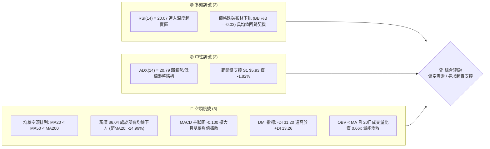
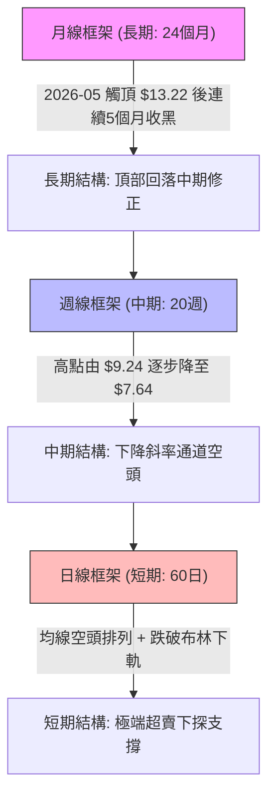
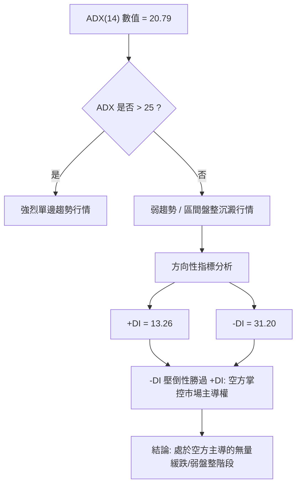
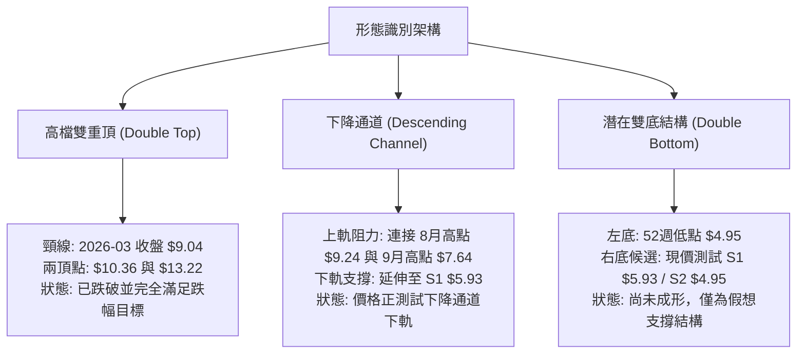
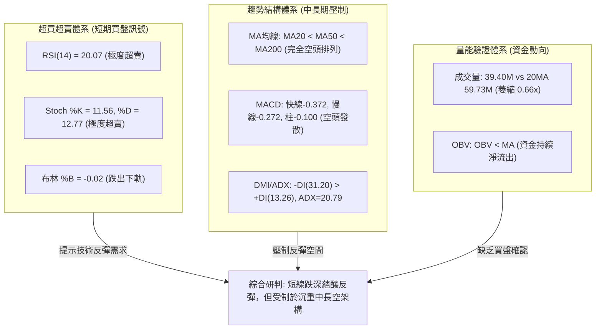
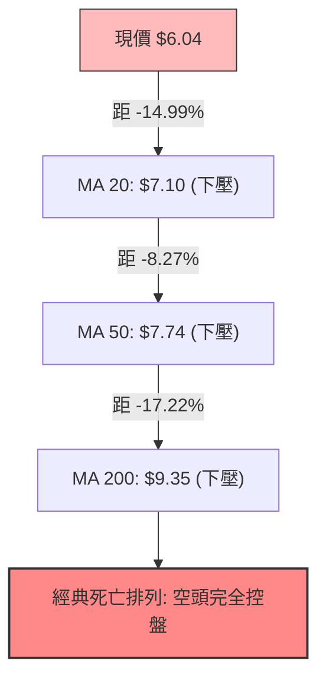
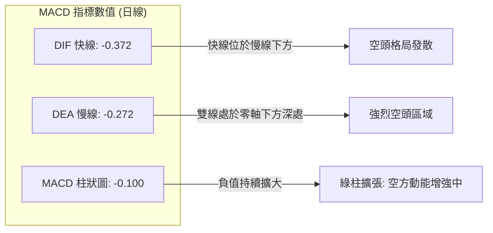
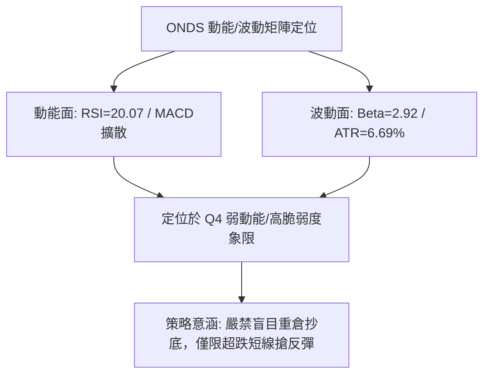
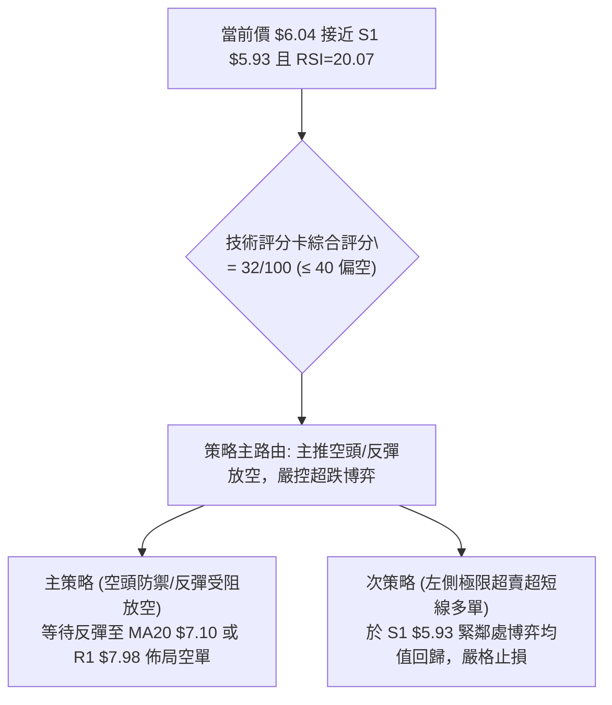
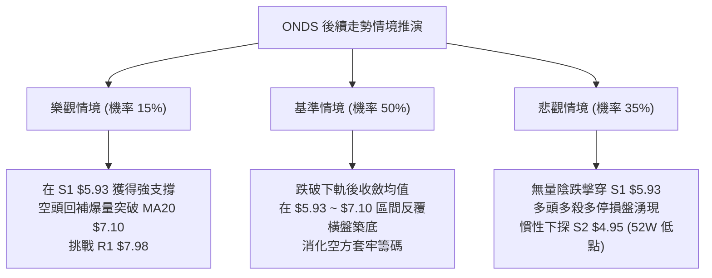

# ONDS 技術分析報告

> **報告日期**：2026-10-18 ｜ **語言**：繁體中文 ｜ **數據來源**：Yahoo Finance ｜ **當前價格**：$6.04

---

## 目錄

| 章節 | 內容 |
|------|------|
| [1. 技術面概覽](#1-技術面概覽) | 訊號儀表板、核心指標、評分卡 |
| [2. 趨勢分析](#2-趨勢分析) | 多時框趨勢、長中短期走勢 |
| [3. 圖表形態分析](#3-圖表形態分析) | 形態識別、K線組合、目標價 |
| [4. 支撐與阻力](#4-支撐與阻力) | 關鍵價位、斐波那契回調 |
| [5. 技術指標深度解讀](#5-技術指標深度解讀) | MA/RSI/MACD/布林/成交量 |
| [6. 動能與波動率](#6-動能與波動率) | 動能評估、ATR、Beta |
| [7. 多時框架總結](#7-多時框架總結) | 時框架評分矩陣 |
| [8. 交易策略建議](#8-交易策略建議) | 多空策略、風險報酬比 |
| [9. 風險提示與監控](#9-風險提示與監控) | 監控指標、風險場景 |

---

## 1. 技術面概覽

### 🎯 技術訊號儀表板



### 📊 核心指標速覽表

| 指標類別 | 指標名稱 | 當前數值 | 訊號 | 解讀 |
|----------|----------|----------|------|------|
| **價格** | 當前價格 | $6.04 | 🔴 | 位於52週區間 10.6% 低檔，短線賣壓沉重 |
| **均線** | MA20 | $7.10 | 🔴 | 現價低於MA20達 -14.99%，短期均線強烈壓制 |
| **均線** | MA50 | $7.74 | 🔴 | 中期生命線下行，中期空頭掌控主導權 |
| **均線** | MA200 | $9.35 | 🔴 | 長期牛熊分界線下行，長線處於空頭循環 |
| **動能** | RSI(14) | 20.07 | 🟢 | 進入極端超賣區 (<30)，蘊釀技術性跌深反彈 |
| **動能** | MACD | -0.372 / -0.272 / -0.100 | 🔴 | 快慢線負值發散，柱狀圖負值放大，空方動能充沛 |
| **動能** | Stoch %K / %D | 11.56 / 12.77 | 🟢 | 隨機指標雙雙落於極低超賣區，短線殺跌動能減弱 |
| **趨勢** | ADX / DMI | ADX: 20.79 (+DI: 13.26 / -DI: 31.20) | 🟡 | ADX < 25 代表非強烈單邊趨勢，-DI 主導跌勢但動能放緩 |
| **通道** | 布林通道 | 上軌 $8.13 / 中軌 $7.10 / 下軌 $6.08 | 🟢 | %B 為 -0.02，現價跌破下軌，產生通道外極端擴張 |
| **量能** | 成交量 / 20日均量 | 39.39M / 59.73M (0.66x) | 🔴 | 量能持續萎縮，OBV 疲弱，缺乏多頭承接大單 |
| **波動** | ATR(14) | $0.40 (佔股價 6.69%) | 🟡 | 每日平均波動幅度大，需給予充足止損緩衝空間 |

### 🏆 技術評分卡

```
╔══════════════════════════════════════════════════════════════════╗
║                技術評分卡 — ONDS (2026-10-18)                    ║
╠══════════════════════════════════════════════════════════════════╣
║ 趨勢強度 (ADX=20.79, 空頭排列)   ██████░░░░░░░░░░░░  30/100 🔴 ║
║ 動能指標 (RSI超賣但MACD偏空)     ████████░░░░░░░░░░  40/100 🟡 ║
║ 支撐穩定度 (逼近 S1 $5.93 低點)   ████████░░░░░░░░░░  40/100 🟡 ║
║ 成交量配合 (量能萎縮0.66x, OBV弱) ████░░░░░░░░░░░░░░  20/100 🔴 ║
║ 形態完整度 (自$13.22單邊下挫盤整) ██████░░░░░░░░░░░░  30/100 🔴 ║
║ 均線排列 (MA20<MA50<MA200空排)   ██░░░░░░░░░░░░░░░░  10/100 🔴 ║
╠══════════════════════════════════════════════════════════════════╣
║ 綜合評分                         ██████░░░░░░░░░░░░  32/100 🔴 ║
║ 綜合評級：偏空震盪（超賣待變）                                   ║
╚══════════════════════════════════════════════════════════════════╝
```

---

## 2. 趨勢分析

### 🌐 多時框趨勢分析



### 📈 長期趨勢 — 12個月走勢圖（Unicode）

```
ONDS 月線走勢圖（過去12個月：2025-11 至 2026-10）
價格軸 ($)
$13.50 ┤                                      ● (2026-05 $13.22)
$12.00 ┤                                     / \
$10.50 ┤                       ●            /   \
$10.00 ┤                   ●       ●   ●   /     \
$9.00  ┤               ●             \   /       \   ●
$8.00  ┤       ●                              \   / \
$7.50  ┤   ●                                   ●     \   ●   ●
$7.00  ┤                                                   \
$6.00  ┤━━━━━━━━━━━━━━━━━━━━━━━━━━━━━━━━━━━━━━━━━━━━━━━━━━━━●←現價 $6.04
       └─┬───────┬───────┬───────┬───────┬───────┬───────┬───────┬─
        25-11   25-12   26-01   26-02   26-03   26-04   26-05   26-06   26-07   26-08   26-09   26-10
收盤價:  7.90    9.76   10.36   10.08    9.04   10.04   13.22    8.24    7.49    7.66    7.33    6.04
```

#### 長期走勢階段特徵分析

| 階段區間 | 月份起訖 | 起始與終止價 | 區間漲跌幅 | 結構形態與成交量特徵 |
|----------|----------|--------------|------------|----------------------|
| 第一階段：多頭加速段 | 2025-11 ~ 2026-01 | $7.90 → $10.36 | +31.14% | 連續三個月長紅，站穩兩位數大關，買盤動能強烈 |
| 第二階段：高檔箱型整理 | 2026-02 ~ 2026-04 | $10.08 → $10.04 | -0.40% | $9.04 ~ $10.08 窄幅拉鋸，高檔換手積蓄動能 |
| 第三階段：末升衝頂爆量 | 2026-05 | $10.04 → $13.22 | +31.67% | 單月大漲創下波段高點 $13.22（52週高點 $15.28） |
| 第四階段：斷崖式崩跌回吐 | 2026-06 ~ 2026-07 | $13.22 → $7.49 | -43.34% | 獲利了結賣壓湧現，連續失守 $10 與 $8 關卡 |
| 第五階段：低檔弱勢陰跌 | 2026-08 ~ 2026-10 | $7.66 → $6.04 | -21.15% | 8月反彈無力，9-10月量縮破線，逼近 52 週低點區 |

### 📊 中期趨勢（週線分析）

從近 20 週收盤走勢觀察，中期走勢呈現「反彈高點遞減、回落低點逼近前低」的典型下降階梯：
- 2026-06-07 收盤 $10.43 展開大幅回調，跌至 2026-07-19 的 $6.53。
- 2026-07-26 爆出 8.34 億股大量反彈至 $7.80，隨後於 2026-08-16 創下反彈次高點 $9.24（RSI達70.3）。
- 2026-08-23 以後，成交量萎縮至 2~3 億股水準，股價沿短期均線滑落，收盤價由 $8.71 跌至當前 $6.04，跌破 7 月中旬低點 $6.53。

```
中期週線阻力與支撐示意圖
$9.24 ─────────────────────── 波段反彈高點 (2026-08-16)
        \
 $8.58 ──\─────────────────── R3 (近一年波段高點聚類)
          \
   $7.98 ──\───────────────── R1 / 近期週線反彈頸線 (2026-08-30 $7.90)
            \
     $7.16 ──\─────────────── 斐波那契 78.6% 回調位
              \
       $6.04 ──●───────────── 現價 (跌破前波收盤低點 $6.53)
         $5.93 ─-──────────── S1 (波段低點支撐，距現價 -1.82%)
           $4.95 ──────────── S2 (52週最低價 / 100% 斐波那契)
```

### ⚡ 趨勢強度評估（ADX 解讀）



| 指標名稱 | 當前讀數 | 閥值標準 | 趨勢強度解讀 |
|----------|----------|----------|--------------|
| **ADX (14)** | 20.79 | < 25 (弱趨勢/盤整) | 顯示當前未處於強烈的單邊暴跌趨勢，而是處於空頭動能減速的陰跌磨底期 |
| **+DI** | 13.26 | 參考基準 | 多頭進攻意願極低，主動買盤嚴重匱乏 |
| **-DI** | 31.20 | > 30 (空頭主導) | 空方仍控制盤面節奏，但 -DI 尚未向上爆發 |
| **多空力量差** | -17.94 | 負值擴大 | 空方絕對優勢，多頭需待 ADX 拐頭向上且 +DI 上穿方能確認扭轉 |

---

## 3. 圖表形態分析

### 🔍 形態識別系統



#### 形態信心度與目標價計算

| 形態名稱 | 信心度 | 判斷依據（引用數據） | 完成度 | 目標價（附精確計算式） |
|----------|--------|----------------------|--------|------------------------|
| **高檔雙頂破位** | 85% | 頂點1 (2026-01) $10.36，頂點2 (2026-05) $13.22；頸線為2026-03低點 $9.04。6月跳空失守 $9.04。 | 100% | 頸線 $9.04 - 形態高度 ($13.22 - $9.04 = $4.18) = **$4.86**（已逼近 52W 低點 $4.95） |
| **中期下降通道** | 75% | 高點連線：$9.24 (08-16) → $7.64 (09-27)；低點測試：$6.53 (07-19) → 現價 $6.04 | 90% | 通道下軌目標即為波段支撐 **$5.93**；若失守則下探 **$4.95** |
| **大型雙重底** | 25% | 左底為 52週低點 $4.95，當前價格 $6.04 尚未觸及並缺乏築底突破訊號 | 20% | 訊號不足，僅做指標型解讀（頸線尚未建立，無法計算有效目標價） |

### 🕯️ 重要K線形態分析

| 週/月份 | 收盤價 | K線形態特徵 | 技術面解讀 | 訊號方向 |
|---------|--------|-------------|------------|----------|
| 2026-05 | $13.22 | 帶長上影線長紅 (月高達 $15.28) | 末升段狂熱派發，多頭力竭，主力資金獲利出場 | 🔴 頂部力竭 |
| 2026-06 | $8.24 | 長黑實體大陰線 (跌幅 -37.67%) | 跌破所有短期均線，確認頭部成形，空頭趨勢確立 | 🔴 空方吞噬 |
| 2026-07-26 | $7.80 | 放量長下影線長紅 (單週成交8.34億) | 逢低強力承接買盤介入，短線醞釀超跌反彈 | 🟢 底部吞噬 |
| 2026-08-16 | $9.24 | 衝高受阻流星線 (觸及 $9.24 後拉回) | 反彈受制於長期均線壓力，多頭二次受挫回落 | 🔴 次高點受阻 |
| 2026-10-18 | $6.04 | 連續三週下行黑K (失守 $7.00 整數) | 空方維持壓迫式緩跌，多頭毫無抵抗，直逼前低 | 🔴 空方延續 |

### 📉 ASCII 走勢形態示意圖

```
ONDS 2026年走勢形態與通道示意圖
$15.28 ┬                     ▲ 52W 高點 (2026-05)
       │                    / \
$13.22 ┤        頂1        /   \
$10.36 ┤       ┌─●─┐     /     \
$9.24  ┤───────│───│────/───────\───────● 次高點 (2026-08-16)
$9.04  ┤=======│===│===●========\======│======== 雙頂頸線破位點
$7.98  ┤       │   │  / 2026-03  \     │   ● R1 阻力位
$7.10  ┤       │   │ /            \    │  /  (MA20 / 布林中軌)
$6.04  ┤───────│───│/──────────────\───│─/──● 現價 $6.04 (測試通道下軌)
$5.93  ┤.......│...│................\..│/.... S1 支撐位 (-1.82%)
$4.95  ┴───────●───●─────────────────●─●────── S2 (52W 低點 / 雙頂等幅滿足區)
```

### 🎯 形態目標價計算

根據高檔雙重頂與頭部形態高度推算：
1. **雙頂頸線位**：2026年3月收盤低點 **$9.04**。
2. **形態最高點**：2026年5月月線收盤 **$13.22**。
3. **垂直形態高度**：$13.22 - $9.04 = **$4.18**。
4. **理論最小跌幅滿足點**：頸線 $9.04 - 形態高度 $4.18 = **$4.86**。
   - 此理論測幅滿足點與歷史數據中由波段低點算出的 **S2 ($4.95)** 極度吻合（誤差僅 $0.09），顯示 $4.86 ~ $4.95 區間具備極強的形態對稱與技術支撐意義。

---

## 4. 支撐與阻力

### 🗺️ 關鍵價位分布圖（Unicode）

```
ONDS 價位結構分布圖 (由 OHLCV 歷史數據聚類精確計算)
═════════════════════════════════════════════════════════════════
$15.28 ║                                                        ║ 52週歷史高點 (0.0% 斐波那契)
$12.84 ║▓▓▓▓▓▓▓▓                                                ║ 23.6% 斐波那契回調位
$11.33 ║▓▓▓▓▓▓▓▓▓▓▓▓                                            ║ 38.2% 斐波那契回調位
$10.11 ║▓▓▓▓▓▓▓▓▓▓▓▓▓▓▓▓                                        ║ 50.0% 多空中軸分界線
$9.35  ║████████████████████████████                            ║ MA200 牛熊分水嶺
$8.90  ║▓▓▓▓▓▓▓▓▓▓▓▓▓▓▓▓▓▓                                      ║ 61.8% 斐波那契黃金回調位
$8.58  ║████████████████████████████████████                    ║ 強阻力 R3 (+42.05%)
$8.31  ║████████████████████████████                            ║ 阻力 R2 (+37.67%)
$7.98  ║████████████████████████████████                        ║ 關鍵阻力 R1 (+32.12%)
$7.16  ║▓▓▓▓▓▓▓▓▓▓▓▓▓▓▓▓▓▓▓▓▓▓                                  ║ 78.6% 斐波那契深度回調位
$7.10  ║████████████████████                                    ║ MA20 短期下壓均線
$6.08  ║────────────────────────────────────────────────────────║ 布林通道下軌
$6.04  ╠════════════════════════════════════════════════════════╣ ◄ 當前收盤價 $6.04
$5.93  ║▓▓▓▓▓▓▓▓▓▓▓▓▓▓▓▓▓▓▓▓▓▓▓▓▓▓▓▓▓▓▓▓                        ║ 近期波段關鍵支撐 S1 (-1.82%)
$4.95  ║████████████████████████████████████████████████████████║ 強支撐 S2 (52週最低價 / 100%)
═════════════════════════════════════════════════════════════════
```

### 🚧 阻力位分析表

所有阻力數值嚴格引用「關鍵價位」OHLCV 波段高點聚類計算：

| 阻力級別 | 價位 | 與現價距離 | 形成原因與籌碼解讀 | 突破難度 | 重要性 |
|----------|------|------------|--------------------|----------|--------|
| **R1** | $7.98 | +32.12% | 近一年密集波段高點聚類，與 8月下旬收盤價 $7.90 相鄰，為多頭第一道重解套關卡 | 🔴 極高 | ★★★★★ |
| **R2** | $8.31 | +37.67% | 6月反彈高點聚類，亦接近當前下行的布林上軌 ($8.13)，空方主力重點防守區 | 🔴 極高 | ★★★★☆ |
| **R3** | $8.58 | +42.05% | 下半年度強阻力聚類平台，此處上方累積 6-8 月大量套牢浮額，突破需百億級成交量 | 🔴 極險阻 | ★★★★★ |

### 🛡️ 支撐位分析表

所有支撐數值嚴格引用「關鍵價位」OHLCV 波段低點聚類計算：

| 支撐級別 | 價位 | 與現價距離 | 形成原因與籌碼解讀 | 守住機率 | 重要性 |
|----------|------|------------|--------------------|----------|--------|
| **S1** | $5.93 | -1.82% | 近一年波段低點聚類位，當前價格第一道緩衝屏障，也是超賣反彈多頭最後防線 | 🟡 55% | ★★★★☆ |
| **S2** | $4.95 | -18.05% | 52週歷史絕對低點，斐波那契 100.0% 回調位，大型機構防守底線，具決定性支撐 | 🟢 85% | ★★★★★ |

### 📐 斐波那契回調位分析

依據 52週區間最低點 $4.95 至最高點 $15.28 嚴格推算：

```
斐波那契回調層級分布（基準區間：$4.95 → $15.28）
0.0%  ───────── $15.28 (52週最高點)
23.6% ───────── $12.84
38.2% ───────── $11.33
50.0% ───────── $10.11 (多空中軸線)
61.8% ───────── $8.90  (黃金分割回調位)
78.6% ───────── $7.16  (極限回調位 / 近期跌破)
      ───────── $6.04  ◄◄◄ 現價位於 78.6% ($7.16) 與 100.0% ($4.95) 之間
100.0%───────── $4.95  (52週最低點)
```

- **位置解讀**：現價 $6.04 已全面跌破 78.6% 斐波那契回調位 ($7.16)。在技術分析理論中，跌破 78.6% 意味著先前的整段多頭推升浪潮被徹底瓦解，市場不再屬於「健康回調」，而是進入「全面性重新尋底」格局。
- **目標導向**：在跌破 $7.16 之後，下方唯一的斐波那契錨定基準即為 100.0% 回調位 **$4.95**。現價距離該位置尚有 -18.05% 空間，若波段支撐 **S1 ($5.93)** 失守，磁吸效應將直接導向 **$4.95**。

---

## 5. 技術指標深度解讀

### 🎛️ 指標訊號總覽



### 📈 移動平均線排列分析



均線系統呈現完美的負斜率發散狀態：
- **MA 5 ($6.38)** 與 **MA 10 ($6.75)**：短期均線如刀鋒下壓，日線級別完全未出現任何收復短期均線跡象。
- **MA 20 ($7.10)**：代表月線籌碼成本，乖離率高達 **-14.99%**，負乖離已拉大至警戒極限。
- **MA 60 ($7.79)**、**MA 120 ($8.48)**、**MA 240 ($9.08)**：依序由下而上展開階梯式反壓，確立了全時框的空頭防禦陣型。

### 📉 RSI(14) 分析

```
RSI(14) 當前讀數: 20.07 
[████░░░░░░░░░░░░░░░░] 20.07% (極度超賣區間 < 30)
 0                    30                  70                 100
 ├────────────────────┼───────────────────┼──────────────────┤
 │    🟢 極端超賣區    │     🟡 中性波動區  │   🔴 極端超超買區 │
```

- **超賣狀況解讀**：RSI(14) 跌至 **20.07**，已進入歷史罕見的深度超賣盲區（通常低於 30 即具備反彈動能，低於 20 則顯示恐慌殺跌已達極致）。
- **背離檢視**：
  - 週線 RSI 於 2026-06-28 觸及 21.8，隨後在 2026-07-05 創下 21.3，當時收盤價為 $7.41。
  - 當前最新收盤價跌至 $6.04，創下近一年新低，而最新週線 RSI 讀數為 **20.1**。
  - **結論**：價格創波段新低，RSI 同步創下新低（20.1 < 21.3），**目前指標並未出現典型的「底背離」特徵**，屬於動能與價格同向宣洩的殺跌，多頭不可主觀臆測底部。

### 📊 MACD(12/26/9) 訊號解讀



- **零軸之下死叉延續**：DIF (-0.372) 與 DEA (-0.272) 雙雙在零軸下方運行，柱狀圖（Histogram）為 **-0.100**，較前週及近期進一步擴大負值，表明空頭動能仍在加速释放，未見金叉收斂跡象。

### 📦 布林通道分析

```
布林通道當前狀態 (帶寬收縮後向下開口)
$8.13 ┬────────────────────────────────────────── 布林上軌 (阻力)
      │
$7.10 ┼────────────────────────────────────────── 布林中軌 (MA20 基準)
      │
$6.08 ┴┄┄┄┄┄┄┄┄┄┄┄┄┄┄┄┄┄┄┄┄┄┄┄┄┄┄┄┄┄┄┄┄┄┄┄┄┄┄┄┄┄ 布林下軌 (下軌線)
$6.04  ▼ [現價跌破下軌，%B = -0.02]
```

- **通道參數解讀**：布林帶上軌位於 **$8.13**，中軌（MA20）為 **$7.10**，下軌為 **$6.08**。
- **%B 極限分析**：當前收盤價 $6.04 跌破下軌 ($6.08)，**%B 數值為 -0.02**。在統計學常態分佈下，價格跌破 -2 個標準差軌道之外屬於小概率極端事件（< 2.5% 機率），暗示空方短線過度透支，隨時有向中軌 ($7.10) 靠攏的均值回歸拉力。

### 💹 成交量分析（量價配合度）

```
成交量對比柱狀圖
最新成交量:  39.40M  [████████████░░░░░░░░] 0.66x
20日均量:   59.73M  [██████████████████░░] 1.00x基準
50日均量:   64.68M  [████████████████████] 1.08x
```

- **量縮陰跌特徵**：最新單日成交量為 39.40M，僅為 20日均量 (59.73M) 的 **0.66 倍**。
- **OBV 量能分析**：數據顯示「OBV < MA → 量能疲弱」。當前價格破底而成交量未見爆量換手，呈現典型的「無量陰跌」結構。無量跌破意味著市場缺乏主動性承接買盤，少量賣壓即可將股價大幅推低，必須等待恐慌性拋售爆出天量（如 2026-07-26 單週 8.34 億股）方能確認局部籌碼清洗完畢。

---

## 6. 動能與波動率

### ⚡ 動能評估分析

| 象限分類 | 動能特徵 | 波動率特徵 | 當前狀態匹配 | 戰術應對評估 |
|----------|----------|------------|--------------|--------------|
| **Q1 (最佳爆發)** | 強勢多頭動能 | 低波動壓縮 | 否 | 蓄勢突破，適合重倉佈局 |
| **Q2 (震盪沉澱)** | 弱勢/中性動能 | 低波動收斂 | 否 | 窄幅盤整，適合網格高拋低吸 |
| **Q3 (極度風險)** | 極強單邊動能 | 極高波動擴張 | 否 | 單邊主升或主跌段，追漲殺跌 |
| **Q4 (空頭釋放)** | **弱多頭/強空頭** | **高歷史波動 (Beta=2.92)** | **✓ 吻合** | **高風險弱勢區，嚴格控制倉位防範失速** |



### 📊 ATR 波動率分析

- **ATR(14) 絕對值**：**$0.40**。
- **ATR 相對波幅比率**：$0.40 / $6.04 = **6.69%**。
- **止損距離建議**：由於個股單日平均波動率高達 6.69%，若進場交易，止損緩衝空間絕不能小於 1.5 倍 ATR（即 $0.40 × 1.5 = **$0.60**），否則極易在正常的日內常態雜訊中被無效震盪洗出場。

### 📐 Beta 與市場相關性

- **Beta 係數**：**2.922**。
- **解讀**：ONDS 屬於極高彈性（Super-High Beta）成長/投機型標的，其波動幅度接近標普500大盤的 3 倍。
- **做空與避險考量**：當前空頭市場環境下，高 Beta 特性導致其股價回調時呈現加倍槓桿效應；但反之若市場情緒回暖或引發軋空，其反彈爆發力亦同樣劇烈（空頭浮額比例高達 39.5%，Short Ratio 為 3.64）。

---

## 7. 多時框架總結

### 📋 時框架評分表

| 時框架 | 趨勢方向 | 動能狀態 | 均線排列 | 圖表形態 | 綜合評分 | 戰術建議 |
|--------|----------|----------|----------|----------|----------|----------|
| **月線 (長期)** | 🔴 偏空 | 下行發散 | 跌破中長期均線 | 雙頂破位後深跌 | 30/100 | 嚴格防禦，不可長期死守 |
| **週線 (中期)** | 🔴 空頭 | MACD綠柱延續 | 下降斜率均線壓制 | 下降通道測試下軌 | 35/100 | 逢高阻力減碼，等待止跌結構 |
| **日線 (短期)** | 🟡 超賣 | RSI=20 極端超賣 | MA20<MA50 負發散 | 跌破布林下軌超賣 | 40/100 | 具備技術性均值回歸博弈機會 |

### 🔲 綜合訊號矩陣

```
時框訊號一致性交叉檢驗
─────────────────────────────────────────────────────────────
維度           短期 (日線)      中期 (週線)      長期 (月線)
─────────────────────────────────────────────────────────────
趨勢方向        🔴 空頭下行      🔴 空頭下行      🔴 頭部破位
動能指標        🟢 極度超賣      🔴 負值增強      🔴 下行發散
量能配合        🔴 萎縮疲弱      🔴 萎縮疲弱      🔴 派發後縮量
形態結構        🟢 通道下軌支撐  🔴 階梯下行      🔴 雙頂滿足中
─────────────────────────────────────────────────────────────
方向收斂度      [ 75% 偏空一致，25% 短期超賣背道而馳 ]
─────────────────────────────────────────────────────────────
```

### ⚖️ 多時框收斂結論

依據多時框收斂優先級規則：
1. **趨勢強度定性**：當前 ADX(14) 讀數為 **20.79**（< 25），在定義上屬於**「弱趨勢 / 盤整磨底」**行情，而非具備高推進動能的單邊強暴跌趨勢。
2. **時框優先級衝突取捨**：
   - 儘管中長期（週線/月線）均線全面空頭排列，但由於日線 ADX < 25，且日線指標觸發極限超賣（RSI=20.07、布林 %B = -0.02），下行殺跌動能已顯著衰竭。
   - 價格已極度逼近波段核心支撐 **S1 ($5.93)**，下行空間在未出現新利空前受到壓制。
3. **唯一收斂方向**：**【偏空震盪，嚴禁追空，等待超賣修復】**。
   - 中長線維持偏空定調，但短線不具備追空盈虧比；日線級別以 **S1 ($5.93)** 至 **布林中軌 MA20 ($7.10)** 的區間震盪修復看待。

---

## 8. 交易策略建議

### 🗺️ 策略決策流程圖



### 🧭 策略路由

> **當前主策略方向 = 偏空高空（依評分卡 32/100 評定），多頭僅限極短線超賣博弈。**

### 🎯 價格情境階梯（Price Scenarios）

所有價位均嚴格取自數據模組「關鍵價位」與斐波那契點位：

| 觸發條件 | 第一目標 | 第二目標 | 情境技術含義 |
|----------|----------|----------|--------------|
| **強力反彈突破 R1 $7.98** | R2 $8.31 | R3 $8.58 | 扭轉短期空頭，突破近一年密集阻力區，空頭回補軋空啟動 |
| **超賣回抽突破 MA20 $7.10** | 斐波那契 78.6% $7.16 | R1 $7.98 | 完成布林下軌向中軌的均值回歸，測試中期下壓趨勢線 |
| **現價 $6.04 守住 S1 $5.93** | MA20 $7.10 | R1 $7.98 | 低檔打底築平台，以時間換取空間消化賣壓 |
| **有效跌破 S1 $5.93** | 理論測幅 $4.86 | S2 $4.95 | 破底殺恐慌盤，下探 52 週絕對低點與雙頂終極滿足區 |

### 📊 情境機率分佈

| 價格情境劇本 | 發生機率 | 主要技術依據 |
|--------------|----------|--------------|
| **劇本一：下探 S1 後引發超賣反彈** | **50%** | RSI(14)=20.07 極端超賣、布林 %B=-0.02、距離 S1 ($5.93) 僅 1.82%，技術性買盤具備博弈動力 |
| **劇本二：跌破 S1 直奔 52W 低點 S2** | **35%** | 均線空頭排列、OBV 疲軟無承接盤、MACD 柱負值擴張，空方主導未變 |
| **劇本三：直接 V 型反轉站上 R1** | **15%** | 成交量極度萎縮 (0.66x)，缺乏增量資金推動反轉，機率極低 |

### 🟢 主策略詳情

```
╔══════════════════════════════════════════════════════════════════╗
║                    交易執行策略明細表                            ║
╠══════════════════════════════════════════════════════════════════╣
║ 策略 A（主推：順勢反彈放空）       策略 B（激進：左側超跌博弈多單）║
╠══════════════════════════════════════════════════════════════════╣
║ 進場條件：反彈測試布林中軌/R1受阻  進場條件：測試 S1 $5.93 獲支撐且出現小陽線 ║
║ 進場價格：$7.10 (MA20 附近)        進場價格：$6.00 (靠近 S1 $5.93)║
║ 目標價 T1：$6.04 (回測現價低點)    目標價 T1：$7.10 (布林中軌 MA20)║
║ 目標價 T2：$4.95 (S2 終極支撐)     目標價 T2：$7.98 (阻力位 R1)    ║
║ 止損價格：$7.50 (突破78.6% $7.16)  止損價格：$5.53 (跌破S1且減1.5ATR $0.60)║
║ 風險報酬比：1 : 2.65 ~ 1 : 5.37    風險報酬比：1 : 2.34 ~ 1 : 4.21  ║
║ 成功機率：60%                      成功機率：40%                   ║
║ 建議倉位：15% ~ 20%                建議倉位：5% (微量投機)         ║
╚══════════════════════════════════════════════════════════════════╝
```

- **策略 A (順勢放空) 損益比計算**：
  - 進場 $7.10，止損 $7.50 (風險 $0.40)。
  - T1 $6.04 (利潤 $1.06) → 風險報酬比 = $1.06 / $0.40 = **2.65 : 1**。
  - T2 $4.95 (利潤 $2.15) → 風險報酬比 = $2.15 / $0.40 = **5.37 : 1**。
- **策略 B (超跌博弈) 損益比計算**：
  - 進場 $6.00，止損 $5.53 (以 S1 $5.93 扣除常態雜訊，風險 $0.47)。
  - T1 $7.10 (利潤 $1.10) → 風險報酬比 = $1.10 / $0.47 = **2.34 : 1**。
  - T2 $7.98 (利潤 $1.98) → 風險報酬比 = $1.98 / $0.47 = **4.21 : 1**。

### 🔴 反向風險觸發點（對沖提示）

- **全面推翻空頭邏輯的關鍵價位**：日線放量收盤**實體站穩 $7.98 (R1)**。
  - 一旦價格強勢越過 $7.98，代表近兩個月的下降通道遭到實質性向上突破，且一舉收復 78.6% 斐波那契回調位 ($7.16) 與 MA50 ($7.74)。空方必須無條件全數平倉停損，並應防範空頭浮額高達 39.5% 帶來的暴力軋空風險。

### ⭐ 整體訊號強度評星

```
╔══════════════════════════════════════════════════╗
║ 做多訊號強度：★★☆☆☆  (2.0/5星 - 僅有極限超賣) ║
║ 做空訊號強度：★★★★☆  (4.0/5星 - 順應大勢但忌追) ║
║ 整體可信度：  ★★★☆☆  (3.5/5星 - 低量易生異動) ║
╚══════════════════════════════════════════════════╝
```

---

## 9. 風險提示與監控

### ✅ 關鍵監控指標 Checklist

```
╔══════════════════════════════════════════════════════════════════╗
║              ONDS 每日盤面風控監控清單 (Checklist)               ║
╠══════════════════════════════════════════════════════════════════╣
║ [ ] 支撐防線監控：日線收盤是否跌破 S1 ($5.93)？                   ║
║     └─ 若跌破，下一停損/防守錨點立即移至 S2 ($4.95)。            ║
║ [ ] 均線動態監控：價格是否收復 MA 5 ($6.38) 與 MA 20 ($7.10)？   ║
║     └─ 未站上 MA20 之前，所有反彈一律視為弱勢技術性修正。          ║
║ [ ] 動能背離監控：RSI(14) 回升至 30 以上時，是否伴隨 MACD 金叉？ ║
║ [ ] 量能異動監控：單日成交量是否突破 60M (超過20日均量 1.0x)？   ║
║     └─ 放量大陽線方能確認主力資金重新進駐護盤。                   ║
║ [ ] 空頭回補監控：高達 39.5% Float 的空頭比例是否引發被動軋空？  ║
╚══════════════════════════════════════════════════════════════════╝
```

### ⚠️ 風險場景分析



### 🛡️ 風險管理重要提醒

1. **極高空頭浮額軋空風險（Short Squeeze Risk）**：
   - 該股 **Short % Float 高達 39.5%**，Short Ratio 達 3.64。在空頭極度擁擠的背景下，任何潛在的不可預期利多或特定買盤介入，均可能在極短時間內誘發報復性軋空暴漲。因此，**空頭策略絕對嚴禁在現價 $6.04 盲目追空**，必須等待反彈至阻力位停滯時方可佈局。
2. **高 Beta 波動懲罰（High Volatility Hazard）**：
   - Beta 值為 **2.922**，且日線 ATR 高達 **$0.40 (6.69%)**。持倉過重將對心理防線造成毀滅性打擊。建議整體投資組合對 ONDS 的風險曝險額度嚴格限制在 **2% 本金損失** 以內，單筆持倉比例不宜超過總資金的 15%。
3. **數據客觀限制與財務背離**：
   - 儘管分析師共識目標價平均達 **$18.88**（低標 $13.00、高標 $25.00），但技術面呈現絕對空頭壓制。在技術圖表未正式發出右側反轉訊號（如收復 R1 $7.98）前，不可依據遠期基本面目標價進行盲目左側抗單。

---

## 📋 報告總結

```
╔══════════════════════════════════════════════════════════════════╗
║                     ONDS 技術分析報告總結                        ║
╠══════════════════════════════════════════════════════════════════╣
║ 報告日期：2026-10-18                                             ║
║ 當前價格：$6.04                                                  ║
║ 分析評級：⚖️ 偏空震盪（極端超賣，等待反彈高空）                  ║
║                                                                  ║
║ 關鍵結論：                                                       ║
║ ├─ 長期趨勢：🔴 空頭（自 52W 高點 $15.28 回跌，雙頂滿足中）      ║
║ ├─ 中期趨勢：🔴 下降通道（高低點持續下移，受阻於下降均線群）    ║
║ ├─ 短期趨勢：🟡 極端超賣（RSI=20.07，布林 %B=-0.02，隨時反彈）   ║
║ ├─ 關鍵支撐：S1 $5.93 (-1.82%) ｜ S2 $4.95 (-18.05%, 52W最低)   ║
║ ├─ 關鍵阻力：MA20 $7.10 (+17.5%) ｜ R1 $7.98 (+32.12%)          ║
║ └─ 分析師目標價：均價 $18.88 (與當前技術盤面嚴重背離)           ║
║                                                                  ║
║ 最優策略組合：                                                   ║
║ 1. 🥇 最佳機會（順勢防禦）：耐性等待反彈至 MA20 $7.10 附近放空，  ║
║      以 $7.50 為停損，目標下看 $6.04 及 S2 $4.95。              ║
║ 2. 🥈 次選機會（超跌博弈）：若在 S1 $5.93 出現築底長下影線，以小 ║
║      倉位 (5%) 博弈均值回歸至 $7.10，嚴格停損設於 $5.53。       ║
║ 3. 🥉 保守選擇（觀望為上）：空手觀望，靜待日線級別帶量站穩 R1    ║
║      $7.98 確認右側底部成形後再行進場。                          ║
╚══════════════════════════════════════════════════════════════════╝
```

---

> ⚠️ **免責聲明**：本報告為 AI 自動生成之技術分析，所有數據及估算均嚴格基於所提供的歷史價格與指標資訊。本報告**僅供研究與學術參考**，**不構成任何買賣要約或投資建議**。金融市場波動劇烈，投資人應獨立評估風險並自行承擔交易後果。

---

*報告生成時間：2026-10-18 ｜ 數據來源：Yahoo Finance ｜ 分析框架：多時框技術分析*