# ONDS 技術分析報告

> **報告日期**：2026-10-19 ｜ **語言**：繁體中文 ｜ **數據來源**：Yahoo Finance ｜ **當前價格**：$6.04

---

## 目錄

| 章節 | 內容 |
|------|------|
| [1. 技術面概覽](#1-技術面概覽) | 訊號儀表板、核心指標、評分卡 |
| [2. 趨勢分析](#2-趨勢分析) | 多時框趨勢、長中短期走勢、ADX 解讀 |
| [3. 圖表形態分析](#3-圖表形態分析) | 形態識別、K線組合、目標價推算 |
| [4. 支撐與阻力](#4-支撐與阻力) | 關鍵價位、斐波那契回調結構 |
| [5. 技術指標深度解讀](#5-技術指標深度解讀) | 均線系統、RSI、MACD、布林通道、OBV |
| [6. 動能與波動率](#6-動能與波動率) | 動能四象限、ATR 波動率、Beta 市場敏感度 |
| [7. 多時框架總結](#7-多時框架總結) | 時框架矩陣、多時框收斂原則 |
| [8. 交易策略建議](#8-交易策略建議) | 策略路由、主策略執行細節、風控情境 |
| [9. 風險提示與監控](#9-風險提示與監控) | 關鍵監控清單、極端情境與倉位管理 |

---

## 1. 技術面概覽

### 🎯 技術訊號儀表板

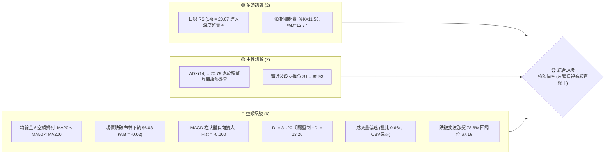

### 📊 核心指標速覽表

| 指標類別 | 指標名稱 | 當前數值 | 訊號 | 解讀 |
|----------|----------|----------|:----:|------|
| **價格** | 當前收盤價 | $6.04 | 🔴 | 位於 52 週區間 10.6% 處，逼近波段下緣 |
| **均線** | MA20 (月線) | $7.10 | 🔴 | 現價低於 MA20 達 -14.99%，短期受制下行 |
| **均線** | MA50 (季線) | $7.74 | 🔴 | 季線下彎，中線空頭壓制顯著 |
| **均線** | MA200 (年線)| $9.35 | 🔴 | 現價低於年線 -35.40%，長期趨勢翻空 |
| **動能** | RSI(14) | 20.07 | 🟢 | 極度超賣 (<30)，短期隨時具備技術性抽頭動能 |
| **動能** | MACD (12,26,9) | -0.372 / -0.272 | 🔴 | DIF 低於 DEA，負柱狀體 -0.100 持續擴散 |
| **動能** | KD (9,3,3) | 11.56 / 12.77 | 🟢 | 進入低檔鈍化超賣區間 |
| **趨勢** | ADX / DMI | 20.79 | 🔴 | 雖然 ADX < 25，但 -DI(31.20) 遠大於 +DI(13.26)，空方絕對主導 |
| **通道** | 布林通道 | 下軌 $6.08 | 🔴 | %B 為 -0.02，價格跌出帶外，呈現弱勢單邊貼軌下行 |
| **量能** | 20日均量比 | 0.66x | 🔴 | 當日成交 3,939.59 萬股，量能萎縮且 OBV 弱於均線 |
| **波動** | ATR(14) | $0.40 | 🟡 | 佔股價 6.69%，單日波動彈性極大，停損空間需放大 |

### 🏆 技術評分卡

```
╔══════════════════════════════════════════════════════════════╗
║              技術評分卡 — ONDS (2026-10-19)                  ║
╠══════════════════════════════════════════════════════════════╣
║ 趨勢方向 (Trend)       ███░░░░░░░░░░░░░░░░░  18/100 🔴 空頭排列  ║
║ 動能強度 (Momentum)    ██████░░░░░░░░░░░░░░  32/100 🟡 低檔超賣  ║
║ 支撐穩定度 (Support)   ████████░░░░░░░░░░░░  38/100 🔴 測底 S1   ║
║ 成交量配合 (Volume)    █████░░░░░░░░░░░░░░░  26/100 🔴 縮量陰跌  ║
║ 形態結構 (Pattern)     ██████░░░░░░░░░░░░░░  30/100 🔴 破位下行  ║
║ 均線發散度 (Alignment) ██░░░░░░░░░░░░░░░░░░  12/100 🔴 完全空頭  ║
╠══════════════════════════════════════════════════════════════╣
║ 綜合技術評分           █████░░░░░░░░░░░░░░░  26/100 🔴 強烈偏空  ║
╚══════════════════════════════════════════════════════════════╝
```

---

## 2. 趨勢分析

### 🌐 多時框趨勢分析

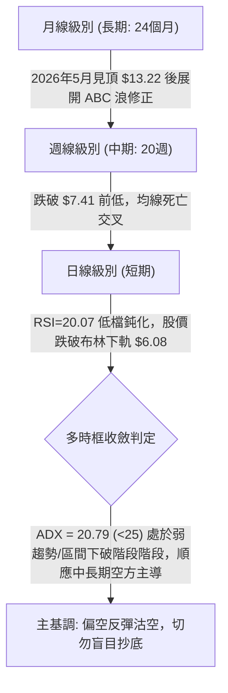

### 📈 長期趨勢 — 12個月走勢圖（Unicode）

以下為 ONDS 自 2025 年 11 月至 2026 年 10 月之月線收盤走勢：

```
ONDS 月線走勢圖（過去12個月收盤價變動）
價格軸 ($)
$13.22 ┤                                      ● (2026-05 頂部)
$12.00 ┤                                     / \
$10.36 ┤                     ●             /   \
$10.04 ┤                    / \     ●─────●     \
 $9.04 ┤                   /   \   /             \
 $7.90 ┤  ●              /     ●─●               ● (2026-06 破位)
 $7.33 ┤   \             /                         \───●───● (08-09月盤整)
 $6.04 ┤    \           /                                   \
 $5.00 ┤     \─────────●                                     ● (2026-10 現價)
       └─────────────────────────────────────────────────────────────
        25-11 25-12 26-01 26-02 26-03 26-04 26-05 26-06 26-07 26-08 26-09 26-10
```

#### 長期月線走勢特徵分析表

| 階段區間 | 起訖月份 | 收盤價變動 | 區間漲跌幅 | 結構與量價特徵 |
|:---|:---:|:---:|:---:|:---|
| **主升浪攀升** | 2025-11 → 2026-01 | $7.90 → $10.36 | +31.14% | 連續放量陽線，突破前波阻力，確立波段高點 |
| **高位箱型整理** | 2026-01 → 2026-04 | $10.36 → $10.04 | -3.09% | 於 $9.04 至 $10.36 間震盪，籌碼進行大規模換手 |
| **多頭末升衝刺** | 2026-04 → 2026-05 | $10.04 → $13.22 | +31.67% | 爆發性買盤衝刺創下波段歷史次高，但留下長上影線 |
| **快速獲利了結** | 2026-05 → 2026-06 | $13.22 → $8.24 | -37.67% | 單月重挫逾 37%，跌破起漲頸線，主力出貨明確 |
| **弱勢弱反彈平台** | 2026-06 → 2026-09 | $8.24 → $7.33 | -11.04% | 於 $7.23 - $7.80 築出平坦旗形，成交量呈現階梯式遞減 |
| **主跌浪向下破位** | 2026-09 → 2026-10 | $7.33 → $6.04 | -17.60% | 灌破支撐平台，向 52 週低點 $4.95 方向宣洩賣壓 |

### 📊 中期趨勢（週線分析）

從近 20 週收盤走勢觀察，ONDS 經歷了兩次反彈失敗：
1. **第一次嘗試（2026-07-26 至 2026-08-16）**：股價自 $6.53 反彈至 $9.24，週成交量暴增至 8.34 億股，週 RSI 衝至 70.3，但在遭逢 R2 ($8.31) 與 MA50 反壓後迅速回落。
2. **第二次嘗試（2026-09-27）**：反彈至 $7.64 即遭遇阻力，隨後連續三週收陰（$7.24 → $6.73 → $6.04），週 MACD 柱狀體重新由正轉負（+0.013 → -0.035 → -0.100）。

```
中期週線支撐壓力結構示意
  [阻力帶 R2 / R3]  ═════════════════════════ $8.31 - $8.58 (中期強阻力)
                              ▲ 反彈高點 $9.24 (2026-08-16)
                             / \
  [反彈頸線 R1]     ────────/───\──────────── $7.98 (近一年波段高點聚類)
                           /     \     ▲ 次高點 $7.64 (2026-09-27)
  [前期破位中樞]    ──────/───────\───/─\──── $7.16 (斐波那契 78.6% 回調)
                         /         \ /   \
  [當前價格]        ────●───────────v─────●── $6.04 (最新收盤)
  [近期波段低點 S1] ───────────────────────── $5.93 (近一年波段低點聚類)
  [52週極限低點 S2] ═════════════════════════ $4.95 (年度底部關鍵支撐)
```

### ⚡ 趨勢強度評估（ADX 解讀）

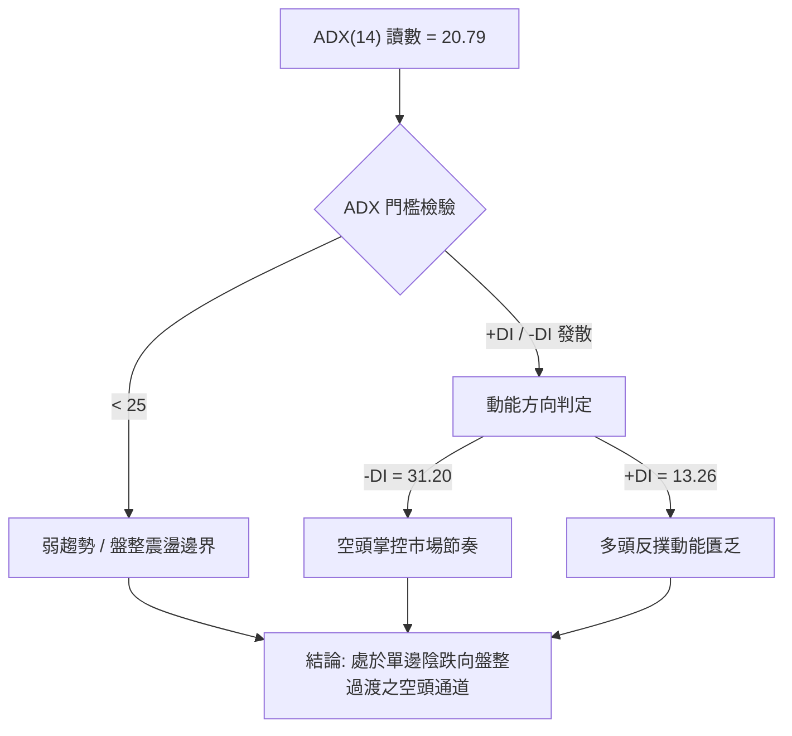

#### ADX 強度對照與解讀表

| 指標名稱 | 當前數值 | 門檻基準 | 狀態評估 | 實質意義解讀 |
|:---|:---:|:---:|:---:|:---|
| **ADX(14)** | 20.79 | 25.00 | 弱趨勢/區間震盪 | 雖未達強趨勢標竿(>25)，但自低檔向上勾頭，代表跌勢正在累積新的慣性 |
| **+DI (正向動向)** | 13.26 | 20.00 | 極弱 | 買盤力量顯著渙散，無法形成有效推升波浪 |
| **-DI (負向動向)** | 31.20 | 25.00 | 強勢空頭 | 賣盤佔據主導優勢，-DI 與 +DI 差值高達 17.94，顯示空方完全控盤 |
| **綜合判定** | 🔴 空方控盤 | ADX < 25 | 弱勢下移 | 行情屬於「空頭主導下的弱勢陰跌」，盤中反彈皆受限於均線動態反壓 |

---

## 3. 圖表形態分析

### 🔍 形態識別系統

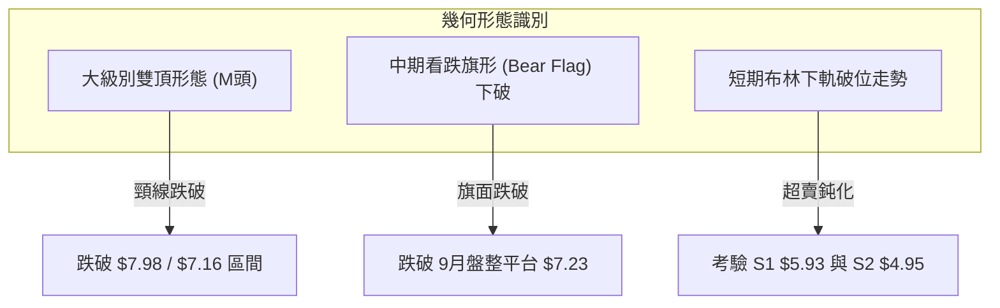

#### 圖表形態信心度與目標價計算表

| 形態名稱 | 信心度 | 判斷依據（引用數據） | 完成度 | 目標價（附嚴謹計算式） |
|:---|:---:|:---|:---:|:---|
| **中期雙頂 (Double Top)** | 85% | 左頂 $10.36 (2026-01)，右頂 $13.22 (2026-05) 伴隨月線放量，頸線落於波段密集區 R1 $7.98。2026年6月大陰線直接下破 $8.24。 | 100% (已跌破) | 由形態高度推算：頸線 $7.98 - (頂部 $10.36 - 頸線 $7.98) = **$5.60**（已逼近波段低點聚類 S1 $5.93） |
| **看跌旗形 (Bear Flag)** | 75% | 2026-08 見反彈高點 $9.24 後急跌至 $7.23 形成旗桿（落差 $2.01）；9月於 $7.23 - $7.64 形成弱勢旗面，10月以 $6.04 實體陰線跌穿旗面下軌。 | 90% (破位確認) | 由旗形高度推算：破位點 $7.23 - 旗桿落差 $2.01 = **$5.22**（介於 S1 $5.93 與 52W 低點 S2 $4.95 之間） |
| **短期下降契形/通道** | 50% | 日線沿著布林通道下軌 $6.08 單邊下探，RSI 跌至 20.07，但數據中未偵測到明確的收斂契形下軌，幾何結構欠完整。 | 35% (未成形) | 訊號不足，僅做指標型超賣解讀，不預設契形翻轉目標價。 |

### 🕯️ 重要K線形態分析

| 週期/月份 | 收盤價 | K線形態 | 量價關係與解讀 | 訊號評級 |
|:---:|:---:|:---|:---|:---:|
| **2026-05** | $13.22 | 長上影避雷針大陽線 | 月線單月衝高至 52W 高點 $15.28 後遭遇機構大舉拋售，留長上影線，主力出貨信號明確 | 🔴 強烈看空 |
| **2026-06** | $8.24 | 光頭大陰線 (Bearish Marubozu) | 實體跌幅高達 -37.67%，完全吞噬前兩月漲幅，空方擊穿 MA20 與 MA50 | 🔴 空方突穿 |
| **2026-07-26(週)**| $7.80 | 週線爆量長陽 (Hammer/反彈) | 週成交量激增至 8.34 億股，收復跌幅，為跌勢中的主力護盤與誘多反彈 | 🟡 假突破 |
| **2026-09(月)** | $7.33 | 紡錘星線 (Spinning Top) | 波動區間收斂於 $7.23 - $7.64，多空陷入短暫平衡，屬於暴跌後的弱勢中繼 | 🟡 方向未明 |
| **2026-10(當前)**| $6.04 | 破位光腳陰線 | 當月跌破中繼平台下沿，連續跌穿所有短期均線，空頭賣壓再度釋放 | 🔴 極度疲弱 |

### 📉 ASCII 走勢形態示意圖

```
ONDS 中期雙頂 (M頭) 與 看跌旗形破位示意圖
$13.22 ─────────────── 右頂 (2026-05)
                      /\
$10.36 ── 左頂 (26-01)/  \
          /\         /    \
         /  \       /      \
$7.98 ──[────\─────/────────\─────────────────────] 雙頂頸線 (R1)
              \   /          \
$7.64 ─────────\─/────────────\── 旗面上軌 ──▲
                               \            / \
$7.23 ──────────────────────────\─ 旗面下軌 ●───\── 破位點
                                                 \
$6.04 ────────────────────────────────────────────● 現價位置 (加速探底)
                                                   :
$4.95 ═════════════════════════════════════════════▼ 終極目標 (52W Low / S2)
```

### 🎯 形態目標價計算

根據經典技術形態幾何量度規則進行推導：

1. **雙頂頸線破位量度跌幅**：
   - 基準頸線取近一年重要波段高點聚類 **R1 = $7.98**。
   - 形態初級頂部高點為 **$10.36**（2026-01 月收盤價）。
   - 形態垂直高度 $H_1 = \$10.36 - \$7.98 = \$2.38$。
   - 破位量度目標價 $Target_1 = \$7.98 - \$2.38 = \mathbf{\$5.60}$。
   - *評估*：該價位貼近近一年波段低點聚類 **S1 ($5.93)**，顯示目前股價（$6.04）已進入第一目標滿足區的邊緣。

2. **看跌旗形延伸量度跌幅**：
   - 旗桿起點為 2026-08 高點 $9.24，終點為 2026-09 低點 $7.23，旗桿落差 $H_2 = \$9.24 - \$7.23 = \$2.01$。
   - 破位點取自旗面下沿支撐 $7.23。
   - 旗形次級量度目標價 $Target_2 = \$7.23 - \$2.01 = \mathbf{\$5.22}$。
   - *評估*：若跌破 S1 ($5.93)，股價將朝向 52 週最低點 **S2 ($4.95)** 尋求終極支撐。

---

## 4. 支撐與阻力

### 🗺️ 關鍵價位分布圖（Unicode）

```
ONDS 關鍵價位結構分布圖 (由 OHLCV 聚類計算)
═════════════════════════════════════════════════════════════════════
$8.58 ║████████████████████████████████████║ 強阻力 R3 (+42.05%)
$8.31 ║██████████████████████████          ║ 阻力 R2 (+37.67%)
$7.98 ║████████████████████████████████    ║ 關鍵頸線阻力 R1 (+32.12%)
$7.16 ║▓▓▓▓▓▓▓▓▓▓▓▓▓▓▓▓▓▓                  ║ 斐波那契 78.6% 回調位 (+18.54%)
$7.10 ║────────────────────────────────────║ 20日均線 MA20 (+17.55%)
$6.08 ║░░░░░░░░░░░░░░░░░░░░░░░░░░░░░░░░░░░░║ 布林通道下軌 (+0.66%)
$6.04 ╠════════════════════════════════════╣ ◄ 當前收盤價 ($6.04)
$5.93 ║████████████████████████████        ║ 波段低點支撐 S1 (-1.82%)
$4.95 ║████████████████████████████████████║ 52週歷史低點強支撐 S2 (-18.05%)
═════════════════════════════════════════════════════════════════════
```

### 🚧 阻力位分析表

所有數值均嚴格引用數據包中「近一年波段高點聚類」與均線計算：

| 阻力級別 | 具體價位 | 距離現價幅幅 | 形成原因與籌碼結構 | 突破難度 | 重要性等級 |
|:---|:---:|:---:|:---|:---:|:---:|
| **動態阻力** | $7.10 | +17.55% | 20日均線 (MA20) 所在位置，同時為布林中軌，短期下行斜率陡峭 | 🟡 中等 | ★★★☆☆ |
| **R1** | $7.98 | +32.12% | 近一年波段高點聚類關鍵位，前波大型雙頂頸線，累積大量套牢籌碼 | 🔴 極高 | ★★★★★ |
| **R2** | $8.31 | +37.67% | 近一年波段次高密集聚類區，2026年6月崩跌之起跌中樞 | 🔴 極高 | ★★★★☆ |
| **R3** | $8.58 | +42.05% | 波段反彈極限阻力聚類，上方緊鄰 MA120 ($8.48) 動態反壓 | 🔴 極高 | ★★★★☆ |

### 🛡️ 支撐位分析表

所有數值均嚴格引用數據包中「近一年波段低點聚類」與 52 週最低點：

| 支撐級別 | 具體價位 | 距離現價幅幅 | 形成原因與防守意義 | 守住機率 | 重要性等級 |
|:---|:---:|:---:|:---|:---:|:---:|
| **S1** | $5.93 | -1.82% | 近一年波段低點聚類核心，現價僅高出 $0.11，為多方防守第一道防線 | 🟡 45% | ★★★★☆ |
| **S2** | $4.95 | -18.05% | 52週歷史低點 (52W Low)，整數大關，跌破將引發大規模停損賣壓 | 🟢 70% | ★★★★★ |
| **S3** | 數據中未偵測到 | — | 低於 $4.95 之歷史聚類在近一年數據中不存在，嚴禁憑空捏造 | — | — |

### 📐 斐波那契回調位分析

依據 52 週完整波段（低點 $4.95 至 高點 $15.28，波幅 $10.33）計算之各黃金分割水平：

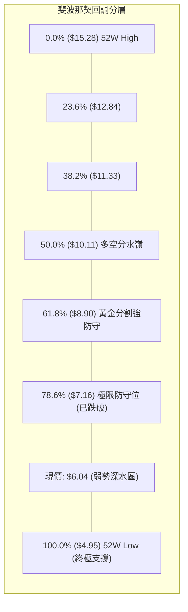

#### 斐波那契層級解讀表

| 回調比例 | 價格水準 | 當前相對位置 | 技術意義與市場心理解讀 |
|:---:|:---:|:---:|:---|
| **0.0%** | $15.28 | +152.98% | 52 週最高點，代表上一輪多頭行情的狂熱頂峰 |
| **23.6%** | $12.84 | +112.58% | 初級拉回支撐，2026年5月見頂後瞬間擊穿 |
| **38.2%** | $11.33 | +87.58% | 弱勢修正回調位，多頭在此無任何抵抗力 |
| **50.0%** | $10.11 | +67.38% | 多空中長期平衡分水嶺，失守後宣告行情轉入空方週期 |
| **61.8%** | $8.90 | +47.35% | 黃金分割重要防線，跌破後確認先前多頭波段遭到實質瓦解 |
| **78.6%** | $7.16 | +18.54% | **最後防守位**。股價於 2026 年 10 月正式跌破此處，代表整輪漲幅被回吐接近八成 |
| **現價** | **$6.04** | **基準** | **落在 78.6% ($7.16) 與 100.0% ($4.95) 之間的「超跌真空帶」** |
| **100.0%** | $4.95 | -18.05% | 52 週最低點，多頭最後心理底線，若回測此處將完成對整波漲幅的 100% 回吐 |

---

## 5. 技術指標深度解讀

### 🎛️ 指標訊號總覽

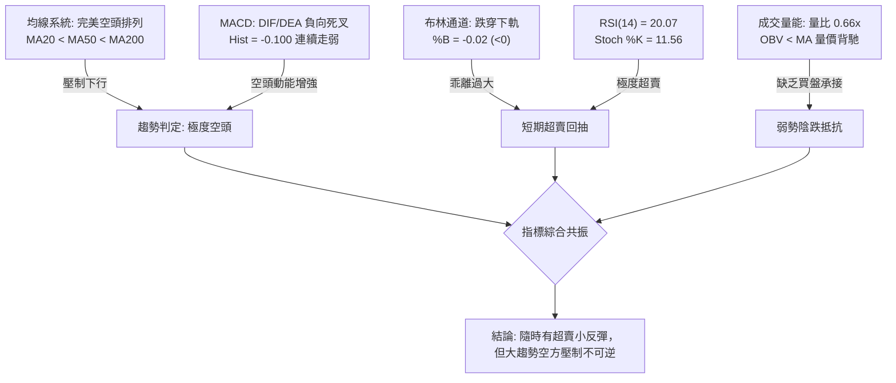

### 📈 移動平均線排列分析

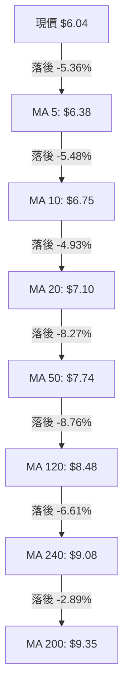

#### 移動平均線數據分析矩陣

| 均線天期 | 當前價位 | 距現價幅幅 | 排列層級 | 趨勢斜率 | 技術意涵解讀 |
|:---:|:---:|:---:|:---:|:---:|:---|
| **MA 5** | $6.38 | +5.63% | 短期第 1 層 | 陡峭向下 ▁ | 極短期動態反壓，盤中觸碰即遭空頭打壓 |
| **MA 10** | $6.75 | +11.75% | 短期第 2 層 | 持續走低 ▁ | 兩週持有者平均成本，形成短線反彈天花板 |
| **MA 20** | $7.10 | +17.55% | 中短期中樞 | 穩步下傾 ▁ | 月線級別生命線，未有效帶量站上前，不可言多 |
| **MA 50** | $7.74 | +28.15% | 中期生命線 | 下行趨勢 ▁ | 季線阻力，空頭中線防禦核心 |
| **MA 60** | $7.79 | +28.97% | 季度分界 | 穩步向下 ▁ | 與 MA50 形成雙重密集均線反壓帶 |
| **MA 120** | $8.48 | +40.40% | 半年線 | 下降通道 ▁ | 標誌著過去半年的買入者處於全面套牢虧損狀態 |
| **MA 200** | $9.35 | +54.80% | 牛熊分界線 | 堅定下行 ▁ | 現價大幅落後年線，確立長期熊市格局 |
| **MA 240** | $9.08 | +50.33% | 兩年線 | 向下走平 ▁ | 長期籌碼結構嚴重鬆動 |

### 📉 RSI(14) 分析

當前 RSI(14) 數值為 **20.07**，進入深度超賣區：

```
RSI(14) 刻度指示條
[ 0 ──────── 20 ──────── 30 ──────────────── 50 ──────────────── 70 ──────── 100 ]
  超跌深水區  ▲          超賣線             多空中軸            超買線
              │ (20.07)
```
- **超買超賣區間判斷**：RSI 低於 30 即屬於超賣，低於 25 則為「極度超賣（Deep Oversold）」。目前 20.07 為近 20 週以來的次低水平（僅高於 2026-06-21 的 22.1 及 2026-07-05 的 21.3）。
- **背離分析判斷**：
  - *日線等級*：數據顯示「RSI 背離：無明顯背離」。現價刷新近期波段低點 $6.04，RSI 同步刷新低點至 20.07，呈現**量價指標同步創新低**，未出現底背離特徵，排除「底背離引發強烈反轉」之可能性。
  - *週線等級*：回顧 2026-06-28 股價 $7.83 (RSI 21.8) 到 2026-07-19 股價 $6.53 (RSI 35.0)，曾出現短暫弱底背離推動反彈至 $9.24；但隨後於 2026-08-09 RSI 達 70.3 見頂，隨後伴隨價格下跌一路震盪滑落，當前週線 RSI 降至 20.1，**未見任何週線級別底背離信號**。

### 📊 MACD(12,26,9) 訊號解讀

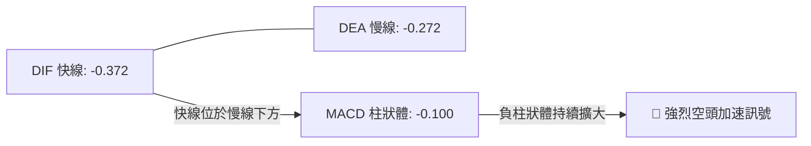
- **數值關係**：DIF (-0.372) < DEA (-0.272) < 0，快慢線均處於零軸下方深水區，屬於典型的「零下死叉空頭主導格局」。
- **柱狀體動能**：負柱狀體讀數為 -0.100，較前週及近期顯著走擴，顯示賣壓並未減緩，反而有加速宣洩跡象。
- **背離檢驗**：MACD 線與價格走勢同步向下破位，綠柱持續發散，**無底背離現象**，指標驗證當前跌勢為實質性主跌段。

### 📦 布林通道分析

```
ONDS 日線布林通道 (20, 2) 結構圖
$8.13 ┤ ───────────────────────────────────── 上軌 (Upper Band)
      │
$7.10 ┤ ─────────────────●─────────────────── 中軌 (MA20)
      │                   \
$6.08 ┤ ───────────────────\───────────────── 下軌 (Lower Band)
      │                     \
$6.04 ┤                      ● ◄ 現價 ($6.04，跌出帶外，%B = -0.02)
```
- **通道寬度與狀態**：布林上軌為 $8.13，中軌為 $7.10，下軌為 $6.08，通道頻寬寬達 $2.05（約 33.9% 波動空間）。
- **%B 指標解析**：當前 %B 數值為 **-0.02**。在布林通道定義中：%B=0 代表價格恰在下軌，%B=1 代表在上軌，%B<0 代表**收盤價跌破布林下軌**。目前股價跌破下軌 $6.08 達 $0.04，呈現極端弱勢的「沿下軌單邊暴跌」走勢。雖然跌出帶外常引發技術性回抽帶內（回到 $6.08 之上），但在 ADX 弱勢下移的情境下，通道開口持續向下擴張，回抽往往受制於快速下墜的 MA5 與 MA10。

### 💹 成交量分析（量價配合度）

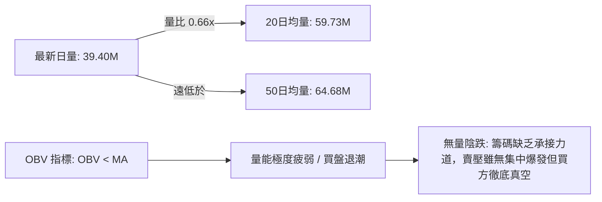
- **量比與均量關係**：最新單日成交量為 39,395,900 股，僅為 20 日均量（59,727,290 股）的 66%（量比 0.66x），亦遠低於 50 日均量（64,681,752 股）。
- **OBV (能量潮) 走勢**：數據確認「OBV < MA → 量能疲弱」。OBV 處於均線下方下行，表明資金呈現持續淨流出狀態。當前市場呈現「無量陰跌」，這種狀態在技術分析中最為棘手，因為缺乏「恐慌盤拋售（Capitulation Volume）」帶來的成交量噴發，往往意味著底部尚未真正探明。

---

## 6. 動能與波動率

### ⚡ 動能評估四象限

將動能維度（由 RSI、MACD、DI 差值綜合判定）與波動率維度（由 ATR% 及 Beta 判定）進行交叉分析：

| 象限 | 動能強度 | 波動率水準 | 當前對應特徵 | 策略與處置方向 |
|:---:|:---:|:---:|:---:|:---|
| **第一象限 (Q1)** | 強多頭動能 | 低波動率 | 不符合 | 最佳單邊做多機會（趨勢穩定） |
| **第二象限 (Q2)** | 弱動能 / 空頭 | 低波動率 | 不符合 | 盤整觀望，等待突破 |
| **第三象限 (Q3)** | 強多頭動能 | 高波動率 | 不符合 | 突破追價，承受高回撤風險 |
| **第四象限 (Q4)** | **極弱空頭動能** | **極高波動率** | **✔ ONDS 目前精確落於此區** | **高風險深水區：嚴禁盲目加倉摸底，以反彈沽空為主** |

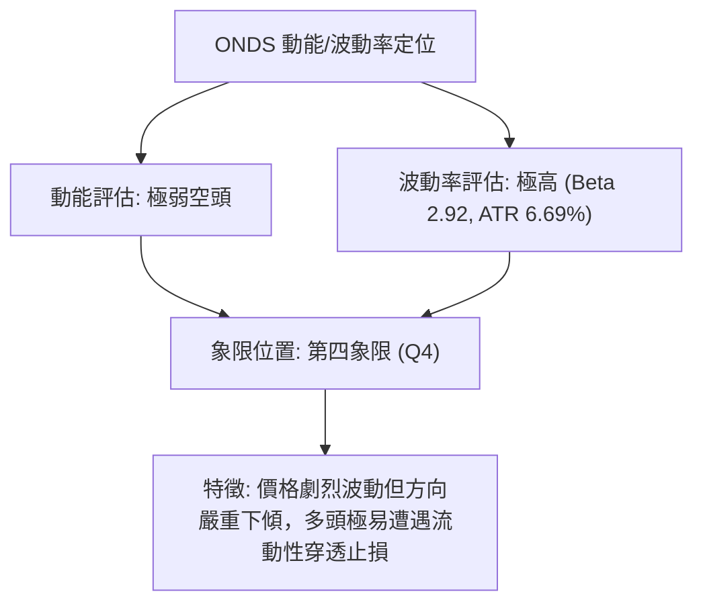

### 📊 ATR 波動率分析

- **ATR(14) 數值**：**$0.40**。
- **相對價格波動率**：佔當前股價 $6.04 的 **6.69%**。
- **技術意涵**：ONDS 平均每個交易日的正常價格波動區間即達 $0.40。這意味著盤中震盪超過 ±6% 屬於統計常態，因此任何技術性停損設定若小於 1.5 倍 ATR（即 $0.60），極容易在市場隨機雜訊中被無效觸發。
- **停損距離設定指南**：
  - *超短線交易（1-3日）*：停損空間至少需給予 $1.0 \times \text{ATR} = \mathbf{\$0.40}$。
  - *波段放空/做多交易（1-3週）*：停損空間建議採用 $1.5 \times \text{ATR} = \mathbf{\$0.60}$ 或 $2.0 \times \text{ATR} = \mathbf{\$0.80}$。

### 📐 Beta 與市場相關性

- **Beta 係數**：**2.922**（極高 Beta 標的）。
- **市場敏感度分析**：ONDS 的波動幅度接近標普 500 指數或大盤整體波動的 **2.92 倍**。當大盤指數下跌 1% 時，理論上該股將承受近 3% 的下行衝擊；在當前整體大盤環境震盪及空頭壓制下，高 Beta 特性進一步放大了其下行風險。
- **空頭部位特徵（Short Interest）**：
  - 空頭佔流通盤比例（Short % Float）：高達 **39.5%**。
  - 空頭回補天數（Short Ratio）：**3.64 天**。
  - *量化解讀*：接近 40% 的極高融券賣空比例，說明專業做空機構重度進駐；雖然這在極端超賣時具備「軋空（Short Squeeze）」的潛在催化劑，但在未見到成交量爆發與突破關鍵阻力（如 R1 $7.98）前，高空頭比例反映的是機構對其基本面轉差的高度共識。

---

## 7. 多時框架總結

### 📋 時框架評分表

| 時框架 | 趨勢方向 | 動能狀態 | 均線排列 | 圖表形態 | 綜合評分 | 戰術建議 |
|:---:|:---:|:---:|:---:|:---:|:---:|:---|
| **長期 (月線)** | 🔴 明確空頭 | 下行發散，見頂回吐 | 價格跌破長期均線組 | 大型雙頂破位下跌浪 | **20 / 100** | 長線資金離場觀望，嚴禁存股或加碼 |
| **中期 (週線)** | 🔴 弱勢下探 | RSI 20.1，MACD 綠柱走擴 | 週均線死亡交叉下壓 | 旗形破位向下測底 | **25 / 100** | 反彈至阻力位即為中線加空點位 |
| **短期 (日線)** | 🔴 單邊陰跌 | RSI 20.07 進入極度超賣 | MA5-MA240 全面空頭排列 | 跌破布林下軌貼軌運作 | **32 / 100** | 謹防超賣微幅回抽，但不可作為買入信號 |

### 🔲 綜合訊號矩陣

```
時框與指標共振分析矩陣
╔══════════════════╦══════════════════╦══════════════════╦══════════════════╗
║ 評估維度         ║ 短期 (日線級別)  ║ 中期 (週線級別)  ║ 長期 (月線級別)  ║
╠══════════════════╬══════════════════╬══════════════════╬══════════════════╣
║ 趨勢方向 (Trend) ║ 🔴 強烈空頭      ║ 🔴 穩定下行      ║ 🔴 頂部確立翻空  ║
║ 均線結構 (MAs)   ║ 🔴 完全空頭排列  ║ 🔴 空頭排列發散  ║ 🔴 跌破中期均線  ║
║ 擺盪指標 (Osc)   ║ 🟢 極度超賣 (20) ║ 🟢 進入超賣區    ║ 🟡 中性偏弱      ║
║ 趨勢強度 (ADX)   ║ 🟡 弱勢 (20.79)  ║ 🔴 -DI 掌控盤面  ║ 🔴 空方趨勢主導  ║
║ 籌碼量能 (Vol)   ║ 🔴 量能萎縮      ║ 🔴 反彈無量      ║ 🔴 高位爆量出貨  ║
╚══════════════════╩══════════════════╩══════════════════╩══════════════════╝
```

### ⚖️ 多時框收斂結論

依據多時框收斂規則進行權重收斂：
1. **行情性質判定**：當前日線 ADX(14) 為 **20.79**（< 25），符合規則定義之「**弱趨勢 / 盤整邊界行情**」；然而，細部 DMI 指標中 -DI 高達 31.20，遠超 +DI 之 13.26，同時中長期週線與月線之 MA50、MA200 均呈現不可逆的空頭壓制。
2. **時框優先級權衡**：依規則 14，盤整行情中日線布林通道上下軌（$6.08 - $8.13）為主要交易區間，但因中長期方向高度統一偏空，**日線超賣不得作為反轉做多依據，僅能作為空頭獲利回補或逢高沽空的進場時機過濾**。
3. **唯一方向性結論**：**【強烈偏空（Bearish Bias）】**。當前任何日線級別的反彈均定位為「極度超賣引發的技術性修復」，中長期下行趨勢具有絕對主導權。後續操作主軸以「順應週月線空頭趨勢、逢反彈至阻力位建立空單」為唯一核心策略。

---

## 8. 交易策略建議

### 🗺️ 策略決策流程圖

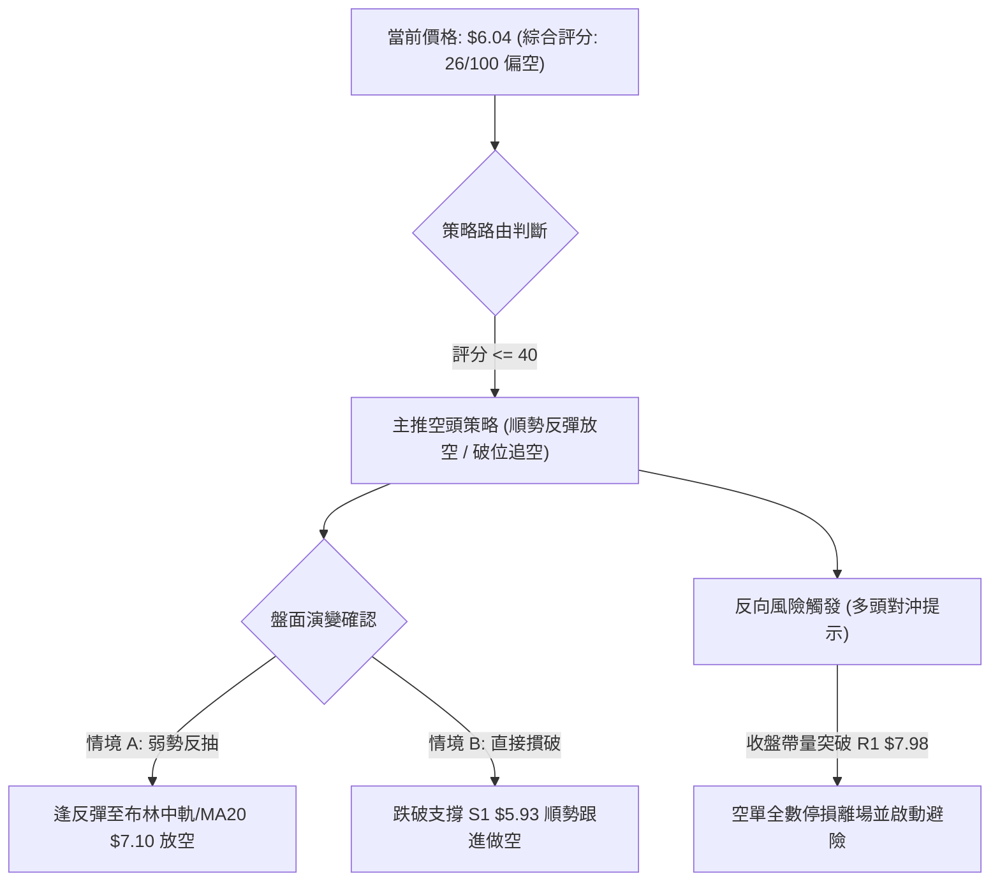

### 🧭 策略路由（依評分卡分流）

> **當前主策略方向 = 【逢反彈放空 / 破位放空】（依綜合評分 26 / 100 偏空判定）**

因技術評分僅 26 分（≤40），技術結構被空頭全面掌控，本報告嚴格依循交易紀律，**主推空頭策略**。多頭操作勝率極低，僅將其列為「反轉風險觸發點（對沖提示）」。

### 🎯 價格情境階梯（Price Scenarios）

所有價位均嚴格引用第 4 章「關鍵價位」區塊之實質計算數值：

| 階梯觸發條件 | 下一目標價位 | 後續延伸目標 | 情境實質技術含義 |
|:---|:---:|:---:|:---|
| **向上突破 R1 $7.98** | R2 $8.31 | R3 $8.58 | 帶量突破雙頂頸線，空頭結構徹底破壞，短線轉強逼空 |
| **反彈受阻於 MA20 $7.10** | S1 $5.93 | S2 $4.95 | 超賣修正結束，回歸中期均線下行軌道，絕佳做空加碼點 |
| **跌破波段低點 S1 $5.93** | S2 $4.95 | 數據中未偵測到更高支撐 | 跌破一年低點聚類，開啟主跌加速浪，直接下探 52W 低點 |

### 📊 情境機率分佈

| 情境類型 | 估計機率 | 主要技術與量化依據 |
|:---|:---:|:---|
| **情境一：超跌弱反彈後再次破位下行** | **55%** | RSI 20.07 具備修復需求，但均線全面空頭排列，MACD 負向柱擴散，反彈動能難以越過 $7.10 |
| **情境二：直接跌破 S1 $5.93 探底 S2** | **35%** | 賣盤主導（-DI 31.20），成交量極度萎縮無人護盤，跌破布林下軌引發停損賣壓 |
| **情境三：展開強勢 V 型反轉突破 R1** | **10%** | 空頭比例高達 39.5%，若有突發基本面爆發性利多可能引發軋空，但技術指標上完全無此跡象 |

### 🔴 主策略詳情（空頭交易策略）

本報告規劃兩套操作邏輯嚴密的空頭執行方案：

| 策略要素 | 策略 A（反彈沽空 — 推薦首選） | 策略 B（破位追空 — 動態跟進） |
|:---|:---|:---|
| **核心邏輯** | 利用極度超賣後的技術性回抽，在關鍵阻力位建立順勢高盈虧比空單 | 股價跌破最後防線 S1，順應慣性下殺動能追擊至 52W 低點 |
| **進場條件** | 盤中反抽至布林通道中軌及 MA20 附近，出現上影線或滯漲信號 | 日線實體收盤價跌破波段低點聚類 **S1 ($5.93)** |
| **進場價格** | **$7.10**（精確對齊 MA20 / 布林中軌） | **$5.90**（確認失守 S1 $5.93 後追進） |
| **第一目標 (T1)** | **$5.93**（回測波段支撐位 S1，潛在空間 -16.48%） | **$4.95**（回測 52W 歷史低點 S2，潛在空間 -16.10%） |
| **第二目標 (T2)** | **$4.95**（波段目標 52W 低點 S2，潛在空間 -30.28%） | **$4.55**（由 S1 破位量度 $5.93 - $1.38 推算之極限延伸） |
| **停損價格** | **$7.74**（精確對齊 MA50 季線阻力，風控空間 +9.01%） | **$6.38**（精確對齊 MA5 動態反壓，風控空間 +8.14%） |
| **風險報酬比** | **1 : 1.83**（至 T1）／ **1 : 3.36**（至 T2） | **1 : 1.98**（至 T1）／ **1 : 2.87**（至 T2） |
| **成功機率** | **65%** | **55%** |
| **建議倉位** | **總資金 8% - 10%** | **總資金 5% - 8%** |

### 🟢 反向風險觸發點（多頭對沖提示）

若市場出現未預期之極端走勢，空頭投資人必須在下列關鍵價位嚴格執行平倉與避險：
1. **短線反轉預警點**：若日線連續兩日實體收盤於 **$7.16**（斐波那契 78.6% 回調位）之上，且成交量放大至 20 日均量以上（>6,000 萬股），代表超賣回抽演變為級別擴大的反彈，空單應立即減倉 50%。
2. **主趨勢翻多失效點**：若價格強勢向上突破波段頸線 **R1 ($7.98)**，則本報告之空頭架構全數推翻失效，必須**無條件全數停損所有空單**，並可反手配置輕倉多單博弈軋空行情至 R2 ($8.31) 與 R3 ($8.58)。

### ⭐ 整體訊號強度評星

```
做多訊號強度：★☆☆☆☆  (1.0 / 5星 — 僅有超賣指標支撐，趨勢極度不利)
做空訊號強度：★★★★☆  (4.0 / 5星 — 均線與動能共振偏空，順勢交易首選)
整體可信度：  ★★★★☆  (4.5 / 5星 — 數據全面收斂，多時框架方向高度一致)
```

---

## 9. 風險提示與監控

### ✅ 關鍵監控指標 Checklist

```
╔══════════════════════════════════════════════════════════════════════╗
║               ONDS 每日盤後關鍵技術監控清單 (Checklist)              ║
╠══════════════════════════════════════════════════════════════════════╣
║ [ ] 1. S1 支撐防守測試：收盤價是否跌破 $5.93？(破位確立直接開啟跌浪)  ║
║ [ ] 2. 布林下軌回抽狀況：現價能否快速站回 $6.08 之上？(判斷是否貼軌)║
║ [ ] 3. 成交量異動警示：單日成交量是否暴增超過 1.2 億股？(防範軋空)   ║
║ [ ] 4. RSI(14) 鈍化或修復：RSI 是否在 20 之下形成低檔鈍化？          ║
║ [ ] 5. MACD 柱狀體：Hist 負值是否縮小至 -0.035 之內？(反彈先兆)      ║
║ [ ] 6. MA5 動態反壓：每日收盤價是否持續被 MA5 ($6.38) 壓制？         ║
╚══════════════════════════════════════════════════════════════════════╝
```

### ⚠️ 風險場景分析

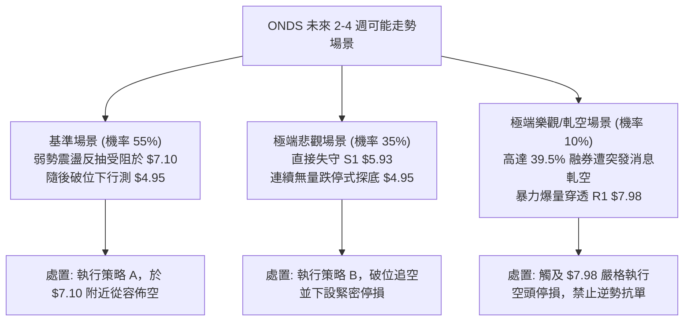

### 🛡️ 風險管理重要提醒

1. **極高 Beta 與槓桿風險**：ONDS 之 Beta 高達 2.922，且單日 ATR 佔股價 6.69%，波動率極大。嚴禁使用高槓桿融資或過度做空，整體持倉部位建議控制在總投資組合資產的 **10% 以內**。
2. **流動性與滑價風險**：當前成交量比僅 0.66x，買盤承接深度不足，盤中若觸發停損或大量市價單進出，容易產生 2-3% 以上之滑價成本，建議多加利用「限價停損單（Stop-Limit Order）」。
3. **空頭擠壓（Short Squeeze）黑天鵝**：空頭佔流通盤高達 39.5%，這如同一個裝滿火藥的桶子。任何涉及公司防務無人機（Counter-UAS）業務之重大合約公告，都可能在盤前引發數十個百分點的跳空開高。因此，**空單持有者絕對不可將停損設於口頭或心態中，必須在經紀商系統內掛出條件單**。

---

## 📋 報告總結

```
╔══════════════════════════════════════════════════════════════════════╗
║                    ONDS 技術分析報告核心總結                        ║
╠══════════════════════════════════════════════════════════════════════╣
║ 報告日期：2026-10-19              當前收盤價格：$6.04               ║
║ 分析評級：🔴 強烈偏空 (反彈沽空)    技術綜合評分：26 / 100            ║
╠══════════════════════════════════════════════════════════════════════╣
║ 關鍵維度結論：                                                       ║
║ ├─ 長期趨勢 (月線)：🔴 自 2026-05 見頂 $13.22 後確立長期下行週期    ║
║ ├─ 中期趨勢 (週線)：🔴 旗形與頸線破位，反彈無力，均線空頭排列發散   ║
║ ├─ 短期趨勢 (日線)：🔴 跌出布林下軌 $6.08，RSI=20.07 進入深度超賣   ║
║ ├─ 核心阻力結構：  R1 = $7.98 ｜ MA20 = $7.10 ｜ 布林上軌 = $8.13   ║
║ ├─ 核心支撐結構：  S1 = $5.93 ｜ S2 = $4.95 (52週歷史低點)          ║
║ └─ 華爾街目標價：  分析師平均 $18.88 (與當前技術盤面嚴重背離，暫忽略)║
╠══════════════════════════════════════════════════════════════════════╣
║ 最優交易策略矩陣：                                                   ║
║ 1. 🥇 首選策略 (反彈沽空)：待回抽 MA20 $7.10 放空，停損 $7.74，     ║
║                          目標 $5.93 / $4.95 (盈虧比 1:3.36)          ║
║ 2. 🥈 次選策略 (破位跟進)：跌破 S1 $5.90 追空，停損 $6.38，          ║
║                          目標 $4.95 (盈虧比 1:1.98)                  ║
║ 3. 🥉 嚴格風控 (反轉停損)：收盤價帶量站上 $7.98，空頭全數認賠離場    ║
╚══════════════════════════════════════════════════════════════════════╝
```

---

> ⚠️ **免責聲明**：本報告由具備 15 年資深經驗之技術分析模型產出，所有分析數據、形態識別與支撐阻力推算均基於歷史量價數據（OHLCV）。本報告旨在提供專業學術研究與交易架構參考，**不構成任何要約、招攬或具體投資建議**。金融市場具有高度風險，投資人應獨立評估自身風險承受能力並嚴格執行資金管理。

---

*報告生成時間：2026-10-19 ｜ 數據來源：Yahoo Finance ｜ 分析框架：多時框架收斂與量化技術指標體系*