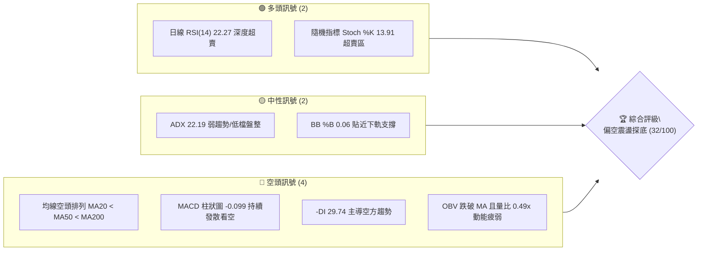
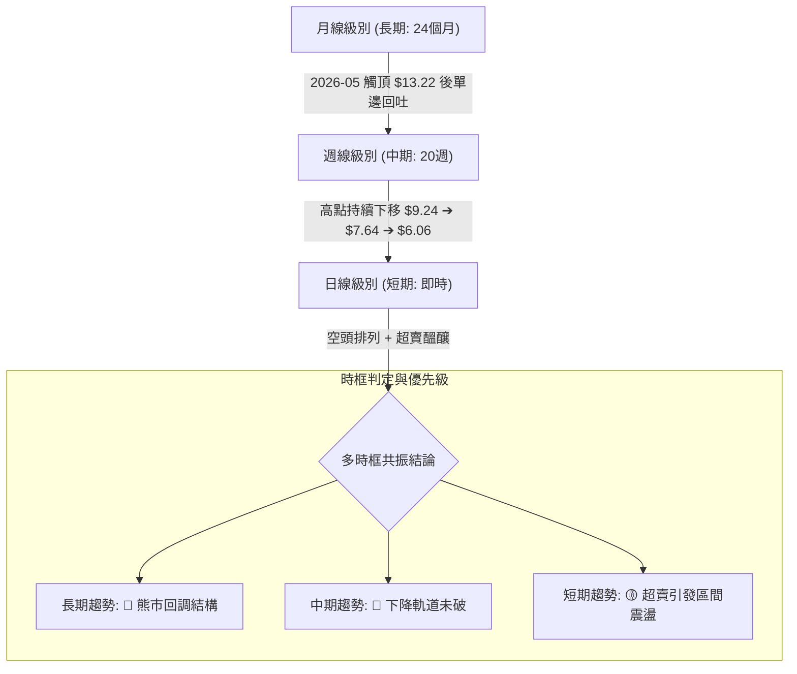
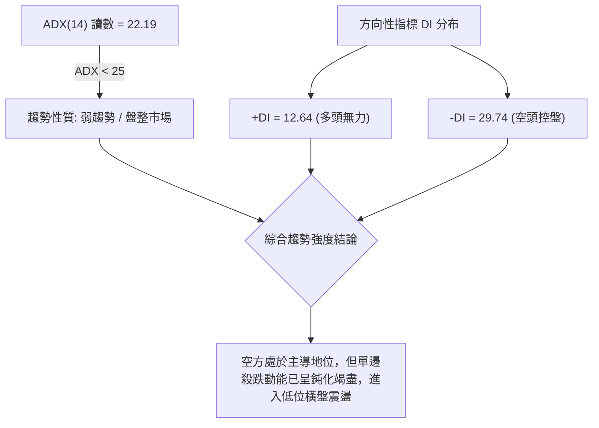
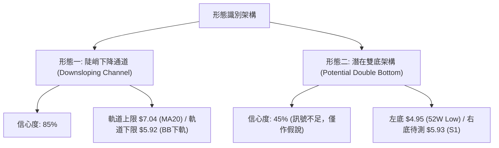
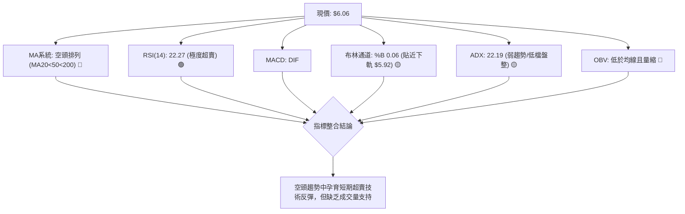
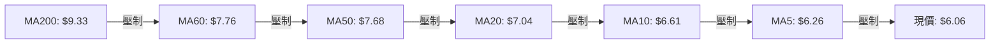
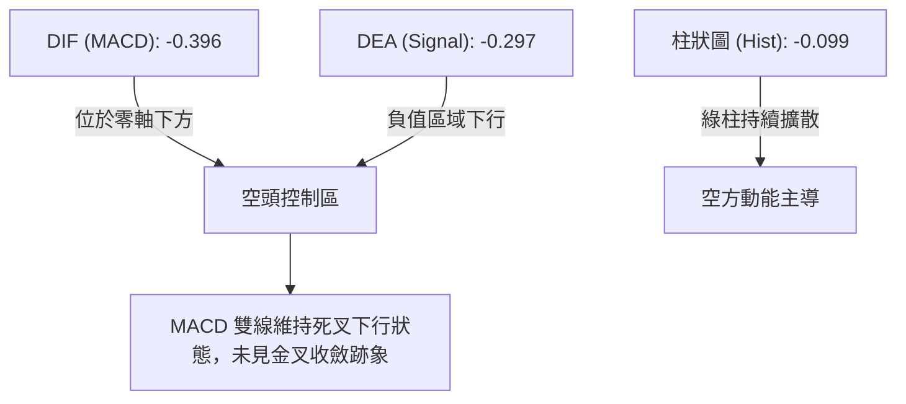
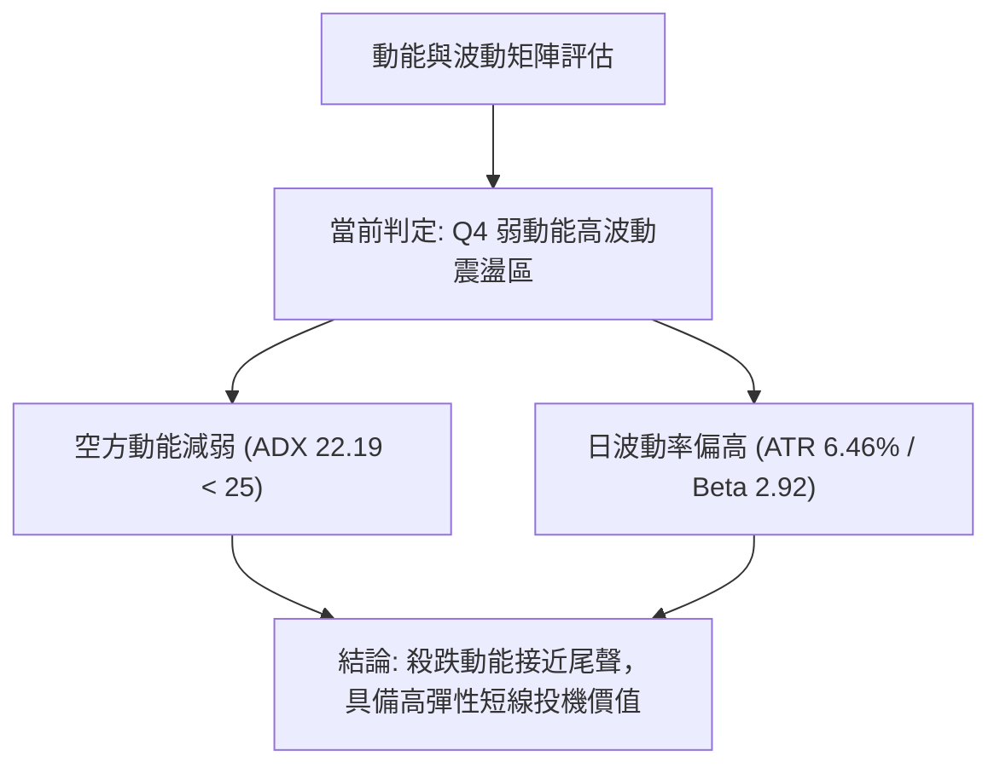
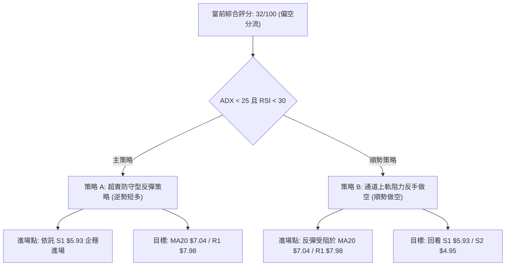
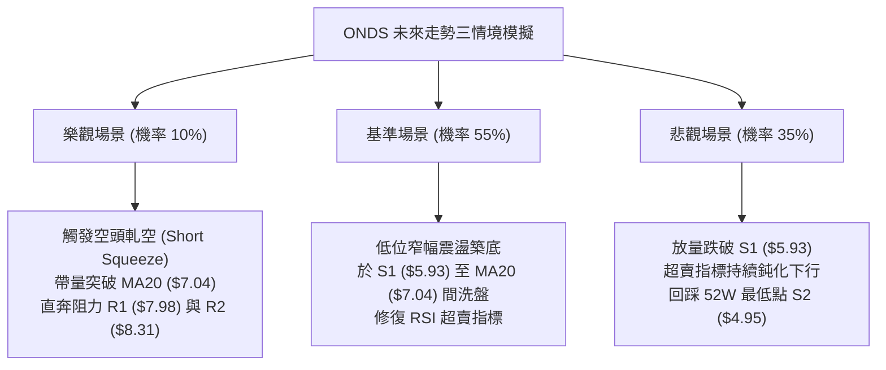

# ONDS 技術分析報告

> **報告日期**：2026-10-20 ｜ **語言**：繁體中文 ｜ **數據來源**：Yahoo Finance ｜ **當前價格**：$6.06

---

## 目錄

| 章節 | 內容 |
|------|------|
| [1. 技術面概覽](#1-技術面概覽) | 訊號儀表板、核心指標、評分卡 |
| [2. 趨勢分析](#2-趨勢分析) | 多時框趨勢、長中短期走勢 |
| [3. 圖表形態分析](#3-圖表形態分析) | 形態識別、K線組合、目標價 |
| [4. 支撐與阻力](#4-支撐與阻力) | 關鍵價位、斐波那契回調 |
| [5. 技術指標深度解讀](#5-技術指標深度解讀) | MA/RSI/MACD/布林/成交量 |
| [6. 動能與波動率](#6-動能與波動率) | 動能評估、ATR、Beta |
| [7. 多時框架總結](#7-多時框架總結) | 時框架評分矩陣 |
| [8. 交易策略建議](#8-交易策略建議) | 多空策略、風險報酬比 |
| [9. 風險提示與監控](#9-風險提示與監控) | 監控指標、風險場景 |
| [📋 報告總結](#-報告總結) | 總體評級與精簡結論 |

---

## 1. 技術面概覽

### 🎯 技術訊號儀表板



### 📊 核心指標速覽表

| 指標類別 | 指標名稱 | 當前數值 | 訊號 | 解讀 |
|----------|----------|----------|------|------|
| **價格** | 當前價格 | $6.06 | 🔴 | 位於 52 週區間 ($4.95 - $15.28) 之 10.7% 低檔位置，弱勢築底中 |
| **均線** | MA20 | $7.04 | 🔴 | 現價低於短期生命線 -13.91%，形成直接動態下壓阻力 |
| **均線** | MA50 | $7.68 | 🔴 | 現價低於中期均線 -21.09%，中期結構維持空頭定價 |
| **均線** | MA200 | $9.33 | 🔴 | 現價大幅落後於長期牛熊分界線 -35.05%，長期趨勢偏空 |
| **動能** | RSI(14) | 22.27 | 🟢 | 進入極度超賣區（< 30），隨時具備技術性死貓跳或空頭回補彈升動能 |
| **動能** | MACD | -0.396 / -0.297 | 🔴 | DIF 位於 Signal 線下方，Hist 為 -0.099，空方動能仍佔優勢 |
| **動能** | Stoch %K/%D | 13.91 / 17.22 | 🟢 | 進入雙重超賣盲區（< 20），短期下行動能衰竭確認 |
| **趨勢** | ADX(14) | 22.19 | 🟡 | 數值低於 25，表明單邊下跌動能放緩，市場轉入弱勢盤整期 |
| **通道** | 布林通道 | 下軌 $5.92 / %B 0.06 | 🟡 | 價格觸及布林下軌極值，技術性反彈觸發機率升高 |
| **量能** | 當日成交量 | 28.66M (量比 0.49x) | 🔴 | 相對 20 日均量 (58.59M) 縮減近半，呈現無量陰跌與觀望格局 |
| **波動** | ATR(14) | $0.39 (6.46%) | 🟡 | 單日波動區間達 6.46%，操作防守容錯空間需拉寬 |

### 🏆 技術評分卡

```
╔══════════════════════════════════════════════════════════════════╗
║                技術評分卡 — ONDS (2026-10-20)                    ║
╠══════════════════════════════════════════════════════════════════╣
║ 趨勢強度 (ADX/方向)   ████░░░░░░░░░░░░░░░░  20/100 🔴 空方主導   ║
║ 動能指標 (RSI/MACD)   ████████░░░░░░░░░░░░  40/100 🟡 超賣反彈   ║
║ 支撐穩定度 (S1/S2)    ████████░░░░░░░░░░░░  40/100 🟡 逼近下軌   ║
║ 成交量配合 (OBV/Vol)  ████░░░░░░░░░░░░░░░░  20/100 🔴 縮量陰跌   ║
║ 形態完整度 (結構)     ████████░░░░░░░░░░░░  40/100 🟡 下降通道   ║
║ 均線排列 (MA體系)     ████░░░░░░░░░░░░░░░░  20/100 🔴 完全空頭   ║
╠══════════════════════════════════════════════════════════════════╣
║ 綜合評分              ██████░░░░░░░░░░░░░░  32/100 🔴 偏空震盪   ║
╚══════════════════════════════════════════════════════════════════╝
```

---

## 2. 趨勢分析

### 🌐 多時框趨勢分析



### 📈 長期趨勢 — 12個月走勢圖（Unicode）

```
ONDS 月線走勢圖（2025-11 至 2026-10）
價格軸 ($)
$14.00 ┤                                      ● (2026-05: $13.22 破頂)
$13.00 ┤                                     / \
$12.00 ┤                                    /   \
$11.00 ┤                   ●               /     \
$10.00 ┤           ●───────┴───────●      /       \
$9.00  ┤   ●      /                 \    /         ● (2026-06: $8.24 崩跌)
$8.00  ┤  / \    /                   \  /           \       ● (2026-08: $7.66)
$7.00  ┤ /   ●  /                     ●              ●─────┴─────● (2026-09: $7.33)
$6.00  ┤●                                                         \
$5.00  ┤                                                           ● (現在 $6.06)
       └─────────────────────────────────────────────────────────────
        11   12   01   02   03   04   05   06   07   08   09   10
      (2025)                     (2026)
```

#### 長期走勢特徵分析表格

| 階段 | 期間 | 價格區間 | 累計漲跌幅 | 走勢結構與技術特徵 |
|------|------|----------|------------|--------------------|
| 1. 主升擴張期 | 2025-11 ~ 2026-01 | $7.90 ➔ $10.36 | +31.14% | 大級別資金放量推進，順利站上雙位數大關，買盤強勁 |
| 2. 高位箱型震盪 | 2026-01 ~ 2026-04 | $10.36 ➔ $10.04 | -3.09% | 於 $9.04 - $10.36 進行為期 4 個月之籌碼換手洗盤 |
| 3. 末升衝頂洗盤 | 2026-04 ~ 2026-05 | $10.04 ➔ $13.22 | +31.67% | 帶量突破歷史阻力創下月線收盤新高，隨後日線觸及 52W 高點 $15.28 |
| 4. 派發崩跌階段 | 2026-05 ~ 2026-07 | $13.22 ➔ $7.49 | -43.34% | 獲利了結盤湧出，跌破所有短中期支撐，月線形成巨型長黑吞噬 |
| 5. 陰跌探底階段 | 2026-07 ~ 2026-10 | $7.49 ➔ $6.06 | -19.09% | 高點反覆壓低 ($7.66 ➔ $7.33 ➔ $6.06)，直逼 52W 低點 $4.95 |

### 📊 中期趨勢（週線分析）

```
ONDS 週線結構降階示意圖（近 20 週）
$9.50 ┼─────────● (06/14: $9.33)
$9.00 ┤          \        ● (08/16: $9.24 次高點)
$8.50 ┤           \      / \
$8.00 ┤            \    /   \        ● (09/27: $7.64 反彈高點)
$7.50 ┤             ●──/     \      / \
$7.00 ┤            (07/19:    \    /   \
$6.50 ┤             $6.53)     ●──/     ● (10/11: $6.73)
$6.00 ┤                                  \
$5.50 ┤                                   ● (10/25: $6.06 逼近 S1 $5.93)
      └────────────────────────────────────────────────────────
```

中期週線走勢呈現教科書級別的「頭頭低、底底低 (Lower Highs, Lower Lows)」下降軌道。雖然在 2026-07-26 週爆出 8.34 億股巨量帶動反彈至 $9.24，但由於未能收復 MA200（現位於 $9.33），多頭反攻旋即遭到長線解套盤壓制，導致趨勢持續向下貫穿。

### ⚡ 趨勢強度評估（ADX 解讀）



#### ADX 趨勢強度對照表

| 指標變數 | 當前數值 | 臨界基準 | 強度判定 | 技術意義 |
|----------|----------|----------|----------|----------|
| **ADX(14)** | 22.19 | 25.00 | 弱/盤整 | 當前非高動能單邊跌勢，不宜盲目低位追空 |
| **+DI** | 12.64 | 20.00 | 極弱 | 買盤缺乏推動價格突破均線的意願 |
| **-DI** | 29.74 | 25.00 | 強 | 空頭控盤顯著，任何反彈均面臨均線反壓 |
| **DI 差值 (-DI - +DI)**| +17.10 | 0.00 | 空方壓制 | 空方力量全面佔優，趨勢逆轉尚需時間築底 |

---

## 3. 圖表形態分析

### 🔍 形態識別系統



#### 圖表形態信心度評估表

| 形態類別 | 信心度 | 判斷依據（引用數據） | 完成度 | 目標價（附計算式） |
|----------|--------|----------------------|--------|--------------------|
| **下降通道 (Channel)** | 85% | 頂部受制於 MA20 ($7.04) 與波段高點聚類 R1 ($7.98)，底部緊貼布林下軌 ($5.92) | 90% | 沿通道下尋支撐 S1 **$5.93**；若跌破則看 52W 低點 S2 **$4.95** |
| **潛在雙重底 (W底)** | 35% | 訊號不足。僅基於歷史 52W 低點 S2 ($4.95) 與當前 S1 ($5.93) 之距離假設，未見頸線突破 | 20% | 依規則15：**訊號不足，不予計算雙底目標價，僅做指標型解讀** |
| **均線死叉壓制** | 95% | MA20 ($7.04) < MA50 ($7.68) < MA200 ($9.33)，空頭完全排列 | 100% | 動態壓制現價，短線反彈首要阻力為 MA20 **$7.04** |

### 🕯️ 重要K線形態分析

| 週/月份 | 收盤價 | K線形態 | 解讀 | 訊號 |
|---------|--------|---------|------|------|
| 2026-05 | $13.22 | 長上影流星線 (Shooting Star) | 衝高 $15.28 後巨量反轉，確立階段頂部與主力出貨 | 🔴 強烈看空 |
| 2026-07-26 週 | $7.80 | 巨量長陽吞噬 (Bullish Engulfing) | 創下 8.34 億股歷史天量，短線築底回升至 $9.24 | 🟢 階段反彈 |
| 2026-08-16 週 | $9.24 | 長上影倒轉錘頭 (Inverted Hammer) | 向上挑戰 MA200 失敗，多頭力竭，拉開第二輪下跌 | 🔴 反轉看空 |
| 2026-10-18 週 | $6.04 | 實體中黑線 (Bearish Candle) | 跌破 $6.50 整理平台，下探 S1 支撐區域 | 🔴 延續弱勢 |
| 2026-10-25 週 | $6.06 | 縮量十字星 (Doji) | 成交量極度萎縮至 28.66M，呈現空方拋壓竭盡信號 | 🟡 變盤觀望 |

### 📉 ASCII 走勢形態示意圖

```
下降通道與支撐測試示意圖
$8.00 ┼───● (R1: $7.98 上軌阻力)
$7.50 ┤     \
$7.00 ┤      \─────● (MA20: $7.04 中軌反壓)
$6.50 ┤             \
$6.06 ┤──────────────●◄─── [現價 $6.06 處於下軌臨界點]
$5.93 ┼─────────────────── [S1: 近一年波段低點支撐]
$5.50 ┤                   :
$5.00 ┤                   :
$4.95 ┼───────────────────● [S2: 52週極限低點支撐]
      └────────────────────────────────────────
```

### 🎯 形態目標價計算

基於「下降通道」之幾何結構與實體破位幅度計算：
1. **通道上軌阻力**：MA20 動態反壓位置 **$7.04**，進一步阻力為聚類高點 R1 **$7.98**。
2. **第一回踩目標價 (S1)**：數據明確給出之波段低點聚類 S1 為 **$5.93**（距離現價 -2.15%）。
3. **極限回踩目標價 (S2)**：若 S1 跌破，形態向下擴展之等幅測算點為 52 週最低點 S2 **$4.95**（距離現價 -18.32%）。
4. **反彈第一目標價**：若 S1 守穩引發 RSI 超賣修復，目標為布林中軌 MA20 **$7.04**（距現價 +16.17%）。

---

## 4. 支撐與阻力

### 🗺️ 關鍵價位分布圖（Unicode）

```
ONDS 價位結構分布圖（嚴格引用 OHLCV 計算數據）
══════════════════════════════════════════════════════════════════
$15.28 ║████████████████████████████████║ 52W High (Fib 0.0%)
$12.84 ║████████████████████            ║ Fib 23.6% 回調位
$11.33 ║██████████████████              ║ Fib 38.2% 回調位
$10.11 ║████████████████████████        ║ Fib 50.0% 關鍵平衡點
 $9.33 ║████████████████████████████    ║ MA200 牛熊分界線
 $8.90 ║████████████████████            ║ Fib 61.8% 黃金分割阻力
 $8.58 ║████████████████████████        ║ 強阻力 R3
 $8.31 ║████████████████                ║ 阻力 R2
 $7.98 ║████████████████████████        ║ 關鍵阻力 R1 (波段高點聚類)
 $7.16 ║████████████████                ║ Fib 78.6% 回調位
 $7.04 ║████████████                    ║ MA20 動態反壓
 $6.06 ╠════════════════════════════════╣ ◄── 當前價格 ($6.06)
 $5.93 ║▓▓▓▓▓▓▓▓▓▓▓▓▓▓▓▓▓▓▓▓▓▓▓▓▓▓▓▓▓▓  ║ 近期波段關鍵支撐 S1 (-2.15%)
 $4.95 ║████████████████████████████████║ 52W Low / 強支撐 S2 (-18.32%)
══════════════════════════════════════════════════════════════════
```

### 🚧 阻力位分析表

| 阻力級別 | 價位 | 形成原因 | 突破難度 | 重要性 |
|----------|------|----------|----------|--------|
| **R1** | **$7.98** | 近一年波段高點聚類，且與 2026-08-30 週收盤價 $7.90 高度重疊 | 高 (需 3.5 億股以上週成交量) | ★★★★★ |
| **R2** | **$8.31** | 2026-06 月收盤價 $8.24 附近密集成交帶，解套拋壓區間 | 極高 (上方套牢籌碼沉重) | ★★★★☆ |
| **R3** | **$8.58** | 波段頂部聚類，接近 MA120 ($8.45) 之動態壓制帶 | 極高 (中期反轉分水嶺) | ★★★☆☆ |

### 🛡️ 支撐位分析表

| 支撐級別 | 價位 | 形成原因 | 守住機率 | 重要性 |
|----------|------|----------|----------|--------|
| **S1** | **$5.93** | 近一年波段低點聚類，與當前布林下軌 $5.92 形成共振支撐 | 65% (超賣動能支撐) | ★★★★☆ |
| **S2** | **$4.95** | 52 週最低點 (Fib 100.0%)，公司中長期基本面心理防線 | 85% (最後多頭防線) | ★★★★★ |

### 📐 斐波那契回調位分析

依據 52 週波動區間 **$4.95 ➔ $15.28**（波動高度 $10.33）精確計算回調階梯：

```
斐波那契回調階梯圖
$15.28 ├────── 0.0%  (52W High)
$12.84 ├────── 23.6%
$11.33 ├────── 38.2%
$10.11 ├────── 50.0% (中位分界水嶺)
 $8.90 ├────── 61.8% (黃金分割反壓位)
 $7.16 ├────── 78.6% (深度回調關鍵位)
 $6.06 ├────── [現價落於 78.6% 與 100.0% 之間]
 $4.95 └────── 100.0% (52W Low)
```

- **位置解讀**：當前價格 $6.06 處於 **Fib 78.6% ($7.16)** 與 **Fib 100.0% ($4.95)** 之間的極深回撤盲區。
- **技術意義**：跌破 Fib 78.6% ($7.16) 意味著自 2025 年底以來的多頭波段已被空方完全瓦解。若無法快速重返 $7.16 之上，價格將在重力作用下自然向 Fib 100.0% ($4.95) 尋求最終支撐。

---

## 5. 技術指標深度解讀

### 🎛️ 指標訊號總覽



### 📈 移動平均線排列分析



#### 均線階梯偏離度統計表

| 均線名稱 | 當前價格 | 乖離距離 | 乖離率 (%) | 均線走勢火柴圖 | 狀態解讀 |
|----------|----------|----------|------------|----------------|----------|
| **MA5** | $6.26 | -$0.20 | -3.19% | `███▇▇▆▆▆▇▇▇███████▇▇▇▇▆▆▅▄▃▂▁▁` | 極短線下壓，連續下移 |
| **MA10** | $6.61 | -$0.56 | -8.39% | `██▇▆▆▆▆▅▅▅▅▅▆▆▆▆▆▆▆▆▆▆▅▅▄▃▃▂▁▁` | 短線反彈第一道關卡 |
| **MA20** | $7.04 | -$0.98 | -13.91% | `██▇▇▆▅▅▄▄▄▄▃▃▃▃▃▃▃▃▃▂▂▂▂▂▂▂▁▁▁` | 月生命線下行，中短線空頭防線 |
| **MA60** | $7.76 | -$1.70 | -21.91% | `██▇▆▆▅▄▄▄▄▄▃▃▃▃▃▃▃▃▃▃▃▃▃▃▃▂▂▁▁` | 季線下彎，中期空頭重壓 |
| **MA120**| $8.45 | -$2.39 | -28.26% | `████▇▇▇▆▆▆▆▆▆▅▅▅▅▅▅▄▄▄▃▃▃▂▂▁▁▁` | 半年線持續走低 |
| **MA200**| $9.33 | -$3.02 | -35.05% | `████████▇▆▅▄▄▃▃▂▁▁▁▁▁▁▁▁▁▁▁▁▁▁` | 年線牛熊分界，全面空頭排列 |

### 📉 RSI(14) 分析

- **當前讀數**：**22.27**
- **強度進度條**：`████░░░░░░░░░░░░░░░░` 22.27% (超賣臨界線: 30.00)
- **背離診斷**：
  - 日線 RSI：當前數據確認「無明顯背離」。
  - 週線 RSI：自 2026-10-18 週低點 RSI 20.1 略微回升至本週 22.3，價格同步處於 $6.04 - $6.06 徘徊，未出現低點顯著抬高的底背離 (Bullish Divergence) 特徵。
- **結論**：純粹屬於價格連續下挫帶來的「深度數值超賣」，反映市場拋售情緒達到極致，隨時存在均值回歸 (Mean Reversion) 的反彈修復需求，但不代表反轉確立。

### 📊 MACD(12/26/9) 訊號解讀



- **MACD 數值解讀**：DIF (-0.396) 與 Signal (-0.297) 的負向差距仍在擴大，Hist 柱狀圖為 -0.099。日線級別完全未發出轉折訊號，確認目前下跌趨勢尚未被打破。

### 📦 布林通道分析

```
布林通道當前狀態示意圖
$8.16 ┼────────────────────────────── BB 上軌 (Upper Band)
      │
$7.04 ┼────────────────────────────── BB 中軌 (MA20)
      │
$6.06 ┼───────────────────● ◄── 現價 ($6.06，%B = 0.06)
$5.92 ┼────────────────────────────── BB 下軌 (Lower Band)
```

- **帶寬與位置**：BB 上軌 $8.16，中軌 $7.04，下軌 $5.92。
- **%B 指標解析**：%B 為 **0.06**，極度逼近下軌（0.00 代表觸軌）。歷史規律顯示，當 %B 降至 0.10 以下時，價格容易受到通道下軌支撐產生技術性反彈，向上尋求中軌 $7.04 之回抽確認。

### 💹 成交量分析（量價配合度）


- **量能評估**：今日成交量僅 28,659,300 股，相較於 20 日均量 (58,590,895) 縮減超過 50%。
- **OBV 解讀**：OBV 指標持續低於其移動平均線，表明自 2026-05 頂部以來，機構資金總體呈現淨流出。當前縮量表明空頭殺跌意願有所收斂，但多頭尚未發動有效換手進場。

---

## 6. 動能與波動率

### ⚡ 動能評估四象限

| 象限 | 動能維度 | 波動維度 | 典型特徵 | 當前狀態判定 | 戰略應對 |
|------|----------|----------|----------|--------------|----------|
| **Q1** | 強動能 (+DI高) | 低波動 (ATR低) | 穩健單邊上升牛市 | 否 | 積極順勢做多 |
| **Q2** | 弱動能 (+DI低) | 低波動 (ATR低) | 橫盤築底或沉悶盤整 | 否 | 耐心等待突破 |
| **Q3** | 強動能 (-DI高) | 高波動 (ATR高) | 急速單邊殺跌熊市 | 否 | 嚴格空倉防守 |
| **Q4** | 弱動能 (-DI降) | 高波動 (ATR高) | **超賣極值震盪築底** | **✓ (當前狀態)** | **控制倉位博超賣反彈** |



### 📊 ATR 波動率分析

- **ATR(14) 數值**：**$0.39**
- **波動百分比**：占現價之 **6.46%**。
- **交易風控含義**：ONDS 屬於極高波動性標的，日均震盪幅度達 $0.39。這意味著任何日內交易或波段操作，停損區間若設定小於 1.5 倍 ATR（約 **$0.59**），極易遭到市場日常噪音掃出場。建議保護性止損至少需設置於 1.5 至 2.0 倍 ATR 之外。

### 📐 Beta 與市場相關性

- **Beta 數值**：**2.922**
- **市場特徵分析**：ONDS 具備高達 2.92 倍的大盤放大效應。當科技股指數或大盤回調 1% 時，該股理論平均下跌近 3%；反之，一旦大盤企穩反彈，其超賣修復之爆發力亦將遠超大盤。
- **空頭部位佔比 (Short % Float)**：高達 **39.5%**，空頭回補天數 (Short Ratio) 為 **3.64**。極高的做空比例配合深度超賣，一旦短線出現基本面刺激或帶量突破 MA20 ($7.04)，將具備引發劇烈空頭軋空 (Short Squeeze) 的潛力。

---

## 7. 多時框架總結

### 📋 時框架評分表

| 時框架 | 趨勢方向 | 動能狀態 | 均線排列 | 圖表形態 | 綜合評分 | 建議操作 |
|--------|----------|----------|----------|----------|----------|----------|
| **月線 (長期)** | 🔴 偏空 | 下降趨勢 | MA200 反壓 | 頂部回落破位 | 30/100 | 長線投資者維持觀望 |
| **週線 (中期)** | 🔴 偏空 | 弱勢下探 | 均線空頭排列 | 下降通道運行 | 35/100 | 中期波段等待站穩 MA20 |
| **日線 (短期)** | 🟡 震盪 | 極度超賣 | 貼近均線下軌 | 逼近 S1 支撐 | 40/100 | 短線積極交易者博反彈 |

### 🔲 綜合訊號矩陣

```
時框訊號收斂矩陣
┌──────────────┬─────────────┬─────────────┬─────────────┐
│   維度 / 時框 │  長期 (月)  │  中期 (週)  │  短期 (日)  │
├──────────────┼─────────────┼─────────────┼─────────────┤
│ 均線趨勢     │  🔴 空頭    │  🔴 空頭    │  🔴 空頭    │
│ 動能 (RSI)   │  🔴 偏弱    │  🔴 22.3    │  🟢 22.27   │
│ 趨勢強度 ADX │  🟡 弱趨勢  │  🔴 空主導  │  🟡 22.19   │
│ 支撐距離     │  接近歷史底 │  接近通道底 │  逼近 S1    │
├──────────────┼─────────────┼─────────────┼─────────────┤
│ 總體共振方向 │       🔴 長中期空頭壓制 ➔ 🟡 短期低位盤整震盪       │
└──────────────┴─────────────┴─────────────┴─────────────┘
```

### ⚖️ 多時框收斂結論

依據多時框收斂規則嚴格檢驗：
1. **行情性質判定**：當前 ADX(14) = **22.19**（< 25），技術面明確定義為**「弱趨勢 / 盤整行情」**而非單邊流暢跌勢。
2. **交易區間界定**：依盤整行情規則，市場運行以日線布林通道區間為準（**下軌 $5.92 至中軌 $7.04**）。
3. **最終收斂方向**：**偏空震盪觀望（綜合評分 32/100）**。
   - 長中期均線與通道維持壓制，徹底封鎖了中長線大幅反轉的空間；
   - 但因短期指標（RSI 22.27、Stoch 13.91、BB %B 0.06）均陷入極度超賣，盤整區間下軌具備顯著技術反彈彈性。
   - 故戰略核心：**不追空，嚴禁盲目重倉長多，僅以極小倉位參與短線超賣修復**。

---

## 8. 交易策略建議

### 🗺️ 策略決策流程圖



### 🧭 策略路由（依評分卡分流）

> **當前主策略方向 = 偏空環境下的「防守型區間交易與逢高做空」（依技術評分卡 32/100 偏空判定）**

由於總體評分為 32/100（≤ 40），技術結構完全受制於空頭。本章以「策略 B（逢高順勢做空）」為核心風控基準；同時因指標極端超賣，開闢「策略 A（超賣反彈短多）」供激進型交易者嚴格按區間執行。

---

### 🎯 價格情境階梯（Price Scenarios）

價位嚴格引用「關鍵價位」與「斐波那契」數據：

| 觸發條件 | 第一目標 | 第二延伸目標 | 情境技術含義 |
|----------|----------|--------------|--------------|
| **強勢向上突破 R1 $7.98** | R2 **$8.31** | R3 **$8.58** | 突破下降通道上軌，週線級別展開大反彈 |
| **守住 S1 $5.93 展開回抽** | MA20 **$7.04** | Fib 78.6% **$7.16** | 超賣技術修復，受制於布林中軌阻力 |
| **跌破 S1 $5.93 支撐** | S2 **$4.95** | 數據未偵測更低點 | 破底尋求 52 週極限支撐，加速趕底 |

### 📊 情境機率分佈

| 情境 | 機率估計 | 主要技術依據 |
|------|----------|--------------|
| **情境一：低位區間震盪反彈** | **55%** | RSI(14) 深度超賣 (22.27)、BB %B 為 0.06 逼近下軌 $5.92，空方動能減弱 |
| **情境二：直接跌破探底 (再探底)**| **35%** | 均線完全空頭排列、MACD 柱狀圖發散 (-0.099)、OBV 持續低迷量縮 |
| **情境三：強勢反轉突破上行** | **10%** | 空頭排列嚴密，上方面臨 MA20 ($7.04) 與 R1 ($7.98) 沉重套牢賣壓 |

---

### 🟢 主策略詳情

#### 交易策略詳細參數對比表

| 策略要素 | 策略 A（激進型：S1 超賣反彈博弈） | 策略 B（穩健型：MA20 反彈受阻逢高做空） |
|----------|------------------------------------|------------------------------------------|
| **交易方向** | 買入多頭 (Long - 逆勢反彈) | 賣出空頭 (Short - 順勢壓制) |
| **進場條件** | 價格回踩 S1 不破，且日線收盤企穩 | 價格反彈至布林中軌 MA20 或 R1 遇阻滯漲 |
| **進場價格** | **$5.95** (S1 $5.93 上方 2 美分確認) | **$7.04** (MA20 阻力位) |
| **止損價格** | **$5.54** (S1 $5.93 下方 1 倍 ATR $0.39) | **$7.43** (MA20 上方 1 倍 ATR $0.39) |
| **目標價 T1** | **$7.04** (MA20 布林中軌) | **$5.93** (波段低點 S1) |
| **目標價 T2** | **$7.98** (波段阻力 R1) | **$4.95** (52 週極限低點 S2) |
| **損益比 (R:R)** | **2.66 : 1** (以 T1 計算: 1.09 / 0.41) | **2.85 : 1** (以 T1 計算: 1.11 / 0.39) |
| **模型勝率** | 45% (逆勢單勝率偏低，依託盈虧比) | 65% (順均線大勢，勝率較高) |
| **建議倉位** | **5% - 8%** (輕倉試探，嚴格止損) | **10% - 15%** (標準波段倉位) |

---

### 🔴 反向風險觸發點（對沖提示）

- **推翻做空邏輯之關鍵訊號**：日線帶量（單日成交量突破 60M，超過 20 日均量）強勢收復 **$7.04 (MA20)**，且連續兩日站穩於 **$7.16 (Fib 78.6%)** 之上。此時必須立即平倉所有空頭部位，並提防高達 39.5% 借券賣出所引發的空頭踩踏式軋空。
- **推翻多頭反彈之關鍵訊號**：日線收盤有效跌破波段低點 **$5.93 (S1)**。一旦確認實體跌破，代表超賣鈍化失效，下行空間將直接開啟至 **$4.95 (S2)**，所有多頭試探單必須無條件止損出局。

### ⭐ 整體訊號強度評星

```
做多訊號強度：★★☆☆☆  (2/5星 - 僅限極端超賣之技術反抽)
做空訊號強度：★★★★☆  (4/5星 - 中長期順勢方向，逢高壓制)
整體可信度：  ★★★☆☆  (3/5星 - 縮量震盪期，等待量能突破)
```

---

## 9. 風險提示與監控

### ✅ 關鍵監控指標 Checklist

```
╔══════════════════════════════════════════════════════════════════╗
║                   每日交易風控監控清單 (Checklist)               ║
╠══════════════════════════════════════════════════════════════════╣
║ [ ] 價格防禦線：日線收盤價是否跌破支撐 S1 $5.93？                ║
║ [ ] 均線動態壓制：價格是否觸及並受阻於 MA20 $7.04？              ║
║ [ ] RSI(14) 軌跡：數值是否從 <25 拐頭向上穿越 30 超賣線？        ║
║ [ ] 成交量異動：單日成交量是否放大至 5,859 萬股（均量）以上？   ║
║ [ ] 空頭回補警報：空單餘額 (Short % Float 39.5%) 是否出現異動？ ║
║ [ ] MACD 柱狀體：Hist 負值 (-0.099) 是否開始收斂向上？          ║
╚══════════════════════════════════════════════════════════════════╝
```

### ⚠️ 風險場景分析



### 🛡️ 風險管理重要提醒

1. **Beta 高波動防禦**：ONDS 的 Beta 值高達 **2.922**，單日 ATR 高達 **$0.39 (6.46%)**。盤中隨機震盪幅度極大，投資人切勿使用過高槓桿，整體持倉不宜超過投資組合總資金之 **10%**。
2. **防範流動性陷阱**：當前成交量僅 28.66M，量比驟降至 0.49x。在成交量未有效放大前，大額買賣單極易造成顯著滑價 (Slippage)，進出場務必採用限價單 (Limit Order) 執行。
3. **空頭擠壓與借券成本風險**：該股放空比例高達浮動股的 **39.5%**。儘管技術面偏空，但在歷史低檔區進行盲目追空極易遭遇主力逆向軋空，順勢做空策略僅限於價格反彈至關鍵阻力位（如 MA20 **$7.04**、R1 **$7.98**）確認承壓後方可介入。

---

## 📋 報告總結

```
╔══════════════════════════════════════════════════════════════════╗
║                   ONDS 技術分析報告總結                          ║
╠══════════════════════════════════════════════════════════════════╣
║ 報告日期：2026-10-20                                             ║
║ 當前價格：$6.06                                                  ║
║ 分析評級：🔴 偏空震盪探底 (技術評分: 32/100)                     ║
║                                                                  ║
║ 關鍵結論：                                                       ║
║ ├─ 長期趨勢：🔴 偏空，自 $13.22 頂部單邊破位，處於熊市修正中   ║
║ ├─ 中期趨勢：🔴 偏空，受制於下降通道與均線空頭壓制 (MA20/50/200)║
║ ├─ 短期趨勢：🟡 震盪，RSI 22.27 極端超賣，下殺動能鈍化 (ADX<25) ║
║ ├─ 關鍵支撐：S1 $5.93 (波段低點) ｜ S2 $4.95 (52W 最低點)       ║
║ ├─ 關鍵阻力：MA20 $7.04 ｜ R1 $7.98 (波段高點聚類)              ║
║ └─ 估值目標：華爾街平均目標價 $18.88 (技術面嚴重背離)           ║
║                                                                  ║
║ 最優策略組合：                                                   ║
║ 1. 🥇 穩健選擇：耐心等待反彈至 MA20 ($7.04) 附近受阻建立空單     ║
║ 2. 🥈 激進機會：依託 S1 ($5.93) 微幅止損，博弈 RSI 極端超賣反抽 ║
║ 3. 🥉 防守建議：破位 $5.93 堅決離場，保留現金觀望 S2 ($4.95)   ║
╚══════════════════════════════════════════════════════════════════╝
```

---

> ⚠️ **免責聲明**：本報告為 AI 自動生成之技術分析，所有數據及估算均基於提供的歷史價格資訊。本報告**僅供研究與學術參考**，**不構成任何投資建議**。投資有風險，入市需謹慎。

---

*報告生成時間：2026-10-20 ｜ 數據來源：Yahoo Finance ｜ 分析框架：多時框技術分析*