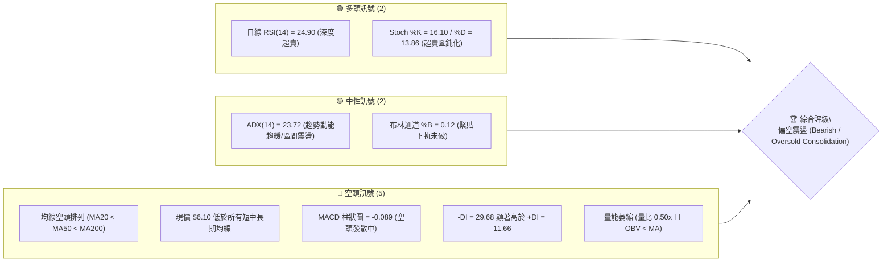
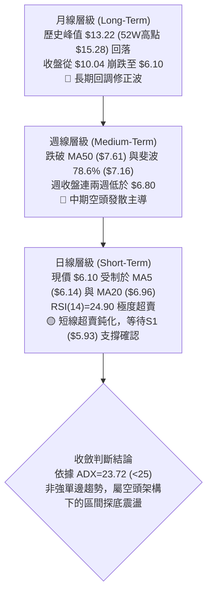
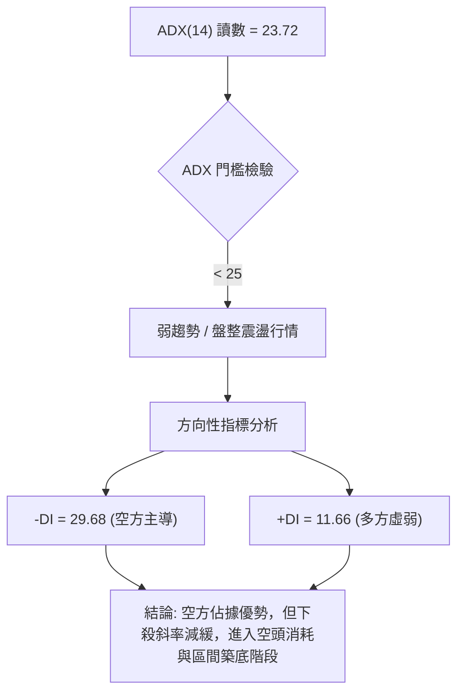
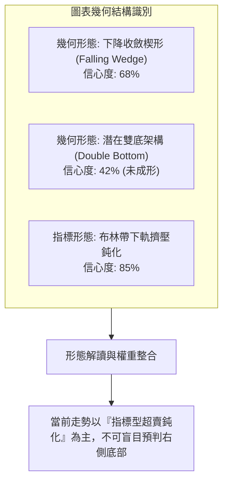
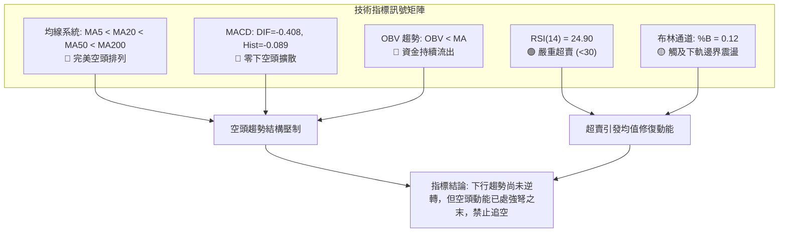
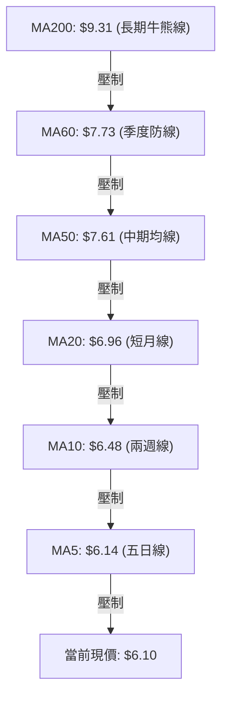
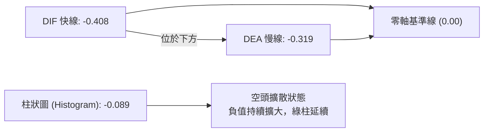
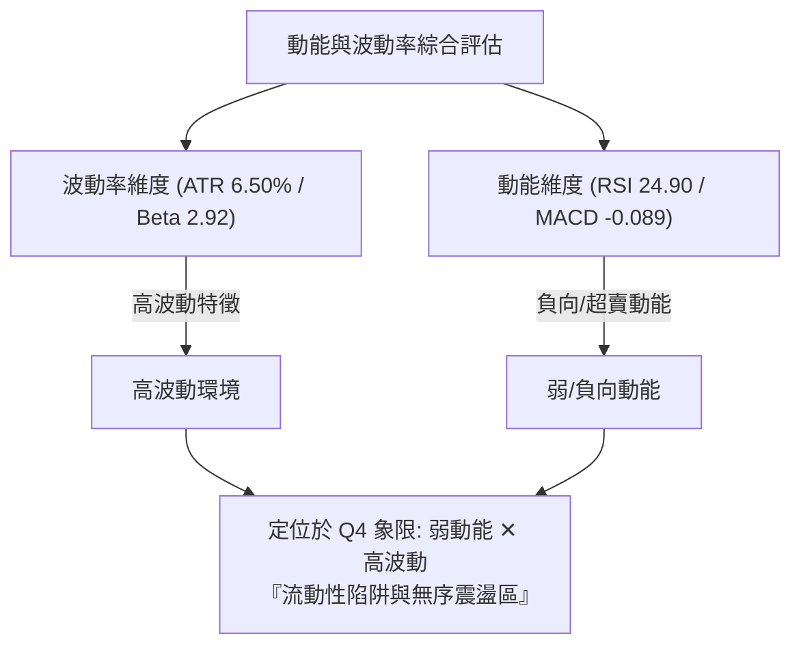
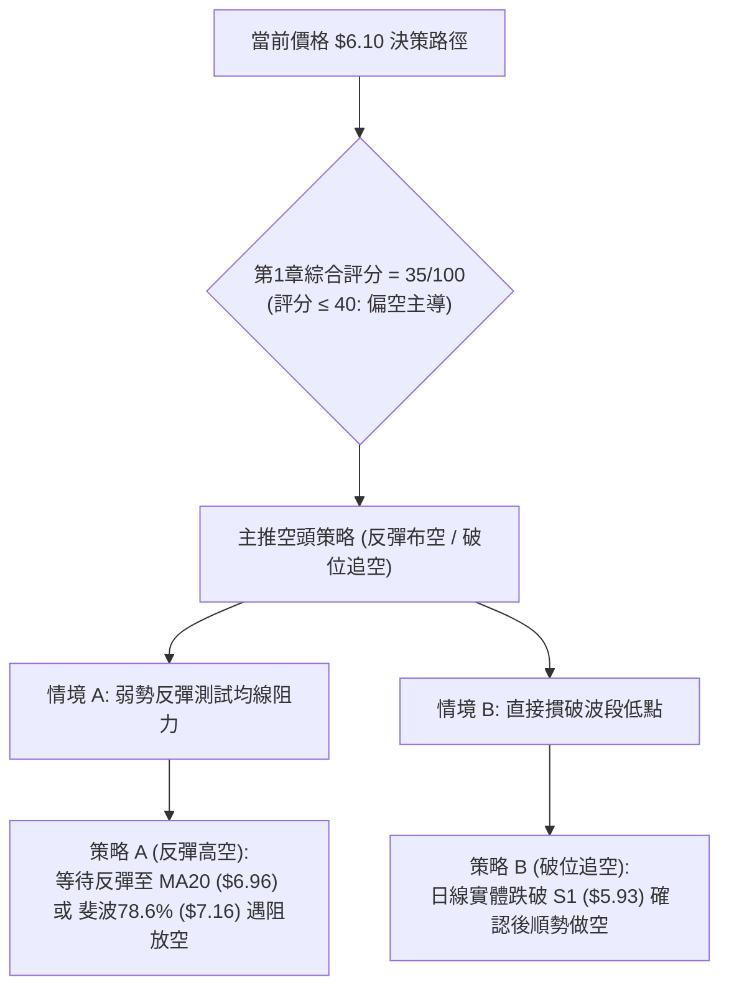
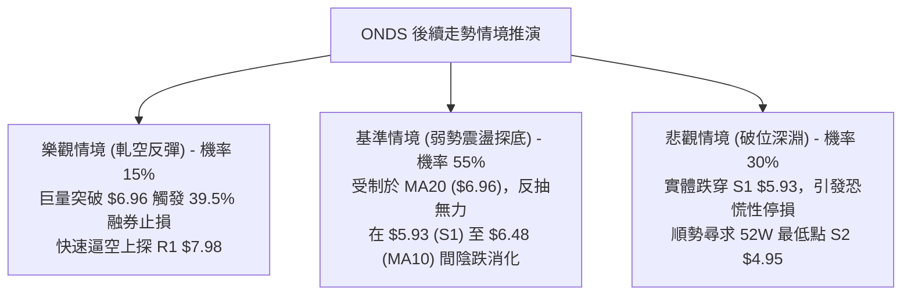

# ONDS 技術分析報告

> **報告日期**：2026-10-21 ｜ **語言**：繁體中文 ｜ **數據來源**：Yahoo Finance ｜ **當前價格**：$6.10

---

## 目錄

| 章節 | 內容 |
|------|------|
| [1. 技術面概覽](#1-技術面概覽) | 訊號儀表板、核心指標、評分卡 |
| [2. 趨勢分析](#2-趨勢分析) | 多時框趨勢、長中短期走勢、ADX 分析 |
| [3. 圖表形態分析](#3-圖表形態分析) | 形態識別、K線組合、目標價推算 |
| [4. 支撐與阻力](#4-支撐與阻力) | 關鍵價位結構、斐波那契回調位解讀 |
| [5. 技術指標深度解讀](#5-技術指標深度解讀) | 均線系統、RSI、MACD、布林通道、量能 |
| [6. 動能與波動率](#6-動能與波動率) | 動能四象限、ATR 波動率、Beta 與大盤關聯 |
| [7. 多時框架總結](#7-多時框架總結) | 時框架評分、綜合矩陣、多時框收斂結論 |
| [8. 交易策略建議](#8-交易策略建議) | 策略路由、價格情境、多空交易策略、評星 |
| [9. 風險提示與監控](#9-風險提示與監控) | 監控清單、情境分析、風險管理原則 |
| [📋 報告總結](#-報告總結) | 總體評級、核心結論與操作指引 |

---

## 1. 技術面概覽

### 🎯 技術訊號儀表板



### 📊 核心指標速覽表

| 指標類別 | 指標名稱 | 當前數值 | 訊號 | 專業解讀 |
|:---|:---|:---|:---:|:---|
| **價格** | 當前收盤價 | $6.10 | 🔴 | 位於 52 週區間 ($4.95 - $15.28) 的 11.1% 低位，弱勢探底 |
| **均線** | MA20 (短月線) | $6.96 | 🔴 | 價格低於 MA20 達 -12.33%，短線處於壓制空頭通道 |
| **均線** | MA50 (季線) | $7.61 | 🔴 | 價格低於 MA50 達 -19.84%，中期趨勢維持下行 |
| **均線** | MA200 (年線) | $9.31 | 🔴 | 價格低於 MA200 達 -34.48%，長期牛熊分水嶺上方壓力沉重 |
| **均線** | 均線排列 | 空頭排列 | 🔴 | MA5($6.14) < MA20($6.96) < MA50($7.61) < MA200($9.31) |
| **動能** | RSI(14) | 24.90 | 🟢 | 進入極度超賣區間 (<30)，具備技術性均值回歸修復潛能 |
| **動能** | MACD (12,26,9) | -0.408 / -0.319 | 🔴 | DIF 與 DEA 雙雙處於零軸下方，柱狀圖 -0.089 維持空方掌控 |
| **動能** | 隨機指標 (KD) | %K 16.10 / %D 13.86 | 🟢 | 雙線於超賣區低檔走平，隨時具備低檔金叉反彈契機 |
| **趨勢強度** | ADX (14) | 23.72 | 🟡 | 數值 <25，單邊急速下殺動能放緩，市場轉入弱勢盤整 |
| **通道** | 布林通道帶寬 | 下軌 $5.81 / 上軌 $8.10 | 🟡 | %B 為 0.12，現價逼近下軌支撐，面臨帶狀支撐考驗 |
| **量能** | 當日量 / 20日均量 | 28.53M / 56.52M | 🔴 | 量比僅 0.50x，下行量縮但多方承接意願薄弱，OBV < MA |
| **波動** | ATR(14) | $0.40 (6.50%) | 🟡 | 每日平均波動幅度達 6.50%，短線波動風險處於中高水平 |

### 🏆 技術評分卡

```
╔══════════════════════════════════════════════════════════════════╗
║              技術評分卡 — ONDS (2026-10-21)                      ║
╠══════════════════════════════════════════════════════════════════╣
║ 趨勢強度 (Trend)     ████░░░░░░░░░░░░░░░░  20/100  🔴 極度空頭   ║
║ 動能指標 (Momentum)  ████████░░░░░░░░░░░░  40/100  🟡 超賣回抽   ║
║ 支撐穩定度 (Support) ██████████░░░░░░░░░░  50/100  🟡 臨近S1考驗 ║
║ 成交量配合 (Volume)  ██████░░░░░░░░░░░░░░  30/100  🔴 量能渙散   ║
║ 形態完整度 (Pattern) ████████░░░░░░░░░░░░  40/100  🟡 矩形探底   ║
║ 均線排列 (Moving Av) ██░░░░░░░░░░░░░░░░░░  10/100  🔴 完美空頭   ║
╠══════════════════════════════════════════════════════════════════╣
║ 綜合評分             ███████░░░░░░░░░░░░░  35/100  🔴 偏空震盪   ║
╚══════════════════════════════════════════════════════════════════╝
```

---

## 2. 趨勢分析

### 🌐 多時框趨勢分析



### 📈 長期趨勢 — 12個月走勢圖（Unicode）

依據 2025 年 11 月至 2026 年 10 月實際月線收盤價繪製走勢圖：

```
ONDS 月線走勢圖（過去12個月：2025-11 至 2026-10）
價格軸 ($)
$13.50 ┤                                  ● $13.22 (2026-05 頂峰)
$12.00 ┤                                 / \
$10.50 ┤                   ● $10.36     /   \
$10.00 ┤                  / \          ● $10.04
$9.50  ┤         ● $9.76 /   ● $10.08 /       \
$9.00  ┤        /         \   \      /         \
$8.50  ┤       /           \   ● $9.04          ● $8.24
$7.50  ┤ ● $7.90                                 \   ● $7.66
$7.00  ┤                                          ● $7.49 \   ● $7.33
$6.00  ┤                                                   \   \
$5.50  ┤                                                    \   ● $6.10 (現價)
       └─────────────────────────────────────────────────────────────
        11    12    01    02    03    04    05    06    07    08    09    10  (月份)
       [── 2025 ──] [────────────────────── 2026 ────────────────────────]
```

#### 走勢特徵分析表格

| 週期階段 | 起訖月份 | 收盤價區間 | 期間漲跌幅 | 結構特徵與關鍵推動力 |
|:---|:---|:---|:---:|:---|
| **主升浪攀升期** | 2025-11 ~ 2026-01 | $7.90 → $10.36 | +31.14% | 多頭排列放量拉升，無人機與防務合約推動投機買盤爆發 |
| **高位箱體洗盤** | 2026-01 ~ 2026-04 | $10.36 → $10.04 | -3.09% | 在 $9.04 ~ $10.36 構築高檔震盪平台，獲利盤與換手並存 |
| **末端衝頂噴射** | 2026-04 ~ 2026-05 | $10.04 → $13.22 | +31.67% | 月線天量拉出長陽線，創下 52 週高點 $15.28，主力強勢派發 |
| **破位斷頭下殺** | 2026-05 ~ 2026-06 | $13.22 → $8.24 | -37.67% | 次月無量崩跌，跌破短期多頭防線，形成標準長黑吞噬形態 |
| **低位抵抗陰跌** | 2026-06 ~ 2026-10 | $8.24 → $6.10 | -25.97% | 反彈高點逐波下移（$7.80 → $7.64），持續向下尋找 S1 支撐 |

### 📊 中期趨勢（週線分析）

從近 20 週數據觀察，ONDS 在 2026 年 7 月下旬曾出現一波由 $6.53 反彈至 8 月中旬 $9.24 的波段漲勢（週成交量達 8.34 億股天量）；然而，在碰觸 $9.24（接近年線 MA200 壓力區）後再度受阻下挫。

```
週線級別價格防禦梯隊示意：
$9.31  ────── [長期均線 MA200 反轉阻力] ────── (未能收復，確立中期熊市)
$7.98  ────── [近一年波段高點聚類阻力 R1] ─── (2026-08~09 震盪反彈頂部)
$7.16  ────── [斐波那契 78.6% 回調分水嶺] ─── (10月中旬長黑實體跌破)
$6.10  ────── [當前現價交易位置] ─────────── (週成交量驟降至 57.35M)
$5.93  ────── [波段關鍵支撐 S1] ───────────── (前低防守陣線，距離僅 -2.79%)
$4.95  ────── [52週歷史極端低點 S2] ───────── (最後戰略性防禦底部)
```

### ⚡ 趨勢強度評估（ADX 解讀）



#### ADX 趨勢強度指標對照表

| 指標變數 | 當前讀數 | 標準閾值區間 | 當前市場狀態判定 | 交易戰術指引 |
|:---|:---:|:---:|:---|:---|
| **ADX (14)** | **23.72** | < 25 (弱趨勢/盤整) | 趨勢動能處於衰竭過渡期 | 避免追空，警惕超賣引發的假突破，以通道震盪策略應對 |
| **+DI (14)** | **11.66** | > 20 為多頭積極 | 多頭動能嚴重匱乏 | 多方尚無組織性反攻信號，反彈多屬技術性空頭回補 |
| **-DI (14)** | **29.68** | > 25 為空頭強勢 | 空方仍牢牢掌控盤面 | 雖然動能放緩，但盤面仍處於空頭絕對優勢區間 |
| **差值 (-DI - +DI)**| **+18.02** | > 15 為極度失衡 | 盤面偏向空方單邊壓制 | 任何右側多頭進場均須等待 +DI 上穿 -DI 形成多頭交叉 |

---

## 3. 圖表形態分析

### 🔍 形態識別系統



#### 圖表形態信心度評估表（依規則 15 嚴格執行）

| 形態識別名稱 | 信心度 | 判斷依據（引用數據） | 完成度 | 目標價（附嚴格計算式） |
|:---|:---:|:---|:---:|:---|
| **下降收斂通道 / 楔形** | **68%** | 上軌由 2026-08 高點 $9.24 與 2026-09 高點 $7.64 連線，下軌由 2026-07 低點 $6.53 與 2026-10 低點 $6.04 連線，高低點收斂且 ADX 降至 23.72。 | 75% | 若向上突破上軌頸線 $6.96 (MA20)，向上量度目標 = 頸線 $6.96 + 形態高度 ($7.64 - $6.04 = $1.60) = **$8.56** (逼近 R3 $8.58)。 |
| **大級別雙重底 (W底)** | **42%** | 前低為 2026-07-19 週低點 $6.53，當前測試現價 $6.10 與 S1 $5.93。**數據不足**：現價已跌破第一底 $6.53，形態對稱性破壞，尚未出現放量反轉K線。 | 30% | *訊號不足，未達50%門檻，不予推算雙底突破目標價。* |
| **布林帶下軌超賣擠壓** | **85%** | 布林通道下軌位於 $5.81，當前價格 $6.10，%B 為 0.12，RSI 為 24.90，構成指標型超賣極值修復架構。 | 90% | 均值回歸第一目標 = 布林中軌 (MA20) = **$6.96**；第二目標 = 斐波 78.6% 回調位 = **$7.16**。 |

### 🕯️ 重要K線形態分析

| 觀測週期 | 收盤價 | K線形態名稱 | 形態力學解讀 | 多空訊號 |
|:---|:---:|:---|:---|:---:|
| **2026-05** | $13.22 | 長上影高檔巨量長黑射擊之星 | 盤中衝擊 $15.28 後遭遇機構天量派發，長達 2 美元之上影線奠定長期反轉頭部 | 🔴 極度看空 |
| **2026-06** | $8.24 | 斷頭鍘刀巨陰線 | 直接擊穿 10 美元大關與多條短期均線，引發多頭踩踏融資斷頭 | 🔴 極度看空 |
| **2026-07** | $7.49 | 低檔長下影錘頭十字線 | 於 $6.53 獲得超跌買盤支撐，隨後引發 8 月份反彈至 $9.24 | 🟢 短線反彈 |
| **2026-08** | $7.66 | 倒轉鎚頭高檔遇阻線 | 衝高 $9.24 後無力突破 MA200，多頭動能衰竭轉弱 | 🔴 中期承壓 |
| **2026-09** | $7.33 | 縮量窄幅紡錘線 | 多空雙方於 $7.30 附近陷入拉鋸僵局，波動率進一步壓縮 | 🟡 變盤前兆 |
| **2026-10** | $6.10 | 下行破位光腳中黑線 | 跌破盤整區下沿，向 S1 $5.93 尋求支撐，空方仍居於下壓優勢 | 🔴 空頭延續 |

### 📉 ASCII 走勢形態示意圖

```
ONDS 下降收斂楔形與關鍵支撐測試示意圖
價格 ($)
$9.24 ┼───● (2026-08 波段高點)
      │    \   ╲ [下降趨勢壓力線]
$8.58 ┼─────\───╲─────────── [R3 關鍵阻力]
$7.98 ┼──────\───● (2026-09 次高點 $7.64) ─── [R1 關鍵阻力]
      │       \    ╲
$7.16 ┼────────\────╲─────── [斐波那契 78.6% 壓力轉換位]
$6.96 ┼─────────\────● (MA20 / 布林中軌頸線)
      │          \     ╲
$6.53 ┼─● (7月低點)\    ╲
$6.10 ┼──────────────●───► [當前現價 $6.10，逼近楔形尖端]
$5.93 ┼─────────────────── [S1 支撐位：波段低點聚類]
      │                     ╲
$4.95 ┼───────────────────────● [S2 終極支撐：52W低點]
      └───────────────────────────────────────────────► 時間軸
```

### 🎯 形態目標價計算

依據具備 68% 信心度的「下降收斂楔形」與指標型「均值回歸」理論進行推算：

1. **下行跌破情境**：
   - 觸發條件：日線實體跌破支撐位 S1 ($5.93)。
   - 形態測幅：現價 $6.10 跌破 S1 後，下一個具有歷史聚類支撐之價位為 **S2 ($4.95)**（跌幅 -18.85%）。
2. **上行突破情境**：
   - 觸發條件：日線放量突破 MA20 頸線位置 ($6.96)。
   - 形態高度：近期震盪高點 $7.64 減去波段低點 $6.04 = $1.60。
   - 理論量度目標價：頸線 $6.96 + $1.60 = **$8.56**，此數值與系統計算之關鍵阻力 **R3 ($8.58)** 高度重合（誤差僅 0.23%）。

---

## 4. 支撐與阻力

### 🗺️ 關鍵價位分布圖（Unicode）

```
╔══════════════════════════════════════════════════════════════════╗
║              ONDS 關鍵價位結構分布圖                             ║
╠══════════════════════════════════════════════════════════════════╣
║ $8.58 ║████████████████████████████████║ 強阻力 R3 (年線/密集成交區)
║ $8.31 ║████████████████████████        ║ 次級阻力 R2 (反彈高點聚類)
║ $7.98 ║████████████████████████████████║ 核心阻力 R1 (波段反轉頸線)
║ $7.16 ║▓▓▓▓▓▓▓▓▓▓▓▓▓▓▓▓▓▓▓▓            ║ 斐波那契 78.6% 分水嶺
║ $6.96 ║▒▒▒▒▒▒▒▒▒▒▒▒▒▒▒▒▒▒▒▒            ║ MA20 / 布林中軌動態壓力
║       ╠════════════════════════════════╣ 
║ $6.10 ║ ◄─── 當前現價 (處於S1上方脆弱平衡區)
║       ╠════════════════════════════════╣ 
║ $5.93 ║▓▓▓▓▓▓▓▓▓▓▓▓▓▓▓▓▓▓▓▓▓▓▓▓▓▓▓▓    ║ 關鍵支撐 S1 (近一年波段低點)
║ $4.95 ║████████████████████████████████║ 終極強支撐 S2 (52週歷史低點)
║ [無]  ║░░░░░░░░░░░░░░░░░░░░░░░░░░░░░░░░║ S3 數據中未偵測到
╚══════════════════════════════════════════════════════════════════╝
```

### 🚧 阻力位分析表

所有阻力數值嚴格引用近一年波段高點聚類數據：

| 阻力級別 | 準確價位 | 距現價幅標 | 形成原因與籌碼結構 | 突破難度評級 | 技術重要性 |
|:---|:---:|:---:|:---|:---:|:---:|
| **R1** | **$7.98** | +30.82% | 2026 年 8 月下旬多頭反彈失敗之頸線平台，前期大量套牢籌碼沉積區 | 🔴 極高 | ★★★★★ (中期牛熊翻轉點) |
| **R2** | **$8.31** | +36.31% | 2026 年 6 月破位大陰線中繼整理平台，籌碼密集成交換手帶 | 🔴 高 | ★★★★☆ (反彈解套拋壓區) |
| **R3** | **$8.58** | +40.66% | 2026 年 5 月底崩跌起跌點，並與 MA120 ($8.42) 及下降形態量度目標 ($8.56) 形成壓力共振 | 🔴 極高 | ★★★★★ (波段極限目標位) |

### 🛡️ 支撐位分析表

所有支撐數值嚴格引用近一年波段低點聚類數據：

| 支撐級別 | 準確價位 | 距現價幅標 | 形成原因與結構強度 | 守住機率預估 | 技術重要性 |
|:---|:---:|:---:|:---|:---:|:---:|
| **S1** | **$5.93** | -2.79% | 近一年波段次級低點聚類區，距離現價僅 $0.17，也是布林下軌 ($5.81) 前最後屏障 | 🟡 55% | ★★★★☆ (短線防守第一道生命線) |
| **S2** | **$4.95** | -18.85% | 52 週歷史最低價，也是 2025 年牛市主升浪啟動前的原始籌碼密集發起區 | 🟢 85% | ★★★★★ (長期價值重估底線) |
| **S3** | 數據未偵測 | — | 數據中未偵測到此層級數據 | — | — |

### 📐 斐波那契回調位分析

基準區間採用 52 週完整波動波段：**最低點 $4.95 (100.0%) → 最高點 $15.28 (0.0%)**，總波動空間為 $10.33。

```
斐波那契垂直回調階梯：
0.0%  (52W High) ─────────────────────── $15.28
23.6%            ─────────────────────── $12.84
38.2%            ─────────────────────── $11.33
50.0%            ─────────────────────── $10.11
61.8% (黃金分割) ─────────────────────── $8.90
78.6% (防守邊界) ─────────────────────── $7.16
─── [現價 $6.10 處於 78.6% ($7.16) 與 100.0% ($4.95) 深度回撤區間] ───
100.0%(52W Low)  ─────────────────────── $4.95
```

- **位置解讀**：現價 $6.10 已實質跌穿斐波那契 78.6% 極限回調位 ($7.16) 達 -14.80%。在傳統道氏理論與斐波那契架構中，一旦資產價格跌破 78.6% 回調線，代表先前從 $4.95 到 $15.28 的牛市多頭推進浪已被空頭徹底瓦解。
- **後市意義**：$7.16 已由支撐轉化為極強的阻力轉換位。若現價無法於 S1 ($5.93) 企穩築底，行情將具備強大引力向下回測 100.0% 斐波那契位，即 **$4.95** 原點。

---

## 5. 技術指標深度解讀

### 🎛️ 指標訊號總覽



### 📈 移動平均線排列分析



#### 移動平均線多空狀態詳表

| 均線名稱 | 當前價位 | 現價偏離幅度 | 斜率走勢特徵 | 訊號評估 |
|:---|:---:|:---:|:---|:---:|
| **MA5** | $6.14 | -0.62% | 微幅向下，現價正緊貼五日線尋求站上契機 | 🟡 測試突破 |
| **MA10** | $6.48 | -5.92% | 加速度下行，構成短線超跌反彈第一道動態阻力 | 🔴 空頭壓制 |
| **MA20** | $6.96 | -12.33% | 穩定下行，為布林中軌，站上此線方能確認短線止跌 | 🔴 空頭阻力 |
| **MA50** | $7.61 | -19.84% | 持續走低，為中期空頭趨勢主幹道 | 🔴 中期看空 |
| **MA200** | $9.31 | -34.48% | 平緩下行，象徵長期技術走勢處於熊市格局 | 🔴 長期走熊 |

### 📉 RSI(14) 分析

- **RSI 當前讀數**：`24.90` 
- **進度條展示**：
  ```
  超賣區 (0-30)        中性區 (30-70)        超買區 (70-100)
  [█████████░░░░░░░░░░░░░░░░░░░░░░░░░░░░░░] 24.90 (深度超賣)
  ```
- **超買超賣評估**：RSI(14) 跌破 30 進入極度超賣區，反映過去 14 日空方拋壓過度集中，隨機指標 Stoch %K 同步下探至 16.10，顯示市場隨時存在技術性反抽需求。
- **背離判斷**：
  - 價格於 2026-10-18 週收盤 $6.04，當週 RSI 為 20.1；本週價格微升至 $6.10，RSI 升至 24.90。
  - **結論**：指標與價格同向回升，**無明顯底背離或頂背離**現象（數據確認無背離）。此處超賣為純粹之「動能衰竭超賣」，而非結構性背離引發的反轉。

### 📊 MACD(12/26/9) 訊號解讀



- **MACD 線性讀數**：DIF 為 `-0.408`，Signal (DEA) 為 `-0.319`，雙線在零軸深處運行。
- **柱狀圖動能**：Histogram 為 `-0.089`。雖然 10 月中旬柱狀圖由 -0.100 略微收斂至 -0.089，但 DIF 仍低於 DEA，尚未形成低檔黃金交叉，空頭控制權未失。

### 📦 布林通道分析

布林通道參數 (20, 2)：
- **布林上軌**：`$8.10`
- **布林中軌 (MA20)**：`$6.96`
- **布林下軌**：`$5.81`
- **帶寬指標 %B**：`0.12` （0 = 下軌，$5.81；0.5 = 中軌，$6.96；1 = 上軌，$8.10）

```
布林通道現價垂直投影圖：
$8.10 ┤─────────────────────────────── 上軌 (強阻力邊界)
      │
$6.96 ┤- - - - - - - - - - - - - - - - 中軌 (MA20 基準線)
      │
$6.10 ┤████████████████ ◄─── 現價 (%B = 0.12)
$5.81 ┤─────────────────────────────── 下軌 (動態包絡支撐)
```

**解讀**：%B 讀數 0.12 代表價格已極度逼近下軌邊界。在 ADX < 25 的盤整震盪市場中，布林下軌具有強烈的橡皮筋回彈效應；現價距離下軌僅剩 $0.29（-4.75%），做空盈虧比極度不佳。

### 💹 成交量分析（量價配合度）

```
成交量對比柱狀圖：
最新量 (28.53M) ▓▓▓▓▓▓▓▓▓░░░░░░░░░░ (量比 0.50x)
20日均 (56.52M) ▓▓▓▓▓▓▓▓▓▓▓▓▓▓▓▓▓▓░
50日均 (62.62M) ▓▓▓▓▓▓▓▓▓▓▓▓▓▓▓▓▓▓██
```

- **量價背離分析**：最新單日成交量為 28,531,700 股，相較於 20 日均量 56,520,130 股呈現腰斬現象（量比僅 0.50x）。
- **OBV 能量潮判讀**：數據明確指出「OBV < MA → 量能疲弱」。這表明過去一段時間的價格下跌並非主力大單無序拋售，而是呈現市場流動性匱乏、買盤嚴重縮手的「陰跌無量」走勢。無量下跌意味著賣壓正在消耗，但在買盤介入放量之前，難以展開具規模的 V 型反轉。

---

## 6. 動能與波動率

### ⚡ 動能評估四象限



#### 動能-波動四象限對照表

| 象限標籤 | 動能強度 | 波動率水平 | 當前所屬狀態 | 操作戰略評估 |
|:---:|:---:|:---:|:---:|:---|
| **第一象限 (Q1)** | 強 (Bullish) | 低 (Stable) | — | 最佳趨勢加碼機會（低風控單邊上漲） |
| **第二象限 (Q2)** | 弱 (Bearish) | 低 (Stable) | — | 窄幅盤整，靜待方向選擇 |
| **第三象限 (Q3)** | 強 (Bullish) | 高 (Volatile) | — | 高風險高收益突破浪（警惕洗盤） |
| **第四象限 (Q4)** | **弱 (Bearish)** | **高 (Volatile)** | **✓ (ONDS 當前)** | **避免追漲殺跌；空頭動能衰減，逢高放空或等待極端支撐博弈超賣反彈** |

### 📊 ATR 波動率分析

- **ATR(14) 絕對值**：`$0.40`
- **ATR 相對波動比率**：`6.50%`（相較於現價 $6.10）
- **止損距離動態建議**：
  - **日內/超短線止損 (1.0 × ATR)**：`$0.40`。若自現價進場，短線多頭止損應設於 $6.10 - $0.40 = **$5.70**（跌破布林下軌）。
  - **波段交易止損 (1.5 × ATR)**：`$0.60`。若建立防禦性多單，止損距離為 $6.10 - $0.60 = **$5.50**。
  - **空頭頭寸防守 (1.5 × ATR)**：反彈放空止損需設於進場點上方 $0.60，例如於阻力位 $6.96 放空，止損設於 **$7.56**。

### 📐 Beta 與市場相關性

- **Beta 係數**：`2.922`
- **特徵解讀**：ONDS 屬於極端高貝塔標的，波動敏銳度接近納斯達克大盤的 3 倍。
- **融券作空比例 (Short % Float)**：高達 **39.5%**，Short Ratio 為 3.64 天。
- **空頭擠壓 (Short Squeeze) 潛在能量**：高達近四成的流通股被做空，一旦公司出現突發利多或大盤強勢拉升，高 Beta 與高空單比例將引發劇烈的軋空暴拉，這是在任何做空策略中必須嚴密防範的黑天鵝風險。

---

## 7. 多時框架總結

### 📋 時框架評分表

| 時框架 | 趨勢方向 | 動能狀態 | 均線排列狀況 | 關鍵形態特徵 | 綜合評分 | 操作建議 |
|:---|:---:|:---:|:---:|:---|:---:|:---|
| **月線 (長期)** | 🔴 下行修正 | 弱勢減速 | 跌破 5 月高點起跌通道 | 頂部 $13.22 破位崩跌後的尋底波段 | 30/100 | 規避長期多頭持有 |
| **週線 (中期)** | 🔴 空頭延續 | 柱狀微斂 | MA50 壓制，跌破斐波 78.6% | $9.24 受阻回落，測試 S1 支撐 | 35/100 | 反彈遇均線逢高布空 |
| **日線 (短期)** | 🟡 弱勢震盪 | 極度超賣 | 全均線呈空頭排列向下發散 | 逼近布林下軌 $5.81 與 S1 $5.93 | 40/100 | 嚴禁殺跌，尋求區間交易 |

### 🔲 綜合訊號矩陣

```
╔══════════════════════════════════════════════════════════════════╗
║              多時框架維度訊號矩陣                                ║
╠══════════════════╦══════════════╦══════════════╦═════════════════╣
║ 分析維度         ║ 短期 (日線)  ║ 中期 (週線)  ║ 長期 (月線)     ║
╠══════════════════╬══════════════╬══════════════╬═════════════════╣
║ 趨勢方向 (Trend) ║ 🔴 偏弱下壓  ║ 🔴 空頭排列  ║ 🔴 回撤修正     ║
║ 動能指標 (Osc.)  ║ 🟢 嚴重超賣  ║ 🔴 負向低迷  ║ 🟡 動能放緩     ║
║ 均線系統 (MAs)   ║ 🔴 壓制在下  ║ 🔴 破位下行  ║ 🔴 跌破年線     ║
║ 量價結構 (Vol.)  ║ 🔴 縮量陰跌  ║ 🟡 週量驟減  ║ 🔴 派發後無量   ║
║ 支撐壓力測試     ║ 🟡 逼近 S1   ║ 🔴 跌破 78.6%║ 🟡 測試起漲平台 ║
╚══════════════════╩══════════════╩══════════════╩═════════════════╝
```

### ⚖️ 多時框收斂結論

> **依據嚴格要求第 14 條收斂規則執行判定：**
> 1. **行情屬性**：當前 ADX(14) 讀數為 **23.72 (< 25)**，嚴格定義為**盤整行情（震盪行情）**，非單邊強烈趨勢行情。
> 2. **主導時框規則**：在盤整行情中，依規則應以**日線布林通道上下軌（下軌 $5.81 至 上軌 $8.10）**為主要交易區間框架。
> 3. **方向性唯一收斂結論**：**【偏空震盪（Bearish Range-bound）】**。
>    雖然長期與中期受制於空頭排列，但由於日線動能出現極度超賣（RSI=24.90），且價格緊貼布林下軌 $5.81 與支撐 S1 ($5.93)，空單不具備向下追擊優勢。因此，市場被收斂為：**「以中長期均線阻力位尋找高空點位為主、以布林下軌/S1支撐做為超跌反彈止盈與超短線風控點」的偏空格局**。

---

## 8. 交易策略建議

### 🗺️ 策略決策流程圖



### 🧭 策略路由

- **依據規則判定**：第 1 章技術評分卡綜合評分為 **35/100 (≤ 40)**。
- **核心戰術結論**：**當前主策略方向 = 【空頭主導策略（反彈逢高布空與破位做空）】**。
- *注：多頭操作僅列為超跌反彈之極短線戰術性對沖，不作為主要波段推薦。*

### 🎯 價格情境階梯（Price Scenarios）

價位嚴格引用自「關鍵價位」區塊之客觀數據：

| 觸發條件 | 下一目標 | 後續延伸 | 情境技術含義 |
|:---|:---:|:---:|:---|
| **強勢突破 R1 ($7.98)** | R2 ($8.31) | R3 ($8.58) | 多頭全面扭轉頹勢，形成週線級別大反轉 |
| **向上反抽觸及 MA20 ($6.96)** | 斐波 78.6% ($7.16) | R1 ($7.98) | 超賣技術性抽腳修復，遭遇中軌強阻力（主空點） |
| **在現價 $6.10 附近震盪** | 布林下軌 ($5.81) | MA5 ($6.14) | 弱勢無量拉鋸，處於 S1 邊界消耗空方動能 |
| **實體跌破 S1 ($5.93)** | 52W 低點 S2 ($4.95) | 數據未偵測S3 | 破位引發新一輪止損殺跌，尋求歷史極端支撐 |

### 📊 情境機率分佈

| 預測情境名稱 | 發生機率 | 主要技術依據 |
|:---|:---:|:---|
| **反彈遇阻回落 (情境 A)** | **55%** | RSI(14)=24.90 極度超賣引發超跌反彈，但受制於 MA20($6.96) 與空頭排列壓制 |
| **跌破 S1 再探底 (情境 B)** | **30%** | OBV持續疲弱、量比僅 0.50x，買盤承接匱乏，隨時可能直接摜破 S1($5.93) |
| **直接破底反轉暴漲** | **15%** | 僅能在出現重大外生利多引發 39.5% 空頭強制軋空時發生，技術面暫不支援 |

### 🔴 主策略詳情（空頭主導策略）

依據評分 ≤ 40 規則，全案主推兩組精準空頭策略：

| 策略要素 | 策略 A：反彈遇阻沽空策略 (Pullback Short) | 策略 B：跌破關鍵支撐追空策略 (Breakdown Short) |
|:---|:---:|:---:|
| **進場條件** | 價格反抽至 MA20 / 斐波 78.6% 區域出現上影線滯漲 | 日線收盤價或小時線實體跌穿支撐 S1 |
| **進場價格** | **$6.96** (布林中軌 MA20 處) | **$5.90** (確認跌破 S1 $5.93 後追進) |
| **目標價 T1** | **$6.10** (當前盤整平台) | **$5.20** (接近歷史前低) |
| **目標價 T2** | **$5.93** (關鍵支撐 S1) | **$4.95** (終極強支撐 S2 / 52W低點) |
| **止損價格** | **$7.36** (突破斐波 78.6% $7.16 上方 1 × ATR) | **$6.30** (重回 S1 上方 1 × ATR) |
| **風險報酬比** | **2.15 : 1** (風險 $0.40 vs 報酬 $0.86) | **2.38 : 1** (風險 $0.40 vs 報酬 $0.95) |
| **成功機率** | **65%** | **55%** |
| **建議倉位** | **8% ~ 10%** 總資產 | **5%** 總資產 (順勢底倉) |

### 🟢 反向風險觸發點（多頭對沖提示）

若已持有空單或欲進行左側極端反彈博弈，須嚴密監控以下反轉節點：
- **空單警戒平倉點**：日線帶量收盤站上 **$6.96 (MA20)**，表明下降楔形向上假跌破真突破，空單應立即全數止損離場。
- **多頭激進博弈點（對沖性買入）**：若現價回踩至布林下軌 **$5.81** 至 **$5.93 (S1)** 區間出現 15 分鐘長下影線，激進型投資者可以嚴格止損在 **$5.70**（現價 - 1 ATR）為前提，博弈目標看至 **$6.96** 之超跌均值回歸，但部位嚴格限制在 3% 以內。

### ⭐ 整體訊號強度評星

```
╔══════════════════════════════════════════════════════════════════╗
║ 做多訊號強度：★★☆☆☆  (2/5星 - 僅存超賣回抽潛能，無趨勢配合)    ║
║ 做空訊號強度：★★★★☆  (4/5星 - 均線完美空頭壓制，順勢為主)      ║
║ 整體可信度：  ★★★★☆  (4/5星 - 技術位聚類扎實，量價關係清晰)    ║
╚══════════════════════════════════════════════════════════════════╝
```

---

## 9. 風險提示與監控

### ✅ 關鍵監控指標 Checklist

```
╔══════════════════════════════════════════════════════════════════╗
║                 ONDS 日常交易風控監控清單 (Checklist)            ║
╠══════════════════════════════════════════════════════════════════╣
║ [ ] 支撐防守測試：收盤價是否跌破 $5.93 (S1)？                    ║
║ [ ] 動態阻力突破：收盤價是否帶量越過 $6.96 (MA20)？              ║
║ [ ] 動能底背離訊號：RSI(14) 回升至 30 以上時，是否伴隨成交量放大？║
║ [ ] 空頭回補警報：空頭浮動比高達 39.5%，單日量比是否突增至 >2.0x？║
║ [ ] 布林軌道擴軌：布林帶下軌 $5.81 是否出現開口朝下擴散？       ║
║ [ ] ATR 異常放大：單日震幅是否突破 $0.60 (1.5 × ATR)？           ║
╚══════════════════════════════════════════════════════════════════╝
```

### ⚠️ 風險場景分析



### 🛡️ 風險管理重要提醒

1. **極端高空單比例與軋空風險 (Short Squeeze Risk)**：
   - ONDS 的 Short % Float 高達 **39.5%**，Short Ratio 達 3.64 天。在美股微型防務與通訊板塊中，此類極高做空比例標的極易因任何正面消息引發空頭踩踏。
   - **處置原則**：任何執行空頭策略的部位，止損必須剛性執行，嚴禁在突破 **$7.16** 或 **$7.36** 後凹單抗虧。
2. **高 Beta 波動風險 (High Volatility Control)**：
   - Beta 值高達 **2.922**，當前 ATR 佔股價高達 6.50%。單日 $0.40 的波動幅度極易掃穿過於緊密的止損。
   - **倉位管理**：單筆交易虧損額度必須嚴格控制在總投資組合資金的 1.0% ~ 1.5% 以內。以操作策略 A 為例，停損距離為 $0.40，總資產 10 萬美元之投資者，最大部位不得超過 2,500 股。
3. **流動性陷阱 (Liquidity Trap)**：
   - 最新單日成交量銳減 50% 至 28.53M 股。盤面缺乏大型主動買盤，容易出現買賣價差（Bid-Ask Spread）擴大問題。進出建議採用限價單（Limit Order），嚴禁使用市價單追擊，以防滑點衝擊。

---

## 📋 報告總結

```
╔══════════════════════════════════════════════════════════════════╗
║                     ONDS 技術分析報告總結                        ║
╠══════════════════════════════════════════════════════════════════╣
║ 報告日期：2026-10-21                                             ║
║ 當前價格：$6.10 (處於 52W 區間 11.1% 之極低分位)                ║
║ 分析評級：🔴 偏空震盪 (綜合技術評分 35/100)                     ║
╠══════════════════════════════════════════════════════════════════╣
║ 關鍵結論：                                                       ║
║ ├─ 長期趨勢：🔴 跌破 52W 頂部起跌通道，長線空頭修正走勢未結     ║
║ ├─ 中期趨勢：🔴 均線呈空頭排列，受制於 MA50 ($7.61) 與 MA200     ║
║ ├─ 短期趨勢：🟡 RSI(14)=24.90 極度超賣，於 S1 ($5.93) 尋求抵抗  ║
║ ├─ 關鍵支撐：S1 $5.93 (-2.79%)  /  S2 $4.95 (-18.85%)            ║
║ ├─ 關鍵阻力：MA20 $6.96 (+14.1%) /  R1 $7.98 (+30.82%)          ║
║ └─ 華爾街共識目標價：$18.88 (與當前技術盤面嚴重脫節，僅供參考) ║
╠══════════════════════════════════════════════════════════════════╣
║ 最優策略組合：                                                   ║
║ 1. 🥇 最佳機會：策略 A (反彈遇阻做空) — 等待價格反抽至 MA20    ║
║    $6.96 附近建立空單，止損設 $7.36，第一目標 $6.10，第二 $5.93 ║
║ 2. 🥈 次選機會：策略 B (破位順勢追空) — 跌破 S1 $5.93 後空單    ║
║    進場，止損設 $6.30，下看 52 週最低點 S2 $4.95               ║
║ 3. 🥉 保守選擇：空倉觀望 — ADX=23.72 顯示單邊動能不足，靜待    ║
║    S1 ($5.93) 的得失確認，或放量站穩 MA20 形成右側底後再行決策  ║
╚══════════════════════════════════════════════════════════════════╝
```

---

> ⚠️ **免責聲明**：本報告為量化技術分析研究報告，所有數據、圖表及價位推演均嚴格基於所提供之歷史 OHLCV 市場行情數據構建。本報告**僅供研究與學術參考**，**不構成任何買賣要約、投資建議或獲利保證**。金融市場具有高度不確定性與本金損失風險，投資人應獨立審慎評估，自行承擔交易風險。

---

*報告生成時間：2026-10-21 ｜ 數據來源：Yahoo Finance ｜ 分析框架：多時框技術分析模型*