# ONDS 技術分析報告

> **報告日期**：2026-10-22 ｜ **語言**：繁體中文 ｜ **數據來源**：Yahoo Finance ｜ **當前價格**：$6.27

---

## 目錄

| 章節 | 內容 |
|------|------|
| [1. 技術面概覽](#1-技術面概覽) | 訊號儀表板、核心指標速覽、技術評分卡 |
| [2. 趨勢分析](#2-趨勢分析) | 多時框趨勢、12個月走勢圖、ADX趨勢強度 |
| [3. 圖表形態分析](#3-圖表形態分析) | 形態識別、K線組合解讀、形態目標價推算 |
| [4. 支撐與阻力](#4-支撐與阻力) | 關鍵價位結構、斐波那契回調深度分析 |
| [5. 技術指標深度解讀](#5-技術指標深度解讀) | 均線系統、RSI/MACD背離檢驗、布林通道與量能 |
| [6. 動能與波動率](#6-動能與波動率) | 動能四象限、ATR波動度與Beta關聯性 |
| [7. 多時框架總結](#7-多時框架總結) | 時框架評分矩陣、收斂規則與單一方向定調 |
| [8. 交易策略建議](#8-交易策略建議) | 策略路由、主空/主多情境階梯、風報比精算 |
| [9. 風險提示與監控](#9-風險提示與監控) | 監控清單、極端軋空情境與部位管理 |
| [10. 報告總結](#10-報告總結) | 核心結論與執行路徑總整理 |

---

## 1. 技術面概覽

### 🎯 技術訊號儀表板

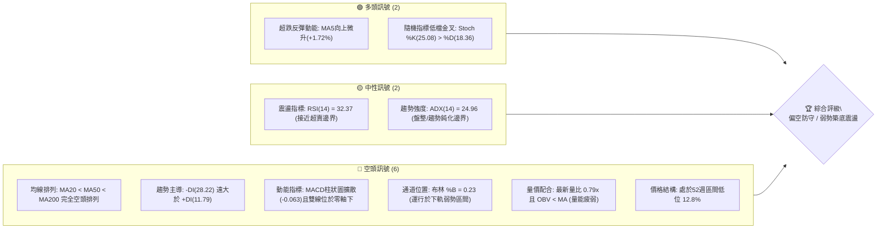

### 📊 核心指標速覽表

| 指標類別 | 指標名稱 | 當前數值 | 訊號 | 專業解讀與市場含義 |
|:---|:---|:---:|:---:|:---|
| **價格** | 當前價格 | $6.27 | 🔴 | 貼近年度波段低點，位於52週區間下緣 12.8% 處 |
| **短期均線** | MA20 | $6.90 | 🔴 | 價格低於MA20達 -9.15%，短期下行趨勢顯著承壓 |
| **中期均線** | MA50 | $7.54 | 🔴 | 中期生命線下傾，構成反彈重大反壓帶 |
| **長期均線** | MA200 | $9.28 | 🔴 | 遠低於年線達 -32.44%，中長期完全處於空頭控制 |
| **動能** | RSI(14) | 32.37 | 🟡 | 位於弱勢區間但未破30極度超賣，目前無背離訊號 |
| **動能** | MACD (12,26,9) | -0.398 / -0.335 | 🔴 | 雙線位於零軸之下，Hist為 -0.063，空頭動能仍佔優 |
| **動能** | Stoch %K / %D | 25.08 / 18.36 | 🟢 | 低檔黃金交叉，暗示極短線有技術性跌深反抽需求 |
| **趨勢** | ADX(14) | 24.96 | 🟡 | 數值小於25，顯示單邊下跌動能轉弱，進入盤整摩擦期 |
| **方向** | +DI / -DI | 11.79 / 28.22 | 🔴 | 空方力量仍顯著壓制多方，多頭反攻尚未具備持續性 |
| **波動** | ATR(14) | $0.39 | 🟡 | 佔現價 6.29%，屬於高Beta標的正常日均波動區間 |
| **通道** | 布林通道 (%B) | 0.23 (下軌$5.74) | 🔴 | 價格游移於中軌($6.90)與下軌($5.74)間，尚未觸發破軌 |
| **成交量** | 20日量比 | 0.79x | 🔴 | 今日量 43.76M 顯著低於均量 55.33M，買盤承接力不足 |

### 🏆 技術評分卡

```
╔══════════════════════════════════════════════════════════════════╗
║                   技術評分卡 — ONDS (2026-10-22)                 ║
╠══════════════════════════════════════════════════════════════════╣
║ 趨勢強度 (Trend)       ███████░░░░░░░░░░░░░  35/100 🔴 空頭壓制   ║
║ 動能指標 (Momentum)    ███████░░░░░░░░░░░░░  38/100 🔴 弱勢鈍化   ║
║ 支撐穩定度 (Support)   ███████████░░░░░░░░░  55/100 🟡 考驗S1支撐 ║
║ 成交量配合 (Volume)    ██████░░░░░░░░░░░░░░  30/100 🔴 無量陰跌   ║
║ 形態完整度 (Pattern)   ████████░░░░░░░░░░░░  40/100 🔴 下行通道   ║
║ 均線排列 (MA System)   ████░░░░░░░░░░░░░░░░  20/100 🔴 典型空頭   ║
╠══════════════════════════════════════════════════════════════════╣
║ 綜合技術評分           ███████░░░░░░░░░░░░░  36/100 🔴 偏空觀望   ║
╚══════════════════════════════════════════════════════════════════╝
```

---

## 2. 趨勢分析

### 🌐 多時框趨勢分析

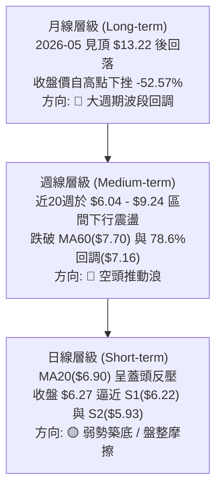

### 📈 長期趨勢 — 12個月走勢圖（Unicode）

以下為 ONDS 過去 12 個月（2025-11 至 2026-10）月線收盤價歷史走勢圖：

```
ONDS 月線走勢圖（過去12個月歷史收盤）
價格軸 ($)
$14.00 ┤                                  ● $13.22 (2026-05 波段頂部)
$13.00 ┤                                 ╱ ╲
$12.00 ┤                                ╱   ╲
$11.00 ┤                  ● $10.36     ╱     ╲
$10.00 ┤            ●    ╱ ╲     ●    ╱       ╲
 $9.00 ┤      ●    ╱ ╲  ╱   ╲   ╱ ╲  ╱         ╲
 $8.00 ┤●    ╱ ╲  ╱   ╲╱     ●─┘   ╲╱           ● $8.24
 $7.00 ┤ ╲  ╱   ╲╱                               ╲   ●   ●
 $6.00 ┤  ╲╱                                      ╲ ╱ ╲ ╱ ╲  ● $6.27 (當前)
 $5.00 ┤                                           ●       ● $6.04 (週線低點)
       └─────────────────────────────────────────────────────────────
        11   12   01   02   03   04   05   06   07  08  09  10 (月份)
       (25) (25) (26) (26) (26) (26) (26) (26) (26)(26)(26)(26)
```

#### 走勢特徵分析表格

| 階段週期 | 月份區間 | 價格區間 | 漲跌幅 | 量價與趨勢特徵解讀 |
|:---|:---:|:---:|:---:|:---|
| **第一階段：高檔強勢整理** | 2025-11 ~ 2026-01 | $7.90 → $10.36 | +31.14% | 沿中長期均線推升，市場預期營收爆發，多頭主控推進 |
| **第二階段：震盪誘多構築** | 2026-02 ~ 2026-04 | $10.08 → $10.04 | -0.40% | 於 $9.00~$10.00 間構築高檔箱型，量能逐漸出現邊際萎縮 |
| **第三階段：末升噴出衝頂** | 2026-05 | 收盤 $13.22 (高 $15.28) | +31.67% | 月線創下52週最高價 $15.28 後巨幅爆量留長上影線，形成主力出貨結構 |
| **第四階段：主跌出脫殺多** | 2026-06 ~ 2026-07 | $13.22 → $7.49 | -43.34% | 獲利了結與流動性抽離，跌破多重均線，月K連收巨陰吞噬 |
| **第五階段：低檔弱勢沉澱** | 2026-08 ~ 2026-10 | $7.66 → $6.27 | -18.15% | 均線轉為全面空頭排列，量能萎縮至 43M 水準，下行探求實質買盤 |

### 📊 中期趨勢（週線分析）

從近20週數據觀察，價格自 2026-08-16 的反彈高點 $9.24 展開新一輪下跌波段：
1. **反彈高點逐級降低**：從 8 月中旬的 $9.24，降至 9 月底的 $7.64，再降至 10 月初的 $7.24。
2. **週線MACD持續處於負值區**：雖然在 2026-07-26 至 2026-08-16 期間 MACD 柱狀圖曾短暫轉正（最高 +0.252），但隨即於 8 月底再度翻黑，最新週線 MACD 柱狀為 -0.063，未見具備翻轉強度的底背離。
3. **週成交量動能消退**：週量從 2026-07-26 爆量 8.34 億股，一路下滑至當週（截至 10-25）的 1.01 億股，顯示低檔籌碼換手意願降低，賣壓雖有減緩，但欠缺主動買盤承接。

### ⚡ 趨勢強度評估（ADX 解讀）

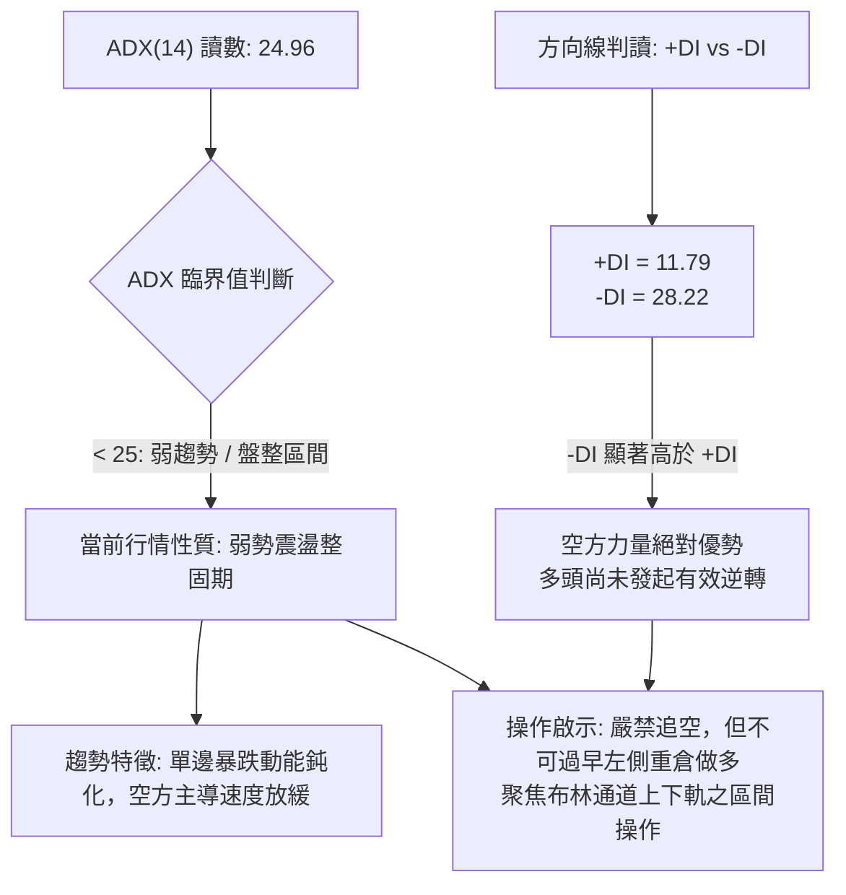

#### ADX 趨勢強度對照表

| 指標變數 | 當前讀數 | 門檻區間 | 技術含義解讀 |
|:---|:---:|:---:|:---|
| **ADX(14)** | **24.96** | 0 ~ 20: 無趨勢<br/>**20 ~ 25: 趨勢醞釀/盤整過渡**<br/>25 ~ 40: 強趨勢<br/>40+: 極強趨勢 | 數值剛好壓在 25 臨界線下方，確認前期強烈單邊下行趨勢暫時告一段落，價格進入寬幅震盪整理，空方推動力道面臨衰竭測試。 |
| **+DI (14)** | **11.79** | 參考線: 20 | 多方動能極度渙散，市場完全缺乏追價買盤。 |
| **-DI (14)** | **28.22** | 參考線: 20 | 空方力量依然掌控盤面節奏，任何反彈均易受空方壓制。 |
| **差值 (-DI - +DI)**| **16.43** | > 0 為空方佔優 | 淨方向差距仍大，即便 ADX 低於 25，亦不得解讀為多頭即將展開反轉。 |

---

## 3. 圖表形態分析

### 🔍 形態識別系統

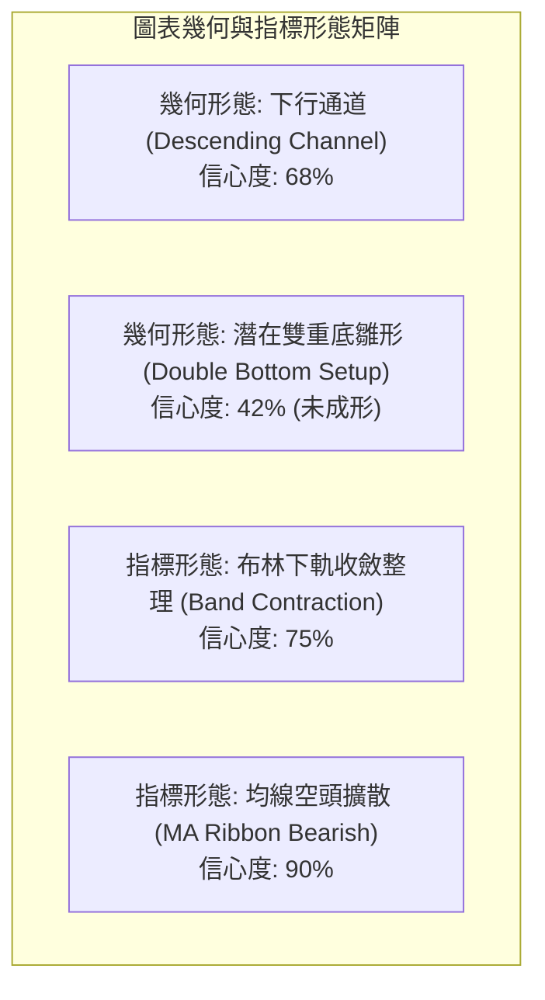

#### 形態識別與信心度評估表

| 識別形態名稱 | 信心度 (%) | 判定數據與事實依據 | 形態完成度 | 目標價計算式與推算結果 |
|:---|:---:|:---|:---:|:---|
| **下行旗型 / 通道** | **68%** | 價格沿 R1($7.98) 與 S1($6.22) 下傾通道下移；反彈高點由 $9.24 降至 $7.64 | 85% | 跌破通道下軌則尋求 52W 低點 S3($4.95)；突破上軌則看 R1($7.98) |
| **雙底反轉 (W底雛形)** | **42%** | 前低 2026-10-18 週收盤 $6.04，本週收盤 $6.27 守於 S1($6.22) 上方 | 25% (未突破頸線) | *數據不足以確認完成*。頸線為 MA20($6.90)，若突破：目標 = $6.90 + ($6.90 - $6.04) = **$7.76** (貼近 MA60 $7.70) |
| **布林帶低檔鈍化** | **75%** | 當前收盤 $6.27 位於下軌 $5.74 與中軌 $6.90 間，%B 僅 0.23 | 90% | 均值回歸目標指向中軌 MA20 = **$6.90** |
| **均線全面空頭擴散** | **90%** | MA5($6.16) < MA10($6.39) < MA20($6.90) < MA50($7.54) < MA200($9.28) | 100% | 空頭排列壓制，下行無支撐時向 S3(**$4.95**) 尋求支撐 |

*註：依分析準則，雙底形態目前完成度僅 25%，信心度低於 50%，不可作為主進場依據，僅能視為極短線潛在超跌反抽之幾何觀察。*

### 🕯️ 重要K線形態分析（近5個月）

| 週期/月份 | 收盤價 | 關鍵 K 線結構 | 技術解讀與籌碼意涵 | 多空訊號 |
|:---:|:---:|:---|:---|:---:|
| **2026-06** | $8.24 | 長陰大浪線 (Long Black Candle) | 自高點巨量出脫，直接擊穿 MA20 與 MA50，確立頂部確立 | 🔴 極空 |
| **2026-07** | $7.49 | 紡錘線 (Spindle Line) | 連續重挫後跌勢放緩，下影線觸碰 $6.53 獲得短線支撐 | 🟡 震盪 |
| **2026-08** | $7.66 | 長上影流星線 (Shooting Star) | 週線反彈一度摸高至 $9.24，但遭空方主力無情壓回，解套賣壓沉重 | 🔴 空方勝 |
| **2026-09** | $7.33 | 窄幅陰十字星 (Doji) | 成交量急劇萎縮，多空於 $7.30 附近陷入拉鋸膠著 | 🟡 觀望 |
| **2026-10** | $6.27 | 下行探底小陽線 (Inverted Hammer Attempt) | 最低探至 $6.04 後微幅拉回至 $6.27，顯示 S1($6.22) 具初步被動買盤 | 🟡 止跌測試 |

### 📉 ASCII 走勢形態示意圖

```
ONDS 關鍵圖表形態結構（日線/週線下行通道與S1支撐示意）
  價格 ($)
   9.24 ┼───● (2026-08 反彈頂點)
        │    ╲
   8.58 ┼─────╲─────────────── [阻力 R2: $8.58]
        │      ╲   ● (09-27 高點 $7.64)
   7.98 ┼───────╲───╲───────── [通道上軌阻力 R1: $7.98]
        │         ╲   ╲   ● (10-04 高點 $7.24)
   6.90 ┼──────────╲───╲───╲──── [布林中軌反壓 MA20: $6.90]
        │           ╲   ╲   ╲
   6.27 ┼────────────╲───╲───★◄── 現價: $6.27 (貼近 S1)
   6.22 ┼─────────────╲───╲───── [波段低點支撐 S1: $6.22]
   5.93 ┼──────────────╲───●──── [布林帶下限外強支撐 S2: $5.93]
        │               ╲ (10-18 低點 $6.04)
   4.95 ┼────────────────┴────── [52週歷史低點 S3: $4.95]
        └────────────────────────────────────────────► 時間
```

### 🎯 形態目標價計算

1. **下行通道測幅目標（空頭延續情境）**：
   * 通道上軌近期反壓錨定 R1 = **$7.98**
   * 通道當前下緣測試點為波段低點聚類 S1 = **$6.22**
   * 若有效跌破 S1，根據下行垂直高度推算：$6.22 - ($7.98 - $6.22) = $4.46；但受制於 52W 低點 S3 具備重大支撐壁壘，實質空頭極限目標直接修正為 **$4.95 (S3)**。
2. **均值回歸反抽目標（技術性反彈情境）**：
   * 基礎回抽位鎖定布林中軌與 MA20 交會處：**$6.90**
   * 擴展目標位鎖定斐波那契 78.6% 回調位 **$7.16** 與下降通道上軌 **$7.98 (R1)**。

---

## 4. 支撐與阻力

### 🗺️ 關鍵價位分布圖（Unicode）

```
╔══════════════════════════════════════════════════════════════════╗
║                    ONDS 價位結構分布圖 (由 OHLCV 精確計算)        ║
╠══════════════════════════════════════════════════════════════════╣
║ $9.92 ║██████████████████████████████║ 強結構阻力 R3 (+58.29%)  ║
║ $8.58 ║████████████████████          ║ 波段聚類阻力 R2 (+36.84%)║
║ $7.98 ║████████████████████████      ║ 關鍵下降反壓 R1 (+27.27%)║
║ $7.16 ║------------------------------║ 斐波那契 78.6% 回調線     ║
║ $6.90 ║..............................║ 布林中軌 / MA20 短期多空水線║
╠═══════╬══════════════════════════════╬══════════════════════════╣
║ $6.27 ╠══════════════════════════════╣ ◄── 現價位置 ($6.27)     ║
╠═══════╬══════════════════════════════╬══════════════════════════╣
║ $6.22 ║▓▓▓▓▓▓▓▓▓▓▓▓▓▓▓▓▓▓▓▓          ║ 關鍵近端支撐 S1 (-0.80%) ║
║ $5.93 ║████████████████████████      ║ 結構強支撐 S2 (-5.42%)   ║
║ $4.95 ║██████████████████████████████║ 52W 底線強支撐 S3(-21.05%)║
╚══════════════════════════════════════════════════════════════════╝
```

### 🚧 阻力位分析表

依據歷史 OHLCV 籌碼成交密集度及波段高點聚類計算，所有數值均為客觀數據：

| 阻力級別 | 精確價位 | 距現價空間 | 形成技術原因 | 突破難度評級 | 戰略重要性 |
|:---:|:---:|:---:|:---|:---:|:---|
| **R1** | **$7.98** | +27.27% | 近一年波段高點聚類區，且緊密貼合 2026-07-26 爆量反彈頸線位置 | 🔴 極高 | **短中期空頭防線**：若未能放量站上，整體下行架構無法宣告扭轉。 |
| **R2** | **$8.58** | +36.84% | 2026-08 波段平台整理下沿，套牢籌碼解套峰值區 | 🔴 極高 | **解套壓力牆**：多頭反攻之次級阻力，重演震盪洗盤機率高。 |
| **R3** | **$9.92** | +58.29% | 2026 年初 $10.00 整數關卡下方之多重頂部頸線，逼近 MA200($9.28) | 🔴 實質壁壘 | **牛熊分水嶺**：唯有突破該點位，方能重啟大級別牛市週期。 |

### 🛡️ 支撐位分析表

依據歷史波段低點聚類計算之精確支撐位：

| 支撐級別 | 精確價位 | 距現價空間 | 形成技術原因 | 守住機率評級 | 戰略重要性 |
|:---:|:---:|:---:|:---|:---:|:---|
| **S1** | **$6.22** | -0.80% | 近一年波段低點密集聚類區，當前價格直接測試之第一道防線 | 🟡 55% | **極短線前哨站**：跌破則宣告短期弱勢探底結構重啟。 |
| **S2** | **$5.93** | -5.42% | 波段低點強支撐，緊鄰布林帶下軌($5.74)外緣之價值買盤區 | 🟢 70% | **區間防守核心**：若遭實體陰線擊穿，恐引發技術性停損拋盤。 |
| **S3** | **$4.95** | -21.05% | **52週絕對歷史低點**，斐波那契 100.0% 起漲基準原點 | 🟢 85% | **多頭最後防線**：長線生命線，具極強價值投資與軋空支撐力。 |

### 📐 斐波那契回調位分析

基準區間採集自 52 週完整波動週期：**最低點 $4.95 (100.0%) 至 最高點 $15.28 (0.0%)**，總落差為 $10.33。

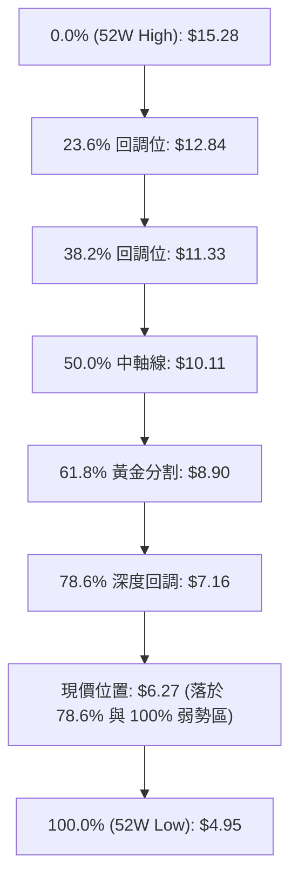

#### 斐波那契回調深度解讀

| 回調比率 | 精確點位 | 當前相對位置 | 技術含義解讀 |
|:---:|:---:|:---:|:---|
| **0.0%** | **$15.28** | +143.70% | 52週歷史最高點，超級多頭推動浪終點。 |
| **23.6%**| **$12.84** | +104.78% | 強勢回調支撐（已被跌破並轉為極遠期阻力）。 |
| **38.2%**| **$11.33** | +80.70% | 多頭防守基準位（失守確認中級波段轉空）。 |
| **50.0%**| **$10.11** | +61.24% | 心理平衡中軸，亦為年初箱型底。 |
| **61.8%**| **$8.90** | +41.95% | **黃金分割關鍵位**，與 MA200($9.28) 形成廣義共振阻力帶。 |
| **78.6%**| **$7.16** | +14.19% | **深度防守臨界點**。現價 $6.27 跌破此位，技術結構被定義為「極度弱勢超跌整理」，若無法儘速收復，極易滑向 100% 原點。 |
| **100.0%**| **$4.95** | -21.05% | 52週低點，全週期起漲原點。 |

---

## 5. 技術指標深度解讀

### 🎛️ 指標訊號總覽

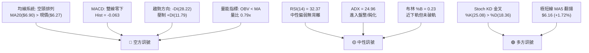

### 📈 移動平均線排列分析

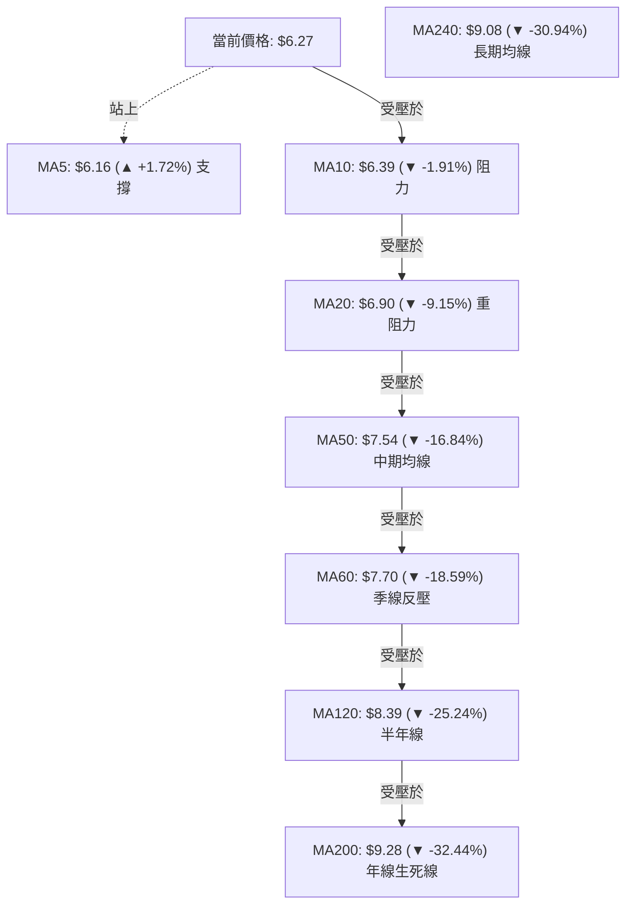

* **均線形態解讀**：典型的「空頭瀑布排列」。除 MA5 出現 +1.72% 的微幅翹頭代表極短線跌深喘息外，MA10、MA20、MA50、MA60、MA120、MA200、MA240 全數維持陡峭下傾斜率。現價距離 MA200 負乖離高達 -32.44%，雖然存在技術性修復乖離的客觀誘因，但在短期均線依次理順前，反彈皆應視為空頭抵抗。

### 📉 RSI(14) 分析

* **RSI(14) 當前讀數**：**32.37**
* **數值區間評估進度條**：
  ```
  超賣 (0)                       中性 (50)                      超買 (100)
  ├───█████████████░░░░░░░░░░░░░░░░░░░░░░░░░░░░░░░░░░░░░░░░░░░░░┤
  0            30(32.37)        50                            100
  ```
* **背離檢驗結論**：
  * **日線級別**：當前 RSI 讀數為 32.37，比對前次低點（2026-10-18 週收盤 $6.04 時 RSI 為 20.1），價格呈現低檔微升（$6.04 → $6.27），RSI 同步自 20.1 回升至 32.37。**並未出現「價格破底而指標未破底」的標準底背離形態**，數據上確認為指標跟隨價格同步回彈的常態反應。
  * **超買超賣狀態**：數值 32.37 貼近 30 邊界，屬於「弱勢但尚未極度鈍化超賣」區間，顯示空頭下殺力道略有減速，但並未具備多方報復性反彈的極端籌碼條件。

### 📊 MACD(12,26,9) 訊號解讀

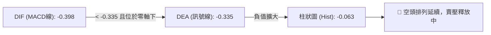

* **指標數值**：DIF = **-0.398**，DEA = **-0.335**，MACD Hist = **-0.063**。
* **訊號解讀**：DIF 運行於 DEA 下方，雙線均深處零軸下方負值區域，MACD 柱狀圖依然為負值擴散（-0.063），顯示中短期動能仍完全被空頭所主導，尚未出現雙線向零軸收斂或形成水下黃金交叉的徵兆。

### 📦 布林通道分析（Bollinger Bands）

```
ONDS 日線布林通道位置示意圖 (BB 20, 2)
 價格 ($)
  8.06 ┼────────────────────────────── BB 上軌 ($8.06)
       │
  7.48 ┼─ ─ ─ ─ ─ ─ ─ ─ ─ ─ ─ ─ ─ ─ ─ ─ 
       │
  6.90 ┼────────────────────────────── BB 中軌 / MA20 ($6.90)
       │
  6.27 ┼──────────────★◄────────────── 當前價格 ($6.27, %B = 0.23)
       │
  5.74 ┼────────────────────────────── BB 下軌 ($5.74)
       └─────────────────────────────
```

* **通道帶寬與位置**：BB 上軌為 $8.06，中軌為 $6.90，下軌為 $5.74，帶寬落差達 $2.32。
* **%B 指標解讀**：當前 %B 讀數為 **0.23**。依照技術定義，%B < 0.5 代表價格位於弱勢半區。目前價格未摜破下軌（未小於 0），顯示跌勢並未演變為「下軌暴跌開口」的失控行情，而是在下軌支撐 $5.74 與中軌反壓 $6.90 之間進行弱勢摩擦。

### 💹 成交量分析（量價配合度）

1. **最新量比檢視**：最新單日成交量為 **43,762,400 股**，相較於 20 日均量 **55,328,610 股**，量比僅為 **0.79x**；相較於 50 日均量 **61,998,326 股** 更是萎縮近 30%。
2. **OBV（能量潮）走勢**：技術監測確認 **OBV < MA**，OBV 指標線持續運行於自身均線之下，呈現量能階梯式滑落。
3. **量價背離判定**：股價自 9 月的 $7.64 陰跌至 $6.27，成交量亦同步降至 43M，呈現「價跌量縮」格局。此格局表明：**此波下跌非恐慌性崩跌，而是買盤極度匱乏所致的「流動性陰跌」**。在此種量能環境下，缺乏主動增量買盤介入，單憑自然換手難以發動突破 R1($7.98) 的大級別反轉。

---

## 6. 動能與波動率

### ⚡ 動能評估四象限

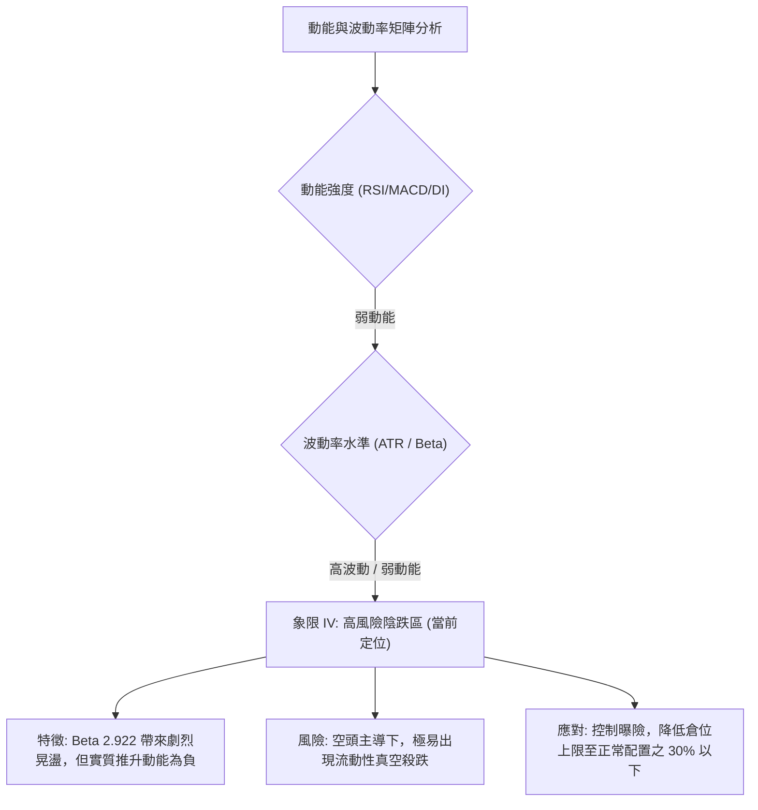

#### 動能與波動率四象限定位表

| 象限 | 動能維度 | 波動維度 | 當前狀態標註 | 策略應對與市場心理評估 |
|:---:|:---:|:---:|:---:|:---|
| **Q1 (最佳擴張)** | 強動能 (+DI優勢) | 低波動 (ATR壓縮) | — | 突破前的最佳買點，趨勢爆發前夕。 |
| **Q2 (震盪防禦)** | 弱動能 (中性鈍化) | 低波動 (區間盤整) | — | 資金觀望，適合區間網格操作。 |
| **Q3 (極限搏殺)** | 強動能 (爆量單邊) | 高波動 (ATR擴大) | — | 強勢主升浪或恐慌主跌浪，高風險高收益。 |
| **Q4 (流動性陷阱)** | **弱動能 (空方佔優)** | **高波動 (Beta=2.92)**| **✓ 當前定位** | **高風險低勝率區間**。市場由空頭籌碼與散戶被動套牢盤交織，股價受大盤波動劇烈放大，極易引發停損踩踏。 |

### 📊 ATR 波動率分析

* **當前 ATR(14)**：**$0.39**
* **波動幅度佔比**：$0.39 / $6.27 = **6.29%**
* **交易風險參數設定依據**：
  * **單日安全洗盤緩衝距**：1.0x ATR = **$0.39**
  * **標準停損邊際距離**：1.5x ATR = **$0.585**
  * **寬鬆波段停損距離**：2.0x ATR = **$0.78**
* **ATR 實戰指導意義**：每日 6.29% 的預期波動空間，代表任何進場策略若將停損設定在 2% 以內，將極易被日內隨機噪音掃出場。所有合規策略之停損點必須至少拉開至 $0.40 ~ $0.60 之外，方能避免假突破雜訊。

### 📐 Beta 與市場相關性

* **Beta 係數**：**2.922**
* **空頭部位佔流通股比 (Short % Float)**：**39.5%**
* **空頭回補天數 (Short Ratio)**：**3.64 天**
* **結構性解讀**：
  1. **市場槓桿效應**：Beta 達 2.922，代表標的對標普500或那斯達克指數具備近 3 倍的波動敏感度。當大盤下挫 1%，ONDS 技術面平均下殺近 3%；反之，大盤反彈時其彈幅亦大。
  2. **潛在「軋空」催化劑**：高達 39.5% 的流通股被放空，Short Ratio 為 3.64 天。此籌碼特徵說明當前技術面雖處空頭，但**一旦技術面出現突破 R1($7.98) 的異常放量巨陽，極易引發空頭踩踏式停損買盤（Short Squeeze）**。此為做空者必須時刻提防的最大尾部風險。

---

## 7. 多時框架總結

### 📋 時框架評分表

| 時框架 | 趨勢方向 | 動能狀態 | 均線系統 | 幾何形態 | 綜合評分 | 策略導向 |
|:---|:---:|:---:|:---:|:---:|:---:|:---|
| **月線級別 (長期)** | 🔴 回調推動 | 弱勢下傾 | 失守中長均線 | $13.22 頂部構築崩塌 | **30/100** | 長期投資宜觀望，靜待估值與籌碼沉澱 |
| **週線級別 (中期)** | 🔴 空頭下行 | MACD柱擴散 | 跌破 MA60($7.70) | 下降通道延伸 | **35/100** | 逢反彈至關鍵阻力站在調節/偏空方 |
| **日線級別 (短期)** | 🟡 跌勢趨緩 | RSI 32 低檔回溫 | MA20 空頭壓制 | S1($6.22) 前哨防守 | **45/100** | 區間震盪操作，聚焦布林通道邊界反應 |
| **極短線 (日內/4H)**| 🟢 跌深反抽 | Stoch 低檔金叉 | MA5微幅翹頭 | 測試 $6.04 雙底雛形 | **55/100** | 僅限嚴守紀律之超短線博弈反抽 |

### 🔲 綜合訊號矩陣

```
╔══════════════════════════════════════════════════════════════════╗
║                    多時框架技術訊號一致性檢驗                    ║
╠══════════════════╦══════════════╦══════════════╦═════════════════╣
║ 分析維度         ║ 短期 (日線)  ║ 中期 (週線)  ║ 長期 (月線)     ║
╠══════════════════╬══════════════╬══════════════╬═════════════════╣
║ 趨勢方向 (Trend) ║ 🟡 弱勢盤整  ║ 🔴 空頭推動  ║ 🔴 大級別回調   ║
║ 均線結構 (MAs)   ║ 🔴 空頭排列  ║ 🔴 均線蓋頭  ║ 🟡 接近長期均線 ║
║ 動能指標 (Osc.)  ║ 🟡 接近超賣  ║ 🔴 負向發散  ║ 🔴 動能退潮     ║
║ 成交量能 (Vol.)  ║ 🔴 量能疲弱  ║ 🔴 主力撤出  ║ 🟡 低檔沉澱     ║
╠══════════════════╩══════════════╩══════════════╩═════════════════╣
║ 多時框收斂共振評估：短期出現背離反抽契機，但中長期趨勢完全一致看空 ║
╚══════════════════════════════════════════════════════════════════╝
```

### ⚖️ 多時框收斂結論

* **收斂規則仲裁（嚴格遵守規範）**：
  1. 當前 **ADX(14) 讀數為 24.96**，嚴格界定於 **盤整行情（ADX < 25）** 範疇，顯示日線級別單邊暴跌推動力度鈍化。
  2. 依據收斂優先級規則，盤整行情中應**以日線布林通道上下軌（$5.74 ~ $8.06）作為主要邊界交易區間**。
  3. 但在中長期方向上，-DI(28.22) 顯著高於 +DI(11.79)，且週線及均線系統為徹底的空頭排列，故**日線的反彈訊號絕不可解讀為多頭反轉，僅能視為空頭趨勢內部的「次級折返整理」**。
* **唯一方向性結論**：**偏空震盪／防禦型觀望**。整體交易思維應維持「逢反彈至阻力位建立防禦空單，或在布林下軌/S2強支撐處極低倉位博取短線反抽，嚴禁在中途追價」。

---

## 8. 交易策略建議

### 🗺️ 策略決策流程圖

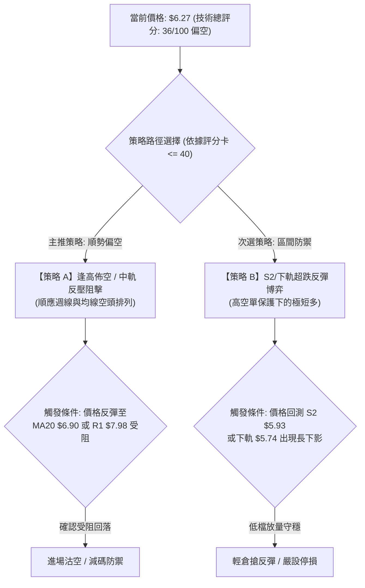

### 🧭 策略路由定調

> **核心定調宣告**：依據第 1 章技術評分卡綜合評分 **36/100（≤ 40 偏空門檻）**，本報告**主推策略為：順勢偏空／高空防禦策略**。多頭策略僅列為超跌區間之輔助防守博弈，絕不進行激進左側滿倉抄底。

### 🎯 價格情境階梯（Price Scenarios）

價位完全嚴格引用第 4 章由 OHLCV 精確計算之關鍵價位：

| 觸發條件 | 下一目標點位 | 後續延伸目標 | 情境實質技術含義 |
|:---|:---:|:---:|:---|
| **向上放量突破 R1 ($7.98)** | R2 ($8.58) | R3 ($9.92) | 短線空頭結構瓦解，觸發 39.5% 放空部位之軋空潮 |
| **反彈受阻於 MA20 ($6.90)** | S1 ($6.22) | S2 ($5.93) | 典型均線反壓受阻，空頭中繼延續 |
| **維持於現價 ($6.27) 震盪** | 布林中軌 ($6.90) | 布林下軌 ($5.74) | 指標低檔鈍化整固，以時間換取空間 |
| **實體陰線擊穿 S1 ($6.22)** | S2 ($5.93) | S3 ($4.95) | 支撐破位，開啟向 52 週歷史原點之尋底行情 |

### 📊 情境機率分佈

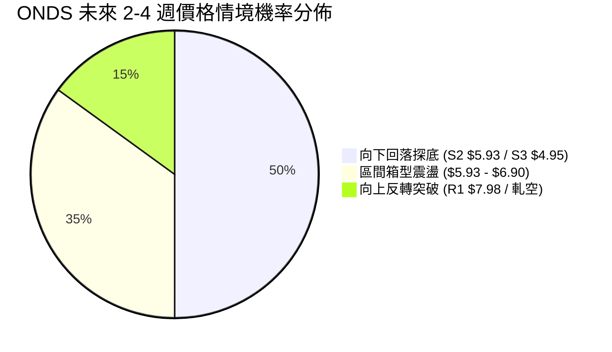

| 未來發展情境 | 評估機率 | 核心客觀依據（引用指標狀態） |
|:---|:---:|:---|
| **向下破位 / 再探低點 (S2/S3)** | **50%** | 均線瀑布空頭排列，MACD 處於零下且柱狀體為負(-0.063)，-DI(28.22) 牢牢掌控盤面。 |
| **低檔區間寬幅震盪 ($5.93~$6.90)**| **35%** | ADX 降至 24.96（進入盤整態勢），RSI(14) 接近超賣（32.37），S1($6.22) 展現初步韌性。 |
| **強勢反彈 / 逼空上行 (挑戰R1)** | **15%** | 僅能在特定重大利多刺激下，引爆 39.5% Short Float 軋空方能實現，目前量能(0.79x)暫不支援。 |

### 🟢 主策略詳情

#### 策略 A（主推：順勢高空 / 反彈逢阻做空） vs 策略 B（輔助：支撐位超跌反彈）

| 策略要素 | 策略 A（主推：順勢高空防禦） | 策略 B（輔助：低檔超跌博弈） |
|:---|:---|:---|
| **戰略意圖** | 順應週線空頭趨勢，於反彈動能衰竭時進場 | 於 S2 強支撐處博弈布林通道均值回歸 |
| **進場條件** | 反彈至 MA20 附近出現日線收長上影線 | 價格回踩 S2($5.93) 且 1小時K線出現底分型 |
| **進場價格** | **$6.90** (布林中軌 / MA20) | **$5.95** (貼近 S2 強支撐 $5.93) |
| **目標價 T1** | **$6.22** (波段低點支撐 S1) | **$6.90** (布林中軌反壓 MA20) |
| **目標價 T2** | **$5.93** (結構強支撐 S2) | **$7.16** (斐波那契 78.6% 回調位) |
| **停損價格** | **$7.30** (突破斐波那契 78.6% $7.16 停損)| **$5.54** (跌破下軌 $5.74 達 1x ATR 停損) |
| **停損距離** | $0.40 (約 5.80% 空間) | $0.41 (約 6.89% 空間) |
| **獲利空間(T2)**| $0.97 (約 14.06% 空間) | $1.21 (約 20.34% 空間) |
| **風險報酬比** | **1 : 2.43** (符合專業風控要求) | **1 : 2.95** (符合專業風控要求) |
| **執行勝率預估** | **65%** | **40%** |
| **建議倉位上限** | 總投資資金之 **15%** | 總投資資金之 **5%** (嚴格試倉) |

### 🔴 反向風險觸發點（對沖提示）

為保護主策略執行，若市場出現下列異常技術行為，必須立即無條件啟動空頭部位避險或平倉離場：
1. **軋空爆發門檻**：若單日成交量突破 1.2 億股（達 20日均量 2 倍以上），且實體長陽線直接**有效收復 R1 ($7.98)**。此時 39.5% 放空部位將引發骨牌效應，空頭必須停損離場，並可反手配置保護性買權（Call Options）。
2. **波動率異動**：若單日價格漲幅超過 2x ATR (即單日上漲超過 $0.78)，顯示高 Beta 軋空能量釋放，任何未脫離成本區之空單應即刻撤出。

### ⭐ 整體訊號強度評星

```
做多訊號強度：★★☆☆☆  (2.0/5星 — 僅屬低檔超跌反抽，無實質反轉結構)
做空訊號強度：★★★★☆  (4.0/5星 — 均線與中長期動能共振看空，勝率佔優)
整體可信度：  ★★★☆☆  (3.5/5星 — 受制於高空頭部位，需嚴防逼空雜訊)
```

---

## 9. 風險提示與監控

### ✅ 關鍵監控指標 Checklist

```
╔══════════════════════════════════════════════════════════════════╗
║                     ONDS 每日盤面風控監控清單                    ║
╠══════════════════════════════════════════════════════════════════╣
║ [ ] 價位破位警報：收盤價是否實體跌破 S1 ($6.22)？              ║
║ [ ] 通道極限警報：盤中是否刺穿布林下軌 ($5.74) 誘發恐慌盤？    ║
║ [ ] 均線動態反壓：每日檢視 MA20 ($6.90) 下移斜率是否平緩？      ║
║ [ ] 異常放量監控：日成交量是否突發性 > 65M 股 (出現主力異動)？ ║
║ [ ] 動能翻轉確認：MACD 柱狀圖是否由 -0.063 翻正跨越零軸？       ║
║ [ ] 軋空異動指標：借券賣出比例與 Short Ratio 是否顯著下降？     ║
╚══════════════════════════════════════════════════════════════════╝
```

### ⚠️ 風險場景分析

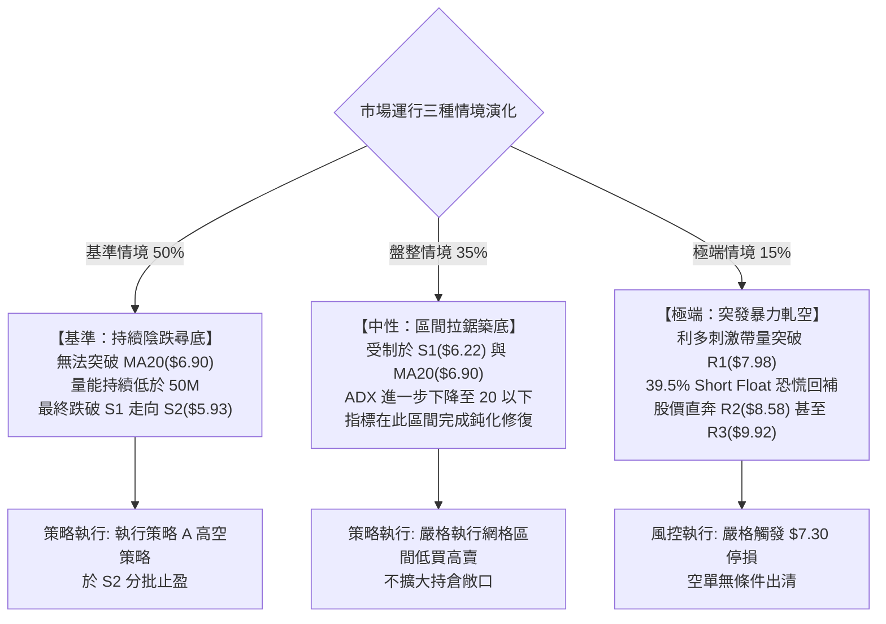

### 🛡️ 風險管理重要提醒

1. **極端放空比率風險（Short Squeeze Alert）**：
   * ONDS 當前 Short % Float 高達 **39.5%**。在美股小型通訊/國防科技板塊中，此等比例屬於極易引發流動性逼空的火藥桶環境。分析師評級共識雖為 `strong_buy` 且平均目標價高達 **$18.88**，與現價形成巨大割裂。技術派交易員切不可因技術指標看空而進行無止盡的裸空操作，**所有空頭倉位必須設置硬性止損點（建議置於 $7.30）**。
2. **高 Beta 波動磨損風險**：
   * 標的 Beta 為 **2.922**，每日 ATR 達 **$0.39 (6.29%)**。在高槓桿衍生品（如期權）操作中，時間價值磨損與隱含波動率驟降（IV Crush）極易吞噬本金。現貨交易者應將個股總風險曝險金額嚴格控制在總投資組合淨值的 **2% 以內**。
3. **營運現金流與基本面拖累**：
   * 雖然營收成長達 1235.4%，但營業利益率為 -166.3%，自由現金流為負數（$-69.11M）。基本面的流動性失血持續對技術面反彈形成估值天花板，在財務數據實質改善前，任何非放量反彈均應以技術性修復視之。

---

## 10. 報告總結

```
╔══════════════════════════════════════════════════════════════════╗
║                     ONDS 技術分析報告總結                        ║
╠══════════════════════════════════════════════════════════════════╣
║ 報告日期：2026-10-22                                             ║
║ 當前價格：$6.27                                                  ║
║ 分析評級：⚖️ 偏空震盪 / 防禦性觀望 (技術評分: 36/100)            ║
╠══════════════════════════════════════════════════════════════════╣
║ 關鍵結論研判：                                                   ║
║ ├─ 長期趨勢 (月線)：🔴 自 $13.22 頂部崩塌，處於大級別下行回調浪  ║
║ ├─ 中期趨勢 (週線)：🔴 空頭排列壓制，反彈高點階梯式下滑          ║
║ ├─ 短期趨勢 (日線)：🟡 ADX 降至 24.96，單邊推動轉為弱勢震盪整固 ║
║ ├─ 極近支撐防線：S1: $6.22 ｜ 結構強支撐 S2: $5.93               ║
║ ├─ 上方核心阻力：MA20: $6.90 ｜ 關鍵下行反壓 R1: $7.98           ║
║ └─ 籌碼特殊因子：Short Float 達 39.5%，具備隨時暴力軋空之潛在能量║
╠══════════════════════════════════════════════════════════════════╣
║ 最優交易策略矩陣：                                               ║
║ 1. 🥇 最佳主策略 (順勢高空)：                                     ║
║    反彈至 MA20 ($6.90) 建立防守空單，停損 $7.30，目標看 $5.93   ║
║ 2. 🥈 次選策略 (區間博弈)：                                     ║
║    回測 S2 ($5.93) 不破輕倉試多，停損 $5.54，目標看 $6.90        ║
║ 3. 🥉 保守觀望選擇：                                             ║
║    靜待價格放量突破 R1 ($7.98) 或回踩 S3 ($4.95) 方進行右側跟進 ║
╚══════════════════════════════════════════════════════════════════╝
```

---

> ⚠️ **免責聲明**：本報告由資深技術分析模型基於客觀市場歷史交易數據（OHLCV）自動運算產出，所有關鍵點位、形態識別與動能評估均依據既定技術分析理論體系編撰。本報告**僅供學術研究、量化模型驗證與專業交易者風控參考**，**完全不構成任何要約、招攬或具體投資買賣建議**。金融市場瞬息萬變，高 Beta 與高空頭比例標的具備極端尾部風險，投資人應獨立評估財務狀況並自負盈虧。

---
*報告生成時間：2026-10-22 ｜ 數據來源：Yahoo Finance ｜ 分析框架：多時框技術分析架構*